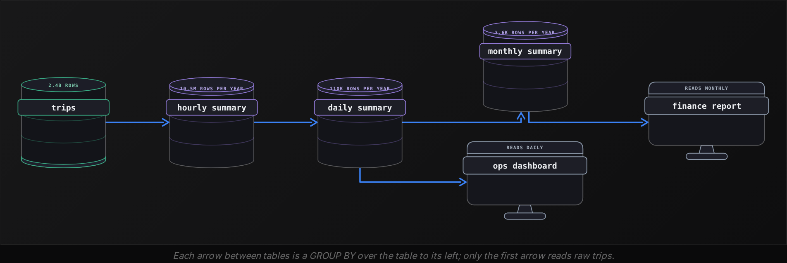
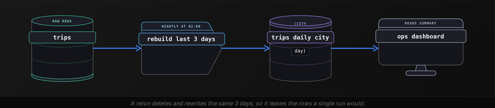

Intermediate·Data Modeling · 23 min · 12 challenges

# Pre-Aggregation

At Uber, one operations team opens its Monday dashboard: trips and fares for the 300 cities it covers, over the last 90 days. Pointed at the raw trips table, the page spins for 40 seconds while the whole team waits. Pointed at a nightly summary table, it reads 27,000 rows and loads before the coffee cools. Pre-aggregation decides which morning they get.


<br>

---

## Why Pre-Aggregate?

### One dashboard, 2.4 billion rows

Take a simplified model of that team's data at Uber. Every completed trip is 1 row in `trips`: trip_id, rider_id, driver_id, country, city, vehicle_type, started_at, fare, distance_km. After 6 years the table holds 2.4 billion rows, about 900GB on disk. The dashboard charts trips and fare per city per day for the last 90 days, and this is the query behind it.

```sql
SELECT
  city,
  DATE_TRUNC('day', started_at) AS trip_date,
  COUNT(*) AS trip_count,
  SUM(fare) AS fare_total
FROM trips
WHERE started_at >= DATE '2026-07-25'
GROUP BY city, DATE_TRUNC('day', started_at)
```

The engine reads every row from the last 90 days, about 100 million of them, groups them into 300 cities by 90 days, and returns 27,000 rows. On a shared cluster that takes 40 seconds. Each morning 40 analysts open the dashboard, each tab re-runs the query, and every filter click (one city, one week) re-runs it again with a narrower WHERE clause. The same 100 million rows are read hundreds of times a day to produce the same 27,000 numbers.


<br>

### Compute once, read many

Pre-aggregation moves that GROUP BY out of the dashboard and into a scheduled job. The job runs once a night, writes its result to a summary table, and every dashboard query reads the summary instead of the raw table.

```sql
CREATE TABLE trips_daily_city AS
SELECT
  city,
  date_trunc('day', started_at) AS trip_date,
  count(*) AS trip_count,
  sum(fare) AS fare_total
FROM trips
GROUP BY
  city,
  date_trunc('day', started_at)
```

| city | trip_date | trip_count | fare_total |
| --- | --- | --- | --- |
| Austin | 2026-10-21 | 18,412 | 341,207.50 |
| Austin | 2026-10-22 | 19,006 | 352,118.25 |
| Berlin | 2026-10-21 | 42,880 | 619,330.00 |
| Berlin | 2026-10-22 | 41,215 | 598,004.75 |

One row now means: every trip that started in one city on one day. The table holds 657,000 rows (300 cities by 2,190 days), the dashboard query becomes a filter over it, and the 2.4 billion raw rows are never touched after the nightly job finishes. A filter for Berlin in the last week reads 7 rows and returns in under a second.

```sql
SELECT
  city,
  trip_date,
  trip_count,
  fare_total
FROM trips_daily_city
WHERE trip_date >= DATE '2026-07-25'
```

- **3,650x** — fewer rows per dashboard query
- **30MB** — summary table on disk


<br>

### What you give up

> The summary answers only its own question
>
> - Filtering by driver or rider is impossible: those columns were grouped away and no query can bring them back.
> - Hourly trends are gone: a row holds a whole day, and a day cannot be split back into hours.
> - Numbers lag the raw table by up to one job cycle, so a trip at 11pm shows up tomorrow.
> - Someone owns the job: when it fails, the newest day goes missing and nothing raises an error.

If next month's questions group by a column this month's never used, the summary cannot answer them, and the job has to be changed and rerun.

> **TIP**
>
> Before building a summary, list the 5 queries the dashboard runs most and write down the GROUP BY columns of each. The summary's grouping columns are the union of those lists, and nothing else.


<br>

---

## Metric Types and Additivity

### Roll up: a summary of a summary

The nightly table holds one row per city per day. A monthly report wants one row per city per month, and the cheapest way to produce it reads the daily table rather than the raw trips. Combining finer rows into coarser rows is a roll up, and whether the result is right depends on the metric. Suppose the nightly job also stored distinct_riders and avg_fare for each day.

| city | trip_date | trip_count | fare_total | distinct_riders | avg_fare |
| --- | --- | --- | --- | --- | --- |
| Austin | 2026-10-20 | 10,000 | 150,000.00 | 5,200 | 15.00 |
| Austin | 2026-10-21 | 18,412 | 341,207.50 | 9,800 | 18.53 |
| Austin | 2026-10-22 | 19,006 | 352,118.25 | 10,100 | 18.53 |

Summing trip_count across the 3 days gives 47,418, and summing fare_total gives 843,325.75. Both are correct, because each trip belongs to exactly one day and its fare is counted exactly once. A metric with that property is additive: the roll up is a SUM over the finer rows, along any column you like.

Now sum distinct_riders: 25,100. The true 3-day figure is lower, perhaps 19,600, because a rider who took a trip on the 20th and again on the 22nd appears in both daily counts and once in the combined count. Nothing in the daily table can recover the overlap. The avg_fare column fails differently. Summing it gives 52.06, which means nothing, and averaging the 3 averages gives 17.35, which is wrong: the quiet 20th gets the same weight as the busy 21st. The true 3-day average is 843,325.75 divided by 47,418, which is 17.79.


<br>

### 3 kinds of metric

| Examples | Kind | How it rolls up |
| --- | --- | --- |
| trip_count, fare_total, distance_km | Additive | SUM across any column: city, day, vehicle type |
| drivers_online, account_balance | Semi-additive | SUM across cities or accounts; last value or average across time |
| distinct_riders, avg_fare, p95_wait | Non-additive | Cannot be rolled up from the stored number; store its ingredients instead |

Semi-additive metrics measure a level at an instant rather than a flow over a period. drivers_online at 9am in Austin plus drivers_online at 9am in Berlin is a real number, the drivers online across both cities. drivers_online at 9am plus drivers_online at 10am counts the same drivers twice. Rolling a snapshot across time means choosing one instant (the last reading of the month) or averaging the readings, and the column name must say which, so a reader of `drivers_online_month_end` knows what the number is.


<br>

### Store the parts, never the answer

Non-additive metrics become additive when the summary stores their ingredients. A ratio is a numerator over a denominator, and both are sums. Store fare_total and trip_count, leave avg_fare out, and divide at read time: the monthly average is sum(fare_total) / sum(trip_count), which is the weighted 17.79 for the 3 days above.

```sql
SELECT
  city,
  DATE_TRUNC('month', trip_date) AS trip_month,
  SUM(trip_count) AS trip_count,
  SUM(fare_total) AS fare_total,
  SUM(fare_total) / SUM(trip_count) AS avg_fare
FROM trips_daily_city
GROUP BY city, DATE_TRUNC('month', trip_date)
```

Distinct counts have no exact ingredient smaller than the full list of ids, but they have an approximate one. A sketch is a small, fixed-size summary of a set of ids. Two sketches can be merged, and the merged sketch estimates the distinct count of the union, within about 2 percent, at a few kilobytes per row. The nightly job stores a sketch of rider ids per row, and every roll up merges them.

```sql
SELECT
  city,
  DATE_TRUNC('day', started_at) AS trip_date,
  APPROX_SET(rider_id) AS riders_sketch
FROM trips
GROUP BY city, DATE_TRUNC('day', started_at)
```

```sql
SELECT
  city,
  DATE_TRUNC('month', trip_date) AS trip_month,
  CARDINALITY(MERGE(riders_sketch)) AS distinct_riders
FROM trips_daily_city
GROUP BY city, DATE_TRUNC('month', trip_date)
```

*Percentiles have the same shape: the p95 of 30 daily p95 values is not the monthly p95. Store a quantile digest, a sketch of the value distribution that merges the same way, or keep the finer rows and compute the percentile from them.*


<br>

---

## OLAP Cubes & Rollups

### Many groupings, one table

OLAP, online analytical processing, is the name for queries that slice a measure by one grouping column after another: trips by city, then by vehicle type, then by city and vehicle type together, then the company total. Each slice is a GROUP BY with a different column list, and a summary that holds only (city, day) rows cannot serve the vehicle type view. A column used for grouping like this is called a dimension, and a cube is a summary that holds every combination of its dimensions in one table.

Take 2 dimensions, city and vehicle_type. There are 4 combinations: both, city only, vehicle_type only, and neither, which is the grand total. You could build them with 4 separate queries, or with 1 query using CUBE.

```sql
SELECT
  city,
  vehicle_type,
  COUNT(*) AS trip_count,
  SUM(fare) AS fare_total,
  GROUPING(city, vehicle_type) AS grouping_id
FROM trips
WHERE started_at >= DATE '2026-10-22'
  AND started_at < DATE '2026-10-23'
GROUP BY CUBE(city, vehicle_type)
```

| city | vehicle_type | trip_count | fare_total | grouping_id |
| --- | --- | --- | --- | --- |
| Austin | sedan | 14,200 | 263,000.00 | 0 |
| Austin | xl | 4,806 | 89,118.25 | 0 |
| Austin | NULL | 19,006 | 352,118.25 | 1 |
| NULL | sedan | 820,300 | 14,765,400.00 | 2 |
| NULL | xl | 281,100 | 5,246,400.00 | 2 |
| NULL | NULL | 1,101,400 | 20,011,800.00 | 3 |

NULL in a dimension column means 'all values', and grouping_id records which columns were collapsed: bit value 1 for vehicle_type, bit value 2 for city. The id column matters because a real city value can be missing too, and a trip with an unknown city would otherwise look like the all-cities row. A dashboard reading the cube filters on grouping_id to pick a view: `grouping_id = 1` gives one total per city, `grouping_id = 3` gives the single company row, and the Austin row with id 1 holds 19,006 trips, the sum of its 2 rows with id 0.


<br>

### Rollups for hierarchies, grouping sets for choice

Dimensions multiply. A cube over d dimensions holds 2 to the power d groupings: 3 dimensions give 8, 6 give 64, 10 give 1,024, and most of them answer questions nobody asks. Grouping by vehicle_type and hour without city, for a dashboard with no hourly view, produces rows nobody reads and a longer job every night.

ROLLUP covers a hierarchy. `ROLLUP (country, city)` produces (country, city), (country) and (), and skips (city) alone, since a city belongs to one country and the (country, city) rows already hold its total. GROUPING SETS lists the exact combinations you want and nothing else. The `trips` table has a country column, so the 3 dimensions country, city and vehicle_type can be trimmed to 5 groupings.

```sql
SELECT
  country,
  city,
  vehicle_type,
  COUNT(*) AS trip_count,
  SUM(fare) AS fare_total
FROM trips
GROUP BY GROUPING SETS ((country, city, vehicle_type), (country, city), (country, vehicle_type), (country), ())
```

| Clause over (country, city, vehicle_type) | Groupings | Rows per day with 20 countries, 300 cities, 4 types |
| --- | --- | --- |
| CUBE | 8 | 3,105 |
| ROLLUP | 4 | 1,521 |
| GROUPING SETS above | 5 | 1,601 |

The cube's 8 groupings include (city, vehicle_type), which repeats (country, city, vehicle_type) row for row, because every city sits inside exactly one country. The grouping sets drop that repeat and keep (country, vehicle_type), which the rollup would never produce. Per day the row counts are all small; across 6 years, the cube stores 1,500 redundant rows a day that someone has to document and keep correct.

> Reading a cube
>
> - Filter on the grouping id, or on which dimension columns are NULL, before summing anything; rows with different ids overlap.
> - A non-additive measure is computed from raw rows or merged sketches inside each grouping, never derived from a finer grouping in the same table.


<br>

---

## Granularity Design

### What one row means

The granularity of a summary is the meaning of one row: the set of columns that make a row unique and the time bucket it covers. `trips_daily_city` has the granularity (city, day). Every design decision about a summary is a decision about granularity, because the granularity fixes both the questions the table can answer and its size.

| Granularity | Rows per day | Rows per year | Answers | Cannot answer |
| --- | --- | --- | --- | --- |
| (day) | 1 | 365 | company-wide daily trend | anything by city |
| (city, day) | 300 | 109,500 | city trends and rankings | hourly peaks, vehicle mix |
| (city, vehicle_type, hour) | 28,800 | 10.5M | peak hours per city and type | anything about one rider |
| (rider_id, day) | 1.1M | 400M | per-rider daily activity | nothing a raw query cannot do as cheaply |

The last row fails. A high-cardinality column in the granularity gives the summary about as many rows as the raw table, since most riders take 1 trip a day, and a summary the size of its source saves nothing. For 300 cities the third row fits best: it answers every hourly peak question and still sits about 38 times below the raw table, 28,800 rows a day against 1.1 million trips.


<br>

### Finest grain first, coarser grains from it

Pick the finest granularity any current consumer needs, then derive each coarser table from the one below it rather than from raw. Per night, the hourly table reads about 1.1 million raw trips, the daily table reads 28,800 hourly rows, and the monthly table rebuilds the current month from at most 9,300 daily rows. Each step is a SUM for additive metrics and a merge for sketches; a metric that cannot be rolled up has to be recomputed from raw at every level, and the chain breaks.




<br>

### Columns that belong in the granularity

- A column belongs when a dashboard filters or groups by it: city, vehicle_type, hour.
- Leave out a column that gives about 1 raw row per summary row: rider_id makes 1.1M rows a day from 1.1M trips.
- A column with 2,000 values, such as restaurant, can stay if each summary row still covers dozens of raw rows.
- The time bucket is the finest size anyone charts: hour for ops, day for most teams, never minute for a dashboard.
- A derived flag such as is_airport_trip has 2 values, doubles the rows at most, and often replaces a second summary.


<br>

---

## Refresh Strategies for Aggregates

### 3 ways to keep a summary current

A summary is a cache of a GROUP BY, and like any cache it goes stale the moment new rows land in the raw table. The refresh strategy decides how much work each update costs and how far behind the raw table the summary may fall.

| Strategy | Raw rows read per run | Cost over the years | Rows that arrive late |
| --- | --- | --- | --- |
| Full rebuild | all 2.4B | grows with the raw table | always included |
| Incremental append | 1 day, about 1.1M | flat | missed once their day is written |
| Trailing window rebuild | last 3 days, about 3.3M | flat | included if under 3 days late |

#### Full rebuild

Drop the summary and run the CREATE TABLE AS from the first section again. The result is correct by construction, since every raw row is read every time, and the job is 1 statement. Cost is the problem: the run reads 2.4 billion rows tonight and 2.8 billion next year, and a nightly job that already takes 3 hours has no room to grow.

#### Incremental append

Aggregate only the rows that arrived since the last run and insert them. For a daily summary that means one day of trips, about 1.1 million rows, at a cost that stays flat for years.

```sql
INSERT INTO trips_daily_city
SELECT
  city,
  date_trunc('day', started_at) AS trip_date,
  count(*) AS trip_count,
  sum(fare) AS fare_total
FROM trips
WHERE started_at >= date '2026-10-22'
  AND started_at < date '2026-10-23'
GROUP BY
  city,
  date_trunc('day', started_at)
```

Incremental append breaks on 2 kinds of row. A trip that started at 23:58 on the 22nd but reached `trips` at 02:10 on the 23rd, after the job ran, belongs to a day that is already summarized, and tomorrow's run filters it out by date, so it is never counted. A job rerun by hand after a failure inserts the 22nd a second time, and the dashboard shows Austin at 38,012 trips instead of 19,006.

#### Trailing window rebuild

Delete the last N days from the summary, recompute them from raw, and insert. With N = 3 the job reads 3 days of trips, a trip arriving up to 3 days late lands in its proper day on the next run, and running the job twice produces the same table as running it once, because the delete removes whatever the first run wrote.

```sql
DELETE FROM trips_daily_city
WHERE trip_date >= date '2026-10-20'
```

```sql
INSERT INTO trips_daily_city
SELECT
  city,
  date_trunc('day', started_at) AS trip_date,
  count(*) AS trip_count,
  sum(fare) AS fare_total
FROM trips
WHERE started_at >= date '2026-10-20'
  AND started_at < date '2026-10-23'
GROUP BY
  city,
  date_trunc('day', started_at)
```

Pick N from the data by measuring how late trips actually arrive. If 99.9 percent land within 6 hours and the rest within 2 days, N = 3 covers them, and N = 30 reads 10 times the rows for no gain. A trip later than N days needs a backfill: the same 2 statements with an older date, which is why the job takes its start date as a parameter.




<br>

### Trust the numbers after the job

A refresh that fails without a signal is worse than no refresh, because nobody notices the missing or half-counted day. Most failures show up in 2 checks. First, the summary's trip_count for the latest day must equal a count(\*) on the raw table for the same day exactly, at the cost of one scan of 1.1 million rows, and any difference pages the owner. Second, compare the day against the same weekday last week, where a gap above 20 percent pages the owner before anyone reads the number.


<br>

---

## Putting It All Together

A food delivery company serves 2,000 restaurants across 50 cities, and its restaurant partners open a performance dashboard every morning: orders, revenue, distinct customers and median delivery time per restaurant per day for the last 30 days, with a city-level view for the account managers.

- The raw orders table holds 800 million rows, so each dashboard open re-reads 30 days of it; a nightly summary at (restaurant, day) cuts each query to 30 rows, and the city view rolls those rows up to (city, day).
- orders and revenue are additive and roll up by SUM; distinct customers is stored as a sketch and merged; median delivery time is stored as a quantile digest, because the median of daily medians is wrong.
- A GROUPING SETS clause over (city, restaurant) and (city) gives the account managers their city totals in the same table, with grouping_id telling the 2 kinds of row apart.
- Granularity stays at (restaurant, day): customer_id would push the summary to the size of the raw table, and hour is left out because no partner charts hourly orders.
- The job rebuilds the last 3 days each night, so an order confirmed 2 days late lands in its proper day, and a rerun after a failure leaves no duplicate rows.


<br>

---

## Key Takeaways

- A summary table stores the result of a GROUP BY once so that dashboards read thousands of rows instead of billions.
- Additive metrics roll up with SUM; ratios need their numerator and denominator stored; distinct counts need a mergeable sketch.
- CUBE produces every combination of dimensions, ROLLUP follows a hierarchy, and GROUPING SETS names the combinations you want.
- Granularity is what one row means: the finest grain any consumer needs, without high-cardinality columns, with coarser tables derived from it.
- A trailing window rebuild keeps cost flat, absorbs late rows, and leaves the same table whether the job runs once or twice.
