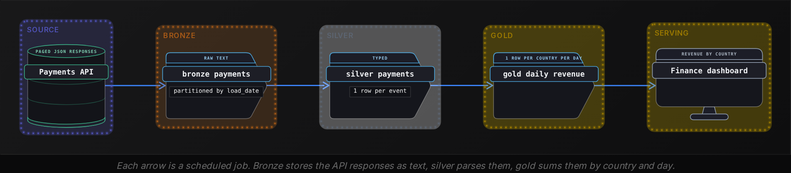
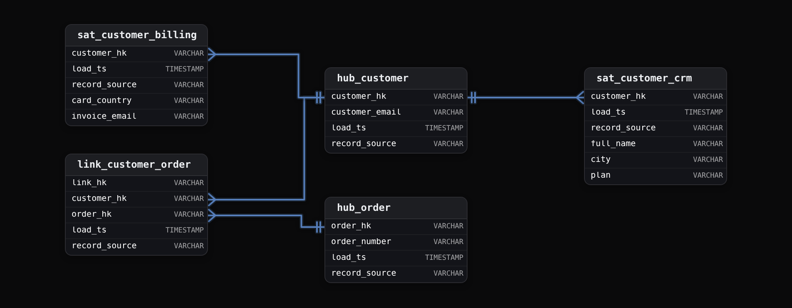
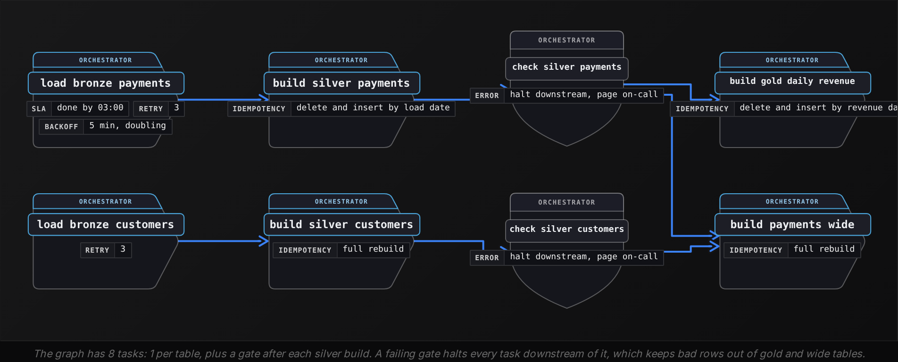

Intermediate·Data Modeling · 21 min · 12 challenges

# Design Patterns

Say 2 teams at Netflix bring weekly hours watched to the same leadership meeting, and their numbers are 3 percent apart. One team counted raw play events. The other read a cleaned table that drops trailers and autoplay previews. Both computed what they meant to. The disagreement ends when both teams read one cleaned silver table and one metric definition says whether trailers count.


<br>

---

## Medallion Architecture

### 3 copies of the same data

A pipeline that reads a source system and writes a report in a single step has nowhere to stand when a rule changes. Suppose the report counted refunds as revenue for 6 months. Fixing it means pulling the source again, and a payments API may keep only 30 days of events, so the older months are gone for good. A layered design keeps 3 copies of the data, each with a stated promise about what it holds and who may change it.

| Layer | One row means | Promise | Who reads it |
| --- | --- | --- | --- |
| Bronze | one record exactly as the source delivered it | append only, never edited, never deleted | pipeline engineers replaying history |
| Silver | one cleaned record per real-world event or entity | typed columns, duplicates removed, bad rows quarantined | analysts and downstream builds |
| Gold | one answer per business question | shaped for a named consumer, arithmetic done once | dashboards and executives |

The names describe how far the data has travelled from the source. Bronze is evidence. Whatever arrived stays there even if it's malformed, so it can be read again next year. Silver is the version you would hand to an analyst. Gold is built for one audience, with the arithmetic done so 20 dashboards don't each redo it.



#### What a bronze row holds

A bronze table adds columns about the delivery rather than the business. _ingested_at records when the row landed, _source_file records which file or API page it came from, and payload is the record as a single string. Nothing is parsed yet, because parsing is where mistakes happen, and bronze exists so mistakes can be undone.

| load_date | _ingested_at | _source_file | payload |
| --- | --- | --- | --- |
| 2026-10-20 | 2026-10-20 01:31:04 | page_0017.json | {"id":"ev_91","customer":"c_204","amount_cents":"4999","country":"fr","paid_at":"2026-10-20T00:58:11Z"} |
| 2026-10-20 | 2026-10-20 01:31:04 | page_0017.json | {"id":"ev_92","customer":"c_777","amount_cents":"1299","country":"DE","paid_at":"2026-10-20T01:02:40Z"} |
| 2026-10-20 | 2026-10-20 01:33:52 | page_0017.json | {"id":"ev_91","customer":"c_204","amount_cents":"4999","country":"fr","paid_at":"2026-10-20T00:58:11Z"} |

Row 1 and row 3 are the same event, delivered twice because the API retried a page. The country arrives as fr on one row and DE on another, and the amount is a string. All 3 problems are left in place. The silver build is where they get fixed, and it reads bronze every time it runs:

```sql
INSERT INTO silver_payments
SELECT
  event_id,
  customer_id,
  amount_cents,
  country,
  paid_at
FROM (
  SELECT
    json_extract_scalar(payload, '$.id') AS event_id,
    json_extract_scalar(payload, '$.customer') AS customer_id,
    CAST(json_extract_scalar(payload, '$.amount_cents') AS BIGINT) AS amount_cents,
    upper(json_extract_scalar(payload, '$.country')) AS country,
    from_iso8601_timestamp(json_extract_scalar(payload, '$.paid_at')) AS paid_at,
    row_number() OVER (
      PARTITION BY json_extract_scalar(payload, '$.id')
      ORDER BY _ingested_at DESC
    ) AS rn
  FROM bronze_payments
  WHERE load_date = DATE '2026-10-20'
) AS parsed
WHERE rn = 1
```

The inner query parses each field out of the JSON string, casts the amount to a whole number of cents, upper-cases the country, and numbers each event's copies from newest to oldest. The outer query keeps copy number 1, so ev_91 lands in silver once. If a later audit finds that countries should have been mapped through a lookup table, the fix is a change to this query and a rerun over bronze. The API is never called again.

#### Gold answers one question

Gold tables are shaped by their reader. The finance dashboard asks for revenue by country by day, so that is the table, with one row per country per day and no column it doesn't need:

```sql
INSERT INTO gold_daily_revenue
SELECT
  CAST(paid_at AS DATE) AS revenue_date,
  country,
  SUM(amount_cents) AS revenue_cents,
  COUNT(*) AS payments
FROM silver_payments
WHERE CAST(paid_at AS DATE) = DATE '2026-10-20'
GROUP BY 1, 2
```

A bug in parsing is fixed in silver, and every gold table inherits the fix on its next run. A new question gets a new gold table built from silver, with no new parsing code. A rebuild costs a read of bronze, which sits on your own storage, rather than a request to a source that may say no.

> Where a fix belongs
>
> - Malformed or duplicated source records: the silver build, rerun over bronze.
> - A metric computed with the wrong rule: the gold build, rerun over silver.
> - Rows that should never have existed: bronze keeps them. Silver moves them to a rejects table with a reason column.

> **TIP**
>
> Partition bronze by the date the row was loaded. Dates inside the payload belong to silver, where they have been parsed and trusted. Load date is the one value the pipeline controls, so a rerun for 2026-10-20 reads exactly the files that arrived that day.


<br>

---

## Data Vault

### Hubs, links and satellites

A warehouse with one wide customer table works until a second source arrives. Your company acquires a competitor whose CRM describes customers with 14 attributes, 9 of which yours has never heard of. Widening the table means editing and retesting each job that loads it and each view or report that reads it. Data Vault splits a model into 3 kinds of table so that a new source adds tables and edits none.

The 3 table types

- **Hub** *one row per business key*\
  A business key is the identifier the business already uses: an order number, an email, a product code. The hub stores only that key, the first time it was seen, and the source that supplied it.
- **Link** *one row per relationship between hubs*\
  Customer c_204 placed order 51833: that fact is a link row. A link carries the hash keys of the hubs it joins plus load time and source, and no descriptive attributes.
- **Satellite** *one row per change to a hub or link*\
  Names, cities, plans, prices: every descriptive attribute lives in a satellite, stamped with when it loaded and which system said so. Rows are added, never updated.



customer_hk is a hash of the email. Link rows and satellite rows use that fixed-length value to refer to a customer, so the email is never repeated. Each satellite belongs to one source: sat_customer_crm holds what the CRM says about a customer and sat_customer_billing holds what the billing system says, and the 2 are never merged in storage. Here is the CRM satellite for 1 customer after 3 loads:

| customer_hk | load_ts | record_source | full_name | city | plan |
| --- | --- | --- | --- | --- | --- |
| 8f3a... | 2023-11-02 03:00 | crm | Ana Costa | Lisbon | basic |
| 8f3a... | 2024-02-14 03:00 | crm | Ana Costa | Porto | basic |
| 8f3a... | 2024-09-30 03:00 | crm | Ana Costa | Porto | pro |

No row was overwritten when Ana moved or upgraded. Reading her current state means taking the newest row per customer:

```sql
SELECT
  h.customer_email,
  s.city,
  s.plan
FROM hub_customer AS h
JOIN (
  SELECT
    customer_hk,
    city,
    plan,
    ROW_NUMBER() OVER (
      PARTITION BY customer_hk
      ORDER BY load_ts DESC
    ) AS rn
  FROM sat_customer_crm
) AS s
  ON s.customer_hk = h.customer_hk
WHERE s.rn = 1
```

Add WHERE load_ts <= TIMESTAMP '2024-03-01 00:00:00' to the inner query and the Porto, basic row becomes the newest. That is what the warehouse knew on 2024-03-01, because load_ts records when a change loaded. When Ana actually moved is the source's effective date, which belongs in the satellite as its own column. Every row also names the system that asserted it, so an auditor gets a source and a timestamp.

✓Data Vault

- New source: add a satellite, touch nothing else
- History: every load kept, as-of queries by load_ts
- Audit: record_source on every row
- Queries: 3 to 6 joins to assemble one customer

✗One wide customer table

- New source: alter the table and edit everything that loads or reads it
- History: last value wins
- Audit: who said the city is Porto is unknown
- Queries: 1 table, written in a minute

The last row of that comparison is the price. Dashboards are rarely pointed at a vault directly. The vault is the storage behind the silver layer, and flatter tables are built from it for analysts. Before those, decide how a vault absorbs the acquisition.


<br>

---

## One Big Table (OBT)

### Every attribute beside the number it describes

An analyst wants October revenue by customer region and product category. In a model that keeps orders and their lines apart from customers and products, that query joins 4 tables, and each of 30 dashboard authors writes those joins again. Some join orders to lines and sum the order total, counting a 3-line order 3 times. One Big Table runs those joins once in the pipeline and stores the result, so the analyst's query has none.

order_lines (silver)

| order_line_id | order_id | product_id | qty | amount_cents |
| --- | --- | --- | --- | --- |
| L1 | O100 | P7 | 2 | 3998 |
| L2 | O100 | P9 | 1 | 1299 |
| L3 | O101 | P7 | 1 | 1999 |

order_lines_wide

| order_line_id | order_id | customer_region | category | product_name | amount_cents |
| --- | --- | --- | --- | --- | --- |
| L1 | O100 | EMEA | Audio | Headphones | 3998 |
| L2 | O100 | EMEA | Cables | USB-C cable | 1299 |
| L3 | O101 | APAC | Audio | Headphones | 1999 |

The row meaning is unchanged: one row per order line. What changed is that each line now carries customer_region and category alongside product_name, copied from their source tables at build time. Both rows for order O100 say EMEA, and that repetition is the point: the analyst reads 1 table.

```sql
CREATE TABLE order_lines_wide AS
SELECT
  ol.order_line_id,
  ol.order_id,
  o.ordered_at,
  o.shipping_fee_cents,
  o.payment_status,
  c.customer_email,
  c.region AS customer_region,
  p.product_name,
  p.category,
  ol.qty,
  ol.amount_cents
FROM order_lines ol
JOIN orders o
  ON o.order_id = ol.order_id
JOIN customers c
  ON c.customer_id = o.customer_id
JOIN products p
  ON p.product_id = ol.product_id
```

```sql
SELECT
  customer_region,
  category,
  SUM(amount_cents) AS revenue_cents
FROM order_lines_wide
WHERE ordered_at >= TIMESTAMP '2026-10-01 00:00:00'
GROUP BY 1, 2
```

The second query reads 1 table, so it cannot miss a join condition, and any chart tool can generate its GROUP BY. Storage grows, because the region string is stored once per line rather than once per customer, and that trade is usually worth making for the handful of tables analysts touch most.

#### An order-level column on an order-line table

Shipping is charged once per order. Copied onto order lines, it appears once per line:

| order_line_id | order_id | shipping_fee_cents | amount_cents |
| --- | --- | --- | --- |
| L1 | O100 | 500 | 3998 |
| L2 | O100 | 500 | 1299 |
| L3 | O101 | 700 | 1999 |

SUM(shipping_fee_cents) over these 3 rows gives 1700, and the true total is 1200. SUM(DISTINCT shipping_fee_cents) happens to return 1200 here, which makes it worse: if order O102 also charges 500, the true total becomes 1700 while DISTINCT still returns 1200 with no sign of error. The fix is orders_wide, one row per order with the fee on it. A column whose row meaning differs from its table's belongs in a different table.

#### Which moment is the region from?

Say a customer moved from Lisbon, in EMEA, to Singapore, in APAC, in March 2026. Their January orders in order_lines_wide show EMEA if the table stores the region at order time, and APAC if it's rebuilt nightly from the current customer record. Both are valid, and they answer different questions: where the customer lived when they ordered, versus where the customer lives now. Pick one per column and write it in the column description. If both are needed, store them as 2 columns named region_at_order and region_current.

✓Do

- Name the table after its row meaning: order_lines_wide, orders_wide, sessions_wide.
- Build it from silver so parsing and deduplication happen once, upstream.
- Document for each copied column which moment in time it reflects.

✗Don't

- Put an order-level amount on an order-line table and hope nobody sums it.
- Hand-maintain a wide table; rebuild it from upstream on every run.
- Build one wide table per dashboard; build one per row meaning.


<br>

---

## Semantic Layers

### The metric written once

At one company, 3 teams each publish active customers for the trailing month:

| Dashboard | Rule used | Count |
| --- | --- | --- |
| Marketing | any order in the trailing 30 days | 41,200 |
| Finance | paid order in the trailing 30 days, refunds excluded | 38,950 |
| Product | any session in the trailing 28 days | 97,300 |

All 3 numbers are correct for their rule, and the business has no way to say which one is the company's. The rules live inside 3 tools, written as SQL by 3 people, and a fourth tool will add a fourth rule. A semantic layer moves the metric definitions out of the tools and into one place that every tool queries.

```sql
metrics:
  - name: active_customers
    description: Customers with at least 1 paid order in the trailing 30 days
    table: order_lines_wide
    expression: COUNT(DISTINCT customer_email)
    filter: CAST(ordered_at AS DATE) >= date_add('day', -30, current_date) AND payment_status = 'paid' AND amount_cents > 0
    allowed_breakdowns: [customer_region, category]
  - name: revenue
    table: order_lines_wide
    expression: SUM(amount_cents) / 100.0
    allowed_breakdowns: [customer_region, category, ordered_at.day]
  - name: conversion_rate
    type: ratio
    table: daily_funnel
    numerator: SUM(orders)
    denominator: SUM(sessions)
    allowed_breakdowns: [customer_region, funnel_date.week]
```

A definition names the metric, the table it reads, the expression that computes it, the filter that scopes it, and the breakdowns a user may group by. When the finance tool asks for active_customers by customer_region, the layer writes the SQL:

```sql
SELECT
  customer_region,
  COUNT(DISTINCT customer_email) AS active_customers
FROM order_lines_wide
WHERE CAST(ordered_at AS DATE) >= DATE_ADD('day', - 30, CURRENT_DATE)
  AND payment_status = 'paid'
  AND amount_cents > 0
GROUP BY 1
```

The marketing tool asking the same question gets the same SQL and the same 38,950. Changing the rule to 28 days is an edit to 1 line of the definition, and every tool follows on its next query. Nobody searches 40 dashboards for the string 30.

#### Ratios are summed before they are divided

Conversion rate is orders divided by sessions. Store a daily rate and average it, and the answer is wrong whenever days differ in size:

| Day | Sessions | Orders | Daily rate |
| --- | --- | --- | --- |
| Monday | 50 | 5 | 10.0% |
| Tuesday | 100 | 30 | 30.0% |
| Average of the 2 rates |  |  | 20.0% |
| Combined, 35 / 150 | 150 | 35 | 23.3% |

The 2 answers differ by more than 3 points on 2 days of data. The definition therefore declares conversion_rate as a ratio of 2 sums, and the layer adds up the numerator and the denominator across whatever grouping the user asked for before it divides:

```sql
SELECT
  customer_region,
  CAST(SUM(orders) AS DOUBLE) / SUM(sessions) AS conversion_rate
FROM daily_funnel
GROUP BY 1
```

> What each layer owns
>
> - Gold and wide tables own the rows: cleaned, joined, at a stated row meaning.
> - The semantic layer owns the arithmetic: which rows a named number filters to, and how its columns are summed and divided.
> - Tools own presentation: charts, colours, drill paths. A tool never owns a definition.


<br>

---

## Pipeline DAG Design

### Tasks, edges and no cycles

Every table in the previous sections is written by a task, and every task reads tables written by other tasks. A pipeline DAG is that set of tasks with an arrow from each writer to each reader. Directed means the arrows have a direction. Acyclic means following them never returns to the start, so some task can always run first. An orchestrator walks the graph and starts a task when every task pointing into it has finished.



#### Depend on completion, never on the clock

A common first design runs the bronze load at 01:30 and the silver build at 02:00, because bronze usually takes 20 minutes. Here is the night it takes 50:

| Time | What happens |
| --- | --- |
| 01:30 | load_bronze_payments starts, 40 pages to fetch |
| 01:41 | API returns rate-limit errors, the loader backs off and retries |
| 02:00 | build_silver_payments starts on schedule and reads 23 of 40 pages |
| 02:20 | load_bronze_payments finishes; silver already wrote the day |
| 06:00 | Finance dashboard shows 58% of the day's revenue, no alert fired |

The silver build never failed, so nobody was paged. The fix is an edge in the orchestrator from the bronze task to the silver task: silver starts when bronze reports success, at 01:50 on a fast night and 02:20 on this one. A clock schedule belongs on the first task in the graph, and every other task waits for its inputs.

#### Rerunning a task must give the same table

Tasks get rerun: a fix lands, a source resends a day, an engineer presses retry. A task that appends rows produces 2 copies of the day on its second run. A task that first removes what it wrote for that day, then writes, produces the same table however many times it runs:

```sql
DELETE FROM gold_daily_revenue
WHERE revenue_date = DATE '2026-10-20'
```

Run the DELETE and the INSERT in one transaction, or as one overwrite of the date's partition, and the pair always leaves exactly 1 copy of 2026-10-20; a run that fails halfway leaves the old copy in place. The date is the task's parameter, handed in by the orchestrator, so a 90-day backfill runs as 90 copies of the task, in parallel where the graph allows.

#### A gate between layers

A quality gate is a task that reads a table and fails when a condition breaks, with every downstream task waiting on it:

```sql
SELECT
  COUNT(*) AS silver_rows,
  COUNT(DISTINCT event_id) AS distinct_events,
  SUM(
    CASE
      WHEN event_type = 'payment'
        AND amount_cents <= 0 THEN 1
      ELSE 0
    END
  ) AS non_positive
FROM silver_payments
WHERE CAST(paid_at AS DATE) = DATE '2026-10-20'
```

If silver_rows differs from distinct_events, deduplication failed. If non_positive is above 0, a refund was classified as a payment. Either way the gate fails, the gold build never starts, and the dashboard shows yesterday's number with a staleness flag instead of today's wrong one.

- One task writes one table, so a failure names the table that is missing.
- Edges follow data: if task B reads what task A writes, B depends on A.
- Gates sit between layers and block; a gate that only warns is a log line.
- Retries belong on tasks that call external systems; a SQL bug fails 3 times the same way.


<br>

---

## Putting It All Together

A music streaming company launches a paid tier in Brazil. On day 1 the CFO wants weekly Brazilian revenue, paying listener counts and free-to-paid conversion, and the numbers must survive a restatement when the payment processor corrects a batch of currency conversions 2 weeks later.

- The processor's corrected batch lands in bronze under its own load date; the silver rerun reads the original 2 weeks' partitions together with that load date and keeps the newest _ingested_at per event, so the corrections replace the originals and gold inherits the fix with no call back to the processor.
- Listener identity lives in a hub whose business key is account email, with one satellite per source, so the Brazilian payment processor's attributes arrive as a new satellite and no existing loader changes.
- Analysts read subscriptions_wide, which has one row per subscription day with country and plan on it. The processor fee sits in a separate payments_wide so nobody sums it per day.
- Conversion is defined once in the semantic layer as paid starts over free trials, summed per week before dividing, so the CFO's chart and the growth team's tool show the same percentage.
- The gold build waits on the silver gate rather than on 02:00, each task takes a date, and the 2-week restatement runs as 14 reruns that each delete and rewrite their day.


<br>

---

## Key Takeaways

- Bronze keeps every record as delivered, silver fixes it once, gold answers one question; a bug is fixed in the layer that introduced it and rerun downstream.
- Data Vault keeps identity in hubs and relationships in links. Attributes go in satellites, so a new source adds a satellite and overwrites nothing.
- One Big Table runs the joins in the pipeline and stores the result at one stated row meaning; a column with a different row meaning belongs in a different wide table.
- A semantic layer defines each metric once, as an expression with a filter and a list of allowed breakdowns. It generates the SQL every tool runs, including ratios summed before dividing.
- A pipeline DAG runs a task when its inputs are complete, reruns each task for a date without doubling, and blocks at a gate between layers.
