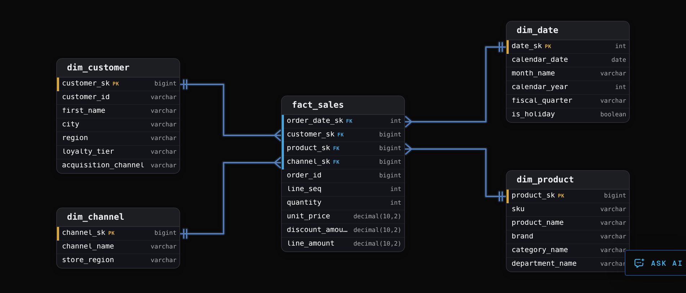

Intermediate·Data Modeling · 30 min · 12 challenges

# Star Schemas

Ridgeline Outfitters sells hiking gear through a website and 14 stores. Every Monday finance asks for last week's revenue by product category and region. Against the operational database the query joins 12 tables and runs for 9 minutes. The warehouse answers it from 840 million rows in under 2 seconds, with 3 joins. The difference is the shape of the tables, and that shape has a name.


<br>

---

## The Star Schema

A star schema places 1 fact table at the centre and a ring of dimension tables around it. At Ridgeline Outfitters the centre is `fact_sales`, and its grain is 1 row per order line item: 1 product on 1 order, sold to 1 customer on 1 date through 1 channel. Each row carries 4 foreign keys, 2 identifiers and 4 measures: `quantity`, `unit_price`, `discount_amount` and `line_amount`. Everything descriptive about the customer, the product, the date and the channel lives in the dimension the key points to.

The 2 kinds of table have opposite shapes. `fact_sales` is tall and narrow: 840 million rows over 3 years and 10 columns, every column a key or a numeric measure. `dim_customer` is short and wide: 4.2 million rows and 31 columns, among them `city`, `region`, `loyalty_tier` and `acquisition_channel`. `dim_product` holds 38,000 rows, `dim_channel` 16, and `dim_date` 36,525, 1 per calendar day for 100 years. Facts hold the numbers and dimensions hold the words.




<br>

### Why the shape is fast to query

Every analytical query walks the same path: start at the fact table, filter and group through the dimensions, aggregate the measures. Units sold by brand and month during 2025 reads the 2025 partitions of `fact_sales`, joins `dim_product` for `brand` and `dim_date` for `month_name`, and sums `quantity`. The warehouse returns 1,100 rows in 1.8 seconds.

```sql
SELECT
  p.brand,
  d.month_name,
  SUM(f.quantity) AS units
FROM fact_sales AS f
JOIN dim_product AS p
  ON p.product_sk = f.product_sk
JOIN dim_date AS d
  ON d.date_sk = f.order_date_sk
WHERE d.calendar_year = 2025
GROUP BY p.brand, d.month_name
```

- Columnar storage: the engine reads the 3 columns the query names out of 10, and never touches the other 7.
- Partition pruning: fact_sales is partitioned by order date, so a 2025 filter skips 2 of the 3 years on disk.
- Broadcast joins: a 38,000-row dimension is copied to every worker and probed in memory during the fact scan.
- Predicate pushdown: a filter on brand becomes a list of product keys applied to fact rows as they are read.

The broadcast join is the mechanism worth holding onto. Joining 840 million fact rows to 38,000 product rows costs about as much as scanning the fact table once, because every worker probes its own in-memory copy of the dimension. Ridgeline's operational schema answers the same question through 11 joins across normalized product, brand, supplier, category and department tables, each resolved before a row can be summed, and runs for 9 minutes.


<br>

### Star against snowflake

A snowflake schema keeps dimensions normalized: `dim_product` carries a `category_id` pointing to `dim_category`, which carries a `department_id` pointing to `dim_department`. A star copies `category_name` and `department_name` onto every product row, storing 'Footwear' 6,400 times instead of once for about 50 KB. The snowflake makes any department filter 2 joins deeper, and every analyst has to remember which of 3 tables holds the category name.

Snowflaking earns its place in 2 situations: a fact table that lives at a hierarchy level, such as marketing spend per category, which needs a category table to own `category_sk`; and a dimension where a repeated 2 KB description column would dominate storage. A 38,000-row product table with a 12-character category name is neither.


<br>

---

## Types of Fact Tables

Ridgeline runs 3 business processes against the same dimensions. Sales asks what happened. Inventory asks what the level was on a given day. Fulfilment asks how long each stage of an order took. Each question maps to a type of fact table, and a table built for 1 answers the others slowly or not at all.


<br>

### Transaction facts

A transaction fact holds 1 row per discrete event, written once and never updated. `fact_sales` is 1. A return is a new row with a negative `quantity` rather than an update, so the table stays append-only and reloading any day's partition reproduces the same rows. The measures are fully additive: `quantity` and `line_amount` sum across customers, products, days and channels, and the total always means something.

| order_id | line_seq | product_sk | quantity | line_amount |
| --- | --- | --- | --- | --- |
| 50218 | 1 | 41077 | 1 | 299.99 |
| 50218 | 2 | 41530 | 1 | 109.99 |
| 50218 | 3 | 43902 | 1 | 79.99 |
| 50219 | 1 | 61204 | 1 | 44.99 |
| 50231 | 1 | 41077 | -1 | -299.99 |

The last row returns the tent from order 50218 as its own event. What a transaction fact cannot answer is a question about state. `fact_inventory_movements` records every receipt, shipment and adjustment as a row with a signed `quantity_delta`, so units on hand for a product on 3 March is the sum of every movement since the warehouse opened, and a dashboard of 60 days of stock levels replays 3 years of movements 60 times.


<br>

### Periodic snapshot facts

A periodic snapshot holds 1 row per entity per period, capturing the state at the close of the period. `fact_inventory_daily` has the grain of 1 row per product per warehouse per day: 38,000 products across 6 warehouses produce 228,000 rows every night, whether or not anything moved. The 3 March question becomes 1 lookup. Rows are never updated; the next night writes a new set.

- **83.2M** — snapshot rows written per year

The measure `units_on_hand` is semi-additive: it sums across some dimensions and not others. Adding the 6 warehouses for a product on 1 day gives company-wide stock that day, a number a buyer can act on. Adding the same product across 30 days describes nothing, because each day's row already includes the units carried over from the day before.

| sku | warehouse | snapshot_date | units_on_hand |
| --- | --- | --- | --- |
| RL-4471 | Denver | 2026-03-01 | 131 |
| RL-4471 | Denver | 2026-03-02 | 125 |
| RL-4471 | Denver | 2026-03-03 | 128 |
| RL-4471 | Reno | 2026-03-03 | 84 |

Summing the 2 warehouses on 3 March gives 212 units, a real figure. Summing the 3 Denver rows gives 384, which counts a unit that sat on the shelf all 3 days 3 times. Across time the valid aggregates are the last day's value, the period average or the minimum, and the metric's written definition fixes which one applies.


<br>

### Accumulating snapshot facts

An accumulating snapshot holds 1 row per instance of a process with a defined start and end. `fact_order_fulfilment` has 1 row per order, created at placement and updated as each milestone arrives. Each milestone is a date key, NULL until it happens, and the row carries the `carrier_sk` that shipped the order. Lag columns such as `days_to_deliver`, counted from placement, are computed in the load, so a lifecycle report never redoes date arithmetic across 325 million orders. This is the 1 fact type whose rows change after they are written, so its load is a merge rather than an append.

| order_id | placed_date_sk | shipped_date_sk | delivered_date_sk | days_to_deliver |
| --- | --- | --- | --- | --- |
| 50218 | 20260902 | 20260903 | 20260906 | 4 |
| 50219 | 20260902 | 20260904 | NULL | NULL |
| 50231 | 20260904 | NULL | NULL | NULL |


<br>

### Factless facts

A factless fact table has keys and no measures. `fact_promotion_coverage` holds 1 row per product per promotion per day on promotion, and the row itself is the fact. `COUNT(*)` is the metric. It answers questions about what did not happen: promoted products that sold nothing, found by left-joining coverage to `fact_sales` and keeping the rows with no match.

| Type | One row per | Rows updated | Measures | Answers |
| --- | --- | --- | --- | --- |
| Transaction | 1 event, such as a line item sold | never | additive | what happened |
| Periodic snapshot | 1 entity per period | never | semi-additive | the level on a date |
| Accumulating snapshot | 1 process instance | at each milestone | durations between milestones | how long each stage took |
| Factless | 1 coverage or relationship | never | none, COUNT(\*) | what did and did not happen |

The 4 types are complementary. Ridgeline's sales, inventory and fulfilment facts share the same dimensions, and a question goes to the table whose grain matches its shape.


<br>

---

## Types of Dimensions

A `fact_sales` row says `customer_sk = 8827414`, `quantity = 2`, `line_amount = 189.98`. `dim_customer` turns the key into Priya Natarajan in Denver, Gold tier, acquired through a referral in 2023. Every `WHERE` clause and every `GROUP BY` an analyst writes lands on a dimension column, so the set of dimensions and their attributes decides which questions the warehouse answers without a rebuild.


<br>

### Conformed dimensions

A conformed dimension is 1 physical table shared by several fact tables, with 1 set of keys and 1 definition per attribute. `dim_customer` is referenced by `fact_sales`, `fact_returns` and `fact_support_tickets`, so a cross-process question, such as customers who bought the Cascade 65 pack and opened a ticket within 30 days, is a join through the shared key. Before Ridgeline conformed it, support derived `region` from the ticket's time zone and sales from the shipping address, and the 2 regional dashboards disagreed by 11 percent.

> What conformance requires
>
> - One physical table, loaded by 1 pipeline, referenced by every fact that needs the entity
> - One written definition per attribute: region means the region of the shipping address
> - One key space, so every process's facts point at the same customer_sk for the same customer
> - A definition change reaches every consumer at once, and is announced as one


<br>

### Role-playing dimensions

A role-playing dimension is 1 physical table referenced more than once by the same fact, each reference in a different role. `fact_order_fulfilment` carries `placed_date_sk`, `shipped_date_sk` and `delivered_date_sk`, all pointing at `dim_date`. The table is loaded once; the query aliases it once per role, and the alias is the only thing that differs between orders by placed month and orders by delivered month.

```sql
SELECT
  d_placed.month_name AS placed_month,
  d_deliv.month_name AS delivered_month,
  COUNT(*) AS orders
FROM fact_order_fulfilment AS f
JOIN dim_date AS d_placed
  ON d_placed.date_sk = f.placed_date_sk
JOIN dim_date AS d_deliv
  ON d_deliv.date_sk = f.delivered_date_sk
WHERE d_placed.calendar_year = 2026
GROUP BY 1, 2
```


<br>

### Junk dimensions

An order carries flags that belong to no customer or product: `is_gift`, `is_expedited`, `gift_wrap` and a `payment_method` with 4 values. Left on the fact they are 4 columns across 840 million rows, and every new flag is an `ALTER TABLE` on the largest table in the warehouse. A junk dimension collects them: `dim_order_flags` holds every combination, 2 x 2 x 2 x 4 = 32 rows, and `fact_sales` carries 1 `order_flags_sk` as a fifth key. A new boolean flag doubles it to 64 rows and leaves the fact untouched.

| order_flags_sk | is_gift | is_expedited | gift_wrap | payment_method |
| --- | --- | --- | --- | --- |
| 1 | false | false | false | card |
| 2 | true | false | true | card |
| 17 | false | true | false | paypal |
| 32 | true | true | true | gift_card |


<br>

### Degenerate dimensions

`order_id` sits on `fact_sales` with no dimension table behind it. A `dim_order` would hold 1 column, the id, and joining 840 million rows to it to fetch a value they already carry gains nothing. An identifier with no attributes of its own stays on the fact as a degenerate dimension, used to group line items back into their orders.


<br>

### The date dimension

`dim_date` has 1 row per calendar day, 36,525 of them, generated once for 100 years. Its columns are everything a report groups or filters by: `day_of_week`, `month_name`, `quarter`, `fiscal_year`, `fiscal_quarter`, `is_weekend`, `is_holiday`. Ridgeline's fiscal year begins on 1 February, so a calendar `EXTRACT(QUARTER ...)` is wrong for every finance report, and `dim_date.fiscal_quarter` holds the answer once. Before the table existed, 4 teams wrote their own fiscal quarter logic and 2 disagreed about which year 31 January belongs to.

Each new attribute forces the question of where it lives, and the answer follows from what it describes and which attributes travel with it.


<br>

---

## Defining the Grain

The grain of a fact table states what 1 row means, and it is decided before any column is added. Ridgeline's `fact_sales` grain reads: 1 row per order line item, unique on (`order_id`, `line_seq`). Naming the columns that enforce the unit is what lets another engineer write a test against it.

| Grain statement | Precision | What goes wrong |
| --- | --- | --- |
| 1 row per sale | vague | a sale could be an order, a line item or a payment |
| 1 row per order | a unit, no key | 3 products per order and 1 product_sk column |
| 1 row per order line item, unique on (order_id, line_seq) | testable | nothing a query cannot check |


<br>

### Two grains, the same 2 orders

Order 50218 holds 3 line items: a tent at 299.99, a sleeping pad at 109.99 and a stove at 79.99. Order 50219 holds 1 headlamp at 44.99.

Order grain

Line item grain

At the order grain, `product_sk` for order 50218 has no honest value: 3 products, 1 cell. Whatever the load writes there, a units-by-product report attributes the whole order to 1 product or drops it. `SUM(line_amount)` is 489.97 at both grains, so revenue agrees with finance and nobody looks further, until merchandising asks for revenue by category and the stove's 79.99 has been reported under tents for months. A wrong grain produces no error message, only numbers that look right.


<br>

### Mixed grain, the quieter failure

The second grain error puts 2 grains in 1 table. The 12.00 shipping fee on order 50218 is charged once per order, and the first place a developer reaches for is a `shipping_fee` column on each line row. Now 3 rows carry 12.00 and `SUM(shipping_fee)` returns 36.00: the query and the column are both correct, and the number is 3 times too large. The fix is to allocate the fee across lines in proportion to `line_amount`, or to store it in a separate fact at the order grain.

```sql
SELECT
  order_id,
  line_seq,
  COUNT(*) AS n
FROM fact_sales
GROUP BY order_id, line_seq
HAVING COUNT(*) > 1
```

A count above 1 means duplicate source rows or a grain statement that does not match the data, so the test runs after every load and fails the pipeline when it returns rows.

The story below makes the grain choice for `fact_sales` under the 2 requests that landed in its first quarter.


<br>

---

## Surrogate Keys

A surrogate key is an integer the warehouse assigns to a dimension row at load time. It means nothing to the business, has no relation to any source system, and never changes. The source's `customer_id` sits beside it as a natural key, kept for traceability and never referenced by a fact table, and `fact_sales` joins to `dim_customer` on `customer_sk` alone.


<br>

### Where natural keys break

Natural keys come from source systems built for their own needs, and Ridgeline's fail in 3 ways. Emails change: 4 percent of customers update theirs each year, and a fact keyed on email loses its history at every update. SKUs get reused: the supplier retired `RL-2208`, a 2-person tent, in 2023 and reissued it for wool socks in 2025, so 2 years of tent sales keyed on SKU now join to socks. And a type 2 dimension, which adds a new row for each change to a tracked attribute instead of overwriting the old one, holds several rows per `customer_id`, which a fact row cannot point at without a date to pick the version.


<br>

### One key per version

Priya Natarajan moved from Portland to Denver on 14 August 2024. The dimension keeps both versions: the Portland row, `customer_sk` 3310562, closed on the move date, and the current Denver row, 8827414. A June 2024 sale references 3310562 and an October 2024 sale references 8827414, so revenue by city puts each sale where Priya lived when she bought, with no date logic in the query.

| customer_sk | customer_id | city | valid_from | valid_to | is_current |
| --- | --- | --- | --- | --- | --- |
| 3310562 | C-77120 | Portland | 2021-04-02 | 2024-08-14 | false |
| 8827414 | C-77120 | Denver | 2024-08-14 | 9999-12-31 | true |

```sql
SELECT c.city, SUM(f.line_amount) AS revenue
FROM fact_sales f
JOIN dim_customer c ON c.customer_sk = f.customer_sk
GROUP BY c.city;

SELECT c.city, SUM(f.line_amount) AS revenue
FROM fact_sales f
JOIN dim_customer c
  ON c.customer_id = f.customer_id
 AND f.sale_date >= c.valid_from
 AND f.sale_date <  c.valid_to
GROUP BY c.city;
```

In the second query the engine hashes on `customer_id`, then checks each fact row against every version of that customer with a residual range filter, which costs more than a single equality probe. It is also fragile: a sale stamped at exactly `valid_to` matches 2 versions or none depending on which boundary convention the dimension and the query assumed. The surrogate key resolved the version once, at load time, and stored the answer in the fact row.


<br>

### Generating the key

The load assigns the key. A `customer_id` the dimension has never seen gets a new row and the next value from a sequence. A change to a tracked attribute closes the current row and inserts a new one with a new key. The alternative to a sequence is a hash, such as the MD5 of `customer_id` and `valid_from`, which produces the same key on every rerun of the same input, so a failed load replays without consulting the previous run. A row with key -1 stands for 'unknown customer', so a fact whose customer has not arrived yet still joins and its amount stays in the totals.

A BIGINT key is 8 bytes and a UUID string is 36, a difference of 28 bytes per row for each foreign key column, and `fact_sales` carries 5 of them. `dim_date` is the conventional exception to meaningless keys: its key is the date written as `20260902`, because the table is never versioned and a readable key makes partition filters legible.

- **23.5 GB** — saved per key column on fact_sales

The payoff of keys the warehouse owns shows up the day a second source system arrives with its own numbering.

✓Do

- Assign surrogate keys in the load, from a sequence or a deterministic hash
- Keep the natural key beside the surrogate key to trace rows to the source
- Give each dimension version its own key so facts join on equality alone
- Carry a -1 'unknown' row so facts with a late dimension still join and count

✗Don't

- Reassign or renumber surrogate keys once facts reference them
- Join facts to dimensions on a natural key the source can change or reuse
- Use UUID strings where an 8-byte integer key will do
- Offset colliding source ids instead of widening the natural key with source_system


<br>

---

## Putting It All Together

Ridgeline's CFO asks for a single fiscal Q3 pack, covering August to October: revenue by category and region, units on hand per warehouse on 31 October, and median days from placement to delivery by carrier for orders placed in the quarter, with the figures reconciling to the source system.

- Revenue by category and region reads fact_sales at the line item grain, joined to dim_product for category and dim_customer for region, and sums line_amount, which is additive at every rollup because the grain was set before the first column.
- Units on hand on 31 October reads 1 day of fact_inventory_daily and sums across warehouses only; the same measure summed across the quarter's 92 days would be a number that describes nothing.
- Median days to deliver by carrier reads fact_order_fulfilment, whose 1 row per order already holds days_to_deliver and carrier_sk, filtered through the placed_date_sk role of dim_date.
- All 3 figures take the quarter from the same dim_date.fiscal_quarter, and the revenue and inventory figures read the same dim_product, so the pack agrees with itself wherever its facts share a dimension.
- Reconciliation to the source system runs through the natural keys stored beside each surrogate key, while the facts themselves joined on surrogate keys that no SKU reuse or email change could disturb.


<br>

---

## Key Takeaways

- A star schema is 1 tall narrow fact table joined on equality to a ring of short wide dimensions, the shape every warehouse optimizer is tuned for.
- Transaction facts record events, periodic snapshots record state per period, accumulating snapshots record 1 lifecycle per row; the question's verb picks the table.
- Dimensions carry the words: conformed across facts, role-played through aliases, junk for flags, degenerate for bare identifiers, and dim_date for every calendar rule.
- The grain is the first decision and the uniqueness test is its proof; a wrong or mixed grain produces numbers that look right.
- Surrogate keys are assigned by the load, never change, and give each dimension version its own key so facts join on equality alone.
