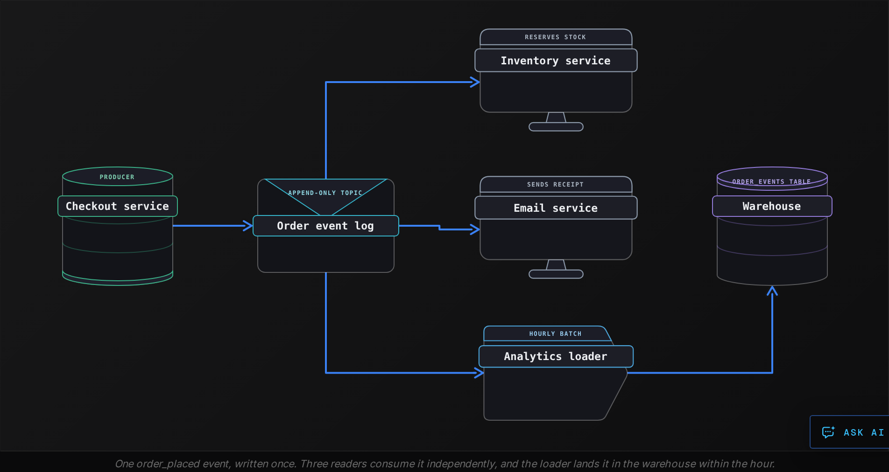
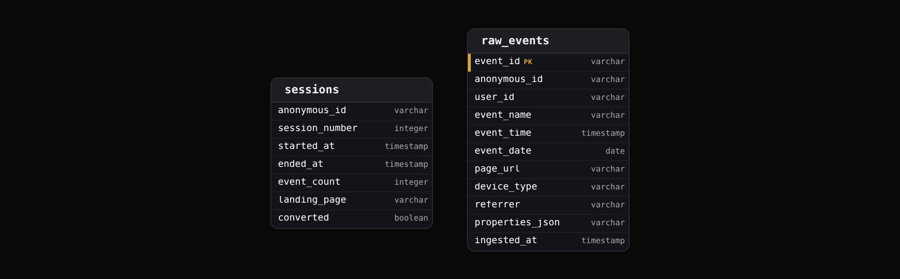

Intermediate·Data Modeling · 27 min · 12 challenges

# Event Streams

An Uber rider taps request at 8:02, a driver accepts at 8:03, the car arrives at 8:09, the trip ends at 8:31, and a tip lands 4 hours later from a phone that was offline in a tunnel. Pricing, driver pay, fraud checks and the receipt all read the same sequence of facts. A trip is a history, and this lesson shows how to model one.


<br>

---

## Event-Driven Architecture

An event is a record that something happened: customer 4471 placed order 8812 at 14:02:17, a thermostat read 21.5 degrees, a driver accepted a trip. The record names the thing, when it happened and what changed, and it never changes afterwards, because the past does not change. A system built on events writes each record to a shared log once, and every other system that cares reads the log at its own pace.


<br>

### Request-driven versus event-driven

In a request-driven design, the checkout service finishes an order by calling the inventory service, then the email service, then the analytics service, and waits for each reply. Adding a fraud check means changing checkout again. When the email service is down, the order either fails or checkout grows a retry branch for that one call. In an event-driven design, checkout writes one `order_placed` event to the log and returns. Inventory, email, analytics and fraud each subscribe to the log and react when they are ready. Checkout holds no list of who reads its events, so a new consumer costs the producer nothing.



✓Request-driven

- Producer calls each consumer and waits for a reply
- Producer code changes when a consumer is added
- A down consumer blocks or fails the request
- History lives in server logs nobody queries

✗Event-driven

- Producer writes one event and returns
- Consumers are added without touching the producer
- A down consumer catches up from its last offset
- The log is a queryable record of everything that happened

*The log sits between producer and consumers, which is why these systems are called decoupled: the 2 sides share a contract about the event, and nothing else.*


<br>

### The shape of an event

Every event carries an envelope, the fields that are the same for every event type, and a payload, the fields specific to this type. The envelope is what routing, deduplication and loading rely on, so it is strict. The payload is what the business reads, so it changes as the business does, and a `schema_version` in the envelope records which shape the payload has.

| Field | Part | Example | Why it is there |
| --- | --- | --- | --- |
| event_id | envelope | evt_01HX4K9Q7M | Dedupe retries, trace one event end to end |
| event_type | envelope | order_placed | Route to the consumers that care |
| event_time | envelope | 2026-10-20T14:02:17Z | When it happened, stamped by the producer |
| entity_id | envelope | order_8812 | Group every event about one thing |
| producer | envelope | checkout-v12 | Trace a malformed event to its source |
| schema_version | envelope | 3 | Read old payloads with the right code |
| payload | payload | items, total, currency | The facts specific to this type |

```sql
{
  "event_id": "evt_01HX4K9Q7M",
  "event_type": "order_placed",
  "event_time": "2026-10-20T14:02:17Z",
  "entity_id": "order_8812",
  "producer": "checkout-v12",
  "schema_version": 3,
  "payload": {
    "customer_id": "cust_4471",
    "items": [
      {
        "sku": "SKU-220",
        "qty": 2,
        "unit_price": 19.99
      }
    ],
    "total": 39.98,
    "currency": "EUR"
  }
}
```

> **TIP**
>
> Name events as facts in the past tense: `order_placed`, `payment_captured`, `trip_completed`. A name like `send_receipt` is an instruction aimed at one consumer, and once it sits in a shared log every other reader has to know to skip it.


<br>

### Querying an event table

Once the loader lands events in the warehouse, the table has one row per event, and most questions become a count grouped by type and time. This query shows what happened in each hour of one day.

```sql
SELECT
  DATE_TRUNC('hour', event_time) AS event_hour,
  event_type,
  COUNT(*) AS events
FROM order_events
WHERE event_time >= TIMESTAMP '2026-10-20 00:00:00'
  AND event_time < TIMESTAMP '2026-10-21 00:00:00'
GROUP BY DATE_TRUNC('hour', event_time), event_type
ORDER BY event_hour, event_type
```


<br>

---

## Immutable Append-Only Logs

A log is a file that only grows. Each write goes to the end, receives the next position number, called an offset, and stays at that offset until the log is trimmed. Nothing in the middle is rewritten, and nothing is deleted one row at a time. This one rule, append only, is what makes a log cheap to write, safe to share between many readers, and possible to replay.

| offset | event_type | entity_id | event_time | payload summary |
| --- | --- | --- | --- | --- |
| 0 | order_placed | order_8812 | Oct 20 14:02:17 | total 39.98 EUR, street Rue Lepic 41 |
| 1 | payment_captured | order_8812 | Oct 20 14:02:19 | 39.98 EUR by card |
| 2 | order_placed | order_8813 | Oct 20 14:02:40 | total 120.00 EUR |
| 3 | address_corrected | order_8812 | Oct 20 14:05:02 | street changed to Rue Lepic 14 |
| 4 | order_shipped | order_8812 | Oct 21 09:41:10 | carrier DPL |
| 5 | order_cancelled | order_8813 | Oct 21 10:15:33 | reason: customer request |

Offset 3 is how a log handles a mistake. The customer typed the wrong street, and in a table someone would run an UPDATE. In a log, the original `order_placed` stays exactly as it was, and a new `address_corrected` event records the fix. Both facts are true: the order was placed with one address, and the address was later corrected. A consumer that printed a label from offset 0 at 14:03 used the wrong street, and the log can show why: the correction arrived 2 minutes after the label.

- **1** — write per event, always at the tail
- **0** — rows updated in place, ever


<br>

### Every reader keeps its own place

The log holds no record of who has read what. Each consumer stores the offset it has reached and asks for everything after it. The email service may sit at offset 5 while the analytics loader, which runs hourly, is at 2. A fraud consumer added next month starts at the oldest offset the log still keeps and reads forward. Under the 7-day retention covered below, that offset is a week old, so last year's orders come from the warehouse copy. When a consumer ships a bug, the fix is to reset its offset to the point before the bug and replay. The log did nothing special to allow this.


<br>

### Reading current state from an append-only table

When the log lands in the warehouse, the table has 2 rows for order 8813 and 4 for order 8812, and a dashboard wants one row per order showing where it stands now. The answer is the latest event per entity. `row_number()` numbers each order's events from newest to oldest, and the row numbered 1 is the current state. Ties on `event_time` are broken by offset, which is the order the log received them.

```sql
WITH ranked AS (
  SELECT
    entity_id,
    event_type,
    event_time,
    ROW_NUMBER() OVER (
      PARTITION BY entity_id
      ORDER BY event_time DESC, log_offset DESC
    ) AS rn
  FROM order_events
)

SELECT
  entity_id,
  event_type AS current_status,
  event_time AS status_since
FROM ranked
WHERE rn = 1
```


<br>

### Retention and compaction

A log that grows forever fills every disk, so logs are trimmed by one of 2 policies. Time-based retention drops everything older than a window, such as 7 days, which suits a log that feeds a warehouse where the full history is copied anyway. Compaction keeps only the latest event for each entity key and drops the older ones, so the log holds current state for every key but loses the path that led there. A compacted log answers 'what is order 8812 now' and cannot answer 'what was it at 14:03'.

*A compacted log deletes a key by appending a tombstone, an event carrying the key and an empty payload. Even deletion is an append.*

✓Do

- Record a correction as a new event that references the one it corrects
- Store the offset with each row when loading a log into a table
- Choose time retention when the warehouse keeps the full history
- Break event_time ties with offset, the true arrival order

✗Don't

- Run UPDATE or DELETE on an event table to fix a value
- Share one offset across consumers, because the slowest stalls the rest
- Compact a log that a replay or an audit will later need
- Trust event_time alone to order events from different producers


<br>

---

## Event Sourcing

Most applications store state and discard how it got there. An `accounts` table says the balance is 240.00, and nobody can say which deposits and withdrawals produced that number. Event sourcing turns the storage inside out: the events are the source of truth, and the balance is a result computed from them, as many times as anyone needs.

| offset | event_type | account_id | amount | event_time | balance after |
| --- | --- | --- | --- | --- | --- |
| 10 | account_opened | acc_77 | 0.00 | 2026-03-01 09:00 | 0.00 |
| 11 | deposited | acc_77 | 100.00 | 2026-03-02 10:15 | 100.00 |
| 12 | deposited | acc_77 | 200.00 | 2026-03-10 16:40 | 300.00 |
| 13 | withdrawn | acc_77 | 60.00 | 2026-03-15 12:05 | 240.00 |

The last column is computed, never stored: start at 0 and apply each event in order, adding on `deposited` and subtracting on `withdrawn`. Any state that can be described as a start value plus a sequence of changes can be rebuilt this way, which covers account balances, inventory levels, order status, and a document's edit history.


<br>

### Rebuilding state with a query

```sql
SELECT
  account_id,
  SUM(
    CASE
      WHEN event_type = 'deposited' THEN amount
      WHEN event_type = 'withdrawn' THEN - amount
      ELSE 0
    END
  ) AS balance
FROM account_events
WHERE event_time <= TIMESTAMP '2026-03-31 23:59:59'
GROUP BY account_id
```

The `WHERE` clause is the part a state-based table cannot offer. Change the timestamp to March 12 and the same query returns 300.00, the balance as it stood that day, with no history table and no archived copy. Audits ask that question constantly. The second gift is repair: if the code that computes balances had a bug that subtracted each withdrawal twice for 3 weeks, the events are still right, because they record what was requested. Fix the code, run the fold again, and every balance is correct without a single hand-written correction.

Dashboards do not run this fold on every page load. A pipeline runs it on a schedule and writes the result to a plain `account_balances` table, called a read model. A read model is derived, so it can be dropped and rebuilt whenever the code or the question changes.


<br>

### Snapshots

Replaying an account's 9 years of events to answer each balance request is slow, and a busy account can hold millions. A snapshot stores the computed state at a known offset. To get the current balance, read the snapshot, then apply only the events after its offset. The snapshot is a cache: delete it and the events rebuild it. Most systems take a snapshot every N events or every night, and keep the latest 1 or 2.

account_snapshots

| account_id | as_of_offset | balance |
| --- | --- | --- |
| acc_77 | 12 | 300.00 |

events after offset 12

| offset | event_type | amount |
| --- | --- | --- |
| 13 | withdrawn | 60.00 |

*Current balance: 300.00 from the snapshot, minus 60.00 from offset 13, with no replay of offsets 10 to 12.*


<br>

### What event sourcing costs

> The bills come due later
>
> - Old events never change shape, so code that reads `deposited` must handle version 1 payloads for as long as those events exist.
> - A read model is rebuilt from the log after the fact, so it lags the log by seconds to minutes, and a screen can show the previous state briefly.
> - Storage grows with activity rather than with the number of accounts: an active account writes thousands of events a year.
> - Deleting a person's data on request means rewriting or encrypting history, which an append-only design resists by construction.


<br>

---

## Clickstream Modeling

A clickstream is the event stream of what people do in a product: pages viewed, buttons tapped, searches run, videos paused. Each row is one person doing one thing at one instant, and a mid-sized app produces hundreds of millions of these a day. Nothing about a tap changes once it has happened, so the raw table is append only, and the questions share one shape: how many people did X, then Y, within one visit.



Two identity columns matter. `anonymous_id` is a random id the app assigns before anyone logs in, and `user_id` is filled once they do. A shopper browses 20 products anonymously, logs in to buy, and the login event, which carries both ids, is the only thing that connects the browsing to the purchase. Drop either column and every funnel breaks at the login step.


<br>

### A tracking plan: few names, many properties

The event name is the vocabulary everyone shares, so it stays small and follows one pattern: object, then past-tense action. What varies goes in properties. `product_viewed` with `product_id` 220 is one event name that covers the whole catalog, while `product_220_viewed` is a new event name per product and a dashboard nobody can maintain. The tracking plan is the table that says which names exist, when each fires, and which properties are required.

| event_name | Fires when | Required properties |
| --- | --- | --- |
| page_viewed | a screen or page renders | page_url, referrer |
| product_viewed | a product detail page renders | product_id, price, category |
| search_performed | the search button is tapped | query, results_count |
| cart_item_added | an item lands in the cart | product_id, quantity, price |
| order_placed | checkout completes | order_id, total, item_count |


<br>

### Sessions: the visit the raw table never records

The app records taps. A visit is derived: a run of events from one `anonymous_id` with no gap of 30 minutes or more between neighbours. `lag()` fetches the previous event's time for the same person, a gap of 30 minutes or a missing previous event flags a new session, and a running sum of those flags numbers each session. The cutoff is a convention, and a video app measuring binge watching might pick 4 hours.

```sql
WITH gaps AS (
  SELECT
    anonymous_id,
    event_time,
    event_name,
    LAG(event_time, 1) OVER (
      PARTITION BY anonymous_id
      ORDER BY event_time
    ) AS prev_time
  FROM raw_events
  WHERE event_date = DATE '2026-10-20'
),
flags AS (
  SELECT
    anonymous_id,
    event_time,
    event_name,
    CASE
      WHEN prev_time IS NULL
        OR DATE_DIFF('minute', prev_time, event_time) >= 30 THEN 1
      ELSE 0
    END AS new_session
  FROM gaps
)

SELECT
  anonymous_id,
  event_time,
  event_name,
  SUM(new_session) OVER (
    PARTITION BY anonymous_id
    ORDER BY event_time
  ) AS session_number
FROM flags
```

| anonymous_id | event_time | event_name | new_session | session_number |
| --- | --- | --- | --- | --- |
| anon_9f2 | 08:14:02 | page_viewed | 1 | 1 |
| anon_9f2 | 08:16:40 | product_viewed | 0 | 1 |
| anon_9f2 | 08:17:05 | cart_item_added | 0 | 1 |
| anon_9f2 | 13:02:11 | page_viewed | 1 | 2 |
| anon_9f2 | 13:03:50 | order_placed | 0 | 2 |


<br>

### Funnels

A funnel asks how many sessions reached each step. Counting events gives the wrong answer, because one session can view 12 products and add 3 to the cart. The query reads `sessionized_events`, the October 20 output of the sessionization query saved as a table, where one `anonymous_id` with one `session_number` is one visit. The inner query collapses each visit to 3 flags, and the outer one counts the sessions with each flag set.

```sql
SELECT
  COUNT(*) AS sessions,
  COUNT_IF(viewed > 0) AS viewed_product,
  COUNT_IF(added > 0) AS added_to_cart,
  COUNT_IF(purchased > 0) AS purchased
FROM (
  SELECT
    anonymous_id,
    session_number,
    COUNT_IF(event_name = 'product_viewed') AS viewed,
    COUNT_IF(event_name = 'cart_item_added') AS added,
    COUNT_IF(event_name = 'order_placed') AS purchased
  FROM sessionized_events
  GROUP BY anonymous_id, session_number
)
```

| sessions | viewed_product | added_to_cart | purchased |
| --- | --- | --- | --- |
| 48,210 | 31,004 | 6,112 | 1,933 |

> **TIP**
>
> Partition the raw table by `event_date` and put `event_date` in every WHERE clause. A day of clickstream is a few hundred million rows and the full table is 3 years of them, so a query without the partition filter scans all of it to answer a question about yesterday.


<br>

---

## Handling Late-Arriving Data

Every event has 2 times. `event_time` is when it happened, stamped by the producer, often a phone. `ingested_at` is when the log accepted it. For most events the 2 are seconds apart. For a phone in a tunnel, a laptop closed mid-upload, or an app that batches events and sends them every 15 minutes, `event_time` can be hours behind `ingested_at`. A tip tapped at 08:35 while the phone was offline keeps that `event_time` and reaches the log at 12:40, when the phone reconnects. The event is late, and it is still true.

| event_id | event_name | event_time | ingested_at | delay |
| --- | --- | --- | --- | --- |
| evt_a1 | trip_completed | 2026-10-20 08:31:05 | 2026-10-20 08:31:06 | 1 s |
| evt_a2 | tip_added | 2026-10-20 08:35:12 | 2026-10-20 12:40:48 | 4 h 5 min |
| evt_a3 | page_viewed | 2026-10-20 23:58:40 | 2026-10-21 00:14:03 | 15 min |
| evt_a2 | tip_added | 2026-10-20 08:35:12 | 2026-10-20 12:41:02 | retry, same event_id |


<br>

### Why yesterday's number keeps changing

Row 3 is the subtle case. The page view happened on October 20 and arrived on October 21. If the loader files events by arrival day, it lands in the wrong partition and October 20 is undercounted forever. File it by `event_time`, into `event_date` 2026-10-20, and a partition for a day already closed changes. A daily aggregate built at 01:00 on October 21 counted 1,204,118 events for October 20. By October 23 the true count was 1,209,744, about 0.5% higher. Neither figure is a bug. The aggregate was built before the data finished arriving.

The batch fix is a lookback: each run recomputes the last N days rather than yesterday alone, overwriting those partitions in the aggregate table. N comes from measurement. If 99.9% of events arrive within 48 hours, a 3-day lookback catches almost all of them, and anything later is accepted as a known, small error.

```sql
SELECT
  event_date,
  event_name,
  COUNT(*) AS events
FROM raw_events
WHERE event_date >= CURRENT_DATE - INTERVAL '3' DAY
  AND event_date < CURRENT_DATE
GROUP BY event_date, event_name
```


<br>

### Watermarks: declaring a window finished

A streaming job cannot wait forever to emit the 08:00 to 09:00 count. It keeps a watermark, a timestamp that says 'no event earlier than this is still coming', and advances it as event times arrive, minus an allowed lateness. With a 1-hour allowance, the watermark passes 09:00, the window's end, once events stamped 10:00 arrive, and the window is emitted then. The tip stamped 08:35 that arrives at 12:40 is behind the watermark, and the job needs a policy for it.

> Three policies for an event behind the watermark
>
> - Drop it, and count how many were dropped. Right for a live dashboard where a 0.1% undercount costs nothing.
> - Route it to a late_events table and let a nightly batch fold it into the day's partition. Right for money, where every tip must reach a driver.
> - Re-emit the window with the late event included, so downstream sees a corrected 08:00 count. Right when downstream can accept updates.


<br>

### Retries arrive late too

The phone that failed to upload evt_a2 at 08:35 retries at 12:40 and again at 12:41, and the log holds 2 copies. The retry carries the same `event_id`, which is the reason the envelope has one. Dedupe on `event_id` inside each `event_date` partition, keeping the earliest `ingested_at`, with the same `row_number()` pattern that found the latest event per order.


<br>

---

## Putting It All Together

A Netflix member starts a film on a train, the app loses signal for 40 minutes, and the pause, resume and finish events upload when the train reaches the city. The continue-watching row, the daily viewing-hours report and the recommendation features all read those same events.

- The player emits playback_started, playback_paused and playback_finished as past-tense events, and the services that need them subscribe to the log rather than being called by the player.
- The events are appended in the order the log receives them, with the phone's event_time inside each, so the resume that reached the log after the finish can still be ordered correctly.
- The continue-watching position is a read model folded from the member's playback events, rebuilt from a snapshot plus the events after it.
- Each playback event follows the tracking plan, with title_id and position as properties, so one event name covers the whole catalog.
- The viewing-hours report for the travel day is rebuilt over a 3-day lookback, so the 40 minutes that arrived late land in the day they were watched.


<br>

---

## Key Takeaways

- An event is a past-tense fact with an envelope and a payload. The producer writes it once, and each consumer reads from its own offset.
- A log only appends, so mistakes are fixed by new events and history is never destroyed. Current state is the latest event per key.
- Event sourcing makes state a computed result: fold the events, snapshot for speed, and rebuild read models whenever the code or the question changes.
- Clickstream models keep a small event vocabulary, push variation into properties, and derive sessions and funnels from one row per action.
- Every event carries an event_time and an ingested_at. File by event_time, rebuild a lookback window, and pick a late-data policy per consumer.
