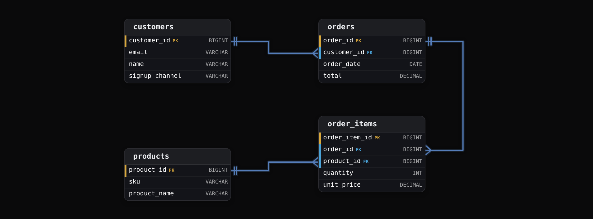
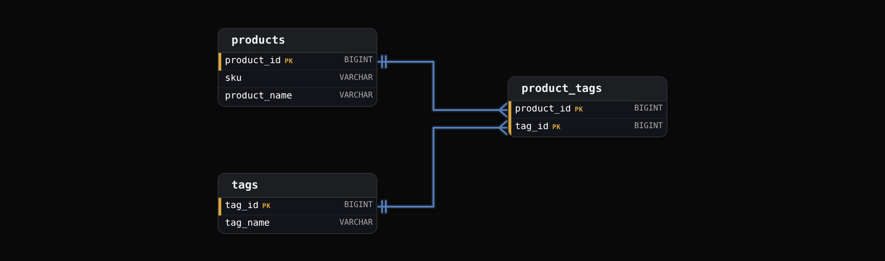

Intermediate·Data Modeling · 22 min · 10 challenges

# Keys & Identity

FreshCart closed March 2024 with revenue 11% higher than its payment processor settled. The cause was 2 `customers` rows for 1 person, 1 from the app and 1 from the website, and every order joined to both. Nothing in the schema said those rows had to be different people. Keys are how a schema says that, and this lesson is how to choose them.


<br>

---

## The Problem of Identity

A row in a relational table stands for 1 thing in the world: 1 customer, 1 product, 1 line on 1 order. The database holds the row's columns, and the modeller supplies the rule that says which thing the row stands for. Identity is that rule. When the rule is missing, the database stores 2 rows for 1 customer without complaint, and every query that assumes 1 row per customer returns wrong numbers with no error.


<br>

### Dorota Kaminski, Twice

FreshCart loaded its `customers` table from the mobile app and from the website checkout. Each source wrote a row per sign-up, and nothing in the table stopped 2 rows from describing the same person. Dorota Kaminski signed up on both.

| name | email | signup_channel | created_at |
| --- | --- | --- | --- |
| Priya Nair | priya.nair@example.com | app | 2024-02-03 |
| Priya Nair | Priya.Nair@example.com | web | 2024-02-19 |

The 2 rows differ by 1 capital letter and a channel. To the database they are 2 rows; to the business they are 1 customer with 6 orders in March totalling $412. The `orders` table stored the email she typed at checkout, so a revenue query joining on email matches each order against both rows.

```sql
SELECT
  c.name,
  COUNT(*) AS orders,
  SUM(o.total) AS revenue
FROM orders AS o
JOIN customers AS c
  ON LOWER(o.email) = LOWER(c.email)
WHERE o.order_month = '2024-03'
GROUP BY c.name
```

| name | orders | revenue |
| --- | --- | --- |
| Priya Nair | 12 | 824.00 |

Six orders became 12 and $412 became $824. The `LOWER()` that was meant to tolerate casing is what made both rows match, and the join multiplied every order row by the number of customer rows it found. Across 40 million customers, 1.8 million had a second row, and the March revenue report overstated the settled total by 11%.


<br>

### Updates and deletes go wrong the same way

Joins are the loudest symptom, and writes carry the same defect. An `UPDATE customers SET marketing_opt_in = false WHERE email = 'priya.nair@example.com'` changes 1 of her 2 rows, and the next campaign emails her anyway. A GDPR erasure `DELETE` removes 1 row and leaves the other for an auditor to find. A deduplication job keeping the newest row per name merges Dorota with every other Dorota Kaminski in the table.

Each failure traces to the same missing rule: no column, or set of columns, that the schema guarantees is unique per entity, so nothing can say 'this row and only this row'. Joins and writes need that rule to land on exactly 1 row, and deduplication needs it to know what 'same' means.


<br>

### Identity is a modelling decision

The database can't invent the rule, but it enforces one once declared: a `PRIMARY KEY` rejects a repeated value, and a `UNIQUE` index on `LOWER(email)` would have rejected Dorota's second sign-up. Whether 2 rows with the same email are 1 customer is the modeller's question, because a household can share an inbox and 1 person can hold 2 accounts, and it gets answered before any constraint is written. The answer starts from the grain, what 1 row is, and the identity column is whatever makes 1 row at that grain distinguishable from every other.

The defect lives in the table, and every fix applied in a query is a patch over it. The column that carries identity, declared so the database enforces it, is the primary key, and choosing one that holds up is the next section.


<br>

---

## Primary Keys: Data Identity

A primary key is the column, or set of columns, the schema guarantees is unique and non-null for every row. The database enforces it with an index: an insert that repeats an existing key value fails before the row lands. Everything else leans on that guarantee: a join matches on it, a foreign key points at it, an `UPDATE ... WHERE id = ?` touches 1 row because of it, and a `MERGE` uses it to choose between update and insert.


<br>

### The 4 properties

> What a primary key must be
>
> - Unique: no 2 rows share the value, enforced by the index behind the constraint, so a duplicate insert fails rather than landing.
> - Non-null: NULL isn't equal to NULL in SQL, so a nullable key could never be matched by a join and could never fail the uniqueness check.
> - Immutable: a value that changes after insert has to change in every row that references it, and in every historical copy that will never be rewritten.
> - Minimal: no column can be dropped and leave the rest still unique. `customer_id` qualifies; `(customer_id, email)` is unique too, but `email` adds nothing.

Uniqueness and non-null are what the constraint enforces. Immutability and minimality are the modeller's choice, and so is width, since every foreign key and index entry copies the key: the database accepts a 120-character email as a primary key, and an `UPDATE` to it. A key that never collides stays unique across 3 boundaries: the rows in the table now, the rows it will hold over the years, and rows merged in from another system.


<br>

### Collision across time: the recycled SKU

FreshCart's `products` table used `sku` as its primary key. SKU `FC-0417`, a 6-pack of sesame bagels, was discontinued in January 2023, and merchandising reuses codes: in March 2024 `FC-0417` came back on a 1-litre oat milk. `order_items` referenced products by `sku`, so every bagel order since 2021 now joins to oat milk, and the bagels have no product row at all. The business needed both rows:

| sku | product_name | listed_from | discontinued |
| --- | --- | --- | --- |
| FC-0417 | Sesame Bagels 6pk | 2021-04-12 | 2023-01-31 |
| FC-0417 | Oat Milk 1L | 2024-03-18 | NULL |

- **21 months** — of bagel sales reported as oat milk

The table can't hold both rows, because the key says they are 1 product. `sku` was unique in 2021 and is unique today; it collided across time because the system minting it has a reuse policy the warehouse doesn't control. Emails fail the same way: customers change them, and some providers hand released addresses to new owners.


<br>

### Natural keys and surrogate keys

A natural key is a value from the business domain that identifies the entity: an email, a SKU, an ISO country code, a VIN. A surrogate key is a value the system generates purely to identify the row: a sequence integer, a UUID, a hash. Nothing in the business can edit or recycle it, which is where its immutability comes from. The natural key stays as an attribute, so a lookup by SKU still works, but other tables stop pointing at it.

✓Natural key as PK

- Readable in every join and every log line
- Changes when the business changes it, and the change must reach every referencing row
- Reused by the source system without warning
- As wide as the email or name it holds, often 20 to 120 characters

✗Surrogate key as PK

- Meaningless integer or UUID, so nothing in the business can alter it
- Fixed at 8 or 16 bytes and copied into every foreign key
- Holds 2 rows for 1 natural key, such as both listings of FC-0417
- Needs the natural key kept UNIQUE at its true grain, or duplicates get in

The decision turns on who controls the value. A `countries` table keyed on the ISO 3166 alpha-2 code is sound: the standards body changes a code about once a decade and the table is tiny. A `products` table keyed on a SKU that merchandising recycles is a collision waiting for a reorder. FreshCart moved to a `product_id BIGINT` surrogate: the bagels became 40817 and the oat milk 118204, each carrying `FC-0417`. Uniqueness moved to the grain the SKU is actually unique at, `UNIQUE (sku, listed_from)`, so each listing period appears once and a replayed product load can't insert the oat milk twice.

A surrogate gives the row an identity the business can't disturb. What other tables do with that identity, and what the database does when the row behind it disappears, is the subject of foreign keys.


<br>

---

## Foreign Keys

A foreign key is a column in one table whose values are drawn from the primary key of another. `orders.customer_id` holds values that exist in `customers.customer_id`, and the rule that says so is referential integrity: every value in the child column matches a parent row, or is NULL. In a one-to-many relationship the foreign key sits on the many side: each order has exactly 1 customer, so the customer's id fits in 1 column of the order row.



`order_items` carries 2 foreign keys because a line sits in 1 order and names 1 product. Read from the many side, the diagram is the business: lines belong to orders, orders to customers. A `customers.order_id` column would instead say each customer has 1 order.


<br>

### What enforcement buys, and where it is missing

PostgreSQL checks the constraint on every write, as do MySQL and SQL Server: an insert into `orders` naming a nonexistent customer fails, and deleting a customer with orders fails or cascades according to the declared action. The cloud warehouses behave differently. BigQuery and Snowflake accept `FOREIGN KEY` declarations, as do Redshift and Databricks, and none of them checks at write time, which is where data engineers get caught. The declaration is metadata the optimizer may use to skip a join it can prove loses no rows, and nothing more.

```sql
INSERT INTO orders (order_id, customer_id, order_date, total)
VALUES (90117, 99999999, '2024-04-29', 48.20);
```


<br>

### Orphans corrupt aggregates without an error

An orphan is a child row whose foreign key matches no parent. FreshCart's deduplication job merged 3,400 duplicate customers like Dorota's second row by deleting the losing row, and 41,000 genuine April `orders` kept pointing at the deleted ids. An inner join drops those orders, so revenue by segment undercounts by $2.4 million with no error. A left join keeps them with NULL in every customer column, and the $2.4 million lands in a segment the dashboard labels 'Unknown'. Either way finance and sales disagree until someone finds the gap weeks later.

| join type | order rows | revenue reported | where the $2.4M went |
| --- | --- | --- | --- |
| inner join | 1,159,000 | $69.0M | dropped from the result |
| left join | 1,200,000 | $71.4M | segment NULL, shown as Unknown |


<br>

### Delete actions

| action | on parent delete | fits |
| --- | --- | --- |
| RESTRICT / NO ACTION | the delete fails while child rows exist | production OLTP; forces explicit cleanup |
| CASCADE | child rows are deleted too | tightly owned children, such as order_items under orders |
| SET NULL | the child's FK becomes NULL | child is meaningful without the parent, such as orders after a customer erasure |
| SET DEFAULT | the child's FK takes a declared default | rare; needs a real default parent row |

`CASCADE` from `orders` to `order_items` is reasonable, because a line has no meaning without its order. `CASCADE` from `customers` to `orders` deletes revenue history: the deduplication job would have taken 41,000 real orders with it. A merge re-points children to the surviving row before deleting the loser. `SET NULL` keeps the orders and loses only the link, which is what a GDPR erasure usually wants: the money stays, the person goes. In a warehouse these actions are pipeline logic, and the dimension load checks for referencing facts before it deletes.

> FK discipline in a warehouse
>
> - Declare the constraint anyway: the optimizer uses it, and the relationship is documented in the catalog.
> - Test it on every load: a dbt relationships test or an anti-join that counts orphans, failing the run above 0.
> - Never delete a dimension row without first counting the facts that point at it.
> - Load parents before children in the same run, or the test fails on rows that are late rather than wrong.

The fix keeps discontinued products in the dimension with a status flag, so every fact keeps its parent. In a warehouse that rule lives in the pipeline, because nothing else will apply it.


<br>

---

## Composite Keys

A composite key is a primary key made of 2 or more columns, unique in combination where no single column is unique on its own. The database treats the combination as 1 value for enforcement: `(product_id, tag_id)` can appear once, while `product_id` 40817 may appear in 30 rows and `tag_id` 7 in 20,000. The shape appears wherever the entity being identified is a relationship between 2 other entities rather than a thing of its own.


<br>

### The junction table

FreshCart tags products for search: organic, gluten-free, local. A product has many tags and a tag many products, a many-to-many relationship no foreign key on either side can hold: a `product_id` column on `tags` would allow 1 product per tag. The junction table `product_tags` resolves it with 1 row per product-tag pair and a foreign key to each parent.



The composite key `(product_id, tag_id)` states the business rule directly: a product carries a given tag once. The grain is 1 row per product-tag pair, and the key is the grain written down. A surrogate `product_tag_id` here would still need `UNIQUE (product_id, tag_id)`, or the same pair could land twice; that constraint is the composite key under another name.


<br>

### When the relationship grows attributes

A junction table stays a bare pair until the business records something about the relationship itself, such as who applied a tag and when. The cost of a composite key shows once another table points at a row of `product_tags`, say a `tag_reviews` table of compliance checks on each assignment: its foreign key carries both `product_id` and `tag_id`, so every join on it is 2 columns wide, and so is the index behind it. At that width a surrogate starts to pay for itself.

The same pattern runs through dimensional modelling. A type 2 slowly changing dimension holds many versions of 1 customer, and the versions could be told apart by `(customer_id, valid_from)`. The standard choice is a surrogate `customer_sk` per version, because 2.1 billion fact rows each store 1 key column instead of a natural key plus a date.


<br>

### The partial dependency trap

If `product_tags` also stored `product_name`, that column would depend on `product_id` alone. That's a partial dependency, a non-key column depending on part of the key, and second normal form forbids it: a rename reaches `products` while 30 rows in `product_tags` keep the old name. Every non-key column in a composite-key table depends on the whole key, and anything depending on part of it belongs in that part's own table.


<br>

---

## Key Generation Strategies

The generator behind a surrogate key decides 3 things: how wide the key is, whether consecutive keys arrive in order, and whether 2 writers can mint keys without coordinating. The common options are a database sequence, a UUID, a hash of the natural key, and the natural key itself.


<br>

### Sequences: compact and ordered, until they run out

A sequence is an atomic counter the database maintains: `BIGSERIAL` in PostgreSQL, `IDENTITY` in SQL Server and Snowflake. Each call returns the next integer, so keys arrive in insert order and pack B-tree indexes tightly, every new key landing at the right-hand edge. The key's width is the column's type, 8 bytes for `BIGINT`, and that's where tables go wrong: `SERIAL` and `INT` are 32-bit signed and stop a little past 2.1 billion. FreshCart created `order_items` with `SERIAL` in 2021, and at around 2 million lines a day it crossed that limit in its 3rd year. The next insert failed and took checkout down with it. The repair took `ALTER SEQUENCE ... AS bigint` plus an `ALTER COLUMN ... TYPE BIGINT` that rewrote the table under an exclusive lock for 2 hours.

- **2,147,483,647** — the last key a 32-bit sequence can mint

A sequence's other limit is coordination: 1 counter in 1 database, so 400 Spark tasks writing a dimension can't each take the next value without serialising on it. `BIGINT` is the right default for anything that might pass 100 million rows; the extra 4 bytes a row come to 800 MB on 200 million rows, far cheaper than the outage FreshCart had.


<br>

### UUIDs: unique anywhere, at a cost in width

A UUID is 128 bits. Version 4 is random, so any process anywhere mints one with no coordination, and with 2^122 possible values a collision isn't worth planning for. A native `UUID` column stores 16 bytes and the text form 36, so 500 million keys take 18 GB as text against 4 GB as `BIGINT`, before every foreign key and index copies them. Random values also scatter inserts across the index, fragmenting it. Version 7, standardised in RFC 9562, leads with a 48-bit millisecond timestamp, so keys sort by creation time and inserts cluster at the index's right edge, keeping the coordination-free property without the fragmentation. It's the default for ids minted on clients or across services.


<br>

### Hash keys: deterministic and replayable

A hash key is `MD5` or `SHA-256` of the natural key, with a separator so ('ab','c') and ('a','bc') stay apart: `md5('FC-0417' || '|' || '2024-03-18')`. The same input yields the same key on every run and every worker, so a fact load computes `product_key` from the natural key in parallel with the dimension load, with no lookup. Sequence keys exist only after the dimension insert, so every fact load waits for it and looks them up. Data Vault builds its hubs and links this way. The costs: MD5 is 16 bytes like a UUID, SHA-256 is 32, and hex text doubles each; the values have no order; and 2 inputs can in principle collide, negligible for SHA-256 and the reason some teams avoid MD5. The key is only as stable as its input: the recycled SKU hashes alike for bagels and oat milk unless the listing date is included.


<br>

### Natural keys, kept where they belong

A natural key still fits as the primary key where the value is short and set by a standard the business doesn't control, so it rarely changes: ISO country and currency codes, a calendar `date_key` written as `20240318`. The test is unchanged: who can change or reuse the value, and how many rows would have to follow it.

| situation | strategy | reason |
| --- | --- | --- |
| OLTP table, 1 database writing | BIGINT sequence | 8 bytes, ordered, uniqueness guaranteed by the engine |
| Ids minted on clients or across services | UUID v7 | no coordination, time-ordered, 16 bytes |
| Warehouse dimension whose facts load in parallel | MD5 of the natural key | any worker derives it with no lookup |
| Date or calendar dimension | natural date_key integer | readable, never changes, 4 bytes |
| Reference data from a standard | natural code | tiny, stable, controlled outside the business |

Hash keys are worth their width where separate jobs must agree on a key without talking to each other; a single writer is still best served by a `BIGINT` sequence. The habits below are what the 5 sections add up to.

✓Do

- Give every table a primary key the business cannot change or reuse; keep natural keys UNIQUE at their grain.
- Default surrogate integers to BIGINT on any table that could pass 100 million rows.
- Put the foreign key on the many side, and test referential integrity in every warehouse load.
- Keep a UNIQUE constraint on the composite columns when a junction table gets a surrogate.
- Use hash keys where parallel jobs must agree on a key, and UUID v7 where services mint ids.

✗Don't

- Do not key a table on an email or SKU the source system can edit or recycle, and never on a name.
- Don't store UUIDs as 36-character text when the engine has a 16-byte UUID type.
- Do not CASCADE deletes from a parent whose children carry revenue history.
- Don't put a column in a composite-key table that depends on only part of the key.
- Don't assume a declared FOREIGN KEY in Snowflake, BigQuery or Redshift rejects anything.


<br>

---

## Putting It All Together

FreshCart launches a loyalty programme. Members earn points from 3 services (checkout, delivery app, partner petrol stations), move between tiers over time, and the warehouse must report points per member per tier per month, with replays whenever a partner resends a day's file.

- The identity question comes first: 1 row in loyalty_members is 1 member, and 2 sign-ups with the same email are 1 member or 2 accounts by a rule written down before any constraint, so the March duplicate never recurs.
- The member's primary key is a surrogate member_id BIGINT , with the loyalty card number kept as a UNIQUE attribute, because cards are reissued and the number can't be trusted across time.
- points_events carries member_id as a foreign key on the many side, and since the warehouse is Snowflake, an anti-join test counts orphaned events on every load instead of relying on the declared constraint.
- Tier history is a relationship between a member and a tier that gains valid_from and valid_to , so it gets a surrogate member_tier_sk with UNIQUE on ( member_id , valid_from ) , the shape the tag assignment story ended on.
- Checkout and the delivery app mint event ids as UUID v7 so no service waits on a sequence, while the warehouse keys each event by md5 ( source || '|' || event_id ) , so a partner's resent file merges onto the same keys instead of creating a 2nd row.


<br>

---

## Key Takeaways

- Identity is a modelling decision: 1 row per entity at the table's grain, carried by a column the database can enforce as unique and non-null.
- A primary key never collides when the system controls its value: a surrogate for most tables, a natural key only for short, stable codes from an outside standard.
- The foreign key sits on the many side. Snowflake doesn't check it, and neither do BigQuery or Redshift, so the pipeline has to.
- A junction table's composite key states the relationship's grain; once the relationship gains attributes and history it becomes an entity with a surrogate.
- Generators differ in width and ordering, and in how much coordination they need: BIGINT sequences for 1 writer, UUID v7 across services, hash keys where parallel jobs must agree on a key.
