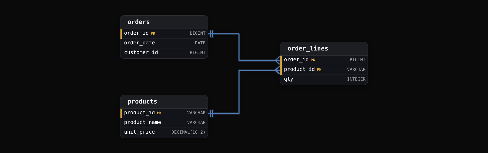
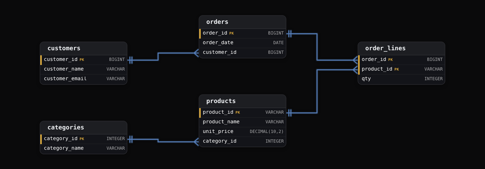

Intermediate·Data Modeling · 15 min · 12 challenges

# Normalization

Suppose each album row in Spotify's catalog carried its own copy of the artist name. When a band renamed itself, the rename would have to reach every album, and a script that missed 3 of them would leave search showing the old name. One fact, stored in 2 places, would disagree with itself. Normalization is the discipline that prevents that split.


<br>

---

## Data Gets Out of Sync

An online store's reporting team exported every order line into one wide table so analysts never need a second table. Each row is 1 product on 1 order, with customer and product details copied beside it.

| order_id | order_date | customer_id | customer_name | customer_email | product_id | product_name | unit_price | qty |
| --- | --- | --- | --- | --- | --- | --- | --- | --- |
| 1001 | 2024-03-02 | 42 | Priya Nair | priya@nair.io | P7 | Desk Lamp | 34.00 | 1 |
| 1001 | 2024-03-02 | 42 | Priya Nair | priya@nair.io | P2 | USB Cable | 9.00 | 3 |
| 1002 | 2024-03-05 | 17 | Tom Ola | tom@ola.dev | P7 | Desk Lamp | 34.00 | 2 |
| 1003 | 2024-03-06 | 42 | Priya Nair | priya@nair.io | P9 | Felt Pad | 4.50 | 10 |
| 1004 | 2024-03-09 | 42 | Priya Nair | priya@nair.io | P2 | USB Cable | 9.00 | 1 |

Every value on every row is true, yet customer 42's email is written 4 times, the Desk Lamp's price twice, the USB Cable's name twice. The disk this costs is cheap. The expensive part is that 4 copies of 1 fact can hold 4 different values, and nothing in the table prevents it.


<br>

### The update that lands halfway

Customer 42 changes their email to `priya@nair.dev`. The engineer updates the rows for order 1001, the order number on the ticket, and closes it. Rows 1 and 2 now carry the new address and rows 4 and 5 the old one, with no error raised. Where customer 42's receipts go now depends on which row a report reads first. This query finds the damage.

```sql
SELECT
  customer_id,
  COUNT(DISTINCT customer_email) AS email_versions
FROM order_report
GROUP BY customer_id
HAVING COUNT(DISTINCT customer_email) > 1
```

| customer_id | email_versions |
| --- | --- |
| 42 | 2 |

This is an update anomaly. The number of places a fact is stored is the number of ways an update to it can fail.


<br>

### Facts with nowhere to live

The store adds P12, a Monitor Arm at 59.00, which no order contains yet. Here a product exists only as part of an order line, so recording P12 means inventing an order line: an empty `order_id`, an empty customer, a quantity of 0, and a fake row every report must filter out. A customer who registers before buying hits the same wall. This is an insert anomaly: the table cannot hold a fact around 1 thing without asserting a fact about another.


<br>

### Deleting one thing erases another

Order 1003 is cancelled and its row deleted. It was the only row mentioning P9, so the Felt Pad's name and price leave with it: removing an order removed a product. This is a delete anomaly.

> The 3 anomalies of duplicated data
>
> - Update: a change must reach every copy of a fact, and each copy it misses becomes a contradiction.
> - Insert: a fact about a product or customer cannot be stored until an order exists to attach it to.
> - Delete: removing the last row that mentions something removes everything known about it.

All 3 anomalies share a cause. A fact is a single statement about a single thing: customer 42's email is `priya@nair.io`, product P7 costs 34.00. This table puts customer, product and order facts on 1 row, so each customer fact is copied once per order line. Normalization splits a table until each fact is stored once, in a table about the thing it describes, so changing a fact means changing 1 row.

A key is the column, or the set of columns, whose value picks out exactly 1 row. Neither `order_id` nor `product_id` does that alone here, since order 1001 has 2 rows and P7 appears on 2 orders; the pair (`order_id`, `product_id`) does. Each normal form is a rule about how the columns outside the key relate to the key.

> **TIP**
>
> When you inherit a wide table, pick a column that should have 1 value per entity, such as a customer's email, and run COUNT(DISTINCT) on it grouped by the entity's id. Any group above 1 is a fact that has already drifted.


<br>

---

## First Normal Form (1NF)

Normalization starts with a table in the strict sense: every cell holds 1 value, and every row has the same columns. Spreadsheet and JSON exports break this rule constantly, and the result looks convenient until a query has to look inside a cell. Here are the same store's orders, exported that way.

| order_id | order_date | customer_id | product_ids | quantities |
| --- | --- | --- | --- | --- |
| 1001 | 2024-03-02 | 42 | P7,P2 | 1,3 |
| 1002 | 2024-03-05 | 17 | P7 | 2 |
| 1003 | 2024-03-06 | 42 | P9 | 10 |
| 1004 | 2024-03-09 | 42 | P2 | 1 |

One row is 1 order, and `product_ids` holds the basket as a comma-separated string, with a matching string of quantities beside it. The pairing is positional, and nothing enforces that the 2 lists have the same length. Counting the orders that contained a Desk Lamp means looking inside a string.

```sql
SELECT
  COUNT(*) AS orders_with_p7
FROM orders_flat
WHERE product_ids LIKE '%P7%'
```

The query counts orders 1001 and 1002, which is right today. Once product P71 launches, its orders count as Desk Lamp orders too, because the string P71 contains P7. Summing quantities is worse: split both strings, walk them in lockstep, convert the pieces to numbers, and a stray space in 1 cell breaks the conversion. That parsing logic gets written again in every report that touches the column.


<br>

### The same mistake laid out sideways

| order_id | product_1 | qty_1 | product_2 | qty_2 | product_3 | qty_3 |
| --- | --- | --- | --- | --- | --- | --- |
| 1001 | P7 | 1 | P2 | 3 |  |  |
| 1002 | P7 | 2 |  |  |  |  |
| 1003 | P9 | 10 |  |  |  |  |

Numbered columns remove the parsing and add a wall: at most 3 products per order, so a fourth item has nowhere to go. Counting Desk Lamp orders means checking 3 columns with OR, and a report written for 3 slots silently ignores a fourth slot added later. Columns like these are called a repeating group, and they hold a list spread sideways across the row.


<br>

### One value per cell, one row per item

| order_id | order_date | customer_id | product_id | qty |
| --- | --- | --- | --- | --- |
| 1001 | 2024-03-02 | 42 | P7 | 1 |
| 1001 | 2024-03-02 | 42 | P2 | 3 |
| 1002 | 2024-03-05 | 17 | P7 | 2 |
| 1003 | 2024-03-06 | 42 | P9 | 10 |
| 1004 | 2024-03-09 | 42 | P2 | 1 |

For both shapes, the fix is to turn the list into rows. A row now stands for 1 item in 1 basket, keyed by `order_id` together with `product_id`, and an order can have 1 item or 40. Each quantity sits on the same row as the product it counts, so the table enforces the pairing. The Desk Lamp question becomes a filter and a sum.

```sql
SELECT
  SUM(qty) AS desk_lamps_sold
FROM order_lines
WHERE product_id = 'P7'
```

The query needs no string parsing, cannot match P71 by accident, and reads the same for 1 line or 100. The split did cost something: `order_date` and `customer_id` are now written once per line, so order 1001's date appears twice. First normal form allows that; the next section deals with it.

> The 1NF test
>
> - Every cell holds exactly 1 value, never a list, a delimited string or a blob a query would have to parse.
> - No repeating groups: no item_1, item_2, item_3 columns standing in for a list.
> - Every row has the same columns and a key that identifies it.
> - A table that fails any line fails 1NF, and 2NF and 3NF can't be judged until it passes.

✓Do

- Store a list as rows in a table keyed by the owner and the item
- Keep a quantity on the same row as the item it counts
- Ask what 1 row means before asking anything else about a table

✗Don't

- Store comma-separated ids and promise to parse them later
- Add item_4 when item_3 runs out
- Match ids with LIKE, which finds P71 when you asked for P7


<br>

---

## Second Normal Form (2NF)

The reporting team adds product names and prices to the 1NF table, `order_lines`. The key is still the pair (`order_id`, `product_id`); every other column is a non-key column.

| order_id | product_id | order_date | customer_id | product_name | unit_price | qty |
| --- | --- | --- | --- | --- | --- | --- |
| 1001 | P7 | 2024-03-02 | 42 | Desk Lamp | 34.00 | 1 |
| 1001 | P2 | 2024-03-02 | 42 | USB Cable | 9.00 | 3 |
| 1002 | P7 | 2024-03-05 | 17 | Desk Lamp | 34.00 | 2 |
| 1003 | P9 | 2024-03-06 | 42 | Felt Pad | 4.50 | 10 |
| 1004 | P2 | 2024-03-09 | 42 | USB Cable | 9.00 | 1 |


<br>

### What depends on what

Column B depends on column A when each value of A goes with exactly 1 value of B. Product P7 always means Desk Lamp at 34.00; order 1001 always means March 2 and customer 42. But order 1001 has 2 lines with different quantities, so `qty` needs both halves of the key. Writing down what each column depends on is the whole technique.

| Column | Determined by | Portion of the key |
| --- | --- | --- |
| order_date | order_id | half |
| customer_id | order_id | half |
| product_name | product_id | half |
| unit_price | product_id | half |
| qty | order_id and product_id | whole |

Of the 5 non-key columns, 4 depend on half the key: a partial dependency, and the mechanism behind section 0's duplication. `order_date` is copied once per line on the order, `product_name` and `unit_price` once per order containing the product. Raise the Desk Lamp's price and 2 rows must change; add P12 with no orders and there is no row to put it on.


<br>

### Give each half of the key its own table

Second normal form says: in a table with a multi-column key, every non-key column depends on the whole key. Columns that depend on `order_id` alone move to a table keyed by `order_id`. Columns that depend on `product_id` alone move to a table keyed by `product_id`. What depends on both stays where it is.



`order_lines` keeps both halves of the old key and nothing that depended on only 1 of them. `customer_id` moved with `order_date`, since the order alone determines which customer placed it. Against 5 order lines, `orders` holds 4 rows and `products` holds 3, so each date and each price appears once.

orders

| order_id | order_date | customer_id |
| --- | --- | --- |
| 1001 | 2024-03-02 | 42 |
| 1002 | 2024-03-05 | 17 |
| 1003 | 2024-03-06 | 42 |
| 1004 | 2024-03-09 | 42 |

products

| product_id | product_name | unit_price |
| --- | --- | --- |
| P7 | Desk Lamp | 34.00 |
| P2 | USB Cable | 9.00 |
| P9 | Felt Pad | 4.50 |

Each product's price now lives on 1 row. Repricing the Desk Lamp is a single-row change that every order line picks up through the join. P12 gets a row in `products` with no order attached. Deleting order 1003 removes 1 row from `orders` and 1 from `order_lines`, and P9 stays in `products`. The cost is that a report which read 1 table now reads 3.

```sql
SELECT
  o.order_id,
  o.order_date,
  SUM(l.qty * p.unit_price) AS order_total
FROM order_lines AS l
JOIN orders AS o
  ON o.order_id = l.order_id
JOIN products AS p
  ON p.product_id = l.product_id
GROUP BY o.order_id, o.order_date
```

| order_id | order_date | order_total |
| --- | --- | --- |
| 1001 | 2024-03-02 | 61.00 |
| 1002 | 2024-03-05 | 68.00 |
| 1003 | 2024-03-06 | 45.00 |
| 1004 | 2024-03-09 | 9.00 |

The join reads the price from `products` once per line, so a price that changes tomorrow changes every total computed tomorrow.

*If the store needs the price the customer actually paid, that's a fact about the line, since the catalog price can change after the sale. It belongs on order_lines as sale_price, next to qty. The catalog price and sale_price can match today and still be 2 different facts.*

> The 2NF test
>
> - The table is in 1NF.
> - For each non-key column, write down which key columns are needed to determine it.
> - If any column needs only some of the key's columns, that is a partial dependency and the table fails 2NF.
> - A table whose key is 1 column cannot have a partial dependency and passes 2NF the moment it passes 1NF.


<br>

---

## Third Normal Form (3NF)

The original export also carried the customer's name and email beside each order, and many teams keep them on `orders` to save a join on every receipt.

| order_id | order_date | customer_id | customer_name | customer_email |
| --- | --- | --- | --- | --- |
| 1001 | 2024-03-02 | 42 | Priya Nair | priya@nair.io |
| 1002 | 2024-03-05 | 17 | Tom Ola | tom@ola.dev |
| 1003 | 2024-03-06 | 42 | Priya Nair | priya@nair.io |
| 1004 | 2024-03-09 | 42 | Priya Nair | priya@nair.io |

The key is `order_id` alone, so 2NF is satisfied: a 1-column key has no part to depend on. Yet customer 42's email is written 3 times, and the halfway update from section 0 can happen again. This duplication runs through a column that is in no key at all.


<br>

### Dependencies that pass through a non-key column

Knowing the order tells you the email, but in 2 steps: `order_id` determines `customer_id`, and `customer_id` determines `customer_email`. The email is a fact about the customer, and the order knows it only because it knows the customer. That 2-step path is a transitive dependency, and every column at the far end of one is a copied fact waiting to drift.

The same shape hides in `products`. If a product row stores `category_id` and `category_name` together, the name reaches the key through the category, and renaming Lighting to Lamps means changing every product row in it. The signature is an id column beside the attributes that id determines.


<br>

### Move the fact to the thing it describes

Third normal form says: each column outside the key depends on the key directly, with no other column in between. The repair is the 2NF move with a different trigger: `customer_id` becomes the key of a new `customers` table, and the columns it determines go there. `orders` keeps `customer_id` as a reference, because who placed the order is a fact about the order. Categories get the same treatment.



Each table is now about 1 kind of thing: 1 row of `customers` is 1 customer, 1 row of `order_lines` is 1 product on 1 order. The old wide row is assembled at query time instead of stored. A wide table carrying `category_name` would answer revenue by category with a single GROUP BY; this schema needs 2 joins.

```sql
SELECT
  c.category_name,
  SUM(l.qty * p.unit_price) AS revenue
FROM order_lines AS l
JOIN products AS p
  ON p.product_id = l.product_id
JOIN categories AS c
  ON c.category_id = p.category_id
GROUP BY c.category_name
```

| category_name | revenue |
| --- | --- |
| Lighting | 102.00 |
| Cables | 36.00 |
| Accessories | 45.00 |

On billions of lines, 2 joins cost real time, and later lessons weigh when to keep copies on purpose. For now, the trade runs one way: a normalized schema can always be joined back into the wide shape, while a wide table can't be trusted to agree with itself. Rename a category and the report above is correct on its next run, with no update script.

> The key, the whole key, nothing but the key
>
> - The key: 1NF, every row has a key and every cell holds 1 value.
> - The whole key: 2NF, no column depends on only part of a multi-column key.
> - Nothing but the key: 3NF, no column depends on a non-key column.
> - The phrase comes from a 1983 paper by William Kent.

> **TIP**
>
> Column names often give the problem away. A `customer_name` column on `orders` announces that it describes a customer. Any column whose prefix names a different thing from the table's key is worth tracing: it usually sits at the end of a transitive dependency.


<br>

---

## Identifying Normal Form

Diagnosing a table is a fixed sequence of questions, and the first one that fails names the form. A table that fails an early question can't be judged on a later one.

The diagnosis, in order

- **1. Find the key** *the smallest set of columns that picks out 1 row*\
  If 2 rows can share every value, the table has no key and the diagnosis cannot start.
- **2. Any cell holding a list, or any numbered column group?** *fails 1NF*\
  Delimited strings, JSON blobs, item_1 through item_3. Stop here until the list becomes rows.
- **3. Multi-column key, and a non-key column that depends on part of it?** *1NF but not 2NF*\
  A 1-column key passes this step without further checking.
- **4. A non-key column that depends on another non-key column?** *2NF but not 3NF*\
  Look for an id column sitting beside the name or attribute that the id determines.
- **5. None of the above** *3NF*\
  Every non-key column is a fact about exactly the thing the key identifies.


<br>

### A worked diagnosis

| ticket_id | opened_at | agent_id | agent_name | agent_team | tags |
| --- | --- | --- | --- | --- | --- |
| 5001 | 2024-04-01 | A3 | Lena Koch | Billing | billing;urgent |
| 5002 | 2024-04-01 | A3 | Lena Koch | Billing | refund |
| 5003 | 2024-04-02 | A8 | Raj Mehta | Tech | login;urgent |

Step 1: `ticket_id` identifies a row. Step 2: `tags` holds a list, so the table fails 1NF and the diagnosis stops. Move tags to `ticket_tags`, 1 row per ticket and tag, and rerun. Step 2 passes, and step 3 passes on a 1-column key. Step 4: `agent_name` and `agent_team` depend on `agent_id`, which is in no key, so the table is in 2NF and fails 3NF. Split out `agents` and the third pass reaches step 5. The table took 3 passes and 2 splits, and ended as 3 tables.


<br>

### Repeated values that are not copied facts

A normalized schema still repeats values. The `orders` table holds `customer_id` 42 on 3 rows: 3 facts, each saying which customer placed that order. What 3NF forbids is 3 copies of the customer's email, which is 1 fact. To tell them apart, ask whether changing the value on one row should change it on the others. If yes, the column is a copied fact and belongs elsewhere. If no, it is a reference.

✓Repetition that is a reference

- customer_id 42 on 3 order rows: 3 facts roughly 3 orders
- product_id P7 on 2 order lines
- agent_id A3 on 2 tickets

✗Repetition that is a copied fact

- ines@okoro.io on 3 order rows: 1 fact written 3 times
- unit_price 34.00 on every Desk Lamp line
- agent_team Billing on every one of Lena's tickets


<br>

---

## Putting It All Together

An online marketplace stores each seller's display name and payout account on every order row so that the finance export needs no joins. A seller renames their shop; the rename script updates orders placed in the last 90 days and the older rows keep the old name, so the seller's annual statement lists 2 shops. Normalizing the export into sellers, orders and order_lines makes the rename a 1-row change and the statement a join.

- Section 0's update anomaly is the 2-shop statement: a fact copied onto every order drifted the moment 1 update reached only some of the copies.
- Section 1 sets the row grain first: once an order's items sit as a list in 1 cell, counts per item become string parsing, so 1 row per order line comes before anything else.
- Section 2 moves order_date and the seller reference off the (order_id, product_id) key because they depend on order_id alone, and product names off it because they depend on product_id alone.
- Section 3 moves the seller's name and payout account off orders because they depend on seller_id, a non-key column, and a sellers table stores each of them once.
- Section 4's diagnosis runs the 5 questions on the finance export, names the form it meets, and tells the team which split to make first.


<br>

---

## Key Takeaways

- Each fact lives in exactly 1 row of 1 table; every extra copy is another row an update can miss, leaving the table contradicting itself.
- 1NF: 1 value per cell and 1 row per item, so lists become rows and numbered column groups disappear.
- 2NF: with a multi-column key, each non-key column depends on the whole key, or it moves to a table keyed by the part it depends on.
- 3NF: no non-key column depends on another non-key column; an id sitting beside the attribute it determines is the signature.
- Diagnose in order: key, lists, partial dependency, transitive dependency; the first question that fails names the form.
