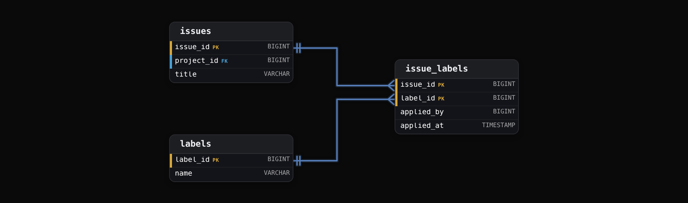

Intermediate·Data Modeling · 18 min · 12 challenges

# Relationships

A GitHub engineer is adding Discussions. Users already comment on issues and on pull requests, and now they will comment on discussions. One comments table for all 3, or one per kind? Teams nest inside teams, repositories fork other repositories, and one user belongs to many organizations. Each is a relationship, its model decides which queries stay cheap, and the last section weighs 3 answers to the comments question.


<br>

---

## What Are Relationships?

### A column that points at another table

A relationship is a column in one table whose values are drawn from the identifying column of another table. In an issue tracker every issue belongs to a project, so the `issues` table has a `project_id` column, and each value in it matches the `project_id` of exactly 1 row in `projects`. The issue row stores no project name and no project owner. It stores a reference, and the reference is the relationship.

projects

| project_id | name | owner |
| --- | --- | --- |
| 1 | Billing | Priya |
| 2 | Mobile App | Chen |

issues

| issue_id | project_id | title | status |
| --- | --- | --- | --- |
| 101 | 1 | Invoice totals wrong | open |
| 102 | 1 | Add refunds | closed |
| 103 | 2 | Crash on login | open |

Read issue 103 and you learn it belongs to project 2. Which project that is lives in the other table, and a join is how the database follows the reference back to it. The join condition names both ends of the relationship: the reference column on one side and the identifying column on the other.

```sql
SELECT
  i.issue_id,
  i.title,
  p.name AS project_name
FROM issues AS i
JOIN projects AS p
  ON i.project_id = p.project_id
WHERE i.status = 'open'
```

| issue_id | title | project_name |
| --- | --- | --- |
| 101 | Invoice totals wrong | Billing |
| 103 | Crash on login | Mobile App |


<br>

### Why not one wide table?

Copy the project name onto every issue row instead and the 3 issues carry 'Billing', 'Billing' and 'Mobile App'. Renaming the Billing project to Payments now means updating 2 issue rows, and a 4th issue inserted with 'billing' in lowercase quietly creates a 3rd project that nobody intended. With a reference column, the name lives in 1 row of `projects`: a rename touches that row alone, and a typo in `project_id` fails at insert time because no project 7 exists.

| issue_id | project_name | project_owner | title |
| --- | --- | --- | --- |
| 101 | Billing | Priya | Invoice totals wrong |
| 102 | Billing | Priya | Add refunds |
| 103 | Mobile App | Chen | Crash on login |
| 104 | billing | Priya | Tax rounding |

Row 104 is the failure in miniature. A report grouping by `project_name` now shows 3 projects, the Billing total is short by 1 issue, and the only clue is a lowercase letter. The wide table has no column whose value could be rejected, so the mistake is accepted and stored.

✓Project name copied onto each issue

- A rename touches every issue in the project
- A misspelling creates a phantom project
- No join needed to read the name
- Nothing stops an issue naming a project that was never created

✗Issue holds project_id

- A rename touches 1 row
- An unknown project_id is rejected
- Reading the name costs 1 join
- Every issue points at a project that exists


<br>

### PK and FK badges on a schema diagram

A schema diagram draws each table as a card. The column that identifies a row carries a PK badge, short for primary key, and a column holding another table's identifier carries an FK badge, for foreign key. The line between those 2 badges is the relationship. Everything that follows in this lesson is a question about that line: how many rows sit at each end, whether an end may be empty, and whether both ends can be the same table.


<br>

### One sentence per table

A relationship also fixes what one row of each table means. One row of `projects` is one project. One row of `issues` is one issue inside exactly one project. Say that sentence for every table in a schema and the relationships fall out of it: the phrase 'inside exactly one project' is the `project_id` column. When the sentence for a table needs the word 'several', the reference can't live on that table, which is the subject of the next section.

> **TIP**
>
> When you meet a new schema, find every FK column first. The list of FK columns is the list of relationships, and the relationships tell you which joins the schema was built to make cheap.


<br>

---

## Cardinality Explained

Cardinality is the answer to 2 questions asked about tables A and B: can one row of A relate to many rows of B, and can one row of B relate to many rows of A? The answers decide where the reference column lives, and in one case they decide that no single column can hold it.

| One A has many B? | One B has many A? | Cardinality | Example |
| --- | --- | --- | --- |
| no | no | one-to-one (1:1) | a user and their settings row |
| yes | no | one-to-many (1:N) | a project and its issues |
| yes | yes | many-to-many (M:N) | issues and labels |


<br>

### One-to-many: the reference sits on the many side

A project has many issues and an issue has one project. Try putting the reference on the project: `projects.issue_id` holds 1 value, so a project with 3 issues needs 3 columns, and a 4th issue needs a schema change. Put it on the issue and the problem disappears, because every issue has exactly 1 project to name. The reference column always lives on the many side, where each row has a single thing to point at. The Billing project in the previous section is 1 row; its 2 issues each carry `project_id = 1`.


<br>

### One-to-one: pick a side and declare it unique

A user has 1 settings row and a settings row belongs to 1 user. Either table could hold the reference, so put it on the table that is optional or arrived later: `user_settings.user_id` points at `users`, and `users` is untouched. The split is usually made to keep a narrow table that every request reads apart from wide columns that almost nothing reads. The database only knows the relationship is 1:1 if `user_settings.user_id` is declared unique. Without that declaration it is a 1:N that happens to have 1 row per user today, and nothing stops a 2nd settings row from appearing tomorrow.


<br>

### Many-to-many needs a third table

An issue can carry many labels and a label sits on many issues. Neither side has a single thing to point at, so neither table can hold the reference column. The tempting shortcut is a text cell on `issues` holding '3,7,12'. That cell cannot be joined and can't be indexed, so 'which issues carry label 7' becomes a full scan with string matching, and '7' also matches '17'. The structure that works is a 3rd table whose rows are the pairs.



One row of `issue_labels` means 'this issue carries this label'. The pair of columns together identifies the row, so issue 101 cannot carry label 7 twice. The table is often called a junction table, and it's a real table: it can hold columns of its own, such as who applied the label and when, that have nowhere else to live.

| issue_id | label_id | applied_by | applied_at |
| --- | --- | --- | --- |
| 101 | 3 | 12 | 2026-03-02 09:14 |
| 101 | 7 | 12 | 2026-03-02 09:15 |
| 103 | 7 | 40 | 2026-03-04 16:02 |

```sql
SELECT
  l.name,
  COUNT(*) AS issue_count
FROM issue_labels AS il
JOIN labels AS l
  ON il.label_id = l.label_id
GROUP BY l.name
ORDER BY issue_count DESC
```

The query never touches `issues`. The junction table already holds one row per issue and label pair, so counting its rows per label is the answer, and the join to `labels` only fetches the name. A many-to-many relationship makes 2 directions of question cheap at once, given an index for each: the pair key, led by `issue_id`, serves labels for an issue, and a second index on `label_id` serves issues for a label.

> Deciding the cardinality of any pair
>
> - Ask both questions, in both directions, about the business rule and not about today's data.
> - No and no: 1:1, put the reference on the optional side and declare it unique.
> - Yes and no: 1:N, put the reference on the many side.
> - Yes and yes: M:N, create a junction table holding the pairs.

*Today's data can mislead. A customer with 1 address this year is still a 1:N if the business allows a 2nd address, and a schema built on the 1:1 assumption breaks the day the 2nd address arrives.*


<br>

---

## Required vs Optional

Cardinality says how many rows can sit at each end of a relationship. The second question is the minimum: must a row exist at the other end at all? Every issue must belong to a project, so `issues.project_id` is required, the column rejects NULL, and an insert with no project fails. An issue can sit unassigned for days, so `issues.assignee_id` is optional, and NULL in that column means nobody yet.

| issue_id | project_id | assignee_id | title |
| --- | --- | --- | --- |
| 101 | 1 | 12 | Invoice totals wrong |
| 102 | 1 | NULL | Add refunds |
| 103 | 2 | 40 | Crash on login |


<br>

### The join changes with the minimum

The minimum is a fact about the data, and it decides which join is correct. Here is the issue list with the assignee's name attached.

```sql
SELECT
  i.issue_id,
  i.title,
  u.name AS assignee
FROM issues AS i
LEFT JOIN users AS u
  ON i.assignee_id = u.user_id
```

| issue_id | title | assignee |
| --- | --- | --- |
| 101 | Invoice totals wrong | Priya |
| 102 | Add refunds | NULL |
| 103 | Crash on login | Chen |

Swap `LEFT JOIN` for `JOIN` and issue 102 disappears, because an inner join keeps only rows with a match on both sides, and NULL matches nothing. A dashboard that counts open issues through an inner join to `users` undercounts by every unassigned issue, and no error is raised anywhere. The rule follows from the minimum: a required relationship can be inner-joined safely, and an optional relationship needs a left join or the unmatched rows vanish from the result.

| Relationship | Reference column | Allows NULL | Minimum at the other end |
| --- | --- | --- | --- |
| issue to project | issues.project_id | no | a project may have 0 issues |
| issue to assignee | issues.assignee_id | yes | a user may have 0 issues |
| settings to user | user_settings.user_id | no | a user may have 0 or 1 settings row |


<br>

### Minimums on the one side

A project can exist with 0 issues. That minimum sits at the other end of the line, and a column constraint can't enforce it, because there is no column on `projects` that turns NULL when its last issue is deleted or moved away. If the business rule is 'a project must have at least 1 issue', the rule lives in application code or in a check that runs at write time. The schema alone will not hold it, and a reviewer reading the schema can't see it, so write it down where the next engineer will look.


<br>

### Deleting the parent row

The minimum also decides what a delete does. When user 12 leaves the company, issue 101 can keep existing with `assignee_id` set back to NULL, because the relationship was optional from the start. When project 1 is deleted, its 2 issues cannot keep existing with a required `project_id` pointing at nothing. The usual choices are to block the delete until the issues move, or cascade it to the issues. Reassigning them to a default parent, such as an Archived project, is the other declared option.

✓Required (NULL rejected)

- Inner join is safe
- Parent delete is blocked or cascades to the children
- Child row cannot be inserted before its parent
- Example: issue to project

✗Optional (NULL allowed)

- Left join or rows go missing
- Parent delete blocks by default, or can be declared to set NULL
- Child row can exist alone and be linked later
- Example: issue to assignee

The decision is cheaper to make at design time than to reverse. Making a required column optional later means every existing query that inner-joins through it is now wrong. Making an optional column required later means finding a value for every NULL already stored, which may be thousands of rows with no right answer.

> **TIP**
>
> Before writing a join, check whether the reference column allows NULL. If it does, the question to answer is whether the report should include the rows with no match, and the answer picks the join.


<br>

---

## Self-Referential Tables

A reference column can point at the table it lives in. An employee has a manager, and the manager is an employee, so `employees.manager_id` holds the `employee_id` of another row in the same table. That is 1 table with 1 relationship, and both ends of the line sit on the same card. Org charts, folder trees and nested comment threads all use this pattern.

| employee_id | name | manager_id | title |
| --- | --- | --- | --- |
| 1 | Priya | NULL | CEO |
| 2 | Chen | 1 | VP Engineering |
| 3 | Dana | 1 | VP Sales |
| 4 | Eli | 2 | Engineer |
| 5 | Fatima | 2 | Engineer |

Ruth's `manager_id` is NULL because the CEO reports to nobody. Every tree has at least 1 root, and the root needs a marker for having no parent. A root pointing at itself passes the reference check too, but it plants a loop that every hierarchy query must guard against, so NULL, the optional minimum from the previous section, is the clear marker.


<br>

### Joining a table to itself

```sql
SELECT
  e.name AS employee,
  m.name AS manager
FROM employees AS e
LEFT JOIN employees AS m
  ON e.manager_id = m.employee_id
```

| employee | manager |
| --- | --- |
| Priya | NULL |
| Chen | Priya |
| Dana | Priya |
| Eli | Chen |
| Fatima | Chen |

The table appears twice under 2 aliases: `e` is the row being reported and `m` is the row it points at. Without the aliases the database cannot tell which `employees.name` is wanted. The left join keeps Ruth, whose `manager_id` matches no row.


<br>

### How deep does it go?

Going 2 levels up takes a 2nd alias and a 2nd join, and 3 levels takes a 3rd. Each join is a fixed step, so a query written with 3 joins reaches great-grandparents and never sees a 4th level. Eli's skip-level manager is 2 joins away.

```sql
SELECT
  e.name AS employee,
  m2.name AS skip_level
FROM employees AS e
JOIN employees AS m1
  ON e.manager_id = m1.employee_id
JOIN employees AS m2
  ON m1.manager_id = m2.employee_id
WHERE e.employee_id = 4
```

When the depth is unknown, a fixed number of joins can't answer 'everyone under Chen'. A recursive query can walk the tree at read time. Two stored columns trade write-time maintenance for cheaper reads. A `level` column stores the depth of each row, 0 for Ruth and 2 for Eli, so 'all employees 2 levels below the CEO' is a filter. A `path` column stores the chain of identifiers from the root, so Eli's path is `/1/2/4/`, and 'everyone under Chen' is `WHERE path LIKE '/1/2/%' AND employee_id <> 2`, since the pattern also matches Chen. The catch is that when Eli moves under Dana, his path and the path of everyone beneath him must be rewritten.

| employee_id | name | level | path |
| --- | --- | --- | --- |
| 1 | Priya | 0 | /1/ |
| 2 | Chen | 1 | /1/2/ |
| 4 | Eli | 2 | /1/2/4/ |
| 5 | Fatima | 2 | /1/2/5/ |


<br>

### Self-referential many-to-many

A user follows many users and is followed by many users. Both directions answer yes, so the pairs go in a junction table, and both of its columns reference `users`. One row of `follows` means 'this user follows that user'. The 2 columns together identify the row, so nobody can follow the same person twice, and a rule that `follower_id` differs from `followed_id` stops a user following themselves.


```sql
SELECT
  u.name,
  COUNT(f.follower_id) AS follower_count
FROM users AS u
LEFT JOIN follows AS f
  ON f.followed_id = u.user_id
GROUP BY u.user_id, u.name
ORDER BY follower_count DESC
```

Swapping `followed_id` for `follower_id` in the join turns the same query into 'how many people each user follows'. One junction table answers both directions, which is the point of holding the pairs rather than a list on either side.


<br>

---

## Complex Patterns

### Polymorphic: one column, several targets

Comments were attached to issues. Now the product wants comments on projects too, and the same `comments` table should serve both. A reference column points at 1 table, so a comment that might belong to an issue or to a project has no single column to hold the reference. Each of the workarounds below gives up a different amount of enforcement to get that flexibility.

| comment_id | target_type | target_id | body |
| --- | --- | --- | --- |
| 501 | issue | 101 | Reproduced on staging |
| 502 | project | 2 | Kickoff is Monday |
| 503 | issue | 103 | Fixed in build 4812 |

The table above is the first design: a `target_type` column saying which table, and a `target_id` saying which row. Any new target is a new string value and no schema change. The price is that the database cannot check `target_id` against anything, because one column cannot reference 2 tables. Comment 503 could name issue 999, which does not exist, and the insert succeeds. Deleting issue 103 leaves comment 503 behind with no error. Every join needs a filter on `target_type` first.

The second design gives each target its own column: `issue_id` and `project_id`, both optional, with a rule that exactly 1 of them is filled. Each column is a real reference, so an unknown issue is rejected and a deleted issue can clear its comments. Adding a 3rd target later means adding a 3rd column and extending the rule. Reading the target's name is 2 left joins and a `COALESCE`.

```sql
SELECT
  c.comment_id,
  c.body,
  COALESCE(i.title, p.name) AS target_name
FROM comments AS c
LEFT JOIN issues AS i
  ON c.issue_id = i.issue_id
LEFT JOIN projects AS p
  ON c.project_id = p.project_id
```

The third design splits the table: `issue_comments` with a required `issue_id`, and `project_comments` with a required `project_id`. Each is a plain one-to-many with the strongest enforcement, but a query that wants everything one user wrote now has to combine both tables with a `UNION ALL`.

| Design | Reference enforced | Adding a new target | All comments by a user |
| --- | --- | --- | --- |
| type + id pair | no | a new string value | 1 table |
| one nullable column per target | yes | a new column | 1 table |
| one table per target | yes | a new table | UNION ALL across tables |

> **TIP**
>
> Pick the type and id pair only when the set of targets changes often and orphaned rows are tolerable. When a comment pointing at a deleted issue is a bug, pick one of the designs the database can check.


<br>

### Circular: 2 tables that point at each other

Every employee belongs to a department, and every department has a head who is an employee. That gives `employees.department_id` referencing `departments` and `departments.head_employee_id` referencing `employees`. Make both required, with each checked immediately, and neither row can be inserted first: the first department needs a head who exists, and the first employee needs a department that exists. A database that defers the check to commit can insert both in one transaction. Without that, make one reference optional: a department is created with `head_employee_id` NULL, employees are inserted into it, and then the head is set. Or move the head into its own table, `department_heads` with `department_id` and `employee_id`, inserted last.


A circular pair hides a second rule the schema cannot state: the head of Sales should belong to Sales. Both references can be valid while Chen, an engineer, heads Sales. That check lives in code at write time, and it is worth a comment in the schema so the next reader knows the loop exists.

✓Do

- Give every reference a single target table the database can check
- Make one side of a circular pair optional so the first rows can be inserted
- Write down rules the schema cannot enforce next to the tables they apply to
- Choose the polymorphic design by how bad an orphaned row would be

✗Don't

- Store a list of identifiers in a text cell
- Rely on a type column alone to keep references valid
- Make both halves of a circular pair required
- Assume today's row counts are the business rule


<br>

### Capstone: design the reactions model


<br>

---

## Putting It All Together

A Slack engineer is modeling a workspace. Users join many channels and channels hold many users. A message belongs to exactly 1 channel. A threaded reply points at the message it answers, and a thread can only run 1 level deep. Emoji reactions attach to messages, and a message may belong to a channel that has since been archived.

- Users and channels answer yes in both directions, so a channel membership table holds the pairs along with the join date.
- A message has 1 channel, so channel_id sits on the message, required, and the channel is never deleted while messages point at it.
- A reply points at another message through a self-referential parent_message_id , NULL for every message that starts a thread.
- Reactions are a junction between users and messages, and because they target only messages, a single checked reference column is enough.
- Archiving a channel keeps the parent row, so the required relationship holds and no message is orphaned.


<br>

---

## Key Takeaways

- A relationship is a reference column whose values match the identifying column of another table, and a join follows it back.
- Ask 'can one A have many B' in both directions: no and no is 1:1, yes and no is 1:N with the reference on the many side, yes and yes is M:N with a junction table.
- Whether the reference column allows NULL decides the join: inner join for required, left join for optional, or unmatched rows vanish.
- A self-referential column models any hierarchy, the root row holds NULL, and unknown depth calls for a level or path column.
- A column cannot reference 2 tables, so polymorphic targets need either one column per target, one table per target, or an unchecked type and id pair.
- Two tables that reference each other need one side optional, or checks deferred to commit, or neither row can be inserted first.
