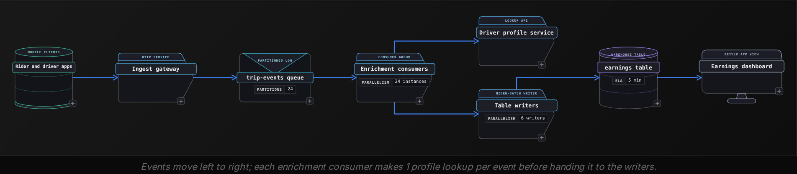
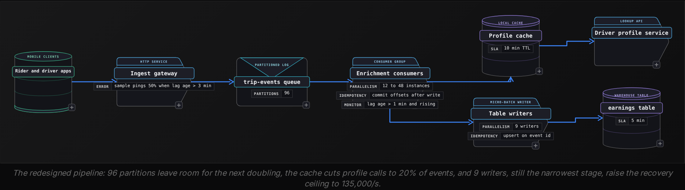

Advanced·Pipeline Architecture · 25 min · 3 challenges

# Backpressure and Scaling: Advanced

Renata is 40 minutes into an onsite loop at Uber when the interviewer draws a pipeline on the whiteboard. Rider and driver apps publish trip events to a partitioned queue, a fleet of consumers enriches each event with driver profile data, and a writer lands the result in the table behind driver earnings. Then comes the question: "Next quarter this traffic doubles. Walk me through what happens." Renata lists fixes: more consumers, bigger machines, autoscaling. The interviewer stops her. "The queue has 24 partitions. Which of those fixes still works? And if the consumers go down for 30 minutes at peak, when is the table current again?" She has been guessing at a question with a computable answer. Each stage has a capacity, the doubled load either fits or it does not, and the recovery time falls out of the same numbers.


<br>

### What you will be able to do

Compute a pipeline's capacity stage by stage and name the stage that breaks first when input doubles.

Choose between blocking, buffering, shedding and throttling for a given event class, and state what each one costs.

Size a partition count from a throughput target and explain what repartitioning does to per-key ordering.

Pick an autoscaling signal and its bounds, and estimate the cost against static provisioning.

Calculate how long a backlog takes to drain and identify the stage that limits the drain rate.


<br>

---

## The Volume-Doubling Question

### One question, many disguises

Interviewers rarely say the word backpressure. They describe a change in load or in a dependency and wait to see whether you reason about rates or reach for a product feature. The forms below all reduce to the same model: work arrives at some rate, each stage processes it at some rate, and the gap between the two, held for some duration, decides what fails.

The same question, rephrased

- Black Friday brings 5x normal order volume. Walk me through the pipeline.
- Calls to the fraud-scoring service now take 40 ms instead of 4. What happens upstream?
- We are onboarding a customer who triples our event count next month.
- The consumers were down for 2 hours. When is the dashboard current again?
- Lag alerts fire every evening around 6 pm and clear by 9 pm. Why, and what would you change?

Each version hands you 3 variables: the arrival rate, the capacity of the slowest stage, and how long the mismatch lasts. A 10-minute burst at 2x fits inside any queue with retention. A sustained 2x does not fit, because every second adds to a backlog that never shrinks. The recovery version asks something else: how much surplus capacity exists above the live input, since only the surplus drains a backlog.


<br>

### The running example: trip events

The rest of this lesson uses one pipeline with fixed numbers. Today's peak is 40,000 events per second at around 1 KB each. Events are keyed by trip and land in a queue with 24 partitions. Each enrichment consumer reads 1 partition and calls a driver profile service for every event. A call takes 4 ms and each consumer runs 10 threads, which gives 2,500 events per second per consumer. A pool of 6 writers commits to the earnings table every 60 seconds. The freshness target is 5 minutes from event to table.



| Stage | Capacity (events/s) | Peak today: 40,000/s | Doubled: 80,000/s |
| --- | --- | --- | --- |
| Ingest gateway | 150,000 | 27% | 53% |
| Queue writes (24 partitions at 5 MB/s) | 120,000 | 33% | 67% |
| Enrichment consumers (24 at 2,500/s) | 60,000 | 67% | 133% |
| Profile service quota | 90,000 | 44% | 89% |
| Table writers (6 at 15,000/s) | 90,000 | 44% | 89% |

Read the table from the right. The consumers cross 100% and are the first break. The 2 stages at 89% matter as much: once the consumers are fixed, the profile service and the writers leave only 10,000 events per second of room above the doubled input, and that room is all a recovery has to work with. An answer that stops at 'add consumers' misses the second ceiling.


<br>

### What breaking looks like in a pull pipeline

Consumers in a pull model fetch at their own pace, so overload shows up as lag instead of a crash. At 80,000 events per second in and 60,000 out, the consumers fall further behind every second. The age of the event being processed grows by a quarter second per second, since the consumers read at 75% of the rate events arrive. Against a 5-minute freshness target, the clock starts the moment the doubled peak begins.

- **20 min** — of doubled peak before the SLA breaks
- **216M** — events queued by a 3-hour peak's end
- **45 min** — lag age when that 3-hour peak ends

Those figures describe what the earnings table's readers experience. Nothing has crashed and no event is lost, since the lag stays far inside the queue's 24 hours of retention. The broken promise is the one made to drivers: that today's trips appear in their earnings within 5 minutes. State the failure in those terms, naming who reads the data and how stale it is when they do.

✓Fixes named without numbers

- Add consumers: the 25th consumer on a 24-partition queue gets no partition and sits idle.
- Bigger machines: each consumer waits on 4 ms lookups, so more CPU adds no throughput.
- Autoscale on CPU: CPU stays low while lag climbs, so the rule never fires.
- The queue will absorb it: a sustained deficit grows the backlog for as long as the peak lasts.

✗Fixes tied to a stage and a number

- The consumers break first at 133%; raise partitions and consumers to 48.
- After that fix, the profile service and writers sit at 89% and cap recovery.
- A 3-hour doubled peak with no fix leaves the table 45 minutes stale.
- If capacity runs out anyway, sample location pings and keep every trip lifecycle event.

> A complete answer in 4 parts
>
> - Demand: the peak rate, its shape, and how long it lasts.
> - Capacity: every stage's rate, and the minimum across them.
> - Failure mode: lag, data loss, memory exhaustion, or a cascade into a shared dependency.
> - Fix and its next ceiling: what you change, what breaks after it, and what it costs to run.

> **TIP**
>
> Ask how the doubling arrives before answering. Twice the users at the same peak-to-average ratio doubles every hour; a new 15-minute spike from a push notification doubles one window. The first needs capacity, the second may only need retention and a freshness target that tolerates a short delay.

*Every number in the example is an assumption chosen to make the arithmetic visible. In an interview, state your assumptions aloud and let the interviewer correct them.*


<br>

---

## Backpressure Mechanisms

Backpressure is a stage telling the stage before it how much it can accept. With it, excess load waits in a place with a known bound or is refused at the edge. Without it, excess load piles up wherever nothing is counting, usually a process's heap, until the process dies and takes its in-flight work with it.


<br>

### Where excess load can go

| Mechanism | Where the excess waits | What it costs | Fits |
| --- | --- | --- | --- |
| Block | In the upstream caller, which stalls | Latency upstream; a stalled caller can stall its own caller | Hops inside one service or job |
| Buffer | On disk in a durable queue, up to retention | Freshness, plus storage for the backlog | Events that must arrive but may arrive late |
| Shed | Nowhere: the event is dropped or sampled | Completeness | Telemetry where a sample still answers the question |
| Throttle | In the client, which retries later | Client logic; retries can arrive in waves | External producers you can tell to back off |

A pull-based queue provides buffering without extra design. Consumers fetch when they have room, so the backlog sits in the queue's partitions on disk, the lag is the pressure signal, and the retention period is the bound. Push-based links, where the sender decides when data moves, need an explicit signal instead: the receiver grants credits for a number of records, and the sender stops when the credits run out.


<br>

### The unbounded buffer inside a consumer

The pull model protects you only up to the consumer's front door. A common consumer design runs a fetch loop that pulls records into an in-memory list and a pool of threads that enrich from it. If that list has no limit, the fetch loop keeps pulling at the partition's arrival rate no matter how fast enrichment drains it.

Run the numbers at doubled volume. Each of the 24 partitions receives around 3,333 events per second. Now the profile service degrades from 4 ms to 40 ms per call, and each consumer's 10 threads finish only 250 events per second. The list grows by around 3,083 events, or 3 MB, every second. A 2 GB heap fills in about 11 minutes. The consumer crashes, its uncommitted records are fetched again by whichever consumer inherits the partition, and that consumer fills its heap the same way. The pipeline now produces crashes and duplicate writes on top of the lag.

```sql
import queue

buffer = queue.Queue(maxsize=10_000)


def fetch_loop(consumer):
    paused = False
    while True:
        for record in consumer.poll(max_records=500):
            buffer.put(record)
        if not paused and buffer.qsize() >= 9_500:
            consumer.pause(consumer.assignment())
            paused = True
        elif paused and buffer.qsize() <= 5_000:
            consumer.resume(consumer.assignment())
            paused = False


def enrich_loop(profile_client, writer):
    while True:
        record = buffer.get()
        profile = profile_client.lookup(record["driver_id"])
        writer.write({**record, "driver_tier": profile["tier"]})
        buffer.task_done()
```

At 9,500 waiting records, fetch_loop pauses its partitions but keeps calling poll, which returns nothing yet proves the consumer alive. A loop that blocked would stop polling, and past the group's maximum poll interval the consumer is ejected and its uncommitted records replayed elsewhere. Unread records stay durable in the partition, memory stays near 10 MB per consumer, and the slowdown becomes lag. Commit offsets only after the writer accepts a record. With 10 threads finishing out of order, commit the lowest offset not yet written, so a crash replays work and loses none.


<br>

### Choosing a mechanism per event class

The trip-events stream carries 2 kinds of event. Location pings, sent every few seconds during a trip, are 60% of volume. Lifecycle events (requested, accepted, started, completed, fare finalized) are the other 40%. At doubled peak that is 48,000 pings and 32,000 lifecycle events per second, and the 2 kinds deserve different treatment.

✓Location pings

- A 50% sample still traces the route on a map.
- Value decays fast: a position from 30 minutes ago is useless.
- Shed at the gateway, before the event costs a lookup.
- Shedding half removes 24,000 events per second at doubled peak.

✗Lifecycle events

- Every event moves money: a lost fare event is a wrong payout.
- Value survives delay: an earnings row 20 minutes late is still correct.
- Buffer in the queue and never shed.
- Order matters per trip, which shapes the partition key.

Shedding half the pings brings doubled input to 56,000 events per second against 60,000 of consumer capacity. The consumers run at 93% of capacity, so the lag stops growing, but there is almost no room to recover from any blip. Shedding buys the time it takes to add partitions and consumers.

> Try it before reading on
>
> During doubled peak, the profile service slows to 8 ms per call. Consumers still run 10 threads each, and the gateway is already shedding half the pings. Does the pipeline keep up?

It falls behind. At 8 ms, a thread handles 125 events per second, a consumer handles 1,250, and 24 consumers handle 30,000. Input after shedding is 56,000, so lag grows by 26,000 events per second. Shedding fixes a load problem. A latency problem in a dependency needs more concurrency per consumer, fewer calls per event, or a decision to stop calling the dependency on the hot path.

> **TIP**
>
> When you throttle external producers, return a retry-after interval and require jittered backoff. Clients that all retry after the same fixed delay arrive together, and the retry wave can exceed the load that triggered the throttle.

✓Do

- Bound every in-memory buffer by count or bytes
- Commit offsets after the write succeeds
- Decide shed or buffer per event class, in advance
- Shed at the earliest stage, before work is spent

✗Don't

- Let a fetch loop outrun the threads that drain it
- Shed events that drive money or state
- Retry throttled calls on a fixed schedule
- Treat a durable queue as unlimited: retention is the bound


<br>

---

## Horizontal Scaling With Partitions

A partition is the unit of both parallelism and ordering. Within a consumer group, each partition is assigned to 1 consumer at a time, which is what keeps events for a key in order. The same rule caps the group: with 24 partitions, the 25th consumer receives no assignment and idles. Partition count is the ceiling on consumer parallelism, so it has to be sized before load arrives.


<br>

### Sizing the partition count

Divide the peak rate by what one consumer can sustain while running at a target fraction of its capacity. For the doubled peak: 80,000 / (2,500 x 0.7) = 45.7, rounded up to 48. The 0.7 leaves headroom for losing a consumer without falling behind and for draining a backlog faster than new events arrive. A pipeline sized to exactly 100% of peak falls behind on any blip and never catches up.

| Partitions | Consumer ceiling (events/s) | Utilization at 80,000/s | Surplus for draining |
| --- | --- | --- | --- |
| 24 | 60,000 | 133% | None: lag grows 20,000/s |
| 32 | 80,000 | 100% | None: any blip becomes lag |
| 48 | 120,000 | 67% | 40,000/s, capped at 10,000/s downstream |
| 64 | 160,000 | 50% | 80,000/s, capped at 10,000/s downstream |

The last 2 rows show where partitions stop helping. Beyond 48, extra consumers add surplus the profile service and writers cannot accept, so the drain rate stays at 10,000 events per second. Each partition also carries fixed cost: open files and memory on the queue's brokers, one more assignment in every rebalance, and smaller writes per partition. Over-partitioning by 2x is a common hedge against the repartitioning problem below; 10x is waste.

Pick a count with many divisors, such as 48 or 96, so a fleet of 12, 16 or 24 consumers gets an equal share each. With 50 partitions on 16 consumers, 2 consumers carry 4 partitions while the other 14 carry 3, and the busiest consumers set the lag.


<br>

### Repartitioning breaks per-key ordering

The producer picks a partition with hash(trip_id) mod N. Change N from 24 to 48 and a key that lived in partition p now lands in p or p + 24, so about half of all trips move. Events a trip produced before the change sit in the old partition; events after it go to the new one. Nothing forces the old and new partitions to be read in order.

| Event for trip t-9031 | Produced | Partition | Processed |
| --- | --- | --- | --- |
| `trip_requested` | 18:02:10 | 7 of 24 | 18:05:10 |
| `trip_accepted` | 18:02:14 | 7 of 24 | 18:05:14 |
| Partition count raised to 48 at 18:02:30 |  |  |  |
| `trip_started` | 18:02:40 | 31 of 48 | 18:02:41 |

Partition 7's consumer is running 3 minutes behind; partition 31 is new and empty, so its consumer handles the start event within a second. The enrichment stage sees a trip start roughly 2.5 minutes before the trip was requested. If it maintains per-trip state, the start event finds no trip to attach to.

Ways to change the count safely

- **Size for growth up front** *Cheapest*\
  Create 96 partitions when 48 are needed today. The next doubling then needs more consumers and no repartition.
- **Drain, then switch** *Needs a pause*\
  Stop producers briefly, let consumers finish the old layout, then resume with the new count. Costs minutes of ingest delay, buffered at the gateway.
- **Order-tolerant consumers** *Most general*\
  Stamp each event with a per-trip sequence number. The consumer holds out-of-order events until the gap fills, or applies them by sequence on write.


<br>

### Skew caps one partition at any count

Adding partitions spreads keys across more consumers, but every event for one key still lands in 1 partition. Suppose the events were keyed by `city_id` instead of `trip_id`, and the largest city produces 8% of events. At doubled peak that city sends 6,400 events per second into 1 partition, whose consumer tops out at 2,500. That partition's lag grows by 3,900 events per second whether the queue has 24 partitions or 480.

✓Re-key by trip_id

- Spreads load evenly: no single trip is hot.
- Keeps order per trip, which is all earnings needs.
- Loses per-city order, which nothing here uses.

✗Salt the hot key

- Key by city_id plus trip_id mod 4 for the largest city.
- Spreads 6,400 events per second as 1,600 into each of 4 partitions.
- Any per-city aggregate must now merge 4 partial results.

> **TIP**
>
> Ask what ordering the consumer actually needs before choosing a key. A key wider than that need, such as city for a per-trip calculation, costs parallelism and invites skew. A key narrower than it, such as event id, gives perfect spread and silently breaks correctness.


<br>

---

## Autoscaling and Cost Tradeoffs

Autoscaling makes consumer count a function of a measured signal. The design comes down to 3 choices: which signal, which bounds, and how fast to react. Each choice has a failure that shows up only under the load it was meant for.


<br>

### Scale on lag, not CPU

An enrichment consumer spends most of each event waiting on the profile call. At full throughput its 10 threads are blocked on the network most of the time, and CPU sits around 30%. A rule that scales out at 70% CPU never fires, while lag climbs at 20,000 events per second. The signal has to measure the thing that fails, and in a pull pipeline that is lag.

| Signal | Rises when | Where it misleads |
| --- | --- | --- |
| CPU utilization | Work is compute-bound | Blind to consumers waiting on lookups |
| Lag in events | Input exceeds consumption | 1M events is 12.5 s of work at 80,000/s and about 4 minutes at 4,000/s |
| Lag age in seconds | Freshness is at risk | Reacts late to a sudden spike, since age grows slowly at first |
| Lag growth rate | Input exceeds capacity right now | Noisy; needs a smoothing window of a minute or more |

A rule that combines the last 2 signals holds up under both ramps and spikes: scale out when lag is growing over a 2-minute window and lag age passes 1 minute, and scale in only when lag age stays under 10 seconds for 10 minutes. The asymmetry is deliberate. Scaling out late costs freshness; scaling in early costs a second scale-out a few minutes later, with another rebalance.


<br>

### The reaction gap

No autoscaler reacts instantly. Detection takes the 2-minute window, a new consumer takes about 3 minutes to start, and adding it to the group triggers a rebalance in which partitions are reassigned and consumption pauses for about 30 seconds. That is 5.5 minutes from spike to added capacity. Suppose off-peak runs 16 consumers, worth 40,000 events per second, and a promotion sends input straight to 80,000. The deficit is 40,000 events per second for 5 minutes, then the full 80,000 during the 30-second pause.

- **14.4M** — events queued before capacity arrives
- **3 min** — lag age when the gap closes
- **24 min** — drain time once 48 consumers run

The freshness target survives this spike, but only because the gap is short. Two levers shrink it: a higher minimum consumer count, which costs money every off-peak hour, and pre-scaling on a schedule before known peaks such as evening rush, which costs nothing when the peaks are predictable and helps nothing when they are not.


<br>

### Set the maximum from downstream quotas

The maximum consumer count can never exceed the partition count, and it should not exceed what downstream accepts either. At 48 consumers running flat out after an outage, the fleet would send 120,000 lookups per second at a profile service with a 90,000 quota. The excess gets throttled, the throttled calls retry, and the autoscaler has converted a backlog in the queue into an overload in a service another team owns. Set the maximum from the narrowest downstream stage, or give the consumers their own rate limiter tied to that quota.


<br>

### What each plan costs per day

| Plan | Instance-hours per day | Cost per day | Risk |
| --- | --- | --- | --- |
| Static at 48 consumers | 1,152 | $230.40 | Pays for idle capacity 18 hours a day |
| Autoscaled, 16 off-peak to 48 for a 6-hour peak | 576 | $115.20 | Reaction gap on unplanned spikes |
| Static at 24 consumers | 576 | $115.20 | Fails the doubled peak outright |
| Static at 12 consumers with a profile cache | 288 | $57.60 | Enrichment reads tier data up to 10 minutes stale |

*Costs assume $0.20 per instance-hour, a round figure for comparison; the cache's own cost is left out.*

The last row is the cheapest plan because it cuts the work per event instead of adding consumers. Driver profiles change rarely, so a local cache with a 10-minute expiry and an 80% hit rate turns the average lookup from 4 ms into 0.88 ms (0.8 x 0.1 ms + 0.2 x 4 ms). One consumer then handles roughly 11,364 events per second, and 12 consumers cover the doubled peak while running at 59% of capacity. The profile service sees 16,000 calls per second instead of 80,000.

The cache has a correctness price. A driver promoted to a higher tier at 18:00 can have trips enriched with the old tier until 18:10, and if tier sets the payout rate, those rows pay the wrong amount. The fix belongs in the design: stamp the tier onto the event at the source, or treat cached enrichment as provisional and correct it in a later batch that reads the profile history.

✓Do

- Scale on lag age and lag growth together
- Cap max consumers at the narrowest downstream quota
- Pre-scale before peaks you can predict
- Make scale-in slower than scale-out

✗Don't

- Scale an IO-bound consumer on CPU
- Set max consumers above the partition count
- Buy instances before cutting per-event work
- Cache data that sets money without a correction path


<br>

---

## End-to-End Throughput Analysis

A pipeline's throughput is the minimum of its stages' capacities, and the rest of the analysis follows from finding that minimum under each condition the interviewer names: steady peak, a spike, a degraded dependency, and recovery. The same stage is rarely the minimum in all 4.


<br>

### Little's Law at each hop

Little's Law ties 3 quantities together for any stable stage: items in flight equal throughput times the time each item spends inside. It sizes concurrency, and it exposes memory limits that a throughput check misses.

| Hop | Throughput | Time inside | In flight |
| --- | --- | --- | --- |
| One consumer's lookups | 2,500/s | 4 ms | 10 concurrent calls, its 10 threads |
| Fleet lookups at doubled peak | 80,000/s | 4 ms | 320 concurrent calls at the profile service |
| One writer's buffer, today's peak | 6,667/s | 60 s between flushes | 400,000 events, 400 MB |
| One writer's buffer, doubled peak | 13,333/s | 60 s between flushes | 800,000 events, 800 MB |

The last row shows a break the capacity table missed. Each writer keeps up with its share, but holds 800 MB just before its 60-second flush. The writer rows show that peak, arrival rate times interval; Little's Law's 30-second average wait gives half, but memory must hold the peak. If the writers run with 1 GB of memory, the doubling leaves 20% headroom, and a slow commit that stretches the interval to 80 seconds tips them over. A 30-second interval halves the memory and doubles the files written.


<br>

### Recovery is a separate calculation

Take the outage from the interview: the consumer group stops for 30 minutes at doubled peak, so the backlog is 80,000 events per second times 1,800 seconds. Draining it needs capacity above the live input, and the drain rate is the smallest stage capacity minus the 80,000 still arriving. Consumers are only one of the stages in that minimum.

- **144M** — events backlogged by the outage

| Configuration | Narrowest stage | Surplus over input | Time to drain |
| --- | --- | --- | --- |
| 24 consumers | Consumers, 60,000/s | None | Never; lag keeps growing |
| 48 consumers, 6 writers | Profile service and writers, 90,000/s | 10,000/s | 4 hours |
| 48 consumers, cache, 6 writers | Writers, 90,000/s | 10,000/s | 4 hours |
| 48 consumers, cache, 9 writers | Writers, 135,000/s | 55,000/s | About 44 minutes |

The cache alone changes nothing about recovery, because the writers share the same 90,000 ceiling. Adding 3 writers raises that ceiling to 135,000 events per second, still the narrowest stage, and cuts the drain from 4 hours to about 44 minutes. The profile service then sees only 27,000 calls per second. This is the reasoning the question tests: the fix for steady state and the fix for recovery sit in different stages, and an answer has to find both.


<br>

### A degraded dependency

If profile calls slow from 4 ms to 40 ms, the cached design still answers 80% of lookups locally. The average cost rises to 8.08 ms (0.8 x 0.1 + 0.2 x 40), a consumer handles around 1,238 events per second, and 48 consumers reach roughly 59,400, below the doubled input of 80,000. With half the pings shed at the gateway, input falls to 56,000 and the fleet holds at 94%. The cache absorbs most of the slowdown and shedding covers the rest, so the design keeps both.


<br>

### Measuring it in production

The same arithmetic runs against real metrics. The query below reads per-partition samples from a consumer_lag_metrics table, takes the latest sample for each partition, and estimates minutes to drain from the current surplus.

```sql
WITH latest AS (
  SELECT
    partition_id,
    end_offset - committed_offset AS lag_events,
    produced_per_sec,
    consumed_per_sec,
    ROW_NUMBER() OVER (
      PARTITION BY partition_id
      ORDER BY sample_ts DESC
    ) AS rn
  FROM consumer_lag_metrics
  WHERE consumer_group = 'trip-enrichment'
    AND sample_ts > CURRENT_TIMESTAMP - INTERVAL '10' MINUTE
)

SELECT
  partition_id,
  lag_events,
  consumed_per_sec - produced_per_sec AS surplus_per_sec,
  CASE
    WHEN consumed_per_sec <= produced_per_sec THEN NULL
    ELSE CAST(lag_events AS DOUBLE) / (
      consumed_per_sec - produced_per_sec
    ) / 60
  END AS minutes_to_drain
FROM latest
WHERE rn = 1
ORDER BY lag_events DESC
LIMIT 10
```

A `NULL` drain time marks a partition that is falling behind. The shape of the top 10 rows is the diagnosis: lag spread evenly across partitions means the fleet is short of capacity, while 1 or 2 partitions far above the rest point to a hot key that more consumers will not fix.



The answer, in the order you would say it

- **Demand** *Peak of 80,000/s*\
  Doubled peak, 60% pings and 40% lifecycle events, lasting about 3 hours.
- **First break** *Consumers at 133%*\
  Lag age grows a quarter second per second and breaks the 5-minute target in 20 minutes.
- **Steady-state fix** *Cache, then partitions*\
  A profile cache cuts per-event cost; 96 partitions leave room to scale consumers without repartitioning.
- **Next ceiling** *Writers at 90,000/s*\
  Writer memory reaches 800 MB per writer, and 6 writers cap any drain at 10,000 events/s of surplus.
- **Recovery** *About 44 minutes*\
  The backlog from 30 minutes down drains at 55,000 events/s of surplus, limited by the 9 writers.
- **Overflow policy** *Shed pings, buffer the rest*\
  Sample pings at the gateway when lag age passes 3 minutes; never drop lifecycle events.
- **Cost** *Autoscale with bounds*\
  Between 12 and 48 consumers on lag signals, capped by the writer and profile quotas.


<br>

---

## Putting It All Together

A food delivery platform launches free delivery in a new country on a Friday evening, and order events double at dinner peak. Its order-events pipeline keys events by restaurant, enriches each one with a call to a menu-pricing service, and lands them in the table that feeds restaurant payouts every 5 minutes. Thirty minutes into the peak, payout freshness alerts fire, the pricing team reports their service is being throttled, and the most popular restaurant in the capital shows 40 minutes of lag while every other partition is current.

- The capacity table finds the first break: the restaurant-keyed partitions and the per-event pricing calls are the stages to check against the doubled rate.
- Lag on 1 partition with the rest current is skew from the restaurant key; more consumers cannot split it, so re-key by order or salt the hot restaurant.
- The throttled pricing service is consumers pushing load past a downstream quota; cap consumers at that quota and add a price cache with a correction path for payouts.
- Payout events must be buffered and never shed, while courier location pings can be sampled at the gateway to buy time.
- Once fixed, the backlog drains only at the surplus above live input, so the answer ends with which stage sets that surplus and how long payouts stay stale.


<br>

---

## Key Takeaways

- Every form of the question reduces to the arrival rate, the slowest stage's capacity, and how long the gap lasts.
- Build the per-stage capacity table first: the first stage over 100% breaks, and the stages near 90% set the next ceiling.
- Bound every in-memory buffer so overload becomes durable lag in the queue instead of a heap that crashes and replays.
- Partition count caps consumer parallelism; size it for growth, because changing it moves keys and breaks per-key order.
- Autoscale on lag age and lag growth, cap the maximum at the narrowest downstream quota, and cut per-event work before buying instances.
- Recovery time is the backlog divided by the surplus over live input, and the stage that limits it is often a different stage from the steady-state bottleneck.
