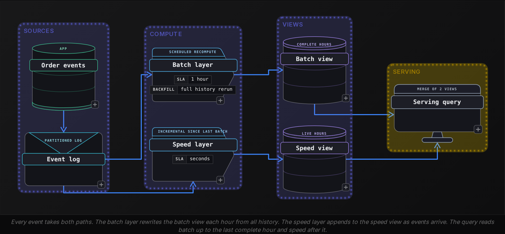
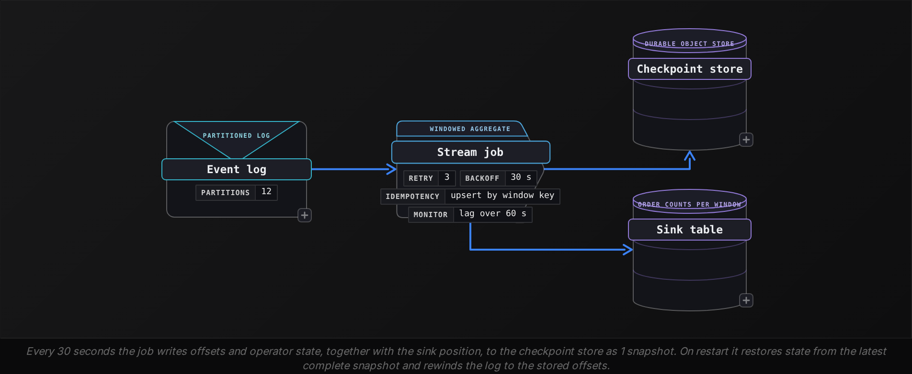

Intermediate·Pipeline Architecture · 35 min · 2 challenges

# Batch or Stream?: Intermediate

The interviewer at Uber opens with a story rather than a question. A rider opens the app and sees a fare and an ETA. Behind that screen, a pricing model reads demand in each neighborhood, and a city operations team reads the same demand on a dashboard the next morning. 'Same data, 2 consumers,' she says. 'Which of those do you build as a stream, which as a batch, and how do you know?' The candidate starts with 'streaming is faster', and she waits. Faster than what? And who pays for the speed? The answer she wants names a latency the consumer needs, a cost of being late, the shape of the source, and the team that will carry the pager. Then: how the stream and the batch share code, how the stream is tested before launch, and what the job does when it crashes at 03:00.


<br>

### What you will be able to do

Score a workload on 4 factors and state the latency SLA that justifies a stream or a batch

Draw a Lambda architecture, name the dual-maintenance cost, and explain how 1 job definition run at 2 cadences removes it

Test a streaming job by replaying recorded events against a golden output, including late, out-of-order and duplicate records

Choose micro-batch or record-at-a-time processing from the SLA and the team's existing runtime

Trace a restart from a checkpoint, say which events are reprocessed, and say why the sink must tolerate them


<br>

---

## When Would You Use Streaming?

Streaming is a cost paid to shorten the gap between an event and a decision made on it. Before paying, find out how short that gap has to be, and take the number from the consumer of the data rather than from the pipeline team. A fraud model approving a card swipe has about 300 ms before the terminal gives up. A finance analyst closing the month opens the revenue report once, on the 2nd business day. Both read the same transactions, and only 1 of them justifies a stream.


<br>

### The 4 factors

Score every workload on these before choosing

- **1. Latency the consumer acts on** *A number, with a unit*\
  When does a person or a system do something different because the data arrived? Write it down: 300 ms for the fraud score, 2 seconds for a rider ETA, 6 hours for a demand forecast.
- **2. Cost of being late** *Money or risk per minute of delay*\
  A stockout alert delayed by an hour costs an hour of lost sales on that item. A weekly cohort chart delayed by an hour costs nothing, because nobody reads it until Monday.
- **3. Shape of the source** *Events or snapshots*\
  Order events and GPS pings arrive 1 at a time with timestamps and can be streamed, and so can change-data-capture rows. A nightly dump of a vendor database arrives whole at midnight, and no engine can stream data it cannot see until then.
- **4. Team and operations** *Who carries the pager*\
  A stream runs 24 hours a day, holds state in memory, and pages someone when it stalls. A batch job that fails at 02:00 reruns at 07:00 with no data lost. Ask who is on call and whether they have run a stateful job before.

The first factor sets the floor, and the way to use it is arithmetic. Write the SLA as the time from the event to the moment the consumer needs the result, then compare it with what batch can reach. An hourly job that runs for 10 minutes delivers a worst case of 70 minutes after the event. A daily job finishing at 06:00 for a report opened at 09:00 is early by 3 hours. Streaming is worth its cost when the SLA is shorter than the worst case of the fastest batch cadence you can afford.

| Workload | Latency acted on | Cost of being late | Source shape | Call |
| --- | --- | --- | --- | --- |
| Card fraud score | 300 ms | fraud approved or a customer declined, per swipe | 1 event per swipe | stream |
| Rider ETA | 2 s | wrong ETA, cancelled trip | GPS ping every 4 s | stream |
| Warehouse stockout alert | 5 min | lost sales on the item until restocked | inventory change events | stream, or 30 s micro-batch |
| Ad click attribution | 1 hour | advertiser dashboard lags | click events | micro-batch, 5 min trigger |
| Monthly revenue close | 2 days | none within the day | ledger snapshot at midnight | daily batch |

The SLA column alone decides the first 2 rows and the last. The ad click row is the arithmetic above: an hourly job running 10 minutes lands 70 minutes after the event, past the 1 hour SLA, so it becomes a micro-batch, small batches run on a fixed trigger, here 5 minutes. The stockout alert is the row interviewers like, because 5 minutes is reachable 2 ways: a stream processing each event on arrival, or a micro-batch with a 30 second trigger. Both meet the number, so the team decides, and a warehouse team already operating the batch engine picks the micro-batch, which runs on it.


<br>

### Put a number on the cost

The cost of streaming is compute that never stops. Take 50 million events a day. A daily batch job reads them in 40 minutes on 20 nodes. A streaming job on the same 20 nodes runs for all 24 hours, holding the cluster whether events arrive or not. The ratio between the 2 is about 36 to 1 before anyone adds the state store and checkpoint storage, let alone the engineer woken at 03:00. That ratio is the price, and factor 2 says whether being late costs more than it.

- **13 node-hours** — daily batch run for 50M events
- **480 node-hours** — the same cluster streaming all day

> **TIP**
>
> Say the SLA before you say the word streaming. 'The fraud decision has 300 ms, so batch cannot meet it' is a complete argument. 'Streaming is more modern' is a preference, and the interviewer will push on it until you produce the number anyway.


<br>

### Practice: a request for real-time order counts

> Work the 4 factors on this ask
>
> - A product manager wants 'real-time' order counts on the wall screen in the operations room.
> - Factor 1: staff glance at the screen every few minutes, so the latency they act on is about 1 minute.
> - Factor 2: when orders drop to zero they call the kitchen, so an hour of delay hides an outage, but 50 seconds of delay changes nothing.
> - Factor 3: each order is already an event on the log, so either path can read it.
> - Factor 4: the team runs a batch scheduler and nobody is on call overnight.
> - Call: a 10 second micro-batch. A 1 minute trigger would push the worst case past the minute staff act on.

Hybrid answers score well when each half has a reason. Stream the order events for the wall screen with a 10 second trigger, and recompute the finance totals from the same log nightly as a batch. The SLA chooses the path for each consumer. One source feeding 2 cadences is the common shape, and the next section shows how to keep the 2 paths honest with each other.


<br>

---

## Design for Both Batch and Stream

Lambda architecture answers a real tension: a stream gives a fast result that may be incomplete, and a batch gives a complete result that arrives late. The design runs both over the same events. The batch layer recomputes every result from the full history on a schedule, say hourly. The speed layer processes only the events since the last batch run completed. The serving layer answers a query by merging the 2 views, taking batch results up to the last complete hour and speed results after it. Nathan Marz described the pattern in 2011, and for years it was the standard answer when an interviewer asked for both freshness and correctness.




<br>

### The merge the serving layer runs

The 2 views overlap on purpose. The speed view holds every hour the stream has seen, including hours the batch has since recomputed, so the merge must cut the speed view at the batch boundary. Here the batch view holds complete hours of order counts per product, and the speed view holds the same shape built from the live log.

```sql
WITH batch_complete AS (
  SELECT
    MAX(hour_start) AS last_hour
  FROM batch_view
)

SELECT
  product_id,
  SUM(order_count) AS order_count
FROM (
  SELECT
    product_id,
    hour_start,
    order_count
  FROM batch_view

  UNION ALL

  SELECT
    product_id,
    hour_start,
    order_count
  FROM speed_view
  WHERE hour_start > (
    SELECT
      last_hour
    FROM batch_complete
  )
) AS merged
GROUP BY product_id
```

batch_view (complete hours)

| product_id | hour_start | order_count |
| --- | --- | --- |
| P1 | 10:00 | 120 |
| P1 | 11:00 | 134 |
| P1 | 12:00 | 141 |

speed_view (live, overlaps)

| product_id | hour_start | order_count |
| --- | --- | --- |
| P1 | 11:00 | 130 |
| P1 | 12:00 | 141 |
| P1 | 13:00 | 57 |

With `last_hour` at 12:00, the query takes 395 from the batch view (120 plus 134 plus 141) and discards the speed rows for 11:00 and 12:00. Adding 57 from 13:00 gives a total of 452. Look at the speed view's 11:00 count of 130 against the batch's 134: the stream missed 4 late orders that the batch picked up an hour later. The merge hides that gap by preferring batch wherever batch exists. That is the correctness guarantee Lambda sells, and it works.


<br>

### The dual-maintenance tradeoff

The cost sits inside the 2 boxes labeled batch layer and speed layer. Each holds its own copy of the business logic: which order statuses count, how an order maps to a product, how refunds subtract. The copies begin identical and drift. A status rule changes in the batch code on Tuesday, the stream version ships on Friday, and for 3 days the merged total disagrees with itself at the boundary hour. Every bug is fixed twice, every test is written twice, every schema change is deployed twice, and the 2 teams who own the halves argue about whose number is right.

- 2 codebases for 1 rule: the attribution logic lives in the batch job and again in the stream job
- 2 deploys per change: a rule change is live in 1 layer days before the other
- 2 test suites: the replay test for the stream and the golden-file test for the batch cover the same cases
- 1 boundary hour that disagrees whenever the layers are out of step


<br>

### Convergence: one code path, 2 cadences

Jay Kreps published 'Questioning the Lambda Architecture' in 2014 with a simpler shape, later called Kappa: keep the log long enough, and when the logic changes, start a second instance of the same stream job from the beginning of the log, let it catch up, and switch readers to its output. Reprocessing becomes a replay in place of a separate batch program. The step after that came from engines that treat a batch as a bounded stream: the same job definition runs over yesterday's files as a batch and over the live log as a stream, with 1 planner, 1 set of tests and 1 deploy. The batch layer survives as a replay of the stream code.

✓Lambda (2 code paths)

- Batch layer and speed layer written separately
- Correctness comes from the batch overwrite
- Reprocessing: rerun the batch job
- Serving layer merges at the boundary hour
- Drift between layers is a standing risk

✗Converged (1 code path)

- 1 job definition runs bounded or unbounded
- Correctness comes from handling late data in the stream
- Reprocessing: replay the log through the same job
- 1 output table, no merge
- Needs log retention long enough to replay


> **TIP**
>
> Name the tradeoff before the interviewer does: 'Lambda gives me both, at the price of the same logic in 2 places. I would rather keep 1 stream job, retain the log for 7 days, and reprocess by replay. The batch is the same job run bounded over a date range.'

The convergence has a condition. Replay works only when the log retains enough history for the rebuild, and when the stream handles late events well enough that the batch overwrite stops being needed. Both are testable, and the next section is about testing the second.


<br>

---

## How Do You Test a Streaming Job?

A streaming job has 3 inputs that a batch job lacks: the order events arrive in, the gaps between them, and the clock the job consults to decide a window is complete. A test that fixes any of those to the laptop's wall clock passes locally and fails on the first evening the traffic pattern changes. Replay fixes all 3 at once: record a set of real events with their event time and their arrival time, feed them through the job with the clock driven by the fixture, and compare the output with a golden result a human checked by hand once.


<br>

### 3 layers of tests

- **Unit tests on the pure functions** *Milliseconds, hundreds of them*\
  Parsing and enrichment each take an event and return a value, and so do key extraction and window assignment. Test all 4 with no engine running.
- **Replay tests on the whole job** *Seconds, 1 per scenario*\
  A recorded fixture of 20 to 200 events with event time and arrival time runs through the real job logic with a controlled watermark, and the output is compared to a golden file.
- **A shadow run against the live log** *Hours, before each release*\
  The new version reads production events into a scratch sink while the old version keeps serving. A bounded recompute over the same window gives the expected totals.


<br>

### A fixture that covers the cases that bite

A good fixture is small and adversarial. The one below uses 60 second windows and a watermark of the largest event time seen minus a 30 second lateness allowance. A window closes when the watermark passes its end, so window 0 stays open until an event at 90 or later appears, however late its own events arrive. Each row exercises 1 behavior: the ordinary case, a duplicate, an out-of-order event in an open window, and an event whose window has closed.

| id | event_time (s) | arrival (s) | amount | what it tests |
| --- | --- | --- | --- | --- |
| a | 10 | 11 | 5.0 | ordinary event, window 0 |
| b | 55 | 56 | 7.0 | ordinary event, window 0 |
| b | 55 | 58 | 7.0 | duplicate delivery, must count once |
| c | 70 | 72 | 2.0 | first event of window 60 |
| d | 40 | 85 | 3.0 | out of order, window 0 still open (ends 60, watermark 40) |
| e | 130 | 131 | 1.0 | advances the watermark past window 0 |
| g | 20 | 140 | 9.0 | 120 s late, window 0 already closed, dropped |
| f | 200 | 201 | 4.0 | advances the watermark past window 60 |

```sql
from collections import defaultdict


def run(events, window_s=60, lateness_s=30):
    seen, open_windows, closed = set(), defaultdict(float), {}
    watermark = 0
    for e in events:
        if e['id'] in seen:
            continue
        seen.add(e['id'])
        watermark = max(watermark, e['time'] - lateness_s)
        start = e['time'] - e['time'] % window_s
        if start in closed:
            continue
        open_windows[start] += e['amount']
        for w in list(open_windows):
            if w + window_s <= watermark:
                closed[w] = open_windows.pop(w)
    return closed


def test_late_and_duplicate():
    events = [
        {'id': 'a', 'time': 10, 'arrival': 11, 'amount': 5.0},
        {'id': 'b', 'time': 55, 'arrival': 56, 'amount': 7.0},
        {'id': 'b', 'time': 55, 'arrival': 58, 'amount': 7.0},
        {'id': 'c', 'time': 70, 'arrival': 72, 'amount': 2.0},
        {'id': 'd', 'time': 40, 'arrival': 85, 'amount': 3.0},
        {'id': 'e', 'time': 130, 'arrival': 131, 'amount': 1.0},
        {'id': 'g', 'time': 20, 'arrival': 140, 'amount': 9.0},
        {'id': 'f', 'time': 200, 'arrival': 201, 'amount': 4.0},
    ]
    assert run(events) == {0: 15.0, 60: 2.0}
```

The watermark only moves forward. Event `d` arrives at 85 with event time 40; the largest event time so far is 70, from `c`, so the watermark stands at 40, window 0 is still open, and its total becomes 15. Event `g` arrives at 140 with event time 20. By then `e`, with event time 130, has pushed the watermark to 100, window 0 has closed at 15, and `g` is dropped. Change `lateness_s` to 120 and `g` counts, window 0 closes at 24 once `f` arrives, and window 60 stays open because the watermark has only reached 80. The test tells you which business decision moved.


<br>

### The shadow run, and the query that scores it

Replay proves the logic. A shadow run proves the job on production volume and partitioning, including the events that arrive late. Deploy the new version reading the live log into `shadow_sink`, leave it for 24 hours, then recompute the same 24 hours with a bounded run of the same code over the log into `batch_recompute`. The 2 should agree for every closed window. The query lists the disagreements, largest first, so the first 20 rows show whether the problem is a dropped partition or a late-data rule.

```sql
SELECT
  b.product_id,
  b.hour_start,
  b.order_count AS batch_count,
  COALESCE(s.order_count, 0) AS stream_count,
  b.order_count - COALESCE(s.order_count, 0) AS diff
FROM batch_recompute AS b
LEFT JOIN shadow_sink AS s
  ON b.product_id = s.product_id
    AND b.hour_start = s.hour_start
WHERE b.order_count <> COALESCE(s.order_count, 0)
ORDER BY ABS(b.order_count - COALESCE(s.order_count, 0)) DESC
LIMIT 20
```

Reading the output follows a pattern. A diff on every key for 1 hour points at an offset or partition the shadow job skipped. A diff of a few units on random keys points at late events the shadow dropped and the bounded run kept, which means the lateness allowance is too short for real arrival delays. Zero rows for 24 hours is the release criterion.

✓Do

- Derive the watermark from the fixture's event times, never the machine clock
- Keep 1 golden file per scenario and name the scenario in the file
- Include a duplicate and a too-late event in every fixture
- Compare the shadow run to a bounded run of the same code

✗Don't

- Test windows with sleep() calls and hope the timing holds
- Reuse the batch job's golden output for the stream without the lateness rule
- Declare a release good on throughput alone
- Let the fixture grow past a few hundred events

> **TIP**
>
> When asked 'how do you test a streaming job', lead with the fixture: 'I replay recorded events with their arrival times through the job, with a controlled watermark, and assert on closed windows. The fixture always holds a duplicate, an out-of-order event and a too-late event.'


<br>

---

## Micro-batch or True Streaming?

Both engines read the same log and write the same sink, and the difference is what happens between. A micro-batch engine waits for a trigger interval and takes every event that arrived during it. It plans and runs that set as a small batch job, then commits the source offsets before the next interval starts. A record-at-a-time engine pushes each event through the operator graph the moment it arrives, updating state per event and emitting results as soon as a window closes. The first reuses the batch planner and pays a latency floor equal to the trigger. The second removes the floor and pays with a second runtime to operate.


<br>

### Where the latency comes from

Take a 10 second trigger. The timeline below follows 2 events through 1 cycle. An event that arrives at the start of the interval waits almost the full 10 seconds for the trigger, then waits for the batch to run. An event arriving at the end waits only for the run. The consumer sees results in steps, every 10 seconds plus the run time, with p99 near the full trigger plus the slowest run.

| Clock | Event arriving at 10:00:01 | Event arriving at 10:00:09 |
| --- | --- | --- |
| 10:00:00 | interval opens | interval opens |
| 10:00:01 | arrives, waits |  |
| 10:00:09 |  | arrives, waits |
| 10:00:10 | trigger fires, 20,000 events planned as 1 batch | same batch |
| 10:00:13 | batch commits, result visible | result visible |
| End to end | 12 s | 4 s |

Shrinking the trigger lowers the floor but raises the overhead. Each cycle pays a fixed cost for planning and committing offsets, around 1 second on a typical cluster, so a 2 second trigger spends half its time on overhead and a 100 ms trigger spends almost all of it. Below about 1 second the micro-batch model stops paying, and that is the line the record-at-a-time engine exists to cross.

✓Micro-batch

- Latency floor: the trigger plus the run, 1 s to minutes
- Throughput: high per node, the batch planner optimizes each cycle
- State: snapshotted once per cycle with the offsets
- Code: the same functions and cluster as the batch jobs
- Failure unit: 1 cycle reruns whole
- Skills: the batch team already has them

✗Record-at-a-time

- Latency floor: the processing path, 10 to 100 ms
- Throughput: high, with per-event overhead on hot keys
- State: kept per operator, snapshotted on an interval
- Code: a separate API, often a separate cluster
- Failure unit: the job restores from its last checkpoint
- Skills: a second runtime to learn and page on


<br>

### Match to the SLA first, then to the team

The decision has 2 steps in order. First, the SLA against the latency floor. A trigger needs to be a fraction of the SLA so that p99 lands under it: a 5 minute SLA tolerates a 30 second trigger with room to spare, a 2 second SLA tolerates no trigger at all. Second, when both engines meet the SLA, the team decides. A team that runs the batch engine already gets the micro-batch stream on the same cluster, with the same functions, the same deploy pipeline and the same on-call rotation. Choosing the record-at-a-time engine for that team adds a runtime they must learn, with its own state backend and checkpoint store, for a latency the SLA never asked for.

| Workload | SLA | Engine | Why |
| --- | --- | --- | --- |
| Card fraud score | 300 ms | record-at-a-time | no trigger fits under the SLA |
| Rider ETA | 2 s | record-at-a-time | a 1 s trigger plus the run misses p99 |
| Stockout alert | 5 min | micro-batch, 30 s trigger | p99 around 40 s, on the existing cluster |
| Ad click attribution | 1 hour | micro-batch, 5 min trigger | shares code with the hourly rebuild |
| Ops wall screen | 1 min | micro-batch, 10 s trigger | nobody acts faster than the glance |

The ETA row deserves the extra sentence an interviewer waits for. A 1 second trigger plus a 1 second run gives a p50 near 1.5 seconds and a p99 near 2.5 seconds, over the 2 second SLA, so micro-batch fails on the tail while passing on the median. Tail latency is where the trigger model loses, and saying so shows the reasoning behind the choice.

> **TIP**
>
> Put the trigger and the SLA in the same sentence: '30 second trigger, p99 about 40 seconds, against a 5 minute SLA, so micro-batch on the cluster we already run.' The interviewer gets the tail latency and the team constraint in 1 breath.

*Some micro-batch engines offer a continuous mode with sub-second latency and weaker guarantees. In an interview, treat it as a footnote: the decision still comes down to the SLA and to who operates the job.*


<br>

---

## How Do You Restart a Stream?

A checkpoint is a snapshot of everything the job would need to continue as if it had never stopped. It holds 3 things written together: the offset in each source partition the job has consumed up to, the state of every operator at that offset (open window totals, the set of seen ids, the join buffer), and the position the sink has acknowledged. The 3 are written as 1 unit to durable storage, so that a restart never pairs state from 1 moment with offsets from another.




<br>

### A crash, second by second

The job reads 2,000 events a second across 12 partitions, aggregates into 5 minute windows, and checkpoints every 30 seconds. The table follows a crash from the last good snapshot to full recovery.

| Clock | What happens | Source offset | Window state |
| --- | --- | --- | --- |
| 10:00:00 | checkpoint 41 completes | 1,000,000 | 09:55 window closed, 10:00 window at 0 |
| 10:00:30 | checkpoint 42 completes | 1,060,000 | 10:00 window at 60,000 |
| 10:00:45 | process dies mid-cycle | 1,090,000, in memory only | 10:00 window at 90,000, lost |
| 10:01:15 | restart after 30 s backoff, loads checkpoint 42 | 1,060,000 | 10:00 window at 60,000 |
| 10:01:15 to 10:01:40 | replays from 1,060,000 and catches up to live | 1,090,000 onward | rebuilt by reprocessing |
| 10:01:40 | caught up, checkpoint 43 completes | 1,200,000 | 10:00 window at 200,000 |

The events between offsets 1,060,000 and 1,090,000 are 15 seconds of traffic at 2,000 a second. The job consumed them and emitted some before the crash, and the restarted job consumes them again. Their totals are added to state restored from checkpoint 42, which does not include them, so the aggregate stays correct. Nothing is lost because the log still holds them and the checkpoint recorded where to resume. What moves is the latency: a consumer watching the sink sees no update for about 55 seconds, from the crash to catch-up, and then a burst.

- **30,000** — events replayed after this crash
- **60,000** — worst case replay at a 30 s interval


<br>

### What the sink sees twice

Correct state after restart is 1 half of the problem. The sink received emissions for the 10:00 window before the crash, perhaps a running total of 88,000 at 10:00:44, and after replay it receives emissions covering the same events again. An append-only sink now holds 2 rows for the same window. 3 designs absorb this. An upsert sink keyed by product and window start overwrites the earlier row, so the latest emission wins. A transactional sink commits output in the same transaction as the offsets, so the writes after checkpoint 42 were never committed. A dedupe view on the read side keeps the latest emission per key, as below. The guarantee each design gives, and what each costs, is the subject of the delivery semantics lesson.

```sql
SELECT
  product_id,
  window_start,
  order_count
FROM (
  SELECT
    product_id,
    window_start,
    order_count,
    ROW_NUMBER() OVER (
      PARTITION BY product_id, window_start
      ORDER BY emitted_at DESC
    ) AS rn
  FROM stream_sink
) AS ranked
WHERE rn = 1
```

The `emitted_at` column makes the view work: the replayed emission for a window is written after the orphaned pre-crash write, so the latest row wins and the orphan stays in the table without being read. The cost is a window function on every query, which is why an upsert sink is the usual choice when the sink supports it.


<br>

### Choosing the checkpoint interval

The interval sets the size of the replay and the write load on the checkpoint store, and the 2 pull in opposite directions. At 30 seconds, the store receives a snapshot of the state twice a minute. With 2 GB of state that is 4 GB a minute of writes for a full snapshot, which is why engines write incremental checkpoints holding only the keys changed since the last one. At 5 seconds, replay shrinks to 10,000 events, but every snapshot still pauses operators to write offsets, and that fixed cost runs 6 times as often. The rule to give in an interview: pick an interval that is a small fraction of the latency SLA, often a tenth, bounded below by what the store can absorb, and measure recovery time with a deliberate kill in staging.

> The restart answer, in order
>
> - A checkpoint writes offsets and operator state together with the sink position, as 1 unit
> - Restart loads the latest complete checkpoint and rewinds the source to its offsets
> - Events after the checkpoint are reprocessed, never lost, because the log retains them
> - The sink must tolerate the second emission through upserts or transactions; failing that, dedupe on read
> - The interval trades replay size against snapshot write load, a fraction of the SLA


<br>

---

## Putting It All Together

A food delivery company runs 1 order and courier log feeding 3 consumers. The courier app shows an ETA that must update within 2 seconds of a courier's GPS ping. The operations wall screen shows live order counts that staff glance at every minute. Finance closes revenue by the 2nd business day of each month. The team of 4 already runs the nightly batch jobs and has 1 engineer on call.

- The 4 factors give 3 answers from 1 log: a record-at-a-time job for the ETA, a 10 second micro-batch for the wall screen, and a nightly bounded run of the same micro-batch code for finance.
- The wall screen and finance share 1 job definition run at 2 cadences, so the converged design removes the Lambda dual-maintenance cost for them and leaves no boundary hour to merge.
- Before the ETA job ships, a replay fixture holds a duplicate ping, a ping arriving 45 seconds late and a ping arriving 3 minutes late, and a 24 hour shadow run is scored against a bounded recompute.
- The ETA job checkpoints every second, the smallest interval its state store absorbs, and its sink upserts by courier id so the replay after a crash overwrites instead of duplicating.
- The single on-call engineer is the constraint that keeps the wall screen on micro-batch: 2 runtimes on a 4 person team doubles what 1 person must know at 03:00.


<br>

---

## Key Takeaways

- Streaming is justified by a latency SLA the consumer acts on, written as a number, and by a cost of lateness that exceeds the cost of a cluster that never stops.
- Lambda runs batch and speed layers over the same events and merges at the boundary hour, at the price of the same logic maintained in 2 codebases.
- Convergence keeps 1 job definition that runs bounded for reprocessing and unbounded for the live log, with reprocessing as a replay of the log.
- A streaming job is tested by replaying recorded events with their arrival times through a controlled watermark, with a duplicate, an out-of-order and a too-late event in every fixture.
- Micro-batch pays a latency floor equal to its trigger and reuses the batch team's cluster and skills. Record-at-a-time removes the floor and adds a runtime to operate.
- A restart loads the last checkpoint, rewinds the source to its offsets, and reprocesses what followed. The sink must tolerate seeing those events a second time.
