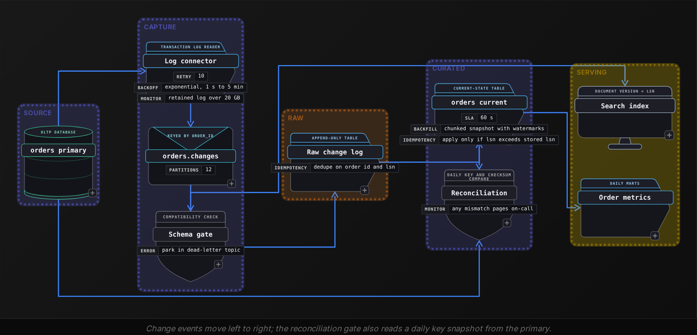
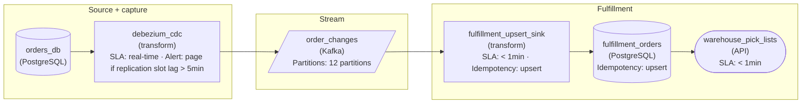
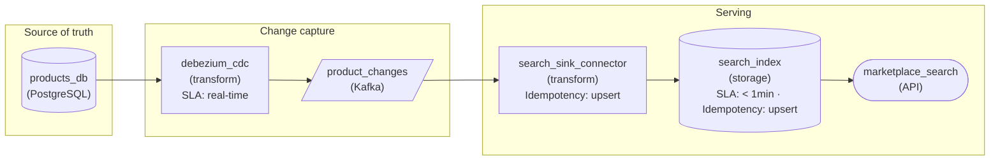

Advanced·Pipeline Architecture · 25 min · 2 challenges

# CDC and Dual Writes: Advanced

Priya is 40 minutes into a data engineering loop at Netflix when the interviewer sketches 2 boxes on the whiteboard: an orders database and a search index. 'Today the service writes to both. Twice a week the index shows orders that the database says were cancelled. Redesign it.' Priya starts toward a retry queue, then stops. A retry would hide the symptom, she realizes, because the drift comes from 2 systems each believing it holds the truth. The interviewer pushes further: how would the warehouse get those orders within a minute, how would deletes arrive, what happens when the change reader crashes mid-batch, and what breaks when someone renames a column? Each follow-up probes the same choice: which component records each change to a row, and what that record promises about order, completeness and duplicates. This lesson builds that reasoning from the transaction log outward.


<br>

### What you will be able to do

Recognize an extraction or sync question in its common disguises and name the guarantees it turns on

Explain how log-based CDC snapshots, streams, orders and redelivers changes, and where log retention and schema change break it

Show with a timeline why timestamp polling loses deletes, intermediate states and rows committed behind the watermark

Diagnose the failure modes of a dual-write design and replace it with CDC or a transactional outbox

Design a CDC pipeline whose apply step stays correct under retries, out-of-order events, backfills and schema change


<br>

---

## "How Do You Extract Source Data?"

Every pipeline that copies operational data rests on a single decision made before any transform: where the record of a change comes from. Get it wrong and no downstream logic recovers what the source never emitted. A deleted row that left no trace cannot be removed from the copy, and a status an order held between 2 reads cannot be counted.


<br>

### The same question in 4 disguises

- **'Keep the search index consistent with the database.'** *Dual write or capture*\
  Today the application writes twice. The answer derives one write from the other.
- **'Land new orders in the warehouse within 60 seconds.'** *Latency budget*\
  A 60-second budget rules out snapshots, strains polling and points at the log.
- **'The nightly load still shows deleted orders.'** *Deletes and lost states*\
  Hard deletes and short-lived statuses never appear in a read of current table contents.
- **'Emit an OrderShipped event whenever an order ships.'** *Events with intent*\
  Consumers want a business fact that a row diff cannot express, which is the outbox case.

Underneath all 4 sits a single question: who writes down the fact that a row changed, and what does that written record guarantee? Name the guarantees before naming a mechanism. Interviewers probing this pattern listen for whether you know what each option gives up, because every option gives something up.


<br>

### Five ways changes leave a database

| Method | Who records the change | Hard deletes | Every intermediate state | Extra load on source | Freshness |
| --- | --- | --- | --- | --- | --- |
| Full snapshot | Nobody; the pipeline diffs 2 copies | Only by diffing keys | No | Rereads every row each run | Hours |
| Query-based CDC | An `updated_at` or version column the app maintains | No | No, only the state at poll time | An index range scan per poll | 1 to 15 minutes |
| Log-based CDC | The database's transaction log | Yes | Yes, every committed change | Log reads, plus log retained while the reader lags | Seconds |
| Dual write | Application code, as a second write | Only if the code sends one | Yes, until a write fails | None on the database | Milliseconds, then drift |
| Transactional outbox | The application, inside the same transaction | If the app writes a delete event | Yes, as business events | 1 extra insert per transaction | Seconds |


<br>

### The running example

The rest of the lesson follows a single table. An `orders` table on an OLTP primary holds 120 million rows and takes 9 million row changes per day, peaking at 2,000 changes per second during evening sales. Two consumers read it: a warehouse table, `orders_current`, that analysts expect within 60 seconds of the source, and a search index that support agents use to look up orders. Orders move through PLACED, PAID, SHIPPED and CANCELLED, and a nightly cleanup job hard-deletes test orders created by QA.


<br>

### The properties that pick the method

Ask these before choosing

- **Deletes.** Does the copy need to drop rows the source removed? If the source hard-deletes, only the log or an explicit delete event carries that fact.
- **Transitions.** Does any consumer need each status, or only the latest? Fraud and dispute models usually need PAID followed by CANCELLED, which polling collapses.
- **Ordering.** Must 2 changes to the same order apply in commit order? The log has a single total order per database; independent application writes have none.
- **Source access.** Can you read the log at all? Vendor-hosted and SaaS databases often expose only a query interface.
- **Load and blast radius.** What may the pipeline do to the primary? A log reader can pin disk, a poller adds queries, and a snapshot adds heavy reads for hours.

| ✓ Log-based CDC earns its cost when | ✗ Polling or snapshots are enough when |
| --- | --- |
| • Consumers need deletes or every status transition<br><br>• Freshness targets are seconds to a minute<br><br>• You can get replication access to the source<br><br>• Several consumers want the same change stream | • The table is small enough to reread each run<br><br>• Rows are append-only and never updated<br><br>• Daily freshness satisfies every consumer<br><br>• The source exposes nothing beyond SQL queries |

> Try it: the vendor database
>
> A disputes team needs every status transition for card chargebacks. The source is a vendor-hosted database with read-only SQL access and no log. Which method would you propose, and what limit would you have to state out loud?

Polling is the only method available, and it cannot meet the requirement, so the answer names that gap and moves the requirement upstream. Ask the vendor for an audit or history table that records each transition as a new row, then poll that append-only table instead of the orders table. If the vendor offers nothing, a poll every minute captures each order's latest status only, and the disputes team must accept that a status held for under a minute may never appear. Stating that loss in numbers is the part of the answer that earns credit.

> **TIP**
>
> Open an extraction answer with the guarantees the consumers need, then pick the method that provides them. Starting from a tool name invites 'and what happens to deletes?' before you have framed the problem.


<br>

---

## Log-Based CDC With Debezium

A database writes every change to its transaction log before it changes the table, so a crash can be replayed and replicas can follow. That log already holds what CDC needs: each committed insert, update and delete, stamped with a log sequence number (LSN). Transactions arrive in commit order, and successive changes to one row always carry rising LSNs, because the row lock serializes its writers. Across rows, interleaved transactions can make LSN order and commit order disagree. A log-based connector registers with the database the way a replica would, reads from a stored position, turns each record into a change event, and publishes it to a topic. Outside snapshots and backfills, streaming sends no queries to `orders`.


<br>

### What one change event carries

```sql
{
  "op": "u",
  "before": {
    "order_id": 501,
    "status": "PAID",
    "amount": 42.5
  },
  "after": {
    "order_id": 501,
    "status": "CANCELLED",
    "amount": 42.5
  },
  "source": {
    "table": "orders",
    "lsn": 88213004512,
    "txid": 771203
  },
  "ts_ms": 1792735245310
}
```

- op marks create (c), update (u), delete (d), or a row read during the initial snapshot (r).
- before and after are row images, and a delete carries only before. Without full before-image logging at the source, an update's before is empty or key-only and a delete's holds the key alone: enough to remove the row, too little for a PAID-to-CANCELLED detector comparing old and new values.
- source.lsn is the log position. It rises with every change to a row, which makes 'highest LSN per order_id wins' safe for every downstream dedupe and ordering rule.
- source.txid groups the events of a single transaction. A transaction that touched orders and payments becomes events on 2 topics, so a consumer can observe half of it.


<br>

### Snapshot first, then the log

The log covers only changes after the connector starts, so a new pipeline also needs the 120 million rows that already exist. The classic sequence records the current log position P, reads the whole table under a single consistent view, emits each row as an `r` event, then streams from P. A row modified during the read arrives twice, from the snapshot and from the log, and the consumer must treat the log copy as newer. On a busy primary the read takes hours, and the log from P onward is retained the whole time.

Chunked snapshots remove the long hold. The connector reads the table in key ranges of, say, 50,000 rows while it keeps streaming, and brackets each chunk with low and high watermark markers written into the log. A log event for a key in the chunk that lands between the 2 markers replaces the chunk's copy of that row. The snapshot can then pause, resume, or rerun a single key range as a backfill without stopping live capture.


<br>

### Delivery is at least once

The connector publishes a batch, waits for the topic to acknowledge it, then saves its log position as an offset. A crash after the acknowledgement and before the offset write restarts it from the older offset, and everything in between is published again. With offsets flushed every 10 seconds at a peak of 2,000 changes per second, a single crash resends up to 20,000 events. Some platforms can publish transactionally, but the consumer's own writes get retried too, so design for redelivery: per `order_id`, keep the highest LSN applied and skip anything at or below it.

Ordering survives only as far as partitioning carries it. Keying the topic by `order_id` sends every change to order 501 to the same partition, where events stay in LSN order. Across the topic's 12 partitions there is no order at all, and a change on the payments topic can arrive before the order insert it references. Any consumer that joins 2 captured tables must tolerate a missing parent for a while.


<br>

### Where the log itself bites

| ✓ Reader-pinned retention | ✗ Time-based rotation |
| --- | --- |
| • The database keeps every log segment the slowest reader still needs<br><br>• Nothing is lost while the connector is down<br><br>• Failure mode: the primary's disk fills and writes stop<br><br>• Guard: alert on retained size, cap it, drop the reader past the cap | • The database deletes segments past a fixed age, readers or not<br><br>• The primary's disk stays safe<br><br>• Failure mode: a long-stalled connector resumes at a deleted position<br><br>• Guard: alert on lag versus retention, re-snapshot after a gap |

The running example uses reader-pinned retention. The `orders` primary writes about 18 GB of log per day and has 54 GB of free disk. If the connector stalls on a Friday evening and nobody is paged, the database keeps every byte of that log for the stalled reader.

- **3 days** — until the stalled reader fills the disk

That is a production outage caused by an analytics pipeline, so the lag alert belongs to the database's on-call as well as the data team's. The running example sets a retained-log cap of 20 GB: past it, the database drops the reader, the primary survives, and the pipeline accepts a re-snapshot.

#### Schema changes travel through the log

DDL changes the shape of every event committed after it. Adding a nullable `coupon_code` column adds a field, and consumers that ignore unknown fields keep working. Renaming `amount` to `total_amount` removes `amount` from the next event, and a consumer reading it gets nulls or crashes. Changing `amount` from decimal dollars to integer cents keeps the name and changes the meaning, which is the most dangerous of the 3 because no check on field names catches it.

| ✓ Do | ✗ Don't |
| --- | --- |
| • Register each event schema and reject incompatible versions before publishing<br><br>• Allow additive changes: new nullable columns and new tables<br><br>• Rename in steps: add the column, backfill, move readers, then drop<br><br>• Give a column a new name when its units change | • Treat a captured table's layout as private once consumers read its events<br><br>• Rename or retype a captured column in a single migration<br><br>• Let a consumer default a missing field to zero without an alert<br><br>• Drop a column before every consumer has stopped reading it |

> Try it: a 9-day outage
>
> A connector reads a database that rotates its log after 7 days, and it was down for 9. Its saved offset points into a segment deleted 2 days ago. What did the consumers miss, and how do you recover without trusting anything from the outage?

Every change committed during the 2 days of deleted log is gone from the stream, deletes included, and the connector cannot tell which rows they touched. Recovery is a fresh snapshot taken from a new log position, applied with the same highest-LSN rule so snapshot rows and live events reconcile. Deletes from the gap need one more step: anti-join the copy's keys against the snapshot's keys and remove the extras, because a snapshot shows only rows that still exist.


<br>

---

## Query-Based CDC and Its Limits

Query-based CDC asks the table what changed. The pipeline stores a watermark, the largest `updated_at` it has loaded (no relation to the snapshot chunk markers of log-based CDC), and on each run selects rows newer than the watermark, upserts them by `order_id`, and advances the watermark. It needs only read access and an index on `updated_at`, which makes it the default for sources that expose nothing else.

```sql
SELECT
  order_id,
  status,
  amount,
  updated_at
FROM orders
WHERE updated_at > TIMESTAMP '2026-10-22 10:00:20'
ORDER BY updated_at
```

The design trusts 3 assumptions: every writer sets `updated_at`, a row becomes visible in the order its timestamp suggests, and the table's current contents describe everything that happened. All 3 fail in production, and each failure is silent.


<br>

### Three things a poll cannot see

#### Rows that no longer exist

The nightly cleanup hard-deletes test orders. A removed row has no `updated_at` left to compare, so no poll returns it, and `orders_current` keeps those test orders forever. Soft deletes fix this only if every writer, the cleanup job included, sets `deleted_at` instead of removing the row.

#### States held between 2 polls

Order 501 is placed at 10:00:05, paid at 10:00:20 and cancelled at 10:00:45. With polls at 10:00:00 and 10:01:00, the second poll reads the row as CANCELLED. The copy is right about the present and blind to the path: a fraud model that flags paid-then-cancelled orders never sees the pattern it was trained on.

- **1 of 3** — order 501 statuses the copy ever held
- **25 s** — time order 501 spent in PAID

#### Rows committed behind the watermark

The subtle failure needs 2 transactions. A row's `updated_at` is set when the statement runs, but other sessions see the row only after its transaction commits.

| Time | Transaction A, order 501 | Transaction B, order 502 | Poller |
| --- | --- | --- | --- |
| 10:00:00 | Updates 501, `updated_at` 10:00:00, stays open |  |  |
| 10:00:20 |  | Updates 502, `updated_at` 10:00:20, commits |  |
| 10:00:30 |  |  | Reads rows after 09:59:30, finds only 502, saves watermark 10:00:20 |
| 10:00:45 | Commits |  |  |
| 10:01:30 |  |  | Reads rows after 10:00:20; 501 is older and never loads |

Order 501's change is committed, correct and permanently absent from the copy, and nothing logs an error. The standard fix is a lookback: query from the watermark minus a margin longer than the longest transaction, here 5 minutes, and let the idempotent upsert absorb rows read twice. The margin is a bet on transaction length. A batch job that holds a transaction open for 20 minutes defeats a 5-minute lookback without a warning, so the margin needs a matching transaction timeout enforced at the source.


<br>

### What a survivable poll costs

| Fix | Closes | Cost |
| --- | --- | --- |
| Lookback margin with idempotent upsert | Late-committing rows | Rereads every row changed inside the margin, every poll |
| Soft deletes in every writer | Missed deletes | A source schema change, and every cleanup job must comply |
| Periodic key reconciliation | Deletes and any other miss | An anti-join of 120 million keys between source and copy |
| A trigger that maintains `updated_at` | Writers that skip the column | An extra write on every update to the busiest table |
| An audit table written by the source | Lost intermediate statuses | Storage growth and a writer change at the source |

Stack the fixes and the poller rereads overlapping windows, scans 120 million keys on a schedule, and depends on source-side discipline it cannot verify. That accumulated cost is the usual case for moving to the log once a table is large, busy and has deletes that downstream consumers must see.

> Try it: the version column
>
> A teammate replaces `updated_at` with an integer `row_version` that a database sequence increments on every write, arguing that sequences cannot drift like clocks. Which of the 3 blind spots does that close?

None of them. A sequence value is assigned when the statement runs, so transaction A can take version 1,040 and commit after transaction B's 1,041 has been read, and the commit-order gap stays open. Deletes still leave no row to return, and states between polls still collapse. The version column removes clock skew between application servers, which is a real gain, and changes nothing about visibility.


<br>

### When polling is the right call

- Append-only tables that never update or delete, polled by sequence id with a lookback
- Small dimension tables where rereading every row costs less than running a connector
- Sources with SQL access only: vendor databases, SaaS exports, replicas without log access
- Daily consumers who need yesterday's final state and nothing between

> **TIP**
>
> When an interviewer proposes `updated_at` polling, walk the 2-transaction timeline aloud. It shows why the watermark leaks, which a bare statement that polling misses deletes does not.


<br>

---

## The Dual-Write Problem

A dual write is application code that updates 2 systems in sequence because both need the change: the `orders` row and the search index, or the row and an event on a topic. Each write is reliable on its own. The pair has no shared commit, so any failure between them leaves the systems disagreeing, and neither records which one is right.

```sql
def cancel_order(order_id):
    db.execute(
        "UPDATE orders SET status = 'CANCELLED' WHERE order_id = ?",
        (order_id,),
    )
    db.commit()
    search.index_document(
        "orders",
        doc_id=order_id,
        body={"status": "CANCELLED"},
    )
```


<br>

### Where the 2 writes come apart

| Failure | Database | Index | Result |
| --- | --- | --- | --- |
| Process dies right after `commit()` | CANCELLED | PAID | Index stays stale until the order changes again |
| Index call times out after succeeding; code retries | CANCELLED | CANCELLED, written twice | Harmless for an idempotent index write; against a topic the retry publishes a duplicate event |
| Index written first, then the commit fails | PAID | CANCELLED | Index shows a cancel that never happened |
| Index rejects the document on a mapping error | CANCELLED | PAID | Error logged while the user sees success |

Each row is rare, and rare multiplied by volume becomes a daily count. The `orders` table takes 9 million changes per day. Suppose 0.01% of second writes fail after the first has committed, through deploys, timeouts and rejected documents.

- **900** — orders out of sync per day

Those orders stay wrong until something touches them again. The usual patch is a nightly job that compares the database with the index and repairs the differences, so the team now runs a sync design plus a reconciliation system to correct it.


<br>

### The race that retries cannot fix

With zero failures, 2 concurrent requests still reorder the second writes. Request A marks order 501 PAID; request B cancels it a moment later.

| Step | Request A | Request B | Database | Index |
| --- | --- | --- | --- | --- |
| 1 | Commits PAID |  | PAID | PLACED |
| 2 | Paused 300 ms by garbage collection | Commits CANCELLED | CANCELLED | PLACED |
| 3 |  | Indexes CANCELLED | CANCELLED | CANCELLED |
| 4 | Resumes and indexes PAID |  | CANCELLED | PAID |

Both requests succeeded, every call returned 200, and the index is wrong. Retries cannot help because nothing failed. The database serialized A and B, but the index receives their writes in whatever order the threads happen to run. Repairing that needs a version on each write that the index compares, and the only trustworthy version is the database's commit order.


<br>

### Make one write the source of truth

Every fix removes the second independent write. A distributed transaction spanning the database and the index or broker would work in principle, but most search indexes and brokers cannot join one, and two-phase commit leaves participants blocked if its coordinator fails mid-protocol. The practical options derive the second write from the first.

| Approach | Consumers receive | Main cost | Failure left over |
| --- | --- | --- | --- |
| CDC on the `orders` table | Row images in commit order | The table layout becomes a public contract | Consumers infer intent from row diffs |
| Transactional outbox, relayed by CDC | Business events the service chose to emit | 1 extra insert per transaction, plus outbox cleanup | Relay redelivers; consumers dedupe by event id |
| Log first: publish, then the database consumes | Events before database state | The service cannot read its own write at once | Validation must finish before publishing |

```sql
def cancel_order(order_id, event_id):
    with db.transaction():
        db.execute(
            "UPDATE orders SET status = 'CANCELLED' WHERE order_id = ?",
            (order_id,),
        )
        db.execute(
            "INSERT INTO outbox (event_id, order_id, event_type, payload) VALUES (?, ?, ?, ?)",
            (event_id, order_id, "OrderCancelled", '{"status": "CANCELLED"}'),
        )
```

The outbox insert commits atomically with the status change, so a crash leaves both rows or neither. A log connector reads inserts on `outbox` and publishes each `payload` to a topic keyed by `order_id`, which restores per-order ordering. The relay is at-least-once, so the `event_id` generated by the application becomes the consumer's dedupe key. A scheduled job deletes relayed outbox rows older than 1 day, or the table grows by up to 9 million rows daily.

> Try it: the payment call
>
> Checkout inserts an order, commits, then calls an external payment provider to charge the card. The provider has no topic to subscribe to and cannot join your transaction. Is this a dual write, and what makes it safe?

It is a dual write whose second half cannot be rolled back. Write the order and a `ChargeRequested` outbox row in the same transaction, let a worker read the outbox and call the provider with the order id as an idempotency key, and record the provider's answer as a new order state. This holds only if the provider honours idempotency keys: a retried call with the same key then returns the original charge, and at-least-once delivery produces exactly 1 charge.


<br>

---

## CDC Pipeline End-to-End

The design for the running example assembles the parts above: a log connector on `orders` and `outbox`, a keyed topic, a schema gate, an append-only change log, and an apply step that builds `orders_current`. The search index reads the gated topic directly and applies the highest-LSN rule through document versions. The interview test is whether each box has a stated rule for duplicates, disorder and changed shapes.




<br>

### Where each box breaks

| Stress | Where it breaks | Property that prevents it |
| --- | --- | --- |
| Connector restart replays 20,000 events | Changes apply twice | Idempotent apply keyed on `order_id` and `lsn` |
| Apply job retries a half-written batch | Target holds a mix of old and new rows | Each batch commits atomically or replaces whole partitions |
| A backfill replays old events for live orders | An older PAID overwrites a newer CANCELLED | Monotonic apply: a row changes only for a higher LSN |
| Snapshot chunk overlaps live changes | A snapshot row overwrites a newer change | Snapshot rows carry their read position and lose to higher LSNs |
| Column renamed at the source | Consumers read nulls as real values | Compatibility check before publish, with incompatible events parked |
| Connector down past log retention | Silent gap, deletes included | Lag alert against retention, then re-snapshot plus key anti-join |
| Hard delete at the source | Copy keeps the row | Deletes kept as LSN-stamped markers so a replayed insert cannot revive the row |


<br>

### Applying changes by LSN

The current-state table is a function of the change log: for each `order_id`, the event with the highest LSN, unless that event is a delete. Writing the rule as a query lets rebuilds and backfills run the same logic as the live path.

```sql
SELECT
  order_id,
  status,
  amount,
  lsn
FROM (
  SELECT
    order_id,
    op,
    status,
    amount,
    lsn,
    ROW_NUMBER() OVER (
      PARTITION BY order_id
      ORDER BY lsn DESC
    ) AS rn
  FROM raw_order_changes
) AS latest
WHERE rn = 1
  AND op <> 'd'
```

Three properties make this safe to rerun. Duplicates collapse because 2 copies of the same event share an LSN and carry identical values. Arrival order stops mattering because the ranking uses LSN, never ingestion time. A delete that is the latest event removes the key even when older updates arrive after it. The live path applies the same rule event by event, updating a row only when the incoming LSN exceeds the stored one and keeping deletes as LSN-stamped markers. The search index applies it by storing the LSN as each document's version and rejecting writes that carry a lower one, which also closes the race from the dual-write timeline.


<br>

### Proving the copy matches

Idempotence guards against the failure shapes you predicted; reconciliation catches the rest. Once a day, compare `orders` with `orders_current` at the same log position: row counts, a checksum over keys, and a checksum over keys with status. A key mismatch points at missed inserts or deletes. A status mismatch with matching keys points at ordering or a lost update. Each class maps to a row in the stress table, which tells the on-call engineer where to start.

```sql
SELECT
  COUNT(*) AS row_count,
  CHECKSUM(order_id) AS key_checksum,
  CHECKSUM(CAST(order_id AS VARCHAR) || ':' || status) AS key_status_checksum
FROM orders_current
```


<br>

### Shaping the answer in the room

A 5-step answer to any CDC design prompt

- **1. Consumers and guarantees**\
  Who reads the copy, how fresh it must be, and whether readers need deletes, transitions and per-key order.
- **2. Capture point**\
  Log, outbox or polling, chosen from step 1, with access and retention limits stated aloud.
- **3. Transport and ordering**\
  Partition by primary key, then name which consumers must tolerate disorder across keys and tables.
- **4. Apply rule**\
  Highest LSN wins, deletes stay as markers, snapshot rows rank by their read position.
- **5. Failure budget**\
  Lag alerts against retention, the schema gate, daily reconciliation and a re-snapshot runbook.

> Try it: the overwritten cancel
>
> After a backfill reprocessed last Tuesday's changes, support reports that order 7310 shows PAID in `orders_current` while the source says CANCELLED. The live path and the backfill both wrote to the table. Name the missing property and the change that restores it.

The backfill wrote by arrival, so its older PAID event replaced the newer CANCELLED that the live path had applied. The missing property is monotonic apply: both paths compare the incoming LSN with the stored LSN and skip anything older. Add an `lsn` column to the target if it lacks one, make the comparison part of the write itself, and rerun the backfill, which is now harmless because no row can move backwards.

> **TIP**
>
> When asked 'what happens if...' about a CDC design, give the property first and the mechanism second: 'the apply step is monotonic in LSN, implemented as a conditional update.' A property survives follow-ups that swap out the tools.


<br>

---

## Putting It All Together

A food delivery marketplace runs its order service on a single OLTP primary. Three consumers need each order's status: a search index for support agents, a warehouse table for hourly courier payouts, and a fraud service that watches for orders paid and then cancelled. Today the order service writes the database, then the index, then publishes an event, and a nightly poll copies changed rows into the warehouse. Support sees stale statuses every day, payouts sometimes include deleted test orders, and the fraud service misses fast cancellations.

- The stale statuses come from the dual-write crash window and the request race; feeding the index from CDC on the orders table, versioned by LSN, removes both.
- The fraud service needs transitions that the nightly poll collapses; an outbox emitting OrderPaid and OrderCancelled gives it business intent instead of row diffs.
- Deleted test orders in payouts are the poll's blind spot for hard deletes; log events carry each delete, and the warehouse keeps it as an LSN-stamped marker.
- A single connector now feeds all 3 consumers, so its retained-log cap and lag alert protect the primary that every restaurant order depends on.
- The warehouse apply step is highest-LSN-wins, so the one-time backfill of historical orders cannot overwrite live statuses, and the daily key and checksum compare proves it.


<br>

---

## Pipeline Architecture

### Exercise 1 of 2

**● TASK**

How would you rebuild the path that carries orders to the warehouses, which today writes each order to PostgreSQL and publishes an 'order placed' message to Kafka from the same request handler, so that warehouses see exactly the orders that committed, within a minute, with every change to an order arriving in the order it committed? The fulfillment on-call engineer is seeing both failures at the 2,000-orders-per-minute peak (rolled-back orders on pick lists, confirmed orders that never show up), and no warehouse may ship the same order twice when the new pipeline restarts or replays.

<details>
<summary><strong>Solution</strong></summary>

#### What this problem really is

This is the dual-write problem in its purest form: one request handler writes PostgreSQL and publishes to Kafka, and nothing ties the two together. Everyone sees that one side can fail. The trap is the fix most candidates reach for: retry the publish, move it after the commit, or poll the `orders` table on `updated_at`. Each one trades a phantom order for a lost one, or a lost one for a skipped change, because any design where application code writes twice can finish half-done. **The only publisher that knows exactly what committed, and in what order, is the database's own log.**

| Trick: Delete the second write, don't harden it |
| --- |
| The service keeps one job: commit the order. A log-based CDC connector reads committed changes off the PostgreSQL replication slot and publishes them to Kafka. A rolled-back transaction never shows up as a committed change, and a committed one cannot be skipped, because the connector resumes from its position in the log after any crash. |

| ✕ Fix the publish in app code | ✓ Read what the database committed |
| --- | --- |
| Publish before the commit and a rollback leaves a phantom on the pick list. Publish after it and a crash between the two lines loses the order. Add retries and you now duplicate on timeouts. Every variant still has two writes that can disagree. | The order exists in Kafka exactly when it exists in the WAL. Debezium emits one event per committed row change, `op` 'c', 'u' or 'd', with before and after state, in log order. Only one system decides what happened. |

#### Walk the requirements

1. **Remove the Kafka call from the request handler**

   The service writes the order row and returns. Nothing else in checkout touches Kafka, so there is no window where one write has landed and the other has not. This is what fixes both symptoms at once: the rolled-back orders and the missing confirmed ones.

2. **Capture from the replication slot, not a query**

   Debezium attaches to a logical replication slot and reads the WAL. It sees each commit as it lands, including a cancel that deletes a row and two edits inside the same second, and freshness is seconds, well inside the one-minute budget. A poller on `updated_at` sees neither the delete nor the intermediate edit.

3. **Key the topic by `order_id`**

   Kafka only orders within a partition. Keying every change event by `order_id` puts an order's placement, edits and cancellation on one partition in commit order, which is the only ordering fulfillment needs. Global ordering across orders would cap you at one partition for no business reason.

4. **Upsert at the fulfillment sink**

   CDC is at-least-once: a connector restart replays from its last recorded offset, so the same change can arrive twice. The sink upserts into `fulfillment_orders` on `order_id`, and the pick list reads that table, so a replay rewrites the same row instead of cutting a second pick ticket.

#### The reference design



*The service only commits. Debezium reads the WAL into `order_changes` keyed by `order_id`; the sink upserts on `order_id` so replays converge.*

| Pitfall: Polling `updated_at` is a quieter dual write |
| --- |
| Query-based CDC looks like it removes the app publish, but it misses deletes, collapses several edits into one, and skips a row whose transaction committed after the poll with an older `updated_at`. That last one is exactly a confirmed order that never arrives. |

| Performance: The cost lives in the slot, not the volume |
| --- |
| 2,000 orders a minute with a few changes each is a trivial stream for one connector and a dozen partitions. The real risk is a stalled connector: PostgreSQL retains WAL for the slot until it is read, so a dead connector slowly fills the primary's disk. Alert on slot lag. |

| Interviewer: Seniority shows in the replay story |
| --- |
| Anyone can draw Debezium into Kafka. The strong answer says out loud that the connector is at-least-once, and moves exactness to an upsert on `order_id` at the sink instead of claiming the stream itself never duplicates. |

**Follow-up questions**

1. Fulfillment is new to this feed and needs every order that is already open, not just changes from today. How do you start it?\
   *Tests the connector's initial snapshot: rows emitted with `op` 'r' before streaming resumes from the slot position, landing through the same upsert.*
2. Warehouses complain the events expose internal columns that change whenever the checkout schema does. What would you change?\
   *Tests decoupling the event contract from the `orders` table, for example capturing a purpose-built table written in the same transaction.*

</details>


<br>

### Exercise 2 of 2

**● TASK**

Because the listing service saves each product to PostgreSQL and then calls the search index directly from the same request handler, the on-call search engineer keeps fielding seller tickets about delisted items that stay searchable for days and quick successive edits that surface in the wrong order. Redesign how catalog changes reach the index so it stays a faithful copy of the `products` table, deletes included, without putting extra query load on the catalog database.

<details>
<summary><strong>Solution</strong></summary>

#### What this problem really is

This is the **dual-write problem** wearing a search-relevance costume. The handler writes PostgreSQL, then writes the index, and nothing makes those two writes agree. A request that commits the delete and then times out on the index call leaves a ghost listing. Two edits racing on different app servers can commit in one order and reach the index in the other, so the stale edit wins. Both seller complaints are the same bug: the index is being told about changes by the application instead of learning them from the database.

The trap is the fix most candidates reach for next: pull the index call out of the handler and run a job that queries `products` for `updated_at > last_run`. It cures the race on paper and keeps the exact bug sellers reported. A hard-deleted row has no `updated_at` left to find, so every delisted product stays searchable forever, and the job adds a recurring scan to a database that is already busy.

| Trick: Let the database tell the index |
| --- |
| Make PostgreSQL the only thing the handler writes, and make the index a consumer of the database's own commit log. The WAL already records every insert, update and delete, in commit order, whether or not the application remembered to announce it. Log-based CDC turns that record into the index's feed. |

#### Walk the redesign

1. **Take the index out of the request handler**

   The handler commits to `products` and returns. It no longer knows the index exists. That single change removes the window where the database and the index disagree because one write succeeded and the other did not; there is now exactly one write, and the database commit decides what is true.

2. **Read changes from the WAL, not from the table**

   Debezium attaches to a replication slot and reads committed changes from the write-ahead log. No query touches `products`, so the busy primary pays nothing beyond the log it already writes. Crucially, a delete arrives as its own event with op 'd' and the row's `before` image, which is the one thing a timestamp query can never see.

3. **Publish one topic for the table, keyed by product**

   Debezium writes one Kafka topic per table, and each event's key is the row's primary key. Every change to one `product_id` therefore lands on the same partition in the order the database committed it. The race that reordered edits in the handler cannot happen here: the log has a single order and the topic preserves it per product.

4. **Apply events to the index as upserts and deletes on `product_id`**

   The sink reads the topic and, for ops 'c', 'u' and 'r', writes the document from the `after` image; for op 'd' it deletes the document named by the `before` key. Because every write is addressed by `product_id`, a redelivered event after a restart rewrites the same document to the same state. Replays converge instead of duplicating.

#### The reference design



*The listing service writes only `products_db`. Debezium reads the WAL into one topic keyed by `product_id`, and the sink upserts or deletes each document, so the index follows the table in commit order.*

| ✕ Handler writes both | ✓ Index follows the log |
| --- | --- |
| Two writes, no shared outcome. A timeout after the `products` commit strands a ghost; two concurrent saves can reach the index in the opposite order to their commits. | One write. The WAL fixes a single commit order, the topic keeps it per `product_id`, and a delete travels as an op 'd' event like any other change. |

| Pitfall: Polling looks like CDC until someone deletes a row |
| --- |
| The `updated_at > last_run` job is the answer that gets built first because it needs no new infrastructure. It misses every hard delete, misses two edits inside one polling interval, and scans `products` on a schedule. Sellers keep filing the same ghost-listing tickets, now with a nightly job to blame. |

| Performance: The replication slot is not free if nobody reads it |
| --- |
| Log-based capture costs the primary almost nothing while Debezium keeps up. If the connector stops, PostgreSQL retains WAL for the slot until it resumes, and at 2 million edits a day that disk fills. Alert on slot lag the same way you would alert on the index falling behind. |

| Interviewer: The existing ghosts need a one-time reset |
| --- |
| Strong candidates notice the index is already wrong and that new events alone will never remove a product deleted last month. Debezium's initial snapshot emits every current row as op 'r'; loading that into a fresh index and switching reads to it gives a clean baseline, and the change stream keeps it clean from that offset on. |

**Follow-up questions**

1. The sink connector is down for 6 hours during a deploy. What happens to the edits and delists made in that window, and to the catalog database?\
   *Tests whether the candidate knows the topic retains the events so the sink resumes from its offset, and that the real risk is WAL retention on the replication slot if capture itself stalls.*
2. Kafka compacts the `products` topic. How do you make sure a delete still reaches a sink that rebuilds from the start of the topic?\
   *Tests understanding of delete events plus tombstones on the product key, and that compaction eventually drops the tombstone, so a full rebuild should start from a fresh snapshot.*
3. Search now also needs each product's seller rating, which lives in a different table. Where does that join happen without bringing back a second write?\
   *Tests whether the candidate keeps capture per table and enriches downstream of the change stream rather than having the application write the rating into the index.*

</details>


<br>

---

## Key Takeaways

- The capture point decides what the copy can ever know: deletes and intermediate states exist downstream only if something at the source records them.
- Log-based CDC delivers complete, commit-ordered changes at least once, so consumers own dedupe and ordering by LSN.
- Log retention is a shared risk: a reader-pinned log can fill the primary's disk, and a rotated log can leave a gap that only a re-snapshot repairs.
- Timestamp polling loses hard deletes, states between polls and rows that commit behind the watermark; a lookback margin is a bet on transaction length.
- A dual write has no shared commit, so it drifts on failures and on races; derive the second write from the first through CDC or a transactional outbox.
- An apply step that is idempotent and monotonic in LSN makes retries, backfills and snapshot overlap safe, and daily reconciliation catches whatever the rules missed.
