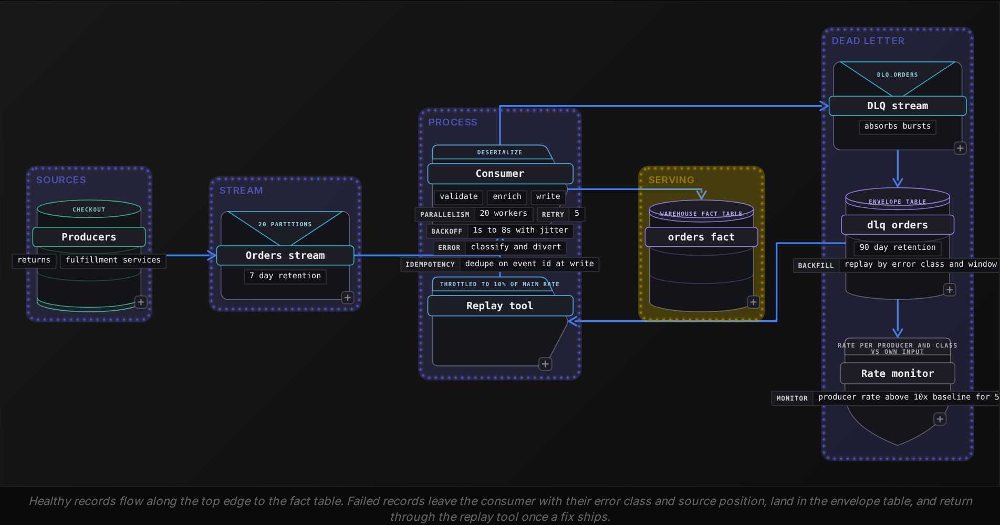
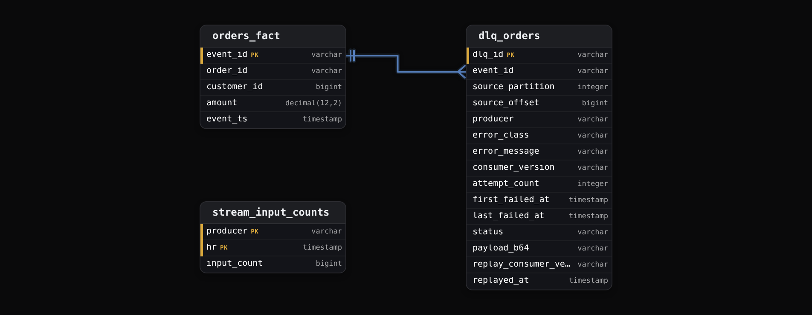
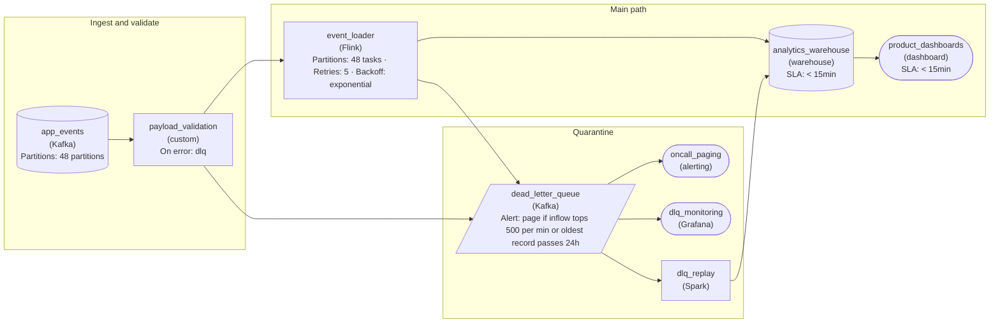
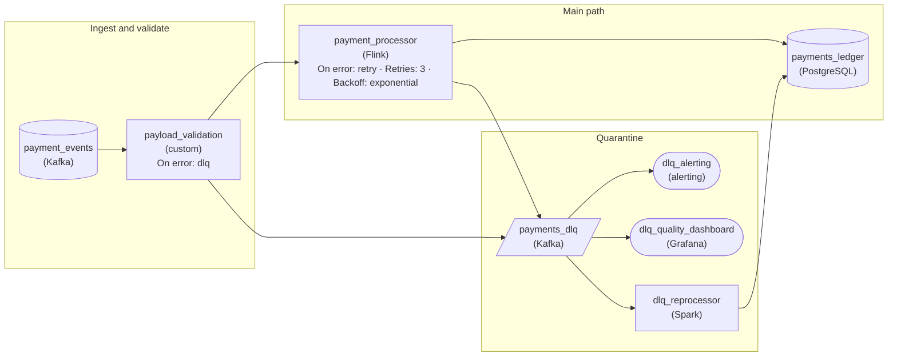

Advanced·Pipeline Architecture · 25 min · 2 challenges

# Dead Letter Queue: Advanced

A candidate is in a final loop at Amazon. Order and shipment events there move through queues at a scale that makes a single malformed record a certainty rather than a risk. The interviewer draws a consumer reading from a stream and writing to a table, then says: an upstream team deploys on Friday evening and 2 percent of events arrive with a missing `order_id`. What does your pipeline do in the next 10 minutes, and what do you do on Monday? The candidate who answers 'it fails and we fix it' has described an outage. The candidate who answers 'we drop them' has described silent data loss. The complete answer names a diversion point, an envelope that preserves evidence, a retry policy that separates transient faults from poison records, a replay path with idempotent writes, and a dashboard that turns the queue into a quality signal.


<br>

### What you will be able to do

Recognize the dead letter question when it arrives disguised as a schema change or a crash loop, and also when it shows up as a reconciliation gap; then state the lifecycle a complete answer covers

Design the diversion point and the envelope, and choose storage that lets a record diverted today be replayed 6 weeks later by a fixed consumer

Choose between in-place retry and retry streams using the stall cost per partition, and explain how a cap turns a poison pill into a dead letter record

Write the queries that measure dead letter rate against input, surface the oldest open failure, select a replay set and verify it landed

Decide which streams deserve the full dead letter path and read the queue as a per-producer contract violation ledger


<br>

---

## "How Do You Handle Bad Data?"

Interviewers rarely say the words dead letter queue. They describe a failure and watch what you reach for. A producer changes a field from integer to string. A partner feed starts sending dates as `31/12/2025` into a column your parser reads as ISO 8601. A consumer that handled 40,000 events per second for a year meets one record with a 9 MB payload and dies. The question under every version is the same: when a record can't be processed, where does it go, what do you keep about it, and how does the rest of the stream keep moving? Your answer shows whether you treat bad data as an exception to catch or as a steady input with a pipeline of its own.

> The same question in 5 disguises
>
> - How do you make sure one bad row doesn't block the day's load? (throughput and ordering)
> - A field you rely on starts arriving null. Walk me through the next hour. (classification and alerting)
> - Your consumer crashes every time it restarts. What's happening? (the poison pill)
> - We lost 300,000 events last quarter and finance found it before we did. How do you prevent that? (evidence and rate monitoring)
> - The upstream team shipped a fix. How do the missing records reach the warehouse? (replay and idempotent writes)


<br>

### 3 choices and what each one costs

Take a consumer reading a partitioned stream at 40,000 events per second across 20 partitions, so each partition carries 2,000 events per second. The consumer deserializes each record, validates 12 required fields, and writes to a fact table. A record arrives with a `customer_id` of the string `N/A` where the schema expects a bigint. If the consumer throws and the process restarts, it resumes from the last committed offset, which sits immediately before that record. It reads the record again and throws again. Each restart costs roughly 30 seconds of startup and rebalancing, and during those 30 seconds the partition accumulates 60,000 unread events. After 10 restarts the partition is 600,000 events behind and nothing has been written for 5 minutes. One record has stopped 1 of 20 partitions, and every key hashed to that partition is now late.

| Choice | What the stream does | What happens to the record | Cost you pay |
| --- | --- | --- | --- |
| Fail the consumer | Partition stalls until a human intervenes | Waits at the source until retention expires, typically 7 days | Lag, late data for every key on that partition, a page at 3 a.m. |
| Drop and count | Keeps moving at full rate | Gone, and a counter increments | No evidence, no replay, no answer for finance |
| Divert to a dead letter store | Keeps moving at full rate | Written with its error and source position to a durable store | Per-key ordering breaks, and a second system to run and watch |

Dropping behind a counter looks cheap and is the choice teams regret most. The counter reports that 4,118 records failed on Tuesday. It cannot say which orders or which producer they came from, let alone whether the failures share one cause. When finance asks why Tuesday's revenue is $212,000 short, a counter has no answer. The records are gone from the consumer and, once the source retention window closes, gone entirely. Dropping is defensible for data whose loss is bounded and accepted in advance, such as sampled telemetry where a 0.1 percent gap changes no decision. It's indefensible for anything with a ledger behind it.

Diverting keeps the stream moving and keeps the evidence. The consumer catches the failure and wraps the original bytes in an envelope that records where the record came from and why it failed. It writes that envelope to a separate durable store, then commits the offset and moves on to the next record. The partition never stalls. In exchange, the diverted record is now out of order relative to its neighbors, so a consumer that depends on per-key ordering, such as one applying UPDATE events after INSERT events, needs a plan for the moment that record returns. A second cost is operational. A dead letter store that nobody reads is a drop with extra storage.

> **TIP**
>
> When the interviewer asks what you do with bad data, answer with the whole lifecycle: divert, store with evidence, alert on rate, retry what is transient, replay what's fixed. A candidate who stops at 'send it to a DLQ' has said where the records go and nothing about how they come back.

The interviewer scores judgement here, and the judgement is about scope. A clickstream feeding an hourly dashboard can drop malformed events behind a metric, because the dashboard tolerates a small gap and nothing reconciles against it. An order event stream cannot, because each lost event is a row that will never reconcile. The strong answer says which class the stream belongs to, then names the mechanism, then names what it costs.

*The figures in this lesson follow one stream: 40,000 order events per second, 20 partitions, a baseline failure rate of 0.01 percent. Every later number derives from those 3.*


<br>

---

## DLQ Architecture: Divert, Store, Alert

The diversion point sits inside the consumer, at the stage where a record is proven unprocessable. Deserialization fails when the bytes are invalid in the declared format. Schema validation fails when a required field is missing or a type doesn't match. Enrichment fails when a dimension lookup returns nothing. The sink write fails when the warehouse rejects the row or times out. Each stage gets its own `error_class`, because the action differs per class: a deserialization failure is permanent and goes straight to the dead letter store, while a sink timeout is transient and shouldn't land there on the first attempt.




<br>

### The envelope decides what you can replay

The envelope decides whether the queue is useful 6 weeks later. Keep the original bytes, base64 encoded, rather than the parsed object, because the parsed object is often the thing that failed to exist. Next comes the source position, meaning the stream and partition the record was read from and its offset there, so the record can be placed back in sequence. The error class and message go in too, along with the version of the consumer that was running, because a replay must prove it ran through a different build. Last come the attempt count and the first and last failure timestamps: a record that failed once at 02:14 and one that failed 5 times over 15 seconds tell different stories.

```sql
{
  "dlq_id": "9f2c1a7e4b0d",
  "source_topic": "orders.v2",
  "source_partition": 7,
  "source_offset": 184220391,
  "event_id": "ord_7731904",
  "payload_b64": "eyJvcmRlcl9pZCI6ICJvcmRfNzczMTkwNCIsICJjdXN0b21lcl9pZCI6ICJOL0EifQ==",
  "error_class": "SCHEMA_VALIDATION",
  "error_message": "customer_id: expected bigint, got string 'N/A'",
  "consumer_version": "orders-consumer:4.12.0",
  "attempt_count": 1,
  "first_failed_at": "2026-03-14T02:14:07Z",
  "last_failed_at": "2026-03-14T02:14:07Z",
  "producer": "checkout-service",
  "status": "open"
}
```

*The dlq_id is a hash of the source position, so a record diverted twice from the same offset in the same stream partition produces the same id and the table writer deduplicates it.*

Store the envelopes in a table partitioned by failure date and `error_class`, with retention longer than the source stream's. If both keep 7 days, a bug that takes 9 days to notice leaves no evidence on either side, and 90 days is a common floor for a stream with financial consequences. A 2 KB payload makes an envelope of about 3.5 KB, since base64 adds a third and the metadata the rest. The `dlq.orders` stream in front of the table absorbs bursts: when a consumer bug diverts every record at 40,000 per second, the stream buffers while the table writer batches, so the main consumer never waits on the dead letter write. A `status` column lets replay mark envelopes resolved without deleting the evidence.

- **1.2 GB** — envelope bytes written per day
- **14** — fields in the envelope above

> **TIP**
>
> Write the dead letter envelope before committing the source offset, never after. If the process dies between the two, the record is read again on restart and diverted twice, which the hash on dlq_id absorbs. If the order is reversed, the record is lost with nothing to show for it.


<br>

### Alert on rate, never on count

A count alert fires on the first bad record and trains the on-call engineer to ignore it. The running stream, at its 0.01 percent baseline, diverts 4 records per second and 345,600 per day, every day. The monitor computes the rate per producer and error class against that producer's own input, because a small producer's spike vanishes in the stream-wide total. A producer moving from 0.01 percent to 0.1 percent over 5 minutes is 10 times baseline and means that producer changed something. A move to 100 percent means the consumer deployment is broken and the stream is draining into the queue.

> 3 alerts, 3 owners
>
> - Any producer's rate above 10x its baseline for 5 minutes: page the consumer on-call, because that producer most likely changed
> - Rate above 50 percent of input for 2 minutes: page the deploy owner and roll back the consumer automatically
> - Oldest open envelope older than 24 hours: ticket to the team that owns the error class, no page

Diverting breaks per-key ordering, and that cost belongs in every answer. If the `ORDER_CREATED` event for `ord_7731904` is diverted and its `ORDER_SHIPPED` event flows through 30 seconds later, `orders_fact` holds a shipment for an order it has never seen created. The order-state table built from `orders_fact` can tolerate it, upserting on `order_id` so the replayed create fills in the columns the shipment left empty. The consumer can instead quarantine the whole key, holding later events for `ord_7731904` in a side table until the first one resolves. Or each event can be self-contained, so order carries no meaning. The first is the common choice; the second fits a sink that is append-only.


<br>

---

## Retry Strategies and Poison Pills

The dead letter store should receive only records that would fail again if retried with the same consumer. Everything else is a retry problem, and a policy that is too eager or too patient produces one of 2 symptoms: the queue fills with records a second attempt would have saved, or the partition stalls on a fault that will never clear. The policy starts by classifying the exception. Deterministic errors skip retry. Parse failures fall in that group, as do schema violations and oversized payloads. Transient errors retry with backoff up to a cap. Sink timeouts and rate limit responses are transient, and so is a dimension lookup that misses because the dimension loads 5 minutes behind the stream.

| Error class | Deterministic | Action | Cap |
| --- | --- | --- | --- |
| PARSE_ERROR | Yes | Divert on attempt 1 | None |
| SCHEMA_VALIDATION | Yes | Divert on attempt 1 | None |
| PAYLOAD_TOO_LARGE | Yes | Divert on attempt 1, store a hash and the first 64 KB | None |
| SINK_TIMEOUT | No | Retry in place, backoff 1 s to 8 s with jitter | 5 attempts, then divert |
| RATE_LIMITED | No | Retry, honor the wait hint the server returns | 10 attempts over 10 minutes, then divert |
| DIM_LOOKUP_MISS | Depends | Retry through a delayed stream | 1 hour of wall time, then divert as LATE_DIMENSION |


<br>

### In-place retry versus retry streams

In-place retry means the consumer holds the record and sleeps between attempts. With 5 attempts and a wait that doubles from 1 second up to 8 between them, a record that exhausts its budget stops the partition for 15 seconds, which at 2,000 events per second per partition delays 30,000 events. If 10 poison records per hour arrive mixed into healthy traffic, they cost 2.5 minutes of partition stall per hour on faults that were never going to clear, which is why deterministic errors skip retry. A whole-sink outage exposes the opposite flaw. During a 10 minute outage each record spends its 15 seconds, is diverted as `SINK_TIMEOUT`, and the next healthy record starts its own budget, so about 40 healthy records per partition, 800 across the 20 partitions, land in the dead letter store. The fix is a circuit breaker: when consecutive failures span most partitions, the consumer pauses consumption and probes the sink without spending any record's cap, then resumes from the committed offset.

Retry streams move the waiting out of the main consumer. The consumer writes a failed record to `retry.orders.1m` and commits the offset without waiting. A second consumer reads that stream and holds each record until its `not_before` timestamp before attempting again. On failure the record moves on to `retry.orders.10m` and later `retry.orders.1h` before it reaches the dead letter store. The main partition never stalls. Besides the extra streams and the late arrival listed below, the tiers hide a cap problem: a record in the 1h tier during a long sink outage retries once an hour, so a 6 hour outage exhausts a 5 attempt budget and diverts records that would have succeeded in the seventh hour. Teams cap the final tier in hours of wall time for that reason.

| ✓ In-place retry | ✗ Retry streams |
| --- | --- |
| • Zero extra infrastructure<br><br>• Preserves per-key order through the retry<br><br>• Stalls the partition for the full backoff sum<br><br>• Needs a circuit breaker for whole-sink outages | • 3 extra streams and consumers to operate<br><br>• A record may land an hour after its neighbors<br><br>• The main partition never waits<br><br>• Cap the last tier in wall time, since each attempt is an hour apart |

```sql
TRANSIENT = {"SINK_TIMEOUT", "CONNECTION_RESET"}
DELAYED = {"DIM_LOOKUP_MISS"}
BACKOFF_S = [1, 2, 4, 8]
MAX_ATTEMPTS = 5
MAX_RATE_LIMITED = 10
RETRY_TIERS = ["retry.orders.1m", "retry.orders.10m", "retry.orders.1h"]
LATE_WINDOW_S = 3600


def route(error_class, attempt, first_failed_at, now, wait_hint_s=None):
    if error_class in TRANSIENT and attempt < MAX_ATTEMPTS:
        return "retry_in_place", BACKOFF_S[attempt - 1]
    if error_class == "RATE_LIMITED" and attempt < MAX_RATE_LIMITED:
        return "retry_in_place", wait_hint_s or 60
    if error_class in DELAYED and (now - first_failed_at).total_seconds() < LATE_WINDOW_S:
        return "retry_stream", RETRY_TIERS[min(attempt, len(RETRY_TIERS)) - 1]
    return "dead_letter", None
```

The shape matters more than the constants. Here `attempt` counts failures so far, starting at 1, so a transient record is tried 5 times with 4 waits between them. Deterministic classes match no branch and divert on their first failure. Rate limits wait as long as the server asks, up to 10 attempts. Delayed classes climb the retry tiers by attempt while the 1 hour window is open. The constants are tuning: a sink with a 99th percentile write latency of 400 ms wants a first backoff near 1 second, while one that takes 8 seconds per batch wants 10.


<br>

### The poison pill

A poison pill is a record that fails on every attempt and, without a cap, is attempted forever. The classic shape is the restart loop from the first section. The subtler shape passes classification as transient and is deterministic underneath: a sink that rejects a row holding a 2 GB string returns a timeout, because it tries to write and gives up, and the consumer retries. The cap is what saves you. Every retry path ends in the dead letter store after a bounded number of attempts or a bounded wall time, with the attempt count recorded in the envelope. If an envelope shows `attempt_count` of 5 with a timeout `error_message`, and its `last_failed_at` falls about 15 seconds after `first_failed_at`, it is a poison pill misclassified as transient, and the next section searches for that signature.

> **TIP**
>
> In the interview, state the cap before the backoff. Interviewers have watched systems with beautiful jitter and no ceiling retry one record for 3 days. The ceiling decides whether a record can loop forever; the backoff only sets how quickly each attempt follows the last.


<br>

---

## DLQ Monitoring and Reprocessing

A dead letter table is worth its storage only if someone runs 4 queries against it, and the interviewer wants to hear all of them: the rate by error class and producer against input, the oldest open envelope per class, the replay set after a fix, and a check that the replay landed. They run against `dlq_orders`, the envelope table, joined where needed to `stream_input_counts`, which records input volume per producer per hour, and to `orders_fact`, the sink.



```sql
SELECT
  DATE_TRUNC('hour', d.first_failed_at) AS hr,
  d.producer,
  d.error_class,
  COUNT(*) AS dead_lettered,
  MAX(i.input_count) AS input_count,
  ROUND(100.0 * COUNT(*) / MAX(i.input_count), 4) AS pct_of_input
FROM dlq_orders AS d
JOIN stream_input_counts AS i
  ON i.producer = d.producer
    AND i.hr = DATE_TRUNC('hour', d.first_failed_at)
WHERE d.first_failed_at >= CURRENT_TIMESTAMP - INTERVAL '24' HOUR
GROUP BY 1, 2, 3
ORDER BY pct_of_input DESC
```

| hr | producer | error_class | dead_lettered | input_count | pct_of_input |
| --- | --- | --- | --- | --- | --- |
| 2026-03-14 02:00 | checkout-service | SCHEMA_VALIDATION | 28,804 | 1,440,000 | 2.0003 |
| 2026-03-14 02:00 | returns-service | SINK_TIMEOUT | 12 | 96,000 | 0.0125 |
| 2026-03-14 01:00 | checkout-service | SCHEMA_VALIDATION | 131 | 1,452,000 | 0.0090 |

The first row is the interview question made visible. At 01:00 `checkout-service` lost 131 of 1,452,000 events, 0.009 percent, which is baseline. At 02:00, after a deploy, it lost 28,804 of 1,440,000, 2 percent, all in one error class. That producer sends around 400 events per second, 1 percent of the stream, so its spike lifts the stream-wide rate only to about 0.03 percent. That is 3 times baseline, and a stream-wide monitor would stay quiet. The page came from the per-producer monitor, which crossed 10 times this producer's own baseline at around 02:05. The `returns-service` row, 12 sink timeouts at 0.0125 percent, is noise below every threshold. The second query returns the age of the oldest open envelope per class.

```sql
SELECT
  error_class,
  COUNT(*) AS open_count,
  MIN(first_failed_at) AS oldest_open,
  DATE_DIFF('hour', MIN(first_failed_at), CURRENT_TIMESTAMP) AS age_hours
FROM dlq_orders
WHERE status = 'open'
GROUP BY 1
ORDER BY age_hours DESC
```

An `age_hours` of 200 on `LATE_DIMENSION` means a dimension row never arrived in 8 days, a question for the team that loads the dimension. An `age_hours` of 3 on `SCHEMA_VALIDATION` with 28,804 open means the fix is in progress. The oldest open age is the single number a manager reads on the team dashboard. The same table answers the poison pill search: look for envelopes whose `attempt_count` sits at the cap and whose message is a timeout, where the failure span equals the 15 second backoff sum.


<br>

### Replay: the fix is a new consumer version

Replay starts after a fix ships, and which side shipped it sets what gets replayed. If the producer fixed its bug going forward, the 28,804 envelopes still carry `N/A` in `customer_id` and will fail again under consumer 4.12.0, so the repair is a consumer change: version 4.13.0 maps `N/A` to a sentinel of -1 and sets a `customer_unknown` flag. If the consumer was the bug, say a validation rule tightened by mistake, the corrected consumer replays the payloads unchanged. Either way the replay set is selected by error class and failed consumer version inside the incident window, so an unrelated failure in the same table is left alone. On each resolved row the replay tool writes `replay_consumer_version` and `replayed_at`, and that version is the proof the record went through a different build.

```sql
SELECT
  dlq_id,
  source_partition,
  source_offset,
  payload_b64
FROM dlq_orders
WHERE status = 'open'
  AND error_class = 'SCHEMA_VALIDATION'
  AND consumer_version = 'orders-consumer:4.12.0'
  AND first_failed_at BETWEEN TIMESTAMP '2026-03-14 02:00:00'
  AND TIMESTAMP '2026-03-14 03:30:00'
ORDER BY source_partition, source_offset
```

The replay tool decodes each payload and writes it to `replay.orders`, which consumer 4.13.0 reads beside the live stream at a throttle of 4,000 events per second, 10 percent of the main rate, so live traffic keeps its latency. The 28,804 records take around 7 seconds; a 3 day backlog of 1.2 million would take 5 minutes. A successful write sets `status` to `replayed`. The sink dedupes on `event_id` for 2 reasons: a record may have been partially processed before it failed, and a record may have been diverted twice across a restart. Without that dedupe, replay creates the duplicates it was meant to repair.

```sql
SELECT
  COUNT(*) AS still_missing
FROM dlq_orders AS d
LEFT JOIN orders_fact AS f
  ON f.event_id = d.event_id
WHERE d.status = 'replayed'
  AND f.event_id IS NULL
```

Replay has consequences past the fact table. The 28,804 orders average $48, so around $1.4 million of revenue arrives in `orders_fact` for March 14 after the daily revenue job ran at 06:00. Every job keyed on event date that read that day must rerun, so the replay tool publishes a completion event naming the affected dates, and downstream owners recompute idempotently or are told. The order-state table built from `orders_fact` catches up through its upsert on `order_id`: the replayed `ORDER_CREATED` rows arrive after their `ORDER_SHIPPED` rows and fill in the columns the shipments left empty. A replay that ignores downstream recomputation has moved the data loss one table to the right.

> Replay checklist
>
> - Select by error class and failed consumer version within the incident window, never by date alone
> - Replay through a consumer version different from the one on the envelope
> - Throttle to a fixed share of live throughput
> - Dedupe at the sink on event_id
> - Mark envelopes replayed, never delete them, then verify with the anti-join
> - Publish the affected dates so downstream aggregates recompute


<br>

---

## DLQ as a Data Quality Signal

Everything so far treats the dead letter store as a holding area for records awaiting repair. The reframe the interviewer is listening for is that the store is also a ledger of contract violations, and a ledger can be read. Each envelope records which producer broke a rule on which field, and at what moment. Aggregate 8 weeks and the table shows which producers break the contract and on which fields. It also shows whether the breaks cluster on their deploy days. That belongs on the producer's own dashboard beside their latency and error rate, because a service emitting 2 percent unparseable events has an error rate of 2 percent whether or not its own metrics say so.

```sql
SELECT
  DATE_TRUNC('week', first_failed_at) AS wk,
  producer,
  REGEXP_EXTRACT(error_message, '^([a-z_]+):', 1) AS field_name,
  COUNT(*) AS violations,
  COUNT(DISTINCT consumer_version) AS consumer_versions_seen
FROM dlq_orders
WHERE error_class = 'SCHEMA_VALIDATION'
  AND first_failed_at >= DATE_ADD('week', - 8, CURRENT_DATE)
GROUP BY 1, 2, 3
ORDER BY violations DESC
LIMIT 20
```

| wk | producer | field_name | violations | consumer_versions_seen |
| --- | --- | --- | --- | --- |
| 2026-03-09 | checkout-service | customer_id | 28,931 | 2 |
| 2026-02-23 | checkout-service | customer_id | 1,204 | 1 |
| 2026-03-09 | fulfillment-service | ship_date | 412 | 2 |

Read across the weeks and the story changes. The 28,931 violations in the week of March 9 are the incident from the monitoring section, but the 1,204 violations 2 weeks earlier on the same producer and field show that `checkout-service` had been leaking `N/A` at a low rate before the deploy that made it 2 percent, and the consumer had absorbed it as baseline. Ownership follows the error class. A `SCHEMA_VALIDATION` envelope belongs to the producer named on it, and the consumer team owns `SINK_TIMEOUT` and `LATE_DIMENSION`. Handed that table, the producer team added a deploy check that validates 1,000 sample events against the published schema.


<br>

### Scope: which streams deserve the full path

The full path has real costs. You run a dead letter stream and table plus 3 retry tiers, and you build a replay tool, which takes roughly an engineer week and then a few hours a month to operate. Someone also has to carry an alert rotation and run a weekly review of error classes. Before paying that for a stream, ask 3 questions. Does a lost record change a ledger or a payout, or any report someone signs? Is the time to detect a bug longer than the source stream's retention, so the evidence is gone before anyone looks? Does the consumer run several stages with external lookups, so failures have causes worth telling apart? A yes to any justifies the path. If all 3 answers are no, a drop behind a counter, with the loss tolerance written down and agreed with the dashboard's consumer, is the correct design.

| ✓ Drop behind a metric | ✗ Full dead letter path |
| --- | --- |
| • Sampled telemetry where 1 in 100 events is already discarded by design<br><br>• Dashboards refreshed hourly with an agreed tolerance such as 0.5 percent<br><br>• Streams nothing reconciles against<br><br>• Source retention longer than the longest plausible time to detect | • Order lifecycle, payments, refunds, anything with a ledger<br><br>• Compliance and audit events where every record must be accounted for<br><br>• Streams with a reconciliation report on the other end<br><br>• Consumers with lookups and sinks that fail for different reasons |

A dead letter table that nobody drains is a drop with a longer delay, so the queue needs its own objective: 99 percent of envelopes resolved within 24 hours of landing, whether by replay or by an explicit decision to discard. Put the oldest open age on the weekly review, and give every error class an owner before the next week. Batch pipelines follow the same pattern under different names: a reject table beside the target, a rejection reason per row, a rate alert on rejections against input, and a rerun that reads the reject table through corrected code. You still ask about rate and age, and about who owns each class and how it gets replayed.

| ✓ Do | ✗ Don't |
| --- | --- |
| • Put the original bytes on every envelope, with the source position and consumer version beside them<br><br>• Alert on rate against input and on oldest open age, per error class<br><br>• End every retry path in the dead letter store after a bounded number of attempts<br><br>• Replay through a different consumer version and dedupe at the sink on event_id<br><br>• Report violations per producer and hand that table to the producer team | • Retry deterministic errors in place and stall the partition<br><br>• Delete envelopes on replay; mark them and keep the evidence<br><br>• Set retention on the dead letter table shorter than the source stream<br><br>• Page on a count of 1 and train the on-call to ignore the queue<br><br>• Build the full path for a sampled telemetry stream that tolerates loss |


<br>

### Delivering the answer

- Classify the stream first: ledger or tolerant, and say which and why
- Name the diversion point per stage and the error classes it produces
- Describe the envelope: bytes, position, class, version, attempts
- State the retry policy as a cap first, then backoff, then the in-place versus stream choice
- Close with rate and age monitoring, replay through a new version with idempotent writes, and the violation table


<br>

---

## Putting It All Together

A payments platform ingests merchant settlement events from 300 acquiring banks into a ledger table that finance reconciles every morning. One bank begins sending settlement amounts as strings with a currency symbol, and 1.8 percent of that bank's events fail schema validation starting at 23:40. The consumer diverts them with envelopes carrying the raw bytes, the bank id and the consumer version, commits offsets and keeps the other 299 banks flowing. The rate monitor sees 1.8 percent against a 0.02 percent baseline within 5 minutes and pages the consumer on-call. Because the amounts are deterministic failures, nothing retries; the 3 sink timeouts from a different bank in the same hour retry in place and succeed. By 09:00 a consumer build that parses the new format ships, the replay tool selects the open envelopes for that bank and version in the 23:40 to 09:00 window, writes them through at a tenth of live throughput, and the ledger dedupes on settlement id. The morning reconciliation for that date reruns, and the weekly violation table shows the same bank had been leaking at 0.1 percent for 3 weeks before the spike, which becomes a conversation with the bank rather than a surprise for finance.

- Diverting instead of failing kept 299 banks' settlements on time while 1 bank's records waited
- The envelope's raw bytes and consumer version let the replay prove it ran through a different build
- Because the amount failures were classified as deterministic, they stayed out of the retry path and out of the partition's stall budget
- Alerting on rate against the bank's own input surfaced a 1.8 percent problem inside a stream where the absolute count stayed small
- Sink dedupe on settlement id made the replay safe against the records that were diverted twice across a restart
- The per-producer violation table is what turned a one-night incident into a 3 week pattern with an owner


<br>

---

## Pipeline Architecture

### Exercise 1 of 2

**● TASK**

In-app events from the mobile app arrive on one event stream at about 30,000 per second, and since the latest release one event type carries a nested payload the consumer cannot parse, so the consumer crashes on that message, restarts, reads it again and crashes again while product dashboards go stale. Design the path from that stream into the analytics warehouse so ingestion resumes with dashboards back under 15 minutes of freshness, every malformed event is kept with the reason it failed and can be loaded once the parser is fixed, and the next bad release reaches on-call within minutes instead of stopping the flow. The warehouse also times out for a few seconds several times a day, and those writes must land on their own without piling in with the malformed events.

<details>
<summary><strong>Solution</strong></summary>

#### What this incident really is

This is a poison pill, and the answer is a dead letter queue, but first see what the crash loop actually is: an unbounded retry of a permanent error. The payload will be just as malformed on the thousandth read as on the first, so every restart buys nothing and holds back the 30,000 good events a second queued behind it. There is a tempting shortcut on each side. Skip the offset and the stream moves, but a whole event type from the new release quietly disappears from the numbers. Send every failure to the quarantine and the warehouse's few-second timeouts start filling it too, so on-call replays by hand records that would have landed on their own.

| Trick: Sort the failure first, then give it a lane |
| --- |
| Permanent errors go aside immediately with their context. Transient errors get a bounded retry. Neither one is allowed to stop the main consumer.<br><br>1. Validate before loading, and divert malformed payloads on an error path.<br>2. Retry only the write that can succeed later, and cap it.<br>3. Page on dead letter growth, and replay once the parser is fixed. |

#### Walk the requirements

1. **Classify each failure before deciding what to do**

   A parse failure on a nested payload is permanent: the bytes will never change. A warehouse write that times out for 4 seconds is transient: the same write succeeds a moment later. The question is not 'retry or not' but which lane each error class belongs in, and that decision has to be written into the pipeline, not made by on-call at 3am.

2. **Divert malformed events at the validation gate, context included**

   `payload_validation` parses and checks each payload before `event_loader` touches it. A failure goes down an error path into `dead_letter_queue` and the offset commits, so the next good event is read immediately. The record keeps the original payload untouched plus what triage and replay will need: error category and message, `event_type`, `app_version`, source partition and offset, first-failure time. A payload stored without its reason is a record nobody can act on.

3. **Retry the warehouse write, with a bound**

   `event_loader` retries timeouts with exponential backoff, 5 attempts, which covers a few-second blip with room to spare. Past that budget the batch goes to the same quarantine under a different error category instead of crashing the consumer. An unbounded retry is how this incident started; the bound is what turns a real warehouse outage into a visible backlog instead of a second freeze.

4. **Make the quarantine loud**

   `dead_letter_queue` pages through `oncall_paging` when inflow jumps past its baseline (a few dozen an hour normally, thousands a minute during this release) or when the oldest record is more than a day old. `dlq_monitoring` breaks volume down by error category, `event_type` and `app_version`, which is what tells the mobile team within minutes that one event type in one release broke its contract.

5. **Replay once the parser is fixed**

   `dlq_replay` reads the quarantined records, runs them through the fixed parser, and loads the repaired events into `analytics_warehouse`. Records that still fail are left in place with their attempt count raised. Close the loop by checking that dashboard totals for the affected hour now match what the app emitted.

#### The reference design



*`payload_validation` diverts malformed payloads to `dead_letter_queue`; `event_loader` retries warehouse timeouts and quarantines only what exhausts the budget; the quarantine pages, is monitored by category, and feeds `dlq_replay` after the fix.*

| ✕ Skip the bad offset | ✓ Divert to the dead letter queue |
| --- | --- |
| The stream resumes within a minute. Every event of the broken type from the new release is dropped without a trace, and that feature's numbers read low until someone compares them with the source weeks later. | The stream resumes just as fast. Each malformed event sits in `dead_letter_queue` with its reason, the page fires within minutes, and after the fix `dlq_replay` puts back the missing hour. |

| Performance: The backlog outlasts the fix |
| --- |
| An hour frozen at 30,000 events a second is about 108 million events waiting. Unblocking the consumer does not make dashboards fresh; draining the backlog does. With 48 tasks at 2x headroom the loader works through it at a net 30,000 a second, roughly an hour before freshness is back under 15 minutes. The quarantine itself is cheap: thousands a minute is a rounding error next to the main topic. |

| Interviewer: Name the crash loop as a retry policy |
| --- |
| A strong senior answer starts by calling the restart loop an unbounded retry of a permanent error. Then it lays out validation ahead of the loader, an error path that keeps context, a bounded retry only for the transient class, a page on dead letter growth, and a replay plan. 'We'll log the error and move on' is the phrase that ends the round. |

| Pitfall: A quarantine nobody watches is a graveyard |
| --- |
| The common design adds `dead_letter_queue` and stops there. The next bad release diverts thousands of events a minute, the stream stays green, nobody is paged, and the gap turns up a quarter later as a 3% shortfall against the source system. The alert and the replay path are what make it a dead letter queue rather than a bin. |

**Follow-up questions**

1. The fixed parser ships, but 2% of the quarantined events still fail on replay. What happens to them?\
   *Tests whether the candidate keeps attempt history on each record, separates still-broken records from new failures, and gives them an owner and a retention horizon instead of replaying in a loop.*
2. The warehouse is down for 40 minutes, not 4 seconds. Where do those events end up, and how do they come back?\
   *Tests whether exhausted retries land in the quarantine under a transient category, alert as a different signal from malformed payloads, and get a bulk replay once the warehouse recovers.*
3. 6 months of dead letter categories show the same producer breaking its payload on most releases. What do you do with that?\
   *Tests the data-quality-signal move: trend categories by producer and `app_version`, and push the fix upstream as a contract the producer checks before it ships.*

</details>


<br>

### Exercise 2 of 2

**● TASK**

Our payments consumer is stuck in a crash loop: one message with a corrupted payload kills it on every restart, blocking 200,000 queued payments, and the ledger write also times out for a few seconds under load. Design a pipeline where a record that fails to parse or fails ledger validation is separated from the flow without blocking the queue, where transient timeouts get retry chances, and where new failures trigger alerts so the team responds in minutes. Once the producer is fixed, those quarantined payments must be replayable into the ledger.

<details>
<summary><strong>Solution</strong></summary>

#### What this problem really is

This is the dead letter queue pattern with a payments ledger on the other end, and the crash loop is the easy half. Anyone can say 'skip the bad message.' The trap is that on a payments topic a skip is a delete: commit past the corrupt offset by hand, or wrap the parser in a catch that logs and moves on, and you unblock the consumer by quietly losing a payment that finance finds missing at the next reconciliation. The second trap hides in the ledger timeouts: route every failure into the same quarantine and the design starts setting aside perfectly good payments every time the database hiccups.

Why the loop exists at all: the consumer commits its offset only after a record succeeds, so a crash restarts it at the same offset, which crashes it again. Adding replicas changes nothing, because the corrupt message lives on one partition and whichever instance owns that partition dies. The fix has to turn a crash into a routed, recorded outcome.

| Trick: Classify first, then divert with a receipt |
| --- |
| Ask of every failure: can trying again ever fix it? A corrupt payload cannot, so it goes straight to `payments_dlq` and the offset is committed. A ledger timeout can, so it gets bounded retries with backoff first and joins the quarantine only when those run out. Either way the record leaves with its receipt: offset, rejecting stage, error, producer. |

#### Walk the requirements

1. **Put a validation gate in front of the ledger logic**

   Parsing and schema checks become the first stage, `payload_validation`. An unreadable payload is now a failed check, not an exception that kills the process: it takes the error path into `payments_dlq`, the offset advances, and the 200,000 payments behind it start draining at once.

2. **Give ledger timeouts a bounded second chance**

   `payment_processor` retries a timed-out write 3 times with exponential backoff, which covers a few-second load spike. When the retries run out, the payment diverts with stage '`ledger_write`' rather than retrying forever, because an unbounded retry on one record is the crash loop wearing a different costume.

3. **Make every quarantined record carry its receipt**

   Store the original bytes untouched, plus topic, partition and offset, the rejecting stage, the error class and message, the producer from the event header, the first failure time and the attempt count. The offset lets you find the record in the source; the stage tells you whose code to open.

4. **Alert on the quarantine, not on crashes**

   Crashes are gone now, so they can no longer be the alarm. Watch `payments_dlq` depth and inflow instead, and page through `dlq_alerting` when inflow rises above baseline. That is how the next bad batch reaches you in minutes rather than at month-end close.

5. **Read the quarantine as a producer report card**

   `dlq_quality_dashboard` breaks rejections down by producer and error class. One service's corrupt-payload count trending up is an upstream contract breaking, and the chart shows you whom to call before the ledger is short.

6. **Close the loop with a reprocessor**

   Once the producer ships a fix, `dlq_reprocessor` replays the quarantined payments through the same parsing code into `payments_ledger`. A record that fails again returns to the quarantine with a higher attempt count, never to the floor.

#### The reference design



*Corrupt payloads leave `payload_validation` on an error path straight into `payments_dlq`; ledger timeouts get 3 backed-off retries in `payment_processor` before they divert; the quarantine feeds an alert, is analyzed by producer, and is replayed into `payments_ledger` after the fix.*

| ✕ Skip the bad offset | ✓ Divert with a receipt |
| --- | --- |
| Unblocks the consumer in a minute. The payment is gone, nobody knows which producer sent it, and the next corrupt message starts the same loop because nothing in the design changed. | Unblocks the consumer just as fast. The payment sits in `payments_dlq` with its offset and rejecting stage, someone is paged, the producer is visible on a chart, and the payment reaches the ledger after the fix. |

| Interviewer: Naming the error class is the senior tell |
| --- |
| Weaker answers say 'send failures to a DLQ.' Stronger ones split transient from permanent before saying anything else, and then mention replay without being asked. The strongest note that the quarantine's inflow rate is now the health signal, because the consumer will never crash again to tell you something is wrong. |

| Pitfall: One quarantine route for every failure |
| --- |
| The design that ships first catches every exception and diverts it. It works until the first load spike, when thousands of healthy payments time out once and land in the quarantine beside the corrupt one. Retries before diversion are what keep the quarantine meaning 'actually broken.' |

| Performance: The backlog costs you, the quarantine does not |
| --- |
| At a handful of corrupt records a day, `payments_dlq` is tiny. The real load is the catch-up: 200,000 queued payments drain while new ones keep arriving, so the consumer needs headroom above its steady-state rate, not more quarantine capacity. |

**Follow-up questions**

1. The ledger is down for 20 minutes, not a few seconds. What happens to the payments that exhaust their retries, and is that what you want?\
   *Tests whether the candidate sees that bounded retries during a full outage would flood the quarantine with healthy payments, and whether they would alert on a sudden '`ledger_write`' spike and replay those payments once the ledger is back.*
2. The reprocessor replays a batch and half of it fails again with the same error. What does the design do with them?\
   *Tests the reprocessing workflow: records return to the quarantine with an incremented attempt count and stay visible on the producer dashboard instead of looping forever or being dropped.*

</details>


<br>

---

## Key Takeaways

- The question can arrive as a schema change or a crash loop, or as a reconciliation gap, and the answer is always the lifecycle: divert, store, alert, retry, replay, feed back
- The envelope holds the original bytes and the source position. Replay also needs the error class and attempt count, and the consumer version that failed, so all 5 go in
- Deterministic errors divert on the first attempt; transient ones retry under a cap, in place when the whole sink is down and through retry streams when poison is scattered
- Alerts fire on rate against input and on the age of the oldest open envelope, never on a raw count
- Replay runs through a different consumer version, throttled, with sink dedupe on event_id, and it publishes the dates downstream jobs must recompute
- Read the queue per producer and per field: it is a contract violation ledger that belongs on the producer's dashboard
