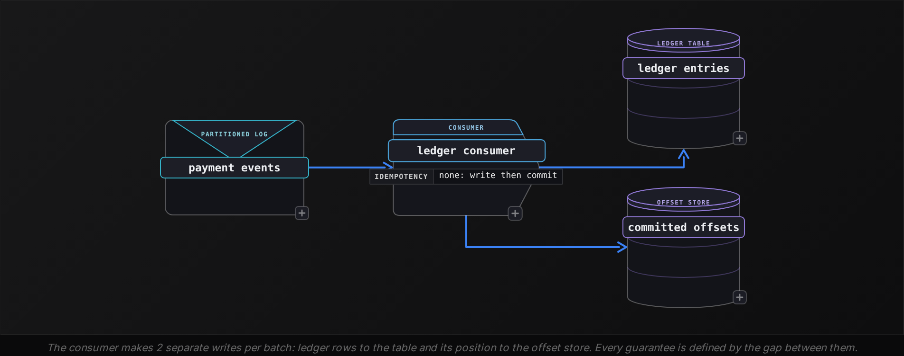
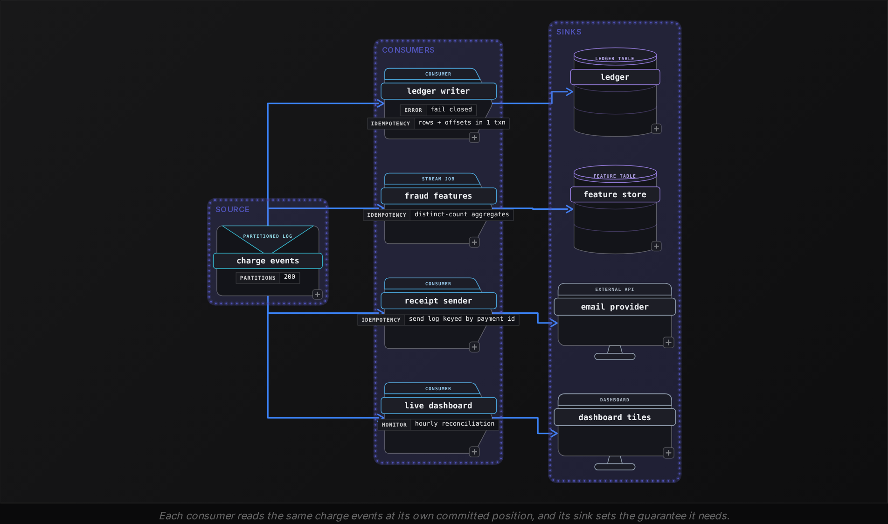

Advanced·Pipeline Architecture · 25 min · 2 challenges

# Delivery Semantics: Advanced

Dalia is in the final system design round at Stripe, where an API request can carry an idempotency key so a retried charge is applied once. The interviewer draws 3 boxes on the whiteboard, a payment events log feeding a consumer that writes to a ledger table. "This consumer crashed at 02:14 and restarted," she says. "Finance reports 312 charges recorded twice. Walk me through what happened, and what guarantee you would build instead." Dalia knows the vocabulary: at-least-once, at-most-once, exactly-once. What the interviewer wants is the mechanism under the words: where the consumer saved its progress relative to its write, why the duplicates numbered 312, and what exactly-once would cost in latency and coordination. This lesson builds that answer, for every form the question takes.


<br>

### What you will be able to do

Trace any crash to its outcome by locating the progress commit relative to the side effect.

Size the duplicates or losses a failure produces from throughput and commit interval.

Trace each delivery guarantee through a retry and a late record, then through a schema change, and name where it breaks.

Price exactly-once in visibility latency and coordination, and name the side effects it cannot cover.

Assign a guarantee per sink from the cost of a duplicate against the cost of a loss.


<br>

---

## "What Is Your Delivery Guarantee?"

Every delivery guarantee comes down to the order of 2 operations inside a consumer. One applies the effect: writing a row, calling an API, sending a message. The other records progress: committing the offset or checkpoint that says every record before this point is handled. A crash can land between them, and whichever ran first decides what the restart sees.


<br>

### The gap between effect and progress

| Order in the consumer | Crash between the steps | Restart reads from | Outcome |
| --- | --- | --- | --- |
| Write, then commit | Rows written, offset not saved | Old offset | Batch replayed as duplicates: at-least-once |
| Commit, then write | Offset saved, rows not written | New offset | Batch skipped as loss: at-most-once |
| Write and commit in 1 atomic step | Both happened or neither did | The offset matching the data | No gap: exactly-once effect |
| Idempotent write, then commit | Rows written, offset not saved | Old offset | Batch replayed, and the keyed write absorbs it |

Run the 312-duplicate incident through the first row. The ledger consumer reads payment events in offset order and commits its position every 1,000 records. Its last commit was offset 48,000. It wrote ledger rows for offsets 48,000 through 48,311, and then its host was killed. On restart it asks for its committed position, gets 48,000, and writes those 312 events again. The duplicate count is exactly the records applied since the last successful commit, so the number Finance reported tells you where in the 1,000-record interval the crash landed: about a third of the way through.

The commit interval is a dial. Committing after every record shrinks the replay to 1 record but costs a write to the offset store per event, which is 20,000 writes a second at the throughput used throughout this lesson. Committing every 1,000 records cuts that to 20 a second and accepts up to 1,000 replayed records per crash. An interviewer who asks why you didn't commit per record wants this tradeoff stated with both numbers.




<br>

### The guarantee is end to end

Asked for a delivery guarantee, many candidates quote a broker or producer setting. The guarantee a business experiences belongs to the whole path, and it is capped by the weakest of 3 links: whether the source can replay, whether processing keeps progress behind effects, and whether the sink tolerates or prevents repeats.

| Link | Must provide | Ceiling if it does not |
| --- | --- | --- |
| Source | Replay from a stored position for longer than recovery takes | At-most-once: a crashed batch cannot be read again |
| Processing | Progress recorded after the effect, or atomically with it | At-most-once wherever progress runs ahead of effects |
| Sink | Idempotent writes, or a transaction shared with the progress | At-least-once: every replay surfaces as a duplicate |

A common trap follows from the weakest-link rule. A stream processor can promise exactly-once for its internal state, because it snapshots state and source positions together in 1 checkpoint. The promise stops at the processor's edge. If the job calls an HTTP endpoint per event, recovery re-executes calls already made, and the endpoint receives at-least-once delivery regardless of the processor's documentation.

The source link fails more often than it sounds. A partner that pushes webhooks and does not retry on errors gives you 1 chance per event; if your receiver crashes before persisting the request, no downstream design recovers the record. Landing raw requests in a replayable log before any processing restores the source link.


<br>

### The question in disguise

Each one asks where the commit sits

- **"Our daily count runs 0.4% high after every deploy."**\
  Each deploy restarts consumers, and each restart replays the uncommitted tail.
- **"A customer got 2 shipping confirmation emails."**\
  A side effect outside any transaction was repeated by a retry.
- **"Tuesday's revenue dropped after we added a column."**\
  A schema change broke parsing or a key, so records were skipped or rekeyed.
- **"How would you backfill last month?"**\
  A rerun is a deliberate replay, and the sink must absorb it.
- **"What if your job is down for 9 days?"**\
  Lag beyond the log's 7-day retention turns replay into loss.

> Try it: size the blast radius
>
> A consumer processes 20,000 events per second, writes to the sink, then commits its offset every 5 seconds. A deploy kills it 4 seconds after its last commit. How many events reach the sink twice? What changes if the commit runs before the write?

Write-then-commit replays everything applied since the last commit: 4 seconds at 20,000 per second is 80,000 duplicates, and a kill moments before the next commit would make it 100,000. Reverse the order and the same kill loses the records whose offsets were committed but whose writes had not finished. The commit interval sets the size of the damage in both designs; the order decides whether you count it in duplicates or in losses.

> **TIP**
>
> Open your answer with the 2 operations and their order. A sentence like "we write the ledger row, then commit the offset, so a crash replays at most 1,000 records" is a design the interviewer can probe, where a bare "at-least-once" is a label.


<br>

---

## At-Least-Once and Its Duplicates

At-least-once is the default of well-built pipelines because it fails in the recoverable direction: nothing is lost, and the price is repeats. The engineering question is where repeats enter and whether every sink downstream absorbs them.


<br>

### Where duplicates come from

| Source of the repeat | Trigger | Size of 1 incident |
| --- | --- | --- |
| Producer retry | The log stored the write, the acknowledgment timed out, and the producer sent again | One extra copy per timed-out send |
| Consumer replay | Crash or deploy between effect and commit | Records applied since the last commit |
| Rebalance | A partition moves to another consumer before its old owner commits | The uncommitted tail of each moved partition |
| Rerun or backfill | An operator reprocesses a day or a partition | The entire rerun range |

*A rebalance also fires when a consumer goes longer than its maximum allowed interval between polls, so a slow write can evict it and cause a replay with no crash at all. The session timeout covers a different failure: missed heartbeats from a process that died or lost the network.*

Candidates forget the producer retry. A producer sends charge `pay_8812`, the log stores it, and the acknowledgment is lost on the network. From the producer's side the write failed, so it sends again, and the log now holds 2 copies at different offsets. Consumer commit discipline cannot remove this repeat, because the 2 copies are distinct records. Only a component that recognizes `pay_8812` as 1 event can.


<br>

### Idempotency needs a key from the origin

An idempotent sink gives the same result whether a record arrives once or 5 times. That needs a key identical on every copy, and the only place to mint one is where the event is born. A UUID assigned by the ingestion service on receipt fails: the retried copy arrives as a new request, gets a new UUID, and dedup sees 2 events. The payment ID assigned when the customer pressed Pay passes.

Key minted at ingestion

| offset | event_key | payment_id | amount |
| --- | --- | --- | --- |
| 48,100 | a1f3e9 | pay_8812 | 49.00 |
| 48,101 | 7c2eb0 | pay_8812 | 49.00 |

Key minted at the origin

| offset | event_key | payment_id | amount |
| --- | --- | --- | --- |
| 48,100 | pay_8812 | pay_8812 | 49.00 |
| 48,101 | pay_8812 | pay_8812 | 49.00 |

Dedup on `event_key` leaves 2 charges of 49.00 on the left and 1 on the right. The fix lives at the producer and is a contract change, so name it as one: every producer stamps a stable ID, and events arriving without one go to quarantine instead of being trusted.


<br>

### Making a table sink absorb replays

For a table sink, the replay-safe write inserts only keys the ledger hasn't seen, after collapsing repeats inside the batch itself. Rerun it over the same staging batch and it inserts nothing.

```sql
INSERT INTO ledger_entries (payment_id, customer_id, amount, event_time, source_partition, source_offset)
SELECT
  s.payment_id,
  s.customer_id,
  s.amount,
  s.event_time,
  s.source_partition,
  s.source_offset
FROM (
  SELECT
    payment_id,
    customer_id,
    amount,
    event_time,
    source_partition,
    source_offset,
    ROW_NUMBER() OVER (
      PARTITION BY payment_id
      ORDER BY source_offset
    ) AS rn
  FROM staging_payments
) AS s
LEFT JOIN ledger_entries AS l
  ON l.payment_id = s.payment_id
WHERE s.rn = 1
  AND l.payment_id IS NULL
```

The anti-join is safe with 1 writer per key range. If 2 writers race on the same payment, both can find it missing and both insert, so partition writers by key or enforce uniqueness in the sink.


<br>

### Sizing the dedup state

A streaming deduplicator holds every key it has seen for a window, and that window must cover the longest gap between 2 copies of 1 event. Producer retries arrive seconds apart. A consumer replay arrives after the restart, so its gap is the time since the last commit plus the whole downtime: a consumer down for 30 minutes replays copies 30 minutes behind their originals. Size the streaming window to cover the longest outage you plan to recover from by replay. A longer outage, or a backfill delivering a copy weeks later, goes through the keyed table write above. The figures below use the 20,000 events per second from earlier and 40 bytes per stored key, which includes the store's per-entry overhead.

- **1.728B** — keys in a 24-hour dedup window
- **69 GB** — dedup state for that window

Cutting the window to 1 hour shrinks the state 24-fold, to roughly 2.9 GB. Say the tradeoff aloud: the window length is the age of the oldest duplicate you promise to catch.


<br>

### Failures that survive at-least-once

- **Increments.** A sink running balance = balance + amount applies a replay twice. Store the events and derive the balance, or upsert each (account, window) aggregate with its recomputed value.
- **Payload-hash keys.** If the key is a hash of the whole record, adding a column changes every hash, and a replay after the schema change slips past dedup as new events. Key on the producer's ID.
- **External calls.** An email or webhook sent per record repeats on replay. Write the send to a keyed table and check it before sending, or pass the event ID to a receiver that dedups on it.
- **Copies older than the window.** A copy arriving after the dedup window has expired counts as new. Long outages and backfills are the usual cause.

> Try it: which aggregates need dedup?
>
> A fraud job computes 2 features per merchant per hour: distinct cards used, and total amount charged. Both run on at-least-once input. Which one does a replay corrupt?

Total amount is corrupted: each copy adds its amount again. Distinct cards is safe, because a second copy of card `c_17` adds nothing to a set that already holds it. Classify each aggregate by whether a repeat changes it before building dedup machinery; an idempotent aggregate needs none.


<br>

---

## At-Most-Once: Fire and Forget

At-most-once commits progress before the effect, or never confirms the effect at all. A crash in the gap drops the batch, and nothing downstream notices. In return, the write path never waits for an acknowledgment and keeps no dedup state or replay logic, so it runs faster and lighter.


<br>

### When losing a record is the right call

Weigh the cost of a duplicate against the cost of a loss at the volume the pipeline runs. At-most-once wins when a lost record barely moves the result, and a duplicate would either harm someone or cost more to prevent than the loss is worth.

✓Fits at-most-once

- Sampled telemetry, where 1 point in 10,000 missing changes no chart
- Live dashboard tiles overwritten by the next value seconds later
- Marketing pushes, where a second copy annoys more than a missed one costs
- High-volume debug logs that would cost more to retry durably than they are worth

✗Does not fit

- Anything summed into money: charges, refunds, payouts
- Training labels for a model, where loss becomes invisible bias
- Audit trails a regulator can ask you to reproduce
- Any stream whose consumers assume completeness

At-most-once also lives at the producer. A producer configured to send without waiting for acknowledgment never retries, so it creates no duplicates, and any record in flight during a broker failover is gone. That setting suits sampled telemetry and is wrong for anything in the right column above.


<br>

### Measure the loss you accepted

Accepted loss is defensible only when it is bounded and measured. Suppose a telemetry consumer commits before processing, in batches of 500 records, and crashes around 2 times a day. The worst case is 1,000 lost records a day against 1.728B events, a loss rate near 0.00006%. State that bound, then state how you would know it held: count records per hour at the producer and at the sink, and page when the gap exceeds the agreed rate.

```sql
SELECT
  s.event_hour,
  s.events AS source_events,
  COALESCE(k.events, 0) AS sink_events,
  1.0 - CAST(COALESCE(k.events, 0) AS DOUBLE) / s.events AS loss_rate
FROM source_hourly_counts AS s
LEFT JOIN sink_hourly_counts AS k
  ON k.event_hour = s.event_hour
WHERE s.event_hour >= CURRENT_TIMESTAMP - INTERVAL '1' DAY
ORDER BY loss_rate DESC
```


<br>

### Accidental at-most-once

The dangerous version is the one nobody chose. Several designs that claim at-least-once drop records under failure, and an interviewer probing judgement will steer toward them.

| Hidden loss | How it happens | Property that prevents it |
| --- | --- | --- |
| Retention expiry | Consumer lag outgrows the log's 7-day retention, and unread records are deleted | A lag alert well inside retention, and retention longer than your worst planned outage |
| Late data past the watermark | A watermark is the job's estimate of how far event time has progressed; a window closes once the watermark passes its end plus the allowed lateness, and events for it arriving later are discarded | Late events routed to a side output that corrects the window |
| Poison record skipped | Parsing fails, and the job logs the error and commits past it | A dead-letter queue with an owner and a replay path |
| Incompatible schema change | A new producer version emits a type the consumer cannot parse, so every record is skipped | A compatibility check before publish, and failing closed instead of skipping |
| Async write, early commit | The consumer fires a non-blocking write and commits before it is confirmed | Committing only offsets whose writes were acknowledged |

Every row has the same signature: progress moved forward while an effect didn't happen. Prevention is always a property that keeps progress behind confirmed effects, or a holding place where skipped records wait for a second attempt.

> Try it: the 6-hour flight
>
> A mobile analytics job drops events that arrive more than 2 hours past its watermark. A phone offline on a 6-hour flight uploads its events on landing. What guarantee do those events get, and what would you change if product decisions rely on daily active users?

They get at-most-once: every event from the flight lands past the watermark and is discarded. Daily active users built on that stream undercount travellers, a biased loss rather than a random one. Keep the 2-hour watermark for the live tile, and rebuild the daily table in batch from the raw log once a lateness horizon covering offline devices has passed, so the number behind decisions includes the late arrivals.

> **TIP**
>
> When you choose at-most-once, give the loss bound and the reconciliation that measures it in the same breath.


<br>

---

## Exactly-Once and Its Cost

Crashes force re-execution, so no pipeline can stop a record from being processed twice. Exactly-once is a claim about effects: however many times the work runs, the sink shows each record once. It comes from 2 families of design, transactional commit or replay into an idempotent sink. Each sends a different bill.


<br>

### Transactions inside 1 system

If the sink can store the consumer's progress, write both in 1 transaction. The ledger rows for offsets 48,000 through 48,999 and the row recording next offset 49,000 commit together or not at all. On restart the consumer reads its position back from the sink, and that position can never disagree with the rows already written.


```sql
def process_batch(conn, log, group, partition):
    start = read_next_offset(conn, group, partition)
    records = log.read(partition, start, max_records=1000)
    if not records:
        return
    with conn.transaction():
        for record in records:
            insert_ledger_row(conn, record)
        save_next_offset(conn, group, partition, records[-1].offset + 1)
```

This holds only while output and progress share 1 transactional system. Fan out to a second sink, or write to one without transactions, and the atomic step is gone.


<br>

### Transactions across systems

Stream processors stretch the idea across systems with a two-phase protocol tied to checkpoints. Between checkpoints, output accumulates in an open sink transaction. When a checkpoint snapshots state and source positions, that transaction is pre-committed; once every task confirms the checkpoint, the coordinator commits it. A crash before the checkpoint completes aborts the open transaction and restores from the previous checkpoint.


<br>

### Latency and coordination costs of transactions

| Cost | Mechanism | Example figure |
| --- | --- | --- |
| Visibility latency | Readers that skip uncommitted data see output only after the checkpoint commits | With 60-second checkpoints, up to 60 seconds stale and 30 on average |
| Invisible reprocessing | Everything since the last checkpoint reruns after a crash | Up to 1.2M records at 20,000 per second |
| Transaction timeout | A checkpoint plus recovery that outlasts the sink's timeout lets the sink abort pre-committed output | A 15-minute timeout against a 20-minute recovery |
| Barrier coordination | Every task must reach the checkpoint before commit, so a slow task delays all output | A single skewed partition out of 200 sets commit time for all of them |
| Blocked readers | Committed-only readers wait behind the oldest open transaction | A stuck transaction stalls consumers until it times out |

The timeout row belongs in any complete answer, because it is where exactly-once quietly turns into at-most-once. The checkpoint recorded that source positions advanced, the sink discarded the matching output when its timeout fired, and recovery resumes past records that never landed. Prevent it by setting the sink's transaction timeout well above the worst checkpoint duration plus recovery time you plan for.


<br>

### Replay into an idempotent sink

The second family is at-least-once delivery into a sink keyed on the origin's event ID, the design from the duplicates section done carefully. Output is visible the moment it is written, with no checkpoint wait and no open transactions. The bill moves to the sink: a uniqueness check or upsert on every write, plus the dedup window for streaming paths. Both families can produce the same final table; they differ in where the cost lands and in what breaks them.

✓Transactional commit

- Output visible at checkpoint commit
- No dedup state in the sink
- Breaks when a sink lacks transactions or a timeout fires mid-recovery
- Side effects outside the transaction still repeat

✗Idempotent sink

- Output visible on write
- Needs a stable origin key on every event
- Breaks when keys are regenerated or derived from the payload
- Works with any sink that can upsert or reject a known key


<br>

### The boundary exactly-once cannot cross

Exactly-once covers what a coordinator can roll back. An email, a card network call or a partner webhook cannot be rolled back, so recovery repeats it. Extend idempotency past the boundary instead: send the event ID with the call and have the receiver dedup on it, the way a payments API accepts an idempotency key. If the receiver offers no such key, the guarantee at that edge is at-least-once, with a keyed send log that shrinks repeats to crashes between the send and the log write.

> Try it: a 10-second dashboard
>
> Your job checkpoints every 60 seconds with transactional output. Product wants a dashboard no more than 10 seconds stale. What are your options, and what does each cost?

Dropping the checkpoint interval to 5 seconds meets the target, but runs 12 times as many commits and multiplies the slow-task stalls. The alternative keeps transactions for the ledger and gives the dashboard its own consumer that upserts the recomputed value for each metric and window. A replay rewrites the same rows with the same values, and the ledger keeps its guarantee. Different consumers get different semantics, which is where the last section starts.


<br>

---

## Semantics for a Business Need

A single event stream usually feeds several consumers, and each needs its own guarantee. Picking 1 guarantee for "the pipeline" overpays on the dashboards or underprotects the money. Decide per sink, from 4 questions.

- What does 1 duplicate cost at this sink, in money, trust or wrong decisions?
- What does 1 lost record cost, and would anyone notice it was missing?
- Can the effect be made idempotent with a key minted at the origin?
- Can the source replay for longer than your worst recovery takes?

*The 4 questions also order your interview time: spend it on the sinks where both a duplicate and a loss are expensive, because those need the costliest mechanism.*


<br>

### A stream with 4 consumers

Take a payments company's charge events at 20,000 per second, read by 4 consumers, each at its own committed position. Assign each a guarantee from the 4 questions before reading the table.



| Consumer | Duplicate cost | Loss cost | Guarantee | Mechanism |
| --- | --- | --- | --- | --- |
| Ledger writer | A double charge on the books | Missing revenue and a failed audit | Exactly-once | Ledger rows and offsets in 1 transaction |
| Fraud features | None, for distinct-count features | A card missed by a velocity check | At-least-once | Replay into aggregates that absorb repeats |
| Receipt sender | A second email to the customer | No receipt, then a support ticket | At-least-once with dedup | Send log keyed by payment_id, plus the provider's idempotency key |
| Live dashboard | A tile briefly high | A tile briefly low | At-most-once | Commit first, reconcile hourly against the ledger |

Look at the receipt row. A duplicate email and a missing receipt both cost something, and the missing receipt costs more because it becomes a support ticket. Work out that ordering for each sink and the guarantee name follows from it.


<br>

### Structure of a complete answer

- **Guarantee per sink**\
  Each consumer's guarantee, with the business cost that justifies it.
- **Mechanism**\
  The order of commit and effect, and the key or transaction that enforces that order.
- **Failures handled**\
  How the design handles a retry and a late record, and what happens when the schema changes.
- **The number**\
  Whatever the guarantee costs, sized from throughput: the duplicates or losses per crash, or else the dedup state or visibility latency it needs.
- **What it still misses**\
  The edge the guarantee leaves uncovered, and how you detect it: a reconciliation, a lag alert, a dead-letter owner.


<br>

### Retry, late data and schema change in the ledger

| Failure | What the ledger writer does | Result |
| --- | --- | --- |
| Producer retries pay_8812 after a lost acknowledgment | The second copy hits insert-if-absent on payment_id and is skipped inside the transaction | A single ledger row |
| A charge from a terminal offline for 3 hours | Rows key on payment_id and book by event_time, with no watermark to drop the event | The row lands in the correct day, and that day's total is restated |
| Producer adds a currency_code column with a default | Old and new records both parse, and payment_id is unchanged | No rekeying, no skipped records |
| The amount column changes type to string | Parsing fails, so the writer stops and alerts instead of committing past the record | Lag grows; nothing lost, nothing doubled |

The last row fails closed, and you should defend that choice aloud. A halted ledger writer shows up in 1 lag alert and recovers without loss once the schema is fixed, provided the outage stays inside the 7-day retention. A writer that skips unparseable records keeps its lag at zero while revenue disappears.

> Try it: a ride-hailing stream
>
> Trip-completed events feed 3 consumers: driver payouts, a surge-pricing model, and an in-app prompt asking the rider to rate the trip. Assign each a guarantee and a mechanism before reading on.

Payouts are money: exactly-once, through a transactional write with offsets or a payout table keyed on trip ID. Surge pricing reads demand over the last few minutes. A missed or repeated trip moves its multiplier by a fraction, so at-least-once on the replay the job already has is enough; freshness matters more than either guarantee. The rating prompt is a human-facing side effect where a duplicate annoys and a miss costs little, so at-most-once fits, unless the product team tracks prompt coverage, in which case a keyed send log gives at-least-once with dedup.

✓Do

- Mint the event ID where the event is born and carry it to every sink
- Size duplicates per crash from throughput times commit interval
- Fail closed on unparseable records and alert on lag
- Reconcile source and sink counts for any sink that accepts loss
- Set sink transaction timeouts above worst checkpoint plus recovery time

✗Don't

- Quote a broker setting as the pipeline's guarantee
- Derive dedup keys from a hash of the payload
- Pick 1 guarantee for every consumer of a stream
- Let consumer lag approach log retention without a page
- Assume exactly-once covers an external API call, whether it sends an email or fires a webhook


<br>

---

## Putting It All Together

A food delivery marketplace publishes order-placed events at 20,000 per second. One stream feeds restaurant payouts, courier dispatch, a demand heatmap for operations, and an order-confirmation push to the customer. After a regional outage, every consumer was down for 9 hours and restarted from its committed offset. The payout team finds 0 duplicates, dispatch notifies some couriers about orders already assigned, and the heatmap shows a demand spike that never happened.

- Payouts had 0 duplicates because rows and offsets committed in 1 transaction, so the restart position matched the data.
- Dispatch repeated assignments because its effect, a courier notification, sat outside any transaction and carried no order ID the receiver could dedup on.
- The heatmap spike is mostly the 9-hour backlog processed in minutes and bucketed by processing time; bucketing by event_time spreads it back over the hours it happened, and an upsert of the recomputed value per zone and minute absorbs the few replayed duplicates from the uncommitted tail.
- A 9-hour outage stayed inside the 7-day retention, so nothing was lost; a 9-day outage would have turned every consumer into at-most-once.
- The confirmation push shows the per-sink rule at work: after 9 hours a stale confirmation may cost more than none, which argues for dropping old events by event time.


<br>

---

## Key Takeaways

- A delivery guarantee is the order in which the effect and the progress commit happen, plus the crash that lands between them.
- Duplicates or losses per crash equal the work done since the last commit: throughput times commit interval at worst.
- At-least-once needs a key minted at the origin; ingestion UUIDs break under retry and payload hashes break under schema change.
- At-most-once is defensible only with a stated loss bound and a source-to-sink reconciliation, and it often arrives by accident: retention expires, or a watermark or a skip drops records.
- Exactly-once is a property of effects, paid for in visibility latency and coordination, and it stops at the first side effect outside the transaction.
- Assign guarantees per sink from the cost of a duplicate against the cost of a loss.
