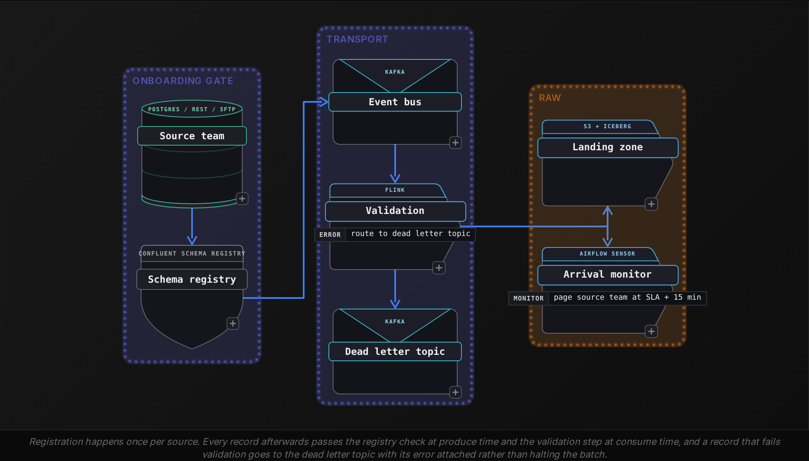
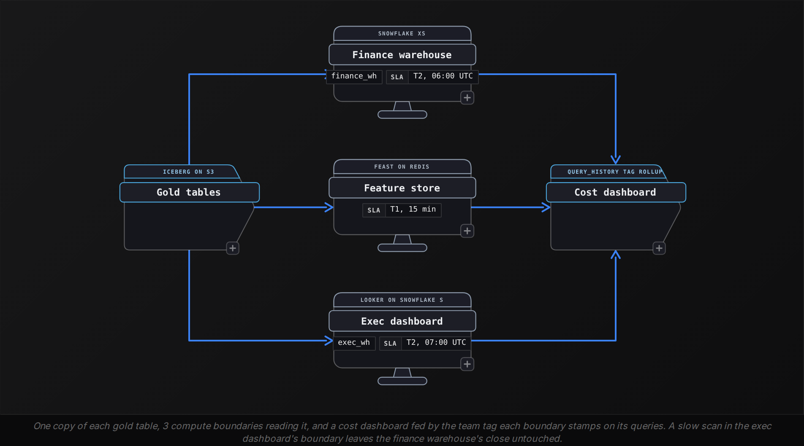
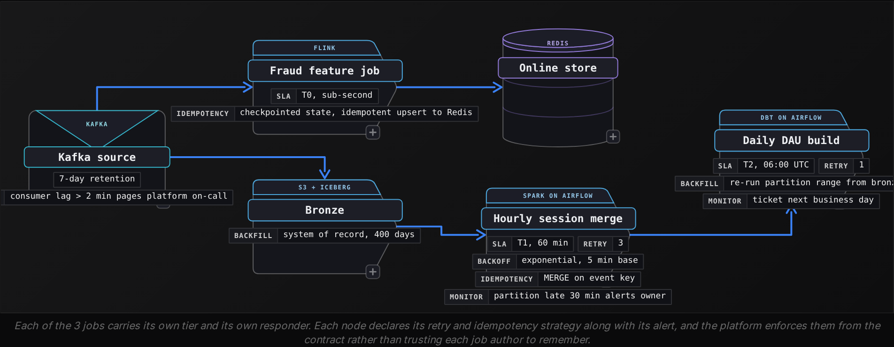
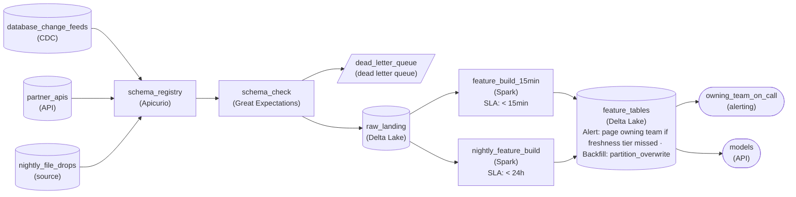
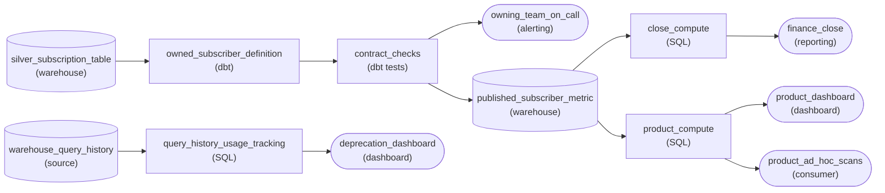
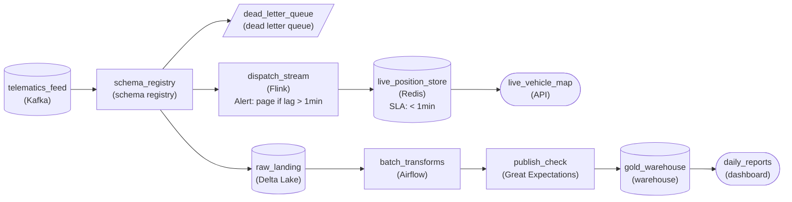
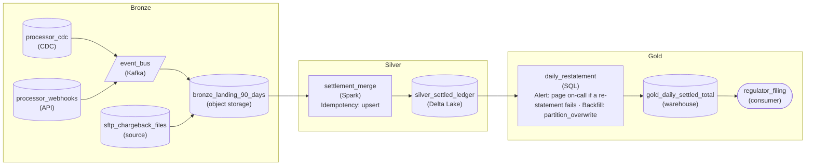

Advanced·Pipeline Architecture · 20 min · 4 challenges

# Design a Pipeline

You are 20 minutes into a system design round at a company with 40 product teams.
"Every team here builds its own pipelines. Marketing has 6, risk has 11, and nobody can tell me what a dashboard number means or what it cost. Design the platform."
He leans back. There is no source list, no volume and no latency target, and "every team" means the deliverable is onboarding, governance and cost attribution rather than any single flow. Most candidates draw Kafka, Spark and Snowflake in a row and describe last year's clickstream pipeline, which answers a question with 1 consumer when he asked about 40.
What he is testing is whether you can size the whole estate, say who owns each contract, and price every regime you propose.


<br>

### What you will be able to do

Size a multi-team data platform from first principles within the first 2 minutes, counting events and bytes and pricing them in dollars

Specify a self-service ingestion gate whose schema policy decides which changes propagate and which page a source team

Quantify transformation cost per stage and per reprocess, and pick between ELT and ETL, or a hybrid of the two, from the numbers

Write serving contracts that let 40 teams consume shared datasets without a shared outage

Match each guarantee the platform offers to a dataset tier and state what it costs to keep


<br>

---

## Scoping and Sizing the Platform

The prompt arrives dressed as a business complaint. Marketing wants attribution that covers email as well as web and mobile. A risk team wants a decision inside 200 ms of a purchase. An analyst says the dashboard and the finance report disagree. Each sounds like a different system, and underneath each one is data leaving 1 set of systems, crossing a latency budget and landing in another, which is the shape the interviewer is waiting for you to name.

- "Our ML team needs features refreshed every 15 minutes from 12 source systems"
- "Flag fraudulent card transactions before the authorization returns, so within 200 ms"
- "Attribute every signup to the campaign that caused it, across web, mobile and email"
- "Finance closed the quarter on a number the dashboard never showed"


<br>

### Pipeline or platform

A pipeline serves 1 consumer. A platform serves that consumer and the 10 that follow, so onboarding and schema governance are designed in from the first sketch, and so is cost attribution. The opening sentence that lands is close to: 'This is 1 pipeline, and I'm going to design the platform it runs inside, because the next 9 teams will ask for the same thing with different sources.' Netflix published the scale its Keystone platform reached after making that choice: 1 ingestion path carrying more than 1 trillion events a day on behalf of every team, in place of each team running its own collectors. The question is testing whether you have internalized that trajectory and can defend the extra cost of building it.

| ✓ One pipeline | ✗ The platform |
| --- | --- |
| • Serves 1 consumer's stated requirement<br><br>• Schema lives inside the job that reads it<br><br>• Cost absorbed by the owning team's budget<br><br>• Rebuilt when the next use case arrives | • Serves current and future consumers through configuration<br><br>• A schema registry governs every source<br><br>• Cost attributed per team and per query<br><br>• A new source onboards without a platform engineer |


<br>

### Sizing out loud

Estimate volume rather than waiting for it. Given 'a mobile app with 50 million daily actives', the arithmetic runs in the open: 50 million users, 2 sessions a day, 20 events a session, so 2 billion events a day. At 500 bytes an event that is 1 TB a day raw and around 200 GB a day in Parquet with Snappy. Performing that in under 30 seconds, with the compression ratio and the storage price attached, is what separates someone who has run this from someone who has read about it. A candidate who answers 'it depends on the volume' and waits has handed the conversation back.

```sql
# 50M DAU mobile clickstream
50M users x 2 sessions/day x 20 events/session = 2B events/day
2B events x 500 bytes                           = 1 TB/day raw
Parquet + Snappy, ~5x reduction                 = 200 GB/day
30 days raw                                     = 30 TB
30 days compressed                              = 6 TB

S3 standard at $0.023/GB, 6 TB                  = ~$140/month
BigQuery on-demand at $6.25/TB, 1 pass of 6 TB  = ~$38
Kafka + consumers for 2B events/day             = ~$3,000/month
```


<br>

### Choosing the regime

'Real time' in the prompt is a word, and the follow-up that earns points is 'what does real time mean here?' If the answer is that a dashboard refreshes every 15 minutes, this is micro-batch. If it is a fraud decision before the authorization returns, this is a stream processor with state and checkpoints. Getting the regime wrong costs in both directions: a Flink cluster held up for a 15-minute requirement burns $50,000 to $200,000 a year of compute that a scheduled job would never spend, and a batch system pointed at a 200 ms requirement misses the SLA however it is tuned. Micro-batch carries its own hidden line: a 30-second trigger writes a file per partition per trigger, and the compaction job that cleans that up belongs in the regime's cost.

- **2,880** — files per partition per day at 30 s

| Regime | Latency it serves | Cost scales with | Failure recovery |
| --- | --- | --- | --- |
| Scheduled batch | 15 min and above | bytes processed per run | rerun the partition |
| Micro-batch | 1 to 15 min | run frequency x bytes | replay from checkpoint |
| Stream | sub-second to 1 min | wall-clock: the cluster runs 24x7 | restore state from checkpoint |

Say the regime and its reason in the first 2 minutes, then say what you would do when both appear in the same platform. Kappa treats batch as a stream with a larger window and a replay from the retained log, which keeps 1 transformation codebase and demands a stream engine that can replay history. Lambda runs a batch path and a speed path and reconciles them, which doubles the transformation logic unless it is abstracted into a shared library. Name the one you would pick and the cost you accept with it.


<br>

### The 5-layer frame

Before a box goes on the board, name 5 layers. Then promise to walk them in order and call out the tradeoff and the cost at each. The interviewer gets a map, and every later follow-up has a place to land: when 'what happens when a source changes its schema' arrives at minute 30, the answer points at the ingestion layer you already described.

- Ingestion: source onboarding, format contracts and landing zones
- Transformation: raw to business-ready, with cost quantified per stage
- Serving: consumer contracts, freshness tiers and compute isolation
- Orchestration: dependencies, retry policy and scheduling
- Observability: quality metrics, pipeline health and a cost dashboard per team

> **TIP**
>
> State the platform framing and the regime before drawing anything. The interviewer scores the altitude of the first 3 sentences, and a diagram drawn first anchors the whole conversation at the single-pipeline level.


<br>

---

## Governed Self-Service Ingestion

Start at ingestion, because every layer below inherits its contract. The sentence to say: 'Any team onboards a source by registering a schema, declaring a delivery SLA and picking batch or streaming. The platform validates, serializes, routes to the landing zone and monitors arrival.' That commits the design to 3 answers: what format data arrives in, who owns the schema, and what happens when it changes. Leave them open and roughly 1 breaking change per source per quarter, across 12 sources, is 48 production failures a year, about 4 a month.




<br>

### The schema policy matrix

Schema change is the most common cause of a production pipeline failure, so the registry needs a policy that says which changes flow through on their own and which stop the line. Backward-compatible changes, adding a nullable column or widening INT to BIGINT, propagate with no human in the loop. Breaking changes such as removing a column or narrowing a type block the producer at registration and page the source team. Renames and new required fields form the third class, which gets a review and a 90-day window where both names are served. Naming all 3 classes, with the window, is the point where the interviewer hears production experience.

```sql
backward_compatible:    # auto-approve, no pipeline impact
  - add_nullable_column
  - add_field_with_default
  - widen_numeric_type   # INT -> BIGINT

requires_review:        # 90-day alias window
  - rename_column
  - change_encoding
  - add_required_field   # backfill of history needed

breaking:               # reject registration, page source team
  - remove_column
  - narrow_type          # BIGINT -> INT
  - change_partition_key
  - change_serialization # Avro -> Protobuf
```

| Change | Class | What happens |
| --- | --- | --- |
| Add nullable column | backward compatible | auto-propagates; consumers see it when they read it |
| Widen INT to BIGINT | backward compatible | auto-propagates; Parquet readers upcast |
| Rename column | requires review | old name aliased for 90 days, then deprecated |
| Add required field | requires review | history backfilled before the schema goes live |
| Remove column | breaking | registration rejected, source team paged |
| Narrow BIGINT to INT | breaking | registration rejected, overflow risk named in the alert |
| Change partition key | breaking | full reprocess of the table required |


<br>

### Source contracts by type

Each source type arrives with a different contract, and the interviewer wants to hear the 3 named apart. CDC from a transactional database runs through Debezium or DMS and delivers ordered change events carrying the exact schema of the table within seconds of the commit. It needs an initial snapshot before the stream means anything. API ingestion delivers JSON whose shape the owning team can change on a Tuesday without telling you, so the platform runs inference and validation in front of it, and a backfill is a full historical pull against a rate limit. File drops are about completeness: a manifest declares the expected row count, the landing job compares it with the rows that arrived, and an arrival sensor pages if the file is late.

| Source | Ordering and schema | Backfill | Primary failure |
| --- | --- | --- | --- |
| CDC (Debezium, DMS) | ordered, schema from the table | initial snapshot, then replay the log | replication slot lag or WAL retention expiry |
| API (REST, webhook) | unordered, no schema guarantee | full historical pull under a rate limit | silent field rename in the payload |
| File (SFTP, S3 drop) | batch, schema-on-read | re-deliver the file | partial file or missing manifest |


<br>

### Delivery semantics at the boundary

The boundary is where delivery semantics get decided, and the decision is paid for in every layer downstream. At-least-once with idempotent consumers is the right default for analytical data: a replayed partition lands twice and a `MERGE` on the event key collapses it. Exactly-once through Kafka transactions costs 10 to 20 percent in producer latency, requires every consumer to read at `read_committed`, and only holds inside Kafka unless the sink participates in the commit. Say that cost out loud, then name the case that justifies it: a consumer whose side effect moves money, like a charge or a refund, or dispatches a vehicle, where a duplicate is an incident rather than a data quality ticket.

Every event carries an idempotency key the platform assigns at the gate, sha256(source_id, primary_key, source_timestamp), so any consumer can deduplicate without knowing which source produced the row. Naming that key, and that it is minted once at ingestion rather than once per consumer, shows the interviewer you have been through a replay before.

> What the onboarding gate requires
>
> - A registered schema with a declared compatibility mode
> - A delivery SLA in minutes, which sets the arrival alert
> - An ingestion mode: CDC or file drop, or an API that is either polled or pushes webhooks
> - An owning team and an on-call rotation for breaking-change pages
> - A retention declaration for the raw landing zone, in days


<br>

---

## Transformation Economics

### ELT as the default, ETL as the exception

ELT lands the raw record and transforms it on warehouse or lakehouse compute, the analytical default because the raw record stays available for questions nobody has asked yet and the transformation lives in versioned, tested SQL. Three conditions flip it: PII that must never land in the analytical store, a 100-to-1 reduction such as 10 TB of raw logs a day collapsing to 100 GB of metrics, and regulatory scope where every raw table widens the audit surface. These usually produce a hybrid: the PII columns or the log stream transform before load, everything else lands raw. Name the default and the 3 exceptions, then say which exception this scenario triggers.

| ✓ ELT | ✗ ETL |
| --- | --- |
| • Raw lands in bronze; transforms run on warehouse compute<br><br>• Exploratory queries on the raw record stay possible<br><br>• Fewer moving parts before the load<br><br>• Transformation compute billed by the warehouse | • Transforms run before the warehouse load<br><br>• PII never enters the analytical system<br><br>• A 100:1 reduction before load avoids the storage<br><br>• No raw record for the question nobody asked yet |


<br>

### Pricing a stage before choosing an engine

The interviewer will ask what the transformation layer costs, and the answer has a unit. Take the 200 GB a day of compressed clickstream from the sizing. A daily silver build that reads the day's bronze partition and writes 60 GB of sessionized rows is small on either engine: 25 minutes on a Snowflake Medium warehouse runs roughly 1.7 credits at around $3 a credit, so $5 a day, and a 10-node EMR cluster of `m5.2xlarge` for the same 25 minutes is near $2. The 2.5x gap is the price of SQL ergonomics and zero cluster operations, and for 1 daily job it buys them cheaply. The arithmetic turns when reprocessing enters.

```sql
# Daily silver build over 200 GB of bronze
Snowflake Medium: 4 credits/hr x $3 x (25/60 hr)        = ~$5/day   -> ~$150/month
EMR 10 x m5.2xlarge: ($0.384 + $0.096) x 10 x (25/60)   = ~$2/day   -> ~$60/month

# Full 365-day reprocess after a sessionization bug
Bronze scanned: 365 x 200 GB                            = 73 TB
Snowflake, same throughput, ~150 hours of Medium        = ~$1,800
EMR, cluster held ~150 hours                            = ~$720
BigQuery on-demand at $6.25/TB                          = ~$456
```

The reprocess cost per incident, multiplied by how often the logic changes, decides the engine more than the daily number. Silver logic that changes monthly means 12 reprocesses a year: about $21,600 on Snowflake, $8,640 on EMR and $5,500 on BigQuery on-demand. The $13,000 a year between Snowflake and EMR buys a fraction of the engineer-time a self-run cluster needs, so it justifies Spark only where a cluster is already operated.


<br>

### Where medallion stops being an architecture

Bronze holds the raw records. Silver holds them cleaned and conformed, and gold is what the business reads. Saying it earns nothing; saying where it breaks does. Medallion holds while the DAG is a funnel, many sources narrowing into fewer refined tables. It breaks when the DAG fans out: 1 silver `sessions` table feeding 15 gold tables owned by 6 teams, each with its own freshness tier and its own notion of a session boundary. At that point gold is a namespace, and the design question has become who owns the shared silver table and how a change to it reaches 15 jobs without a flag day.

> Signs the medallion has become a namespace
>
> - Fan-out: 1 silver table with more than 10 downstream gold tables across teams
> - Conflicting tiers: finance wants hourly, the feature job wants 5 minutes, from the same silver
> - Ownership gap: 6 teams depend on a silver table no team is on call for
> - Schema coupling: a silver column rename breaks 15 gold jobs in 1 deploy

The answer that scores names medallion as the starting shape and then names its extension: a mesh overlay where the platform team owns bronze and silver as shared infrastructure with a published contract, and each domain team owns its gold tables and pays for their compute. Saying it in those words, with the ownership line drawn at silver, signals that you have sat in the meeting where 6 teams argued around 1 table.


<br>

### Shuffle cost as architecture

On the Spark side, the shuffle is the line item. A join between a 1 TB `events` table and a 200 GB `users` table, neither partitioned on `user_id`, moves 1.2 TB across the network; without Adaptive Query Execution it lands in `spark.sql.shuffle.partitions` tasks, 200 by default, each writing its own files. Three moves change the economics. Broadcast the small side when it fits: the default `spark.sql.autoBroadcastJoinThreshold` is 10 MB, and 1 GB is routine on 64 GB executors. Bucket both tables on the join key at write time, trading a one-time sort for shuffle-free joins afterwards. And size partitions from the data, roughly 128 MB each, so 1.2 TB gets 9,600: AQE, on by default since Spark 3.2, coalesces this way from `advisoryPartitionSizeInBytes`, 64 MB by default.

```sql
-- Bucketed write: later joins on user_id skip the shuffle
CREATE TABLE silver.sessions
USING iceberg
PARTITIONED BY (days(event_time), bucket(64, user_id))
AS SELECT * FROM bronze.events;

-- Skewed join: salt the hot key 16 ways, then join on the salted key
SELECT e.*, u.plan
FROM   (SELECT *, concat(user_id, '_', cast(rand() * 16 AS int)) AS salted
        FROM events) e
JOIN   (SELECT u.*, concat(u.user_id, '_', n) AS salted
        FROM users u
        CROSS JOIN (SELECT explode(sequence(0, 15)) AS n)) u
ON     e.salted = u.salted;
```

> **TIP**
>
> Give the diagnosis before the fix: the Spark UI task histogram with 1 task at 40 minutes and 199 under 30 seconds. Then salt, and name the cost at once: the replicated `users` side grows 16x, 200 GB to 3.2 TB. A second merge stage is the cost of salting an aggregation, not a join.


<br>

---

## Serving Contracts Across Teams

A serving contract is what lets 40 teams read the same gold table without sharing an outage. It names 5 things: the schema with its compatibility mode, the freshness tier with a measurable SLA, the semantics of every metric column in words a finance analyst would sign, the owning team with an on-call rotation, and the deprecation procedure. Most candidates describe the first and stop. The interviewer is listening for the last 3, because cross-team incidents start there.

```sql
dataset: gold.daily_active_users
owner: growth-analytics        # on-call: #growth-data-oncall
freshness:
  tier: T2
  sla: "ready by 06:00 UTC, measured on partition commit"
  late_alert_after_min: 30
schema:
  compatibility: BACKWARD
  columns:
    - {name: event_date, type: DATE}
    - {name: dau, type: BIGINT,
       definition: "distinct user_id with >= 1 event in the UTC day"}
semantics:
  metric_store: metrics_layer   # dau is defined once, here
  grain: "1 row per event_date"
consumers: [finance-reporting, ml-features, exec-dashboard]
deprecation:
  notice_days: 90
  dual_publish: true
```


<br>

### Freshness as a declared tier

Freshness scales across teams when it is a tier a dataset is placed in, with the platform owning the machinery for each tier, and it stops scaling when every pipeline makes its own promise. Three tiers cover almost every platform. The interviewer wants to hear that a dataset asking for a tighter tier pays for it, because the tier decides the regime from the sizing section and the compute underneath it.

| Tier | Freshness | Machinery | Yearly compute, 200 GB/day clickstream |
| --- | --- | --- | --- |
| T0 operational | under 1 minute | Flink on a Kafka source, state checkpointed | ~$50,000, cluster runs 24x7 |
| T1 hourly | 1 to 60 minutes | micro-batch, incremental merge | ~$9,000, a run every 15 minutes |
| T2 daily | by a wall-clock deadline | daily batch, partition rebuild | ~$1,800, 25 minutes a day |


<br>

### Compute isolation and cost attribution

The failure the interviewer is waiting for you to name is the noisy neighbor: one team's 4-hour ad hoc scan of the shared `events` table slows the finance close. The fix is a compute boundary per consuming team, which every serving engine offers under a different name: a virtual warehouse per team in Snowflake, a slot reservation per project in BigQuery, a SQL warehouse per workspace in Databricks. Storage stays shared while compute is split per team, and every query carries the team tag that the cost dashboard rolls up. Saying 'storage shared, compute isolated, cost tagged at the query' in one sentence covers what most answers spend 5 minutes circling.




<br>

### Deprecation without a flag day

Every contract breaks eventually, and the procedure for breaking it is what scales. The pattern: publish the new version beside the old for 90 days, route each consumer's reads through a view that resolves to the version it has migrated to, pull usage from the query log so the owning team knows which 3 of 15 consumers have not moved, and drop the old version when the log shows 30 days of silence. Saying 'dual-publish, then measure, then drop' gives the interviewer the shape; adding that the measurement comes from `query_history` and from no other source is the part that shows you have done it.

| ✓ Each team defines its metrics | ✗ One metrics layer |
| --- | --- |
| • Every team computes dau from silver its own way<br><br>• Finance and the dashboard disagree by Thursday<br><br>• 15 copies of the same aggregation, each paid for<br><br>• A definition change needs 15 pull requests | • dau defined once, in the contract, with a tested query<br><br>• Every consumer reads the same gold row<br><br>• 1 aggregation, 1 bill, attributed to the owner<br><br>• A definition change ships once with a version bump |


<br>

---

## Operational Guarantees by Tier

A platform cannot afford every guarantee on every dataset, and the answer that scores assigns guarantees by tier and prices each one. The tiers are the same 3 the serving contract placed datasets in. A tier 0 fraud feature gets exactly-once semantics, a 24x7 on-call and a hot standby. A tier 2 marketing rollup gets at-least-once with a deduplicating merge, a daily arrival check and a next-business-day fix. Saying which dataset gets which, and why the marketing table does not get the fraud treatment, is the judgement being graded.

| Guarantee | T0 operational | T1 hourly | T2 daily |
| --- | --- | --- | --- |
| Delivery | exactly-once, transactional sink | at-least-once, idempotent merge | at-least-once, idempotent merge |
| Late data | 5-minute watermark, then a correction stream | reprocess the hour on arrival | reprocess the partition at T+1 |
| Backfill | replay from 7-day Kafka retention | replay from bronze, any range | replay from bronze, any range |
| Failure | DLQ, page within 5 min | DLQ, alert, retry 3x with backoff | DLQ, alert, retry at next schedule |
| On-call | 24x7 rotation, 15-min response | business hours | next business day |


<br>

### What each guarantee costs

The interviewer will push on one row and ask its price. Exactly-once adds, beyond the producer cost from the ingestion boundary, a sink that commits on checkpoint: Flink's FileSink or the Iceberg sink on S3 through two-phase commit, or Kafka transactions. Output appears only at each checkpoint, so end-to-end latency rises to the checkpoint interval; Redis can't join the commit and takes idempotent upserts instead. Idempotent merge costs about 2 to 3x an append's write time on a 60 GB partition, plus a key column on every row. A 5-minute watermark costs the events that arrive later, about 0.3 percent on a clickstream with offline buffering, and a correction path. Backfill costs retention: 80 TB of bronze for 400 days is about $1,900 a month in S3 standard, or $330 in Glacier Instant Retrieval, which reads in milliseconds with no restore step and charges about $0.03/GB, roughly $250 for an 8.4 TB 6-week backfill.

```sql
MERGE INTO silver.sessions AS t
USING (SELECT * FROM bronze.events_staged
       QUALIFY row_number() OVER (PARTITION BY event_key
                                  ORDER BY ingested_at) = 1) AS s
  ON t.event_key = s.event_key
WHEN NOT MATCHED THEN INSERT *;

-- event_key = sha256(source_id, primary_key, source_timestamp), minted at the gate.
-- QUALIFY drops duplicates inside 1 batch; the match drops rows a prior run committed.
```

`run_1` committed these 2 rows before Airflow lost the task at minute 19 of a 20-minute job; `run_2` restages the same 2. Both match on `event_key` and nothing is inserted, though `run_2` still scans and joins the full partition, so a retry costs a whole run of compute.

| event_key | user_id | event_time | batch_run |
| --- | --- | --- | --- |
| a91f... | 1042 | 2026-10-12 23:58:11 | run_1 |
| a91f... | 1042 | 2026-10-12 23:58:11 | run_2 (retry) |
| c07e... | 1042 | 2026-10-13 00:02:40 | run_1 |
| c07e... | 1042 | 2026-10-13 00:02:40 | run_2 (retry) |


<br>

### Backfill as a guarantee, priced

Backfill is the guarantee most candidates forget, and the follow-up is predictable: 'the silver logic was wrong for 6 weeks, what now?' On the batch tiers bronze is the system of record: 42 partitions of 200 GB, 8.4 TB, re-run through the corrected code and land with `INSERT OVERWRITE` on those partitions or a `MERGE` adding `WHEN MATCHED THEN UPDATE SET *`. The insert-only merge above is safe for retries and useless here, because each corrected row shares its `event_key` with the wrong one and inserts nothing. On the operational tier Kafka keeps 7 days, so the replay runs from bronze into a batch correction the stream reconciles with, and naming that limit shows you have tested the Kappa claim against a real incident.


<br>

### What pages whom

Monitoring is a guarantee too, and it is tiered the same way. Each tier has a different set of signals and a different responder. Tier 0 pages the platform on-call on consumer lag above 2 minutes or a checkpoint older than 5. Tier 1 alerts the owning team's channel when a partition is 30 minutes past its deadline. Tier 2 raises a ticket at the next business day. The source team, from the ingestion gate, gets the schema break page whatever the tier, because they are the only ones who can fix it.



| ✓ Do | ✗ Don't |
| --- | --- |
| • Open with the platform frame and 2 minutes of volume and cost arithmetic<br><br>• Put a schema registry with a 3-class change policy in front of every source<br><br>• Price each transformation stage and its reprocess before naming an engine<br><br>• Isolate compute per consuming team and tag every query for attribution<br><br>• Assign guarantees by tier and say what each one costs to keep | • Put Kafka and Snowflake on the board, with Spark between them, before asking what real time means<br><br>• Promise exactly-once without naming the sink that joins the transaction<br><br>• Let 15 gold tables hang off 1 silver table with no owner on call<br><br>• Claim Kappa replay without checking the log retention covers the incident<br><br>• Give every dataset the fraud tier's on-call and watermark |

The last thing to say is what you would refuse. Giving every dataset tier 0 treatment spends about $50,000 a year where $1,800 would do and burns the on-call rotation on marketing rollups, so the answer ends with the datasets you deliberately leave at tier 2.


<br>

---

## Putting It All Together

A consumer fintech with 38 product teams, 50 million daily active app users and a card product is asked by its regulator for a reconciled daily transaction count that matches what the fraud model saw in real time. Today the fraud team consumes Kafka directly, finance rebuilds counts from a nightly Postgres dump, and the 2 figures differ by 0.4 percent every day.

- Sizing: 2 billion clickstream events a day and 1 TB raw go to the batch tiers, and only the card authorizations, about 20 million a day, take the stream path, which fixes the cost before the regulator's deadline is discussed.
- Ingestion: both consumers read 1 registered CDC source on the transactions table carrying the same idempotency key, so the 0.4 percent gap, authorizations reversed after scoring plus a dump snapshot taken at 02:00 rather than UTC midnight, closes once both see the same reversals and cut the same UTC day.
- Transformation: the reconciled count is 1 silver table owned by the platform, with the fraud feature and the finance report as 2 gold tables that each pay for their own compute.
- Serving: finance signs the metric definition in the contract, reads it from a dedicated warehouse at tier 2, and the regulator's number comes from the same gold row the dashboard shows.
- Guarantees: the fraud path keeps exactly-once with a 5-minute watermark and a correction stream; the finance path keeps at-least-once with a merge, a 400-day bronze for re-statement, and a next-business-day on-call.


<br>

---

## Pipeline Architecture

### Exercise 1 of 4

**● TASK**

An ML engineer found that a changed feature definition left the marketplace's 9 models training on old history while serving computed the new values, and nobody was paged when features went stale. Design the feature platform: its 12 sources (4 database change feeds, 5 partner REST APIs whose payloads change without notice, 3 nightly file drops) onboard against a registered schema, and a payload that fails is held for replay rather than dropped or blocking the rest. Features refresh every 15 minutes, except those built from the nightly files, which carry a daily promise, and a changed definition must recompute the full history without duplicating it.

<details>
<summary><strong>Solution</strong></summary>

#### One promise per source type, one price per tier

This is the design-a-pipeline pattern in an ML costume: 9 models, 12 sources, one fifteen-minute number. Everyone draws change capture into a lake and a Spark job into a feature table. What separates candidates is that the gate differs by source type, the guarantees differ by tier, and the backfill path exists before the first definition change. Miss the gate and one partner's payload change blanks a feature for all 9 models. Miss the backfill and the models train on one definition while scoring on another, which is exactly the symptom the engineer found.

#### Break down the requirements

1. **Size it before you draw it**

   40 million changes a day is about 460 a second on average; the APIs add 2 million a day; the files are 30 GB a night. Nothing here needs record-at-a-time processing. A 15-minute micro-batch over landed data meets the promise at a fraction of the cost of a true stream, and saying that number out loud is what tells the interviewer you sized it.

2. **Set the schema policy per source type**

   Database feeds come with schemas their owning teams register; additive changes pass. Partner APIs are the dangerous class: every payload is checked against its registered version, failures go to a dead letter queue tagged with source and version, and the rest keep flowing. Files get a per-file check of header and row count before their partition is published.

3. **Tier the features and price each tier**

   The 15-minute tier gets the on-call page and the compute bill of 96 runs a day. The daily tier gets one run after the files land. Promising 15 minutes on data that arrives once a night buys 95 empty runs and a page every time the file is late, which is noise that trains the on-call to ignore real alerts.

4. **Build the backfill path first**

   Raw landing keeps the full two years. A definition change reruns the build over that history and overwrites the affected partitions of the feature tables, so a rerun replaces rows instead of appending them. Training and serving read the same tables, so after the backfill they agree by construction.

#### The reference architecture

All 3 source types enter through one onboarding gate. A schema registry holds each source's version and compatibility rule, and a Great Expectations check sends passing records to a Delta Lake raw landing zone and failures to a dead letter queue. Two Spark builds read the landing zone: one every 15 minutes for database and API features, one nightly for file features. Both write to Delta Lake feature tables that carry the backfill strategy and a freshness alert. When a tier is missed, that alert pages the owning team's on-call. The models read only those tables.



*Every source passes one gate, failures are held for replay, raw history is kept, and features run on two freshness tiers. Both training and serving read one set of `feature_tables`, and a missed tier pages the owning team.*

| Performance: The 15-minute tier is where the money goes |
| --- |
| At 460 changes a second the 15-minute build processes roughly 400,000 changes per run, small enough for a modest cluster. The cost concentrates in run count, not volume: 96 runs a day versus one. Moving the file features to the daily tier removes most of their compute. The bottleneck is the partner APIs' rate limits, which bound how fast a replay from the dead letter queue can catch up. |

| Interviewer: The contract has 5 parts, not one |
| --- |
| Most candidates describe the schema and stop. The contract the models read names the schema with its compatibility mode, the freshness tier with a measured SLA, what each feature means in words its model owner signs, the owning team with its on-call, and how a feature is deprecated. 3 of those show up as structure on the canvas: the registry, the tier settings and the page to the owning team. Say the other two out loud. |

| Pitfall: A backfill that appends is a second outage |
| --- |
| The common answer reruns the build and inserts the recomputed rows. Now each entity has two values per day, training averages them, and serving picks whichever landed last. Overwrite the affected partitions so a rerun of any length leaves exactly one value per entity and day. |

| ✕ Micro-batch every 15 minutes | ✓ Record-at-a-time stream |
| --- | --- |
| Meets the promise, reads landed data, reruns the same way a backfill does, and costs one scheduled job per tier. | Delivers seconds nobody asked for, needs state and checkpoints on every source, and gives the backfill a separate code path to drift from. |

**Follow-up questions**

1. The partner count grows from 5 APIs to 50. What changes in onboarding?\
   *Whether the gate is genuinely self-service: registration, compatibility and replay owned by the platform, not by a ticket per partner.*
2. A fraud model needs a feature within 200 ms of a purchase. Where does it go?\
   *Whether the candidate opens a new top tier with its own guarantees and price instead of tightening every feature to the fraud SLA.*

</details>


<br>

### Exercise 2 of 4

**● TASK**

Nine copies of `active_subscribers`, each computed by a different team from the same silver subscription table, let the Q3 close land 3.1 percent below the subscriber count the product dashboard showed all quarter. Redesign serving so the close and the product dashboard both read one owned definition that publishes only after passing its checks, a failed check pages the owning team, and the close runs on compute of its own that product's dashboard and ad hoc scans never share. The nine copies get retired only once 60 days of warehouse query history proves nobody still reads them.

<details>
<summary><strong>Solution</strong></summary>

This is a serving contract problem wearing a finance complaint. Nobody's SQL is wrong in a way a reviewer would catch. Nine teams each wrote a reasonable reading of 'active' against the same silver table, and nine reasonable readings disagree by 3.1 percent. The trap is treating it as a data bug. Candidates add a reconciliation job, or a tenth query that blends the others, and leave with one more definition than they started with. **The fix is ownership, published once and gated.** One team owns the metric and checks it before anyone reads it. That team hears first when it breaks, and the old copies go dark only when query history proves they are dead.

#### The reference design



*Silver stays shared. `owned_subscriber_definition` publishes through `contract_checks` into one gold table. The close reads it on `close_compute`, while the product dashboard and `product_ad_hoc_scans` read it on `product_compute`. Query history drives retirement.*

1. **Draw the ownership line above silver**

   The platform keeps owning bronze and silver: shared, conformed, nobody's metric. `active_subscribers` crosses into gold as a data product with one owning team, the subscriptions team, with finance signing the meaning of active. That line is the medallion-to-mesh move. Below it is infrastructure; above it, a definition someone answers for.

2. **Gate the publish, not the read**

   `contract_checks` sits between the definition and `published_subscriber_metric`. It checks things like a row count against yesterday, null plan keys, and a day-over-day move beyond tolerance. A failure stops the write, so readers keep yesterday's good number instead of a broken new one.

3. **Route the failure to the owner**

   The same check feeds `owning_team_on_call`. The point is who learns first: the team that can fix the definition, not a finance analyst three days into the close.

4. **Split the compute, share the table**

   `close_compute` serves only the close. `product_compute` serves the product dashboard and `product_ad_hoc_scans`. Both read the same gold table. One table keeps the number identical; 2 compute stages mean a product scan can never sit in front of the close in a queue. Pointing a BI tool straight at the published store collapses that split back into one shared pool.

5. **Measure the retirement**

   `warehouse_query_history` records who read which table. `query_history_usage_tracking` counts reads per old copy, and `deprecation_dashboard` shows each one trending to zero. A copy is switched off after 30 straight days without a read, which the 60-day history can prove.

| Pitfall: A reconciliation job is a tenth definition |
| --- |
| Comparing the nine copies nightly and flagging drift feels responsible, but it ships another reader of silver with its own logic. The gap shrinks on paper and the ownership question stays unanswered. |

| Interviewer: The contract names an owner and a meaning |
| --- |
| Most candidates describe the schema of `published_subscriber_metric` and stop. The answer that scores names the owning team with an on-call, and the semantics of active in words a finance analyst would sign. |

| ✕ Nine readers of silver | ✓ One owned gold product |
| --- | --- |
| Each team filters `silver_subscription_table` its own way, so every dashboard is internally consistent and they all disagree. A silver change breaks nine queries on nine schedules. | One definition reads silver, passes checks, and publishes. A silver change breaks one job, one team is paged, and every reader sees the same last good number. |

| Performance: Isolation is about queues, not table size |
| --- |
| Silver is about 40 million rows and the gold table is far smaller. The risk is not the cost of the close's own query. It is a product scan with silver-sized joins holding the shared pool during the three business days the close has. |

| Real world: Deprecation without a measurement never finishes |
| --- |
| Around 300 scheduled queries a week still read the old copies. Announce a sunset date without a usage count and someone's quarterly job breaks on the day it runs. The dashboard turns the switch-off into a fact you can show. |

**Follow-up questions**

1. Finance asks to restate last quarter after the definition changes. How do you do it without a second number appearing?\
   *Tests a backfill of the owned gold table that replaces partitions rather than appending.*
2. A tenth team wants active subscribers excluding trials. Do they get their own copy?\
   *Tests deriving a governed variant on top of the contract instead of forking from silver.*
3. The check fails on the morning of close day three. What does each reader see, and who acts?\
   *Tests that the last good snapshot stays published and freshness is visible to readers.*

Read the design back against the brief: one owned definition, an ownership line above silver, a measured retirement, and compute that keeps the close fast. Every stage on the canvas answers one of those, and nothing on it answers none.

</details>


<br>

### Exercise 3 of 4

**● TASK**

How do the 31 pipelines of an acquired fleet operator, spread over six Airflow instances, move onto one governed platform alongside its 2 TB a day telematics feed from 140,000 vehicles, whose firmware changes the message format every quarter? A format change must break no reader, every raw message is kept so any day can be rebuilt, and a message that fails its registered format is held for replay instead of lost. Only the dispatch team's live vehicle map needs data under a minute old, paging on-call when it lags; the other 30 are daily reports under one scheduler, each checked before it publishes.

<details>
<summary><strong>Solution</strong></summary>

#### One feed, two clocks

This is the lesson's platform pattern wearing an acquisition: size it, govern the gate, price each stage, tier the guarantees. The first trap is the one sub-minute reader. Candidates see 2 TB a day and a dispatch map that needs fresh positions, and they put all 31 pipelines on streaming, paying for around-the-clock stream compute and on-call for 30 reports read once a morning. The second trap is quieter: a firmware format nobody registered, so the first new-format message either breaks every reader or is silently dropped, and that day of history is gone for good.

#### Break down the requirements

1. **Size it before you draw it**

   140,000 vehicles reporting every 5 seconds is 28,000 messages a second at about 830 bytes each: 23 MB/s on average, near 70 MB/s at the morning peak. Thirteen months of raw history is about 790 TB as sent, roughly 100 TB in a compressed columnar format. The dispatch view is the opposite scale: the latest position of 140,000 vehicles is tens of megabytes. Those two numbers already say the expensive regime should touch one small projection, not the whole feed.

2. **Govern the format at the gate**

   Every message is checked against a registered version before any reader sees it. The policy: firmware may add optional fields with defaults, a retired field stays deprecated for a full quarter, and a retype ships as a new field. A rollout takes eight weeks, so two versions are live at once and readers must handle both. A message whose version is not registered goes to the dead letter queue with its version id and is replayed once the format is registered: held, never lost.

3. **Give one reader the fast path**

   Only the live map gets a stream processor, keyed by vehicle, writing the latest position into a key-value store with a sub-minute freshness contract. Everything else lands raw in a lakehouse table partitioned by event date, and the 30 reports become ELT models on one Airflow instead of six. Landing 28,000 messages a second makes small files by the minute, so the landing compacts them into files of a few hundred megabytes before the nightly runs scan them.

4. **Assign the tier, then its price**

   The dispatch path is tier 0: a page when lag passes one minute, around the clock, with checkpointed state. The 30 reports are tier 2: at-least-once delivery, a check before each publishes, a rerun that overwrites a date partition, and a next-business-day fix. Tier 1 stays empty until a reader earns it.

#### The reference architecture

One Kafka ingest feeds a registered format check that splits three ways: failures along an error path into the dead letter queue, valid messages into the Flink job for dispatch, and every valid message into the raw landing. Airflow runs the batch models from that landing, a quality gate stands between them and the warehouse, and the reports read only what passed. The raw landing is the replay source: when a firmware change needs a field re-derived, rerun the affected dates from it.



*One governed ingest, a sub-minute path for dispatch only, and one scheduled ELT path for the 30 daily reports.*

| Performance: Streaming pays for one reader, not 2 TB |
| --- |
| The stream job holds state for 140,000 keys and writes tens of megabytes, so a few task slots carry it even at the 70 MB/s peak. Cost concentrates in the raw landing (about 100 TB at full retention) and the nightly scans over roughly 250 GB of new compressed data, which date partitioning keeps to one day per run. The real bottleneck is the ingest gate at peak, and that is what sizes the Kafka partition count. |

| Interviewer: Registration happens before the firmware ships |
| --- |
| The tell is where a format change gets caught. A senior answer has the firmware team register the new version, and the registry refuse an incompatible one, before rollout begins. Catching it at the reader means the outage already happened. |

| Pitfall: A dead letter queue nobody replays is a slow delete |
| --- |
| Diverting bad messages without a way back means the first day of every new format never reaches the raw landing. Keep the version id with each held message, replay after registration, then rerun the affected date partitions downstream. |

| ✕ Streaming for all 31 | ✓ Streaming for dispatch only |
| --- | --- |
| Every report becomes an always-on job with checkpoints, a lag alert and an on-call rotation. Six Airflow instances turn into 31 stream jobs: the governance problem moves, it does not shrink. | One stream job carries tier 0. The 30 reports run on one scheduler over the raw landing at tier 2, checked before they publish and rebuildable from raw after any format change. |

**Follow-up questions**

1. Maintenance wants a harsh-braking alert within five minutes. Where does it attach, and what tier does it get?\
   *Whether a new reader reuses the governed stream at a middle tier instead of adding a second ingest.*
2. The fleet doubles to 280,000 vehicles and reporting moves to every 2 seconds. What resizes?\
   *Redoing the sizing: 140,000 messages a second, about 10 TB a day, partition counts, compaction and retention cost.*
3. A firmware bug sent speed in the wrong unit from half the fleet for three days. How do you repair history?\
   *Backfill from the raw landing by date partition without double counting downstream.*

</details>


<br>

### Exercise 4 of 4

**● TASK**

Chargeback files from the processor that delivers by SFTP arrive up to 45 days after their transactions settle, while the other 2 processors' CDC and webhook events stay in Kafka for only 7 days. Each chargeback re-states the regulator's daily settled total for its transaction's settlement day, replacing the original amount rather than adding to it, and reprocessing a file leaves a filed total unchanged. Design the correction path, starting with the 90 days of files on hand, keeping every feed replayable across the chargeback window and paging on-call when a re-statement fails.

<details>
<summary><strong>Solution</strong></summary>

#### Kafka cannot give you day 44 back

This is the lesson's tiered-guarantee pattern in a late-data costume. A regulator-facing settled total is the top tier on the platform, and the guarantee it buys is not latency: it is the ability to re-state a filed day correctly at any point inside a 45-day chargeback window. Everyone draws the SFTP source and a merge. The trap is the replay. Plan to re-derive a day from Kafka and you have 7 days of history for a 45-day problem. Append the chargeback as a new row and the first re-sent file debits the day twice, and that wrong number goes to the regulator.

#### Break down the requirements

1. **Size the replay window before the stages**

   The window is set by the slowest correction, not the fastest feed: chargebacks reach back 45 days, Kafka holds 7. So every feed, the CDC and webhook events included, lands raw in bronze and stays past 45 days. 90 days is the honest number: it covers the window, the 90 days of files on hand, and an amendment that lands on the window's last day.

2. **Key the correction on the original transaction**

   A chargeback carries the processor's transaction ID, the key the settlement row was written under. The silver merge matches on it and replaces the row's amount (`idempotencyStrategy` 'upsert'), so a re-sent file finds the row already corrected and changes nothing.

3. **Re-state the whole day, not the delta**

   Once silver is corrected, the gold job recomputes each affected settlement day and overwrites that day's partition (`backfillStrategy` '`partition_overwrite`'). Writing the whole day is what makes a filed figure reproducible; a correction delta added to the old total cannot be rerun safely. The 90 days on hand run through this same path as the first backfill.

4. **Give the re-statement to the tier that can own it**

   The streaming tier cannot re-state anything older than its retention, so the daily batch tier owns the correction: it reads bronze, writes gold, and carries the regulator dataset's tier 0 guarantee. That tier pages on a failed re-statement; it does not wait for a next-business-day fix.

#### The reference architecture

Both Kafka-borne feeds and the SFTP files land in one retained bronze store. `settlement_merge` replaces rows on the transaction key in `silver_settled_ledger`; `daily_restatement` overwrites each affected day in `gold_daily_settled_total`, which `regulator_filing` reads, and it pages on failure.



*Every feed lands in a 90-day bronze; the batch tier re-states settled days on the transaction key and pages on failure.*

| ✕ Replay from Kafka | ✓ Replay from bronze |
| --- | --- |
| Only the last 7 days of CDC and webhook events exist. A chargeback against day 30 has nothing to recompute against, so the day gets patched with a delta nobody can reproduce. | Every feed is kept 90 days. Any settled day inside the 45-day window is recomputed from raw records, and running it again yields the same total. |

| Performance: 90 days of raw files is the cheap part |
| --- |
| At about 4 million settlements a day, a day of compressed raw records is a few gigabytes, so 90 days is a few hundred gigabytes of object storage, small next to one wrong regulatory filing. The cost sits in recomputation: 2,000 chargebacks a day spread over 45 settlement days touch most of them, so re-state each affected day once per run, never once per chargeback. |

| Interviewer: Name the shared key before drawing the write |
| --- |
| Strong candidates say which column the correction and the original share before they draw the merge. The processor's transaction ID is that key; a surrogate minted at ingestion is not, because the chargeback file never sees it. |

| Pitfall: An appended chargeback double-counts on re-send |
| --- |
| Writing the chargeback as a negative row looks right the first day. When the processor re-sends the file after an outage, the day is debited twice and the filed total is off by the full amount. |

**Follow-up questions**

1. The regulator now wants every amended day to show the original total beside each amendment. What changes in gold?\
   *Whether the candidate keeps filed history instead of only overwriting.*
2. A fourth processor sends chargebacks up to 120 days late. What moves?\
   *Whether retention is derived from the correction window rather than copied.*
3. A chargeback names a transaction that has not reached silver yet. Where does it wait?\
   *Late-arriving keys handled with a holding path instead of a dropped record.*

</details>


<br>

---

## Key Takeaways

- The question is a platform question in a pipeline costume: size it and name 5 layers, then state the regime with its yearly cost before drawing a box.
- Ingestion is a gate: registered schema, declared SLA, a 3-class change policy, and an idempotency key minted once for every consumer downstream.
- Transformation has a unit cost per stage and per reprocess; the reprocess figure, times how often the logic changes, picks the engine.
- A serving contract scales when freshness is a tier, compute is isolated per team, every query is tagged, and deprecation is dual-publish then measure.
- Guarantees are assigned by tier and priced: tier 0 gets exactly-once with watermarks and a 24x7 on-call, while tier 2 gets an idempotent merge and a ticket.
