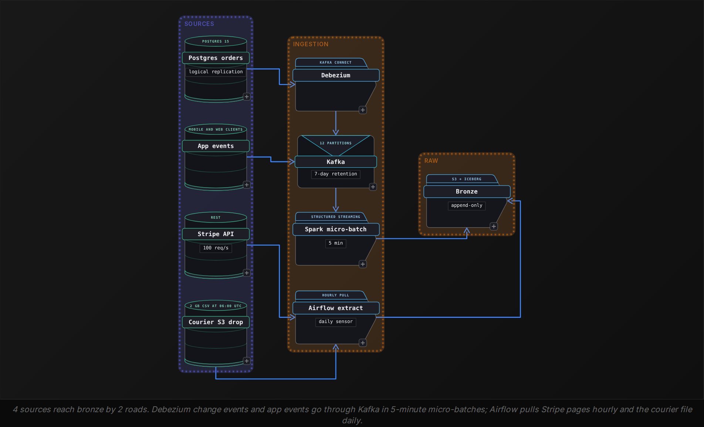
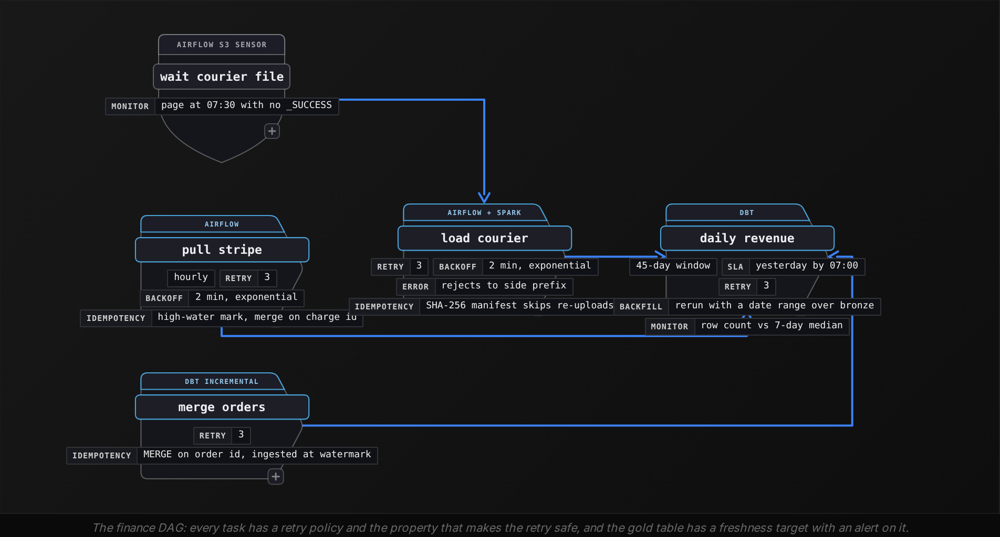

Intermediate·Pipeline Architecture · 20 min · 4 challenges

# Design a Pipeline: Intermediate

You are 20 minutes into the design round at a food delivery marketplace.
"Orders live in Postgres, payments go through Stripe, couriers belong to a partner who emails us a spreadsheet, and the app fires about 40 million events a day. Operations wants a live view of orders by city, and finance closes the books every morning. Design the pipeline."
He caps the marker. Nothing says how live "live" has to be, and the 2 consumers want different things from the same orders: one refreshes a map every 30 seconds, the other needs yesterday's revenue to match Stripe to the cent. Most candidates draw Kafka in the middle and a warehouse on the right before asking either question, and the follow-ups land on choices they never made on purpose.
What he is grading is whether each box you draw comes with a reason and a number.


<br>

### What you will be able to do

Pick an ingestion pattern per source from what the source can give, and name its operational cost before the follow-up arrives

Lay out the 3 medallion layers, and justify the formats and the partition key for each with scan-cost arithmetic

Argue ELT over ETL with storage and reprocessing numbers. Decide incremental versus full refresh model by model

Design each consumer's serving path from the staleness it tolerates and the queries it runs, concurrency included, and list the 6 failure modes with the property that survives each


<br>

---

## Ingestion Patterns

Each of the 4 sources admits 1 ingestion pattern once you ask what it can give. The interviewer is listening for the pattern tied to that answer, because a pattern chosen for the tool you know best reads as a guess, and the follow-ups are built to expose it.


<br>

### Change data capture from the orders table

Debezium on Kafka Connect reads the Postgres write-ahead log through a logical replication slot and emits 1 event per row change, with the after image and the operation type. The `orders` table takes 1.2 million inserts and roughly 3 million status updates a day, about 4.2 million change events, each in Kafka under a second after commit. The primary carries 1 slot reading the WAL instead of a polling query scanning `updated_at` every minute, and deletes arrive as events, which a polling extract never sees.

The cost is operational, and naming it unprompted is what scores. A replication slot pins WAL on the primary's disk until the connector confirms it has read it, so a connector that stops on Friday evening leaves the primary holding every segment written over the weekend, and a full disk takes the production database down with it. Cap the damage with `max_slot_wal_keep_size` (Postgres 13 and later) and alert on slot lag.


<br>

### Pulling Stripe through the API

Stripe's REST endpoint pages with a `starting_after` cursor and returns at most 100 objects per page. Refreshing the full charge history every hour fails within weeks, because the request count grows with the account's age until the job hits the rate limit. Use a high-water mark: store the largest `created` timestamp from the last successful run, request charges with `created[gte]` set to it, and page with the cursor so a restart resumes mid-list. That paging only finds new charges, and a charge changes after it is created, when it is captured and sometimes when it is refunded or disputed. Those changes come from `/v1/events` (`charge.captured`, `charge.refunded`, kept 30 days), pulled with the same loop on the event's `created`, and that feed gives finance its capture dates.

```sql
last_hwm = read_watermark("stripe_charges")
cursor = read_cursor("stripe_charges")
max_created = last_hwm

while True:
    page = stripe.Charge.list(
        created={"gte": last_hwm},
        limit=100,
        starting_after=cursor,
    )
    if not page.data:
        break
    write_to_bronze(page.data)
    max_created = max(max_created, *(c.created for c in page.data))
    cursor = page.data[-1].id
    save_cursor("stripe_charges", cursor)
    if not page.has_more:
        break

save_watermark("stripe_charges", max_created)
save_cursor("stripe_charges", None)
```

Do the division out loud. Stripe's live mode allows 100 read requests a second, so today's 300,000 charges take 3,000 requests, which is around 30 seconds. A 5 million charge backfill is 50,000 requests, roughly 8 minutes if nothing throttles. A 429 gets exponential backoff with jitter, capped near 30 seconds, so 20 workers sharing the limit do not retry together. `created[gte]` rather than `created[gt]` re-reads the boundary second on purpose, and the transformation section's merge absorbs the overlap.


<br>

### Files from the courier partner

The courier partner has no reachable database and no API: they drop around 2 GB of CSV into an S3 prefix at 06:00 UTC, some days as 3 part files. S3 shows each object only once its upload completes, but nothing in a listing says the set for that `dt` is complete, so an Airflow sensor waits for the partner's `_SUCCESS` marker: a load that starts after file 1 of 3 parses cleanly and books a third of Tuesday. A day of latency suits a 07:00 report. The failure worth raising first is duplicate delivery: the partner re-uploads Tuesday's file on Wednesday under a new name, and every courier count for Tuesday doubles.

```sql
s3://marketplace-lake/bronze/courier_deliveries/
  dt=2026-10-07/
    deliveries_20261007.csv      2.1 GB
    _SUCCESS
  dt=2026-10-08/
    deliveries_20261008.csv      2.0 GB
    deliveries_20261008_v2.csv   2.0 GB   (same bytes, re-uploaded)
    _SUCCESS
```

A manifest table keyed on each file's SHA-256 checksum skips the duplicate, because the re-upload hashes identically whatever its name. Filename matching misses the rename, and byte size collides whenever 2 exports share a length.


<br>

### App events, and whether this is a streaming job

The app sends 40 million events a day: 463 a second on average, around 5,000 at the Friday dinner peak. Producers write to a Kafka topic keyed by `user_id`, so a user's events stay ordered on 1 partition, and 12 partitions at several thousand messages a second each cover the peak and give a consumer group 12 workers. Seven days of retention lets a consumer reset its offset and replay the week, which answers "why Kafka and not a Lambda per event."

Then the question the round is built around: does the operations map need true streaming? It polls every 30 seconds, but operations tolerates data up to 10 minutes stale. A Spark Structured Streaming job committing to bronze every 5 minutes gives 288 commits a day and about 6 minutes of worst-case staleness, inside that bound. Flink with sub-second output would add a second cluster, a second deployment path and a stateful job to operate, for freshness nobody consumes. "Micro-batch at 5 minutes, because operations accepts 10 minutes of staleness" is the batch-versus-streaming answer: the interval comes from the consumer, and the tool follows.



> Follow-ups this section draws
>
> - "The vendor sends the same file twice." Tests whether the manifest identifies files by content: a checksum.
> - "The API allows 100 requests a minute and you need 5 million records." Tests pagination, the high-water mark and the division done out loud.
> - "Postgres has 40 tables. Do you write 40 extract jobs?" Expects 1 Debezium connector with a table include list.
> - "Why not Flink for everything?" Expects operations' 10-minute staleness tolerance and the cost of a second stateful cluster.


<br>

---

## Storage Architecture

"I would put it in S3" names a bucket rather than a layout. The interviewer needs 4 decisions, each with a cost at 40 million events a day: the layers, the file format in each, the table format that adds transactions, and the partition key.


<br>

### 3 layers and an immutable bottom

Bronze holds data as it arrived, duplicates included, append-only and never edited. When a transform bug miscounts refunds in gold, the fix is a rerun of silver and gold over bronze, with no second extraction from Stripe and no replay of WAL the slot released weeks ago. That rebuild is why the layers exist, and naming it tells the interviewer you have repaired a pipeline rather than only drawn one.

| Layer | Holds | Grain | Reader |
| --- | --- | --- | --- |
| Bronze | Raw Avro and JSON, duplicates kept | 1 row per change event or app event | Rebuilds only |
| Silver | Typed Parquet, deduplicated | 1 row per order, 1 per event | Analysts, data science |
| Gold | `orders_by_city_5m`, `daily_revenue` | 1 row per city, status, 5-minute bucket; 1 per day | Operations dashboard, finance |


<br>

### Parquet where it is read, Avro where it is written

Parquet stores each column contiguously with min and max statistics per row group, so a query reading 3 of 40 event columns skips the other 37 and opens only row groups whose range covers the filter. A day of 40 million JSON events at about 1 KB each is 40 GB raw and near 4 GB as Snappy Parquet. Avro is row-oriented and carries its schema, which suits the Kafka path: Debezium publishes Avro against the Confluent Schema Registry, so a new column on `orders` becomes a new schema version. Zstd compresses about 15% tighter than Snappy for a little more decode CPU, and silver takes that trade because Athena bills bytes scanned, so every read gets 15% cheaper; in bronze, read only for rebuilds, the gain is storage alone.


<br>

### A table format on top of the files

Raw Parquet in S3 is a folder of files with no transactions: a Spark job that dies after 300 of 500 files leaves 300 files that look complete to every reader. Iceberg adds a metadata layer, as do Delta Lake and Hudi: a write produces new files and a new snapshot, and the table's current pointer moves to it in 1 atomic swap, so readers see the whole commit or none. Snapshot history also gives time travel: `FOR VERSION AS OF` reads gold as it was before yesterday's bad run, the first thing finance asks for during an incident.

The follow-up is always "what if the write fails halfway?" The snapshot was never committed, the pointer never moved, and a maintenance job removes the orphan files later. Saying "pointer" shows the mechanism behind the feature list, which "Iceberg gives you ACID" does not.


<br>

### Partitioning by what the query filters on

The operations query filters by time and city; finance filters by day. Partition silver events by day of `event_ts`, so a day's query opens 1 of 365 partitions. Over a year the table is about 1.5 TB of Parquet, and at Athena's $5 per TB scanned a 1-day query costs roughly 2 cents while the same query on an unpartitioned copy costs over $7. At 200 analyst queries a day that is $1,400 against $4, and the interviewer wants that subtraction done at the whiteboard.

```sql
CREATE TABLE silver.events (
    event_id    STRING,
    user_id     BIGINT,
    city        STRING,
    event_type  STRING,
    event_ts    TIMESTAMP
)
USING iceberg
PARTITIONED BY (days(event_ts));

ALTER TABLE silver.events
WRITE ORDERED BY city, event_ts;
```

"Partition by the filter column" leads candidates to over-partition. By `user_id`, each 5-minute commit writes a file for every active user among 3 million: millions of tiny files a day, manifests that grow with them, and planning that outlasts the query. Keep the partition at day. `city` has 60 values and would slice each day into 70 MB pieces. Put it in the sort order instead, and the per-file min and max statistics still let the planner skip files.

The 5-minute micro-batch writes a file per Spark task per commit: 288 commits at 12 tasks leave 3,456 files in each day's partition at around 1.2 MB apiece, and per-request S3 latency on 3,456 objects outweighs the bytes read. Iceberg's `rewrite_data_files` runs hourly toward a 128 MB target. Name the target: "we would run compaction" without a number sounds like a word heard in a talk.

- **32** — files per day after compaction

> Follow-ups this section draws
>
> - "Analysts query 1 city on 1 day across 500 million rows." Expects date partition plus city sort order, named as 2 separate mechanisms.
> - "Why not partition by user_id, since that is how the app queries?" Expects the file count per commit and the manifest cost.
> - "Your stream writes every 5 minutes. What does the partition look like at midnight?" Expects the file count and the compaction target.


<br>

---

## Transformation Strategy

### ELT because raw data is cheap to keep

ETL transforms before loading, so the warehouse holds only the processed shape. ELT loads raw first and transforms in place with SQL, which in practice means dbt models over bronze with Spark or the warehouse as the engine. The difference shows on the day you reprocess: in ETL a historical month comes from the source again, and in ELT it sits in bronze and the reprocess is a rerun with a different date range.

Storage first: S3 standard is $0.023 per GB-month, and a year of raw events at 40 GB of JSON a day is about 15 TB, or $335 a month. Then the rerun. In bronze, 6 weeks of order CDC is about 176 million change events, and a 16-executor Spark cluster merging around 10 million rows a minute rebuilds silver orders in under 20 minutes, with the gold models adding a few more. The re-extract it replaces starts with 50,000 Stripe requests per 5 million charges, around 8 minutes at the rate limit, and then stalls: 6 weeks of order changes the WAL recycled once the slot confirmed them, and courier exports the partner has deleted. The comparison to say is 25 minutes of compute against a rebuild that cannot finish. Transforming before the load still makes sense in 1 place: card numbers and any other field that may never land in the lake get tokenised or dropped before the write.

✓ETL: transform before load

- Warehouse holds only the processed shape
- A logic bug means re-extracting from every source
- Rate limits and deleted exports cap what can be rebuilt
- Right for fields that cannot be stored raw

✗ELT: load raw, transform in place

- Bronze keeps the year for around $335 a month
- A logic bug means a dbt rerun over bronze
- 6 weeks of orders rebuild in about 20 minutes
- Right for everything the lake is allowed to hold

> **TIP**
>
> The sentence to say: "I land raw in bronze and transform with dbt, because $0.023 per GB-month is cheaper than re-extracting from a rate-limited API that may no longer hold the history."


<br>

### Incremental, and the merge that makes it safe

The orders fact holds 438 million rows after a year, and the operations model runs every 5 minutes. A full refresh therefore rereads the whole fact 288 times a day to apply 1.2 million new orders. An incremental model reads only the change events that landed in bronze since the last run, roughly 4.2 million a day across all runs, and merges them into the target.

```sql
MERGE INTO silver.orders AS t
USING (
    SELECT order_id, user_id, city, status, amount_cents, updated_at, op
    FROM (
        SELECT *, ROW_NUMBER() OVER (
            PARTITION BY order_id ORDER BY kafka_offset DESC
        ) AS rn
        FROM bronze.orders_cdc
        WHERE ingested_at > {{ last_run_ingested_at }}
    ) AS latest
    WHERE rn = 1
) AS s
ON t.order_id = s.order_id
WHEN MATCHED AND s.op = 'd' THEN DELETE
WHEN MATCHED AND s.updated_at > t.updated_at THEN UPDATE SET
    status = s.status,
    amount_cents = s.amount_cents,
    updated_at = s.updated_at
WHEN NOT MATCHED AND s.op <> 'd' THEN INSERT
    (order_id, user_id, city, status, amount_cents, updated_at)
VALUES
    (s.order_id, s.user_id, s.city, s.status, s.amount_cents, s.updated_at);
```

`MERGE` makes the run idempotent. When a replayed change event matches its key, the `updated_at` guard rejects it, leaving the row and every downstream count unchanged, where a plain `INSERT` would add a second row and double them. The `ROW_NUMBER` step matters as much: 1 order can change 3 times inside 5 minutes, and Spark with Iceberg and Snowflake by default reject a MERGE in which several source rows match 1 target row. Filtering on bronze ingestion time rather than `updated_at` keeps a late event from being skipped forever, because it carries an old `updated_at` and a new `ingested_at`. Once you have covered all 3 in that order, the interviewer stops probing.


<br>

### Full refresh where the table is small

Incremental everywhere is its own trap. Gold `daily_revenue` holds 365 rows after a year and depends on refunds that arrive up to 30 days after the charge. Rebuilding its last 45 days every morning reads around 54 million order rows plus the charges joined to them and finishes in a few minutes. It needs neither a watermark nor a merge key, and late data needs no special logic, because every run recomputes the window. The rule: incremental for the fact with hundreds of millions of rows, full refresh over a trailing window when that window's input rescans in minutes. dbt expresses either as 1 config line, and the interviewer wants to hear that you picked per model rather than per pipeline.

- **126B** — row reads a day with full refresh

> Follow-ups this section draws
>
> - "A bug in the refund logic shipped 6 weeks ago." Expects a dbt rerun over bronze with a date range: about 25 minutes of compute against a re-extract that cannot recover the history.
> - "The same change event arrives twice." Expects MERGE on the key and the updated_at guard, with the reason a plain insert doubles counts.
> - "Why not make everything incremental?" Expects the 365-row table and the refund window that a trailing full refresh handles for free.


<br>

---

## Serving the Consumer

The question named operations and finance, and data science appears the moment you ask who else reads the orders. The 3 readers want data at different freshness, and their queries differ in shape and in how many run at once, so 1 gold table cannot serve them all. The interviewer is listening for a serving layer designed backward from each reader rather than forward from the warehouse already drawn.

| Consumer | Freshness | Query shape | Store |
| --- | --- | --- | --- |
| Operations dashboard | Within 10 minutes | 1 city, last 2 hours, every 30 s | Postgres serving table |
| Finance close | Yesterday by 07:00 | Full day, joined to Stripe payouts | Iceberg gold via Athena |
| Data science | Daily | 2-year scans, a few a week | Silver fact tables |


<br>

### Operations: a small aggregate in a row store

Forty operators keep a map open that refreshes every 30 seconds: 115,200 queries a day, each asking for 1 city's order counts by status over the last 2 hours. Athena adds a planning round trip and a few seconds per query; Snowflake keeps its smallest warehouse awake all day, roughly $48 at $2 a credit, for reads that touch 144 rows. Instead, the 5-minute job writes `orders_by_city_5m` to Iceberg gold and upserts the same rows into Postgres with a primary key on `(city, status, bucket_start)`. Sixty cities times 6 statuses times 288 buckets is 103,680 rows a day, and the 144-row read for 1 city's 2 hours returns in single-digit milliseconds. Postgres keeps 30 days; Iceberg keeps the history.

```sql
INSERT OVERWRITE gold.orders_by_city_5m
SELECT city,
       status,
       timestamp_seconds(
         floor(unix_timestamp(updated_at) / 300) * 300
       )                 AS bucket_start,
       count(*)          AS orders,
       sum(amount_cents) AS amount_cents
FROM silver.orders
WHERE updated_at >= date_trunc('HOUR', current_timestamp()) - INTERVAL 2 HOURS
GROUP BY 1, 2, 3;
```


<br>

### Finance: a daily table that reconciles to the cent

Finance reads `daily_revenue` once a morning and compares it to Stripe's payout report, so the number has to match Stripe. The model joins silver orders to silver charges on `order_id` and books a charge on the UTC day Stripe captured it, taken from the `charge.captured` events, rather than the day the order was placed; the 2 definitions differ by a few hundred orders around midnight, and reconciling to the wrong one costs a controller an afternoon. It runs at 06:30 behind the courier sensor, 30 minutes before the 07:00 report. It rebuilds a 45-day window for refunds and carries a `computed_at` column, and when a controller asks why Tuesday changed, the Iceberg snapshot they first read answers. Serve it through Athena on the Iceberg table, because 3 people run 20 queries a day and a second copy is a second thing to reconcile.


<br>

### Data science: the silver tables, and what you do not build

Data science wants every order and event from the last 2 years to train a delivery-time model, scanned in full a few times a week. That is the silver fact, read through Spark with the day partition and city sort doing the pruning. The move that costs the offer is proposing a feature store or a third aggregate before anyone has asked for a feature: silver serves this reader, and a gold table appears when a query pattern repeats.


<br>

### Say the freshness number for each reader

Every serving table has a freshness target the pipeline measures: `max(bucket_start)` in the operations table within 10 minutes of the clock, yesterday's `daily_revenue` by 07:00, each checked by a query the monitor runs every minute. "How do you know the dashboard is current?" wants that query, and the DAG in the next section shows where the alert attaches.

> Follow-ups this section draws
>
> - "Operations now wants data no older than 1 minute." Expects the micro-batch interval to drop toward 30 seconds, the 10x file count it brings, and whether anyone acts that fast.
> - "Finance says Tuesday's number changed overnight." Expects the refund window first, then the computed_at column and the Iceberg snapshot they first read.
> - "Data science wants their own copy." Expects a reason silver already serves the scan and a condition under which a separate gold table is worth building.


<br>

---

## Reliability Under Failure

The last 10 minutes of the round go to failure, and the highest-scoring answers raise each one before the interviewer does. This pipeline has 6, each with a property that survives it, and the property is the answer.


<br>

### Retries land on idempotent writes

Every Airflow task retries 3 times with exponential backoff from 2 minutes, and a retry is safe only if running the task twice leaves the same table. The Stripe pull re-reads the boundary second into bronze, and the silver merge on `charge_id` collapses the overlap. The Spark micro-batch records its Kafka offsets in a checkpoint and tags each Iceberg commit with its batch id, so a job killed between the 2 replays the batch and Iceberg skips a batch it already committed. Where no natural key exists, the run id becomes a column and the load deletes that run id's rows before inserting, the sentence to say when asked about a source with no primary key.




<br>

### Late events and the window that reopens

At the dinner peak Debezium can fall 10 to 15 minutes behind the primary, so order changes reach silver with an `updated_at` older than buckets gold has already written. The gold job recomputes from the hour boundary 2 hours back on every run, so lag under 2 hours is repaired on the next run, and the 45-day `daily_revenue` rebuild catches anything later. App events arrive late another way: a phone that loses signal in a stairwell delivers on reconnect, and about 0.3% of events arrive more than 10 minutes late. The micro-batch lands them by arrival with their true `event_ts`, so they reach the right day partition in silver; a streaming aggregate with a 10-minute watermark would drop that 0.3%, which is why every aggregate here runs in batch over silver.


<br>

### A malformed record takes the side path

One row in the 2 GB courier file carries a delivery timestamp of `31/02/2026`. A parser that raises halts the load, and the whole day's finance report waits on 1 row. Rows that fail typing go to `bronze/courier_deliveries_rejected/dt=.../` with the raw line and the error, and the load counts them and keeps going; an alert fires above 0.1% of the file, the threshold between a typo and a partner who changed their export. Kafka events get a dead letter topic, with the original headers kept so the record can be replayed after the fix.


<br>

### Schema change upstream

The orders team adds a nullable `tip_cents` column on a Tuesday afternoon without telling anyone. Debezium registers a new Avro schema version with the field optional and a null default, which every compatibility mode accepts, and the silver model, selecting columns by name, ignores it until someone adds it. A rename is different. Under the registry's default `BACKWARD` mode, dropping `amount` passes. Adding `amount_cents` is rejected only if it is required with no default, so the rename usually goes through and silver's `SELECT amount` fails or reads null. Set the CDC subjects to `FULL`, which rejects removing a required field such as the NOT NULL `amount`: the connector stops and the slot holds the WAL until the mapping is fixed. A contract test on silver's columns catches whatever the registry still accepts. Iceberg tracks columns by id, so adding one to silver is an `ALTER TABLE ... ADD COLUMN` with no rewrite; the courier CSV has no registry, so the load asserts its header row first.


<br>

### What pages, and what waits

Three monitors cover the pipeline. Freshness: `max(ingested_at)` per bronze table against the clock, paging at 15 minutes for Kafka sources and 90 minutes past expected arrival for the daily file. Volume: today's row count against the trailing 7-day median for the same hour, alerting below 50% or above 200%, which catches a partial file set or a replayed topic before a consumer does. Slot lag: retained WAL bytes on the replication slot, alerting at 10 GB and paging at 30, because the end of that curve is the production database. A silent run, where the DAG succeeds and gold gains 0 rows, trips the volume monitor, which is why it runs on the output table rather than task status.

> Name these before being asked
>
> - Retry after a partial write: MERGE with the updated_at guard, checksum manifest, Iceberg commit tied to the batch id
> - Late data: hour-aligned 2-hour recompute for CDC lag; the 0.3% of app events past 10 minutes kept by aggregating in batch
> - Malformed record: rejects to a side prefix or dead letter topic, alert above 0.1%
> - Schema change: FULL compatibility on CDC subjects, columns selected by name, a contract test on silver
> - Slot lag: max_slot_wal_keep_size and a page at 30 GB before the primary's disk fills
> - Silent success: volume check on the output table against a 7-day median

✓Do

- Give every box a reason tied to the source or consumer and a number the interviewer can check
- Say the retry policy and the idempotency key in the same breath
- Name the late-event percentage and the recompute window that absorbs it
- Monitor the output table's freshness and volume, since task status can succeed on 0 rows
- Route bad records sideways with the raw line kept, and alert on the reject rate

✗Don't

- Say "exactly-once" without naming the commit that makes it true
- Treat a late event as an error instead of an expected 0.3%
- Let 1 malformed row halt a 2 GB file and a 07:00 report
- Read columns by position from a source that can add one on a Tuesday
- Leave a replication slot without a WAL cap and a slot-lag alert


<br>

---

## Putting It All Together

A grocery delivery company runs the pipeline from this lesson. On a Friday at 18:40, the courier partner re-uploads Thursday's file, a developer renames amount to amount_cents on the orders table, and a cell outage in 2 neighbourhoods holds 40,000 app events for 25 minutes. Operations is watching the dinner-peak map, and finance opens the books at 07:00 on Saturday.

- The checksum manifest from the ingestion section skips the re-uploaded file, so Thursday's courier count stays at its real value in the daily revenue model
- With CDC subjects set to FULL, the registry rejects the schema that drops amount and the connector stops; the slot holds the WAL under the slot-lag alert, and the freshness monitor pages at 15 minutes because the operations map has gone stale in the dinner peak
- The recovery runs in order: fix the mapping to amount_cents , register the schema, restart the connector so the slot drains into bronze, then rerun the silver merge over the affected range; the hour-aligned 2-hour recompute repairs the dinner buckets, and Saturday's 06:30 rebuild books Friday's orders before finance opens
- The 40,000 late app events land in bronze by arrival and in silver . events under their true event_ts , and because no streaming watermark sits in their path, Friday's events are complete for analysts and data science once they land


<br>

---

## Key Takeaways

- An ingestion pattern comes from what the source can give: WAL for Postgres, a high-water mark for a rate-limited API, a checksum manifest for a file, 5-minute micro-batch for a consumer that tolerates 10 minutes of staleness
- Storage is 4 decisions with a number each: 3 layers; Avro in, Parquet out; Iceberg for the atomic pointer swap; and a day partition that turns a $7 scan into 2 cents
- ELT wins on arithmetic: $335 a month keeps the raw year, and re-acquiring it is rate-limited or gone; pick incremental or full refresh per model, with MERGE making reruns safe
- Serve each consumer from its own shape: a row store for 115,200 point reads, Iceberg via Athena for 20 daily queries, silver for the 2-year scan
- Raise the 6 failure modes before the interviewer does, each with the property that survives it and the alert that watches it
