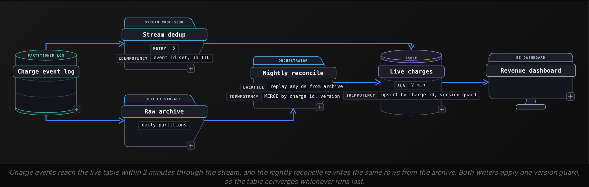

Advanced·Pipeline Architecture · 25 min · 2 challenges

# Idempotency: Advanced

Ines is in the final round of a data engineering interview at Stripe, whose public API accepts an `Idempotency-Key` header so that a client retrying a payment request still creates exactly 1 charge. The interviewer sketches a nightly job that loads charge events into a revenue table, then adds a twist: the orchestrator timed out the task at 02:40 and launched a second attempt, although the first had already finished writing. What does finance see in the morning? Ines says she would deduplicate downstream, and the interviewer keeps pressing. Which write makes the second attempt harmless? How does it know to read the rows the first attempt read? What changes if the job is a stream? And how would she prove any of it before shipping? This lesson builds the answer to each of those questions.


<br>

### What you will be able to do

Define pipeline idempotency precisely and keep it separate from determinism and exactly-once delivery

Choose between an atomic partition replace and a version-guarded MERGE, and name how each one fails

Pin a run's input to a recorded offset range and order offset commits so a crash causes a re-read and never a loss

Compare how batch and streaming pipelines absorb replays, with the dedup state cost in numbers

Prove a design idempotent out loud by walking its crash points and running a rerun fingerprint test


<br>

---

## "What If Your Pipeline Runs Twice?"

Interviewers almost never say the word idempotency. They say the task retried after a timeout, finance wants March backfilled, the consumer restarted after a deploy, or 2 schedulers fired the same job. Every version asks one thing: what does a second execution of the same unit of work do to the table it writes? A complete answer separates 4 properties, knows where repeat executions come from, and walks the 3 points where a run can die.


<br>

### A definition you can test

A run is idempotent when executing it any number of times for one input slice leaves the target exactly as a single execution would. As an equation: run(run(T, s), s) = run(T, s), where T is the target's current state and s is the slice, such as ds = '2026-10-23'. The equation says nothing about correctness. A run that computes wrong numbers can be fully idempotent, producing the same wrong numbers each time, and that property is what lets you fix the bug and rerun knowing the rerun changes only what the fix changed.

Answers often blur 4 properties together, and keeping them apart is half the question:

| Property | What it guarantees | What a rerun does without it |
| --- | --- | --- |
| Pinned input | The rerun reads exactly the rows the first run read | Picks up rows that arrived in between, or misses rows that left |
| Deterministic transform | The same input produces the same output rows | Writes different values, so totals move although no data changed |
| Idempotent write | Applying the same rows twice leaves 1 copy | Doubles the slice |
| Exactly-once delivery | Each message reaches the consumer once | Rarely offered end to end, so designs pair at-least-once delivery with the 3 rows above |

The first 3 are yours to build. The fourth belongs to the transport, and you rarely need it: once the other 3 hold, a message delivered twice into an idempotent write still lands once.


<br>

### Where repeat executions come from

| Trigger | What repeats | Why nobody notices |
| --- | --- | --- |
| Orchestrator retry after a timeout | A task whose first attempt may have committed | The log shows 1 failed attempt and 1 success |
| Manual backfill | Any historical slice, often weeks later | Upstream dimensions have changed since the original run |
| Consumer restart or rebalance | Every record after the last committed offset | Looks like ordinary lag catching up |
| Broker redelivery | Individual messages | Duplicates are rare and scattered across days |
| Zombie worker | A second attempt writing at the same time | Shows up only as a race, never as a failure |

Any answer should mention the zombie row. A worker that stalls for 10 minutes gets declared dead, a replacement starts, and then the original wakes and finishes its write. Retries happen one after another; zombies overlap, and a design that reasons only about sequential reruns breaks on them.


<br>

### The 3 moments a run can die

Take the running example: a nightly job builds the `ds = '2026-10-23'` slice of `fact_charges`, 1,204,000 rows, with a plain `INSERT`. Here is the target after a crash at each point, followed by an automatic retry:

| Crash point | What the crash leaves | Rows after the retry |
| --- | --- | --- |
| Before any write | Slice untouched | 1,204,000, correct |
| Mid-write, after 700,000 rows | A partial slice | 1,904,000, with 700,000 duplicated |
| After the write, before the success marker | The complete slice | 2,408,000, revenue doubled |

The third row is the one interviewers set up on purpose. From the data's point of view nothing failed: the write finished and only the bookkeeping did not. An append has no way to tell a retry from new data, so every safe design ties the write to an identity the retry can recognize: a slice it replaces, or a row key it matches.


<br>

### Nondeterminism inside the transform

A flawless write cannot rescue a transform that computes different rows each time. This query has 4 sources of drift:

```sql
SELECT
  charge_id,
  amount_cents,
  UUID() AS row_id,
  CURRENT_TIMESTAMP AS loaded_at,
  ROW_NUMBER() OVER (
    PARTITION BY charge_id
    ORDER BY event_time
  ) AS rn
FROM raw_charge_events
WHERE event_time >= CURRENT_DATE - INTERVAL '1' DAY
```

`uuid()` mints a new row ID per run, so a MERGE keyed on it inserts every row again. `current_timestamp` stamps a new value each time. `ORDER BY event_time` lets `rn = 1` pick either of 2 events stamped in the same millisecond. And `current_date - INTERVAL '1' DAY` means a retry after midnight reads a different day. The fixed version derives every value from the input or the run's parameters:

```sql
SELECT
  charge_id,
  amount_cents,
  TO_HEX(
    MD5(
      TO_UTF8(charge_id || ':' || CAST(event_seq AS VARCHAR))
    )
  ) AS row_id,
  TIMESTAMP '2026-10-24 02:00:00' AS loaded_at,
  ROW_NUMBER() OVER (
    PARTITION BY charge_id
    ORDER BY event_time, event_seq
  ) AS rn
FROM raw_charge_events
WHERE ds = '2026-10-23'
```

The row ID now hashes the event's own fields, the load time is the logical run time the orchestrator passes in, the window has a tie-breaker, and the filter names the slice. One drift source sits outside the query: a join to `dim_merchant` as it stands today. A backfill run in December would label October charges with December's merchant tiers, so a rerunnable job joins the dimension snapshot for the same `ds`.

> Try it: which writes survive a retry?
>
> - A: `INSERT INTO daily_revenue SELECT ... WHERE ds = '2026-10-23'`
> - B: `UPDATE merchants SET last_seen = current_timestamp WHERE active`
> - C: `DELETE` then `INSERT` for `ds = '2026-10-23'`, both inside 1 transaction
> - D: set `status = 'refunded'` for every charge ID listed in a file

Answers

- A doubles the slice on every retry.
- B never converges: 2 runs write 2 timestamps, so no rerun reproduces the first.
- C is idempotent: the retry replaces the slice with identical rows.
- D is idempotent for one file, but replaying an older file after a newer one can undo a later change.


<br>

---

## DELETE-INSERT and MERGE

Partition replace and MERGE both give a retry something to recognize. Partition replace makes the slice the identity: whatever the slice held, the run swaps in a fresh copy. MERGE makes the row key the identity: each incoming row finds its match and updates it. Both repeat safely in the basic case, and each fails in a way the basic case hides.


<br>

### Partition replace, written carefully

```sql
START TRANSACTION;

DELETE FROM fact_charges
WHERE ds = '2026-10-23';

INSERT INTO fact_charges
SELECT
    charge_id,
    merchant_id,
    status,
    amount_cents,
    version,
    is_deleted,
    ds
FROM stg_charges
WHERE ds = '2026-10-23';

COMMIT;
```

#### Failure 1: a gap between the statements

If the `DELETE` commits alone and the `INSERT` then fails, the day holds 0 rows until someone notices. A dashboard refreshing in that window reports zero revenue, and any job scheduled downstream copies the zero into its own tables. Run both statements in 1 transaction where the table format supports multi-statement transactions. Otherwise build the new slice in a staging location and repoint the partition in 1 metadata operation, so readers see the old slice or the new one and never an empty one.

#### Failure 2: the delete misses rows the insert writes

Suppose `fact_charges` were partitioned by event date while the job runs per load date. The 2026-10-23 load holds 1,204,000 rows, 3,100 of them late events dated 2026-10-22. The `DELETE` clears 1 partition, the `INSERT` writes into 2, and each rerun adds another 3,100 copies to the 22nd. Widening the `DELETE` to the 22nd is worse, because it erases rows the 2026-10-22 load wrote. The `DELETE` predicate must cover every row the `INSERT` can produce and nothing more: partition by the load slice and let readers filter on event date, or route late rows through MERGE.


<br>

### MERGE repeats safely under 3 conditions

Rerunning a MERGE is harmless when the source holds 1 row per key, the update depends only on the source row, and an older source can never overwrite a newer target. This statement meets all 3 and carries source deletes as tombstones:

```sql
MERGE INTO fact_charges t
USING (
    SELECT
        charge_id,
        merchant_id,
        status,
        amount_cents,
        version,
        op = 'd' AS is_deleted,
        ds
    FROM (
        SELECT
            charge_id,
            merchant_id,
            status,
            amount_cents,
            version,
            op,
            ds,
            ROW_NUMBER() OVER (PARTITION BY charge_id ORDER BY version DESC, event_seq DESC) AS rn
        FROM stg_charge_changes
        WHERE batch_id = 'b-20261023'
    ) ranked
    WHERE rn = 1
) s
ON t.charge_id = s.charge_id
WHEN MATCHED AND s.version > t.version THEN
    UPDATE SET
        status = s.status,
        amount_cents = s.amount_cents,
        version = s.version,
        is_deleted = s.is_deleted
WHEN NOT MATCHED THEN
    INSERT (charge_id, merchant_id, status, amount_cents, version, is_deleted, ds)
    VALUES (s.charge_id, s.merchant_id, s.status, s.amount_cents, s.version, s.is_deleted, s.ds)
```

| Clause | What a rerun does without it |
| --- | --- |
| `ROW_NUMBER ... WHERE rn = 1` | Matches 2 source rows to 1 target row, which the SQL standard treats as an error, so every retry fails the same way |
| `AND s.version > t.version` | Lets a stale batch overwrite fresher rows, as the next table shows |
| `is_deleted` tombstone | Resurrects deleted charges: a hard `DELETE` discards the version the guard needs, so a replayed older insert finds no match |
| `WHERE batch_id = 'b-20261023'` | Reads whatever staging holds now, possibly the next batch's rows |

Here is the guard at work. The 2026-10-23 run refunded charge `ch_1` at version 7. A week later someone replays the 2026-10-20 change batch, whose row for `ch_1` is the original successful charge at version 4:

| State | ch_1 status | version |
| --- | --- | --- |
| Target after the 2026-10-23 run | refunded | 7 |
| Row in the 2026-10-20 replay | succeeded | 4 |
| Target after the replay, no guard | succeeded | 4 |
| Target after the replay, with guard | refunded | 7 |

Without the guard, the replay un-refunds a charge and revenue goes up with no new sale behind it. The guard needs a version that only increases per key, such as a source sequence number or a change-log position. A wall-clock `updated_at` qualifies only if 2 writes to one key can never share a timestamp.


<br>

### What each choice costs

`fact_charges` holds 2 TB in 16,000 files of 128 MB. A typical day brings 80,000 changed charges whose originals spread across 2 years of history, so they land in 60% of the files. In a table format that rewrites whole files on update, MERGE rewrites every file holding a matched row; replacing 1 day's partition rewrites 1 day.

- **1.2 TB** — rewritten per day by the MERGE
- **2.7 GB** — rewritten per day by 1-partition replace

That is roughly 450 to 1, but the cheap path applies only when every change falls inside the slice being rebuilt, and scattered corrections never do. Formats that record deletes in separate files avoid the rewrite and charge every read until compaction runs, so the choice decides who pays: the writer once, or each reader repeatedly.

✓Partition replace

- Identity: the slice
- Cost scales with the slice size
- Handles late data only when it lands in the same slice
- Deletes by omission: absent rows vanish
- Breaks when DELETE and INSERT predicates disagree

✗MERGE with a version guard

- Identity: the row key plus its version
- Cost scales with files touched
- Handles late and out-of-order changes anywhere in history
- Deletes need tombstones
- Breaks on duplicate source keys or a missing guard

> **TIP**
>
> A decision rule to say out loud: if recomputing the slice fully determines a set of partitions, replace them; if changes scatter across history by key, MERGE with a version guard. Many production tables use both, replace for the daily slice and MERGE for corrections.

> Try it: pick the write
>
> - Sessions are rebuilt daily from clickstream, and 2% of sessions span midnight.
> - A subscriptions table receives status changes for any subscription ever created.

*Sessions: partition by session start date. The run for day N reads events from N-2 through N, sessionizes them, keeps only sessions starting on N-1 or N, and replaces exactly those 2 partitions. The extra day lets a session that began on N-2 keep its tail instead of reappearing as a new session at midnight. The start-date filter keeps the INSERT inside the 2 partitions the DELETE clears. Subscriptions: changes scatter across all of history, so MERGE on subscription ID with a version guard.*


<br>

---

## Idempotent Reads With Offsets

A retry that writes safely but reads different input still produces a different table. The read side needs an identity too: a named, bounded range of input that a retry can request again.


<br>

### Record the range before reading it

In a partitioned log, every record carries a partition number and an offset that only grows. A run's input is a map from partition to a half-open range `[start, end)`. Write that map to a run ledger before processing begins; a retry reads the ledger and replays exactly that map, even if 40,000 records have arrived since.

| run_id | partition | start_offset | end_offset | status |
| --- | --- | --- | --- | --- |
| r-1001 | 0 | 88,120,000 | 88,410,000 | committed |
| r-1001 | 1 | 87,990,500 | 88,281,300 | committed |
| r-1002 | 0 | 88,410,000 | 88,702,000 | planned |
| r-1002 | 1 | 88,281,300 | 88,560,100 | planned |

Each run starts on every partition where the previous one ended, so the ledger doubles as a test: any gap means lost records, any overlap means a replay the write must absorb. Offsets stay replayable only while the log retains them. A backfill reaching past retention asks for offsets that no longer exist, which is why a raw archive partitioned by load date sits beside the log.


<br>

### Commit order decides what a crash costs

| Order of steps | Crash between the steps | Result |
| --- | --- | --- |
| Commit offsets, then write | Records skipped for good | At-most-once |
| Write, then commit offsets | Records processed again on restart | At-least-once |
| Write and offsets in 1 transaction | Both happen or neither does | Exactly-once effect in the sink |

The middle row is the default worth defending: it never loses data, and the writes from the previous section absorb the replay. The third row needs the offsets stored in the same database as the output, which a table sink allows and an email provider does not. Here is the third row with 1 more guard:

```sql
def commit_batch(conn, log, partition, max_records=5000):
    start = conn.fetch_one(
        "SELECT next_offset FROM consumer_offsets WHERE partition_id = %s",
        (partition,),
    )
    records = log.read(partition, start, max_records)
    if not records:
        return 0
    end = records[-1].offset + 1
    with conn.transaction() as tx:
        upsert_charges(tx, records)
        moved = tx.execute(
            "UPDATE consumer_offsets SET next_offset = %s "
            "WHERE partition_id = %s AND next_offset = %s",
            (end, partition, start),
        )
        if moved != 1:
            raise StaleConsumerError(partition, start)
    return len(records)
```

The `AND next_offset = %s` clause is a fence. A zombie consumer that read from offset 88,410,000, stalled, and woke after its replacement had already advanced the partition finds 0 matching rows, raises, and the transaction rolls back its upsert with it. The fence does for offsets what the version guard does for rows: the stale writer loses.


<br>

### Timestamp watermarks leak rows

Many batch sources have no offsets, so the extract pulls rows whose `updated_at` exceeds the last watermark, then sets the watermark to the highest value it saw. A transaction stamps `updated_at` when it writes, but its rows become visible only when it commits, and that gap loses rows:

| Time | What happens |
| --- | --- |
| 10:00:59.100 | A transaction stamps `ch_88` with that `updated_at` and stays open |
| 10:00:59.900 | Another transaction stamps and commits `ch_91` |
| 10:01:00.000 | The extract sees `ch_91`, misses `ch_88`, sets the watermark to 10:00:59.900 |
| 10:01:03.000 | `ch_88` commits, stamped 10:00:59.100 |
| 10:05:00.000 | The next extract reads above 10:00:59.900 and skips `ch_88` forever |

One fix is to read the database's change log by commit sequence, which orders rows by when they became visible. The other is to re-read a lookback longer than the longest transaction on every extract, say 15 minutes on a 5-minute schedule, and let the version-guarded MERGE absorb the repeats. Each extract then reads from 15 minutes before the watermark up to now, roughly 20 minutes of rows, and extracts start 5 minutes apart. The lookback is safe only because the write is idempotent.

- **4x** — reads of each row, 15-minute lookback

> Try it: find the 2 corruptions
>
> An extract reads `updated_at >= :watermark`, appends with `INSERT`, and saves the new watermark after the insert. Name 2 ways it corrupts the target over a week of runs.

*The >= re-reads every row stamped exactly at the watermark, and the INSERT appends them again on each run. Late commits still fall behind the watermark and vanish. A lookback window feeding a version-guarded MERGE fixes both.*


<br>

---

## Idempotency in Streaming vs Batch

A batch slice has edges, so a retry can recompute it and swap it in whole. A stream has no last row. The unit of replay shrinks to the records since the last checkpoint, and idempotency moves into row keys, dedup state and transactional sinks.

| Aspect | Batch | Streaming |
| --- | --- | --- |
| Unit of replay | A partition or an offset range | Records since the last checkpoint |
| Usual cause | Retry, backfill | Restart, rebalance, redelivery |
| Mechanism | Replace the slice, or MERGE | Upsert by key, dedup state, transactional sink |
| Cost of a replay | Recompute the slice | Re-emit records, possibly to outside systems |
| Where it breaks | Predicates that disagree | Duplicates older than the dedup window |


<br>

### Dedup state has a size and an edge

A stream that drops repeated events by `event_id` must remember every ID inside its window. The charge stream runs at 50,000 events per second, each ID takes 16 bytes, and the window is 24 hours.

- **4.3B** — IDs held in a 24-hour window
- **69 GB** — dedup state before index overhead

That state is checkpointed, restored on every restart, and spread across workers. The window also has an edge: a redelivery 25 hours after the original passes as new. A 1-hour window shrinks the state to 2.9 GB and widens that gap. The design that holds up combines 2 mechanisms with separate jobs. The short window protects writes that are not keyed upserts, such as audit appends, per-minute counts and outbound emails; the live table's version-guarded upsert absorbs a repeat of any age by itself. The nightly batch MERGE over the archive repairs what the stream never wrote or wrote wrong, such as events dropped during an outage or rows a bug miscomputed.




<br>

### Checkpoint-bound sinks trade latency

The streaming form of storing offsets and output in 1 transaction is a sink that commits with the checkpoint. The processor writes each interval's output as pending and makes it visible only when the checkpoint recording the matching input positions completes; a restart discards pending output and replays from that checkpoint. The price is visibility: with a 60-second checkpoint interval, readers see each record up to 60 seconds late, and a sink that cannot hold pending writes cannot take part at all.


<br>

### Window results need an upsert sink

A per-minute charge count emits again when a late event lands or when the job restores a checkpoint and replays. Minute 10:04 for merchant `m_17` first emits 412, then 415 after 3 late charges arrive. Keyed on `(merchant_id, window_start)`, the sink lets the second emission replace the first:

Append sink

| window_start | merchant_id | charges |
| --- | --- | --- |
| 10:04 | m_17 | 412 |
| 10:04 | m_17 | 415 |

Upsert sink

| window_start | merchant_id | charges |
| --- | --- | --- |
| 10:04 | m_17 | 415 |

Summed, the append sink reports 827 charges for a minute that had 415.


<br>

### Side effects leave the transaction

Payout calls, emails and webhooks cannot share a transaction with your offsets, so a restart sends them again. Deduplication has to move to the receiver: derive a key from the event, send it with the request, and the receiver stores the key and returns the original response on a repeat. Stripe's API works this way through its `Idempotency-Key` header, and its documentation says keys may be pruned once they are at least 24 hours old, which is the same window edge as above, inside someone else's system.

```sql
import hashlib


def payout_key(event_id: str, action: str) -> str:
    return hashlib.sha256(f"{event_id}:{action}".encode()).hexdigest()
```

The key must come from the event. A key generated fresh for each attempt, such as a random UUID, differs on every retry and defeats the receiver's check.

✓Do

- Key window sinks on the grouping columns plus the window start
- Derive side-effect keys from event fields
- Back a short dedup window with a batch reconcile

✗Don't

- Append window results to a table that readers sum
- Generate a new request key on each retry
- Guess dedup state size; compute rate times window times key size

> Try it: what repeats after a restart?
>
> A streaming job updates `charge_status` by upsert, appends to `charge_events_audit`, and sends a payment-failed email. A restart replays 6 minutes of records. What is duplicated, and what fixes each?

*The upsert table ends unchanged. The audit table gains 6 minutes of copies unless it keys on event_id. Every payment-failed email from those 6 minutes goes out twice unless the email service accepts a key derived from the event.*


<br>

---

## Proving Idempotency Out Loud

When an interviewer asks whether a design is idempotent, a bare yes gets you nothing. They want an argument that holds at every crash point and a test that would catch you being wrong. These 6 steps build that argument for any design:

- **Name the unit** *What is a run?*\
  A ds plus an offset map, written to a ledger before work starts.
- **Pin the input** *Same rows on retry*\
  The retry reads the ledger, never the clock.
- **Make the transform a function** *Same rows in, same rows out*\
  IDs hashed from event fields, load time from parameters, tie-broken windows, dimension snapshots by ds.
- **Key the write** *Replace or match*\
  Replace the slice atomically, or MERGE on the natural key with a version guard.
- **Walk the crash points** *Before, during, after, concurrent*\
  Say what is on disk at each and why the retry converges.
- **Name the test** *Run twice, compare*\
  Fingerprint the target after each run and require equality.


<br>

### A worked answer

> Answering the charges question
>
> The unit is one `ds` of `fact_charges`, with its input offsets recorded in a ledger before the run reads anything, so a retry reads the same 1,204,000 rows. The transform derives IDs by hashing event fields and takes load time from the run parameters. The write is a partition replace committed in 1 transaction, so the 02:40 retry swaps in identical rows and finance sees a single copy. Late events go through a MERGE with a version guard, so replaying an older day cannot undo a newer refund. I would prove it by fingerprinting the partition after 2 runs and after an out-of-order replay. The cost: the replace rewrites one day, and the MERGE rewrites every file a late row touches, which is why only late rows take that path.


<br>

### Walk every crash point

| Crash point | On disk | Why the retry matches 1 run |
| --- | --- | --- |
| Before the write | Ledger row `planned`, no output | It reads the same offsets and writes the slice once |
| During the write | Nothing visible: the transaction rolled back | Same as the row above |
| After commit, before the ledger update | Full slice, ledger still `planned` | It replaces the slice with identical rows |
| Concurrent attempts | Both computing | The second commit fails the offset fence, or loses to the version guard |


<br>

### The rerun test

Run the job for one slice, fingerprint the result, run it again with identical parameters, and fingerprint again. An order-insensitive `checksum()` aggregate makes the comparison reliable without sorting 1,204,000 rows. It is a hash, so equal values are strong evidence and a collision remains possible. It also covers only what goes into it: wrap nullable columns in `coalesce` so 1 NULL does not blank a row's contribution, and include every column the write sets, or a rerun that changes `merchant_id` or `version` passes.

```sql
SELECT
  COUNT(*) AS row_count,
  COUNT(DISTINCT charge_id) AS distinct_charges,
  SUM(amount_cents) AS total_cents,
  CHECKSUM(
    charge_id || '|' || COALESCE(CAST(merchant_id AS VARCHAR), '') || '|' || COALESCE(status, '') || '|' || COALESCE(CAST(amount_cents AS VARCHAR), '') || '|' || COALESCE(CAST(version AS VARCHAR), '') || '|' || COALESCE(CAST(is_deleted AS VARCHAR), '')
  ) AS content_hash
FROM fact_charges
WHERE ds = '2026-10-23'
```

| Metric | After run 1 | After run 2 |
| --- | --- | --- |
| row_count | 1,204,000 | 1,204,000 |
| distinct_charges | 1,204,000 | 1,204,000 |
| total_cents | 9,871,334,500 | 9,871,334,500 |
| content_hash | 3f9a0c71e2b4d859 | 3f9a0c71e2b4d859 |

The test needs 2 more runs. Replay the 2026-10-20 change batch after 2026-10-23 and confirm every charge keeps its newest version, which exercises the version guard. Then kill a run after commit and before the ledger update, and retry it. Keep `row_count = distinct_charges` as an assertion after every production run, since it fails the moment any path appends.


<br>

### Follow-ups and what they probe

| Follow-up | What it probes | Core of the answer |
| --- | --- | --- |
| The backfill runs a month later? | Input pinned past retention; changed dimensions | Replay from the raw archive and join dimension snapshots by `ds` |
| Is exactly-once real? | Delivery versus effect | At-least-once delivery plus an idempotent write gives one copy in the sink; outside systems need receiver keys |
| What if 2 runs overlap? | Concurrency | Offset fence on the ledger, version guard on the rows |
| Why not dedup in a view downstream? | Where the fix belongs | Every reader pays for it, and the first reader who skips the view reports doubled revenue |
| What does this cost? | Judgement | Partition replace scales with the slice, MERGE with files touched, dedup state with rate times window |

✓Do

- State the unit of work and its parameters first
- Name each crash point and what is on disk there
- Give the cost of the write you chose, in bytes or files

✗Don't

- Offer 'we dedup downstream' as the whole design
- Claim exactly-once without naming the transaction boundary
- Treat a successful retry as proof; run the fingerprint test

> Try it: critique this design
>
> An hourly job reads `events WHERE event_time > now() - INTERVAL '1' HOUR`, keeps `ROW_NUMBER() OVER (PARTITION BY user_id ORDER BY event_time) = 1`, and appends to `hourly_first_events`. Name 4 ways a retry or late run corrupts the table, and the property that fixes each.

Answers

- now() ties the input to start time: pin it to an hour slice or an offset range.
- Ties on event_time pick different rows: a tie-breaker makes the transform deterministic.
- The append doubles on retry: replacing the hour's partition makes the write idempotent.
- Events arriving after their hour are dropped for good: re-read a lookback and replace the hours it touches.


<br>

---

## Putting It All Together

A food delivery marketplace pays couriers every Monday from a ledger built out of delivery events. Events arrive through a partitioned log, a stream keeps courier earnings current in the app, and a nightly batch rebuilds each day's earnings from the raw archive. On a Thursday the team finds a bug in tip handling, and the fix has to be backfilled across 3 weeks while the stream keeps running and Monday's payout request to the payment provider goes out once per courier.

- The backfill reads 3-week-old slices from the raw archive because the log's retention no longer holds those offsets, and it joins courier dimensions by snapshot date.
- Each day's rebuild replaces its partition in 1 transaction, while late tip adjustments reach older days through a MERGE whose version guard stops the backfill from undoing newer corrections.
- The stream and the backfill write the same earnings table under the same version guard, so the order in which they finish does not change the result.
- The payout request carries a key hashed from courier ID and pay week, so a retried request returns the original result and pays once.
- Fingerprints of the days the fix should not touch match before and after the backfill, which proves the rerun changed only what the fix meant to change.


<br>

---

## Key Takeaways

- Idempotency needs 4 properties: pinned input, a deterministic transform, a keyed write, and delivery that may repeat because the first 3 hold.
- Partition replace is cheap and safe when the DELETE and INSERT cover exactly the same rows and commit atomically.
- MERGE repeats safely with 1 source row per key, a version guard and tombstones for deletes; its cost scales with files touched.
- Record a run's offset range before reading it, commit offsets after or with the write, and fence stale writers.
- Streams bound dedup state with a window, so pair a short window with a batch reconcile and send side effects with keys derived from the event.
- In the interview, walk every crash point and finish with a rerun fingerprint test.
