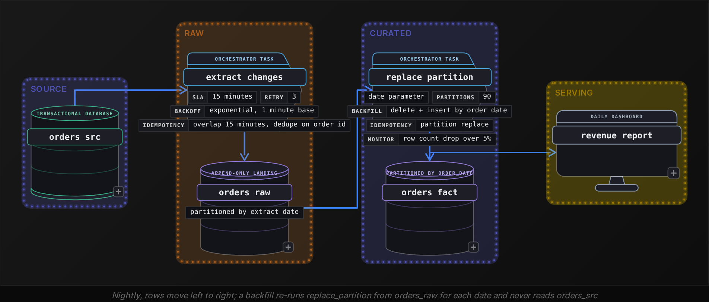
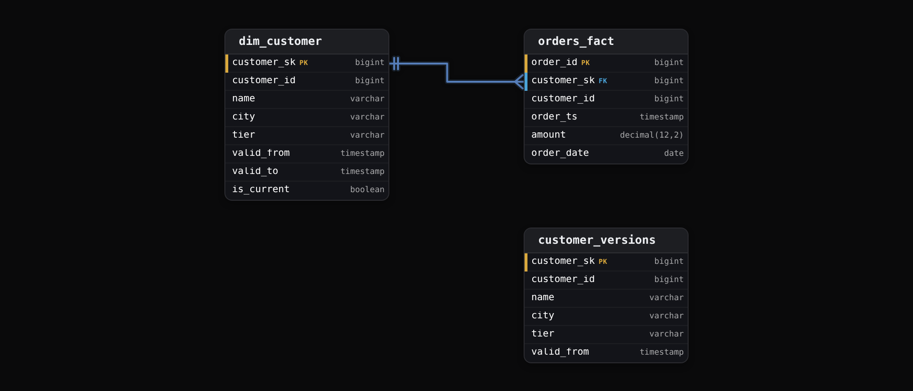
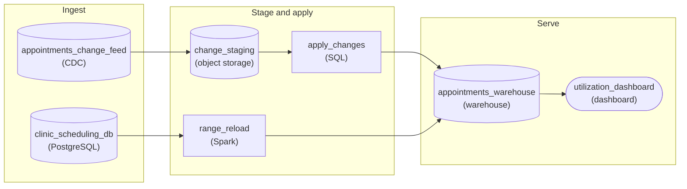
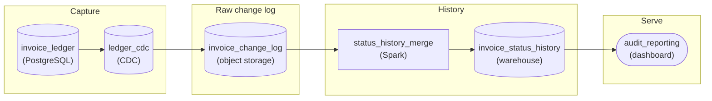

Intermediate·Pipeline Architecture · 35 min · 2 challenges

# Incremental Loading: Intermediate

Ines is 2 interviews into a data engineering loop at Uber, whose engineers published how they moved large tables off snapshot rebuilds, which cost too much and left data a day stale, onto incremental upserts. The interviewer draws a 40 million row orders table and says: the nightly full refresh takes 4 hours and the window is 3, what do you do? Ines says incremental, filtered on updated_at. The interviewer nods and asks what happens to a row deleted at the source. Then what happens when a transaction commits 45 seconds after her watermark passed its timestamp. Then how she reloads last March. Then how the customer table keeps old addresses. Each question is the same pattern: an incremental load that is only correct for inserts. This lesson works through the 4 ways it breaks and the property that fixes each.


<br>

### What you will be able to do

Decide between a full refresh and an incremental load by working out what fraction of the table changes each day, then checking whether a full reload still fits the load window

Explain why a timestamp filter never sees a hard delete, and decide whether soft deletes at the source solve it or you need key reconciliation or a change log instead

Name the 4 ways an updated_at column lies, size an overlap window with dedupe for the 2 it absorbs, and fix the rest at their source

Design a partition-replacing, date-parameterized write that serves both the nightly load and any backfill

Build an SCD Type 2 dimension from an append-only version log that stays correct under late changes


<br>

---

## Full Refresh or Incremental?

Every incremental load is a bet that the rows which changed are a small fraction of the rows that exist. When the bet holds, you move megabytes instead of gigabytes. When it loses, you have taken on 4 kinds of state and failure that a full refresh never carries, and saved nothing. The interview question behind this section is which side of that line a given table sits on, and the answer comes from 3 numbers you can ask for before you decide.


<br>

### What a full refresh buys you

A full refresh truncates the target and reloads every source row. Its correctness is complete by construction: a row removed at the source is absent from the reload, a row updated 3 years after it was created arrives with its new values, and a row whose update timestamp was never set arrives anyway because nothing filtered on it. The job keeps no state between runs, so a backfill is the same job run again. The price is that the work scales with the size of the table rather than the size of the change. Take an `orders` table of 40 million rows at around 400 bytes each. Reloading it means pulling the whole thing across the network every night and writing it back out, even when 99 percent of it hasn't moved since yesterday.

- **16 GB** — moved per nightly full refresh
- **124 MB** — moved per nightly incremental load
- **130x** — the ratio between the two


<br>

### What incremental costs

The same table gains roughly 250,000 new orders and 60,000 status changes a day, so an incremental load touches 310,000 rows, 0.8 percent of the table. Every stage of the job, from the source scan to the target write, shrinks in proportion to that ratio. What you pay for it is a list of properties the pipeline must now hold itself, since nothing truncates and reloads the table anymore.

> What the truncate and reload gave you for free
>
> - Delete visibility: a row removed at the source has no change left to filter on, so the load never sees it (section 1).
> - A trustworthy change column: the filter is exactly as good as the timestamp or sequence it reads (section 2).
> - Reprocessability: a watermark records where you are, and a backfill must rewrite the past without moving it (section 3).
> - History: once you load changes instead of snapshots, you decide whether old values are kept or overwritten (section 4).


<br>

### The 3 numbers that decide it

| Table | Rows | Changed per day | Reliable change column | Full refresh fits window | Choice |
| --- | --- | --- | --- | --- | --- |
| `dim_country` | 250 | 0 to 2 | no | yes, under 1 second | Full refresh |
| `dim_product` | 48,000 | 300 (0.6%) | yes | yes, 40 seconds | Full refresh |
| `orders` | 40,000,000 | 310,000 (0.8%) | updated_at, trigger-set | no, 4 hours against a 3 hour window | Incremental |
| `clickstream_events` | 9,000,000,000 | 120,000,000 (1.3%) | event_time, append-only | no | Incremental, append-only |
| `inventory_levels` | 2,000,000 | 1,600,000 (80%) | yes | yes, 6 minutes | Full refresh |

*Row counts and change rates in this table are the running example for the whole lesson; every later figure derives from the orders row.*

Read the table from right to left. `dim_product` has a reliable change column and a small change ratio, the textbook incremental profile, and the right answer is still a full refresh, because 40 seconds of reload costs less than any amount of watermark logic. `inventory_levels` changes 80 percent of its rows daily, so an incremental load would move nearly as many bytes as a refresh while taking on all 4 properties above. `orders` goes incremental for 1 reason: the refresh no longer fits the window. The change ratio tells you the size of the saving, the window tells you whether you need it, and the change column tells you whether it is achievable at all.


<br>

### The first crack

Here is the incremental load most candidates write first. It's correct for the 250,000 inserts and wrong for the 60,000 updates, because an updated order passes the filter and lands as a second row beside its earlier version. Sections 1 and 2 remove the deletes it misses and the duplicates it creates.

```sql
INSERT INTO orders_fact
SELECT
  order_id,
  customer_id,
  status,
  amount,
  updated_at
FROM orders_src
WHERE updated_at > TIMESTAMP '2026-10-21 02:14:07'
```

✓Full refresh wins when

- The table reloads inside the window with room to spare
- Most rows change every day, so the change filter saves little
- The source has no change column you would trust
- Correctness matters more than the compute bill, as with a 250 row reference table

✗Incremental wins when

- Under a few percent of rows change per day
- The full reload no longer fits the load window
- A trigger or the database itself sets the change column
- Consumers need the data fresher than a nightly rebuild allows

> **TIP**
>
> When asked full refresh or incremental, ask for 3 numbers before answering: table size, rows changed per day, and the load window. State the ratio, name the cost you avoid, then list what the pipeline now owes. A table that reloads in 2 minutes never justifies a watermark.


<br>

---

## How Do You Catch Deletes?

An incremental filter asks 2 things of a source row: that it exist, and that its change column pass the watermark. A row deleted at the source fails the first test before the second is ever evaluated. The target keeps the row forever, the revenue report counts a cancelled order, and nothing logs an error, because from the pipeline's point of view nothing happened. Deletes are the first thing an interviewer probes after you say incremental.


<br>

### Worked example: 2,000 orders a day vanish

Suppose a cleanup job at 03:10 hard-deletes roughly 2,000 orders a day from the source, most of them test orders or duplicate submissions. Over a quarter that is 180,000 phantom rows in `orders_fact`, and every one of them carries an amount that gets summed into a daily revenue figure. Here is a 5 row slice on the morning after 2 of them were removed.

orders_src at 04:00

| order_id | status | amount | updated_at |
| --- | --- | --- | --- |
| 5001 | shipped | 42.00 | 2026-10-20 09:12 |
| 5002 | paid | 18.50 | 2026-10-21 14:40 |
| 5004 | shipped | 77.25 | 2026-10-19 16:03 |

orders_fact after the 04:00 run

| order_id | status | amount | updated_at |
| --- | --- | --- | --- |
| 5001 | shipped | 42.00 | 2026-10-20 09:12 |
| 5002 | paid | 18.50 | 2026-10-21 14:40 |
| 5003 | test | 0.01 | 2026-10-18 11:00 |
| 5004 | shipped | 77.25 | 2026-10-19 16:03 |
| 5005 | paid | 135.00 | 2026-10-20 20:45 |

Orders 5003 and 5005 were deleted at 03:10. The 04:00 run filtered on `updated_at` above yesterday's watermark, found 5002, whose status changed from pending to paid, and loaded it. Rows 5003 and 5005 matched nothing and stayed in the target, which leaves the daily revenue figure 135.01 too high.


<br>

### Option 1: soft deletes at the source

If you can change the source, the cheapest fix is to stop deleting. The cleanup job sets `is_deleted = true`, and the same statement bumps `updated_at`. The row now passes the incremental filter like any other update, arrives downstream carrying its flag, and either the load applies the delete to the target or every consumer adds `WHERE NOT is_deleted`. This breaks when a code path sets the flag and forgets the timestamp: the row is logically gone and invisible to the load, which combines the worst of both options. Make the timestamp bump a database trigger rather than an application convention, so no code path can skip it.


<br>

### Option 2: reconcile the keys

When the source can't change, pull every primary key, and only the key, once a day. The 40 million 8 byte integers come to roughly 320 MB, 50 times less than the full rows, and land in a few minutes. Stage them, then remove whatever the target holds that the source no longer does.

```sql
DELETE FROM orders_fact
WHERE order_id NOT IN (
  SELECT
    order_id
  FROM orders_src_keys
)
```

In an interview, point out that this statement catches deletes once a day, at the granularity of the key pull, while the incremental run itself may be hourly; a deleted order can therefore show in a report for up to 24 hours. The statement is also dangerous when the key snapshot is partial. If the key extract fails halfway and 20 million keys are staged, the delete removes 20 million correct rows and reports success. Guard it with a count check: refuse to run the delete when the snapshot holds fewer than 99 percent of yesterday's keys, since a real day never deletes more than 1 percent.


<br>

### Option 3: read the change log

Databases record every delete in their own transaction log, and a pipeline that reads that log receives the delete as an event with the key attached. It is the most complete answer and the subject of the next tier of this track. For now, know that it exists, that it needs access to the database internals, and that it's the only option which catches a delete within seconds rather than at the next daily reconciliation.

| Option | Source change needed | Delete latency | Extra daily cost | Fails when |
| --- | --- | --- | --- | --- |
| Soft delete flag | yes, cleanup job and a trigger | next incremental run | none | a code path sets the flag without the timestamp |
| Key reconciliation | no | up to 24 hours | 320 MB key pull and an anti-join | the key snapshot is incomplete |
| Change log | database access, no schema change | seconds | a log reader running continuously | the log is truncated before it is read |

✓Do

- Bump updated_at in the same statement that sets is_deleted, by trigger
- Pull keys only for reconciliation, never full rows
- Count the key snapshot before any delete runs against it
- Keep deleted keys as tombstones in the raw layer for backfills

✗Don't

- Trust a soft-delete flag that application code sets by convention
- Run a reconciliation delete that reports success on a partial snapshot
- Assume a hard-deleted row ever reaches a timestamp filter
- Measure delete latency by the incremental run interval when keys arrive daily

> **TIP**
>
> In an interview, name the mechanism before the fix: a timestamp filter needs a row to exist, so a deletion produces no row to find. That sentence alone separates a candidate who has run an incremental load from one who has read about it.


<br>

---

## Which Column Do You Filter On?

The incremental filter has 3 candidate columns. An auto-increment id and a creation timestamp both catch inserts and nothing else, because neither moves when a row is edited. The update timestamp does move on edits, so it catches updates as well, and it lies in 4 specific ways an interviewer will expect you to name and defend against.

| Filter column | Inserts | Updates | Deletes | Breaks when |
| --- | --- | --- | --- | --- |
| auto-increment id | yes | no | no | ids are assigned out of commit order |
| created_at | yes | no | no | 2 app servers disagree on the time |
| updated_at set by the application | yes | mostly | no | 1 code path forgets to set it |
| updated_at set by a trigger | yes | yes | no | a long transaction commits after the watermark |
| commit sequence number | yes | yes | with tombstones | the database does not expose one |


<br>

### Lie 1: the row that committed after the watermark

The timestamp in `updated_at` is written when the statement runs, inside a transaction. The row becomes visible to your extract when the transaction commits, which can be seconds or minutes later. Between those 2 moments another run can read the table, see a higher timestamp on some other row, and record it as the watermark. Here is the sequence with a 45 second transaction and a run every 15 minutes.

| Clock | What happens |
| --- | --- |
| 10:00:00 | Transaction A opens, updates order 7001, sets updated_at to 10:00:00, does not commit |
| 10:00:29 | Transaction B updates order 7002, sets updated_at to 10:00:29, commits |
| 10:00:30 | Run 1 filters updated_at above 09:45:14, sees 7002 only, loads it |
| 10:00:31 | Run 1 stores the new watermark: 10:00:29 |
| 10:00:45 | Transaction A commits; 7001 is now visible with updated_at 10:00:00 |
| 10:15:30 | Run 2 filters updated_at above 10:00:29; 7001 fails the filter, and will on every later run |

Order 7001 is now permanently wrong downstream. The run logs no error and the row counts match, and a reconciliation of keys will never flag the stale status because the key still exists. The timestamp told the truth about when the row was modified and said nothing about when it became visible, and the filter only cares about the second.


<br>

### Lies 2 to 4

- Clock skew: app servers 3 seconds apart write timestamps out of commit order, so the watermark skips the slow one
- Source backfills: an operator fixes 2 million amounts without touching updated_at, and the warehouse never hears
- Local time: a column in local time repeats an hour every autumn, and the repeated hour sits below the watermark


<br>

### The fix: overlap, then dedupe

You can't make the column honest, so make the filter forgiving. Overlap absorbs late commits and clock skew, the lies that leave a row a few seconds behind the watermark, and nothing else. A source correction that never touches `updated_at` needs a targeted re-pull or a partition backfill, a forgotten code path needs the trigger-set column from the table above, and a local-time column needs storing in UTC, because a 15 minute window can't reach back across a repeated hour. For the 2 it does absorb, subtract a lookback window from the watermark that is longer than your longest transaction, 15 minutes here against a 45 second worst case, and accept that each run reloads a slice it has already seen. Then collapse duplicates on the key, keeping the newest version. The overlap turns a permanent miss into a 1 run delay, and the dedupe turns the double-count from section 0 into a single current row. Note the comparison is now `>=`, because many rows share a timestamp to the second and an exclusive compare drops the ones equal to the boundary.

```sql
INSERT INTO orders_stage
WITH changed AS (
  SELECT
    order_id,
    customer_id,
    status,
    amount,
    updated_at,
    row_number() OVER (
      PARTITION BY order_id
      ORDER BY updated_at DESC
    ) AS rn
  FROM orders_src
  WHERE updated_at >= TIMESTAMP '2026-10-21 02:14:07' - INTERVAL '15' MINUTE
)
SELECT
  order_id,
  customer_id,
  status,
  amount,
  updated_at
FROM changed
WHERE rn = 1
```

The stage then replaces matching rows in `orders_fact`: delete where `order_id` is in the stage, insert the stage. Reloading a row you already hold produces the row you already hold, which is why a 15 minute overlap costs some scan and no correctness. That delete-and-insert pair is the same write section 3 uses for backfills.


<br>

### Choosing the window

Size the lookback from the source, never from habit. Ask for the longest transaction the application holds open, add the clock skew between its servers, and double the sum. For the `orders` service that is 45 seconds plus 3 seconds, doubled to about 2 minutes, so 15 minutes is generous and reloads roughly 3,000 rows a run, roughly 1 percent of the daily change. A source with 20 minute batch jobs that update rows inside a single transaction needs a 40 minute window or a different column entirely.

> **TIP**
>
> Store the watermark as the highest `updated_at` the run actually loaded, read back from the staged rows, never as the wall clock when the run began. The 2 values drift apart under load, and the wall clock version makes the overlap window shorter than you think.


<br>

---

## How Do You Backfill?

A backfill reprocesses a range of history: a bug in the transform, a correction at the source, a new column that needs 2 years of values. For a full refresh the backfill is the job itself. For an incremental load it is the moment the design is tested, because the watermark asserts that everything before it is done, and a backfill has to contradict that assertion without breaking it. The design needs 4 properties to do that.


<br>

### Property 1: the write replaces a whole partition

Partition `orders_fact` by `order_date` and make every write a replacement of 1 day: delete the day, insert the day. Running the pair twice yields the rows that running it once yields. Running it for 2026-09-14 touches nothing outside September 14. The same 2 statements serve the nightly load and the backfill of any date in history, which removes the need for a separate backfill code path that drifts from the one in production.

```sql
DELETE FROM orders_fact
WHERE order_date = DATE '2026-09-14'
```

```sql
INSERT INTO orders_fact
WITH versions AS (
  SELECT
    order_id,
    customer_id,
    status,
    amount,
    updated_at,
    order_date,
    row_number() OVER (
      PARTITION BY order_id
      ORDER BY updated_at DESC
    ) AS rn
  FROM orders_raw
  WHERE order_date = DATE '2026-09-14'
)
SELECT
  v.order_id,
  v.customer_id,
  v.status,
  v.amount,
  v.updated_at,
  v.order_date
FROM versions v
LEFT JOIN orders_tombstones t
  ON t.order_id = v.order_id
WHERE v.rn = 1
  AND t.order_id IS NULL
```

- **22M** — rows reprocessed in a quarter backfill
- **2 min** — to replace 1 daily partition
- **1** — write path for nightly and backfill


<br>

### Property 2: the date is a parameter

The literal `2026-09-14` must arrive from the orchestrator, never from `current_date` inside the query. A task that computes its own date processes today every time it runs, so a backfill of the last quarter re-runs October 23 for all 90 dates and declares victory. With the date injected, the scheduler supplies 1 value per task instance, and 90 backfill instances run in parallel against 90 disjoint partitions, which is why the diagram below carries a parallelism of 90.




<br>

### Property 3: backfill from the raw layer you kept

By the time you need March again, the source may have archived March, and it has certainly hard-deleted 2,000 rows a day since. The raw landing layer holds every row ever extracted, partitioned by the day of extraction, together with the daily key snapshots from section 1 kept as tombstones. A backfill replays that history: for a target partition, take every raw row with that `order_date`, keep the latest version per key, drop any key a tombstone covers, replace the partition. The source is read only on the first extraction. Keeping each raw day of rows costs roughly 124 MB, which over 2 years is under 100 GB before the key snapshots.


<br>

### Property 4: the watermark stays where it is

The nightly load advances the watermark; the backfill must never touch it. Keep them as 2 separate state entries, or run the backfill as a task that has no write access to the watermark at all. A backfill of 2026-09-14 that stores the `max(updated_at)` of the rows it processed into the shared entry drags the next nightly run back by 5 weeks and reloads 11 million rows through the overlap and dedupe path, at roughly 1 hour of extra work. The opposite accident is a backfill of recent days storing a watermark higher than the nightly run has reached. The nightly run then skips rows without any error, and section 2 covered how long a silent skip lasts.

*The entire mechanism is a watermark table with a nightly row and a backfill row; the discipline is that each task may write only its own row.*


<br>

### Late data lands in old partitions

An order placed on 2026-09-14 and refunded on 2026-10-20 carries `order_date` September 14 and `updated_at` October 20. The nightly load catches it by `updated_at` and stages it. The replace step then rewrites the September 14 partition with the refund applied, 36 days after the order. A nightly run that only replaces the last 7 partitions is therefore wrong: it must replace every partition that appears in the stage, however old. In the example table a status change can arrive up to 90 days after the order, so a typical night touches about 40 distinct partitions, and any report that cached September is 1 day stale the next morning.

> The backfill checklist
>
> - Partition-aligned write: delete the day and insert it again, so a second run changes nothing
> - Date as a parameter from the scheduler; `current_date` appears nowhere in the task
> - Raw layer is the source of truth for history, with tombstones for deleted keys
> - Watermark untouched by any backfill task
> - Row count of the new partition compared to the old before the delete is allowed to commit

> **TIP**
>
> When asked how you would backfill, answer with the nightly design rather than a separate procedure. If the nightly write is a parameterized partition replace, the backfill is the same task over a date range, and you've shown that your incremental pipeline was built to be re-run.


<br>

---

## How Do You Track History?

Everything so far loads the current state of a row and overwrites the previous one. A dimension that facts join to often needs the previous state kept: an order from March should join to the customer's March address, not the one she moved to in September. A Type 2 slowly changing dimension keeps every version as its own row with a validity interval, and an incremental load is the natural way to build one, because each version is a change the load already detected.




<br>

### Worked example: 1 customer, 1 move

dim_customer before 2026-10-15

| customer_sk | customer_id | city | tier | valid_from | valid_to | is_current |
| --- | --- | --- | --- | --- | --- | --- |
| 88 | 1042 | Austin | gold | 2025-03-02 08:00 | 9999-12-31 00:00 | true |

dim_customer after the 2026-10-15 load

| customer_sk | customer_id | city | tier | valid_from | valid_to | is_current |
| --- | --- | --- | --- | --- | --- | --- |
| 88 | 1042 | Austin | gold | 2025-03-02 08:00 | 2026-10-15 09:30 | false |
| 2311 | 1042 | Denver | gold | 2026-10-15 09:30 | 9999-12-31 00:00 | true |

The old row closes at the instant the new one opens, so the 2 intervals meet without gap or overlap and any order timestamp falls into exactly 1 of them. `valid_to` on the current row is a far-future sentinel rather than NULL, so range comparisons need no `COALESCE` at query time. The surrogate key `customer_sk` is what the fact table stores: a March order carries 88 and an October order carries 2311 forever, so reports join on 1 integer and never touch the dates.


<br>

### Step 1: detect the changes

Compare each incoming row from the overlap and dedupe stage of section 2 against the customer's current version. A row counts as a change in 2 cases: the customer is new and has no current version, or a tracked attribute differs. Write the comparison as a hash over the tracked columns so that tracking a new column later is a 1 line edit, and `COALESCE` any nullable tracked column to a marker before concatenating, because a NULL inside the hash input makes the whole comparison NULL and the change goes undetected. New versions are appended to `customer_versions` with a surrogate key continuing from the current maximum.

```sql
INSERT INTO customer_versions
SELECT
  m.max_sk + row_number() OVER (ORDER BY s.customer_id) AS customer_sk,
  s.customer_id,
  s.name,
  s.city,
  s.tier,
  s.updated_at AS valid_from
FROM customers_stage s
CROSS JOIN (
  SELECT
    COALESCE(max(customer_sk), 0) AS max_sk
  FROM customer_versions
) m
LEFT JOIN dim_customer d
  ON d.customer_id = s.customer_id
  AND d.is_current
WHERE d.customer_id IS NULL
  OR xxhash64(to_utf8(concat(
      COALESCE(s.name, '<null>'), '|',
      COALESCE(s.city, '<null>'), '|',
      COALESCE(s.tier, '<null>')
    )))
    <> xxhash64(to_utf8(concat(
      COALESCE(d.name, '<null>'), '|',
      COALESCE(d.city, '<null>'), '|',
      COALESCE(d.tier, '<null>')
    )))
```


<br>

### Step 2: derive the intervals

`customer_versions` is append-only, 1 row per detected change, and the dimension is derived from it instead of edited in place. Each version's `valid_to` is the next version's `valid_from` for the same customer, which a window function produces without a self join. Rebuilding the dimension is a full refresh of a small table, delete all rows then insert, and section 0 already made the case that a full refresh is right there: 2 million customers at 3 versions each is 6 million rows and under a minute.

```sql
INSERT INTO dim_customer
SELECT
  customer_sk,
  customer_id,
  name,
  city,
  tier,
  valid_from,
  COALESCE(
    LEAD(valid_from) OVER (
      PARTITION BY customer_id
      ORDER BY valid_from
    ),
    TIMESTAMP '9999-12-31 00:00:00'
  ) AS valid_to,
  LEAD(valid_from) OVER (
    PARTITION BY customer_id
    ORDER BY valid_from
  ) IS NULL AS is_current
FROM customer_versions
```


<br>

### Step 3: resolve the key at fact load

When an order loads, look up the version whose interval contains the order timestamp and store that key. The range condition runs once per order at load time, and every report after that joins on `customer_sk` alone.

```sql
SELECT
  s.order_id,
  d.customer_sk
FROM orders_stage AS s
JOIN dim_customer AS d
  ON d.customer_id = s.customer_id
    AND s.order_ts >= d.valid_from
    AND s.order_ts < d.valid_to
```


<br>

### Where it breaks, and why the version log saves it

A change that arrives late, with a `valid_from` earlier than the current version, is the SCD failure most candidates miss. A design that edits the dimension in place closes the current row at the late timestamp and opens a new one, producing 2 current rows or an interval running backwards. The version log design orders by `valid_from` when it derives intervals, so a late version slots between its neighbours and `LEAD` recomputes both of them on the next rebuild. Deletes fit the same log with 1 extra flag column: a tombstone version closes the last real version and carries no attributes forward. And because the dedupe stage guarantees 1 row per customer per load, 2 versions never share a `valid_from`, so the order within a customer is total.

✓Do

- Keep an append-only version log and derive the dimension from it
- Use a far-future sentinel for valid_to on the current row
- Hash the tracked columns after coalescing nullable ones
- Resolve customer_sk at fact load with a range join, once

✗Don't

- Edit valid_to in place when a change may arrive out of order
- Use NULL for an open interval and COALESCE in every report
- Rebuild surrogate keys on each refresh; facts already hold the old ones
- Compare attributes column by column across 30 columns

> **TIP**
>
> If asked to describe SCD Type 2 in an interview, lead with the invariant rather than the columns: for every customer and every instant, exactly 1 version is valid. Then show how the version log plus LEAD makes that invariant hold even when changes arrive late.


<br>

---

## Putting It All Together

A subscription meal-kit company loads its 40 million row orders table and 2 million row customers table into the warehouse every night. Finance reports revenue by month; marketing reports churn by the city the customer lived in when they ordered. The nightly full refresh has grown from 90 minutes to 4 hours against a 3 hour window, cancelled orders are hard-deleted at the source, refund transactions hold rows open for up to 45 seconds, and finance has asked to reprocess March after a tax rule change. The team must go incremental without changing any report's numbers.

- The 3 numbers from section 0 send orders incremental and keep customers on a full rebuild at under a minute, which is also how section 4 rebuilds the dimension from its version log.
- Cancelled orders vanish at the source, so the daily key reconciliation of section 1, with its 99 percent count guard, is what stops finance's monthly revenue from drifting upward by the deleted amounts.
- Refund transactions commit up to 45 seconds after their updated_at, so the 15 minute overlap and row_number dedupe of section 2 is what keeps order statuses from freezing at their pre-refund value.
- The March reprocess runs the section 3 partition replace for 31 dates in parallel from the raw layer, with the date injected by the scheduler and the nightly watermark untouched.
- Marketing's churn-by-city report needs the customer version valid at order time, which the section 4 range join resolves to a surrogate key once at load, so a customer who moved from Austin to Denver keeps her March orders in Austin.


<br>

---

## Pipeline Architecture

### Exercise 1 of 2

**● TASK**

Cancelled appointments are hard-deleted from the clinic scheduling database, leaving no trace in the table. The nightly full refresh of all 40 million appointment rows keeps cancellations off the operations managers' utilization dashboard, but no longer finishes before morning reporting starts. About 200,000 appointments are inserted, edited, or deleted daily: design an incremental pipeline that stages changes from the clinic database, applies them to the warehouse table by appointment so deletions take effect, and can reload a bounded date range directly from the clinic database if the nightly feed breaks.


<br>

### Solution

#### What this problem really is

This is the incremental loading pattern with the one wrinkle that breaks the lazy version of it. The old `SELECT *` refresh was slow, but it had a property nobody wrote down: because it rebuilt the table from scratch every night, a cancelled appointment simply was not there the next morning. **The full refresh was your delete handling.** The moment you switch to pulling rows where `updated_at` is past the high-water mark, that property is gone, because a hard-deleted row has no `updated_at` left to compare. The dashboard keeps showing cancelled slots as booked, utilization looks better than it is, and nothing errors.

| Trick: Capture from the log, not from the table |
| --- |
| A query against the table can only return rows that exist. A delete is an absence, so the only place it is still visible is the database's change log. Read the log with log-based CDC and every insert, edit and cancellation arrives as an event with an operation type. Then stage those events and apply them by `appointment_id`, with 'd' events removing the row. |

#### Walk the requirements

1. **Say where the crossover sits before you say incremental**

   Full refresh costs the whole table every night: 40 million rows. Incremental costs the changed rows plus the merge overhead: about 200,000 rows, roughly half a percent. That gap is why the switch is worth it now. It was not always: when the table was small, a full copy finished in minutes, needed no state, and was obviously correct. The crossover is the point where the full copy stops fitting the window, and it moves back on nights like the annual roster reset, when most of the table changes and a full reload is the cheaper run.

2. **Pick the capture method that can see a cancellation**

   Timestamp CDC is the first thing everyone reaches for and it works for the edits here, since edits set `updated_at`. It cannot see deletes, and cancellations are exactly the rows managers care about. Log-based CDC reads the replication log on the primary, so each cancellation shows up as a delete event, and it puts no scan load on the scheduling database either.

3. **Stage the changes, then apply them by key**

   Land each night's change events in staging, keep only the latest event per `appointment_id`, and apply that set to `appointments` in one keyed step: matched and deleted removes the row, matched otherwise updates it, unmatched inserts it. Keyed and idempotent means a rerun of the same batch after a failure lands the same table, which is what lets you retry at 5am without thinking.

4. **Keep the full copy, but as a range tool**

   The full refresh does not die, it gets demoted. A reload path reads a chosen range of appointments straight from the source and overwrites that range in the warehouse, partitioned by appointment month. When the change feed drops a night or a bug corrupts a week, you reload those months instead of all 40 million rows.

#### The shape that fits



*Nightly: log-based change events are staged and applied by `appointment_id`, deletes included. Repair: `range_reload` overwrites chosen months straight from the source.*

| ✕ Timestamp CDC | ✓ Log-based CDC |
| --- | --- |
| Pulls rows where `updated_at` is past the last high-water mark. Cheap to build, catches every edit, and never sees a cancellation because the deleted row is not there to return. Also scans the live table every night. | Reads the replication log on the primary. Inserts, edits and deletes all arrive as events with an operation type, so a cancellation becomes a 'd' row the merge can act on. Needs log replication enabled and a stored log position instead of a timestamp. |

| Pitfall: The cancelled slot that stays booked |
| --- |
| The version that ships first swaps `SELECT *` for a `WHERE updated_at > last_run` pull and a merge that only updates and inserts. It runs in minutes and every check passes. A month later a manager notices a provider at 100% utilization on a day half their patients cancelled, and the warehouse holds thousands of appointments the source deleted weeks ago. |

| Performance: Half a percent of the table per night |
| --- |
| At 200,000 changed rows out of 40 million, the nightly run moves about 0.5% of what the old job moved, and the merge touches only the matching keys. The cost that remains is the reload path, which is why it works by month: a bad week costs one or two partitions, not the whole table. |

| Interviewer: The candidate who names what full refresh was doing |
| --- |
| Strong answers say out loud that the old job handled deletes by accident and that the new design has to handle them on purpose. They also put a number on the crossover and keep the full copy as a repair path instead of deleting it. |

**Follow-up questions**

1. The backend team adds a `telehealth_link` column to appointments on a Tuesday night. What happens to the change feed and the merge, and what do you want to happen?\
   *Tests schema evolution on an incremental pipeline: whether the new column is picked up, dropped silently, or crashes the apply step.*
2. Finance now wants to see how often appointments are rescheduled. What changes in the target table?\
   *Tests whether the candidate sees that overwriting in place destroys prior versions and reaches for keeping each version with validity dates, applied from the same change events.*


<br>

### Exercise 2 of 2

**● TASK**

How should the engineer who owns the nightly warehouse copy of the vendor invoice ledger rebuild it, now that re-copying all 420 million invoices from the operational Postgres database and replacing the warehouse table takes 5 hours against a 3-hour batch window, while only about 1.5 million invoices change on a typical day? Auditors also need to know what approval status any invoice held at any past moment, including an invoice that was approved and then put back on hold within the same day.


<br>

### Solution

#### Incremental Loading, with an auditor in the room

This is the Incremental Loading pattern with an audit requirement attached, and the audit requirement is what decides the design. Choosing incremental is the easy part: 1.5 million changed rows out of 420 million is well under half a percent, and re-copying the other 99.6% every night is exactly why the job blew the window. The trap is the change capture most candidates reach for first. Poll on `updated_at` once a night and an invoice that went 'approved' at 10:00 and '`on_hold`' at 15:00 arrives as one row saying '`on_hold`': as far as the warehouse knows, the approval never happened. Then a plain `MERGE` overwrites yesterday's status with today's, and the auditor's question about March 3rd has no answer. 2 silent losses, and the job looks healthy the whole time.

1. **Admit the full refresh has run its course**

   Full refresh was the right call when the ledger was small: one `SELECT *`, one swap, nothing to get wrong. It stops being right when the cost scales with table size while the useful work scales with churn. At 5 hours against a 3-hour window and 0.36% daily change, the numbers make the case for you. Say that out loud before you draw anything; the interviewer wants the tradeoff reasoned, not assumed.

2. **Capture from the log, not from a timestamp**

   Log-based CDC reads the Postgres write-ahead log, so every committed change is its own event carrying its commit time. That catches the same-day approve-then-hold, it catches the legacy bulk-approval script that never touches `updated_at`, and it puts no scan load on the database the payables app lives on.

| ✕ Timestamp CDC, nightly | ✓ Log-based CDC |
| --- | --- |
| `WHERE updated_at > last_watermark` returns each changed invoice once, in its state at pull time. Intermediate statuses vanish, and any writer that skips `updated_at` is invisible. | Every committed change is an event in commit order, whoever wrote it. One invoice changing 3 times yields 3 events, each with the commit time the history needs. |

3. **Land the raw events before you interpret them**

   Write the captured events append-only to `invoice_change_log` in object storage before any merge logic touches them. The source only knows the current state, so this log is the one place history can be rebuilt from. When a merge bug corrupts 3 weeks of versions, the backfill replays those weeks from the log instead of asking the source for something it no longer has.

4. **Close the old version, open the new one**

   `invoice_status_history` keeps one row per status version: `invoice_id`, `status`, `valid_from`, `valid_to`, `is_current`. For each event, in commit order, the nightly merge sets `valid_to` on the open version and inserts the new one. An as-of query is then just `valid_from <= t AND (valid_to > t OR valid_to IS NULL)`.

#### The reference design



*`ledger_cdc` turns every committed change into an event, `invoice_change_log` keeps them for replay, and a rerunnable nightly merge versions them into `invoice_status_history`.*

| Pitfall: Deduplicating to the latest event erases the audit trail |
| --- |
| The standard incremental merge first reduces the batch to one row per key so `MERGE` does not hit the same target row twice. For an overwrite-latest table that is correct. For this history it quietly reproduces the timestamp-CDC loss: the 10:00 approval is dropped before it ever reaches the table. Apply every event per `invoice_id` in commit order. |

| Trick: Effective time is the source commit, not the load |
| --- |
| Stamp `valid_from` with the load time and every change looks like it happened at 02:00 the next morning, so an approval at 16:55 on quarter-end day lands in the wrong quarter. The commit time carried by the CDC event is the only clock the auditors mean. |

| Interviewer: A rerun must not mint a second version |
| --- |
| Key each version on `invoice_id` plus the event's commit position, and upsert on that key. A retried night then rewrites the same versions instead of appending duplicates with overlapping ranges, which would make every as-of query return 2 statuses. |

| Performance: Nightly cost now tracks churn, not table size |
| --- |
| The merge touches about 1.5 million events a night, around 4 million at quarter end, instead of 420 million rows. The price is growth: history adds a version per change, roughly 550 million rows a year, so cluster `invoice_status_history` by `invoice_id` and prune by `valid_from`. It also adds a CDC connector and a change log to operate, which is the honest cost of the audit trail. |

**Follow-up questions**

1. Payables engineering adds a `payment_terms` column to the ledger on a Tuesday night. What happens to `ledger_cdc`, `invoice_change_log` and the merge?\
   *Tests schema evolution: new columns flow through as nullable, the raw log keeps whatever arrived, and the merge does not crash or silently drop the field.*
2. A bug in `status_history_merge` closed versions with the wrong `valid_to` for 3 weeks. How do you repair `invoice_status_history`?\
   *Tests backfill: delete the affected invoices' versions for the window and replay the events from `invoice_change_log` in commit order through the fixed merge.*


<br>

---

## Key Takeaways

- Incremental loading pays off when a small fraction of rows change and the full reload no longer fits the window; otherwise refresh and keep the correctness it gives you for free.
- A deleted row produces nothing for a timestamp filter to find; catch it with a soft-delete flag bumped by trigger, a daily key reconciliation guarded by a count check, or the change log.
- An updated_at written at statement time can be invisible until commit; filter with an overlap window longer than the longest transaction, then dedupe on the key.
- Make the write a partition replace with the date as a parameter, backfill from the raw layer you kept, and never let a backfill touch the nightly watermark.
- Keep SCD Type 2 as an append-only version log and derive intervals with LEAD, so late changes slot in and every instant has exactly 1 valid version.
