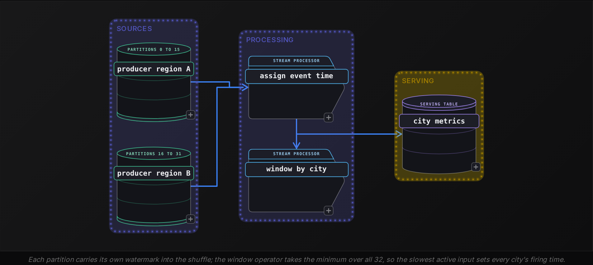
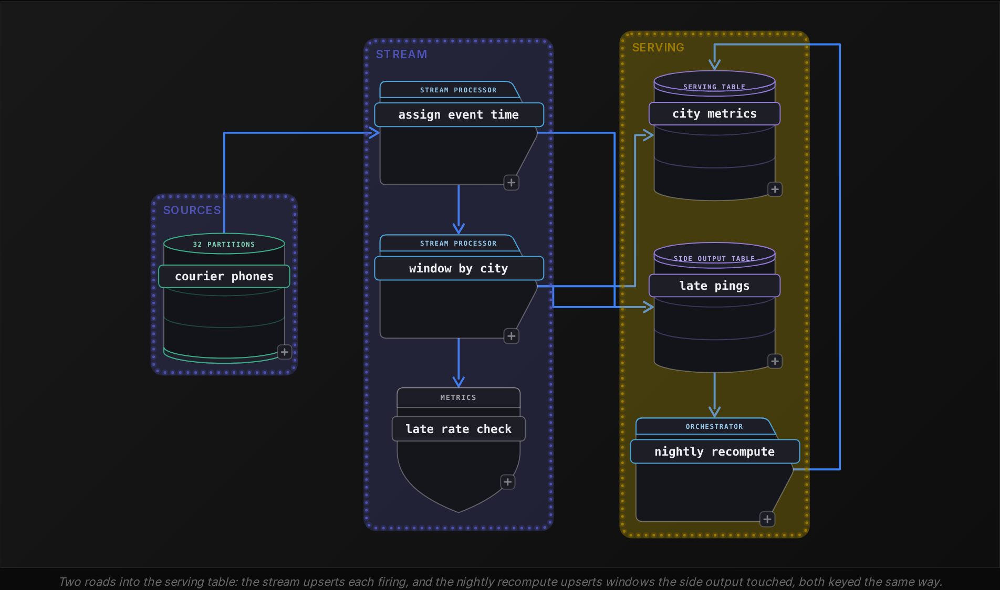
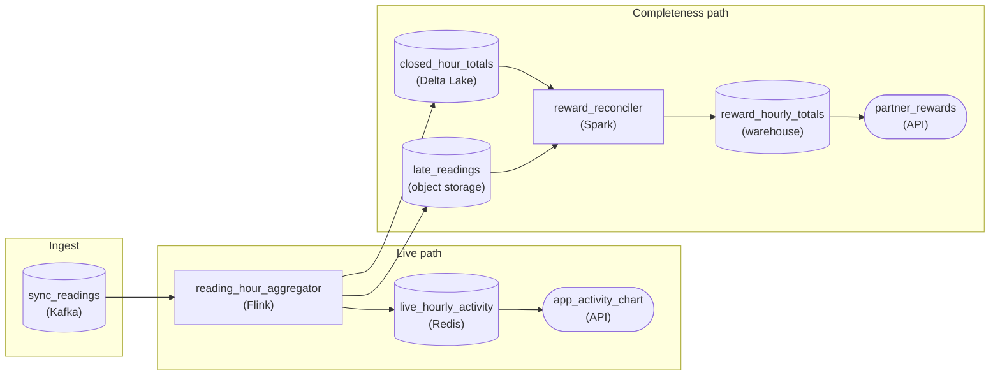
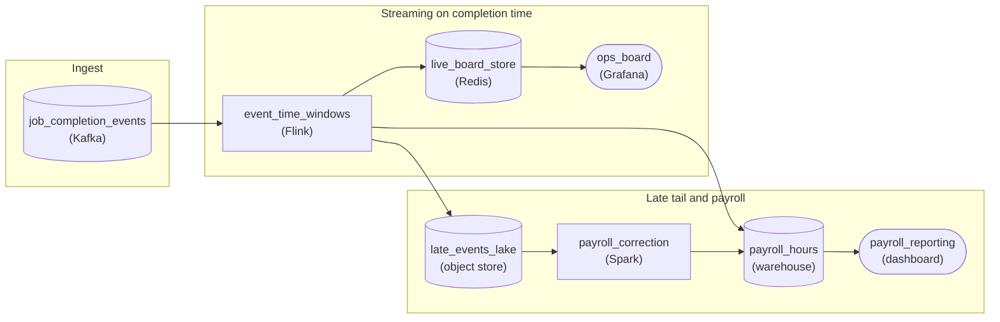

Advanced·Pipeline Architecture · 25 min · 2 challenges

# Late Data and Watermarks: Advanced

A candidate sits in a systems interview at Google, where the papers that gave watermarks their modern form were written. The interviewer sketches a mobile app: devices send a session event each minute, and the dashboard shows active users per 5 minute window. Then the twist: phones lose signal in subways, buffer events for 40 minutes, and flush them all at once when they reconnect. 'Your window for 10:00 to 10:05 has to appear on the dashboard. When do you decide it is done, and what happens to an event for 10:03 that shows up at 10:50?' No single cutoff is right; the answer is a tradeoff with a number attached. This lesson builds the reasoning behind the answer: what the two clocks measure, how a watermark estimates completeness, where allowed lateness and side outputs put events that miss it, and how production pipelines choose and monitor a strategy.


<br>

### What you will be able to do

Recognize a late data question in any disguise and name the 3 costs it trades: correctness, latency and state

Measure a stream's delay distribution and choose a watermark bound as a percentile of it, with the share of late events that bound implies

Trace how a heuristic watermark advances, why the minimum across partitions stalls on an idle input, and what idleness detection costs

Set allowed lateness, choose accumulating output with an idempotent upsert sink, and route the remainder to a side output with a batch path back

Name where a watermark design breaks under retry, replay and schema change, and the property that prevents each break


<br>

---

## "What If Events Are Out of Order?"

### The question rarely says watermark

The pattern shows up as a design question whose records carry 2 timestamps that disagree: the moment something happened and the moment the pipeline saw it. A courier app, a payments gateway, an IoT fleet, a web analytics tag: every one of them produces a stream in which the order of arrival differs from the order of occurrence, and the interviewer wants to know what your design does about that gap. Recognize the pattern by the twist in the prompt: devices go offline, a region loses connectivity for an hour, a replay reprocesses yesterday, or 2 dashboards built on the same events show different totals.

> Disguises the same question wears
>
> - Design a dashboard of active couriers per city, updated every minute, when phones buffer events in basements.
> - Our real-time revenue total and the nightly batch total disagree by 0.4%. Which one is right, and why?
> - A sessionization job closes sessions after 30 minutes of inactivity. What breaks when a device reconnects after 2 hours?
> - We replayed 3 days of events after an outage and every alert fired. What happened to the watermark?


<br>

### A stream of 8 pings

Take a food delivery platform that receives a location ping from each courier roughly every 90 seconds and wants a count of pings and of distinct couriers per city for each 5 minute window. The table lists 8 pings from one city as the pipeline received them, with the time the phone recorded the ping beside the time the pipeline first saw it. Rows are in arrival order, which is the only order a stream processor ever sees.

| event_id | courier | event_time | arrival_time | note |
| --- | --- | --- | --- | --- |
| e1 | c-17 | 10:00:12 | 10:00:14 |  |
| e2 | c-42 | 10:01:05 | 10:01:06 |  |
| e3 | c-17 | 10:02:40 | 10:02:41 |  |
| e5 | c-42 | 10:04:50 | 10:04:52 |  |
| e7 | c-91 | 10:05:02 | 10:05:03 | belongs to the next window |
| e4 | c-08 | 10:03:15 | 10:05:30 | delayed 2 min 15 s by a retry |
| e6 | c-08 | 10:04:10 | 10:19:44 | phone was in a basement |
| e8 | c-08 | 10:02:05 | 10:19:45 | same flush as e6 |

The window from 10:00:00 to 10:04:59 truly contains 7 pings from 3 couriers: e1 through e6 plus e8, with e7 belonging to the window that follows. A pipeline that reads the wall clock, sees 10:05:00 arrive and emits whatever it has counted so far produces a different answer.

Emitted at 10:05:00 by the wall clock

| metric | value |
| --- | --- |
| pings | 4 |
| distinct couriers | 2 |
| missing | e4, e6, e8 |

True contents of 10:00 to 10:05

| metric | value |
| --- | --- |
| pings | 7 |
| distinct couriers | 3 |
| missing | none |

The wall-clock version is wrong by 43% on pings and by a third on couriers, and nothing in the output marks it as wrong. Waiting fixes it, at a price: hold the window until 10:19:45 and the dashboard runs 15 minutes behind reality for every window, every day, to catch 2 pings from 1 courier whose phone was underground. Hold it forever and the pipeline keeps every window open, so state grows without limit. Those 3 costs, correctness, latency and state, are the whole subject, and no setting makes all 3 small at once.


<br>

### The decision the question turns on

Sorting the stream before counting would resolve the ordering, and sorting needs the end of the input; an unbounded stream has none. The design therefore needs a rule that declares a window complete while events for it may still be in flight, and a second rule for what happens to an event that arrives after the declaration. The first rule is the watermark. The second is allowed lateness with a side output. Each rule carries a number, and each number is a position on the same tradeoff: further right buys correctness with latency and state, further left buys speed with error. An answer that names both rules, attaches a number to each and says how it would check the number in production covers what the interviewer is listening for.

> What a complete answer names
>
> - The clock that defines the window: event time stamped by the producer, with a rule for records whose timestamp is missing or implausible.
> - The completeness estimate: a watermark, its bound in seconds, and the delay percentile the bound was derived from.
> - What happens after the window fires: how long state is retained and whether updates replace or add to earlier output.
> - Where events beyond that retention go: a side output and the batch path that reconciles them into the serving table.
> - The metrics that reveal the bound is wrong: watermark lag, late event rate, side output volume.

> **TIP**
>
> Before you choose any number, ask the interviewer for the lateness distribution: the median delay, the 99th percentile and the worst case they have seen. The bound you pick is a percentile of that distribution, and saying so out loud shows you know what the number means.


<br>

---

## Event Time vs Processing Time

### Three timestamps on one record

Every record in a stream can carry up to 3 clocks. Event time is the moment the producer says the thing happened, written by the phone, the sensor or the service that generated the record. Ingestion time is assigned by the first system under your control that receives the record, the gateway or the message broker. Processing time is the wall clock of the operator that handles the record, and it moves every time the record is retried, reprocessed or replayed. The gap between event time and processing time is the record's delay, and that delay is the raw material every decision in this lesson is made from.

| Cause of delay | Typical size | Shape |
| --- | --- | --- |
| Phone offline, events buffered | minutes to hours | long tail, flushed in bursts |
| Producer retry with backoff | seconds to a few minutes | bounded by the retry policy |
| Hot partition behind its peers | seconds | steady and per partition |
| Consumer lag after an outage | the whole outage | every event late at once, then recovery |
| Replay or backfill | hours to days | 100% of events late, order preserved per partition |
| Device clock set wrong | unbounded, in either direction | isolated records from the past or the future |

Each cause has a different shape, and the shape decides the fix. Retry backoff produces a delay with a hard ceiling, so a fixed bound covers it. A reconnecting phone produces a tail that no reasonable bound covers in full, so some fraction of those events must be handled after the window fires. A replay makes every event late by the same amount, which a fixed bound handles as long as the replay preserves order per partition and all partitions replay at a similar pace. Ingestion time earns its place as the fallback: when event time is missing or implausible, ingestion time is the closest honest substitute, and it is immune to the device clock.


<br>

### Measure the distribution before choosing

The bound is a percentile of observed delay, so the first query on any new stream measures that delay. The platform lands raw pings in a table with both timestamps, and 1 day of it answers the question.

```sql
SELECT
  APPROX_PERCENTILE(DATE_DIFF('second', event_time, arrival_time), 0.5) AS p50_seconds,
  APPROX_PERCENTILE(DATE_DIFF('second', event_time, arrival_time), 0.99) AS p99_seconds,
  APPROX_PERCENTILE(DATE_DIFF('second', event_time, arrival_time), 0.995) AS p995_seconds,
  APPROX_PERCENTILE(DATE_DIFF('second', event_time, arrival_time), 0.999) AS p999_seconds,
  MAX(DATE_DIFF('second', event_time, arrival_time)) AS max_seconds,
  COUNT_IF(event_time > arrival_time) AS from_the_future
FROM courier_pings
WHERE arrival_date = DATE '2026-10-20'
```

| p50 | p99 | p99.5 | p99.9 | max | from the future |
| --- | --- | --- | --- | --- | --- |
| 1 s | 48 s | 118 s | 900 s | 33,120 s | 2,310 |

Read the row as a menu of bounds. A 1 minute bound closes each window about a minute after it ends and treats roughly 1% of pings as late. A 2 minute bound halves that to about 0.5%. A 15 minute bound reaches the 99.9th percentile, so 1 ping in 1,000 still arrives after it, and every window on every dashboard waits 15 minutes. The maximum, 9 hours 12 minutes, belongs to a phone that spent a shift underground; no bound you would accept on a live dashboard reaches it, which is why a second path for late events exists at all. The 2,310 pings stamped later than their own arrival are the next subject.

- **48x** — p99 delay over the median
- **19x** — p99.9 delay over the p99


<br>

### Events from the future

The 2,310 pings stamped ahead of arrival are mostly seconds of clock skew plus a few phones whose clock reads 2031; split them by size of skew. A heuristic watermark follows the largest event time seen, so 1 ping from 2031 jumps its partition's watermark 5 years. The operator watermark, the minimum across partitions, follows once bad clocks reach all 32 partitions or the rest go idle, and then every open window fires incomplete and the late rate goes from 0.5% to 100%.

The property that prevents it is a plausibility check at the point where event time is extracted: a record whose event time exceeds its ingestion time by more than a small slack, 30 seconds say, has its event time replaced by ingestion time, or is routed to the side output with a reason code. Records far in the past get the same treatment against a floor, such as 7 days before ingestion, so a replay of ancient data does not silently land in long-closed windows. The check costs 1 comparison per record and removes the single fastest way to break a streaming pipeline.

✓Windows by event time

- Count reflects when things happened, so results match the batch recount
- Needs a completeness rule and a late path
- Same windows on replay; which events are late depends on arrival order

✗Windows by processing time

- Count reflects when the pipeline saw things, so a 1 hour outage shows as a hole then a spike
- Needs no watermark: the wall clock is the completeness rule
- Changes on every replay, so results cannot be reproduced

*Processing-time windows remain the right choice for one question: how much work the pipeline itself did per minute. For any question about the business, the event clock is the only honest one.*


<br>

---

## Watermarks Estimate Completeness

### The claim a watermark makes

A watermark is a timestamp W that the pipeline carries alongside the data, and it makes one claim: every event with an event time earlier than W has already arrived. Once W passes the end of a window, the window has everything it will get and may fire. A perfect watermark would require knowing what every producer will send next, so production pipelines use a heuristic: W equals the largest event time seen so far minus a bound. With the 2 minute bound chosen from the delay distribution, the 8 pings from the first section, plus a ninth that arrives at 10:07:11, drive the watermark like this.

| arrival | event | event_time | largest seen | watermark | effect |
| --- | --- | --- | --- | --- | --- |
| 10:00:14 | e1 | 10:00:12 | 10:00:12 | 09:58:12 | window 10:00 to 10:05 opens |
| 10:01:06 | e2 | 10:01:05 | 10:01:05 | 09:59:05 |  |
| 10:02:41 | e3 | 10:02:40 | 10:02:40 | 10:00:40 |  |
| 10:04:52 | e5 | 10:04:50 | 10:04:50 | 10:02:50 |  |
| 10:05:03 | e7 | 10:05:02 | 10:05:02 | 10:03:02 | next window opens |
| 10:05:30 | e4 | 10:03:15 | 10:05:02 | 10:03:02 | counted: event time ahead of W |
| 10:07:11 | e9 | 10:07:09 | 10:07:09 | 10:05:09 | W passed 10:05, window fires: 5 pings, 3 couriers |
| 10:19:41 | e10 | 10:19:40 | 10:19:40 | 10:17:40 |  |
| 10:19:44 | e6 | 10:04:10 | 10:19:40 | 10:17:40 | late: event time behind W |

Two things in the table matter for the interview. First, e4 arrived 30 seconds after the wall clock passed the window end and was still counted, because the watermark, at 10:03:02, had not yet declared the window complete. The processing-time design from the first section lost e4; the watermark design kept it. Second, the window fired at 10:07:11, when e9 arrived, and the moment of firing depended on the data: had no ping arrived until 10:30, the window would have waited until 10:30. The watermark advances only when events push it, and a quiet stream closes nothing.


<br>

### Idle partitions stall everything

A real stream has many partitions, and every operator tracks a watermark per input, then takes the minimum. The minimum is the only safe choice: a claim that everything before W has arrived holds for the merged stream only if it holds for every input. A join takes the minimum of both sides, so a slow dimension stream delays every fact window joined to it. A shuffle by city takes the minimum over all upstream partitions. So with 32 partitions, one partition whose producer region went offline at 09:58 holds the operator watermark at 09:58, and no window fires for any city until that partition speaks again.

| input | own watermark | state | contribution to the minimum |
| --- | --- | --- | --- |
| partition 0 | 10:05:09 | active | 10:05:09 |
| partition 1 | 10:05:40 | active | 10:05:40 |
| partition 2 | 09:58:00 | silent for 7 minutes | 09:58:00 |
| operator |  |  | 09:58:00 |
| operator, after a 60 s idle timeout on partition 2 |  |  | 10:05:09 |

The property that prevents the stall is idleness detection: an input that has sent nothing for a configured interval, 60 seconds here, is marked idle and dropped from the minimum until it speaks again. The cost is a sharper edge: when partition 2 reconnects and flushes 7 minutes of pings with event times from 09:58 onward, every one of them is behind a watermark that has moved to 10:05:09 and is late. The idle timeout trades a stalled pipeline for a burst of late events, and the late path in the next section has to absorb that burst.




<br>

### The bound, priced in latency and state

The bound buys completeness and pays for it twice. Latency first: every window fires no sooner than the bound after it ends, so a 15 minute bound puts every number on the dashboard 15 minutes behind. State second: a window stays in memory from its first event until the watermark passes its end, so the number of windows open per key is roughly the bound divided by the window size, plus 1. For 5 minute windows keyed by 400 cities, a 2 minute bound holds about 2 windows per city, 800 in all; a 15 minute bound holds 4, 1,600 in all. Keyed by 200,000 couriers instead of 400 cities, the same arithmetic gives 400,000 against 800,000 open windows, and the bound becomes a memory decision as well as a freshness one.

| bound | fires after window end | share of pings late | windows open per key |
| --- | --- | --- | --- |
| 1 min | 1 min | about 1% | 2 |
| 2 min | 2 min | about 0.5% | 2 |
| 15 min | 15 min | about 0.1% | 4 |
| 60 min | 60 min | under 0.05% | 13 |


<br>

---

## Allowed Lateness and Side Outputs

### Firing a window and deleting it are 2 events

When the watermark passes a window's end the window fires and emits its result, and the question is what happens to its state afterwards. Delete it immediately and e6, arriving 12 minutes later with an event time inside the window, has nowhere to go. Allowed lateness is the second number in the design: a duration L for which the window's state is retained after the watermark passes its end. During that time a late event joins the window, the window fires again and emits an updated result. Once the watermark passes the window end plus L, the state is deleted and anything later still is handled by the third mechanism, the side output.

Apply an L of 15 minutes to the running example. The window from 10:00 to 10:05 fires at 10:07:11 with 5 pings and 3 couriers. Its state now lives until the watermark reaches 10:20:00. At 10:19:44 and 10:19:45, e6 and e8 arrive with event times of 10:04:10 and 10:02:05; the watermark at that moment stands at 10:17:40, inside the retention, so the window absorbs both and fires again with 7 pings and 3 couriers. Had L been 10 minutes, the state would have been deleted when the watermark passed 10:15:00, and both pings would have gone to the side output instead.

| firing | trigger | processing time | pings | distinct couriers | status |
| --- | --- | --- | --- | --- | --- |
| 1 | early, every 3 minutes of processing time | 10:02:00 | 2 | 2 | speculative |
| 2 | early | 10:05:00 | 4 | 2 | speculative |
| 3 | watermark passed window end | 10:07:11 | 5 | 3 | on time |
| 4 | late event inside L | 10:19:45 | 7 | 3 | corrected |

The early firings are optional, from a processing-time trigger that fires before the watermark. They show a provisional number within 2 minutes, which the on-time firing replaces about 5 minutes later. The sink receives 4 results for one key, and how it treats them is the next decision.


<br>

### Accumulating or discarding

✓Accumulating mode

- Every firing emits the full current value: 2, then 4, then 5, then 7
- The sink upserts by (window_start, city), so the latest firing wins
- A retried firing writes the same value again, which changes nothing

✗Discarding mode

- Every firing emits only what arrived since the last: 2, then 2, then 1, then 2
- The sink adds deltas, so it must receive each exactly once
- A retried delta is added twice and the total drifts upward with every retry

The retry column decides it. A stream operator that crashes after emitting a firing and before recording that it did so will emit it again on restart. In accumulating mode the second emission is a repeat of a full value and the upsert absorbs it. In discarding mode it is a second delta and the count is wrong by that delta forever. The property that makes the pipeline survive retries is therefore an idempotent sink keyed by the window: accumulating output written as an upsert on (window_start, city). Discarding mode is worth its lower bandwidth only where the sink deduplicates by a firing sequence number itself.


<br>

### Distinct counts do not add up

The courier count exposes a trap that pings do not. Pings are additive: 5 on time plus 2 late is 7. Distinct couriers are not additive: the on-time firing counted c-08 already, so adding the 'late couriers' from e6 and e8 would give 4, which is wrong. Any correction path that treats late events as deltas to add to a published number is only correct for sums and counts. For distinct counts, percentiles and ratios, the correction must recompute the window from raw events, or the pipeline must store a mergeable sketch per window instead of a final number and merge the late sketch into it.


<br>

### The side output and the path back

Events that arrive after the state is deleted go to a side output: a second stream written to a table such as late_pings, carrying the original record, the window it belonged to, the watermark at the time and a reason code. The table serves 2 purposes. It is the evidence that the bound and L are set well or badly, and it is the input to a batch job that recomputes affected windows from raw events and overwrites the serving table, keyed by the same (window_start, city) so the overwrite is an upsert like any other firing. The query that runs first each morning asks which windows the night's late events touched.

```sql
SELECT
  city,
  FROM_UNIXTIME(FLOOR(TO_UNIXTIME(event_time) / 300) * 300) AS window_start,
  COUNT(*) AS late_pings,
  COUNT(DISTINCT courier_id) AS late_couriers,
  MAX(DATE_DIFF('minute', event_time, arrival_time)) AS max_delay_minutes
FROM late_pings
WHERE arrival_date = DATE '2026-10-20'
GROUP BY city, FROM_UNIXTIME(FLOOR(TO_UNIXTIME(event_time) / 300) * 300)
ORDER BY late_pings DESC
LIMIT 50
```

A window with 1 late ping from a courier already counted needs no correction at all; a window with 40 late pings from a region that was offline needs a full recount. Ordering by late volume puts the second kind first, and the max delay column tells you whether a larger L would have caught them in the stream, or whether they belong to the long tail that only batch should chase.

- **5** — windows held per key at L of 15 min
- **0.1%** — pings reaching the side output

✓Do

- Emit accumulating results and upsert by window key, so refires and retries converge
- Store mergeable sketches for distinct counts and percentiles
- Write every dropped event to a side output with the watermark and a reason
- Set L from the side output volume you can afford to recompute in batch

✗Don't

- Add late deltas to a published distinct count
- Delete window state the instant the watermark passes
- Drop late events silently with no counter and no table
- Pick L larger than the state budget allows for your key cardinality


<br>

---

## Watermark Strategies in Production

### Three ways to produce the watermark

| strategy | how W is computed | handles well | fails when |
| --- | --- | --- | --- |
| Bounded out-of-orderness | largest event time seen minus a fixed bound | steady traffic with a known delay ceiling | a bad clock jumps W; an idle partition stalls it |
| Source-supplied | the producer or broker emits its own watermark or heartbeat with each batch | idle producers, since a heartbeat still advances W | producers you do not control, or so many that the minimum is always far behind |
| Adaptive percentile | bound equals the trailing p99.5 of observed delay, recomputed every few minutes | daily rhythms where delay doubles at rush hour | an outage widens the distribution only after the damage, and the bound then stays wide |

Most production pipelines run the first strategy with idleness detection and a clamp on implausible timestamps, because its behaviour is predictable and its 1 number can be explained to anyone reading the dashboard. The second is the right answer when the producers are services you operate, since a service can say 'I have nothing before 10:05:09' with certainty. The third is tempting and dangerous: a bound that adapts to observed delay reacts to an outage by widening after the late events have already been dropped, and then holds every window longer for hours while the distribution recovers.


<br>

### Where the design breaks, and what prevents it

| condition | what breaks | property that prevents it |
| --- | --- | --- |
| Operator restart replays the last few minutes from the source | replayed events are duplicates; in discarding mode they double count, and if the watermark was restored ahead of them they land in the side output | checkpoint the watermark with the source offsets so both roll back together; accumulating upserts keyed by window |
| Replay of 3 days after an outage | state piles up behind the slowest partition; W jumps only if assigned after the merge or a laggard goes idle | align partitions by event time during replay, or run the replay as a batch job with no watermark at all |
| Producer renames the timestamp field | extraction returns null, a default falls back to processing time, and windows silently shift with no error raised | fail closed: a record with no parseable event time goes to the side output and a counter alerts above 0 |
| Daylight saving transition | local timestamps repeat or skip an hour and windows receive double or no events | event time stored as epoch milliseconds in UTC; convert only at display |
| Idle producer region | the minimum watermark stops and no window fires | idleness detection with a timeout, and the late path sized for the flush that follows |

With 32 partitions replaying 3 days at different speeds, their event times drift hours apart within minutes. Per-partition watermarks hold the operator at the slowest, so nothing fires early; the cost is state, as the fast partitions' pings pile up in windows spanning hours of event time. W runs ahead, leaving lagging pings late, when watermarks are assigned after the merge into one reader or when a partition not yet reading trips the idle timeout. Event-time alignment pauses any partition more than 5 minutes ahead of the slowest, capping skew and state.


<br>

### The 4 metrics that tell you the bound is wrong

Export these from every watermark pipeline

- **Watermark lag** *wall clock minus W, per operator*\
  Rising lag means an input is slow or idle; a lag equal to the bound at steady state is healthy.
- **Late event rate** *events behind W as a share of all events*\
  Rising above the percentile you designed for means delay has grown and the bound is now too small.
- **Side output volume** *events dropped past allowed lateness, per window*\
  Any sustained volume is a recompute bill; a spike is an outage you can date from the event times.
- **Oldest open window** *W minus the start of the oldest window still in state*\
  Growing past window size plus L, 20 minutes here, means state is leaking.




<br>

### Answering it in the room

The complete answer walks the same path this lesson did, in about 5 minutes. Name the clock: event time from the device, clamped against ingestion time. Ask for or estimate the delay distribution and pick the bound as a percentile of it, saying the number and the share of events it leaves late. Describe the watermark as the largest event time minus that bound, with the minimum across partitions and an idle timeout. Give allowed lateness its own number and say what the sink does with a second firing, which is an upsert of an accumulating value keyed by window. Name the side output and the batch job that reads it. Close with the 2 metrics you would alert on, and the thing you would change first if late rate rose: the bound, by the amount the new p99.5 says.

> Judgement calls that complete the answer
>
> - A metric that feeds an automated action, such as surge pricing, needs a short bound and a correction path; a metric read once a day needs batch and no watermark.
> - Distinct counts and ratios cannot take late deltas; say recompute or sketch, and say which.
> - Replay and backfill are the moments watermarks misbehave most; propose event-time alignment or a batch route before being asked.
> - Every number you give is a percentile of a distribution you measured or asked for, and you would re-measure it after any change in producers.


<br>

---

## Putting It All Together

A card payments company computes the approval rate per issuing bank per 1 minute window and feeds it to a rule that reroutes traffic away from any bank whose rate drops below 85%. Authorization responses arrive through 3 regional gateways; one region sits behind a satellite link that buffers for up to 40 seconds under load, and a gateway retry policy adds up to 2 minutes. During a regional outage the buffered responses arrive 20 minutes late in a single burst, and the rerouting rule once fired against a bank whose only fault was a slow link.

- The rule acts automatically, so windows by event time with a 2 minute bound sized from the gateway retry ceiling keep the rate honest without waiting for the satellite tail
- The outage burst is the idle partition case: the satellite gateway stops, the minimum watermark stalls, and an idle timeout of 60 seconds is what keeps the other 2 regions' windows firing, at the price of 20 minutes of late responses
- Approval rate is a ratio, so the late responses cannot be added as deltas; the window stores approved and total counts separately, which are additive, and the ratio is computed at read time
- Allowed lateness of 5 minutes absorbs the retry tail in stream, and the side output table drives a batch recompute that corrects the 20 minute burst before the daily bank report
- A rerouting decision that fired on an incomplete window is the correctness cost made visible; late rate and side output volume per bank are the alerts that would have caught it, and the watermark lag chart dates the outage to the minute


<br>

---

## Pipeline Architecture

### Exercise 1 of 2

**● TASK**

Step and heart-rate readings sync in bursts, sometimes a full day after they're taken. Today's bucketing by ingest-receipt time breaks analytics: a reading taken at 7am but syncing at 8pm lands in the 8pm hour. Redesign the aggregation to bucket by event time, streaming hourly totals to a live activity chart within a minute, routing late arrivals to durable storage, and running nightly batch reconciliation so monthly rewards eventually count every reading.


<br>

### Solution

#### The design: split the load

Event-time bucketing: readings go into the hour they were taken. Streaming feeds the chart within a minute. Late readings route to durable storage. Batch reconciliation runs nightly.

#### Why this pattern works

| Key insight: One grace period cannot serve both needs |
| --- |
| Charts and rewards tolerate different lateness. A single grace period forces a trade-off: stretch it and stream state balloons; tighten it and late readings never reach rewards. This design decouples: stream routes overdue data to storage; batch reads both sources and folds by hour. |

#### The shape that fits



*Event-time bucketing feeds 2 paths: live chart within a minute, batch reconciliation by true hour before payout.*

| Pitfall: Never drop late data |
| --- |
| Route late data to durable storage. Never let it vanish. |

**Follow-up questions**

1. If a reading syncs after rewards are paid, how does it count?\
   *Partition overwrite.*
2. If a partition goes idle, what happens to watermarks?\
   *Idle source handling.*


<br>

### Exercise 2 of 2

**● TASK**

Most of our technicians' job-completion events upload within a few minutes, but phones working in basements and rural sites hold them offline until signal returns, sometimes a full day later. Design the pipeline that keeps the operations board showing hourly completions current within a minute, routing late-arriving events to an object store so payroll can fold them back under the hour the work was done, with no job missed or counted twice.


<br>

### Solution

#### What this problem really is

This is late data and watermarks with two consumers who want opposite things from the same watermark. The board wants each hour closed within minutes; payroll wants it closed only after the last basement phone has synced, a day or more later. Nearly everyone gets event time right, because the prompt all but says it. The trap is choosing **one watermark for both**. Size it for the 26-hour straggler and the board freezes a day behind. Size it for the ten-minute upload and every offline job is either dropped or, if the design leans on arrival time, paid for a shift nobody worked.

The resolution is to stop asking the watermark to be the payroll deadline. A tight watermark serves the board, a short grace period absorbs ordinary stragglers, the offline tail leaves through a side output, and a daily reconciliation folds that tail into payroll under the hour the work happened.

#### Build it in order

1. **Key every hour on the completion timestamp**

   The phone stamps the moment the job closes. That value never changes across retries, which is exactly why it is the only honest key. Upload time and broker time move every time a technician walks out of a basement, so an aggregation keyed on either credits Tuesday's work to Wednesday.

2. **Size the watermark to the online population**

   99 percent of completions land within ten minutes. Bound the out-of-orderness to that, not to the offline tail, and the board's hours close a few minutes after they end. Letting the slowest devices set the watermark is how a handful of rural phones hold the whole board hostage.

3. **Grace period for stragglers, side output for the tail**

   Allowed lateness of a few minutes lets a slightly late completion update its hour on the board. Anything later than that goes out of `event_time_windows` as a side output into `late_events_lake`, not onto the floor. The board stays provisional by design; operations staffs the current shift and does not care that yesterday's 2pm count gains 3 jobs tomorrow.

4. **Reconcile payroll by rewriting the hour**

   `payroll_correction` runs daily, reads the side output, and rewrites each affected hour in `payroll_hours` from its on-time total plus the late arrivals, deduplicated on `job_id`. Overwriting the hour partition instead of appending means a rerun, or a phone that resent the same completion, cannot credit a job twice. Payroll locks two days after the day ends, well past the 26-hour tail.

#### The reference design



*`event_time_windows` closes hours on a tight watermark for `ops_board`; the offline tail leaves as a side output to `late_events_lake`, and `payroll_correction` rewrites each affected hour in `payroll_hours`.*

| ✕ One watermark sized for payroll | ✓ Tight watermark plus side output |
| --- | --- |
| Out-of-orderness set to 26 hours so nothing is late. Payroll is exact, but no hour on the board closes until the next afternoon, and the stream holds a day of open state for 15,000 technicians. | Out-of-orderness set to ten minutes. The board closes hours minutes after they end; the 1 percent that arrive later exit to `late_events_lake` and reach payroll through `payroll_correction` before the two-day lock. |

| Trick: The watermark is not the payroll deadline |
| --- |
| The watermark decides when the board commits. Payroll's completeness comes from the side output plus reconciliation. Once those are separate, each gets the latency it actually needs. |

| Pitfall: Dropping late events looks like working |
| --- |
| Streaming frameworks discard records behind the watermark by default. The board looks fine, the test data has no offline phones, and the first sign of trouble is a technician asking why a rural job never got paid. |

| Interviewer: Say where the offline jobs land |
| --- |
| Strong candidates trace a single day-late completion end to end without being asked: past the watermark, out through the side output into `late_events_lake`, rewritten into its original hour in `payroll_hours`, deduplicated on `job_id`. |

| Performance: The expensive part is the small part |
| --- |
| At 120,000 jobs a day, the side output carries roughly 1,200 records. The daily correction reads a tiny slice of `late_events_lake` and overwrites only the hours those records touch, while the stream keeps minutes of state instead of a day's. |

**Follow-up questions**

1. A batch of phones has clocks drifted several hours ahead. What happens to the watermark, and how do you contain it?\
   *Tests whether the candidate sees that future timestamps can drag a watermark forward and make on-time events look late, and reaches for clamping or per-source bounds.*
2. Payroll moves its lock from two days to 12 hours. What breaks, and what do you change?\
   *Tests whether the candidate notices the 26-hour tail now outlives the deadline, and names the tradeoff: a later correction cycle, provisional pay with adjustments, or a payroll policy change.*
3. Operations now wants the board's past hours to reflect late arrivals too. Where does that correction flow?\
   *Tests whether the candidate can route the reconciled hours back into `live_board_store`, or explain why a longer allowed lateness on the live path is the cheaper lever.*


<br>

---

## Key Takeaways

- A late data question is a tradeoff among correctness, latency and state, and every number in the answer is a position on it
- Event time is the business clock; measure its delay distribution and choose the watermark bound as a percentile of it
- A watermark claims every event before W has arrived; it follows the largest event time seen minus the bound, and the minimum across inputs, so idle partitions stall it
- Allowed lateness retains window state past the watermark; accumulating output with an upsert keyed by window makes refires and retries idempotent
- Distinct counts and ratios cannot take late deltas; recompute from raw or merge sketches
- Side outputs make dropped events visible and feed the batch path back; watermark lag, late rate, side output volume and oldest open window tell you when to retune
- Retry, replay and a renamed timestamp field are where the design breaks; checkpointed watermarks, event-time alignment and fail-closed extraction prevent each
