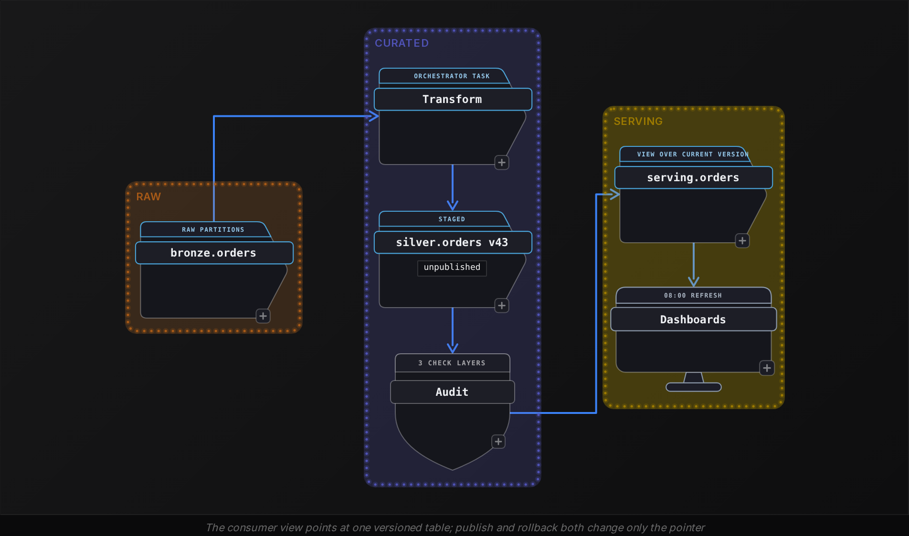
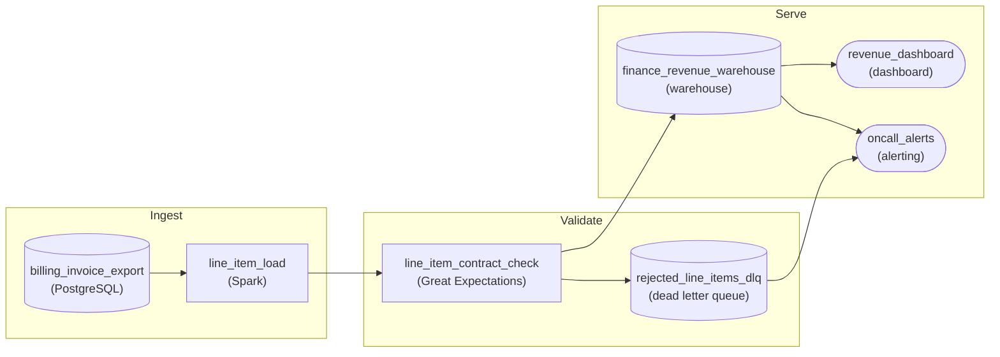
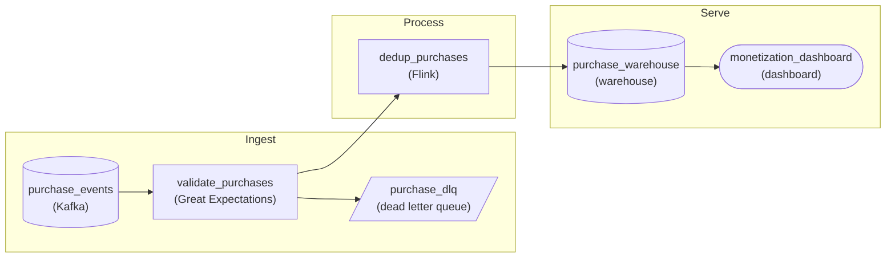

Intermediate·Pipeline Architecture · 35 min · 2 challenges

# Make It Reliable: Intermediate

Priya has 45 minutes with an engineer from Netflix's data platform team, which has described how it audits data before publishing it. The question arrives without a diagram: 'Every morning a batch job loads yesterday's viewing sessions into a table that 40 teams read by 08:00. Last week it ran twice and doubled the counts. The week before, a bad deploy wrote garbage and nobody noticed until a vice president asked. Design it so neither happens again, and tell me what you do when something slips through anyway.' Nothing in that prompt says idempotency, quality layers or rollback, yet those are the 3 pieces being graded. This lesson covers the engineering under the question: where checks sit and when they block, how a re-run leaves the table unchanged, which row wins among duplicates, which monitors fire, and how a bad publish gets undone before anyone reads it.


<br>

### What you will be able to do

Place quality checks at 3 layers, name the failure each layer catches, and say which failures block the publish

Make a load idempotent with partition overwrite or MERGE on a key, and state the test that proves it

Write ROW_NUMBER deduplication with a deterministic tie-breaker and a source priority across systems

Define freshness, volume and schema monitors as configuration with a threshold and an action each

Design a write, audit, publish flow so a bad load rolls back by changing a pointer, and rank the options when it has already published


<br>

---

## How Do You Ensure Data Quality?

Interviewers ask this one open ended on purpose. They want to hear whether you reach for a structure before you reach for a tool. The structure that holds up is 3 layers of checks, each placed where a different kind of failure originates. The first layer sits at ingestion and tests the raw feed against its contract: the columns the producer promised, their types, and a primary key that is present and unique. The second layer runs after transformation and tests the pipeline's own work: row counts reconcile with the input, joins did not fan out, every foreign key resolves. The third layer runs on the published output and tests business invariants: order totals are never negative, every order has a customer, and yesterday's revenue lands within a plausible band of the day before.

| Layer | Runs where | Example check | Failure it catches |
| --- | --- | --- | --- |
| 1: Contract | On raw data at ingestion | `order_id` unique, `currency` in a fixed list | Producer changed a column or sent a partial file |
| 2: Transformation | After each transform step | Silver row count within 0.5% of bronze row count | A join fanned out or a filter dropped real rows |
| 3: Business | On the published table | Sum of `order_total` within 30% of the trailing median | A logic bug that passes every structural test |

One check at the end tells you something broke; 3 checks tell you where. If the contract layer passed and the transformation layer failed, the bug lives in your code, and the on-call engineer skips the hour spent asking the producer whether they changed anything. Say that sentence in the interview, because it shows the layers exist to shorten diagnosis rather than to look thorough.


<br>

### Blocking versus warning

The decision this question turns on is what the pipeline does when a check fails. A warning writes a log line and lets the load continue to the table consumers read. A blocking check halts the run before that write happens. Candidates often default to warnings because blocking looks expensive: the dashboard shows yesterday's numbers until someone fixes the feed. The senior position is the reverse, and it rests on one asymmetry. Stale and correct is recoverable, because the data arrives late and nothing downstream has acted on it. Fresh and wrong is unrecoverable, because a finance analyst who reconciled against the wrong figure at 8 a.m. has already sent the email. You can replay a load; you cannot replay a decision.

✓Block the publish

- Primary key null or duplicated
- Row count outside the reconciliation tolerance
- A required column missing from the source
- Totals negative or outside the business band

✗Warn and continue

- Optional column null rate rises from 2% to 4%
- A new column appears that no consumer reads yet
- Free-text field length distribution shifts
- Row count 3% above the median on a known sale day

A blocking check is a query that returns a count, and a pipeline step that refuses to proceed unless that count is 0. The query below runs against the day's partition after the transform step and before the publish step.

```sql
SELECT
  COUNT(*) AS violations
FROM silver.orders
WHERE dt = DATE '2026-10-20'
  AND (
    customer_id IS NULL
    OR order_total < 0
    OR currency NOT IN ('USD', 'EUR', 'GBP')
  )
```

#### Reconciliation as the layer 2 check

```sql
SELECT
  raw.row_count AS raw_distinct_orders,
  curated.row_count AS curated_rows,
  raw.row_count - curated.row_count AS dropped_rows
FROM (
  SELECT
    COUNT(DISTINCT order_id) AS row_count
  FROM bronze.orders
  WHERE dt = DATE '2026-10-20'
) AS raw
CROSS JOIN (
  SELECT
    COUNT(*) AS row_count
  FROM silver.orders
  WHERE dt = DATE '2026-10-20'
) AS curated
```

The tolerance belongs next to the check, in writing, with every reason rows leave on purpose. This transform removes 2 kinds: the duplicate versions that deduplication collapses on the way into silver, which section 2 builds, and internal test orders. Counting distinct `order_id` values in bronze takes the duplicates out of the arithmetic, so on a 20 million row day `dropped_rows` of 1,200 test orders is healthy and the threshold reads 0.5% rather than 0. A tolerance nobody wrote down becomes a 3 a.m. argument about whether 1,200 is a bug.


<br>

### What blocking costs, in minutes

Every check adds runtime. On a 20 million row daily partition, the 3 layers together add about 4 minutes to a 40 minute load, a 10% tax that buys the ability to trust the number. Blocking adds a second cost only when a check fails: the data sits unpublished while a human decides, and that decision needs an owner. Name both costs in your answer and name the mitigations with them: run the layer 1 checks in parallel with the transform so they cost no wall-clock time, and attach a named owner and a paging rule to each blocking check so a failure at 3 a.m. wakes one specific person rather than a channel.

What the interviewer hears as the senior signal

- Each layer is tied to the failure it catches, so the design shortens diagnosis
- Blocking is the default for keys, counts and invariants, with the asymmetry stated as the reason
- Every tolerance and every blocking check has a written number and a named owner

> **TIP**
>
> When the interviewer asks what happens on failure, say 'the publish step does not run and the check owner is paged' in that order. Leading with the page before the halt suggests you would let the write through while someone looks.

✓Do

- Place checks at the 3 layers and say which failure each one catches
- Block on key, count and invariant failures before the publish step
- Write the tolerance beside the check with the reason for it
- Give every blocking check a named owner

✗Don't

- Run one check at the end and call the pipeline validated
- Warn on a null primary key because blocking feels disruptive
- Set tolerance to 0 on a transform that filters rows on purpose
- Page a channel with no owner attached


<br>

---

## Can You Re-run This Safely?

Picture the orchestrator retrying a task at 02:14. The first attempt wrote 6 million of the day's 20 million rows into `silver.orders` and then lost its connection. The retry starts from the beginning, reads all 20 million rows from bronze, and appends them. The table now holds 26 million rows for 20 October, 6 million of them twice. Nothing errored on the second attempt, so nothing paged. A pipeline is idempotent when running it 5 times leaves the table in the same state as running it once, and that property is what makes retry safe to turn on.


<br>

### Pattern 1: overwrite the partition

The most direct form of idempotency is to make the unit of work a whole partition and replace it. The run deletes everything it owns, which is the one day it is processing, and writes that day again from the source. Run it twice and the second run deletes the first run's 20 million rows before writing its own 20 million.

```sql
DELETE FROM silver.orders
WHERE dt = DATE '2026-10-20';

INSERT INTO silver.orders
SELECT
  order_id,
  customer_id,
  order_total,
  currency,
  updated_at,
  dt
FROM bronze.orders
WHERE dt = DATE '2026-10-20'
```

Two details decide whether this holds. First, the filter must use the run's logical date, which the orchestrator passes in, rather than `CURRENT_DATE`. A retry at 00:30 the next morning with `CURRENT_DATE` would delete and rewrite the wrong day. Second, there is a window between the DELETE and the INSERT where a reader sees an empty partition. If consumers query during the load window, write into a staging table and swap it in as the final step, which section 4 builds on.


<br>

### Pattern 2: MERGE on the business key

Partition overwrite struggles when an update arrives for a row that lives in a partition from 3 weeks ago. Rewriting every partition in that range to apply 200,000 changed rows is wasteful, and change data capture feeds produce exactly that shape of input. MERGE matches incoming rows to existing rows on a key, updates the ones that exist, and inserts the ones that do not. A replay matches every row the first run wrote, and the `updated_at` guard below skips them, so they stay unchanged. The source has to hold one row per key first: if `staging.orders_changes` carries 2 versions of one `order_id`, which change feeds deliver routinely, the MERGE fails on the double match, so run the ROW_NUMBER deduplication from section 2 before merging.

```sql
MERGE INTO silver.orders AS target
USING staging.orders_changes AS source
  ON target.order_id = source.order_id
WHEN MATCHED AND source.updated_at > target.updated_at THEN
  UPDATE SET
    order_total = source.order_total,
    currency = source.currency,
    updated_at = source.updated_at
WHEN NOT MATCHED THEN
  INSERT (order_id, customer_id, order_total, currency, updated_at, dt)
  VALUES (source.order_id, source.customer_id, source.order_total, source.currency, source.updated_at, source.dt)
```

The `updated_at` guard matters for replays out of order. If the feed redelivers Monday's change after Tuesday's already applied, the guard keeps Tuesday's values. Without it, MERGE is idempotent for a single batch but not for the sequence of batches.

| Property | Partition overwrite | MERGE on key |
| --- | --- | --- |
| Unit of work | One partition, all rows | One row per key |
| Needs a unique key | No | Yes, and it must be stable |
| Late update to an old partition | Rewrites the whole partition | Touches one row |
| Cost on a 50M row partition | About 8 minutes, regardless of how many rows changed | Join cost on the key; 200k changes finish in under 1 minute |
| Cost on a 2B row target table | Unchanged, only the partition is touched | Key join against 2B rows unless the target is partitioned and the merge prunes |
| Reader sees partial state | Yes, between DELETE and INSERT, unless staged | No, each statement commits whole |

The numbers point at the decision. When changes arrive as whole days and consumers tolerate a staged swap, overwrite the partition and skip the key requirement. When changes arrive as individual rows spread across history, MERGE on a stable key and partition the target so the merge prunes to the partitions the batch touches rather than joining against 2 billion rows.


<br>

### The test to say out loud

Interviewers want to hear how you would prove it. Run the pipeline for 20 October, snapshot the row count and a checksum of the partition, run it again, compare. The diff comes back empty, and that sentence is your evidence. The pattern's advanced tier spends a whole lesson on this proof, so at this depth, naming the test and the expected outcome is the mark to hit.

- **0 rows** — differ between run 1 and run 2

> Three things that break idempotency
>
> - `CURRENT_TIMESTAMP` or `CURRENT_DATE` in a filter: the second run selects different rows than the first
> - Auto-increment surrogate keys: the retry mints new ids for the same business rows
> - An append-only sink with no key: nothing in the target lets a run recognise its own earlier output


<br>

---

## How Do You Handle Duplicates?

Duplicates arrive from 3 directions, and the interviewer wants to hear you name them before you write a window function. Upstream systems deliver at least once, so a retry on their side sends the same event twice. Your own retries, when the load is not idempotent, double rows you already wrote. And the same real-world entity lives in 2 systems that both export it, so the customer exists once in the CRM and once in billing with different email addresses. The first 2 produce exact or versioned duplicates of one record; the third produces conflicting records that need a rule for which one wins.


<br>

### Exact duplicates and versioned duplicates

`SELECT DISTINCT` removes rows that are identical in every column. It does nothing for 3 rows that share an `order_id` but carry different `updated_at` values, because each row is distinct. That shape, the same key with several versions, is the common one, and it needs a rule that picks the version to keep.

| order_id | order_total | updated_at | ingested_at |
| --- | --- | --- | --- |
| 1001 | 49.00 | 2026-10-20 09:12 | 2026-10-20 09:15 |
| 1001 | 54.00 | 2026-10-20 11:40 | 2026-10-20 11:42 |
| 1001 | 54.00 | 2026-10-20 11:40 | 2026-10-20 11:50 |

Row 2 and row 3 share the same `updated_at`, so the rule needs a second sort key. `ingested_at` breaks the tie: the latest arrival wins. Without a tie-breaker the engine picks whichever row it reads first, and the pipeline returns different answers on different runs.

```sql
SELECT
  order_id,
  customer_id,
  order_total,
  currency,
  updated_at
FROM (
  SELECT
    order_id,
    customer_id,
    order_total,
    currency,
    updated_at,
    ROW_NUMBER() OVER (
      PARTITION BY order_id
      ORDER BY updated_at DESC, ingested_at DESC
    ) AS rn
  FROM bronze.orders
  WHERE dt = DATE '2026-10-20'
) AS ranked
WHERE rn = 1
```

Order 1001 comes out once with `order_total` 54.00 from the row ingested at 11:50. Say why `ORDER BY` has 2 keys when you write it, because an interviewer who sees one key will ask what happens on a tie, and a candidate who already answered it has shown they ran into it before.


<br>

### Cross-source deduplication with source priority

When the same customer arrives from 2 systems, recency alone gives the wrong answer. Billing updated the record at 10:00 with a verified payment email; the CRM updated it at 14:00 when a sales rep typed a typo. Newest wins picks the typo. The rule needs a priority: billing is the system of record for this entity, so billing wins whenever it has a row, and recency decides only within a source.

crm_customers

| customer_id | email | updated_at |
| --- | --- | --- |
| 42 | dana.k@exmaple.com | 2026-10-20 14:00 |

billing_customers

| customer_id | email | updated_at |
| --- | --- | --- |
| 42 | dana.k@example.com | 2026-10-20 10:00 |

```sql
SELECT
  customer_id,
  email,
  source_system
FROM (
  SELECT
    customer_id,
    email,
    source_system,
    updated_at,
    ROW_NUMBER() OVER (
      PARTITION BY customer_id
      ORDER BY CASE source_system
  WHEN 'billing' THEN 1
  WHEN 'crm' THEN 2
  ELSE 3
END, updated_at DESC
    ) AS rn
  FROM (
    SELECT
      customer_id,
      email,
      'billing' AS source_system,
      updated_at
    FROM bronze.billing_customers

    UNION ALL

    SELECT
      customer_id,
      email,
      'crm' AS source_system,
      updated_at
    FROM bronze.crm_customers
  ) AS unioned
) AS ranked
WHERE rn = 1
```

The `CASE` in the `ORDER BY` turns a business rule into a sort key, and the `ELSE 3` catches a source nobody listed so it never silently outranks billing. The rule here is whole-row: billing wins every column. The field-level version, where billing wins `email` but the CRM wins `phone`, uses a separate priority per column and `COALESCE` across sources ordered by that priority. Mention that it exists, and say you would start whole-row because consumers can reason about one winner.


<br>

### Where it runs and what it costs

`ROW_NUMBER` partitioned by key forces a shuffle of every row to the worker holding its key, then a sort within each key. On a 500 million row daily feed that shuffle is the most expensive step in the load, so run it once, when bronze becomes silver, and leave bronze holding every version so an audit can see what arrived. Deduplicating again in every downstream model repeats the shuffle and invites 2 models to pick different winners for the same key.

The question wears several disguises: 'this feed sometimes sends events twice', 'the same customer shows up in 2 systems', 'the retry doubled our counts'. Each one resolves to the same 2 decisions, which key defines a duplicate and which rule picks the survivor, and an answer that names both before writing SQL reads as experience.

✓Do

- Name the 3 sources of duplicates before writing SQL
- Order by a business timestamp, then an ingestion timestamp, for a deterministic winner
- Encode source priority as a CASE sort key with an ELSE for unknown sources
- Dedupe once at the silver layer and keep every version in bronze

✗Don't

- Reach for DISTINCT when rows differ in a timestamp column
- Order by one key and leave ties to the engine
- Let newest-wins override the system of record
- Dedupe again in every downstream model


<br>

---

## How Do You Know It's Broken?

A quality check runs inside the pipeline and asks whether this load is right. A monitor runs beside the pipeline and asks whether the pipeline itself is alive, on time and shaped the way consumers expect. The 3 monitors interviewers look for are freshness, volume and schema, and the answer that lands describes each one as a query with a threshold and an action, checked into the repository next to the pipeline code.


<br>

### Freshness: how old is the newest row

Define the SLA in consumer terms first. The orders table promises the previous day's partition, published by 07:00 each morning, so on 21 October consumers expect the partition for 20 October to be there. The monitor asks exactly that at the deadline: is the newest loaded `dt` the expected logical date? Store a `loaded_at` column at write time as well, so the alert can report when the last load landed without scanning event timestamps that may legitimately lag the load.

```sql
SELECT
  MAX(dt) AS newest_dt,
  MAX(loaded_at) AS newest_load,
  COALESCE(MAX(dt) < DATE '2026-10-20', TRUE) AS is_stale
FROM silver.orders
WHERE dt >= DATE '2026-10-19'
```

The `WHERE` on `dt` is the cost control. Without it the monitor scans 3 years of partitions on every run to find a maximum that only ever lives in the newest one. With it the query reads only the newest partitions and finishes in seconds, so it can repeat after the deadline until the partition lands. Comparing dates is also what keeps the page meaningful: a threshold on minutes since `MAX(loaded_at)` would sit above 60 for most of every day on a once-a-day load and page around the clock.

- **15 min** — re-check interval after 07:00
- **2 partitions** — scanned per freshness query


<br>

### Volume: compare to the right baseline

Row count against yesterday catches a feed that died, but on this orders table it also fires every Monday, because Sunday orders run about 40% below weekdays. The baseline that works is the median count of the same weekday over the previous 4 weeks, with a band around it. A Monday compares to the last 4 Mondays, and a 30% deviation either way fires.

```sql
WITH daily AS (
  SELECT
    dt,
    COUNT(*) AS row_count
  FROM silver.orders
  WHERE dt >= DATE '2026-09-22'
  GROUP BY dt
)

SELECT
  today.row_count AS today_rows,
  APPROX_PERCENTILE(hist.row_count, 0.5) AS baseline_rows,
  CAST(today.row_count AS DOUBLE) / APPROX_PERCENTILE(hist.row_count, 0.5) - 1 AS deviation
FROM daily AS today
CROSS JOIN daily AS hist
WHERE today.dt = DATE '2026-10-20'
  AND hist.dt < DATE '2026-10-20'
  AND DAY_OF_WEEK(hist.dt) = DAY_OF_WEEK(DATE '2026-10-20')
GROUP BY today.row_count
```

The median rather than the mean keeps one holiday from dragging the baseline. If a public holiday cut orders by half 2 weeks ago, the mean of 4 weeks moves 12% and the next 2 normal Mondays look high; the median barely moves.


<br>

### Schema drift: catch the change before the join does

Schema drift means the source changed shape: a column renamed, a type widened from integer to string, a column dropped. The monitor stores the expected column list and types for each source table and compares the live schema against it before the load starts. Added columns are additive and warn. Removed or retyped columns break downstream SELECT lists and casts, so they block the load. Catching a rename at the schema check costs 1 query; catching it when a join returns 0 rows costs the morning.

```sql
SELECT
  column_name,
  data_type
FROM information_schema.columns
WHERE table_schema = 'bronze'
  AND table_name = 'orders'
ORDER BY ordinal_position
```


<br>

### Monitoring as code

Writing the thresholds in a configuration file next to the pipeline turns them into something reviewed, versioned and testable. A pull request that loosens the volume band from 30% to 50% leaves a record of who did it and why, and a reviewer can push back. The file below is the whole monitor for one table.

```sql
table: silver.orders
owner: orders-data-team
monitors:
  - type: freshness
    partition_column: dt
    expected_partition: previous_day
    deadline: "07:00"
    recheck_minutes: 15
    on_breach: page
  - type: volume
    baseline: same_weekday_median
    lookback_weeks: 4
    max_deviation: 0.30
    on_breach: ticket
  - type: schema
    source: bronze.orders
    on_added_column: warn
    on_removed_column: block
    on_type_change: block
```

| Signal | Fires when | Action | Why that action |
| --- | --- | --- | --- |
| Freshness | Expected day's partition missing at 07:00 | Page the owner | Consumers are already waiting |
| Volume | Count deviates more than 30% from baseline | Open a ticket, hold the publish | Could be real; a human confirms in daylight |
| Schema removed or retyped | Live columns differ from expected | Block the load, page | The transform will fail or produce wrong types |
| Schema added | A new column appears | Warn in channel | Additive; nothing downstream reads it yet |

The actions differ by signal because the costs differ. Paging on every volume deviation teaches the on-call to ignore pages within a month, which is the failure mode that makes monitoring worthless. Reserve the page for the 2 signals where consumers are already affected or the load will definitely fail, and route the rest to a queue a human clears each morning.

> **TIP**
>
> If the interviewer asks 'how would you know it broke?', answer with the 3 monitors in the order consumers feel them: freshness first, since a late table is the complaint that reaches you, then volume, then schema.


<br>

---

## How Do You Roll Back a Bad Load?

At 07:10 the orders load finished and published 20 October. The layer 3 sum check had been switched to warn rather than block while a new currency feed settled in, so its failure went to a channel and the publish went ahead. At 07:40 the on-call read that warning: `order_total` summed 100 times higher than its trailing median. The row count was normal, which is why the volume monitor from section 3 stayed quiet. A currency conversion change had multiplied minor units where it should have divided. Consumers refresh dashboards at 08:00. You have 20 minutes, and the question is whether the design you built gives you a rollback that fits in them.


<br>

### Design the publish so rollback is a pointer flip

The pattern is write, audit, publish. The load writes the new partition to a location consumers cannot see, the quality layers from section 0 audit it there, and only a passing audit publishes it by switching what the consumer-facing name points to. Rollback becomes the same switch in reverse: point the name back at the previous version. The write and the audit can take 40 minutes; the publish and the rollback take seconds.



```sql
CREATE OR REPLACE VIEW serving.orders AS
SELECT
  order_id,
  customer_id,
  order_total,
  currency,
  updated_at,
  dt
FROM silver.orders_v42
```

Versioned tables with a view on top is one implementation; table formats that keep snapshots and let you restore a previous one offer the same flip natively. Either way the property to name is that the published name and the physical data are separate, and rollback changes the name's target. Retain previous versions long enough to cover a long weekend, so a bug found on Tuesday can still roll back Friday's load.

- **7 days** — version retention window


<br>

### When the bad data already published

If the design wrote straight into the consumer table, there is no pointer to flip, and the options rank by how fast they restore a correct state.

| Option | Time to correct state | Requires | Leaves |
| --- | --- | --- | --- |
| Restore previous snapshot or version | Seconds to minutes | Versioning or retained snapshots | Yesterday's data until the fix re-runs |
| Re-run the idempotent pipeline on fixed code | One full load, about 40 min here | The overwrite or MERGE design from section 1, plus a fixed transform | Correct data, no manual steps |
| DELETE the bad partition and leave it empty | Seconds | Partition-scoped data | A visible gap that consumers notice rather than a wrong total |
| Patch rows with an UPDATE | Minutes, if the bug is a formula | Knowing exactly which rows and which formula | Risk of a second bug under time pressure |

The second row is where sections 1 and 4 meet. An idempotent pipeline turns a rollback into a re-run: fix the conversion, trigger the load for 20 October, and the partition overwrite deletes the 100 times too large rows and writes correct ones. Without idempotency, the same re-run appends 20 million correct rows next to 20 million wrong ones and the total is now 101 times too high. The third row deserves a word too: an empty partition is a better interim state than a wrong one, because a dashboard that shows no Tuesday prompts a question, while a dashboard that shows a 100 times Tuesday prompts a decision.

#### Test the rollback before you need it

A rollback nobody has run is a hypothesis. Once a quarter, pick a day, flip the view to the previous version in a non-production copy, time it, and confirm the dashboards read the old numbers. The timing is the figure you quote in the interview, and the exercise surfaces the version that was quietly deleted by a cleanup job 3 months ago.


<br>

### Downstream, and saying so

A rollback on `serving.orders` leaves every table built from it holding the bad numbers until they re-run. The orchestrator knows the dependency graph, so the rollback step marks downstream tasks for the day as failed and re-triggers them after the fix, in dependency order. The message to consumers goes out before the fix, with 3 facts: which table, which dates, and when the corrected data will be live. A consumer who hears at 07:50 that Tuesday's orders are wrong and will be corrected by 09:00 waits; a consumer who finds out from their own dashboard stops trusting the table.


✓Do

- Separate the published name from the physical data so publish and rollback are pointer flips
- Audit in staging with the same checks that would block the publish
- Retain previous versions long enough to cover a long weekend
- Re-trigger downstream tasks in dependency order after the fix

✗Don't

- Write a load straight into the table consumers read
- Patch rows by hand at 07:45 under a deadline
- Roll back the one table and forget the tables built on it
- Let consumers discover the problem from their dashboards


<br>

---

## Putting It All Together

A grocery delivery company loads 18 million order events a day into an orders table that finance, marketing and the operations dashboard read by 07:00. Three tables are built from it: finance's revenue rollup, marketing's cohort table and the operations summary. Events arrive at least once from the app, store systems resend on retry, and the customer record lives in both the CRM and the payments platform. One Tuesday the load fails halfway and retries, a payments schema change renames a column the same week, and a pricing fix lands with the units inverted.

- The retry is harmless because the load overwrites the day's partition from a logical date, so the second attempt deletes the first attempt's 7 million rows before writing all 18 million
- The resent store events and the app's at-least-once delivery collapse to one row per order through ROW_NUMBER over the order key, ordered by update time then arrival time
- The customer email comes from payments rather than the CRM because the source priority CASE ranks payments first, and recency decides only within a source
- The renamed payments column blocks the load at the schema monitor, so the transform never runs against a missing column and the owner is paged with the column name
- The inverted pricing fix writes 100 times too large totals into a staged version, the layer 3 business check sees the sum outside the 30% band, and the publish never happens, so there is nothing to roll back
- Had the check been a warning, the view would be flipped back to the previous version in seconds, the corrected pipeline re-run for the day, and the 3 downstream tables re-triggered in dependency order


<br>

---

## Pipeline Architecture

### Exercise 1 of 2

**● TASK**

About 3 million billing-system invoice line items arrive each night, each belonging to one invoice date, and land in a date-partitioned warehouse table that the finance revenue report reads at 7 AM. Design the nightly load so that rerunning any night leaves its revenue unchanged, rows failing validation are held aside for billing to correct rather than reaching the report, and on-call is paged before 7 AM when a night goes wrong.


<br>

### Solution

#### What the incident is really asking

This is the lesson's whole reliability surface wearing a postmortem: an idempotent partition load, a quality gate that diverts failures to a dead letter store, and monitoring that pages before a human reader does. The trap is fixing only the sentence in the writeup. Put a dedup view over the doubled day and the dashboard looks right again, but a half-loaded night still reaches the controller, rejected rows still vanish, and the next surprise is still found by finance. **The interviewer is grading whether you see 3 missing guarantees, not one.**

| Trick: Make the night's partition the unit of truth |
| --- |
| Every night owns exactly one `invoice_date` partition. The load deletes and rewrites that partition inside one transaction, so running it once, twice or 5 times leaves the same rows. Idempotency lives in the write, not in the on-call engineer remembering to clean up first. |

#### Build it in order

1. **Replace the append with a partition rewrite**

   The failed run wrote part of the night, and the rerun appended the full night on top of it. Make the load own its `invoice_date` partition instead: delete that date's rows and write the fresh set in one transaction (`delete_write`), or overwrite the partition outright. The second run then produces the table the first run should have, and billing's corrected re-export of a past day lands through the same door with no special path.

2. **Put the contract check in front of finance**

   The finance-facing table is what the controller signs, so nothing reaches it unchecked. A quality gate sits between the load and the warehouse and tests the contract first (the columns and types billing promised), then the values: an `invoice_id` present, a non-negative `quantity`, a currency billing actually issues. Only rows that pass continue into the partition.

3. **Divert failures, never drop them**

   A rejected row is still revenue someone billed. Route failures to a dead letter store keyed by night, tagged with the rule they broke, so billing can correct them and the night can be rerun. Because the load is idempotent, that replay is the same boring operation as any other rerun.

4. **Page on what the scheduler cannot see**

   The scheduler saw nothing wrong last month: the rerun succeeded. What catches that night is a volume check on the landed partition against its recent average, which a 2x day trips immediately. Add a freshness alert for a partition missing well before 7 AM and a page whenever rows arrive in the dead letter store, all landing in on-call alerting.

| ✕ Append the night | ✓ Rewrite the night's partition |
| --- | --- |
| `INSERT INTO` adds rows every time it runs. A partial failure leaves a fragment and the rerun stacks a full copy on it. Correctness depends on someone cleaning up by hand, at 3 AM. | Delete and write the `invoice_date` partition in one transaction. Any number of runs converge on one copy, a failed run leaves the previous state intact, and a corrected re-export is just another run. |

#### The reference design



*The gate stands between the load and `finance_revenue_warehouse`; failures divert to `rejected_line_items_dlq`; the warehouse rewrites each `invoice_date` partition with `delete_write`, and both stores page on-call.*

| Pitfall: A dedup view hides the double, it does not remove it |
| --- |
| The tempting patch is a `ROW_NUMBER()` over `line_item_id` in the reporting layer. The dashboard turns right while the table stays wrong, and every new consumer (the month-end close, the tax export) has to know to read the view. Deduplication is the right tool when the source sends a row twice; it is the wrong tool for a load that writes the same night twice. |

| Interviewer: Idempotency is the first word, not the last |
| --- |
| Strong candidates open with 'every rerun of a night must produce the same partition' before naming a single tool, then hang the gate, the reject path and the alerts off that guarantee. Weak ones start with the scheduler and add retries, which is exactly what doubled the revenue: a retry of a non-idempotent write is the bug. |

| Performance: Rewriting one night is cheap |
| --- |
| At about 3 million line items and 1.5 GB a night, rewriting a single `invoice_date` partition touches one slice of the table, not its history, so a rerun costs the same as the original load. The gate adds one pass over the night's rows. The expensive thing here was never compute; it was the controller finding the error first. |

**Follow-up questions**

1. Billing starts sending the same `line_item_id` twice inside one night's export. Does the partition rewrite protect you?\
   *Tests whether the candidate separates 2 failure modes: the rewrite makes reruns safe but faithfully copies whatever the export contains, so in-export duplicates need a dedup step keyed on `line_item_id` before the gate.*
2. Two hundred rows sit in the dead letter store and billing has fixed them. How do they reach the numbers?\
   *Tests replay through idempotency: rerun that night's load with the corrected rows included instead of appending the fixes, so the partition converges on one correct copy.*
3. The volume alert fires on the last day of the quarter because invoicing genuinely spikes. What changes?\
   *Tests alert tuning: compare against the same period's seasonality or a known close calendar rather than silencing the check.*


<br>

### Exercise 2 of 2

**● TASK**

Our mobile app publishes about 2 million in-app purchase events a day onto a message bus that delivers at least once, so a retry can hand us the same purchase twice, and some payloads arrive truncated or missing fields. Design the path from the bus to a warehouse table of per-day purchase totals that stays correct when we reprocess a day, keeps every bad payload where someone can fix and replay it, and pages on-call within the hour if purchases stop arriving.


<br>

### Solution

#### What this really is

This is the lesson's **reliability surface** assembled on a live stream: a quality gate at the front, a dead letter queue beside it, dedup on a stable key, an idempotent load, and monitoring that watches for silence. Every piece is familiar. The trap is that at-least-once delivery attacks the totals from 2 directions at once, and the failure that costs the most makes no noise. A pipeline that only alerts on errors sits green through an afternoon when an app release stopped publishing purchases, and that day's numbers look plausible, just low.

The default design reads the bus, drops anything that fails to parse, sums by day, and appends. Each shortcut breaks a different promise: the parse failures were real sales and are gone, a redelivered purchase adds its amount twice, and the first time someone reprocesses a day to pick up late retries, the day doubles.

| Trick: Guard both ends, then watch for silence |
| --- |
| 2 things go wrong on an at-least-once bus: the same purchase arrives more than once, and some arrive broken. A third goes wrong that nobody sees.<br><br>1. Gate every payload on the contract; failures go to a dead letter queue, never the floor.<br>2. Collapse repeats on `purchase_id`, the id a retry keeps.<br>3. Load with an upsert so reprocessing a day replaces it.<br>4. Page on silence: freshness and volume, not just errors. |

#### Walk the requirements

1. **Validate against the contract before anything counts**

   Truncated payloads and missing fields are a contract problem, so the check sits at the front: `validate_purchases` asserts that `purchase_id`, amount, currency and purchase time are present and typed before a record moves on. Content checks (a negative amount, an unknown currency) belong here too. A half-record let through does not fail loudly; a null amount simply vanishes from the sum.

2. **Quarantine bad payloads, never drop them**

   A payload that fails the gate is still somebody's purchase. Send it to `purchase_dlq` and keep the main path draining, so one broken client build cannot stall the day. The DLQ gets its own depth alert, because a queue nobody watches is just a slower way to drop data. Once the cause is fixed, the records replay through the same gate and land in the same totals.

3. **Collapse redeliveries on `purchase_id`**

   Retries resend the same `purchase_id`, so that is the key. `dedup_purchases` remembers the ids it has seen over a window wider than the retry horizon: retries can land a day late, so hold 48 hours, and drop repeats before they reach the table.

4. **Make the load replace, not add**

   Late retries mean a closed day gets reprocessed, and DLQ replays mean yesterday can grow after the fact. `purchase_warehouse` upserts on `purchase_id` and the daily totals are recomputed from that set, so running any day twice produces the same number. The upsert is also the backstop for a repeat that slipped past the stream window, including a DLQ replay of a purchase whose clean retry already landed.

5. **Alert on silence, not only on errors**

   Errors, DLQ depth and failed jobs all require something to happen. A feed that has gone quiet produces none of them. A freshness check on `purchase_warehouse` pages on-call when no purchase has landed for an hour, and a volume check against the same hour last week catches the partial outage where one platform stops and the other keeps going.

#### The shape that fits



*Validate first, divert bad payloads to `purchase_dlq`, collapse redeliveries on `purchase_id`, upsert into the warehouse, and page on-call when the DLQ grows or purchases stop landing.*

| ✕ Drop on parse failure | ✓ Dead letter queue |
| --- | --- |
| The main path stays fast and green. The dropped purchases were real sales, the day's total is short by exactly their amount, and nothing records which ones or why. | The main path stays fast and green as well. Every rejected payload sits in `purchase_dlq` with its reason, its depth pages on-call, and once the client bug is fixed the records replay through the gate into the same totals. |

| Performance: The dedup window is cheap at this volume |
| --- |
| 2 million purchases a day is about 23 a second on average, a few hundred at peak. Holding 48 hours of `purchase_id` values is roughly 4 million keys, a few hundred MB of keyed state at most: small enough to live in the stream processor. The expensive part is recomputing a day's totals on reprocess, and that touches one day, not the table. |

| Interviewer: Silence is the tell of an operator |
| --- |
| Most candidates name validation and dedup. The one who has run a pipeline in production says, unprompted, that the scariest failure produces no error: the feed just stops. Naming freshness and volume checks alongside the DLQ depth alert, and saying which failure each one catches, is what reads as experience. |

| Pitfall: Deduping on the envelope instead of the purchase |
| --- |
| The first version hashes the whole message to find repeats. It works until a client retries with a refreshed `sent_at`, or a truncated message is fixed and replayed from the DLQ: the bytes differ, the hash differs, and the same purchase counts twice. The key has to be the identity the business assigns, `purchase_id`, not the envelope it arrived in. |

**Follow-up questions**

1. A new app release starts sending `amount` in cents instead of dollars. Every payload passes the field checks. What catches it?\
   *Tests the third quality layer: presence and type checks pass, so only a distribution check (average purchase value jumping 100x against last week) flags it, and it should hold the load, not just log.*
2. The DLQ holds 40,000 records from a two-hour client bug, and 30,000 of them were later retried cleanly. What happens when you replay the queue?\
   *Tests that replay runs through the same gate and the upsert on `purchase_id`: the 30,000 collapse onto rows already landed and only the 10,000 genuinely missing purchases add to those days' totals.*


<br>

---

## Key Takeaways

- Quality checks live at 3 layers, contract, transformation and business, and each layer shortens diagnosis by pointing at where the failure originated
- Block the publish on key, count and invariant failures, because stale and correct is recoverable and fresh and wrong is not
- A load is idempotent when a second run leaves the table unchanged: overwrite the partition for whole-day inputs, MERGE on a stable key for row-level changes
- Deduplicate once at the silver layer with ROW_NUMBER, a business timestamp, an ingestion tie-breaker, and a CASE sort key for source priority
- Monitors for freshness, volume and schema live as configuration with a threshold and an action each, and only the signals consumers already feel page someone
- Separate the published name from the physical data so a bad load rolls back by flipping a pointer, and let an idempotent re-run finish the repair
