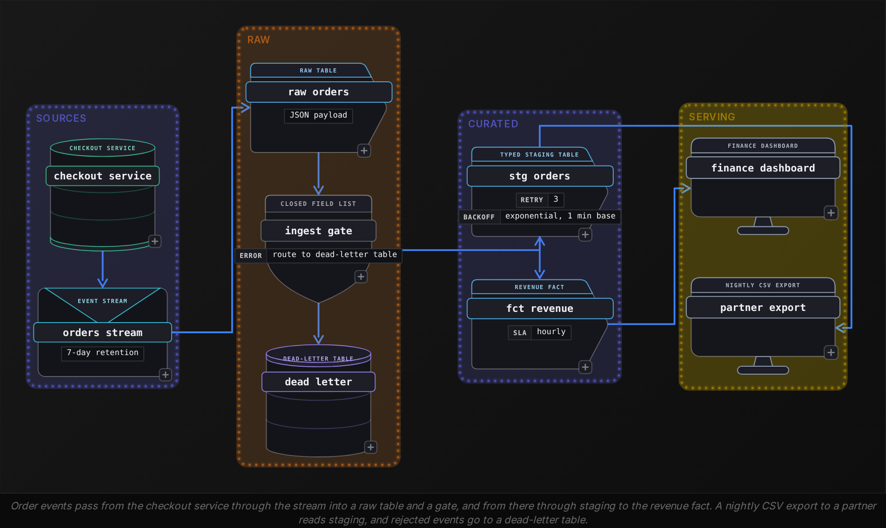
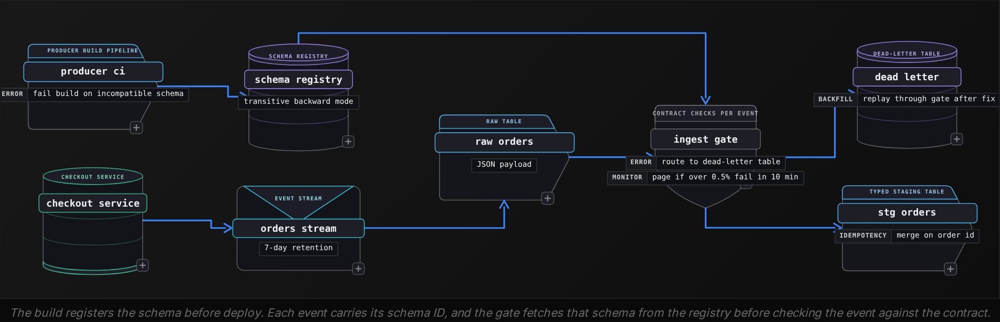
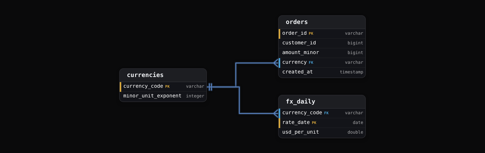
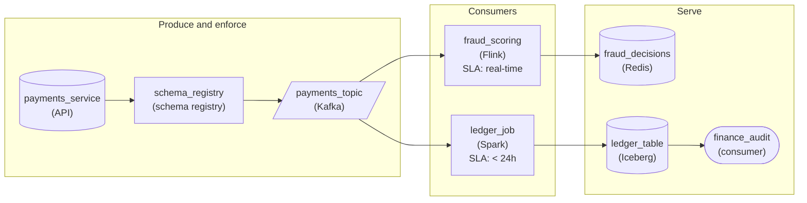
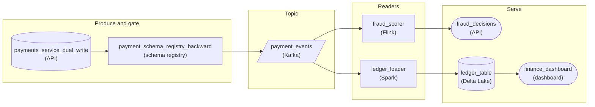

Advanced·Pipeline Architecture · 25 min · 2 challenges

# Schema Evolution: Advanced

Ines is in the last onsite loop at LinkedIn, and the interviewer sketches a pipeline on the whiteboard: a mobile app emitting a profile_view event, an event stream, a raw table, then 3 jobs downstream. One feeds a feed-ranking model; the other 2 build an analytics dashboard and a nightly partner export. The question comes next. The app team ships a release that adds a field to profile_view. What happens at each hop, and what would you have built so that nobody gets paged? Ines answers that the column lands as nullable and everything keeps working. The interviewer keeps pushing, with follow-ups about the half of users who never update the app, a new field that changes what an old field means, and a rename the team wants next quarter. Each follow-up moves the question from a single table to the whole system around it.


<br>

### What you will be able to do

Trace a new source field through every hop of a pipeline and name where binding breaks, both for readers that match columns by position or name and for formats that bind by field ID

Classify a schema change as backward or forward compatible, or both, and choose the deployment order it requires

Decide what a schema registry enforces, what a data contract adds, and where each check runs

Plan a breaking change as expand-migrate-contract, with upcasters for replayed and late data

Explain which changes ID-based table formats make metadata-only and which still force a rewrite


<br>

---

## "What If a Source Adds a Column?"

### One new field, every hop

Adding a column is the mildest schema change a source can make, which is exactly why interviewers open with it. The field itself rarely breaks anything. What breaks is each consumer's assumption about how it locates columns, and a pipeline holds several consumers with different assumptions. A complete answer walks the field from producer to dashboard and states, for every component, how it binds to the schema and what it does with a field it has never seen.

The running example for this lesson is a marketplace whose checkout service emits an `orders` event with 4 fields: `order_id`, `customer_id`, `amount_cents`, `created_at`. To launch in Japan, the payments team proposes a fifth field, `currency`, with a default of `USD`. The diagram below shows the route that event takes.




<br>

### Loud failures and silent ones

| Hop | Binds by | Reaction to currency | Who notices |
| --- | --- | --- | --- |
| Raw table with a JSON payload column | Nothing; it stores the payload | Kept inside the payload, unread | Nobody |
| Gate with a closed field list | Name, exact set | Sends every new event to the dead-letter table | On-call, within minutes |
| Staging load using `SELECT \*` | Position | Column count mismatch, load fails | On-call, at the next run |
| Staging load with explicit columns | Name | Field dropped without an error | Nobody, until someone asks for it |
| Partner CSV export | Position | Every column after the new one shifts by 1 | The partner, weeks later |
| Revenue fact `sum(amount_cents)` | Meaning | Adds yen to US cents | Finance, at month-end close |

The table sorts into 2 groups. The gate and the `SELECT *` load fail loudly, which is costly at 3 a.m. but cheap overall, because nothing wrong reaches a consumer. The explicit-column load keeps running, and so do the CSV export and the revenue fact, all producing output that looks valid. Interviewers give most of the credit for spotting those silent failures.

```sql
INSERT INTO staging.stg_orders
SELECT
  *
FROM raw.orders_parsed
WHERE event_date = DATE '2026-10-01'
```

`raw.orders_parsed` now returns 5 columns while `staging.stg_orders` holds 4, so the engine rejects the insert. Adding the column to the target as well only moves the risk: `INSERT ... SELECT *` matches columns by position, so the load succeeds only while both sides list them in the same order. If the producer places the new field in the middle of its column list, a loud failure becomes a silent swap of values.

That is what happens to the partner export once staging adopts the field. The checkout team put `currency` third, next to the amount it describes; staging takes the column in that order, the export's `SELECT *` writes it third, and the partner's parser still reads 4 positions.

Row the partner expects (v1 layout)

| order_id | customer_id | amount_cents | created_at |
| --- | --- | --- | --- |
| o-1001 | 77 | 4599 | 2026-10-01 09:14 |

Same positions read from a v2 row

| order_id | customer_id | amount_cents | created_at |
| --- | --- | --- | --- |
| o-1002 | 81 | JPY | 125000 |

The partner's loader may reject `JPY` as a non-numeric amount, which is the good outcome. Had the new column been numeric, such as a tax amount in cents, every value would parse and every value would sit under the wrong header.


<br>

### Additive in shape, breaking in meaning

Every schema check in this pipeline approves `currency`: a new field with a default is the most compatible change a schema can make. Then the first Japanese order arrives as `o-1002` with `amount_cents` of 125000 and `currency` of `JPY`. Yen has no minor unit, so that number means 125,000 yen, and the revenue fact, which sums `amount_cents` as US cents, books it as $1,250.00. The change added a column and, in the same release, redefined an existing one, from US cents to minor units of whatever `currency` says. No compatibility rule inspects meaning, so this hop is where a strong answer slows down.

> The same question, disguised
>
> - A third-party API starts returning an extra field overnight. Which jobs break?
> - Old mobile app versions keep sending last year's event shape. How does the pipeline cope?
> - Rename `user_id` to `member_id` across 40 tables. Plan the rollout.
> - A column must change from integer to string. What ships first?
> - How do you stop one producer team from breaking 12 consumer teams?


<br>

### A policy per layer

The answer interviewers want ends in a policy, and the policy differs by layer, because each layer promises something different to the people downstream of it.

| Layer | Policy for unknown fields | Why |
| --- | --- | --- |
| Raw | Accept and store everything | Raw is the replay source; a field dropped there is gone for good |
| Staging | Evolve by name from an allowlist; alert on fields not yet on it | New data stays visible without changing typed tables unreviewed |
| Curated facts | Change only through a reviewed migration | Facts carry business definitions that a new field can quietly alter |
| Partner exports | Frozen explicit column list, versioned | An external reader cannot redeploy on your schedule |

> **TIP**
>
> Name the binding before the fix. Saying that the partner export reads by position, so a new field must be appended or the export must be versioned, shows the reasoning an interviewer is grading. A fix with no binding behind it sounds like a memorized rule.


<br>

---

## Forward and Backward Compatibility

### Writer schema, reader schema

Every compatibility statement compares 2 schemas: the one that wrote the data and the one reading it. Backward compatible means code on the new schema can read data written with the old one. Forward compatible means code still on the old schema can read data written with the new one. Full compatibility means both hold. The names get swapped under pressure, so tie each to a deployment: backward compatibility lets readers upgrade first, forward compatibility lets writers upgrade first.

✓Backward: readers upgrade first

- Readers on the new schema meet old data during rollout
- Fields the old data lacks need a default
- Lets a field be removed: readers stop using it, then writers stop sending it
- Fits lake tables whose old files stay readable for years

✗Forward: writers upgrade first

- Readers on the old schema meet new data during rollout
- Old readers must skip fields they do not know
- Lets a field be added: writers send it before any reader uses it
- Fits streams whose consumers deploy on their own schedules


<br>

### Change by change

| Change | New reader, old data | Old reader, new data | Verdict |
| --- | --- | --- | --- |
| Add field with a default | Yes, the default fills the gap | Yes, the old reader skips it | Full |
| Add field without a default | No, nothing fills the gap | Yes | Forward only |
| Remove field that had a default | Yes, the new reader skips it | Yes, the old reader uses its default | Full |
| Remove field with no default | Yes | No, the old reader finds it missing | Backward only |
| Widen int to bigint | Yes, values are promoted | No, a bigint may not fit an int | Backward only |
| Rename field | No | No | Breaking unless the format supports aliases |
| Change string to int | No | No | Breaking |

Two assumptions sit under every Yes in that table. The reader resolves fields by name, so a field it does not list is skipped, and the format can promote `int` to `bigint` while reading. A positional reader breaks the first assumption, which is why, for the partner's positional CSV export, almost no change is forward compatible: only a field appended at the end leaves the old positions intact.

Rollout order follows from the verdict. Adding `currency` with a default is fully compatible, and the producer can deploy before or after its consumers. Removing a field with no default is backward only: every consumer must stop reading it and redeploy before the producer stops writing it, and the producer's deploy waits on the slowest consumer.

*Formats differ in details, such as which numeric promotions they allow and whether a field can carry aliases for renames; the 2 directions are the same in all of them.*


<br>

### A default can hide a missing currency

Resolution by name with defaults fits in a short function, and writing it out shows where the judgement sits.

```sql
from typing import Any, Dict

READER_V2 = {
    "order_id": {"type": str},
    "customer_id": {"type": int},
    "amount_cents": {"type": int},
    "created_at": {"type": str},
    "currency": {"type": str, "default": "USD"},
}


def resolve(record: Dict[str, Any], reader: Dict[str, Dict[str, Any]]) -> Dict[str, Any]:
    resolved = {}
    for name, spec in reader.items():
        if name in record:
            value = record[name]
        elif "default" in spec:
            value = spec["default"]
        else:
            raise ValueError(f"missing required field: {name}")
        if not isinstance(value, spec["type"]):
            raise TypeError(f"{name} should be {spec['type'].__name__}")
        resolved[name] = value
    return resolved


v1_event = {
    "order_id": "o-1001",
    "customer_id": 77,
    "amount_cents": 4599,
    "created_at": "2026-10-01T09:14:00Z",
    "app_build": "8.4.1",
}
print(resolve(v1_event, READER_V2))
```

The v1 event comes back with `currency` set to `USD`, and `app_build`, which the reader does not list, is dropped. The `USD` default is correct for every order placed before the Japan launch, and a hazard for every writer after it: a new mobile build that forgets to set `currency` on a yen order also resolves to `USD`, and the schema has hidden the bug. The stricter design gives `currency` a null default. That keeps compatibility while leaving missing values visible, and staging makes the decision. A v1 event predates the field, so it becomes `USD`; a v2 event with a null currency goes to the dead-letter table.


<br>

### Compatible with which version?

A registry can check a new schema against the latest version only, or against every version it holds, which is called transitive checking. The difference shows up wherever old data stays readable. Take a `members` event, separate from orders:

| Version | Change | Checked against previous | Checked against v1 |
| --- | --- | --- | --- |
| v1 | `loyalty_points` bigint, default 0 | n/a | n/a |
| v2 | Removes `loyalty_points` | Passes | Passes |
| v3 | Re-adds `loyalty_points` as string, default empty | Passes | Fails: bigint read as string |

Each version passed the check it faced. A backfill that reads 3 years of raw member events, most of them written as v1, with the v3 reader meets a `bigint` where it expects a `string` and stops. A stream that keeps 7 days of events can often live with checks against the previous version, because nothing older is read from it. Any store holding history needs transitive backward compatibility.

> **TIP**
>
> When an interviewer names a change, answer 3 things: the direction it is compatible in, the side that deploys first, and how far back the check must reach. Together those cover most follow-ups before they are asked.


<br>

---

## Schema Registries and Contracts

### A registry checks shape

A schema registry stores every version of a schema under a subject, usually 1 subject per stream or table, assigns each version an ID, and refuses any new version that fails the subject's compatibility mode. Producers prefix each message with the ID of the schema that wrote it, a few bytes, so a consumer can fetch the exact writer schema and resolve it against its own reader schema. The check runs at registration time, which makes it a gate in the producer's build: an incompatible schema fails before any event in that shape exists.



✓Registry catches

- A field removed that had no default
- A type changed from bigint to string
- A rename with no alias
- A new field with no default, under backward mode

✗Registry passes, contract catches

- amount_cents switching from US cents to minor units
- status gaining a new value, PARTIAL_REFUND
- created_at switching from UTC to local time
- customer_id going from 0% to 30% null

Everything in the right column is a valid value of a valid type. The registry's work ends at shape, and the Japan plan would have passed it on the first try.


<br>

### A contract adds meaning and an owner

A data contract is the producer's written promise about a dataset: the schema, what each field means and in which unit, and the constraints values obey. It also names the owner and the consumers, and it says how changes will be announced. The schema part can live in the registry. The rest needs a file the producer reviews like code, plus checks that read it.

```sql
contract: orders
contract_version: 1
owner: payments-platform
subject: orders-value
compatibility: backward_transitive
freshness_sla_minutes: 15
fields:
  order_id:
    type: string
    required: true
    unique: true
  customer_id:
    type: bigint
    required: true
  amount_cents:
    type: bigint
    required: true
    unit: USD cents
    min: 0
  created_at:
    type: timestamp
    timezone: UTC
    required: true
change_policy:
  additive: notify consumers 7 days ahead
  semantic_or_breaking: new field, 30-day overlap
consumers:
  - finance-revenue
  - fraud-scoring
  - partner-export
```

No tool reads intent, so the contract works through people and rules. With `unit: USD cents` on the page, the payments engineer adding `currency` reads that line in review and has to decide what yen orders put in `amount_cents`, which is the question the Japan plan skipped. The change policy classes the redefinition as semantic, so it ships as a new field with a 30-day overlap rather than as a reinterpretation of an old one. The gate can also enforce a rule derived from the contract: while `amount_cents` is US cents, an event whose `currency` is not `USD` fails.

Ownership decides who can change what. The producer owns the contract and is the only party that publishes a new version. Consumers add themselves to the `consumers` list, which makes that list the notification list for every change and the evidence needed before anything is dropped.


<br>

### Halting or quarantining at the gate

| Check point | What it checks | Cost of a failure there |
| --- | --- | --- |
| Producer build | Registry compatibility and a diff of the contract file | A blocked merge; no bad event exists |
| Ingestion gate | Per-event constraints: nulls, ranges, allowed values, units | Events wait in the dead-letter table and curated data lags |
| Consumer tests | Assumptions one consumer relies on, run against staging | A failed deploy of that consumer |
| Daily reconciliation | Curated totals against the source system | Wrong numbers already published for a day |

The earlier a check runs, the cheaper its failure. At the gate, the choice is between halting and flowing. Blocking the whole stream on one bad event stops the revenue fact for every consumer; routing bad events to a dead-letter table keeps it flowing but leaves it quietly incomplete. The usual answer is per-event quarantine plus a rate alarm: page when more than 0.5% of events fail within 10 minutes, since a failure rate that high almost always traces to a producer deploy.

✓Do

- Give every contract a named owning team and a list of consumers
- Write the unit and timezone of every numeric and time field
- Run compatibility checks in the producer's build, before deploy
- Replay dead-lettered events through the same gate after a fix

✗Don't

- Treat a passing registry check as proof that a change is safe
- Let consumers register schemas for data they do not produce
- Halt a shared stream because one event fails validation
- Write contracts for every table at once instead of starting with money and shared sources

> **TIP**
>
> Contracts cost review time on every change, so their value scales with the number of consumers. A source read by 1 job owned by the same team rarely needs one. The orders event does, because finance reads it and so do fraud scoring and a partner.


<br>

---

## Handling Breaking Changes

### Expand, migrate, contract

The fix agreed with finance: yen sales wait, and `amount_cents` is replaced by `amount_minor`, in each currency's own minor unit, alongside the `currency` field that v2 already added. Removing and redefining a field breaks both directions, so no single version can ship it. A sequence of versions can, each compatible with the one before, ending where the breaking change would have.

| Phase | Producer writes | Consumers read | Exit condition |
| --- | --- | --- | --- |
| Expand | v3: `amount_cents`, `currency` and new `amount_minor` | `amount_cents` | New fields present on 100% of events for 3 days |
| Migrate | v3; yen orders now allowed | Each consumer moves to the new pair | Every listed consumer reads only the new pair |
| Backfill | v3 | New pair | Raw history upcast and reloaded into staging |
| Contract | v4: `amount_minor` and `currency` only | New pair | 30 days with no reads of `amount_cents` |

The hard decision comes in the migrate phase. Once yen orders exist, what does `amount_cents` hold for them? Leaving it null makes old readers undercount Japan, and copying the yen amount repeats the original bug. The producer fills it with the US-cent equivalent at the booking-time exchange rate, which keeps the old field true to its contract until the last old reader is gone.

The contract phase needs evidence before it starts: query logs or access audits showing that nothing has selected `amount_cents` for 30 days. A consumer missing from the contract's list is the usual reason a drop breaks someone, which is why consumers maintain that list themselves.


<br>

### A view as a compatibility shim

The partner cannot change its parser inside 30 days, so the curated layer serves it a view that rebuilds the old field from the new pair, using 2 reference tables.



```sql
CREATE OR REPLACE VIEW curated.orders_legacy AS
SELECT
  o.order_id,
  o.customer_id,
  CASE
    WHEN o.currency = 'USD' THEN o.amount_minor
    ELSE CAST(round(o.amount_minor * r.usd_per_unit * power(10, 2 - c.minor_unit_exponent)) AS bigint)
  END AS amount_cents,
  o.created_at
FROM curated.orders AS o
JOIN reference.currencies AS c
  ON o.currency = c.currency_code
LEFT JOIN reference.fx_daily AS r
  ON o.currency = r.currency_code
  AND CAST(o.created_at AS date) = r.rate_date
```

The exponent matters because `amount_minor` is in each currency's own minor unit: yen has 0 decimal places, the dollar 2. Dollar orders pass `amount_minor` through unchanged, so they never depend on a rate. The join to `fx_daily` is a `LEFT JOIN` on purpose. Rates for a day can land hours after that day's orders, and an inner join would drop those orders from the export without a trace. With the left join they appear with a null amount, and because a view is computed at read time, the next export after the rate lands is correct with no reprocessing. A materialized table built from the same query would keep the nulls until someone reruns it.


<br>

### Old shapes keep arriving

Contracting the schema does not retire the old shapes. A consumer recovering from an outage replays up to 7 days of the stream, reaching back past the checkout service's latest deploy. Events quarantined during a rollout leave the dead-letter table weeks later in the shape they were written in. The raw table holds 3 years of v1 and v2 payloads that any backfill reads. All of it is late data in an old shape, so the staging reader keeps upcasters: functions that each turn one version into the next, chained until the event reaches the latest.

```sql
def v1_to_v2(event: dict) -> dict:
    return {**event, "currency": "USD", "schema_version": 2}


def v2_to_v3(event: dict) -> dict:
    return {**event, "amount_minor": event["amount_cents"], "schema_version": 3}


def v3_to_v4(event: dict) -> dict:
    upgraded = {k: v for k, v in event.items() if k != "amount_cents"}
    upgraded["schema_version"] = 4
    return upgraded


UPCASTERS = {1: v1_to_v2, 2: v2_to_v3, 3: v3_to_v4}
LATEST_VERSION = 4


def to_latest(event: dict) -> dict:
    version = event.get("schema_version", 1)
    while version < LATEST_VERSION:
        event = UPCASTERS[version](event)
        version = event["schema_version"]
    return event
```

Each step rests on a fact about its version. The checkout service wrote every v1 and v2 event before it accepted any non-USD order, since yen sales open only with v3, so every one of them is in US cents and copying `amount_cents` into `amount_minor` is exact. Upcasters are deterministic, so a replay produces identical rows and the staging merge on `order_id` absorbs the duplicates a retry creates. An upcaster can be deleted only when no retained store holds its version. With 3 years of raw history, that means keeping it for 3 years or rewriting the raw table, which costs a full scan and cannot be undone; a 3-line function is usually the cheaper of the two.

✓Evolve in place

- One stream and one table to reason about
- Each field migrates on its own timeline
- Overlap lives inside one schema, as extra fields
- Fits field-level changes: renames, units, types

✗Publish orders_v2 alongside

- Clean break, with the old stream frozen as it was
- Producer writes twice and storage doubles during the overlap
- Consumers switch endpoints, and ordering across the 2 streams is lost
- Fits changes of grain or key, such as orders becoming order lines

> **TIP**
>
> If the interviewer asks how long the migration takes, answer with exit conditions rather than dates. Phases end on evidence, such as 100% field coverage or 30 days without a read, and the slowest consumer sets the timeline.


<br>

---

## Schema Evolution in Table Formats

### 3 ways to find a column

Once events land in lake tables, the file format's binding decides what each schema change costs. Positional files, such as CSV, read the third column as the third field. Self-describing files matched by name, the default for many columnar readers, find a column by its label. Some open table formats, or optional modes of them, assign every column an integer ID, stored in table metadata and in each data file's schema, and match by that ID, so a name is only a label the user sees. Others bind by name, so check how your format binds before relying on the guarantees below.

| Operation | ID-based table format | Name-matched files | Positional files |
| --- | --- | --- | --- |
| Add column | Metadata only; old files read null | Metadata only; old files read null | Safe only when appended at the end |
| Rename column | Metadata only | Old files read null for the new name | Free; names are never read |
| Drop column | Metadata only; the ID is retired | Hidden, but returns if the name comes back | Rewrite, or every later column shifts |
| Reorder columns | Metadata only | Safe | Rewrite |
| Widen int to bigint | Metadata only; promoted on read | Depends on the reader | Safe; text has no width |
| Change string to bigint | Rewrite | Rewrite | Rewrite, or values fail to parse |

Read the table by column. ID-based formats turn most structural changes into a metadata commit that finishes in seconds whatever the table's size, which suits tables that evolve often. Positional files sit at the other end: nearly every change other than appending a column means rewriting every file.

Renaming shows the difference. On an ID-based table, renaming `customer_id` to `buyer_id` changes 1 entry in the metadata, and every file written before the rename still answers to field ID 2. On name-matched files, the same statement leaves 3 years of history returning null for `buyer_id`, though the data is still in the files.

```sql
'ALTER TABLE curated . orders RENAME COLUMN customer_id TO buyer_id'
```


<br>

### Drop, then add the same name

This case separates the 2 binding styles most sharply. The marketplace dropped `discount_cents` in March when a promotion ended, and in October added a new `discount_cents` for loyalty discounts. A February file still contains the old promotion values.

Name-matched read of a February file

| order_id | discount_cents |
| --- | --- |
| o-0412 | 500 |
| o-0413 | 0 |

ID-based read of the same file

| order_id | discount_cents |
| --- | --- |
| o-0412 | NULL |
| o-0413 | NULL |

The name-matched reader resurrects the old promotion amounts and reports them as loyalty discounts. The ID-based reader knows the October column has a new ID, finds no such ID in the February file, and returns null. Dropped IDs are retired and never reused, which is what makes that guarantee hold.


<br>

### Partition evolution

Table formats that record the partition scheme per data file let that scheme change without a rewrite. When Japan's order volume makes daily partitions on `created_at` too coarse, the table switches to hourly: new files are written hourly, old files keep their daily layout, and the planner prunes each file by the scheme it was written with. Queries filter on `created_at` itself, so none of them change.

```sql
SELECT
  currency,
  SUM(amount_minor) AS total_minor
FROM curated.orders
WHERE created_at >= TIMESTAMP '2026-10-01 00:00:00'
  AND created_at < TIMESTAMP '2026-10-01 06:00:00'
GROUP BY currency
```

The cost is uneven pruning. This 6-hour window reads 6 hourly partitions for recent data, while the same filter over last year scans whole days. Rewriting old partitions into the new scheme is optional and can run during quiet hours.


<br>

### The sink job between stream and lake

The sink job that writes stream events into lake tables is where the stream's schema and the table's schema must agree. If the sink evolves tables automatically, any producer can add columns to any table it writes; if it never evolves them, new fields are dropped or the write fails. The layer policy applies here as well: raw tables auto-evolve so nothing is lost. Staging and curated tables change only through a migration that runs `ALTER TABLE` before the producer ships the field.

Time travel adds one question to check for each format: whether a query against an old snapshot uses that snapshot's schema or the table's current one. A backfill that compares a pre-rename snapshot against today's table depends on the answer. If it uses the snapshot's schema, the old snapshot exposes `customer_id` and the comparison must map it to `buyer_id`. If it uses the current schema, the old snapshot already shows `buyer_id`, the field ID carrying the values across.

> Changes that still force a rewrite
>
> - Changing a type outside the format's allowed promotions, such as string to bigint
> - Narrowing a type, such as bigint to int or decimal(12,2) to decimal(10,2)
> - Physically deleting a dropped column's data for privacy, since a drop only hides it
> - Changing a field's meaning, such as US cents to minor units, which no format can see

> **TIP**
>
> Before proposing an `ALTER TABLE`, say whether the change is a metadata commit or a rewrite on this table's format, and name what would still force a rewrite. Type changes do when they narrow or fall outside the allowed promotions; so do privacy purges and changes of meaning. Saying that up front answers the cost question before anyone asks.


<br>

---

## Putting It All Together

A marketplace that has sold only in US dollars launches in Japan. The payments team needs order amounts in yen, finance closes the books monthly from a revenue fact, a fraud model scores every order within seconds, and a logistics partner receives a nightly CSV export it cannot change quickly. The order event, its stream, the raw lake table and 3 years of history all assume amounts in US cents.

- Tracing the new currency field hop by hop finds the silent failures: the explicit-column staging load, the positional partner export and a revenue fact that would add yen to cents.
- The compatibility table shows that adding currency with a null default is fully compatible, and the years of raw history mean the registry must check transitively.
- The contract's unit : USD cents line turns the launch from a column addition into a semantic change, which the registry alone would have approved.
- The expand-migrate-contract sequence moves every consumer to amount_minor and currency . Meanwhile the legacy view keeps the partner export running, and the upcaster chain covers replays and old app builds.
- In the lake, an ID-based table records adding amount_minor as a metadata commit, and dropping amount_cents later is one too. Partition evolution absorbs Japan's extra volume without rewriting old days.


<br>

---

## Pipeline Architecture

### Exercise 1 of 2

**● TASK**

A payments topic has two readers: a daily finance ledger job and a fraud-scoring consumer that scores each payment within seconds. The payments team is changing that topic's `amount` field from string to decimal, and every schema published to it is checked against full compatibility, a guarantee that stays on through this change. Design how the change reaches production so neither consumer breaks mid-migration and the ledger table auditors query picks up the decimal amount without its history being rewritten.


<br>

### Solution

#### What this really is

This is expand-contract under a guarantee you are not allowed to touch. String to decimal is not a widening: to the registry it is a different type, so a subject held to full compatibility rejects the in-place edit, correctly. Everyone knows what the new type should be. What separates candidates is whether they keep the check on and route the change around it: add `amount_decimal` beside `amount`, let each consumer move on its own clock, and only then retire the string. The trap is the one-line fix: flip the subject to `NONE`, register the new type, flip it back. The fraud consumer, still resolving events against its old reader schema, fails on the next payment, and the org's guarantee on `amount` was off for exactly the deploy that needed it.

| Trick: A type change is two additions and a deletion |
| --- |
| You never change `amount`. You add a field, move the readers, then delete a field.<br><br>1. Expand: register `amount_decimal`, nullable with a null default. Full compatibility passes it both ways.<br>2. Migrate: the producer writes both; fraud and the ledger switch on their own release calendars.<br>3. Contract: give the string a default, then drop it once both readers confirm. |

#### Walk the migration

1. **Add `amount_decimal`, optional, defaulting to null**

   The expand step is a pure addition: a decimal field with two places, nullable, null by default. Under full compatibility it survives both directions: a new reader of old events fills null, an old reader of new events ignores a field it never asked for. The registry accepts it with the compatibility setting untouched, which is the whole point.

2. **Dual-write both fields from the producer**

   Payments fills `amount` and `amount_decimal` from the same value on every event. From this moment any consumer can switch whenever its own release allows, and nobody has to coordinate a flag day across teams that ship on different calendars.

3. **Move the readers on their own clocks**

   Fraud ships weekly, so it switches to `amount_decimal` first. The ledger job moves on finance's monthly release, and `ledger_table` gains the column as a metadata change: Iceberg tracks columns by ID, so existing files stay untouched and simply read the new column as null. History stays as recorded.

4. **Contract only after both confirm**

   Dropping `amount` is a deletion, and under full compatibility a field can only be removed if old readers have a default to fall back on. So one registered version gives the string a default, and the next drops it, gated on both consumers confirming they read the decimal, not on a date.

#### The shape that fits



*Every schema passes the registry before it reaches `payments_topic`, which carries `amount` and `amount_decimal` side by side through the overlap; fraud scores in seconds and the Iceberg `ledger_table` takes the new column without a rewrite.*

| ✕ Relax the check for one deploy | ✓ Expand, migrate, contract |
| --- | --- |
| Set the subject to `NONE`, register `amount` as decimal, restore `FULL`. One deploy, and every reader still on the old schema fails resolution on the next event. Fraud goes dark within seconds; the ledger fails at its next run. | Register `amount_decimal` alongside `amount` under the unchanged `FULL` setting, dual-write, move each reader when its release allows, then default and drop the string. Slower on the calendar; nothing breaks at any step. |

| Performance: Two fields cost bytes, not compute |
| --- |
| Carrying both representations adds a few bytes per event for about a month, and Iceberg adds the ledger column without touching a data file. The real cost is calendar time: the overlap lasts as long as the slowest reader's release cycle, here finance's monthly one. |

| Interviewer: Ask who else reads the topic |
| --- |
| Strong candidates name the directions the change must survive: forward for fraud still on the old reader, backward for the new ledger replaying old events. Stronger ones ask who else subscribes. If any team can read without telling payments, compatibility has to hold against every prior version, not just the latest one. |

| Pitfall: A fresh topic resets the guarantee |
| --- |
| The other common miss mints `payments_v2` with a decimal `amount` and points consumers at it on a date. Without a dual-published overlap it is a flag day with extra steps, and the first schema on a new subject has nothing to be checked against, so the org's guarantee on `amount` quietly starts over. |

**Follow-up questions**

1. Fraud's release slips a month and payments wants `amount` gone on schedule. What stops the contract step from shipping?\
   *Tests whether retirement is gated on confirmed reader migration rather than a date, and whether the candidate knows the drop needs a defaulted version first.*
2. Auditors now want the decimal amount on every `ledger_table` row, including those written before the change. How do you give it to them without rewriting history?\
   *Tests read-time derivation (a view that falls back to a cast of the string for old rows) versus a backfill that rewrites files, and the audit implications of each.*
3. A replay of last quarter's payments runs through the migrated ledger job. What does it see in `amount_decimal`, and is that correct?\
   *Tests backward compatibility in practice: old events resolve the new field to its null default, so the ledger job must fall back to the string for pre-change events.*


<br>

### Exercise 2 of 2

**● TASK**

A staging replay of the payments topic with `amount` sent as a decimal instead of today's string crashed the ledger loader and blanked the finance dashboard's revenue tiles, and nothing refused those events before they landed on the topic. The fraud scorer reads that topic as payments arrive, the ledger loader appends to a ledger table holding years of audited history that the finance dashboard reads, and none of the three can switch to the new type on the same day. Design how the payments team's type change reaches all three without any of them breaking, so that a change shipped the way this one was is refused before it reaches the topic and the ledger table takes the new amount without rewriting its history.


<br>

### Solution

#### What this really is

This is expand-contract wearing a payments costume. A string-to-decimal switch on `amount` is a breaking type change, and the reflex is to change the field in place and coordinate a cutover day. There is no cutover day here: three readers ship on three schedules, and the fraud scorer replays a week of old-shape events every time it redeploys. The trap is treating the registry's rejection as an obstacle to route around (flip the subject to compatibility NONE, force the new schema through) instead of the signal that the change must be split into a safe add now and a safe removal later. Force it and the ledger loader dies on the first decimal, the dashboard goes blank, and the fraud scorer's next replay chokes on strings its new schema can no longer read.

| Trick: One breaking change is two safe ones |
| --- |
| A string-to-decimal switch cannot be one compatible change, so make it two.<br><br>1. Expand: add an optional `amount_decimal` and write both fields on every event.<br>2. Migrate: each reader moves when its own team ships.<br>3. Contract: drop `amount` only after the last reader moves and every string-only event has aged out of the seven-day replay. |

#### Walk the change through

1. **Pin where the in-place change dies**

   Put a schema registry in front of the payments topic with the subject in backward compatibility: every new schema must read the data already written. A schema declaring `amount` a decimal cannot read the strings already on the topic, so registration fails and the producer's serializer refuses to send. That is where the shipped change would have been caught: at registration, before one event lands, not in the ledger loader's stack trace an hour later.

2. **Expand: add `amount_decimal` beside `amount`**

   The new field goes in as optional with a null default, an additive change the registry accepts. The payments service writes both fields on every event from then on. Nothing downstream has changed and nothing breaks: old readers ignore a field they do not know, and the string `amount` is still there for them.

3. **Move each reader on its own schedule**

   The fraud scorer switches first, reading `amount_decimal` and falling back to parsing `amount` for pre-expand events it replays. The ledger loader adds an `amount_decimal` column to the Delta table: an added column is a metadata change, while an in-place string-to-decimal change is exactly the rewrite of audited history the format will not do for you. The dashboard moves last, reading the decimal where it exists and the cast string for rows written before the expand.

4. **Contract after the last reader and the replay window**

   Stop writing `amount` only once the dashboard has moved and every pre-expand event is older than the topic's seven days. Removing the field is its own registry check, and under backward it passes. Contract a day early and the fraud scorer's next replay meets events carrying only a string it no longer reads, with no decimal to fall back on.

#### The reference design

One producer stage that writes both shapes, one registry every schema passes through on its way to the topic, and three readers that migrate independently. The fraud path stays streaming the whole time, the ledger lands in Delta Lake so the new amount is an added column rather than a rewrite, and the dashboard reads the ledger table, never the topic.



*`payments_service_dual_write` sends both amounts through `payment_schema_registry_backward` to `payment_events`; three readers migrate independently, and `ledger_table` on Delta Lake takes the new column without a rewrite.*

| ✕ Change it in place | ✓ Expand, migrate, contract |
| --- | --- |
| Register `amount` as a decimal on a coordinated day. The registry rejects it under backward, so someone flips the subject to NONE. The ledger loader crashes on the first decimal, the Delta table refuses the type change, the dashboard shows blanks, and the fraud scorer's next replay cannot read last week's strings. | Add optional `amount_decimal`, write both, let each reader switch when its team ships, then drop `amount` after the last reader moves and the string-only events age out. Every step is a change the registry accepts, and no reader is ever handed a shape it cannot parse. |

| Performance: Two amounts for a season |
| --- |
| Dual-writing adds a second amount to all 40 million daily events for the migration window, and the ledger keeps both columns forever because audit forbids rewriting history. Readers carry fallback logic until the contract lands. That is the price of never needing a cutover day across three teams that do not share a release train. |

| Interviewer: Name the rejection, then refuse to override it |
| --- |
| The strong answer says exactly where the shipped change dies (registration under backward compatibility, before the topic) and then treats that rejection as correct. A candidate who proposes relaxing the subject to NONE just for this release has described how the staging crash in the prompt happens. |

| Pitfall: Contracting the day the last reader ships |
| --- |
| The dashboard moves, everyone relaxes, and `amount` is dropped that afternoon. Two days later the fraud scorer redeploys, replays events written before the expand, finds a string it no longer reads and no `amount_decimal`, and scores them with a null amount. The contract waits on retention, not on the migration ticket closing. |

**Follow-up questions**

1. Audit wants every historical payment shown with a decimal amount, but the ledger's history cannot be rewritten. How do you serve that?\
   *Tests read-time reconciliation: coalesce `amount_decimal` with a cast of `amount` for older rows instead of rewriting audited files.*
2. A fourth consumer owned by another org reads `payment_events` and nobody can find its owner. When is it safe to contract?\
   *Tests whether the candidate sees that contract depends on knowing every reader: consumer-group inventory, a published deprecation date, and watching for readers still touching `amount`.*


<br>

---

## Key Takeaways

- A schema change breaks a consumer through how it binds to columns, by position or name or, in ID-based formats, by field ID. Name the binding at each hop before proposing a fix.
- Backward compatibility lets readers deploy first, forward lets writers deploy first, and any store holding history needs checks against every version.
- A registry enforces shape at build time. A contract adds the units and owners, along with a policy for changes, and a gate with a dead-letter table enforces it per event.
- Breaking changes ship in expand-migrate-contract phases that end on evidence, with upcasters that live as long as any retained store holds the old version.
- ID-based table formats turn adds and renames into metadata-only changes, along with drops and reorders, and keep dropped columns from resurrecting; disallowed type changes and changes of meaning still need a rewrite or a new field.
