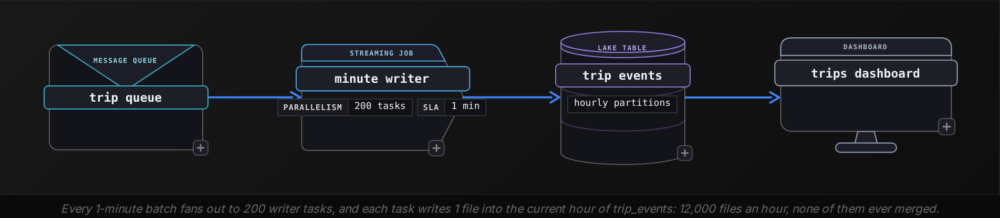
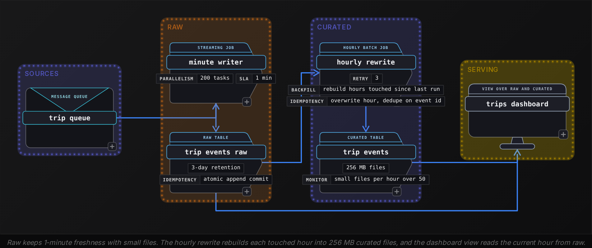
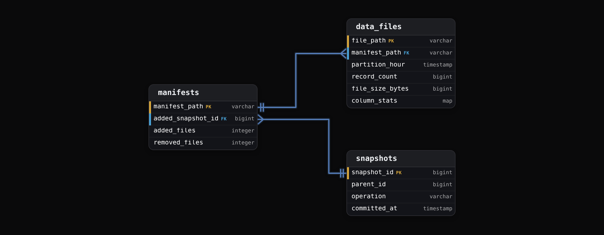

Advanced·Pipeline Architecture · 25 min · 2 challenges

# Small Files and Compaction: Advanced

Ines is in her final-round system design interview at Uber. The interviewer sketches a pipeline: trip events arrive on a message queue, and a job appends them to an hourly-partitioned lake table using 200 writer tasks. Last quarter the team cut the append interval from 1 hour to 1 minute for fresher dashboards. Volume has stayed flat at around 30 GB a day, yet the dashboard query over yesterday has slowed from about 5 seconds to over 2 minutes, and the storage request bill keeps climbing. 'Walk me through what is happening, and what you would change,' he says. Ines knows compaction exists. The interviewer wants more: the arithmetic proving file count is the culprit, a fix that stops the files being created, a compaction design that survives retries and late events and keeps working after a new column is added, and the price of each choice.


<br>

### What you will be able to do

Prove with arithmetic that per-file cost, not data volume, dominates a slow scan

Predict a writer's file count by multiplying its commits by its task count and by the partitions each task touches

Choose how compaction lays out files and which files it selects, then set how often it runs and state what each choice rewrites

Design compaction that stays correct when a job retries or a delete runs concurrently, and when late data or a schema change arrives


<br>

---

## "Why Is My Query So Slow?"

Interviewers rarely say 'small files'. They describe a symptom and watch whether you reach for bytes or for objects. The signature is a mismatch: the data a query reads stays flat while its latency climbs, usually with planning time or request count climbing too. Whenever cost tracks the number of files instead of the number of bytes, you are in this question, whatever its wording.

The same question in 5 disguises

- **Slower over time, same volume** *A scan grew from seconds to minutes*\
  Bytes per day are steady, so the layout changed. Ask when the write cadence last moved; if it didn't, check the writer count and the partition key.
- **Planning outlasts execution** *The engine idles before its first task*\
  Listing keys and reading per-file metadata is work that scales with file count and runs before a single row is read.
- **Requests outgrow storage** *The bill moves while the terabytes hold*\
  Object stores charge per request, so a layout with 2,400 times more files issues roughly 2,400 times more reads per scan.
- **Review this streaming design** *A writer commits every minute*\
  No symptom is given. You are expected to predict the file count before anyone measures it, by multiplying commits by tasks and by the partitions each commit touches.
- **A fine-grained partition key** *Hour and city, or a partition per customer*\
  Each partition owns its files, so bytes per partition shrink while file count multiplies with every new key value.


<br>

### Diagnose with file counts first

Per partition, ask for the file count and the median file size, with total bytes alongside them. Then compare the median with a target size. For columnar files scanned in bulk, teams commonly choose between 128 MB and 512 MB; this lesson uses 256 MB. A table format exposes a queryable file inventory, and a plain directory needs a listing job to build one. Given an inventory table trip_events_files with 1 row per data file, a single query is enough to make the diagnosis.

```sql
SELECT
  DATE_TRUNC('day', partition_hour) AS event_day,
  COUNT(*) AS file_count,
  APPROX_PERCENTILE(file_size_bytes, 0.5) / 1048576.0 AS median_mb,
  SUM(file_size_bytes) / 1073741824.0 AS total_gb
FROM trip_events_files
GROUP BY DATE_TRUNC('day', partition_hour)
ORDER BY event_day DESC
```

| event_day | file_count | median_mb | total_gb |
| --- | --- | --- | --- |
| 2026-10-22 | 288,000 | 0.1 | 30.1 |
| 2026-10-21 | 288,000 | 0.1 | 29.8 |
| 2026-07-14 | 4,800 | 6.4 | 30.2 |

The July row predates the cadence change. Volume matches on both sides, while file count rose 60 times and the median file shrank from 6.4 MB to around 0.1 MB. That comparison moves the conversation from 'the engine is slow' to 'the layout is wrong'. The second check is the query profile: if planning, which covers listing keys and reading per-file metadata, takes tens of seconds on 30 GB, metadata is the bottleneck and extra compute will not move it.




<br>

### Scope the answer before giving it

- What freshness do consumers need: 1 minute for every reader, or only for an operations screen?
- Which predicates do the top queries use, and on which columns?
- Do other jobs update or delete rows in this table, and how often?
- How late can events arrive, and must late rows reach the curated data?
- Who owns table maintenance: each pipeline, or a shared platform service?

Each answer moves the design. A 1-minute freshness need forces a compaction step after the writer; a frequent filter on city justifies sorting; row-level deletes create conflicts with any rewrite; late arrivals decide how compaction picks its partitions; a shared maintenance service changes who gets paged when file counts climb. Ask these before you propose anything.

> What a complete answer covers
>
> - Diagnose: file count and median size per partition, measured against a target size.
> - Explain: what each file costs in requests and listing, plus scheduling and metadata overhead, with numbers.
> - Prevent: write fewer files by committing less often, or by changing how rows are distributed across tasks or how the table is partitioned.
> - Compact: bin-pack or sort what remains, selected from metadata, at a stated rewrite cost.
> - Operate: keep commits atomic when writers conflict, handle late data and schema change, and expire old snapshots.

**Try it.** Before the next section does the arithmetic, estimate it yourself: each file costs 2 requests, footer then data, at 20 ms each, and the cluster has 100 reader slots. How long does opening yesterday's 288,000 files take before any row is decoded?

> **TIP**
>
> Say assumptions as numbers: request latency, slot count, target size. An interviewer can correct a wrong number and keep going; 'it adds overhead' gives them nothing to work with.


<br>

---

## Why Small Files Kill Performance

Here is the estimate worked through. Yesterday's 288,000 files at 2 requests each make 576,000 requests, and at 20 ms apiece that is 11,520 seconds of waiting. Spread over 100 slots, it comes to 115 seconds before a single row is decoded, on a scan whose data takes roughly 3 seconds to move.


<br>

### Every file carries a fixed price

| Cost | Paid once per | How it grows with file count |
| --- | --- | --- |
| Listing | page of up to 1,000 keys | Serial list calls during planning on a plain directory |
| Footer read | file | 1 request, then decoding schema and column statistics |
| Data read | file | At least 1 more request and its first-byte latency |
| Task scheduling | split | Engines pack small files into splits, so task count stays bounded |
| Metadata entry | file | A manifest or catalog row the planner must read and filter |
| Encoding | file | Dictionaries and statistics restart, so compression weakens |

None of these depend on how many bytes the file holds. A 110 KB file and a 256 MB file each cost 1 footer read, at least 1 data request and 1 metadata entry, so a scan costs roughly its bytes divided by bandwidth plus its files multiplied by a fixed price.


<br>

### One day of trip_events in 3 layouts

Fix the assumptions and say them aloud: 20 ms first-byte latency per request, 2 requests per file, 100 reader slots each pulling 100 MB/s, and 50 ms per list call returning 1,000 keys. Moving 30 GB through those slots takes 3.1 seconds in every layout. What changes is everything paid per object.

| Layout | Files per day | Average file | Requests | Request wait | Listing | Total |
| --- | --- | --- | --- | --- | --- | --- |
| 1-minute batches, 200 tasks | 288,000 | 110 KB | 576,000 | 115.2 s | 14.4 s | 133 s |
| 1-hour batches, 200 tasks | 4,800 | 6.4 MB | 9,600 | 1.9 s | 0.25 s | 5.2 s |
| Compacted to 256 MB | 120 | 256 MB | 240 | 0.05 s | 0.05 s | 3.2 s |

The slow layout does no extra useful work: it reads the same rows and the same bytes. It spends 87% of its time waiting on request latency and 11% listing. Say that sentence in the interview, because it tells the interviewer which term a fix must attack, and it shows why a bigger cluster barely helps: doubling slots halves the wait to 58 seconds, while listing, which runs serially on the coordinator, stays at 14.4.

Requests also cost money. At an assumed $0.0004 per 1,000 GET requests, one scan of yesterday costs $0.23 in the 1-minute layout and $0.0001 compacted. Dashboards on refresh timers plus analysts can drive 400 such scans a day.

- **$33,600** — yearly GET spend, 1-minute layout
- **$14** — yearly GET spend, compacted layout

**Try it.** Extend the 1-minute layout to a 30-day scan under the same assumptions. How many files and requests does it touch, and how many minutes does it spend waiting on requests?

*Answer: 8.64 million files, 17.28 million requests and 3,456 seconds of wait, roughly 58 minutes, plus 8,640 list calls that take 7.2 minutes on their own.*


<br>

### Why split packing does not rescue you

Engines do not launch a task per file. They pack small files into splits up to a target size, say 128 MB, so the 30 GB day becomes about 240 tasks instead of 288,000. That fixes scheduling overhead and leaves request latency untouched. Each split now holds 1,200 files, and a task opens them one after another: 2,400 requests at 20 ms is 48 seconds per task, and 240 tasks of 48 seconds on 100 slots lands back at the same 115 seconds. Readers that prefetch several files at once shorten this, at the price of memory per task and more pressure on the per-prefix request limits that object stores enforce.


<br>

### Costs that never show up in a latency chart

Second-order damage

- **Weaker compression.** A 110 KB file restarts its dictionaries and stores its own schema and statistics, so the same rows take more bytes than inside a 256 MB file.
- **Pruning that costs more than it saves.** The planner tests a filter against 288,000 sets of min/max values, and files cut from arrival order span nearly the full range of every column, so few get skipped.
- **Planning metadata.** A table format records each file as a manifest entry: 288,000 a day, 8.64 million for a 30-day scan, all read before the first task starts.
- **Writer overhead.** Each file is opened, flushed, closed and recorded at commit, so the writer spends 200 file lifecycles a minute on 21 MB of data.
- **Downstream spread.** A job that reads trip_events and writes 1 output file per input split copies the layout into the next table.

> **TIP**
>
> When asked why it's slow, rank the costs by their share of runtime. Listing 6 overheads without saying which dominates reads as recall; naming request wait at 87% of runtime reads as diagnosis.


<br>

---

## Compaction Strategies

Compaction reads many small files and commits fewer large ones in their place. You decide how output rows are laid out, which files are selected, and when the job runs. Each decision has a price measured in bytes rewritten, and the interviewer expects that price stated.


<br>

### Bin-packing or sorting the output

✓Bin-pack

- Groups input files by size into output files near 256 MB
- No shuffle: a task concatenates the rows of its group
- Per hour of trip_events: read 1.25 GB, write 1.25 GB
- Fixes request and listing cost, and metadata cost with it
- Leaves column statistics as wide as the inputs were

✗Sort or cluster

- Shuffles the partition's rows by a key such as city_id, then writes
- Each output file covers a narrow key range, so min/max pruning works
- Pays a full shuffle plus sort memory for every partition it rewrites
- A 1-city filter on a 5-file hour opens 1 file instead of 5
- Later appends arrive unsorted, so the order decays until the next run

Pick bin-packing by default and sorting when a filter on one key is frequent and selective. For filters on 2 or 3 columns at once, a space-filling curve interleaves the bits of each key so files are narrow on all of them, though on any single column they are wider than a single-key sort would make them. Ask which predicates the top queries use, because sorting on a key no query filters on adds a full shuffle with no read benefit.


<br>

### Select files from metadata, not from the clock

A file is a candidate when it is under 75% of target, here 192 MB. A partition qualifies when it holds at least 5 candidates, so a partition with 1 straggler is left alone. Files already near target are never selected, and that rule is what keeps repeated runs from rewriting the same bytes.

```sql
SELECT
  partition_hour,
  COUNT(*) AS small_files,
  SUM(file_size_bytes) / 1048576.0 AS small_mb,
  CAST(
    CEIL(SUM(file_size_bytes) / 268435456.0)
    AS INTEGER
  ) AS files_after
FROM trip_events_files
WHERE file_size_bytes < 201326592
GROUP BY partition_hour
HAVING COUNT(*) >= 5
ORDER BY COUNT(*) DESC
```

Selecting by metadata is what catches late data. A driver's phone that was offline uploads its events 3 days later, and each minute batch then writes a small file into an hour that a clock-driven 'compact the hour that closed last' job finished long ago. That job never returns to it. The query above finds the old hour as soon as it collects 5 small files, because it ranks partitions by small-file count and ignores their age.


<br>

### Cadence and write amplification

| Schedule | Bytes rewritten per byte ingested | Small files a reader may hit | Contention with writers |
| --- | --- | --- | --- |
| Every 10 min, rewrite the whole open hour | 3.5 | about 2,000 | Every run races the minute appends |
| Every 10 min, candidates under 192 MB only | 1.0 | about 2,000 | Every run races the minute appends |
| Once, after the hour closes | 1.0 | up to 12,000 | Late writers only |
| Once a day | 1.0 | up to 288,000 | Late writers only |

The 3.5 comes from rewriting a growing hour: 6 runs rewrite 1/6, then 2/6, up to 6/6 of it, which sums to 21/6. The size threshold removes that cost. After the first run the hour holds 1 file of 213 MB, above the 192 MB cutoff, so the next run selects only the 10 minutes of new small files. Whether frequent runs are worth it depends on what readers tolerate, and the per-request figures price it: 2,000 small files cost about 0.8 seconds of request wait per scan, 12,000 cost roughly 4.8.


<br>

### Sizing the job and the target

The hourly bin-pack reads 12,000 files, so the compactor pays the small-file price itself: 24,000 requests, 48 seconds of wait on 10 slots, then 1.25 GB written. Across 24 runs that is about 19 minutes of request wait a day. Cap each run's input, say at 20 GB, so a 60 GB backlog after a 2-day outage drains in 3 bounded runs instead of one run that loses all its work to a single conflict.

Target size is a tradeoff too. Larger files cut per-file overhead further, but a 1 GB file gives a small query fewer splits to parallelise, and in tables that apply updates by rewriting whole files, deleting 1 row rewrites the full 1 GB. Tables with frequent row-level changes therefore sit nearer 128 MB, while append-only fact tables like trip_events can go higher.

✓Do

- Select files under 75% of target from metadata, whatever their age
- Require at least 5 candidates before rewriting a partition
- Sort only on columns the top queries filter on
- Cap input bytes per run so backlogs drain in bounded chunks

✗Don't

- Rewrite the whole open partition every few minutes
- Choose partitions to compact by wall-clock hour alone
- Sort on a key that no predicate uses
- Run 1 job across a whole backlog and lose it all to a conflict

> **TIP**
>
> Compaction moves the small-file cost from every reader to one writer. The job that reads yesterday's 288,000 files pays its 576,000 requests once; without it, each of the 400 daily scans pays them again.


<br>

---

## Preventing Small Files at the Source

Compaction repairs a layout after the fact and pays a rewrite for it. Prevention changes how many files the writer creates in the first place, and it comes down to one bound.

**Files written per commit are at most the writer tasks times the partitions each task touches.** The baseline writer has 200 tasks, each touching 1 hour partition, committing every minute: 200 files a minute. Every fix below shrinks one factor or the number of commits.

| Change | Files per hour | Average file | What it costs |
| --- | --- | --- | --- |
| Baseline: 1-minute commits, 200 tasks, rows in arrival order | 12,000 | 110 KB | Nothing up front; every reader pays |
| Shuffle rows by partition_hour before writing | 60 | 21 MB | A shuffle per batch; 1 task carries the whole hour |
| Also stretch commits to every 5 minutes | 12 | 107 MB | Data is up to 5 minutes old instead of 1 |
| Also rewrite each closed hour at 256 MB | 5 | 256 MB | A second write of every byte; curated data lags up to 1 hour |

Read the table as a menu with prices. The first change spends no freshness and costs a shuffle, the second spends freshness, the third spends storage and compute. A strong answer picks the cheapest combination that meets the consumer's stated freshness, instead of applying all 3 by reflex.


<br>

### Distribute rows before the write

Shuffling by the partition column sends each hour's rows to one task, which writes 1 file per commit. The risk is skew. At 21 MB a minute one task copes, but a holiday hour at 4 times normal volume puts a hot partition on a single writer. The writer rolls to a new file at 256 MB, so no file outgrows target, and a very large partition is split across several tasks by range on a second column, which costs a few extra files and keeps throughput.


<br>

### Backfills multiply the same bound

Batch jobs hit the same bound with bigger factors. A 30-day backfill with 200 tasks reading rows in source order touches every hour from every task: up to 200 times 720, or 144,000 files of about 6.4 MB. Shuffling by hour first and rolling files at 256 MB writes 5 per hour, 3,600 in total. Engines that coalesce shuffle output toward a target partition size reach a similar result automatically, provided the target is set in bytes rather than left at a default task count.


<br>

### Over-partitioning sets a floor compaction cannot lift

Suppose the team partitions by hour and by city across 600 cities. The bound now reads 200 tasks times up to 600 partitions each: 120,000 files from a single 1-minute commit. Compaction cannot repair most of it, since a rewrite never merges files across partitions and most partitions hold too few bytes to fill a target file. City volume is skewed, so a few large cities fill whole files while most of the 600 sit well below the average. The fix is a coarser key such as hour or day, with city order moved inside the files through sort compaction, where it prunes without multiplying files.

- **14,400** — partitions per day, hour and city
- **2.1 MB** — average data per hour-and-city partition


<br>

### Split freshness from layout with a raw tier



The minute writer lands data in a raw table kept for 3 days, and an hourly batch job rebuilds every hour that received rows since its last run. Its input is the hour's existing curated rows plus the new raw rows, deduplicated on event_id, so an event arriving 5 days late still merges with an hour whose raw rows have expired. The rebuild overwrites the whole hour partition in one atomic commit, which makes a retry produce identical output. Consumers that need the last minutes read a view that unions the raw current hour with curated history; everyone else reads curated only.

> Where prevention breaks
>
> - Retry: a writer that dies after writing files but before committing leaves orphans; without an atomic commit, its retry duplicates the batch.
> - Late data: late events still write 1 small file per commit into an old hour, so prevention never removes the need to compact.
> - Schema change: a rewrite job that pins yesterday's schema writes curated files without the column producers added today.
> - Skew: hashing by hour lands a holiday spike or a lopsided backfill on 1 writer task.

> **TIP**
>
> Freshness sets the floor on file count: every commit writes at least 1 file to each partition it touches. A 1-minute freshness target therefore means at least 60 files an hour per partition, so plan compaction after a minute-level writer even when distribution is perfect.


<br>

---

## Compaction in Table Formats

A table format replaces 'the files in this directory' with a log of snapshots. Each snapshot points to manifests, and each manifest lists data files, recording for each one its partition values and row count along with column statistics. A reader resolves one snapshot and reads exactly the files it lists. Compaction becomes a commit like any other: it adds the new large files and removes the old small ones in one swap of the current-snapshot pointer.



*Simplified metadata: real formats also keep a manifest list per snapshot, and a manifest written by one snapshot stays shared by the snapshots after it.*


<br>

### Directory swap versus commit

✓Compaction on a plain directory

- Writes 5 new files, then deletes 12,000 old ones
- A reader listing in between sees both and counts every trip twice
- A retry after a partial delete can't tell which files it already removed
- Every reader still lists keys to plan

✗Compaction as a table-format commit

- New files stay invisible until the snapshot pointer swaps
- Readers see the old 12,000 or the new 5, never both
- A failed or retried job leaves only unreferenced files for cleanup
- Planning reads file entries from manifests, with no listing

Schema change separates them too. A directory compaction that infers its schema from the first file it opens drops a column added at noon if that file came from the morning. A table format that tracks columns by stable ID reads every file through the table's current schema, so morning files surface the new column as null, renamed columns keep their data, and the rewritten files carry the current schema. Formats that resolve columns by name need column mapping enabled before a rename is safe.


<br>

### Optimistic concurrency and the compaction loop

Compaction starts from snapshot S, spends 4 minutes rewriting an hour, and meanwhile 4 minute appends commit. Before its commit lands, the format validates that every file the job removes is still live and unmodified in the latest snapshot. What counts as a conflict decides whether compaction ever finishes on a busy table.

| Concurrent operation | Conflicts with the rewrite? | Reason |
| --- | --- | --- |
| Append to the same hour | No | New files are added; none of the removed files changed |
| Row-level delete touching a rewritten file | Yes | The new large file would resurrect the deleted rows |
| Second compaction of the same files | Yes | Both commits remove the same files; the later one must retry |
| Column added to the schema | Depends on the format | No conflict where columns have stable IDs and only data files are validated; formats that validate the whole table metadata reject the commit, and the rewrite retries from the new snapshot |

Row-level deletes cause the worst conflicts. A privacy job that deletes rows across all hours every 15 minutes conflicts with any 4-minute rewrite that overlaps its targets, and a compaction that retries from scratch can lose that race on every attempt. Commit in file groups, for example 10 per run, so a conflict discards one group's work, and schedule row-level deletes and compaction into separate windows per partition.


<br>

### Metadata needs compaction too

Every minute append is a commit, and each commit writes at least 1 manifest, so trip_events gains 1,440 snapshots and 1,440 manifests a day. Planning a scan of yesterday opens all 1,440 before touching data. Manifest rewriting merges them into a handful grouped by partition, the same bin-packing applied one level up.

The update strategy sets how much more work exists. Copy-on-write rewrites each touched data file at update time: more write amplification per update and no extra small files. Merge-on-read writes small delete files at update time and defers the rewrite, so every read must apply those delete files until compaction rewrites the data files and drops them from the next snapshot. A merge-on-read table therefore needs a compaction cadence matched to its update rate.


<br>

### Storage drops only after snapshots expire

Compaction doesn't shrink the bill on the day it runs. The 12,000 small files of each hour stay referenced by older snapshots, which time travel needs, until those snapshots expire. With 7 days of retention, the table keeps an extra 210 GB of superseded files: 7 days of 30 GB. Snapshot expiry deletes files no live snapshot references. Orphan cleanup handles the other leftover, files from failed writers that no snapshot ever referenced, and it must only remove files older than the longest possible write, such as 3 days, or it deletes the output of a job still running.

> Where a compaction design breaks
>
> - Retry: needs an atomic replace commit, so a rerun either lands whole or leaves only orphans.
> - Late data: needs selection by file metadata, so old hours with new small files get found.
> - Schema change: needs column IDs and reads in the current schema, so rewrites keep new and renamed columns.
> - Concurrency: needs conflict checks on removed files, plus file-group commits to bound lost work.
> - Cost: needs snapshot expiry and orphan cleanup, or superseded files linger for the whole retention window.

> **TIP**
>
> If asked what happens when compaction fails halfway, answer with the commit model: nothing is visible until the pointer swaps, so the rerun starts from the current snapshot and the half-written files become orphans for cleanup.


<br>

---

## Putting It All Together

A food-delivery company streams order status events (placed, accepted, picked up, delivered) into a lake table partitioned by hour. 120 writer tasks commit every 30 seconds so an operations screen shows courier delays within a minute. Finance runs a nightly revenue job on the same table, a privacy service deletes a customer's rows within 24 hours of a request, and couriers in tunnels upload events up to 2 days late. After a year, the nightly job takes 4 hours instead of 20 minutes and the privacy deletes keep failing their commits.

- Diagnosis: 120 tasks committing twice a minute write 14,400 files an hour per partition, and planning time plus median file size show per-object cost dominating the nightly job.
- Prevention: shuffling by hour before the write cuts each commit from 120 files to 1, while a raw tier keeps the 30-second commit the operations screen needs.
- Compaction: an hourly rewrite chosen from file metadata finds the old hours that 2-day-late courier events keep reopening.
- Concurrency: privacy deletes conflict with rewrites of the files they touch, so compaction commits in file groups and deletes run in their own window per partition.
- Schema change: when the product adds a tip_amount column, column IDs carry it through every rewrite instead of losing it to a schema inferred from an old file.
- Lifecycle: snapshot expiry and orphan cleanup follow compaction, or storage keeps every superseded small file for the whole retention window.


<br>

---

## Key Takeaways

- Small-file cost is per object: a scan costs roughly bytes over bandwidth plus files times a fixed price, and on trip_events that fixed price was 87% of runtime.
- Diagnose with file count and median size per partition against a target, and split query time into planning and scanning.
- Files per commit are at most writer tasks times partitions touched; prevention shrinks a factor or the commit count, and freshness sets the floor.
- A partition key whose partitions hold less than 1 target file of data cannot be fixed by compaction.
- Select compaction candidates from metadata and skip files near target: 1.0 rewritten byte per ingested byte with the threshold, 3.5 without it.
- Safe compaction needs an atomic replace commit, metadata-driven selection, column IDs, conflict handling for deletes, and snapshot expiry before storage falls.
