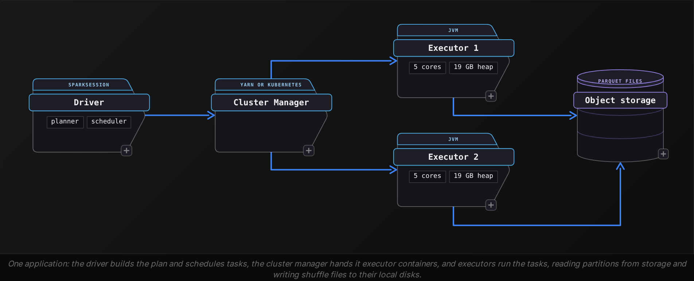

Intermediate·Pipeline Architecture · 35 min · 2 challenges

# The Spark Deep Dive: Intermediate

A candidate sits in a systems round at Netflix, where the batch data platform runs on Spark. The interviewer shares a screen: a nightly job that joins 2 TB of playback events to a 30 GB title catalog, scheduled for 90 minutes, finished last night in 6 hours. 'Tell me what happened,' she says, 'and what you would change.' The screen shows a stage list from the Spark UI so far: stage 3 ran 200 tasks, median task 25 seconds, slowest task 5 hours 33 minutes. The candidate who recognizes that shape, names the join strategy the planner picked, and says which executor setting bounded the spill is the one who gets the next round. This lesson builds that recognition, starting with the execution model and the UI metrics it produces. Join strategies come next, then the sizing arithmetic, then the skew fixes, each worked on real numbers.


<br>

### What you will be able to do

Draw the driver and the executors it schedules tasks on, place the cluster manager beside them, and say what each does when a job runs

Read a Spark UI stage summary and name the bottleneck, starting from the spread of task times and then checking the shuffle and spill bytes

Pick broadcast, sort-merge or bucketed join for a given pair of table sizes and state the network cost of each

Work out executor shape and partition count for a stated input volume and deadline

Detect skew from task metrics and fix it, starting with adaptive skew handling and moving to salting or hot-key isolation when that falls short


<br>

---

## Explain Spark Architecture

The architecture question arrives as 'walk me through what happens when I submit a Spark job', and the interviewer scores it on whether you can name each component, say what it holds, and trace a transformation from the line of code to the tasks that run it. A complete answer draws 3 kinds of process and then shows how a job becomes stages and stages become tasks. Start with the processes.



The driver is the JVM that runs your `main`. It holds the `SparkSession`, turns your transformations into a logical plan, optimizes that plan, cuts it into stages at every shuffle, and hands individual tasks to executors. It also keeps the bookkeeping: which task ran where, which shuffle block lives on which executor, which partitions are cached. Executors are JVMs the cluster manager launches on worker nodes. Each has a fixed core count and a fixed heap, runs 1 task per core at a time, caches partitions in its memory, and serves the shuffle files it wrote to any executor that asks. In most deployments the cluster manager is YARN or Kubernetes, and its only job is to allocate those containers and tear them down; it never sees your data or your plan. A 2 TB job and a 2 MB job look identical to it.


<br>

### From one action to thousands of tasks

```sql
from pyspark.sql import functions as F

events = spark.read.parquet('/lake/events/dt=2026-10-22')
paid = events.filter(events.plan == 'premium')
per_title = paid.groupBy('title_id').agg(F.sum('seconds').alias('watched'))
per_title.write.parquet('/lake/watch_per_title/dt=2026-10-22')
```

Nothing runs until the `write` on the last line, because every transformation is lazy: `read` only extends the plan, and so do `filter` and `groupBy`. The `write` is an action, and 1 action produces 1 job. The driver then walks the plan backwards looking for shuffles. `filter` is narrow: each output partition depends on exactly 1 input partition, so it stays in the same stage as the read. `groupBy` is wide: the rows for a given `title_id` are spread across every input partition and must be moved to one place, so the driver cuts a stage boundary there. The job has 2 stages. Stage 1 reads and filters, with 1 task per input split; at the default `spark.sql.files.maxPartitionBytes` of 128 MB, 1 TB of Parquet becomes about 8,192 tasks. Stage 2 sums per title, with 1 task per shuffle partition; at the default `spark.sql.shuffle.partitions` of 200 it runs 200 tasks however much data arrived.

| Term | One per | In this job |
| --- | --- | --- |
| Application | SparkContext (the session wraps it) | 1 |
| Job | action | 1, the write |
| Stage | run of narrow transformations between shuffles | 2 |
| Task | partition within a stage | 8,192 then 200 |
| Executor | container from the cluster manager | whatever you request |


<br>

### Why the shuffle is the unit of cost

At the stage boundary every stage 1 task hashes each row's `title_id` into 1 of 200 buckets, sorts its output by bucket, and writes 1 file with an index marking where each bucket begins to its executor's local disk. Every stage 2 task then opens a connection to each executor that wrote a segment for its bucket and pulls those bytes across the network. With 8,192 upstream tasks and 200 downstream tasks that is up to 1,638,400 fetches, and each one costs a disk read and a network transfer before the bytes are deserialized. The filter before the shuffle is the reason the job is affordable: if premium viewers produce 10% of the rows, the shuffle moves 100 GB instead of 1 TB. Each question later in this lesson comes down to how many bytes cross that boundary and how evenly they spread over the 200 tasks.

> Say it in this order
>
> - Driver: holds the session and builds the optimized plan, then schedules tasks and tracks where shuffle blocks and cached partitions live
> - Cluster manager: allocates executor containers and nothing else
> - Executor: fixed cores and heap, 1 task per core, caches partitions, serves shuffle files
> - Action to job, shuffle to stage boundary, partition to task; then quote 128 MB and 200 as the 2 defaults that set task counts

> **TIP**
>
> When the follow-up is 'what if the driver dies', the answer comes straight from the roles: the driver holds the plan and the task bookkeeping, so the application fails. An executor can die and its tasks are rerun elsewhere, with the shuffle files it held recomputed from the source by rerunning the upstream tasks.


<br>

---

## This Job Is Slow

'This job used to finish in 90 minutes and now takes 6 hours. Where do you look?' The interviewer is grading your method: which screen you open first, which number you read, and what each number rules in or out. Candidates who answer 'add more executors' before reading a metric lose the question. Skew and driver-bound stages are 2 of the common causes, and neither finishes faster with twice the executors. The Spark UI holds the handful of numbers that separate those causes, and this section reads them in order on the nightly job from the opening.


<br>

### Start at the stage list

The Jobs tab shows 1 row per action with its duration, and the slow one is rarely a mystery. Click into it and the Stages tab breaks that job into stages. The columns worth reading are duration and number of tasks, then the byte columns for input and for shuffle read and write, with the spill column beside them. For the job that joins 2 TB of playback events to a 30 GB catalog and aggregates per title, last night's run looks like this.

| Stage | Work | Tasks | Duration | Shuffle write | Shuffle read | Spill (disk) |
| --- | --- | --- | --- | --- | --- | --- |
| 1 | scan + filter events | 16,384 | 11 min | 210 GB | 0 | 0 |
| 2 | scan catalog | 240 | 1 min | 30 GB | 0 | 0 |
| 3 | sort-merge join + aggregate | 200 | 5 h 45 min | 4 GB | 240 GB | 180 GB |
| 4 | write result | 200 | 3 min | 0 | 4 GB | 0 |

Stage 3 holds 5 hours 45 minutes of the 6 hours, so every other stage is noise for now. That row already narrows the cause with 2 numbers. First, 240 GB of shuffle read landed on 200 tasks, 1.2 GB per task on average, and the stage spilled 180 GB to disk: the tasks lacked the memory to hold their share, so they sorted in chunks and merged from disk. Second, 200 is the default shuffle partition count, which nobody chose for a 240 GB shuffle. Those 2 facts are the same fact: too few partitions made each one too large for a task's memory. Whether that explains all 5 hours needs the task-level view.


<br>

### Then the task summary for the slow stage

| Metric | Min | Median | 75th pct | Max |
| --- | --- | --- | --- | --- |
| Duration | 8 s | 25 s | 41 s | 5 h 33 min |
| Shuffle read size | 0.3 GB | 0.6 GB | 0.9 GB | 96 GB |
| Spill (disk) | 0 | 0.2 GB | 0.5 GB | 90 GB |
| GC time | 0.2 s | 1 s | 2 s | 22 min |

Spark draws this summary for every stage, and the ratio of max to median is the most informative number in the UI. Here the median task finished in 25 seconds and the slowest took 5 hours 33 minutes, a ratio of around 800. One task read 96 GB where the median read 0.6 GB, so 1 shuffle partition held 40% of the join's bytes. That's skew: a single key or a handful of keys hash into the same partition. Skew has its own section later. The summary also shows a second problem. Even without the skewed task, the median task spilled 0.2 GB and the 75th percentile spilled 0.5 GB, so the stage would still spill after the skew is fixed. The distribution points at skew and the median points at sizing, and this stage has both.


<br>

### Symptom to cause

| What you read | What it means | First change |
| --- | --- | --- |
| Max task duration 10x the median or more | 1 partition holds far more rows than the rest: skew | salt the key or enable adaptive skew join |
| Spill on the median task | each task's share exceeds its execution memory | raise `spark.sql.shuffle.partitions` or memory per core |
| Thousands of tasks under 1 second | partitions too small, scheduling dominates | coalesce or lower the partition count |
| Scheduler delay above task duration | the driver cannot hand out tasks fast enough | fewer, larger tasks; check driver CPU |
| GC time above 10% of task time | heap pressure from many objects or wide rows | more memory per core, fewer cores per executor |
| Stage 1 shuffle write near the input size | filter ran after the shuffle, or columns were never pruned | move the filter before the join, select only needed columns |
| Same stage repeats in several jobs | the DataFrame is recomputed per action | cache it once, or write it out |

Check 2 more rows of that table on this job. Stage 1 wrote 210 GB of shuffle from a 2 TB scan, about 10%, which says the premium filter ran before the shuffle and column pruning worked; had it read 1.9 TB, the SQL tab's plan would show the filter above the join rather than inside the scan, and moving it cuts the shuffle 10 times. And the Jobs list showed 1 job, so nothing was recomputed; a script that calls `count()` for a log line and then `write()` runs the whole lineage twice and appears as 2 jobs with identical stage 1 rows.

> How to answer out loud
>
> - Name the screen: Jobs tab for the slow job, Stages tab for the slow stage, task summary for the distribution
> - Quote the 2 ratios: max over median task duration, and shuffle read per task over execution memory per task
> - Separate skew from sizing before proposing a fix; they have different fixes and both can be present
> - State the effect in numbers: 2,000 partitions turn the median task's 0.6 GB into 60 MB and its spill into 0; the 96 GB task still needs the skew fix

> **TIP**
>
> Spill counts twice: the stage writes the bytes to disk and reads them back during the merge, so 180 GB of spill is 360 GB of disk traffic on top of the 240 GB shuffle fetch. Say that number when you explain why spill, rather than the shuffle itself, is where the stage spent its time.


<br>

---

## Optimize This Join

The join question hands you 2 table sizes and asks which strategy you want and why. 'Orders is 2 TB, products is 40 MB, the join on `product_id` takes 50 minutes, what would you do?' The answer the interviewer wants names the strategy the planner picked by default, the strategy you would force, and the bytes that each one moves across the network. Spark's 3 join strategies are 3 answers to the same problem: rows with equal keys live on different executors and must meet somewhere.

Sort-merge join shuffles both sides by the join key into the same number of partitions. It then sorts each partition and walks the 2 sorted lists together. Every byte of both tables crosses the network once, and the sort needs memory or it spills. The planner picks it whenever both sides exceed the broadcast threshold. Broadcast hash join leaves the large side where it is. The driver collects the small side, ships a copy to every executor, and each task builds a hash table from that copy and probes it with its own partition of the large side. The large side moves zero bytes; the small side moves once per executor. Shuffle hash join is the middle path: shuffle both sides, then build a hash table from the smaller partition instead of sorting. It saves the sort but needs the smaller side's partition to fit in memory, and the planner prefers sort-merge over it unless `spark.sql.join.preferSortMergeJoin` is turned off.

| Strategy | Bytes over the network | Memory need per task | Planner picks it when |
| --- | --- | --- | --- |
| Broadcast hash | small side x executor count | the whole small side as a hash table | 1 side is under `spark.sql.autoBroadcastJoinThreshold`, 10 MB by default |
| Sort-merge | both sides, once | 1 partition of each side, spills if short | both sides exceed the threshold |
| Shuffle hash | both sides, once | the smaller side's partition as a hash table | sort-merge preference is off and 1 side is at least 3x smaller |


<br>

### Work it on 3 tables

Take orders at 2 TB, products at 40 MB and customers at 30 GB, on a cluster of 48 executors. For orders to products the planner sees 40 MB, above its default threshold, and picks sort-merge: 2 TB of orders is hashed and written to local disk, then fetched and sorted, so that it can meet 40 MB of products. Forcing a broadcast instead ships 40 MB to each of the 48 executors, 1.9 GB of network in total, and orders stays in place. The 50 minutes becomes the time to scan 2 TB and probe a hash table, a few minutes on this cluster. You get there by raising the threshold to 50 MB or by hinting the one join, and the hint is the safer answer because it changes 1 plan rather than every plan in the session.

```sql
from pyspark.sql.functions import broadcast

enriched = orders.join(broadcast(products), 'product_id')

spark.conf.set('spark.sql.autoBroadcastJoinThreshold', 50 * 1024 * 1024)
```

Orders to customers flips the arithmetic. Broadcasting 30 GB means the driver materializes 30 GB in its heap, then 48 executors each receive and hold 30 GB, with 1.4 TB crossing the network and every executor spending 30 GB of memory on a hash table before a task runs. Sort-merge moves 2 TB plus 30 GB once and holds 1 partition at a time. Sort-merge wins, and the detail worth adding is why the broadcast fails in practice: the driver's collect of the small side is bounded by `spark.driver.maxResultSize`, and Spark refuses any broadcast over 8 GB. The join cost here is the shuffle of orders, and if orders joins customers every night, the way to remove that shuffle is bucketing.


<br>

### Bucketing: pay the shuffle once at write time

Write both tables bucketed by `customer_id` into the same number of buckets, say 1,024, and sorted within each bucket. Bucket 17 of orders and bucket 17 of customers then hold the same set of `customer_id` values, because both hash the key the same way into 1,024 buckets, so the planner reads matching buckets into the same task and runs the merge with no exchange in the plan. The shuffle still happens, once, when each table is written; every nightly join afterwards reads 2 TB and shuffles none of it. The conditions are strict: same key and same bucket count on both sides, recorded in the catalog so the planner can see them. A bucketed table rewritten by a job that forgot the clause loses the property silently, and the next night's plan shows the exchange again.

> The decision rule to say out loud
>
> - Small side under a few hundred MB after filters and column pruning: broadcast, and quote small side x executors as the network cost
> - Both sides large, joined once: sort-merge, and quote both sides crossing the network once
> - Both sides large, joined every run on the same key: bucket both at write time with the same bucket count
> - Check `explain()` for `BroadcastHashJoin` or `SortMergeJoin` and for an `Exchange` node before and after the change

> **TIP**
>
> Filter and project before you decide. A 30 GB customers table at 200 MB after a country filter and 4 columns is a broadcast candidate. Without cost-based optimization the planner's estimate shrinks for the projection only; the filter counts once `spark.sql.cbo.enabled` is on and column statistics exist. Adaptive execution can switch to broadcast after the shuffle; otherwise hint it.


<br>

---

## How Do You Size the Cluster?

'We have 1 TB a day, 16 nodes with 16 cores and 64 GB each, and a 30 minute window. How would you configure it?' Several configurations are defensible, and the interviewer knows it; what they score is the chain of arithmetic from input bytes to executor shape, and whether each number you pick has a reason behind it. The chain runs in a fixed order: executor shape, then memory per task, then partition count, then waves against the deadline.


<br>

### Executor shape

Set aside 1 core and 1 GB per node for the operating system and the cluster manager's agent. That leaves 15 cores and 63 GB. The long-standing guidance caps an executor at 5 cores, because file system client throughput per JVM flattens past around 5 concurrent readers and because a heap large enough to feed 15 tasks pauses for garbage collection long enough to show up as task time. Dividing 15 cores by 5 gives 3 executors per node; 63 GB divided by 3 gives 21 GB per executor container. Spark reserves `spark.executor.memoryOverhead` outside the heap, 10% of executor memory or 384 MB, whichever is larger, for off-heap buffers and the Python worker if you use one, so request a 19 GB heap and the container lands at 21 GB. Across 16 nodes that is 48 executors and 240 task slots.

| Shape per node | Executors | Cores each | Heap each | What goes wrong |
| --- | --- | --- | --- | --- |
| 1 fat executor | 1 | 15 | 57 GB | long GC pauses; 1 JVM failure loses 15 slots and all its shuffle files |
| 3 balanced | 3 | 5 | 19 GB | the common choice |
| 15 thin | 15 | 1 | 3.8 GB | 15 copies of every broadcast, no slot sharing, overhead x15 |


<br>

### Memory per task

A 19 GB heap gives a task far less than 19 GB. Spark holds back 300 MB, then applies `spark.memory.fraction`, 0.6 by default, to the rest: (19 GB - 300 MB) x 0.6 = 11.2 GB of unified memory. Execution and storage share that pool. The executor's 5 concurrent tasks share it too, so each one can count on about 2.2 GB for sorting and hashing before it spills, and less if cached partitions occupy the storage half. That's the number the slow-job section was missing: a shuffle partition near 1.2 GB, once deserialized into objects with a sort buffer on top, spills against a 2.2 GB ceiling, and a 128 MB to 256 MB partition does not.


<br>

### Partitions and waves

| Step | Arithmetic | Result |
| --- | --- | --- |
| Input tasks | 1 TB / 128 MB splits | 8,192 |
| Shuffle bytes after the 10% filter | 1 TB x 0.1 | 100 GB |
| Shuffle partitions at 200 MB each | 100 GB / 200 MB | 500, rounded to 480 |
| Task slots | 48 executors x 5 cores | 240 |
| Stage 1 waves | 8,192 / 240 | 34.1 |
| Stage 2 waves | 480 / 240 | 2 exactly |
| Stage 1 time at 20 s per task | 35 waves x 20 s | 11.7 min |

Both rounding decisions in that table have a reason. The shuffle partition count is rounded to a multiple of the slot count, because 500 partitions on 240 slots run 2 full waves and then 20 tasks on a cluster that is 92% idle; 480 fills every slot in both waves. And stage 1 is quoted as 35 waves rather than 34.1 because the fractional wave runs at the tail at the full cost of a wave. At 20 seconds a task the stage takes under 12 minutes, which fits the 30 minute window with room for the join; if the measured task time comes back at 60 seconds, the same arithmetic says 35 minutes and the answer changes to more nodes or a smaller input. Set the count with `spark.sql.shuffle.partitions`, or set it high and let adaptive execution coalesce small partitions toward its 64 MB advisory size, which absorbs a filter rate that changes from day to day.

> Ask before you size
>
> - Input volume per run, and the share that survives the first filter: it sets the shuffle size
> - Row width and the operator: a sort over wide rows needs more memory per task than a count
> - The deadline and the cadence: a 30 minute window on a nightly job tolerates 35 waves, an hourly one may not
> - Whether anything is cached: cached partitions draw from the same 11.2 GB the tasks sort in
> - The cost cap: 48 executors for 12 minutes costs less than 24 executors for 30 when billing is per minute

> **TIP**
>
> Dynamic allocation (`spark.dynamicAllocation.enabled`) adds and removes executors from the backlog of pending tasks, which helps a job with a long tail of small stages. It changes nothing about the per-executor arithmetic above, so in an interview it is the second answer, after the shape.


<br>

---

## What About Data Skew?

Every shuffle in this lesson hashed a key into 200 partitions and assumed the keys spread out. Skew is what happens when they do not: 1 `title_id` for a live event carries 40% of a night's playback rows, so the partition that key hashes into holds 40% of the bytes, and the task that owns it runs 40% of the join alone on 1 core while 199 cores finish and wait. The interviewer's version is usually 'the stage has sat at 199 of 200 tasks for 5 hours, what is going on', and the answer needs 3 parts: how you confirm it, which of 3 fixes you reach for, and what each costs.


<br>

### Confirm it from 2 places

The task summary from the slow-job section already said it: max duration 5 hours 33 minutes against a median of 25 seconds, and 1 task reading 96 GB of shuffle against a median of 0.6 GB. The second number matters more than the first, because a slow task with a normal read size points at a bad node or garbage collection rather than skew. Then find the key, because the fix depends on how many hot keys there are and whether one of them is `NULL`:

```sql
SELECT
  title_id,
  COUNT(*) AS rows_per_key
FROM playback_events
WHERE dt = DATE '2026-10-22'
GROUP BY title_id
ORDER BY rows_per_key DESC
LIMIT 10
```

| title_id | rows_per_key | Share of 4.8B rows |
| --- | --- | --- |
| 880213 | 1,920,000,000 | 40% |
| NULL | 480,000,000 | 10% |
| 774102 | 96,000,000 | 2% |
| every other key | under 20,000,000 | under 0.5% |


<br>

### Fix 1: adaptive skew join

Adaptive query execution is on by default since Spark 3.2, and its skew join handling has 2 conditions, both default: a shuffle partition counts as skewed when it is larger than 5 times the median partition and larger than 256 MB. Spark then splits the 96 GB partition into pieces near its advisory size and pairs each piece with a copy of the matching partition from the other side, so the join runs as many tasks instead of 1. It costs nothing to enable and works for sort-merge joins, which makes it the first answer. It also did not fire last night, and the reason is the shape of stage 3: the aggregate on `title_id` reuses the join's partitioning, so splitting the hot partition would force a second shuffle, and Spark skips the split rather than add one. Setting `spark.sql.adaptive.forceOptimizeSkewedJoin` accepts the extra shuffle. An aggregation on its own is safe: a `sum` or `count` runs as a partial aggregate before the exchange and a final one after it, so a hot key's rows collapse to 1 row per map task before they move. Salting covers the rest: joins adaptive execution will not split, aggregations whose partials do not shrink, and Spark versions before 3.0.


<br>

### Fix 2: salt the key

```sql
from pyspark.sql import functions as F

SALTS = 64

salted_events = events.withColumn(
    'salt', (F.rand() * SALTS).cast('int')
)
salted_catalog = catalog.withColumn(
    'salt', F.explode(F.array([F.lit(i) for i in range(SALTS)]))
)
joined = salted_events.join(
    salted_catalog, ['title_id', 'salt']
).drop('salt')
```

The large side gets a random integer from 0 to 63 appended to its key, so the hot key hashes into 64 partitions of 1.5 GB instead of 1 of 96 GB, and 1.5 GB sits under the 2.2 GB task budget from the sizing section. The small side is exploded 64 times so that every salted key still finds its match, and that is the price: a 30 GB catalog becomes 1.9 TB of shuffle, which is why the catalog gets projected to the 3 columns the join needs first, at which point it weighs 2 GB and the explosion costs 128 GB. Pick the salt count from the UI: the hot partition's bytes divided by the per-task budget, rounded up to a power of 2. A plain `sum` or `count` on the hot key needs no salt. A distinct count over a huge group does, because its partials do not shrink: salt by a hash of the counted column, count distinct per `(title_id, salt)`, then sum the 64 partials.


<br>

### Fix 3: isolate the hot keys

With 1 or 2 hot keys known in advance, split the join. Rows whose `title_id` is in the hot set join the 2 matching catalog rows through a broadcast, so the large side never shuffles for them; every other row takes the sort-merge path, now with no partition above 2% of the total; union the 2 results. It costs 2 scans of the large side instead of 1, which pays off when the hot keys stay hot from day to day and loses when they change nightly, so it sits behind the adaptive fix. The `NULL` key is its own case. In an inner join it matches nothing, and Spark infers `IsNotNull` on the join key and drops those 10% before the shuffle, which is why no NULL partition shows in the task summary. In a left or outer join the rows must survive and all hash to 1 partition, so filter them out before the join and union them back with empty catalog columns.

| Fix | Reach for it when | What it costs |
| --- | --- | --- |
| Adaptive skew join | sort-merge join on Spark 3.0 or later | nothing to enable; skipped when the split would add a shuffle downstream |
| Salting | a join adaptive execution will not split, an aggregation that cannot pre-combine, or a version without adaptive execution | small side x salt count in shuffle; 2 steps for an aggregation |
| Hot-key isolation | 1 or 2 hot keys that stay hot | a second scan of the large side, code that tracks the hot set |
| Null filtering | the hot key is NULL in a left or outer join | a union to restore the rows |

> Say the numbers
>
> - Confirm: max over median shuffle read, then the key count query; name the key and its share
> - Adaptive first: 5x the median and 256 MB; it is skipped if splitting would add a shuffle, so check the plan for `skew=true` on the join
> - Salt second: salts = hot partition bytes / per-task budget, and quote the small side x salts cost
> - Isolate third: broadcast the hot keys and sort-merge the rest, then union the 2 results and say it needs 2 scans


<br>

---

## Putting It All Together

An online marketplace runs a nightly attribution job: 3 TB of click events joined to a 20 MB campaign table and a 40 GB seller table, then aggregated per seller, with a 2 hour window before the finance team's morning reports. On the first morning of a site-wide sale the job runs 7 hours. The stage list shows the join stage at 200 tasks with 1 task at 6 hours and a median of 30 seconds, the median task spilling 0.4 GB, and a key count showing a single mega-seller on 55% of clicks and a NULL seller on 8%.

- Architecture: the 200 tasks are the default shuffle partition count, and the stage boundary sits at the join to sellers because that is where rows with equal seller_id must meet.
- Slow job: a max over median ratio of 720 with 1 task reading 55% of the shuffle bytes is skew, and the 0.4 GB spill on the median task says the partitions are too large even after the skew is fixed.
- Join: campaigns at 20 MB sat above the 10 MB threshold and were sort-merged, so a broadcast hint removes 1 shuffle of 3 TB; sellers at 40 GB stay sort-merge, bucketed by seller_id if the join runs nightly.
- Sizing: 3 TB at 128 MB splits is 24,576 read tasks, and a 300 GB post-filter shuffle at 200 MB per partition wants 1,500 partitions, rounded to 1,440 to run 6 full waves on 240 slots.
- Skew: the mega-seller's join partition needs adaptive skew join forced with spark . sql . adaptive . forceOptimizeSkewedJoin , because the per-seller aggregate reuses the join's partitioning, or a salted join; the per-seller sum needs no salt thanks to partial aggregation, and the 8% NULL seller rows are dropped before the shuffle in an inner join and need the filter-and-union only in an outer one.


<br>

---

## Key Takeaways

- The driver plans and schedules, executors run 1 task per core and serve shuffle files, and every stage boundary is a shuffle whose byte count is the cost of the job.
- A slow stage is diagnosed with 2 ratios: max over median task duration says skew, shuffle read per task over the 2.2 GB task budget says sizing, and both can be true at once.
- Broadcast moves the small side once per executor and the large side never; sort-merge moves both sides once; bucketing moves them once at write time and never again.
- Executor shape sets memory per task: 5 cores and a 19 GB heap give each task about 2.2 GB, so partitions of 128 MB to 256 MB run without spill.
- Skew is a hot key in 1 partition; adaptive skew join splits it unless the split adds a shuffle, salting covers the joins it will not split and aggregations that cannot pre-combine, and isolation broadcasts the hot keys when they are stable.
