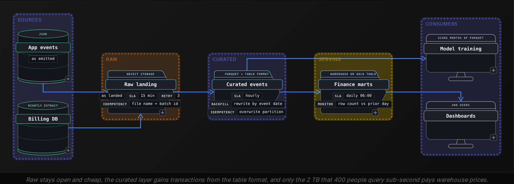
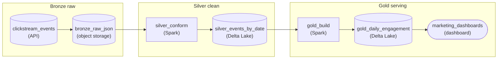
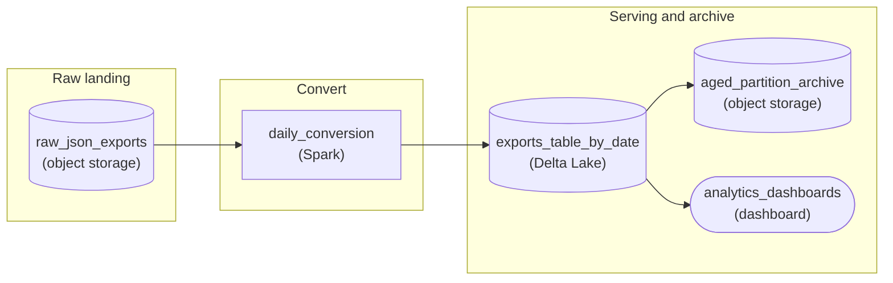

Intermediate·Pipeline Architecture · 35 min · 2 challenges

# The Storage Question: Intermediate

Maya is in the onsite loop at Netflix, the company whose engineers created Apache Iceberg after the directory-based tables in their petabyte-scale Parquet lake kept giving concurrent writers and readers inconsistent answers. The interviewer draws one box labeled 'playback events, 100 billion rows a year' and asks: 'How would you store this?' Parquet, partitions, a table format, a lake or a warehouse, a bill at the end of the month. What the interviewer is testing is whether she can chain them: say why a columnar file reads a fraction of the bytes for a narrow query, pick a partition key by counting its distinct values and its skew, explain what a transaction log gives that a directory listing cannot, decide which workload belongs in a warehouse, and attach a dollar figure to the design. This lesson builds that chain, with the number each link turns on.


<br>

### What you will be able to do

Explain the 3 mechanisms that make Parquet read fewer bytes than CSV or JSON, with a worked byte count for each

Choose partition keys from a cardinality and skew query, and name the keys that belong in sorting or bucketing instead

Describe the metadata log that gives Delta Lake and Iceberg atomic commits, time travel and schema evolution, and compare the 2 on partition and schema change

Place a raw 500 TB workload and a 2 TB serving workload across lake, warehouse and lakehouse with reasons tied to consumers

Model a year of storage with lifecycle tiers and scan-priced compute, and say which line dominates


<br>

---

## Why Parquet?

### Three mechanisms, one file layout

The question arrives in a plain form: the events land as JSON, so why convert them to Parquet before anyone queries them? A complete answer names 3 mechanisms in the file layout and puts a number on each. Columnar storage cuts the bytes a query must read. Column-aware encoding shrinks what remains before compression touches it. Footer statistics let the engine skip whole blocks without reading them.

A CSV or JSON file stores one record after another, so reading the country column means reading every byte of every row. Parquet groups rows into row groups and stores each column's values contiguously inside the group, so a query that touches 3 of 40 columns reads about 3/40 of the bytes, and the file's footer records the byte offset of every column chunk so the engine seeks straight to the chunks it needs.

| Property | CSV | JSON | Parquet |
| --- | --- | --- | --- |
| Schema and types | none, every field parsed from text on every read | field names repeated in every record | declared once in the footer, values stored as typed binary |
| Reading one column | full row scan | full row scan | one column chunk per row group |
| Compression | whole-file gzip, not splittable | whole-file gzip, not splittable | per column chunk, after encoding, splittable by row group |
| Statistics | none | none | min, max and null count per column per row group |
| Nested fields | flattened or quoted | native | native, as repeated and nested groups |

*Types matter as much as bytes. A CSV timestamp is parsed from text on every read, so a WHERE on event_ts costs a parse per row; a Parquet timestamp is a 64-bit integer compared directly.*


<br>

### Worked example: 1 billion rows, 3 columns

Model an events table of 1 billion rows and 40 columns, covering 1 year of traffic. As JSON with field names in every record, a row runs about 1,200 bytes, so the table is 1.2 TB. As CSV the same row is about 400 bytes, 400 GB in total. Written as Parquet with dictionary encoding and a general compressor, a 6x to 7x reduction over CSV is typical for event data, which puts the table near 60 GB. Now run one query against each copy.

```sql
SELECT
  country,
  COUNT(*) AS error_events
FROM events
WHERE event_date = DATE '2026-10-20'
  AND status = 'error'
GROUP BY country
```

The CSV engine parses all 400 GB because it cannot find the status field without splitting every line. The JSON engine parses 1.2 TB. The Parquet engine reads 3 column chunks per row group: country, event_date and status are low-cardinality strings that dictionary-encode to about 1.5 GB combined across the whole table. Then the footer statistics apply. Each row group records the minimum and maximum event_date it holds, and if the writer produced the files in date order, the single day in the filter lives in a handful of row groups. The table spans 365 days, so that day is about 1/365 of the 1.5 GB: the engine skips the rest and reads around 4 MB.

| Step | CSV | JSON | Parquet |
| --- | --- | --- | --- |
| Bytes on disk | 400 GB | 1.2 TB | 60 GB |
| Bytes read for 3 columns | 400 GB | 1.2 TB | 1.5 GB |
| After row group skipping on event_date | 400 GB | 1.2 TB | 4 MB |
| Ratio against Parquet | 100,000x | 300,000x | 1x |

- **128 MB** — row group size most writers default to
- **2 bits** — per value for a 4-value column


<br>

### Encoding before compression

Compression alone does not explain the 60 GB. Parquet encodes each column chunk according to what its values look like, then compresses the encoded bytes. Take the status column: 1 billion values drawn from 4 distinct strings averaging 7 characters. CSV spends 7 GB on it. Parquet writes a dictionary of the 4 strings once, then stores each value as a fixed-width code of the smallest width that distinguishes 4 entries, and the column drops to 250 MB before any compressor runs. If the rows were sorted by status, run-length encoding records each run as a code and a count, and the same column fits in a few hundred bytes. Integer and timestamp columns get delta encoding, and a general compressor such as zstd finishes the job on bytes that already repeat far less.


<br>

### Where Parquet loses

> Workloads the file layout fights
>
> - Point lookups by id: the engine opens a row group, reads a chunk per column and reassembles the row, which costs more than a row store's single seek.
> - One event at a time: Parquet files are immutable, so each append writes a new file, and a day of small files is what the advanced tier of this track is about.
> - Updates and deletes: changing one value means rewriting the whole file that holds it.
> - Debugging by eye: a column chunk of packed codes tells a human nothing without the footer and the dictionary.

> **TIP**
>
> Say the 3 mechanisms by name, columnar layout, encoding, footer statistics, and attach one number to each: a 3-of-40 column read, a 7 GB column that becomes 250 MB, and a day's row groups found out of a year's. An answer that stops at 'Parquet is compressed' describes gzip, which CSV has too.


<br>

---

## How Would You Partition?

### What a partition physically is

A partition is a directory. A table partitioned by event_date stores the 20 October rows under events/event_date=2026-10-20/ and the next day's rows under the next directory, with the partition column absent from the files themselves because its value is the directory name. When a query filters on a constant, the engine matches it against directory names and lists only the directories that match. That pruning happens before any file is opened, which places it one level above the row group statistics in the previous section: partitions decide which directories to list, statistics decide which row groups inside those files to read.

```sql
CREATE TABLE events (
  event_id BIGINT,
  user_id BIGINT,
  country VARCHAR,
  status VARCHAR,
  event_ts TIMESTAMP,
  event_date DATE
)
WITH (
  format = 'PARQUET',
  partitioned_by = ARRAY['event_date']
)
```


<br>

### Cardinality analysis

The partition count is the product of the distinct values of every partition key, and each partition should hold enough data to fill files of 128 MB to 1 GB. Those 2 facts turn the question into arithmetic. Before choosing, measure the candidates against the data you have.

```sql
SELECT
  event_date,
  country,
  COUNT(*) AS row_count,
  APPROX_DISTINCT(user_id) AS distinct_users
FROM events_raw
WHERE event_date >= DATE '2026-10-01'
GROUP BY event_date, country
ORDER BY row_count DESC
```

Take the events table at 50 GB of Parquet per day and score each candidate key set by partitions per year, average partition size, and skew between the largest and smallest partition.

| Partition keys | Partitions per year | Average size | Largest to smallest | Verdict |
| --- | --- | --- | --- | --- |
| event_date | 365 | 50 GB | 1.5x, weekends are lighter | fits any query that filters by day |
| event_date, hour | 8,760 | 2.1 GB | 6x, nights are quiet | fits only if queries filter by hour |
| event_date, event_type (30) | 10,950 | 1.7 GB | 40x | workable if most queries name a type |
| event_date, country (200) | 73,000 | 250 MB | 5,000,000x, 10 GB against 2 KB | most partitions are a single tiny file |
| event_date, user_id (50 M) | up to 18 billion | 1 KB | none, every partition is tiny | never |


<br>

### The over-partition trap

Over-partitioning costs in 3 places. Listing: on object storage each directory is a list call that takes tens of milliseconds, so a query spanning 73,000 country partitions spends minutes planning before it reads a byte. Small files: every writer that touches a partition produces at least 1 file there, so 24 hourly loads into date-country partitions produce 24 files of about 400 MB in the largest country, 24 files near 10 MB in a mid-sized one, and 24 files of a few bytes in the smallest, and each file costs a footer read and a request. Statistics: when a partition holds 1 row group, min and max cover the whole partition and skip nothing. The symptom in the interview scenario is a dashboard showing a 30-day trend across all countries: it touches 6,000 directories and 144,000 files, and spends minutes on list calls and footer reads before it scans any data.

- **50 ms** — per directory list on object storage


<br>

### High-cardinality keys: sort or bucket, never partition

Queries that filter on user_id still need help, and the help lives inside the partition. Sorting each day's files by user_id makes every row group hold a narrow range of ids, so the footer min and max prune most row groups for a single-user lookup: with 50 GB in 400 row groups per day, a lookup touches 1 or 2 of them. Bucketing hashes user_id into a fixed number of files per partition, which gives joins between 2 tables bucketed the same way a file-to-file match with no shuffle, and gives lookups a single file to open.

```sql
CREATE TABLE events_by_user (
  event_id BIGINT,
  user_id BIGINT,
  country VARCHAR,
  status VARCHAR,
  event_ts TIMESTAMP,
  event_date DATE
)
WITH (
  format = 'PARQUET',
  partitioned_by = ARRAY['event_date'],
  bucketed_by = ARRAY['user_id'],
  bucket_count = 64
)
```

✓Partition on it when

- Queries filter on it with constants most of the time
- Distinct values stay in the hundreds or low thousands
- Each value holds at least 1 GB over the table's life
- Old values stop receiving writes, so a date or a month

✗Sort or bucket on it when

- Distinct values run to millions, such as user or order ids
- It is the join key between 2 large tables
- Lookups need one file rather than one directory
- The value is spread across all time, so no partition would ever close

> **TIP**
>
> Answer in this order: which columns appear as constants in the top queries, what the cardinality and skew query shows for each, what size each partition reaches, and how the keys you rejected get handled by sorting or bucketing. Naming the rejected keys is what separates a partition choice from a partition guess.


<br>

---

## Delta or Iceberg?

### The problem a directory cannot solve

A partitioned directory of Parquet files has no definition of the table other than whatever a list call returns at the moment it runs. That produces 4 failures the interviewer will probe. A writer that dies after uploading 3 of 8 files leaves 3 orphans that every reader counts. Two writers that overwrite the same day each believe they finished, and the last upload wins silently. A reader that starts during a rewrite sees old files for one partition and new files for another. And the schema is whichever footer the engine opens first, so a column added last week reads as null or as an error depending on file order.

Both Delta Lake and Iceberg answer with the same idea: a log, stored next to the data, that records which exact files make up each version of the table. Readers consult the log and never list the directory. Writers add files, then commit by writing one new log entry, and the commit either lands whole or fails. Everything the interviewer calls ACID, time travel and schema evolution follows from where that log lives and what it records.


<br>

### How each format writes the log

Delta Lake keeps a _delta_log/ directory of numbered JSON commits, 00000000000000000041.json for commit 41, each listing the files added and removed and any schema change. Every 10 commits it writes a Parquet checkpoint of the full state so readers replay only the tail. A commit is the atomic creation of the next number; if 2 writers race for 41, the object store accepts 1 and the other rereads the log and retries as 42.

```sql
[
  {
    "commitInfo": {
      "timestamp": 1792483200000,
      "operation": "WRITE",
      "operationParameters": {
        "mode": "Overwrite",
        "partitionBy": "[\"event_date\"]"
      }
    }
  },
  {
    "remove": {
      "path": "event_date=2026-10-20/part-00000-a1.parquet",
      "deletionTimestamp": 1792483200000,
      "dataChange": true
    }
  },
  {
    "add": {
      "path": "event_date=2026-10-20/part-00000-b7.parquet",
      "partitionValues": {
        "event_date": "2026-10-20"
      },
      "size": 134217728,
      "dataChange": true,
      "stats": "{\"numRecords\":1200000,\"minValues\":{\"user_id\":1041},\"maxValues\":{\"user_id\":49998871}}"
    }
  }
]
```

Iceberg keeps a tree. A metadata.json file names the current snapshot and the schema and partition spec history; each snapshot points to a manifest list; each manifest lists data files with per-file column statistics. A commit swaps the pointer to the new metadata file in the catalog, 1 atomic operation, and a loser in a race rebases on the winner's snapshot and retries. Because statistics live in the manifests, planning a query reads a few metadata files rather than 73,000 directory listings.

```sql
{
  "snapshot-id": 8412030719,
  "parent-snapshot-id": 8412030718,
  "timestamp-ms": 1792483200000,
  "manifest-list": "metadata/snap-8412030719.avro",
  "summary": {
    "operation": "overwrite",
    "added-data-files": "8",
    "deleted-data-files": "8",
    "added-records": "9600000",
    "deleted-records": "9500000"
  }
}
```


<br>

### Three axes, compared

| Property | Delta Lake | Iceberg |
| --- | --- | --- |
| Atomic commit | create the next numbered log file; collisions retry | swap the catalog pointer to a new metadata file; collisions rebase and retry |
| Isolation | readers pin to the log version they started on | readers pin to the snapshot they started on |
| Time travel | by version number or timestamp, back to the oldest retained log entry | by snapshot id or timestamp, back to the oldest retained snapshot |
| Retention | VACUUM removes files older than the retention window, 7 days by default | expire_snapshots removes snapshots and the files only they reference |
| Schema evolution | add, rename and drop; rename and drop require column mapping mode so files are matched by id rather than name | columns carry ids from creation, so add, rename, drop and reorder never touch data files |
| Partition evolution | partition columns are physical; changing them rewrites the table | partition spec is versioned; new data uses the new spec, old files keep theirs, queries plan across both |
| File statistics | per file in the log, first 32 columns by default | per file in manifests, configurable per column |


<br>

### Making the choice in the room

The interviewer wants a decision tied to properties, and the properties come from the workload. Three questions settle it. How many engines read and write the table? Pick the format every engine in the stack already supports natively, because a format one engine writes and another cannot read is a copy job waiting to happen. Will the partition scheme change? A table that starts partitioned by day and needs hours 6 months later rewrites 9 TB under Delta Lake and changes a spec under Iceberg. How often does the schema change by rename? Iceberg's column ids make it safe by default; Delta Lake needs column mapping enabled before the first rename.

Then name the cost both formats share, because the interviewer will ask. Every rewrite keeps the old files until retention expires them. The events table rewrites 3 days of late-arriving partitions each morning, 150 GB of new files a day, and with a 30-day retention window the old versions hold 4.5 TB that exist for time travel alone. That number reappears on the bill in the last section.

> **TIP**
>
> Describe the log before naming a format: 'a commit is one atomic write of a metadata entry that names the files in this version'. Then answer Delta or Iceberg with the 3 workload questions. An answer that opens with a brand and no mechanism gets the follow-up 'and what does that do for concurrent writers?', which the mechanism already answered.


<br>

---

## Data Lake or Warehouse?

### Three shapes, separated by who owns the files

A warehouse stores tables in its own internal format that only its engine reads, and in return gives transactions, row-level updates, indexes or clustering, and query performance that nobody has to tune at the file level. A data lake stores open files, Parquet or JSON, on object storage that any engine can read, charges the object store's rate for storage, and gives no transactions, no schema enforcement and no consistent view unless something adds them. A lakehouse is a lake with a table format from the previous section and a catalog on top, which restores the transactional properties on open files, so the engine choice stays open while the correctness returns.

| Axis | Warehouse | Data lake | Lakehouse |
| --- | --- | --- | --- |
| Who can read the files | the warehouse engine | any engine with a Parquet reader | any engine that speaks the table format |
| Transactions | full, row level | none without a table format | snapshot-level ACID from the log |
| Updates and deletes | in place, cheap | rewrite files by hand | rewrite files, tracked by the log |
| Raw and semi-structured data | loaded and typed first | stored as landed | stored as landed, promoted when typed |
| Storage price | the vendor's rate, often near object storage | object storage rate | object storage rate plus log and snapshot overhead |
| Compute price | billed by the vendor's unit on every read | whichever engine you run, including free ones | same as the lake |
| Operational burden | lowest | highest: compaction, statistics and consistency are yours | medium: the format handles consistency, compaction stays yours |


<br>

### A scenario with 2 workloads

Place a company with 2 very different tables. The first is 500 TB of raw clickstream, retained 3 years, read mostly by model training jobs that scan months of Parquet, with an analyst querying it a few times a week. The second is 2 TB of curated finance marts, read by 400 dashboard users who expect sub-second filters and by an audit process that needs the numbers as they stood on the last day of each quarter. Loading all 500 TB into the warehouse means paying its storage rate on 500 TB and its compute on every training scan, with the training framework reading through a connector instead of opening files. Keeping the finance marts as bare Parquet in the lake means 400 users hitting files with no indexes and an audit that cannot reconstruct a quarter end.

The design that fits puts the clickstream in the lake as raw JSON, promotes it to Parquet under a table format for the curated layer, and serves the finance marts from the warehouse or from a gold lakehouse layer with time travel enabled, depending on which engine the dashboard tool already uses. The layers also answer the retry and late-data probes: the curated layer overwrites a partition per run, so a retried run produces the same partition, and a late event lands in the partition of its event date and triggers a rewrite of that day.




<br>

### Where the lakehouse pays off

The lakehouse earns its place when the same 500 TB has to serve both audiences: the training jobs keep opening Parquet directly, and an analyst gets a consistent snapshot, a schema enforced on write and a quarter-end version to query, without a second copy in the warehouse. The price is operational: compaction schedules, statistics collection and retention windows are the team's job, where a warehouse would run them unseen. A design that chooses lakehouse should name who owns those 3 jobs.


<br>

### The questions that decide it

- Who reads it, how often, and with what latency expectation: 400 users at sub-second or 3 jobs at hours
- How big it is in TB, because storage rate differences multiply by that figure
- Whether rows mutate after landing or only append, since updates on bare files mean rewrites
- How many engines need the same table, since a proprietary format stops at 1
- Whether an auditor needs the table as it stood on a date, which requires a log or a warehouse
- Who will run compaction and statistics if the files are yours

> Answers that lose the thread
>
> - 'Lake, because storage is cheaper' with no consumer named: the 400 dashboard users have no index and no transactions.
> - 'Warehouse for everything': 500 TB of training data paid for twice, storage and per-scan compute, through a connector.
> - 'Lakehouse' as a brand word: the interviewer asks what the log does, and the mechanism from the previous section is the answer they want.


<br>

---

## How Much Will This Cost?

### The lines on the bill

A storage estimate has 4 lines, and in analytics the last one usually dominates. Storage is billed per GB-month by tier. Requests are billed per 1,000 calls, with list and put costing about 10 times a get. Retrieval from cold tiers is billed per GB restored, on top of a wait. Compute is billed either by the TB a query scans or by the hours a cluster runs, and the scan model prices the format and partition decisions from the first 2 sections directly.

| Tier | Price per GB-month | Retrieval | Minimum duration | Fits |
| --- | --- | --- | --- | --- |
| Standard | $0.023 | none, milliseconds | none | last 30 days, queried daily |
| Infrequent access | $0.0125 | $0.01 per GB, milliseconds | 30 days | 31 to 365 days, queried weekly |
| Archive | $0.0036 | per GB plus hours to restore | 90 days | retained for compliance, read once a year or never |

*Prices are the published list prices of the largest cloud object store for its US regions in 2026, rounded. Your provider and region differ by tens of percent, and the ratios between tiers are what the model turns on.*


<br>

### Worked model: 1 year of the events table

Scale the events table to the 50 GB of Parquet a day the partition section assumed, which is about 330 GB a day as CSV at the first section's 400 GB to 60 GB ratio. After 1 year the Parquet copy holds 18.25 TB and the CSV copy about 120 TB. Held entirely in the standard tier, month 12 costs 18,250 GB times $0.023, which is $420 for Parquet, and 120,450 GB times $0.023, which is $2,770 for CSV. The format decision alone moved $2,350 a month before a single query ran.

Now apply a lifecycle policy to the Parquet copy: standard for 30 days, infrequent access until day 90, archive after. The 1,500 GB in standard costs $34.50. The 3,000 GB in infrequent access costs $37.50. The 13,750 GB in archive costs $49.50. The month-12 bill drops from $420 to $121.50. The catch comes from the third section's consumer question: a dashboard that compares this quarter to the same quarter last year now touches archived files, which cannot be read in place. Its query fails on them until someone issues a restore, which takes hours, bills per GB restored and produces a temporary copy. That is why the archive transition belongs after the longest query window: if analysts query 13 months back, the archive step moves to day 400, and the bill becomes $34.50 plus 16,750 GB times $0.0125, which is $243.88.

```sql
{
  "rules": [
    {
      "prefix": "events/",
      "transitions": [
        {
          "after_days": 30,
          "tier": "infrequent_access"
        },
        {
          "after_days": 400,
          "tier": "archive"
        }
      ],
      "expire_after_days": 2555
    }
  ]
}
```


<br>

### Compute: where the format decision gets multiplied

Engines that bill per TB scanned commonly list around $5 per TB. A query that reads the full year of CSV scans about 120 TB and costs about $600. The same query on Parquet without a partition filter scans 18.25 TB and costs $91. Reading only the 3 columns it needs, which hold the same 2.5% of the bytes they did in the first section, it scans about 450 GB and costs about $2.30. Adding the date partition filter cuts that to one day of those columns, about 1.25 GB, for about 0.6 cents. Multiply by the 1,000 queries a day a 400-user dashboard produces and the storage figures above stop mattering: $600,000 a day against $91,000 against $2,300 against $6.25. The interviewer who asks 'how much will this cost' is usually checking whether the candidate reaches that multiplication.

- **1.8x** — standard over infrequent access, per GB
- **6.4x** — standard over archive, per GB
- **6.7x** — CSV over Parquet, bytes scanned per year


<br>

### Two smaller lines that bite

Request costs rarely reach dollars but reveal the small-file problem. If the hourly loads from the partition section produced 1 million files over the year, a full scan issues 1 million get requests at about $0.0004 per 1,000, which is $0.40, and spends minutes on footer reads; the money is negligible and the latency is the whole story, which the advanced tier takes up. Time travel from the table format section is a storage line: the 4.5 TB of expired-but-retained versions sits in the standard tier at $103.50 a month, so a retention window is a budget decision as much as a recovery one.

✓Do

- Convert at landing so the 6.7x size ratio applies to every downstream copy
- Set lifecycle tiers from the longest query window rather than the ingest rate
- Price a query by bytes scanned, and quote it per day at dashboard volumes
- Count retained snapshots as storage you pay for

✗Don't

- Quote storage alone when a per-scan engine is in the design
- Archive data a dashboard still reads
- Mistake request dollars for the small-file cost; the cost is latency
- Assume list prices match across providers and regions

> **TIP**
>
> Open with the line that dominates: 'at $5 per TB scanned, the format and the partition key set the bill, and storage is $420 a month at most'. Then give the lifecycle numbers. A cost answer that starts with the GB-month price reads as a reseller's, and one that starts with bytes scanned reads as an engineer's.


<br>

---

## Putting It All Together

A food delivery company lands 60 GB a day of order and courier location events as JSON, must keep them 5 years for disputes, trains delivery-time models on 6 months of history, settles late order corrections every morning, and serves a finance dashboard of settled orders to 300 people who compare each month to the same month last year.

- Converting the 60 GB of JSON to Parquet at landing cuts the stored footprint by roughly 20x, to about 3 GB a day, and lets the model training jobs read only the columns they use.
- Partitioning by order_date gives 365 partitions a year of about 3 GB each, while courier_id goes into bucketing so the location join avoids a shuffle.
- The morning settlement rewrites 3 days of partitions, so a table format's atomic commit keeps the dashboard from seeing a half-written day, and its retention window holds 30 days of old versions at a storage cost worth stating.
- Location events stay in the lake for the training jobs, settled orders move to the warehouse or a gold table with time travel because 300 people need indexed, audited numbers.
- The 13-month comparison in the dashboard fixes the lifecycle policy: infrequent access after 30 days, archive only after 400, and the per-scan bill for 300 users is the number to say first.


<br>

---

## Pipeline Architecture

### Exercise 1 of 2

**● TASK**

Redesign the storage behind the marketing analytics team's clickstream dashboards so that a query for one day and a handful of fields reads only that, and the monthly bill starts falling instead of climbing. Today roughly 400 GB of raw JSON events a day lands unsorted in one object-storage bucket, kept for two years, and every dashboard query scans all of it; carry that data through bronze, silver and gold without moving it off object storage. When the tracking team reissues a day's events after a bug fix, the corrected day must cleanly replace the old one.


<br>

### Solution

#### What this really is

This is **The Storage Question** in an inherited-mess costume: a physical layout that has never met the queries run against it. Dashboards ask for one day and six fields; the bucket answers by opening two years of eighty-field JSON. The trap is fixing only half. Convert to Parquet but leave the files unsorted by day, and every query still reads six columns across roughly 290 TB. Organize by `event_date` but keep JSON, and a single day still costs 400 GB of parsing. The bill only falls when both levers move together, and when bronze stops sitting on the query path.

| Trick: Layout follows the query, twice |
| --- |
| Two questions decide the whole design. What do the dashboards filter on? One event day, so organize silver and gold by `event_date` and a one-day query skips the other 729 days. What do they read? Six of eighty fields, so store silver and gold in a columnar format and a query touches six columns, not eighty. Bronze stays as the raw record, compressed and out of the way. |

#### Walk the requirements

1. **Pick the key from the filter, not the habit**

   Every dashboard picks a single event day; some narrow to a campaign; none look up a user. That makes `event_date` the key for silver and gold. Organizing by user because it sounds like the natural identity of clickstream data splits each day into millions of tiny files and helps no query anyone runs.

2. **Keep bronze, but take it off the query path**

   The raw JSON in `bronze_raw_json` is still worth keeping: it is what you reprocess from when tracking ships a bug. It is not worth querying. Compress it, let it age into a cheaper storage tier, and make sure the only thing that reads it is the job that builds silver.

3. **Rebuild silver as a columnar table by day**

   `silver_conform` parses the JSON once and writes `silver_events_by_date` as a Delta Lake table: Parquet underneath, so columns compress well and read independently, and ACID on top, so a reissued day is overwritten as one transaction. Plain Parquet files cannot do that swap safely; without the table format a mid-write dashboard sees half a day or both versions.

4. **Serve the morning dashboards from a gold day table**

   `gold_daily_engagement` holds the rollup the dashboards actually chart, also by day. Marketing reviews yesterday each morning, so a daily build is enough; nothing here needs a stream.

#### The shape that fits



*Raw JSON stays in the bronze bucket on object storage; silver and gold are Delta Lake tables organized by `event_date`, so a reissued day is overwritten atomically and dashboards read one day's columns.*

| ✕ Every dashboard query today | ✓ After the redesign |
| --- | --- |
| Opens every JSON file in the bucket: two years at about 400 GB a day is close to 290 TB, parsed row by row to pull six fields out of eighty, to answer a question about one day. | Goes straight to one `event_date` slice of `gold_daily_engagement` or `silver_events_by_date`, then reads only the columns it names: around 50 GB of Parquet for the whole day, and roughly 4 GB of that for six columns. |

| Performance: Where the bill actually drops |
| --- |
| Two years of raw JSON is about 290 TB, roughly $6,700 a month on S3 Standard before a single query runs. Gzipped bronze shrinks around 5x and, since nobody rereads it after the first week, can age into an infrequent-access tier at about half the price. Silver in Parquet lands near 50 GB a day, around 36 TB over two years. Storage falls to well under half, and the per-query scan falls by 4 orders of magnitude, which is the part the team feels every morning. |

| Interviewer: The key comes from a question you ask |
| --- |
| The strong answer does not open with a date key; it opens with what do the dashboards filter on, and how many fields do they read. Candidates who name the key before asking are guessing, and the interviewer notices even when the guess is right. |

| Pitfall: Parquet alone is not the fix |
| --- |
| The common first cut rewrites the bucket to Parquet and declares victory. Columns shrink, but the files are still organized by upload time, so a one-day query reads six columns across all 730 days. The second common cut organizes by `user_id`, which no dashboard filters on and which buries each day in tiny files. |

**Follow-up questions**

1. Marketing now wants campaign views across a whole quarter. Do you change how silver is organized?\
   *Tests whether the candidate reasons from query share: the daily key still serves most queries, and a gold rollup by campaign and day answers the quarter view without splitting every day into campaign folders of tiny files.*
2. Two years in, most of `bronze_raw_json` has never been reread. What do you do with it?\
   *Tests storage-tier economics: keep it for reprocessing, but move data older than the reissue window into a colder, cheaper tier and set retention so the raw record stops growing the bill.*


<br>

### Exercise 2 of 2

**● TASK**

A daily job lands about 250 GB of wide JSON exports in one object-storage bucket, every file kept forever in the standard tier, and finance wants to know why that bill climbs every month. Redesign the storage so each day's export costs far less to keep and to scan and aged data drops to cheaper tiers, while the analytics team's dashboards, which read the last 90 days of the same table, keep working unchanged.


<br>

### Solution

#### What this really is

This is **the storage question** in a finance costume, and it has 3 levers: columnar format with compression, a layout by date, and age-based tiering. Most candidates pull one lever and stop. The trap is the lifecycle rule written against the bucket instead of the layout: tier objects by age while the dashboards still read every file, and the first refresh after the rule fires either errors on archived objects or runs up retrieval fees that eat the savings. The 3 levers only work together.

Size the problem before touching it. Four years at 250 GB a day is about 365 TB, all at roughly $0.023 per GB-month: around $8,400 a month, growing by about $170 every month as another 7.5 TB lands. The bill climbs because nothing ever leaves and nothing ever shrinks.

#### Walk the levers

1. **Convert the retained copy to compressed columnar files**

   Wide JSON repeats every field name on every record and compresses poorly. A daily Spark job rewrites each export into Parquet with zstd or snappy inside a Delta Lake or Iceberg table, typically 8 to 10 times smaller for wide exports. That cuts bytes stored, and because the dashboards use about 12 of 200 fields, columnar reads skip roughly 94% of the columns on every query.

2. **Lay the table out by export date**

   The dashboards filter on the last 90 days, so export date is the partition key. `exports_table_by_date` writes one date partition per run with `partition_overwrite`, which makes a rerun safe and turns a 90-day query into a read of 90 folders. It is also what the lifecycle rule needs: age becomes a property of a whole folder, not of scattered files.

3. **Tier by age, cut at the query window**

   Keep the last 90 days in standard storage, move 90 days to a year into infrequent access, and push older dates into an archive class that audits can wait hours for. The cut sits just past the dashboard window, never inside it. Separately, expire the raw JSON landing after 30 days: the exporter can resend a month, so the columnar table is the only copy worth keeping.

4. **Keep the dashboards on the same table**

   The dashboards read the table, not file paths. Because the table format tracks which files belong to it, swapping JSON for Parquet underneath is invisible to them, and date pruning keeps every 90-day query inside the standard tier. Point them at `exports_table_by_date` once, backfill the history, and nothing else changes.

#### The reference design



*JSON lands and expires after 30 days; a daily Spark job writes compressed Parquet into `exports_table_by_date`; dates past 90 days move to the archive tier; dashboards read only the table.*

| Performance: 10 times smaller before any tiering |
| --- |
| At 10x compression the 365 TB becomes about 36.5 TB. Tiered: 2.25 TB standard (about $52), 6.9 TB infrequent access (about $86), 27 TB in an archive class (roughly $30 to $100 depending on class). The bill lands in the low hundreds instead of $8,400, and each new month adds cents, not $170. |

| Pitfall: Tiering what the dashboards still read |
| --- |
| The shipped mistake is a 30-day lifecycle rule on the raw bucket with the dashboards still scanning JSON by prefix. Day 31, a 90-day chart hits archived objects: either the query fails or every refresh pays retrieval. The cut must sit past the query window, and the query must prune by date so it never touches archived files. |

| Interviewer: The window comes before the rule |
| --- |
| Strong candidates ask how far back the dashboards look before proposing any day count. The lifecycle thresholds are derived from the 90-day window and the audit latency, not picked from a pricing page. |

| ✕ Lifecycle on the raw bucket | ✓ Lifecycle on the dated table |
| --- | --- |
| Wide JSON archived by object age; dashboards scan every file, hit archived objects, and the bytes stored are still the uncompressed JSON. | Compressed Parquet in `exports_table_by_date`; whole date partitions move once past 90 days, and dashboard queries prune to the standard-tier dates only. |

| Key insight: Small files make the archive expensive |
| --- |
| Archive classes charge per object on transition and carry per-object overhead. A daily job writing thousands of tiny Parquet files makes tiering cost more than it saves; aim for files in the hundreds of MB so each date is a handful of objects. |

**Follow-up questions**

1. An auditor needs one day from 3 years ago. What happens when they query `exports_table_by_date`, and how would you serve them?\
   *Tests whether the candidate knows archived objects must be restored before reading, and plans a restore of just that date partition rather than the table.*
2. The dashboard window grows from 90 days to 13 months. What changes in the layout and the bill?\
   *Tests whether the lifecycle thresholds move with the query window and whether the candidate re-costs the standard and infrequent-access slices.*
3. Analysts start filtering by region as often as by date. Would you change the partition key?\
   *Tests the partitioning trade-off: adding region as a partition level risks small files, and date must stay the outer key for age-based tiering to work.*


<br>

---

## Key Takeaways

- Parquet wins on 3 mechanisms, columnar chunks, encoding before compression, and footer statistics; a 3-column query on 1 billion rows reads 4 MB instead of 400 GB.
- A partition is a directory, its count is the product of key cardinalities, and each should reach 1 GB; high-cardinality keys belong in sorting or bucketing.
- Delta Lake and Iceberg both replace directory listing with a log that names each version's files; they differ most on schema ids and partition evolution.
- Lake, warehouse and lakehouse are decided by consumers, volume, mutation pattern and engine count, with the log supplying what bare files lack.
- At $5 per TB scanned, compute dominates storage, so format and partition key set the bill; lifecycle tiers follow the longest query window.
