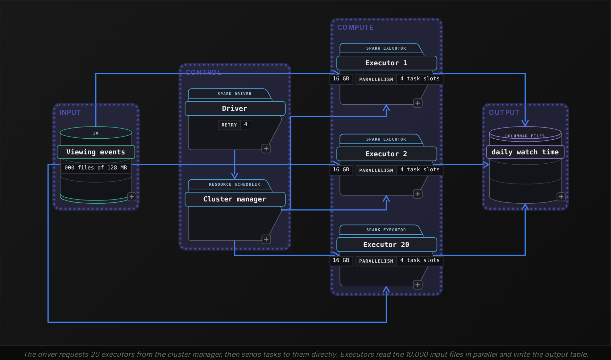
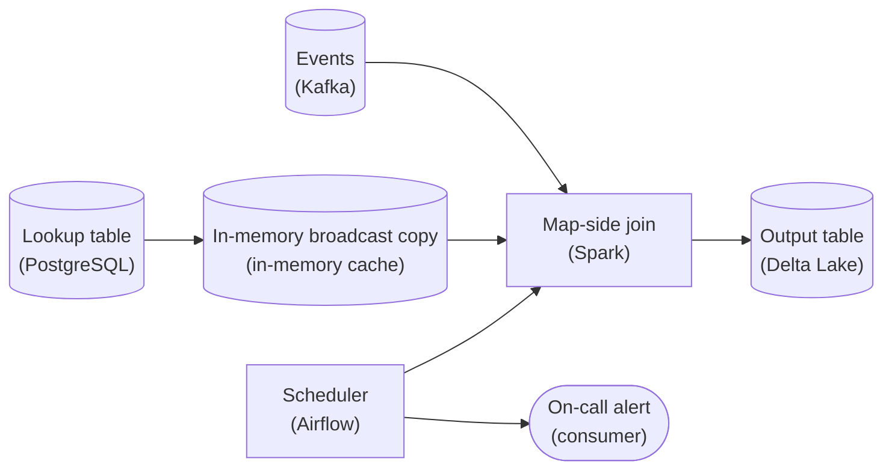
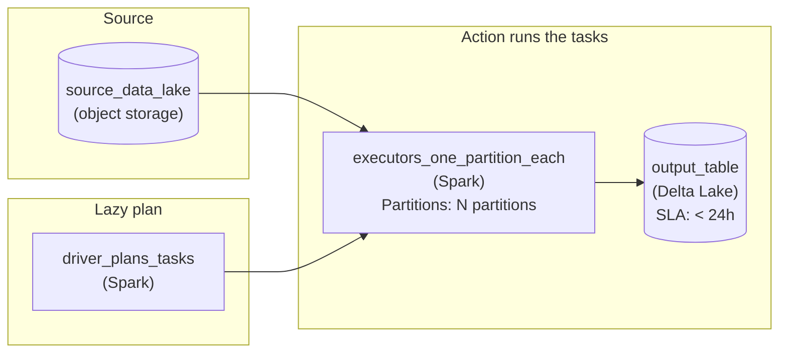
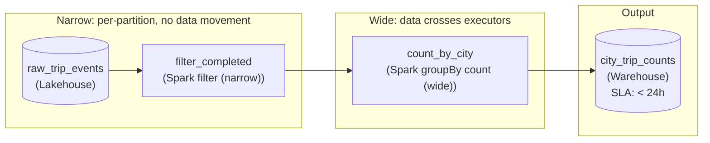
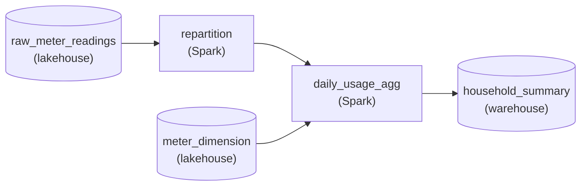
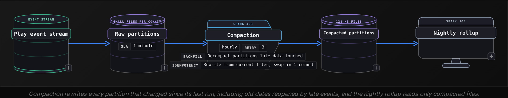
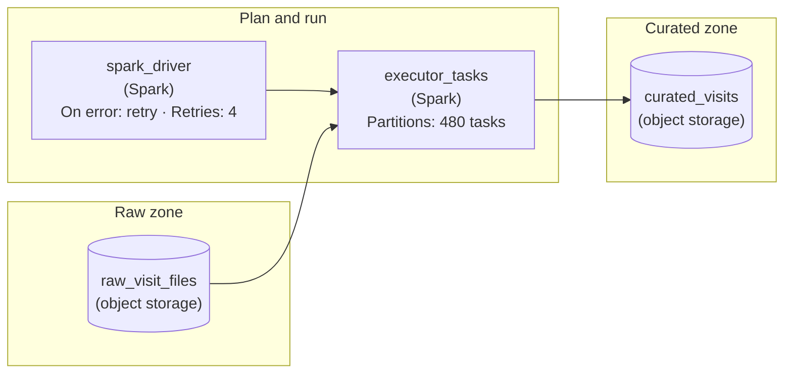
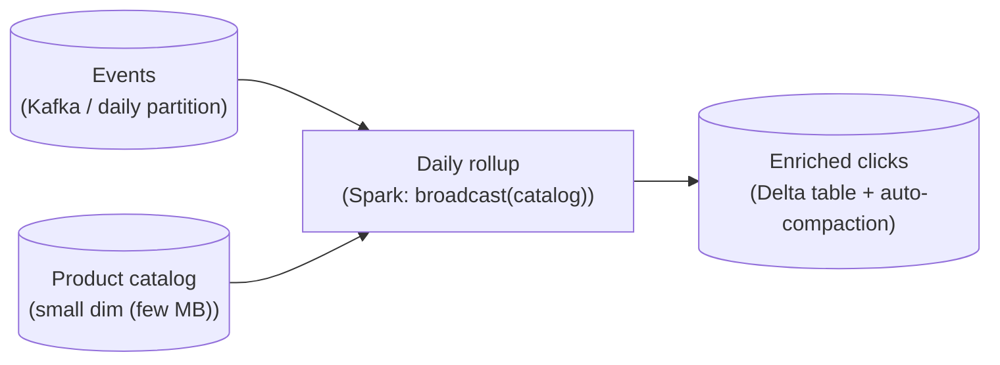

Beginner·Pipeline Architecture · 20 min · 6 challenges

# Distributed Compute: Beginner

Ines is in the third round of a data engineering loop at Netflix. The interviewer shares a nightly job that rolls up a day of viewing events into watch time for each member and title in each country, and asks a single question: 'This used to finish in 40 minutes. Now it takes 3 hours and sometimes dies with an out-of-memory error, and the team reading its output says their queries crawl. Walk me through how it runs and where you would look.' Ines knows the DataFrame calls by heart. The interviewer wants the machinery under them: which process plans the work, how a folder of input files turns into tasks, which step moves rows across the network, why a single task can exhaust its memory, and why the output now holds 50,000 tiny files. This lesson builds that picture around the same job, with its real numbers.


<br>

### What you will be able to do

Describe how the driver works with the cluster manager to get executors, and how an action becomes a job made of stages, each made of tasks.

Classify any operation as narrow or wide and predict where the stage boundaries of a query fall.

Size a shuffle in bytes and decide when a broadcast join removes it.

Match a memory symptom (spill, executor OOM, driver OOM, container kill, skew) to the region of memory that ran out.

Explain why a job writes small files, and pick the fix: coalesce or repartition at write time, or compaction afterward.


<br>

---

## Spark Execution Model

Every question in this family opens with a version of the same request: describe what happens after the job is submitted. A complete answer names 3 kinds of process and 4 units of work, then walks a real job through them. The interviewer is checking whether you can reason about a failure from the architecture alone, before anyone opens a log, because in an incident the architecture tells you which log to open first.


<br>

### The 3 processes and what each one owns

Every application runs these

- **Driver** *1 per application*\
  Runs your program, turns DataFrame code into an optimized plan, cuts the plan into stages and tasks, hands tasks to executors and tracks which ones finished. It holds no table data unless the code pulls results back to it.
- **Cluster manager** *Grants resources*\
  Decides which machines host executors and how many cores and how much memory each gets. The driver requests executors at startup, or repeatedly as load changes when dynamic allocation is on, then sends tasks to them directly.
- **Executors** *Many per application*\
  Long-lived processes on worker machines. Each owns a fixed number of cores, runs 1 task per core at a time, keeps shuffle files on its local disk, and caches data when asked to.




<br>

### From an action to 10,000 tasks

Nothing runs until the code asks for a result: writing a table, counting rows, collecting rows to the driver. Each such request is an action, and each action becomes 1 job. The driver cuts that job into stages wherever rows must regroup by key across machines, and runs each stage as a set of tasks, 1 per partition. A partition is the slice of data that a single task processes from start to finish; for a file scan it is usually a file, or a 128 MB piece of a larger one.

| Unit | Created by | In the nightly job |
| --- | --- | --- |
| Application | Submitting the program | 1 |
| Job | Each action; here, the final write | 1 |
| Stage | Each point where rows regroup by key | 2: scan, then aggregate |
| Task | Each partition of a stage | 10,000 in stage 1, 200 in stage 2 |

The nightly job reads 1.28 TB of viewing events stored as 10,000 files of 128 MB, so stage 1 has 10,000 tasks. The cluster runs 20 executors with 4 cores each, which makes 80 task slots. Tasks queue for those slots and run in waves, and each scan task here takes about 15 seconds.

- **125** — waves of tasks in stage 1
- **31 min** — stage 1 wall-clock time

Start any slow-job question with this arithmetic, because more executors cut wall-clock time only while a stage has more tasks than slots. Stage 2 has 200 tasks on 80 slots: 3 waves, and the third keeps only 40 slots busy. Tripling the cluster to 240 slots finishes stage 2 in a single wave with 40 slots idle. For stage 2, every executor added beyond that costs money and saves no time, though stage 1's 10,000 tasks would still speed up.


<br>

### What happens when a task fails

The driver records how every partition was derived from its inputs, a chain called lineage, and that record is what makes failures recoverable. When a task fails, the driver schedules it again, possibly on another executor, up to spark.task.maxFailures attempts, 4 by default, before it fails the whole job. Losing an executor costs more: its local shuffle files vanish with it, so tasks in the next stage that try to fetch them report a fetch failure, and the driver reruns the upstream tasks that produced the lost files.


> Where a rerun can hurt you
>
> - A rerun task writes its output again. The write path must commit each task's files exactly once, or retries leave duplicate files.
> - Speculative execution starts a second copy of a straggling task; only 1 copy's output may be committed.
> - Side effects inside a task, such as posting each row to an API, happen again on every attempt.
> - A dead driver ends the application. Executors are replaceable; the driver holds the plan and every task's state, so it has no stand-in.

✓Claim heard in interviews

- The code runs line by line as written
- More executors always make a job faster
- A failed task fails the job
- The driver processes the rows

✗What the system does

- Nothing runs until an action, and then the whole plan is optimized together
- Only while a stage has more tasks than slots
- The task gets up to 4 attempts first
- The driver plans and schedules; executors read and transform the rows

> **TIP**
>
> Order the answer the way the system runs: the driver builds the plan, the cluster manager grants executors, the action becomes a job, and shuffles cut it into stages. Each partition becomes a task, and the tasks run in waves on the available slots. Close with 1 failure and how the driver recovers from it.


<br>

---

## Pipeline Architecture

### Exercise 1 of 1

**● TASK**

A daily Spark job joins a large event feed against a small lookup table for a report due each morning, but it now runs for hours because both sides get redistributed across the cluster on every run. The lookup side is small enough to hold in memory, so keep it in a fast in-memory store that the join reads from instead of redistributing it across the cluster, rather than fixing the slowdown by adding machines. Schedule the run against its morning deadline and page the on-call team when a run is running late.

**Starting canvas** (already placed for you):

- Events (source, Kafka)
- Lookup table (small) (source, PostgreSQL)
- Join (large + small side) (transform, Spark)
- Output table (storage, Delta Lake)


<br>

### Solution

This is a shuffle you were never supposed to pay for, dressed up as a slow morning report. The lesson's name for it is the **broadcast join**: one side of the join is small enough to sit in memory on every executor, so it should be shipped there once and joined locally, never redistributed by key. The trap this instance sets is the reflex to add machines. More executors give you more parallelism for the shuffle, but the shuffle itself is the cost, so the job stays slow and now costs more per run. Get this wrong and you keep buying cluster to move a large event feed across the network every single morning to meet a lookup table that would fit in a laptop's RAM.

#### Why both sides move today

By default Spark plans this as a `SortMergeJoin`. To co-locate matching rows it hashes BOTH inputs by the join key and shuffles them across the cluster so equal keys land on the same partition. That's correct, but it means the entire large event feed gets serialized, sent over the network, and re-sorted every run. The small lookup being redistributed too is almost beside the point: the dominant cost is dragging the big side through a shuffle it never needed.

| Trick: Broadcast the small side, keep the large side still |
| --- |
| If one side fits in memory, ship a full copy to every executor and let Spark run a `BroadcastHashJoin`. Each executor probes its LOCAL partitions of the event feed against the in-memory lookup. The large side never leaves the node it was read on: zero shuffle, no re-sort, no network movement of the feed. That is why keeping the lookup in a fast in-memory store beats adding hardware, the design goal the scenario is pointing at. |



*The lookup is held as an in-memory broadcast copy on every executor; the event feed is joined in place and written to the output table. A scheduler runs the job against the morning deadline and alerts on-call when a run runs late.*

1. **Load the lookup into a broadcast copy, once per run**

   Read the small lookup and hand it to `broadcast()` (or let `spark.sql.autoBroadcastJoinThreshold` pick it up when the estimated size is under the threshold). Spark collects it to the driver, then sends one copy to each executor's memory. This is the only place the lookup travels, and it travels as a compact hash table, not a shuffle.

2. **Join in place so the event feed never shuffles**

   With the lookup resident on every executor, the plan flips to `BroadcastHashJoin`: each task probes the broadcast hash table with its own partition of the feed. No exchange stage on the large side means the runtime scales with how fast you can read the feed, not with network bandwidth, which is what was eating your hours.

3. **Anchor the schedule to the morning deadline, not a fixed clock**

   The report is due each morning, so schedule the run to start with enough margin to finish before that deadline. This is a daily batch job with a hard morning target, so the schedule is part of the design, not an afterthought.

4. **Page on-call when a run is running late, not just when it fails**

   A run that is still going past its expected finish is the signal that matters, because a late success still misses the morning report. Wire an alert that pages on-call while there is still time to intervene, rather than a post-mortem email after the deadline has already slipped.

**The join, made shuffle-free**

```python
from pyspark.sql.functions import broadcast

events = spark.read.format("kafka").load(...)      # large side, stays put
lookup = spark.read.jdbc(url, "lookup_table", ...)  # small side, fits in memory

enriched = events.join(
    broadcast(lookup),        # ship one copy to each executor
    on="lookup_key",
    how="left",
)

(enriched.write
    .format("delta")
    .mode("overwrite")
    .saveAsTable("report_output"))
```

*`broadcast()` forces the small side into every executor's memory; the large feed is joined in place.*

| ✕ Add machines | ✓ Broadcast the lookup |
| --- | --- |
| More executors split the shuffle into more tasks, but the large feed still crosses the network and re-sorts every run. You pay more per run for a smaller constant-factor win, and a `SortMergeJoin` exchange stage still gates the whole job. | The `BroadcastHashJoin` removes the exchange on the large side entirely. Runtime drops to the cost of one scan plus a local probe, and it holds even as the feed grows, because nothing about the feed's size triggers a shuffle. |

| Pitfall: Broadcasting something that isn't actually small |
| --- |
| The whole trick rests on the lookup being small. If it grows past what fits in executor memory, `broadcast()` either OOMs the driver during the collect or blows executor heap. Cap it with a realistic `spark.sql.autoBroadcastJoinThreshold`, and treat 'the lookup is small' as an assumption you monitor, not one you assume forever. |

| Interviewer: Changing the join beats buying cluster |
| --- |
| The tell is naming the shuffle as the cost and reaching for a `BroadcastHashJoin` before anyone mentions cluster size. Junior answers scale hardware; strong answers change the join strategy and can say why the large side no longer moves. Bonus points for pairing it with a deadline-anchored schedule and a page on a late run instead of only on a failed one. |

**Follow-up questions**

1. What if the lookup grows past what fits in memory next quarter?\
   *Tests whether they know broadcast has a size ceiling and can fall back to a bucketed or sort-merge join.*
2. How would you confirm the plan actually became a `BroadcastHashJoin` and not a `SortMergeJoin`?\
   *Looks for reading the physical plan via `explain()`, not trusting the config blindly.*
3. The morning run finishes on time but the numbers are stale by an hour, why?\
   *Separates job duration from source freshness and upstream Kafka lag.*


<br>

---

## Distributed Primitives

This family of questions arrives as a code snippet and a prompt: how many stages will this run, and why? The answer comes down to 2 distinctions. Transformations versus actions decides when work happens. Narrow versus wide decides whether rows move between machines, and moving rows accounts for nearly all of the cost.


<br>

### Transformations describe, actions execute

filter is a transformation, as are select and groupBy: each returns a new DataFrame and computes nothing, and the driver appends a step to the plan. Actions like write demand a result, and so do count and collect; only then does the driver optimize the full plan and launch a job. Deferring the work pays off because the optimizer sees every step together: a filter written after a join can move before it, and columns no later step reads are never loaded from disk.

```sql
events = spark.read.load("/lake/viewing_events/dt=2026-10-22/")
watched = (
    events
    .filter(events.event_type == "play")
    .select("profile_id", "title_id", "country", "minutes")
)
daily = watched.groupBy("profile_id", "title_id", "country").sum("minutes")
daily.write.partitionBy("country").mode("overwrite").save("/lake/daily_watch_time/dt=2026-10-22/")
```


<br>

### Narrow or wide: does a row have to move?

A transformation is narrow when each input partition feeds at most 1 output partition. filter on partition 37 needs nothing but partition 37, so the task that read it applies the filter where the rows already sit, and a chain of narrow steps runs inside that task without pausing. A transformation is wide when the rows of an input partition scatter to many output partitions. Summing minutes for each profile and title within a country needs every row for that combination in the same place, and those rows are spread across all 10,000 input files, so they must be regrouped by key. That regrouping is a shuffle, and every shuffle ends a stage and begins the next.

| Operation | Narrow or wide | Why |
| --- | --- | --- |
| `filter`, `select`, `withColumn` | Narrow | Each row is handled in the partition it already sits in |
| `union` | Narrow | Input partitions pass through side by side |
| `coalesce(n)` | Narrow | Whole input partitions merge into fewer outputs without scattering |
| `groupBy` then `agg` | Wide | Rows sharing a key must meet in a single partition |
| `join`, both sides large | Wide | Matching keys from both tables must land together |
| `distinct` | Wide | Duplicates can sit in any partition |
| `orderBy` | Wide | A global order spans every partition |
| `repartition(n)` | Wide | Every input partition scatters rows to every output |

In SQL the rule reads off the clauses. WHERE and the expressions in the SELECT list are narrow. JOIN, GROUP BY, DISTINCT and ORDER BY are wide, unless the planner broadcasts the small side of a join, which the next section covers. A window function with PARTITION BY is wide too.


<br>

### Predict the stages

> Try it before reading on
>
> This query runs as 1 job, and the join moves both tables across the network. Count its stages and name the clause that causes each boundary.

```sql
SELECT
  e.country,
  t.genre,
  SUM(e.minutes) AS minutes_watched
FROM viewing_events AS e
JOIN titles AS t
  ON e.title_id = t.title_id
WHERE e.event_type = 'play'
GROUP BY e.country, t.genre
```

The query runs in 4 stages. Stage 1 scans viewing_events, applies the WHERE filter inside the scan tasks, and writes rows out keyed by title_id. Stage 2 does the same for titles, and the 2 scans run at the same time because neither needs the other. Stage 3 joins the 2 shuffled outputs and starts summing, but the join key is title_id while the grouping key is country and genre, so the partial sums shuffle again. Stage 4 finishes the aggregate. Notice that the filter added no stage and no network traffic: it ran before any row moved.


<br>

### Why the distinction matters on retry

Lineage makes narrow failures cheap. If the stage 1 task for partition 37 dies, the rerun reads the same input file and repeats the same filter: 1 file, about 15 seconds of work. A wide step has no such clean edge. One partition of the aggregate depends on shuffle files written by all 10,000 scan tasks, and if an executor holding some of those files is gone, those scan tasks run again before the aggregate can retry.

✓A chain of narrow steps

- Runs inside a single task, with no disk write or network hop between steps
- A failure reruns 1 partition from its source file
- Partition count stays whatever the input produced

✗A wide step

- Ends a stage, and the next stage waits for every upstream task
- A lost executor can force upstream tasks to rerun
- Partition count resets to the shuffle setting, 200 by default

*Each action is its own job. Calling count and then write on the same DataFrame scans the input twice, unless the DataFrame is cached before the first action.*

> **TIP**
>
> When asked to speed up a job, count the wide steps first. Removing 1 shuffle usually saves more than any tuning of the narrow steps around it.


<br>

---

## Pipeline Architecture

### Exercise 1 of 1

**● TASK**

A nightly Spark batch job reads the previous day's raw listening-event files from the data lake and rolls them up into a daily totals table the analysts open each morning, yet last night it finished in seconds having written nothing. Lay the job out on the canvas from the lake to that once-a-day output table, with the driver that turns the read and the roll-up into a plan of tasks kept apart from the executors that each process one partition in parallel, and wire the write so it is the step that sets that plan running.


<br>

### Solution

#### Driver plans, executors execute, an action triggers

This is the Spark execution model question with a symptom attached, set inside a plain nightly batch job: one bounded day of files in the lake, one table out by morning. A job that 'finished in seconds having written nothing' did not fail: it only ever built its plan. Reading and rolling up the data are transformations, and transformations are lazy. They add steps to the DAG and move no rows. The trap is drawing one box labeled Spark. That answers 'how does Spark work' with a logo and hides exactly the split that explains the symptom. The whole model fits in one sentence: the driver plans the work and divides it into tasks, the executors each process one partition in parallel, and nothing runs until an action such as `.write()` fires.



*The lake feeds the executors directly. The driver only turns the read and the roll-up into a plan of tasks and hands them out. The `.write()` action sets those tasks running, one partition each, and lands the once-a-day output table.*

1. **Separate the coordinator from the workers**

   Draw the driver as its own stage. It reads the job, builds the plan and divides it into tasks, and it never processes rows itself. That is why its edge goes into the executors and not into the data path: it sends tasks, while the rows travel from the lake straight to the executors. Keeping the 2 stages separate is the whole answer to 'what is the difference between a driver and an executor?'

2. **Make the parallelism visible**

   The executors stage carries the partition count because the partition is the unit of work: one task per partition, many running at once. A night of roughly 10,000 files means roughly 10,000 tasks spread over the executors. An interviewer listens for 'each executor processes a partition', and on the canvas the stage says it for you.

3. **Hang the write off the executors**

   The job wrote nothing because nothing ever asked for a result. The edge from the executors into the output table is the action. Draw it as a real downstream flow, and the picture explains both why the fixed job runs and why the broken one did not.

4. **Stamp the output with its daily cadence**

   This is a batch job over a bounded day of files, not a stream. The output table carries a daily freshness because analysts read yesterday's totals each morning, and nothing fresher buys them anything. That tells the interviewer you know where this job sits: scheduled, bounded, run to completion, then idle until tomorrow night.

| Pitfall: The driver never touches partitions |
| --- |
| The common miss is one big Spark box. Worse is a driver sitting in the data path, as if it did the row processing. If the picture does not separate the planner from the workers, the interviewer cannot tell whether you know the difference. |

| Trick: A stranded output table is a plan that never ran |
| --- |
| Transformations like `.filter()` and `.join()` only add to the DAG. The action is what makes the driver ship tasks to the executors: here `.write()`, but `.count()` and `.collect()` are actions too. An output node with no incoming edge is exactly last night's job: planned, never triggered. |

| ✕ Transformation | ✓ Action |
| --- | --- |
| `.filter()`, `.join()`, a roll-up: each one returns instantly and adds a step to the plan. No executor does any work yet. | `.write()`, `.count()`, `.collect()`: the driver finalizes the plan and splits it into tasks, and the executors run them, one partition each. |

**Follow-up questions**

1. What happens if one executor dies partway through the job?\
   *Tests task reassignment: the driver hands the failed tasks to another executor, and a lost partition is recomputed from the lake files using the plan's lineage.*
2. The analyst adds a `.count()` before the `.write()`. How many times does Spark read the lake now?\
   *Tests that each action triggers its own run of the plan: 2 actions mean 2 executions unless the result is kept around.*


<br>

---

## Shuffle Operations

Most slow-job questions end at a shuffle, because a shuffle holds rows in memory while it writes them to disk and sends them across the network, and no other step does all of that at once. A strong answer explains the mechanics, sizes the cost from the numbers in the job at hand, and points at the shuffle that can be removed.


<br>

### What a shuffle does, step by step

| Step | Side | What happens |
| --- | --- | --- |
| 1 | Map | Each task hashes the grouping key of every row and assigns the row to 1 of 200 target partitions. |
| 2 | Map | It sorts rows by target partition and writes 1 shuffle file to the executor's local disk, plus an index of where each partition starts. |
| 3 | Map | It reports the file's location to the driver. The next stage starts only after every map task has reported. |
| 4 | Reduce | Each of the 200 reduce tasks fetches its slice from every map output over the network. |
| 5 | Reduce | It deserializes and merges the slices, then aggregates or joins, spilling to disk if the rows exceed its memory. |

Every shuffled byte is serialized and written to local disk, then sent over the network, where the reading task loads it back and deserializes it. The cost scales with bytes, and the bytes can be estimated. The nightly job filters to plays and keeps 4 columns, which shrinks 1.28 TB of input to 640 GB that must be regrouped by profile and title within each country. Spark also sums minutes inside each map task before writing, which shrinks the data when a task holds many rows for the same key; a profile rarely repeats the same title many times inside a single 128 MB file, so here that step saves little.

- **2,000,000** — shuffle blocks fetched in stage 2
- **3.2 GB** — input per reduce task

Step 3 creates a barrier. The 200 reduce tasks wait for the slowest of the 10,000 map tasks, so a single straggling scan task delays everything after it. Shuffle files also outlive the tasks that wrote them on purpose: they stay on local disk so a failed reduce task can fetch them again without rerunning the map side.


<br>

### Broadcast joins remove the big shuffle

The genre report from the previous section joins the filtered events to titles, and a shuffle join moves both tables so that equal title_id values meet in the same task. When a side is small, a cheaper plan exists. The driver collects the small table and ships a full copy to every executor, and each scan task joins its slice of the big table against that local copy as it reads. The big table never leaves the task that read it, so the join becomes a narrow step inside the scan stage.

Shuffle join

| Step | Data moved |
| --- | --- |
| Shuffle filtered events by title_id | 640 GB |
| Shuffle titles by title_id | 40 MB |
| Stages for the join | 3 |

Broadcast join

| Step | Data moved |
| --- | --- |
| Collect titles to the driver | 40 MB |
| Copy titles to 20 executors | 800 MB |
| Stages for the join | 1 |

Spark picks a broadcast join on its own when it estimates a side to be below spark.sql.autoBroadcastJoinThreshold, 10 MB by default. The titles table is 40 MB, so the planner falls back to a sort-merge join, the default shuffle join, unless you raise the threshold or mark the table with a broadcast hint. The trade is lopsided here: 20 copies of 40 MB put 800 MB on the network, against 640 GB for the shuffle.

```sql
from pyspark.sql.functions import broadcast

enriched = watched.join(broadcast(titles), "title_id")
```

> When a broadcast backfires
>
> - The driver builds the broadcast table in its own memory first, so a table larger than the driver heap kills the application.
> - Every executor holds a full copy: 2 GB broadcast to 20 executors occupies 40 GB of cluster memory.
> - Size estimates come from files on disk, and compressed columnar files can grow several times once loaded as rows.
> - Tables grow. A hard-coded hint keeps broadcasting a dimension long after it has outgrown the executors.


<br>

### Other shuffles worth removing

- **Grouping twice on the same key.** Compute both results in a single aggregate, or the 640 GB moves twice.
- orderBy on a result that readers sort again anyway: a global sort is a full range shuffle.
- repartition called out of habit: every call is a full shuffle, so keep only the ones whose layout a later step uses.
- distinct before a GROUP BY on the same columns: the grouping already removes the duplicates.

*Adaptive query execution, on by default since version 3.2, measures shuffle outputs at runtime. It can switch a sort-merge join to a broadcast join once a side proves small, and it merges small shuffle partitions. Both happen after shuffle files were written, so a broadcast planned up front still saves the most work.*

> **TIP**
>
> State shuffles in bytes. 'This join shuffles 640 GB; broadcasting the 40 MB side moves 800 MB instead' gives the interviewer a number to check, and it shows you sized the problem before proposing a fix.


<br>

---

## Pipeline Architecture

### Exercise 1 of 1

**● TASK**

A ride-hailing platform's daily batch job reads raw trip events from a lakehouse and writes a per-city count of completed trips to the operations warehouse. Roughly 2 billion events arrive each day, and under a tenth are completed trips. The current job groups all events by city first, then filters to completed trips, pushing the entire feed across the network before discarding most of it. Redesign the pipeline so data crosses between executors only once, carrying as little payload as possible.


<br>

### Solution

#### What this problem is really about

This looks like 'write a Spark job to count trips per city,' but it is really a question about which operation forces data across the network and what you do before it. A `filter` is a narrow transformation: each executor works on its own partition and nothing crosses between executors. The per-city count is a wide transformation: every row for the same city has to end up on the same executor, so the data moves. The trap is the ordering. Count first and filter after, and all 2 billion events cross the network before you throw away the ~92% that were never completed trips. Filter first, and the crossing carries only the completed rows.

| Trick: The order is the whole answer |
| --- |
| Narrow before wide. `filter` costs no network, so run it while the data is still spread across partitions. The per-city count is the one step that pays the network bill, so hand it the smallest input you can. |

#### Build it in order

1. **Read the day's raw events in batch**

   The job runs once each morning off the prior day's events in the lakehouse. This is a batch read, not a stream; the freshness requirement is daily.

2. **Filter to completed trips first**

   Keeping only the 'completed' rows is narrow: each executor drops its own non-completed rows in place, no data moves. This is where the 2 billion events collapse to under 160 million, and it happens for free.

3. **Let the per-city count be the crossing**

   Counting per city is wide: rows for the same city are gathered onto one executor, which serializes data, sends it over the network, and reads it back. It is the most expensive step, so it should see only what survived the filter.

4. **Write the small result to the report store**

   One row per city is tiny. Land it in the warehouse the operations report reads from.

#### The shape that fits



*The read and `filter` stay on the per-partition side; the per-city count is the one crossing, and it sees only completed trips.*

| Performance: What the ordering buys |
| --- |
| Filter after the count and ~2 billion rows get shuffled. Filter first and the crossing carries under 160 million, roughly a tenth of the traffic and the disk spill that goes with it. Same result, a fraction of the network cost. |

| Interviewer: Narrow, wide, and lazy in one breath |
| --- |
| A strong junior answer names `filter` as narrow and the per-city count as wide, and adds that transformations are lazy: Spark builds the plan and does nothing until an action (a write here) triggers it, which is what lets the ordering be optimized. |

| Pitfall: Aggregate-first |
| --- |
| The common mistake is grouping first because that is how the report reads, then filtering the output. It gives the right numbers and the wrong bill: the whole feed crosses the network before most of it is discarded. |

**Follow-up questions**

1. A teammate says Spark's optimizer pushes the filter down on its own, so the ordering does not matter. Are they right?\
   *Tests whether the candidate knows predicate pushdown often does exactly this, but that reasoning about the narrow-before-wide order is still how you design and verify the plan, not something to leave to chance.*
2. Which of these also force a crossing: `distinct`, `select`, `join`, `withColumn`?\
   *Narrow vs wide recall: `distinct` and `join` are wide (they shuffle); `select` and `withColumn` are narrow (per-partition).*


<br>

---

## Memory Management

Memory questions arrive as symptoms: a stage that got slow, an executor that keeps dying, an error message pasted into the chat. The skill under test is matching each symptom to the region of memory that ran out, and that takes a picture of how an executor divides the memory it was given.


<br>

### How a 16 GB executor divides its memory

| Region | Size on a 16 GB executor | What it holds |
| --- | --- | --- |
| Reserved | 300 MB | Fixed memory for the engine's own internals |
| Execution | Shares 9.4 GB with storage | Shuffle buffers, plus the sort and hash structures behind joins and aggregates |
| Storage | Shares 9.4 GB with execution | Cached DataFrames and broadcast tables |
| User | 6.3 GB | Objects your own code creates, such as data structures inside a UDF |
| Overhead, outside the heap | 1.6 GB | Network buffers, native memory and Python worker processes |

The split comes from 2 settings. spark.memory.fraction, 0.6 by default, gives 60% of the heap left after the reserved 300 MB to a unified region, roughly 9.4 GB here, which execution and storage share. Execution can evict cached blocks to grow, down to the half that spark.memory.storageFraction protects, while cached blocks can never evict running execution memory. Inside execution, each running task may take at most an equal share, so with 4 tasks busy on 4 cores, each task gets roughly 2.4 GB before it has to spill.


<br>

### Read the symptom, then the region

| Symptom | Region that ran out | Usual cause | First fix |
| --- | --- | --- | --- |
| Stage slows; stage metrics show spill (memory) and spill (disk) | Execution share per task | Shuffle partitions larger than the 2.4 GB per-task share | Raise `spark.sql.shuffle.partitions` |
| Executor lost with `OutOfMemoryError: Java heap space` | Executor heap | A skewed key, or a broadcast too large for every executor | Find the hot key; drop the broadcast |
| Container killed by the cluster manager for exceeding memory limits | Overhead outside the heap | Python UDF workers or native buffers | Raise `spark.executor.memoryOverhead`, leaving the heap as it is |
| Driver fails with `OutOfMemoryError` | Driver heap | `collect()` on a large result, or building a big broadcast | Write results to storage instead |
| Long pauses and high GC time | Executor heap | Millions of short-lived objects, or too much cached data | Cache less; prefer built-in functions over UDFs |

Spill is the slow but safe outcome. When the hash table a task builds for the aggregate reaches its 2.4 GB share, the task sorts what it holds and writes it to local disk. With that memory freed it keeps reading, and at the end it merges the spilled runs with what remains in memory. With 200 shuffle partitions, every reduce task in the nightly job receives 3.2 GB, so every one of them spills, and each spilled byte is written and read back at least once more. The stage metrics report spill (memory), the deserialized size of what was evicted, and spill (disk), its compressed size on disk, usually far smaller.

More partitions is the fix, and the target size follows from the share. Divide the shuffle bytes by a target of a few hundred megabytes and set spark.sql.shuffle.partitions to the result. Deserialized rows plus hash table structures can take several times their serialized size, so a partition well under the share leaves the headroom it needs.

- **1,000** — shuffle partitions after the fix
- **640 MB** — input per reduce task after the fix


<br>

### Skew: when more partitions stop helping

More partitions divide the keys among more tasks, yet every row for a given key still lands in a single task. Suppose the job also joins events to a large profiles table on profile_id, and a test profile driven by an automated player logs 30 GB of play events in a day. At 200 partitions or 1,000, the task that receives that profile_id gets all 30 GB, spills for its whole run or dies with a heap error, while the other 999 tasks finish in seconds. The stage view gives it away: the maximum task input sits far above the median. If the key is junk, filter it out before the shuffle. If it is real, add a random suffix from 0 to 9 to that key on the events side, copy the matching profile row 10 times with each suffix, and join on the salted key. Adaptive execution can split oversized join partitions on its own; salting is the manual version of the same idea.


<br>

### Fix the region that ran out

✓Do

- Read spill and the largest task's input in the stage view before changing any setting
- Size shuffle partitions from shuffle bytes divided by a target of a few hundred MB
- Raise memory overhead when the cluster manager kills containers for exceeding limits
- Compare the largest task to the median when 1 executor keeps dying

✗Don't

- Double executor memory as a first move; it hides skew and doubles the bill
- Call collect() on a result whose size you have not checked
- Cache a DataFrame that is read only once; it takes memory execution could use
- Broadcast a table without checking its size once loaded as rows

> **TIP**
>
> Use the exact vocabulary: spill, executor OOM, driver OOM, container killed for overhead, skew. Each names a different region of memory, and naming the right one tells the interviewer you diagnosed the failure from evidence.


<br>

---

## Pipeline Architecture

### Exercise 1 of 1

**● TASK**

We run the metering platform for an energy utility, and a nightly Spark job reads about 2 billion raw smart-meter readings from the lakehouse and rolls them up into a daily per-household usage table that billing reads by 6am. The job keeps dying with out-of-memory errors, and the executor logs show heavy spill-to-disk during the aggregation, which joins a cached meter-dimension table that sits pinned in memory. Design the batch pipeline so the rollup finishes inside each executor's memory budget and still lands the summary in the warehouse on time.


<br>

### Solution

#### What this problem is really testing

An out-of-memory error reads like 'give the cluster more RAM', and that is the trap. The real question is where each executor's fixed memory is going. It splits between storage (cached data) and execution (shuffles, joins, sorts). Here 2 things eat it at once: the readings arrive in too few partitions, so a single partition is larger than an executor's 8GB, and a `cache()`d dimension table is pinned in storage memory, leaving execution nothing to work in. The aggregation spills to disk, then dies. Adding memory just delays the same failure.

Spill-to-disk is the warning sign the interviewer wants you to name. It means execution memory ran out and Spark is writing intermediate shuffle data to disk, which is far slower; when the disk fills too, the executor is killed. Read the spill in the logs and it tells you which lever to pull: more, smaller partitions, or less pinned cache.

#### Walk the fix

1. **Repartition into smaller chunks**

   Two billion readings landing in a few dozen partitions makes each one far larger than an executor can hold. Repartition to create many more, smaller chunks so each fits comfortably inside the 8GB budget with room to shuffle. This is the single move that removes the spill: the section's rule is more partitions means smaller per-partition memory.

2. **Stop caching what does not need caching**

   The meter-dimension table is read once per run, yet it sits pinned in storage memory through the whole aggregation, crowding out execution. `unpersist()` it, or broadcast it as the small table it is. That hands the reclaimed storage memory back to the shuffle, which is where the pressure actually is.

3. **Land the summary where billing reads it**

   The daily per-household rollup writes to the warehouse before 6am. Keep the output a clean batch write; the memory work all happens upstream, at the repartition and the aggregation, not at the sink.

#### The shape that fits



*The readings are repartitioned into thousands of smaller chunks before the shuffle. The meter dimension is read straight into the aggregation with nothing pinned in cache, and the daily summary lands in the warehouse.*

| Interviewer: Split before you scale |
| --- |
| A strong candidate names the storage-versus-execution split and reads spill-to-disk as the symptom BEFORE reaching for more memory. They diagnose which lever applies: `repartition()` for oversized partitions, `unpersist()` for cache crowding execution. Reaching straight for a bigger executor without that reasoning is the tell of someone who has not looked at the memory model. |

| Pitfall: More RAM hides the leak, briefly |
| --- |
| The reflex fix is a bigger executor. It works for one run, then the next day's volume spills again and the bill is higher. The partition is still too large and the cache is still pinned; nothing structural changed. The section's fix is partition sizing and cache hygiene, not a memory upgrade. |

| Performance: Where the memory goes |
| --- |
| At 8GB per executor and 2 billion readings, a few dozen partitions put well over 8GB of data behind a single task, so it spills from the first pass. Thousands of partitions keep each task's working set small, and reclaiming the cached dimension gives execution the headroom to finish the shuffle in memory. |

**Follow-up questions**

1. How would you decide how much memory to give each executor, and how many cores?\
   *Tests the 5-core rule (5 cores per executor, each processing a partition) and starting from the 4-8GB default, then raising memory or partition count when spill appears.*
2. What is the difference between `persist()` and `cache()`, and which would you use for the dimension table here?\
   *Tests that `cache()` is memory-only while `persist()` picks a storage level, and that the right move here is to unpersist or broadcast rather than pin it in memory.*


<br>

---

## Small File Problem

After the partition fix, the nightly job finishes in 40 minutes again. A week later the team that reads its output complains that their queries got slower, and a listing of the output folder for a single day shows 50,000 files averaging 42 KB. The interview version asks why that happens and how to fix it, and each fix has a different price.


<br>

### Where the files come from

Every task writes its own files, 1 for each output partition value among the rows it holds. The job writes with partitionBy("country"), and the shuffle hashed rows on the full grouping key, profile and title as well as country, so each of the 1,000 reduce tasks holds rows from all 50 countries. The file count is the product: 1,000 tasks times 50 countries is 50,000 files for 2 GB of output. Before the fix, 200 tasks wrote 10,000 files of about 200 KB, already too small for readers; the memory fix multiplied the count by 5, and that is how the interviewer's 50,000 files arrive.


<br>

### What small files cost readers

- Every file costs a listing entry, an open request and a footer read before its first row comes back.
- Readers plan work per file or per packed group of files, so 50,000 files mean many short read tasks.
- Columnar files keep min and max statistics in each footer, so tiny files hand the reader thousands of footers to check.
- Compression and encoding find fewer repeated values in 42 KB of rows than in 128 MB.
- Any catalog or metadata service that tracks individual files slows down as the count reaches millions.

Spark's file reader limits the damage by packing small files into shared read tasks. It fills each task up to spark.sql.files.maxPartitionBytes, 128 MB by default, but charges every file an extra spark.sql.files.openCostInBytes, 4 MB, to account for the cost of opening it. Each 42 KB file therefore counts as about 4 MB, and about 32 of them fill a task.

- **1,563** — read tasks for 50,000 small files
- **200 GB** — size the planner charges for 2 GB


<br>

### Fix 1: control the file count at write time

Take an output with no partition column first. The 1,000 aggregate tasks would write 1,000 files of about 2 MB, and the instinct is to reduce the task count right before the write. The 2 methods for that look alike in code and behave very differently on the cluster.

✓coalesce(16)

- Narrow: merges whole partitions in place, with no shuffle
- Adds no stage boundary, so the aggregate stage itself shrinks to 16 tasks
- Each of those 16 tasks then reads 40 GB of shuffle data and spills heavily
- Fits when the step before the write is a scan or filter of modest size

✗repartition(16)

- Wide: adds a shuffle of the 2 GB result
- The aggregate keeps its 1,000 tasks; only the final write runs as 16
- Rows spread evenly, giving 16 files of roughly 128 MB
- Fits after a large shuffle, which is this job's case

With partitionBy("country") the file count is tasks times countries per task, so the fix is to make each task hold fewer countries. Repartitioning on country sends every row for a country to the same task, so each country folder receives 1 file: 50 files for the day, averaging 41 MB. The biggest country then lands on a single task, and the maxRecordsPerFile option caps rows per file so that task writes several files instead of a giant one.

```sql
(
    daily
    .repartition("country")
    .write
    .partitionBy("country")
    .option("maxRecordsPerFile", 5000000)
    .mode("overwrite")
    .save("/lake/daily_watch_time/dt=2026-10-22/")
)
```


<br>

### Fix 2: compact after the fact

Write-time control fails when files arrive through many small writes. The viewing events table that feeds this job is filled by a stream that commits every minute, 1,440 commits a day, and each commit adds files. Late events add more: a play watched offline and uploaded 3 days later lands in a date partition that was finished long ago. The tidy 128 MB input files from the first section exist because a compaction job rereads each partition's small files and rewrites them as a few large ones.



> Where compaction breaks
>
> - Retry: a job that deletes old files before committing new ones loses data if it dies midway. Write the new files, then swap in 1 atomic step.
> - Concurrent readers: a query listing the folder during the rewrite can see old and new files together and double count rows.
> - Late data: compacting only yesterday misses old partitions that late events reopened; track which partitions changed since the last run.
> - Schema change: after a column is added, the older files lack it, so the rewrite must read both versions and write a single target schema.

> **TIP**
>
> Answer in this order: name the product of writing tasks and partition values, fix the write with repartition rather than coalesce after a big shuffle, then add atomic compaction for streams and late data.


<br>

---

## Putting It All Together

A streaming service runs a nightly job that rolls 1.28 TB of viewing events into daily watch time per profile, title and country, partitioned by country, plus a genre report that joins those events to a 40 MB titles table. Over a few months the job slowed from 40 minutes to 3 hours, executors began to die, and the dashboards reading its output got slower every week.

- The execution model sets the baseline: 10,000 scan tasks run in 125 waves on 80 slots, then 200 tasks aggregate.
- Narrow versus wide locates the cost: the filter and projection ride inside the scan, and the groupBy is the shuffle that matters.
- The shuffle explains the memory failure: 640 GB over 200 partitions is 3.2 GB per task against a 2.4 GB share, so every task spills.
- Broadcasting the 40 MB titles table replaces the genre report's 640 GB join shuffle with 800 MB of copies.
- The memory fix creates the file problem: 1,000 tasks times 50 countries writes 50,000 files of 42 KB.
- Repartitioning on country before the write cuts that to 50 files, and atomic compaction absorbs the stream's minute commits and late events.


<br>

---

## Pipeline Architecture

### Exercise 1 of 2

**● TASK**

60 gigabytes of patient visit records sit in the lake's raw zone as 480 Parquet files, and a notebook's chain of filter and derived-column cells over them returned instantly while the single cell writing the result to the curated zone ran for an hour. Midway through that write one executor died, yet the output still completed with every row, because each task gets up to four attempts before the job gives up. Draw the batch job so the process that plans the work and the workers that run it are separate stages, and so it is visible how the dead executor's share was redone from the untouched raw files.


<br>

### Solution

#### What the notebook was really showing

This is the Spark execution model, all of it, dressed up as a notebook that looks haunted. It has lazy transformations, one action, a driver handing tasks to executors under a bounded retry budget, and lineage rebuilding what a dead executor lost from the lake's raw zone. Anyone can define a transformation and an action. The trap is believing the story the notebook tells: that the filter cells were fast, the write was slow, and the job got lucky when an executor died. None of that is true. The filter cells did nothing, the write did everything, and the survival was designed. Explain it as a slow write and you will reach for a bigger cluster or a checkpoint, and the interviewer hears that you do not know when Spark actually runs.

| Trick: The hour belongs to every cell, not the last one |
| --- |
| Charge the hour to the whole chain. `filter()` and `withColumn()` only add steps to a plan on the driver; `.write()` is the action that finally executes read, filter, columns and write together. A dead executor costs only the tasks it was running, because the driver still holds the recipe for each of them and has attempts left to spend. |

#### Walk the timeline

1. **Read the instant cells as a plan, not work**

   Every `filter()` and `withColumn()` cell is a transformation. The driver records it in the DAG and returns immediately, without opening one of the 480 files. That is why the cells felt instant: there was nothing to wait for yet.

2. **Find the action that pulled the trigger**

   `.write()` is the action. The driver turns the DAG into stages. Filters and new columns are narrow, meaning each partition is handled on its own and no data moves between executors, so the whole chain collapses into ONE stage with no shuffle: 480 tasks, one per file. Twenty executors with four cores is 80 slots, so the tasks run in about 6 waves. That is the hour.

3. **Follow the dead executor's tasks back to the driver**

   When an executor stops heartbeating, the driver marks the tasks it was running as failed and schedules them again on the survivors. A task is only given up on after four failed attempts (`spark.task.maxFailures`, default 4), so one lost machine spends one attempt per task, not the job.

4. **Rebuild the lost partition from lineage**

   Nothing was cached, so no copy of those in-flight partitions existed anywhere. It did not need to. The driver knows each partition's lineage: read these file splits, apply this filter, add these columns. The retried task re-reads the same splits from the raw zone, which this job never modifies, and replays the steps. Tasks that had already finished and written their files to the curated zone are not redone.

#### The reference design



*`spark_driver` plans the lazy chain and retries failed tasks up to four attempts each; `executor_tasks` run all 480 tasks as one narrow stage straight from `raw_visit_files` to `curated_visits`.*

| ✕ What the notebook seemed to say | ✓ What actually happened |
| --- | --- |
| The `filter()` cells were fast, `.write()` was slow, and the job survived the executor loss by luck or because the data was replicated somewhere. | The `filter()` cells built a plan, `.write()` ran the entire plan as 480 tasks, and the driver retried the dead executor's tasks by re-reading their raw input files and replaying the steps. |

| Performance: Recovery is cheap when the stage is narrow |
| --- |
| The dead executor held four task slots, so roughly four tasks of 480 were lost: about 512 MB to re-read and refilter, well under 1% of the job. Had a `groupBy` sat before the write, that executor's shuffle output would have been lost too, and upstream tasks would need rerunning as well. |

| Interviewer: Saying lineage out loud is the tell |
| --- |
| A junior says the job retried. A stronger answer says who retried it (the driver), how many times it would try (four attempts per task), what was redone (only the failed tasks), and where the rows came from (lineage back to the untouched raw files, no cache required). That answer is what the screen is listening for. |

| Pitfall: Checkpointing a job that never needed it |
| --- |
| The reflex after an executor scare is to add `cache()` or a checkpoint between the filters and the write. On a single narrow stage that only adds a second pass and extra storage. The raw zone already is the recovery point. |

**Follow-up questions**

1. If the notebook added a `groupBy` on `site_id` before the write, what would the executor loss cost then?\
   *Tests whether the candidate sees that a shuffle splits the job into 2 stages and that lost shuffle files force upstream tasks to rerun, not just the in-flight ones.*
2. The analyst adds a `count()` cell before the write to check the filter. How long does that cell take now, and does the write get faster?\
   *Tests that every action re-executes the lineage from the source unless something is cached, so the chain now runs twice.*
3. One raw file is corrupt and fails to decode every time. What does the retry budget do with it?\
   *Tests that the retry budget is per task: a bad input file fails the same way on every attempt and ends the job after the fourth.*


<br>

### Exercise 2 of 2

**● TASK**

A distributed Spark job rolls up each day's clickstream events against a small product catalog, but it runs slow and lands its results as thousands of tiny files that downstream readers crawl through. Run the day's events in a single batch pass that enriches them against the small catalog without dragging the full dataset across the cluster, then land the output as a managed table that keeps merging its writes into right-sized files.

**Starting canvas** (already placed for you):

- Events (source, Kafka)
- Spark job (transform, Spark)


<br>

### Solution

#### What this really is

Strip the clickstream-rollup costume and this is 2 classic Spark tuning problems stacked on one job: a **join that must not shuffle**, and a write that must not spray tiny files. The `Events` table is huge and the product catalog is a few megabytes, so the whole fight is deciding which side moves across the cluster. Anyone can write `events.join(catalog, "product_id")` and get correct numbers. The trick is recognizing that a default join sort-merges both sides, which drags every day's clickstream over the network by `product_id` before a single row is enriched. Get that wrong and the job is network-bound for no reason: the tiny catalog was sitting right there, cheap to copy everywhere.

The second half is the symptom you were handed: thousands of tiny files. That is not a mystery, it is arithmetic. Each write task emits at least one file per output partition, so high parallelism times partitions equals a file explosion, and every downstream reader pays a per-file listing and open cost before it reads a byte. The fix is to land into a managed table format that keeps merging writes into right-sized files, not raw parquet you compact by hand.



*One batch pass: read the day's partition once, `broadcast` the small catalog so only the catalog travels, write into a managed table that compacts.*

#### Why the join is the whole game

A sort-merge join shuffles both inputs: Spark hashes every row by the join key and repartitions it across executors so matching keys land together. That is fine when both sides are large, but here it drags the entire clickstream over the wire to meet a catalog that would fit in a browser tab. A broadcast join inverts it: Spark ships one copy of the small `product_catalog` to every executor and each task joins its local slice of `Events` against the in-memory copy. Zero shuffle of the big side, and the catalog moves once.

| Trick: Broadcast the small side, never shuffle the big one |
| --- |
| Wrap the dim in `broadcast(catalog)` so the planner picks a broadcast-hash join. Spark will also do this automatically when the estimated size is under `spark.sql.autoBroadcastJoinThreshold` (10MB default), but an explicit `broadcast()` hint survives bad size estimates from a table without fresh stats. The catalog must genuinely fit in executor memory, that is the one guardrail. |

**The single-pass batch rollup**

```python
from pyspark.sql.functions import broadcast

# Read only today's partition, not the whole history
events = (spark.read.table("raw_events")
          .where("event_date = '2026-09-17'"))
catalog = spark.table("product_catalog")  # small dim, a few MB

# Broadcast the small side: only the catalog crosses the cluster
enriched = events.join(broadcast(catalog), "product_id")

(enriched
    .write
    .format("delta")
    .mode("overwrite")
    .partitionBy("event_date")
    .option("replaceWhere", "event_date = '2026-09-17'")
    .saveAsTable("enriched_clicks"))
```

*`replaceWhere` overwrites just today's partition idempotently; `broadcast` keeps the big side pinned in place.*

#### The tiny-files tax

Even with a perfect join, a naive write leaves you with the exact problem you started with. If the enriched frame carries 200 shuffle partitions and you write raw parquet, you get 200 files per output partition, most of them kilobytes. Downstream readers then spend more time listing and opening files than scanning rows. A managed table format solves this at the table layer instead of the job layer.

| Performance: Let the table format right-size files, not the job |
| --- |
| Delta with `delta.autoOptimize.optimizeWrite = true` coalesces output to ~128MB target files as it writes, and a periodic `OPTIMIZE enriched_clicks` bin-packs the small files an incremental load still leaves behind. Iceberg gives the same via `write.target-file-size-bytes` plus a `rewrite_data_files` maintenance call. Going from thousands of 20KB files to a handful of 128MB files is the difference between a read that lists 5,000 objects and one that lists 8. |

| ✕ Naive job | ✓ Tuned job |
| --- | --- |
| Sort-merge join shuffles the full clickstream by `product_id`; write emits one file per shuffle partition as raw parquet. Slow (network-bound) and leaves thousands of tiny files. | `broadcast(catalog)` ships only the dim, big side never shuffles; write lands in a Delta/Iceberg table with `optimizeWrite` + `OPTIMIZE` compacting into ~128MB files. Fast pass, cheap reads. |

| Pitfall: Over-partitioning turns one problem into two |
| --- |
| Do not `partitionBy` a high-cardinality column like `product_id` or `user_id` to "speed things up": you get a directory per value and the small-files problem gets catastrophically worse. Partition by `event_date` only (it matches how the day's batch and downstream readers slice the data), and let compaction handle file size within each date. |

| Interviewer: Naming the shuffle before it happens |
| --- |
| The tell that separates a mid from a senior here is talking about the join strategy unprompted: "the catalog is small, so I'll broadcast it and skip the shuffle entirely." A candidate who says that has an execution-model mental picture, not just DataFrame API syntax. Bonus signal: mentioning that broadcast fails if the dim is actually large, so it's a size-bounded optimization, not a free lunch. |

**Follow-up questions**

1. What happens if the product catalog grows past the broadcast threshold, say to 2GB?\
   *Tests whether they know broadcast has a memory ceiling and when to fall back to a shuffle or a bucketed join.*
2. The upstream `raw_events` is itself thousands of small Kafka-landed files. Does broadcasting the catalog help read performance?\
   *Separates the join-side small-files problem from the read-side one; the answer is compaction upstream, not the join.*
3. How would you make the daily write safe to re-run after a partial failure?\
   *Probes idempotency: `replaceWhere` / partition overwrite and the table format's atomic commit versus append duplicates.*


<br>

---

## Key Takeaways

- The driver plans and schedules while executors run 1 task per core; every action is a job, every shuffle a stage boundary, every partition a task.
- Narrow steps run in place and retry from a single partition; a wide step shuffles at a stage boundary, and a retry there can force upstream tasks to rerun.
- State a shuffle's cost in bytes, and broadcast the small side of a join when a full copy fits comfortably on every executor.
- Map each memory symptom to its region: spill to the per-task execution share, container kills to overhead, driver OOM to collect or broadcast, a single huge task to skew.
- Output files equal writing tasks times partition values per task; control that at write time, and compact atomically for streams and late data.
