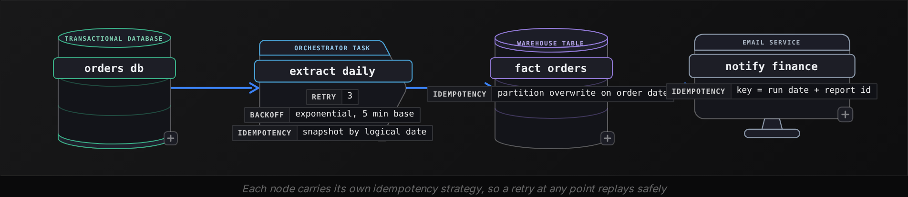
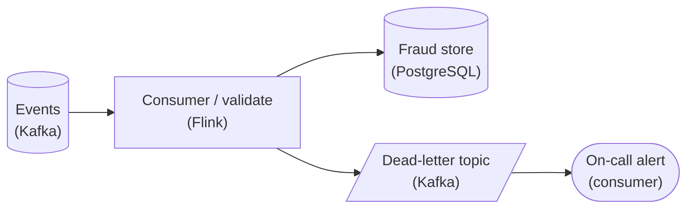
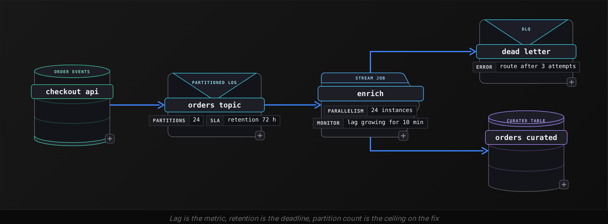
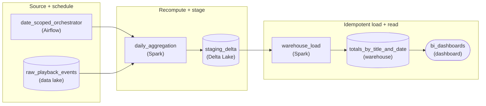
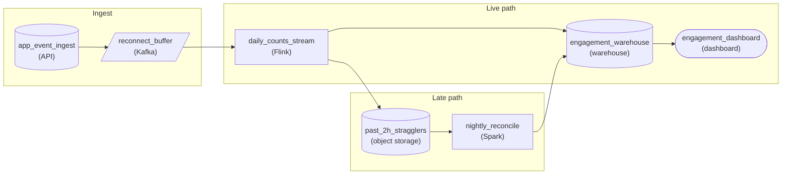
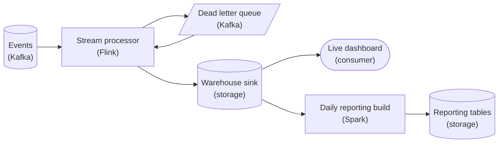

Advanced·Pipeline Architecture · 30 min · 4 challenges

# How Data Moves: Advanced

Shopify's Black Friday weekend is the loudest 4 days on its data platform. In 2023 the company reported $9.3 billion in merchant sales over the weekend, with peak minutes above $4 million, and a public live globe animating every order as it lands. Behind that globe sits a pipeline doing 5 hard things at once: a retried ingestion task must not count an order twice, a burst of checkout events must not drown the consumers, order totals must reach a dashboard served from another continent, the buyer's email must never appear in the analytics copy, and the globe's definition of 'live' has a monthly bill attached. Pipeline interview loops ask about exactly these 5 pressures, usually one at a time and in disguise. This lesson is the scouting report for each: how the question is phrased, what the interviewer is scoring, and the answer that earns the top mark.


<br>

### What you will be able to do

Diagnose the exact step where a retried job changes its output, then name the pattern that makes the second run harmless

Turn a producer and consumer rate gap into lag arithmetic and a deadline, then defend your choice of where the gap goes

Put a number on each of the 3 cross-region costs: round-trip latency and egress fees, plus how far the replica lags

Decide whether masking is enough or the data needs keyed hashing or tokenization, based on which downstream need must survive, and say where it happens

Price the freshness ladder from daily batch to streaming and place a use case on the rung its decision cadence justifies


<br>

---

## Idempotent Pipelines

### How the question arrives

The interviewer rarely says the word idempotent. The question shows up as a story: the orchestrator retried the 02:00 load at 02:40 after a timeout, and finance now sees revenue 1.8 times what the ledger shows. Or it is framed as a design prompt: this job writes to the fact table, what happens if it runs twice? Both are the same question. The score comes from 2 things in order: first the diagnosis of where a second run changes the result, then the pattern that removes that change. Candidates who jump to 'I would add deduplication' before naming what duplicates are produced lose the diagnosis points, and those points carry most of the weight at this level.


<br>

### Diagnose before you fix

A pipeline stops being idempotent at a specific line, and the interviewer wants it named. The most common is an append-only INSERT into the target, where run 2 adds the same rows again. A surrogate key generated by a sequence gives the same order 2 different ids. An aggregate computed as target plus delta lands the delta twice. And a side effect outside the warehouse leaves the second run nothing to compare against: once the email has gone out, there is no row to check, and the same holds for a payment call or a file moved to an archive folder.

| Step | What run 2 does | Idempotent? |
| --- | --- | --- |
| INSERT INTO fact_orders SELECT ... FROM staging | adds the same 50,000 rows again | No |
| DELETE the partition, then INSERT it | removes run 1's rows, writes identical rows | Yes |
| UPDATE totals SET revenue = revenue + delta | adds the delta a second time | No |
| Write orders/dt=2024-11-24/part-0.parquet | overwrites the same path | Yes |
| Call the payment API to capture a charge | charges the customer twice | No, unless keyed |


<br>

### The 3 production patterns

The pattern to lead with is partition overwrite. The job owns 1 partition, usually a date or an hour. It deletes everything in that partition and rewrites it from source. Run 2 produces the same partition as run 1 because the output is a pure function of the input slice. The SQL is short, and interviewers like seeing it because it shows you know the unit of work.

```sql
DELETE FROM fact_orders
WHERE order_date = DATE '2024-11-24';

INSERT INTO fact_orders
SELECT
  order_id,
  customer_id,
  order_date,
  amount_cents
FROM staging_orders
WHERE order_date = DATE '2024-11-24';
```

Pattern 2 is merge on a natural key, for targets where a partition is the wrong unit, such as a customer dimension fed by a change feed. The write says: if this customer_id exists, update it, otherwise insert it. Run 2 finds every row already present and updates it to the same values. The cost is a lookup per row, which is why partition overwrite wins for large fact tables and merge wins for dimensions and late corrections.

Pattern 3 handles the side effects. Any call that leaves the warehouse carries an idempotency key, a deterministic id built from the business event, and the receiving system records the keys it has seen. Payment providers expose this on their APIs for the same reason: a client retry after a network timeout must never create a second charge. In your own services the same idea is a table of processed keys checked before the action fires.




<br>

### Where the follow-up goes

The follow-up that separates tiers is 'what about a stream?' Here the unit is an event rather than a partition, and the pattern is deduplication by event id inside a bounded window, because a replayed consumer group re-reads events it already processed. The window matters: an id store that grows forever becomes the next outage, so you state the retention, typically a few hours past the longest expected replay. The query below is what dedup looks like at the batch boundary, keeping the latest copy of each event.

```sql
SELECT
  event_id,
  order_id,
  status,
  event_ts
FROM (
  SELECT
    event_id,
    order_id,
    status,
    event_ts,
    ROW_NUMBER() OVER (
      PARTITION BY event_id
      ORDER BY event_ts DESC
    ) AS rn
  FROM raw_order_events
  WHERE event_ts >= TIMESTAMP '2024-11-24 00:00:00'
)
WHERE rn = 1
```

Add 2 further points. First, separate the 2 claims: exactly-once describes the delivery path, idempotency describes your write, and the second is the one you control. Second, the scope of the retry matters. A task-level retry inside the orchestrator is cheap to make safe, while a human re-running a backfill over 90 days needs the same guarantee, so the partition the job touches comes from the run's logical date rather than from now().

✓Do

- Name the exact step that breaks under a second run before proposing any fix
- Derive the partition from the run's logical date so backfills replay the same slice
- Put an idempotency key on every call that leaves the warehouse
- State the retention of any dedup id store

✗Don't

- Say 'add deduplication' without saying what produces the duplicates
- Compute aggregates as target plus delta
- Generate surrogate keys from a sequence inside a retryable task
- Claim exactly-once when you mean an idempotent write

> **TIP**
>
> Say the partition key out loud. 'The job owns dt=2024-11-24 and rewrites it' tells the interviewer the unit of work in 1 sentence, and that unit is also what a retry or a backfill touches.


<br>

---

## Pipeline Architecture

### Exercise 1 of 1

**● TASK**

A streaming consumer throws on a malformed event, restarts, replays the same poison record, and throws again, so the whole fraud pipeline wedges behind one bad message. Route the failing events down a side path so the good ones keep flowing, and make sure a rising pile of failures reaches someone instead of growing unwatched.

**Starting canvas** (already placed for you):

- Events (source, Kafka)
- Consumer (wedges on bad event) (transform, Flink)
- Fraud store (storage, PostgreSQL)


<br>

### Solution

#### What this really is

This is the **poison pill** wearing a fraud-detection costume. Strip the story away and it's the oldest failure mode in stream processing: a consumer with at-least-once delivery hits one event it can't parse, throws, and never advances its offset. Kafka hands it the exact same record on restart, it throws again, and the whole partition stops behind message N while N+1, N+2 pile up unread. The lesson here is the dead-letter queue: the fix isn't to parse harder, it's to give the failing event somewhere else to go so the good ones keep flowing. The trap is that a naive `try/catch` that just logs and moves on quietly drops fraud signals on the floor, and nobody notices until an analyst asks where a transaction went.



*Good events flow straight to the `Fraud store`; parse failures branch to a `Dead-letter topic`, and an `On-call alert` wired off it means a rising pile reaches a human instead of growing unwatched.*

#### The design, decision by decision

1. **Wrap the parse, not the whole loop**

   The throw has to be caught at the boundary where you deserialize/validate a single event, so a failure is scoped to that one record. If the `try` wraps the whole poll-process batch, one bad event still fails everything around it. Catch narrowly, classify the failure, and decide per-record: commit-and-route, or retry.

2. **Retry the transient, dead-letter the permanent**

   Not every failure is poison. A timeout writing to the `Fraud store` is transient and deserves a bounded retry with backoff. A malformed payload is permanent: retrying it a thousand times just rebuilds the wedge more slowly. Give retries a hard ceiling (say 3 attempts), and once a record exhausts it, treat it as dead-lettered, not as something to keep replaying.

3. **Route the failure with its context to a side topic**

   Publish the failing event to a `Dead-letter topic` carrying the original bytes plus WHY it failed: the exception, the source `partition`/`offset`, and a timestamp. That payload is what lets someone replay or fix it later. A DLQ that stores only 'this broke' is a graveyard; one that stores the raw event is a repair queue.

4. **Commit the offset AFTER the record is safely handled**

   The moment that breaks the loop: only advance the consumer offset once the event has either landed in the `Fraud store` or been accepted by the `Dead-letter topic`. Now the poison record is durably parked elsewhere and the consumer moves to N+1. Skip this ordering and you either re-poison on restart (commit too late) or lose events (commit too early).

| Pitfall: Logging is not routing |
| --- |
| The mistake real candidates make is `catch (e) { log.error(e); }` and calling it done. That unwedges the pipeline, so it looks fixed, but every malformed fraud event now vanishes with no durable copy and no count. 6 weeks later someone asks why a flagged account slipped through and there is nothing to replay. A log line is not a dead-letter queue: the failed event must survive somewhere you can read it back. |

| Interviewer: A bounded retry that ends in a DLQ |
| --- |
| The tell of a senior answer is that retries and dead-lettering are the same mechanism, not 2 ideas. Juniors add `retry` and stop, and reinvent the infinite loop with extra steps. Strong candidates say it in one breath: bounded retries for the transient case, and exhausting the retry budget is exactly what promotes a record into the `Dead-letter topic`. That single sentence tells the interviewer you have run one of these in production. |

| ✕ Crash and replay | ✓ Route and continue |
| --- | --- |
| Consumer throws on the bad event, offset never commits, Kafka redelivers the same `offset` on restart, throws again. Throughput for the whole partition goes to zero behind one message; lag climbs until an SLA breaks. | Consumer catches at the parse boundary, ships the record to the `Dead-letter topic`, commits the `offset`, and reads N+1. Good events keep flowing at full rate; the one bad message is parked for a human, not blocking the stream. |

| Real world: The DLQ that fills silently is the second outage |
| --- |
| In production the failure mode isn't the first bad event, it's the fiftieth. An upstream schema change starts dead-lettering 5% of traffic and, because the pipeline no longer wedges, nobody looks. That's why the alert is part of the design, not an afterthought: page on `Dead-letter topic` depth or fill rate crossing a threshold, so a rising pile reaches on-call while it's still 50 events and not 5 million. |

| Performance: The side path costs nothing on the happy path |
| --- |
| Dead-lettering is cheap because it's rare: at a healthy 0.01% failure rate, 99.99% of events never touch the `try/catch` slow path or the `Dead-letter topic`. You're adding one branch and one produce call only on failure, so steady-state throughput is unchanged. The design buys you availability (one bad record can't stop the stream) essentially for free, which is why it's the default for every serious streaming platform. |

**Follow-up questions**

1. How do you get the dead-lettered events back into the pipeline once the bug is fixed?\
   *Tests whether the DLQ is a replay queue (re-produce to the source topic) or just a graveyard.*
2. What threshold should page on-call, and should it be `Dead-letter topic` depth or dead-letter rate?\
   *Probes monitoring design: absolute pile vs percentage-of-traffic, and why a slow trickle and a sudden spike need different alarms.*
3. What happens if the write to the `Dead-letter topic` itself fails?\
   *Forces reasoning about the failure-of-the-failure-path: do you block, retry, or drop, and how offset commit ordering protects you.*


<br>

---

## Backpressure

### Recognizing the question

It arrives as a graph described in words. 'Consumer lag on the orders topic has been climbing since 09:00 and is now at 40 million events.' Or as a design probe: 'the API ingests 10,000 events per second but the enrichment service handles 6,000, what do you do?' The interviewer is testing whether you treat the gap as arithmetic before treating it as an incident. A shortfall of 4,000 per second is 14.4 million events of lag per hour, and the first sentence of a strong answer says so, because it tells the room how long you have before the buffers fill.

- **4.4 hours** — to fill a 64M-event buffer at this gap
- **1.67x** — consumer capacity to break even


<br>

### The 4 places the pressure can go

Backpressure is the question of who absorbs the gap, and there are only 4 answers: the buffer absorbs it, the producer slows down, the consumer speeds up, or some data is dropped. Every strategy you have heard of is one of these 4 with a specific mechanism attached. The judgement the interviewer scores is matching the answer to what the data is worth and how long the burst lasts.

| Where the gap goes | Mechanism | What it costs | Fits when |
| --- | --- | --- | --- |
| Buffer | log retention on disk, bounded in-memory ring | latency grows with lag, storage | the burst is short and every event must survive |
| Producer slows | blocking send, credit-based flow control, HTTP 429 with Retry-After | upstream latency, upstream memory risk | the producer can hold state, such as a batch extractor |
| Consumer speeds up | more partitions and instances, larger fetch batches, async I/O | money, rebalance pauses, capped by partition count | the rate increase is sustained |
| Drop or sample | shed oldest, keep 1 in N, priority lanes | data loss, biased metrics | telemetry where the trend matters more than each point |


<br>

### The number that decides it

Parallelism in a partitioned log is bounded by partitions. A topic with 12 partitions can feed 12 consumer instances and no more, so a 13th instance sits idle. If the enrichment service needs 10 instances at 1,000 events per second each to keep pace, and the topic has 8 partitions, scaling consumers does nothing until the topic is repartitioned, which is a producer-side change with its own key-ordering consequences. State the partition count before proposing more consumers, because the interviewer has often chosen a scenario where that count is the trap.


<br>

### Bounded versus unbounded

Unbounded buffers convert a throughput problem into a memory problem that surfaces later and worse. The consumer that reads as fast as it can into an in-process queue runs for 20 minutes, then dies with an out-of-memory error, loses its uncommitted offsets and replays, which is where the previous section pays for itself. The strong answer names a bound and says what happens there. Blocking the reader and spilling to disk both work, as does rejecting with a status the producer understands. A broker with retention is a bounded buffer whose bound is measured in hours of disk, and you should know that number for any pipeline you describe.




<br>

### What a top answer sounds like

Open with the arithmetic, name the deadline from retention, then pick where the gap goes and defend it with the data's value. Then add the operational layer: alert on lag growth rate rather than lag level, because a lag of 2 million that is shrinking is a recovery and the same lag growing is an incident. Mention that slow consumers are usually slow because of a synchronous call per event, and batching those calls often yields a 5x to 10x improvement before any scaling happens. Finish with the failure mode of your own choice: if you add consumers, say what happens to ordering within a key; if you drop, say which dashboard now reads low.

> The follow-ups to expect
>
> - What if the slow consumer is a database? Batch the writes, raise the commit size, and put a buffer with retention in front of it.
> - Does the producer know it is being throttled? It must receive a signal it can act on, or it will time out and retry into the same congestion.
> - How long until lag clears? Lag divided by the surplus rate: 40 million at a 2,000 per second surplus is about 5.6 hours.

> **TIP**
>
> Slowing the producer is only on the table when the producer can wait. A batch extractor can pause and resume; a checkout page cannot make a buyer wait, so for user-facing producers the gap goes to the buffer or the consumer.


<br>

---

## Cross-Region Data Replication

### One question, 3 costs

The prompt sounds operational: 'our warehouse is in Virginia, the new analytics team sits in Frankfurt, the dashboards feel slow, should we replicate?' Or it comes from compliance: 'EU customer data must stay in the EU, how does the global dashboard still work?' Either way the interviewer wants 3 costs separated and a number on each: round-trip latency, which physics sets; egress fees, which the cloud bill sets; and consistency, which your replication design sets. An answer that covers 1 of the 3 reads as incomplete in this round.


<br>

### Latency: the speed of light is the floor

Light in fibre covers roughly 200,000 kilometres per second, so a round trip between the US east coast and Frankfurt, roughly 6,500 kilometres each way, costs about 65 milliseconds before any switch or server touches the packet, and measured round trips land between 80 and 100 milliseconds. Coast to coast across the US is 60 to 70 milliseconds, and US east to Singapore is 180 to 220. These figures matter in 2 ways. A query that makes 50 sequential round trips, which a chatty driver or an ORM will do, turns 90 milliseconds into 4.5 seconds. And a synchronous write that waits for a remote acknowledgement adds the full round trip to every commit, which is why synchronous cross-continent replication is reserved for small, critical state such as configuration and leader election.

| Route | Typical round trip | 50 sequential round trips |
| --- | --- | --- |
| Same region, across zones | 1 to 2 ms | 0.1 s |
| US east to US west | 60 to 70 ms | 3.3 s |
| US east to Frankfurt | 80 to 100 ms | 4.5 s |
| US east to Singapore | 180 to 220 ms | 10 s |


<br>

### Egress: the bill for every byte that leaves

Major cloud providers publish inter-region transfer prices of about $0.02 per gigabyte for most routes, with higher rates on some continents. The arithmetic is where the points are. Replicating 10 terabytes of raw events per day is 300 terabytes a month, which at $0.02 per gigabyte is roughly $6,000 a month in transfer alone, every month, before storage in the second region. The senior move is to ask what actually needs to cross. If the Frankfurt team consumes a 40 gigabyte daily aggregate, replicating that instead of the raw feed costs about $24 a month, which is 250x less. The latency complaint goes away too, because the data is now local to its readers.

✓Replicate raw

- Every downstream query becomes possible in region 2
- Egress scales with event volume
- Lag of seconds with a log-based stream
- Doubles storage and doubles the compliance surface

✗Replicate curated

- Only the agreed outputs cross the boundary
- Egress scales with aggregate size, often 100x smaller
- Lag equals the batch cadence
- A schema change in the aggregate is a cross-region contract


<br>

### Consistency: what the other region sees

Asynchronous replication means the Frankfurt copy lags Virginia by some interval: seconds for a log-based stream, minutes to hours for a batch copy. The interviewer wants you to name the lag, name who notices it and name the rule that keeps it harmless. The rule is usually single-writer: 1 region owns writes for a given key and the others serve reads, so there is never a conflict to resolve. Where 2 regions must both write, you need a conflict policy, and last-writer-wins by timestamp is the common one, with the known flaw that clocks across regions disagree by milliseconds, so 2 updates inside that window resolve arbitrarily. Netflix has written publicly about running active-active across multiple regions and the replication work it demanded. The point to take from that material is that multi-writer is a product decision, worth its engineering cost only when the availability gain justifies it.


<br>

### The residency twist

When the question comes from compliance, the direction reverses: data must stay in the EU, and the global view must be built from what is allowed to leave. The pattern is compute where the data lives and ship only the non-personal result: each region builds its own aggregates with the identifiers stripped out, and a global job unions them. This also answers the cost question, because the aggregates are small, and it sets up the next section, where the identifiers themselves are the subject.

- Latency: quote the round trip and multiply by the number of sequential calls
- Egress: quote the per-gigabyte rate, then the monthly bytes, then the product
- Consistency: quote the lag, the single-writer rule, and the conflict policy if there are 2 writers
- Residency: compute in region, ship only aggregates, union globally

> **TIP**
>
> Put a number on each of the 3 costs before the interviewer asks for one. 'About 90 ms, roughly $6,000 a month, and a lag of about 2 minutes' is the shape of an answer that scores.


<br>

---

## Moving Sensitive Data Safely

### Counting the places data is exposed

It arrives as a review: 'walk me through how customer data moves from the checkout service to the analytics warehouse, and tell me where it is exposed.' The word exposed is the hint. The interviewer holds a mental list of places personal data leaks while it moves and is counting how many you find. The list runs longer than encryption: the wire, the staging bucket, the broker's disk, the dead-letter queue, the orchestrator's logs and the error message that printed a row. Past the pipeline itself, it includes the backup and the analyst's laptop after a CSV export. Finding 6 of those 8 earns full marks on the diagnosis.


<br>

### In transit: stated precisely

Transport encryption with TLS between every hop is assumed, and the credit is for the detail: mutual TLS between internal services so the producer is authenticated too, with certificates issued and rotated by an internal authority. You also get credit for saying that TLS protects the wire only. The moment data lands on a disk, a broker partition, a staging file, a temp table, it is at rest and needs its own encryption, with keys held in a key management service rather than in a config file. Field-level encryption goes further: the sensitive column is encrypted by the producer with a key the pipeline never holds, so a compromised warehouse yields ciphertext.


<br>

### Masking, hashing, tokenizing: pick by what survives

Most of the tradeoff points in this round come from choosing among 3 techniques, each of which preserves something different. Masking replaces characters, so a phone number becomes \*\*\*-\*\*\*-\*\*42: the format and last 2 digits stay readable, no joins are possible, and it's irreversible. Keyed hashing replaces the value with a fixed-length digest computed with 1 secret key shared by every row, usually called a pepper and best applied as HMAC-SHA256 rather than concatenated onto the value: joins across tables still work because equal inputs give equal outputs, and the original cannot be recovered without the key. A random salt per row, the password-storage habit, gives the same email 2 different digests and breaks every join, and a hash with no secret at all falls to a precomputed table in minutes on a low-entropy field like a phone number. Tokenization swaps the value for a random token held in a vault: joins work, the original is recoverable by anyone with vault access, and the vault becomes the thing to protect. The answer that scores starts from which downstream need must survive and works back to the technique: needing the original back means tokenization, joins without that need mean a keyed hash, and masking is left for fields people only have to read.

| Technique | Joins survive? | Reversible? | Weakness |
| --- | --- | --- | --- |
| Masking | No | No | useless for analytics joins |
| Keyed hash (pepper) | Yes | No | a leaked key exposes every low-entropy field |
| Tokenization | Yes | With vault access | the vault is a single high-value target |
| Field encryption | Only on ciphertext equality | With key access | key rotation means re-encrypting history |

```sql
CREATE VIEW analytics.customers_pseudo AS
SELECT
  to_hex(hmac_sha256(to_utf8(lower(email)), to_utf8('pepper-2024-q4'))) AS customer_key,
  regexp_replace(phone, '\d(?=(?:\D*\d){2})', '*') AS phone_masked,
  signup_date,
  country
FROM raw.customers;
```

The hash includes a secret pepper, which in production comes from the secret store rather than the view text, and it lower-cases the email first so the same person with mixed-case entries gets 1 key. Point that normalization out in the interview: a pseudonym that splits 1 customer into 2 is a correctness bug dressed as a privacy feature.


<br>

### Where the masking happens is the scope question

Here the interviewer wants a placement decision. Mask at the source and the raw value never exists downstream of the producer: every exposure point on the earlier list, down to the backups and exports, holds only the masked value. That is the strongest posture, but it blocks any legitimate use of the raw field, such as fraud review. Mask at serving, with a view per audience, keeps the raw column in a restricted table and gives analysts the pseudonymized view: flexible, but every copy of the raw table, including its logs and backups, is now in scope. The defensible answer in most companies is a split: identifiers are pseudonymized at ingest with a keyed hash so analytics joins still work, and the raw value lands in a separate table with its own access policy and a short retention.

Expect 2 follow-ups. Deletion requests against immutable logs are answered with crypto-shredding: encrypt each customer's fields under a per-customer key, and deleting the key renders every copy unreadable without rewriting history. And dead-letter queues, which collect the malformed rows nobody looks at for weeks, are the leak point most teams forget, so you state their encryption and retention explicitly and unprompted.

✓Do

- Count the leak points: wire, staging, broker disk, DLQ, logs, errors, backups, exports
- Pseudonymize at ingest with a keyed hash so joins survive
- Hold raw identifiers in a separate table with its own policy and retention
- Answer deletion against immutable logs with per-customer keys

✗Don't

- Stop at 'we use TLS' when asked where data is exposed
- Hash a phone number without a secret key
- Let a stack trace print a row into the orchestrator's logs
- Forget that the dead-letter queue holds the same fields as the main topic

> **TIP**
>
> Lead with the leak list, then the technique, then the placement. Interviewers score the list first, because anyone can recite the techniques.


<br>

---

## Pipeline Architecture

### Exercise 1 of 1

**● TASK**

Right now a second run over a date adds to the numbers already there, so our daily watch-time and revenue totals per title drift every time on-call retries a failed run or an analyst backfills an arbitrary past date, which happens several times a week. We recompute those totals in a daily batch from about 900M raw playback events, landing one row per title and date in the analytics warehouse that finance and content dashboards read. Design the pipeline, from scheduling through the warehouse load, so that running any date once or five times leaves that table exactly as a single clean run would.


<br>

### Solution

#### What this problem is really testing

This is an **idempotency** problem in a revenue-reporting costume. The job already computes the right daily numbers. What breaks is the SECOND run. The naive load appends its output, so a retry or a backfill over a date that already has rows adds a second copy of that date, and the totals drift. The skill being probed is whether you make the WRITE replace-on-rerun instead of add-on-rerun. Say 'just wrap it in a transaction' and you have missed the point: a transaction makes one run atomic, but it does nothing to stop the next run from stacking a fresh copy on top.

The definition to keep in your pocket: an idempotent pipeline produces the same result whether it runs once or five times on the same input. For a daily batch aggregate, every rerun over a date must leave the warehouse exactly as a single clean run would.

#### The 3 patterns, and which fits here

1. **Pin the grain you replace on**

   The warehouse holds one row per title per date, and a run always targets a single date. That grain decides everything: it is the unit a rerun deletes and rewrites. Name the table after it (`totals_by_title_and_date`) so anyone reading the design sees what a replace overwrites. Without a stable key or partition, 'replace this date' means nothing and you are back to appending.

2. **Make the write replace, not append**

   A full daily recompute produces the ENTIRE partition for a date, so the cheapest safe pattern is partition REPLACE: delete the date's partition, then write the fresh one. An upsert keyed on title and date is the alternative, and it only wins when a run touches a sparse slice of an existing date instead of rebuilding the whole day. Either way, running a date twice converges to one clean copy.

3. **Make the replace atomic per date**

   A load that dies mid-write must not leave a half-replaced date visible. Stage the recomputed partition first, then swap it in as one commit. Finance then reads either the old date or the fully new one, never a torn mix, and that is what keeps retries safe.

4. **Scope reruns through orchestration**

   A date-scoped orchestrator (Airflow) owns when and which date is recomputed. A rerun or backfill for date D triggers the same pipeline with D as its only input, and the load's `partition_overwrite` backfill strategy rewrites only D. When an analyst backfills 90 days, the orchestrator fans it out into 90 single-date runs, and each one is independently safe.

| Trick: Recompute the whole date, don't diff it |
| --- |
| The job rebuilds a date from that date's raw partition, so you never need to reconcile against what is already in the warehouse. Delete the date and write it again. That is why a delete-then-write of the date (`delete_write` on the load) beats a row-by-row `MERGE` here: the recompute already IS the full delta for the date. |

#### The shape that fits



*The orchestrator runs any single date through the same path. The load deletes and rewrites that date's partition of the title-and-date table from the staged partition, so one run or five converge to one clean copy.*

| Interviewer: Name the replace unit before the tool |
| --- |
| A strong candidate names the replace unit BEFORE choosing a tool: 'one row per title per date, so a rerun overwrites that date's partition.' They also say retries and backfills go through the same date-scoped load, so an analyst replaying an old date can only rewrite that date. That answer shows they have been paged at 3am over a double-counted dashboard. |

| Pitfall: A transaction does not stop the second copy |
| --- |
| Wrapping the append in a transaction makes a single run all-or-nothing. It does nothing about the second run stacking another full copy of the date. The double-count is not a partial-write bug; it is an append-versus-replace bug. Transactions give the swap its atomicity, not the pipeline its idempotency. |

**Follow-up questions**

1. MERGE is slow on a billion-row title-history table. What do you do?\
   *Tests the curveball. Partition REPLACE is faster than a full-table MERGE: delete the date's partition and write fresh data. Or stage the delta and MERGE only against the affected partition instead of the whole table.*
2. An analyst backfills 90 days at once. How does that stay safe?\
   *Tests whether the replace stays date-scoped. The backfill fans out into 90 single-date runs, each overwriting its own partition, so no date corrupts another and any one date can be rerun independently.*


<br>

---

## Cost of Freshness

### The question is a budget question

It arrives as enthusiasm from the product side, repeated by the interviewer: 'the executives want the revenue dashboard in real time, how would you build it?' The scored answer begins with a question back: what decision does anyone make from this number, and how fast do they make it? If the dashboard is read at the 09:30 standup, 15-minute freshness is indistinguishable from 1-second freshness, and the difference in cost is where the judgement shows. The interviewer wants you to price the ladder, place the use case on the right rung and defend the placement.


<br>

### The freshness ladder and what each rung costs

| Cadence | Runs per day | Compute shape | Hidden cost |
| --- | --- | --- | --- |
| Daily batch | 1 | 1 cluster, 45 min | worst-case staleness of 25 h |
| Hourly batch | 24 | 1 cluster, 5 min each | 24x the scheduling surface, late data straddles hours |
| 5-minute micro-batch | 288 | warm cluster or always-on pool | small files, a compaction job, lag alerts |
| Streaming | continuous | always on, sized for peak | 2 code paths if batch backfill stays, checkpoint operations |

The shape of the cost curve matters more than any single figure. Daily and hourly batch cost compute roughly in proportion to data processed, because the cluster runs and then stops. Below about 5 minutes the cluster stops stopping: it stays warm for the next run, so you pay for peak capacity all day. A streaming job sized for a Black Friday peak of 10,000 events per second runs at that size on a Tuesday in February at 400 per second. The number to carry is how much of the day the capacity is busy: a batch job that runs 45 minutes a day uses its capacity about 3 percent of the time, and the same work as a stream uses 100 percent of an always-on allocation, so the streaming version can cost 10x to 30x more for the same bytes when the capacity is fixed.

- **1,440** — runs per day at 1-minute cadence
- **12x** — files per day, 5-minute vs hourly


<br>

### The cost of small files

Micro-batches carry a cost that shows up 3 months later: each run writes a file per partition, so 288 runs across 50 partitions is 14,400 files a day, and a month in, a query over that table opens 432,000 files before reading a byte. Then a compaction job is added to merge them, which is another pipeline to monitor, and the freshness promise now has an asterisk because compaction and the next micro-batch race for the same partition. Interviewers reward candidates who raise this unprompted, because it shows they have run the 5-minute pipeline rather than drawn it.


<br>

### Placing the use case

| Use case | Who acts, how fast | Right cadence | Why |
| --- | --- | --- | --- |
| Fraud scoring at checkout | a model, inside the request | streaming | the decision happens inside the latency window |
| Live sales globe on a marketing page | nobody acts, it is a display | streaming, sampling allowed | the value is the motion, so dropped events are acceptable |
| Executive revenue dashboard | humans, at a daily standup | hourly or daily | the decision cadence is daily |
| Inventory reorder | a planner, each morning | daily, plus a hot path for stockouts | split the 1 urgent signal from the bulk |
| Experiment metrics | a PM reading results after a week | daily | nothing changes faster than the experiment |

The row to study is inventory, because it shows the pattern interviewers reward most: split the workload. The bulk recomputation runs daily and cheaply, and a narrow streaming path carries only the stockout signal, which is small and high value, and where latency matters. You get real time where it pays and batch everywhere else, and the streaming cluster is sized for a trickle rather than the whole feed.


<br>

### Saying it in the room

Lead with the question back, then state the rung, then state the number. 'Who reads this and what do they do within 5 minutes of reading it? If nobody acts inside an hour, hourly batch at roughly a twelfth of an always-on cluster the same size; if the fraud model consumes it, streaming, sized for peak with the batch path kept for backfill.' Then name what the design costs: 2 code paths are a maintenance cost you are choosing, and a late-data policy is required at every cadence, because an hourly job still receives events stamped in the previous hour. Close by naming the freshness SLA as a contract with a number and an owner, since 'real time' without a number is a request for an unbounded budget.

> Signals the interviewer listens for
>
> - A question back about who consumes the data and how fast they act on it
> - How busy the cluster is: the one that runs 45 minutes a day against the one that never stops
> - The small files that micro-batches write and the compaction job they force, raised before being asked
> - A split design: bulk in batch, the 1 urgent signal in a narrow stream
> - A freshness SLA with a number and an owner, plus a rule for late data


<br>

---

## Putting It All Together

DoorDash on Super Bowl Sunday: order volume climbs through the afternoon and spikes in the hour before kickoff, and the data platform has to keep a courier-supply dashboard fresh for dispatch operators in several countries, feed a fraud model inside the checkout request, and hand the finance team a settlement table the next morning that reconciles to the cent, all while the orchestrator retries whichever extract times out under the load.

- The settlement table reconciles because every retried extract rewrites its own hourly partition from the run's logical hour, so the 3 retries during the spike leave the same rows as 1 clean run.
- The fraud model keeps its latency because the order topic was sized at 48 partitions before the game, and lag alerts fire on growth rate, so the 1 enrichment service that fell behind was scaled inside its partition ceiling rather than discovered at halftime.
- Dispatch operators in Europe read a courier-supply aggregate replicated from the US region, a few hundred megabytes an hour at the published per-gigabyte rate, rather than the raw order feed, which keeps the bill small and the dashboard local to its readers.
- Customer phone numbers never reach the analytics copy: they are hashed with a secret pepper at ingest so the fraud team can still join across orders, and the raw column sits in a restricted table with a 30-day retention, including in the dead-letter queue.
- Only the fraud path streams; the supply dashboard runs on 5-minute micro-batches with a nightly compaction, and the settlement table runs once at 06:00, so the always-on cluster is sized for the fraud trickle rather than for the whole Super Bowl feed.


<br>

---

## Pipeline Architecture

### Exercise 1 of 2

**● TASK**

An offline-first mobile app holds events on the phone while it has no signal and flushes them on reconnect, so ingestion sees about 60M events a day with commute-hour spikes near 20x the average, and although 99% of events arrive within 2 hours, a tail trickles in up to 7 days late. The product analyst needs each day's engagement counts on a dashboard within 15 minutes, so a day cannot wait on the slowest phone, yet no spike may drop events and every straggler must still land in the day it happened. Design the pipeline so late events are durably stored until the nightly job folds them back, and the counts end up exact even when the job is rerun.


<br>

### Solution

#### What this really is

This is the late-arriving-data pattern with every piece on the table at once: a buffer that soaks up reconnect bursts, a watermark read off the arrival curve, a side output for whatever misses it, and a batch merge that folds the side output back in. Anyone draws Kafka into Flink into a warehouse. What separates answers is what happens to the event that shows up 6 days late, and what happens the second time the nightly job runs. Drop it and every day with an offline phone quietly undercounts; add it onto the existing total and the first rerun doubles every correction the analyst already reported.

| Trick: 2 paths split on one number |
| --- |
| Read the allowance off the arrival curve, not off the worst phone.<br><br>1. 99% of events arrive within 2 hours, so the stream holds each day open until its end plus 2 hours, then closes it.<br>2. Anything later, roughly 600k events a day, leaves the stream on a side output into the lake instead of being dropped.<br>3. A nightly batch job merges those stragglers into their own event day, keyed on `event_id`, and rewrites the correction instead of adding to it. |

#### Walk the requirements

1. **Put a buffer between the phones and the counter**

   At 700 events a second on average and close to 14,000 during the reconnect wave, a stream processor wired straight to the ingest API either drops events or falls over. A partitioned Kafka topic in front of it turns the spike into lag: the consumer reads at the pace it can sustain, lag climbs for 15 minutes, then drains. Sizing the consumer for 20x would mean paying for peak all day to avoid a queue that clears on its own. The subtle part: that delay is processing lag, not lateness. An event that waited 10 minutes in `reconnect_buffer` is still on time for its day, because the day is keyed on when it happened on the phone.

2. **Pick the allowance from the arrival curve**

   The watermark is a bet about how late data can be, and the distribution prices the bet. At 2 hours the stream captures 99% of events and the running count on `engagement_dashboard` stays inside the 15-minute freshness the analyst asked for; the day simply keeps accepting updates until 02:00 UTC. At 10 minutes the side path swallows several percent of traffic and the nightly correction becomes a second pipeline. At 7 days the stream holds a week of state and the analyst never sees a settled number.

3. **Send stragglers down their own path**

   An event that arrives after its day closed is not broken, so it does not belong in a dead letter queue beside malformed payloads. The stream emits it on a side output to `past_2h_stragglers`, at event grain, carrying its `event_id` and its event timestamp. Nothing is lost and nothing holds the live path open.

4. **Make the correction a rewrite, not an increment**

   `nightly_reconcile` merges stragglers into a ledger keyed on `event_id`, so a phone that re-sent its batch, or a job that ran twice, lands each event once. It then recomputes each touched day's late count from that ledger and overwrites the value. The stream's count and the late count live side by side and the dashboard shows their sum. Rerun it and the merge matches every key, the recompute returns the same numbers, and the analyst's report does not move.

#### The shape that fits



*Kafka absorbs the reconnect wave; Flink counts by event day with a 2-hour allowance and sends later events to `past_2h_stragglers` in object storage; a nightly Spark job merges them into the warehouse on `event_id`, safe to rerun.*

| Interviewer: The allowance has to come from the data |
| --- |
| The tell at this level is where the lateness number comes from. 'Two hours, because 99% of events arrive by then, and the last 1% goes to the side path' is reasoning from the distribution. 'Five minutes, it's the default' is not. The second tell is explaining why the merge survives a rerun instead of just asserting that it does. |

| Pitfall: Late is not broken |
| --- |
| The design that ships routes past-allowance events into the same dead letter queue as malformed payloads, or lets the default late-data policy drop them. Both look fine in week one because the gap is 1%. A month later a release drives up offline usage, the undercount stops being small, and the dropped events are gone for good. |

**Follow-up questions**

1. A phone re-sends its whole batch inside the 2-hour allowance because the first upload wasn't acknowledged. What keeps the live count from doubling?\
   *Tests whether the candidate sees that the ledger only covers stragglers; the live path needs its own dedup on `event_id` within the day, or a sink that upserts at event grain.*
2. A new app release doubles offline usage and the share of events past 2 hours climbs from 1% to 8%. What do you change?\
   *Tests whether the allowance is treated as a measured choice: watch the side-path share, then weigh a wider allowance (more state, slower settling) against a bigger nightly merge.*


<br>

### Exercise 2 of 2

**● TASK**

Every backfill and on-call replay re-runs the same Kafka events through this stream, so the warehouse sink has to land each event once no matter how many times it sees it. Malformed and late events can't stall the stream: park the bad ones where they can be inspected and later fed back through the stream once fixed, and page on-call when that backlog grows. Not every consumer needs second-fresh data, so serve the live dashboard and the daily reporting tables at the freshness each one actually requires.

**Starting canvas** (already placed for you):

- Events (source, Kafka)
- Stream processor (transform, Flink)


<br>

### Solution

#### What this really is

This is the lesson's depth probes stacked on one stream: what happens when it runs twice, what happens to an event that can't be processed, and which reader is worth paying real-time prices for. Everyone draws `Kafka` into `Flink` into a warehouse. The trap is the replay sentence. Candidates lean on the engine's exactly-once checkpointing, append to the sink, and call it done. Then the first backfill re-adds every event it touches: **a day replayed twice doubles every metric downstream**, and the engine never noticed, because its guarantee stops at its own state.



*The two starter nodes grow an upsert sink, a dead letter queue that pages on backlog and replays into the processor, and a daily build for the reporting tables.*

#### The idempotent sink

1. **Give every event a stable key**

   Use the producer's `event_id` if it exists, else a business key plus `event_time`. The key must be deterministic from the payload, so a replayed event maps to the same row. A key built from processing time or an auto-increment is not a key: it mints a new row every run.

2. **Write with an upsert, never an append**

   The sink runs a `MERGE` (or `INSERT ... ON CONFLICT (event_id) DO NOTHING`) on that key. At-least-once delivery plus a conflict-absorbing write gives an exactly-once effect in the warehouse, and re-running the whole topic changes nothing that already landed.

| Trick: Make the sink idempotent and let delivery repeat |
| --- |
| Backfills and replays guarantee the same event crosses the wire more than once, so stop fighting it. The upsert on a stable key is the whole fix; checkpointing in `Flink` protects the engine's state, not your warehouse rows. |

#### Bad and late events step out of line

Malformed payloads and events that arrive behind the watermark go to the `Dead letter queue` while the processor keeps moving. Nothing is dropped: once the parser or the upstream is fixed, the queue is drained back through the `Stream processor`. A late event replayed this way still carries its `event_time`, so it lands in the right day, and the upsert sink makes the replay safe by construction.

| Pitfall: Retrying a poison event in place stalls the partition |
| --- |
| Retry a malformed record inline and every event behind it waits. Lag climbs, the consumer falls behind, and one bad byte becomes an outage. The dead letter queue exists so a bad event leaves the line instead of holding it. |

The page sits on the queue's backlog, not on single dead letters. A steady trickle is normal; a growing backlog means an upstream schema changed or a producer broke. Paging per message trains on-call to ignore the pager.

#### Pay for freshness only where it is read

| ✕ Live dashboard | ✓ Reporting tables |
| --- | --- |
| Reads the warehouse rows the stream writes, seconds behind. It is the only reader that justifies the `real-time` path, so it gets it. | Rebuilt once a day by a batch job over the deduplicated warehouse. A `< 24h` refresh is all a daily report needs, and by then replayed late events have landed too. |

| Interviewer: Real-time is a price, not a default |
| --- |
| Real-time runs roughly 3-5x the cost of batch for the same throughput, most of it in on-call burden and debugging. Pricing each reader separately, the dashboard on the stream and the reports on a daily job, is what tells an interviewer you have paid that bill. |

**Follow-up questions**

1. The events have no `event_id`. How do you build a key you trust across replays?\
   *Tests whether the key is a deterministic function of the payload: a business key plus `event_time`, or a content hash.*
2. The `Daily reporting build` runs twice for the same day. What keeps the `Reporting tables` from double-counting?\
   *Checks that idempotency is carried to the second write, for example by replacing the day's partition.*
3. How do you drain the `Dead letter queue` after a parser fix without re-poisoning the stream?\
   *Probes replay through the same processor, reliance on the upsert sink, and sending still-bad records back to the queue.*
4. Volume grows 10x and the processor can't keep up. What happens to the stream, and what do you change?\
   *Tests backpressure reasoning: buffering in the topic, scaling consumers, and never silently dropping data.*


<br>

---

## Key Takeaways

- Idempotency is scored as diagnosis first: name the step where run 2 changes the result, then apply partition overwrite, merge on a natural key, or an idempotency key for side effects.
- Backpressure is arithmetic before it is an incident: the rate gap times time is the lag, retention is the deadline, and partition count caps how far scaling consumers can go.
- Cross-region questions want 3 numbers: round trip from physics, egress from the per-gigabyte rate times monthly bytes, and replication lag with a single-writer rule.
- Sensitive data in motion leaks at 8 places beyond the wire; pseudonymize at ingest with a keyed hash so joins survive, and keep raw identifiers in a restricted table with short retention.
- The price of freshness follows how much of the day you hold capacity: batch pays for minutes, streaming pays for peak all day, so place each use case on the rung its decision cadence justifies and split the urgent signal from the bulk.
