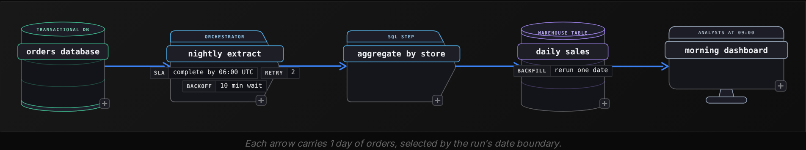
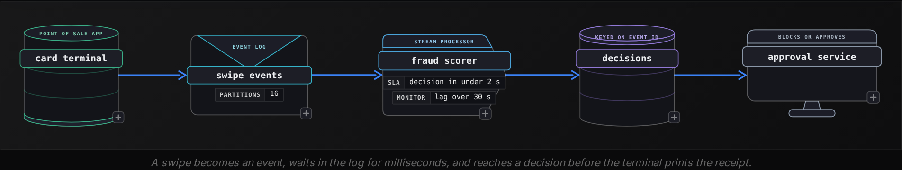

Beginner·Pipeline Architecture · 20 min · 4 challenges

# How Data Moves: Beginner

Every December, Spotify ships Wrapped: your year of listening, turned into a share card. Behind it sits a batch job over most of the year's play history, and nobody would mind if it ran for hours, because the deadline is a date on a calendar. Open the app the same day and the home screen can reflect what you played earlier that morning. That path moves data another way: one event at a time, soon after it happens. Add the catalog files a label delivers and the partner APIs a company like this pulls from, and you have 4 ways of moving data under one roof, each chosen for a reason. Interviewers ask about this because the simplest version of the question hides a scoring rubric: can you name which way the data moves and why, and can you point at where it breaks.


<br>

### What you will be able to do

Describe a batch job by the data it reads and what starts it, then say what a rerun does to the output

Trace an event from the producer through the broker to the consumer, keeping event time apart from processing time, then justify the cost

Load a file from an outside party the way production does: completeness check, ledger, source file on every row

Pull from an API page by page, fetching only records changed since the last run and retrying when a call fails or hits a rate limit

Answer 'batch or streaming?' by asking for the freshness number and the consumer before choosing


<br>

---

## Batch Processing

The question arrives as 'walk me through how you would produce yesterday's sales numbers every morning,' or in its bluntest form, 'what is batch processing?' Either way the interviewer is checking the same thing: whether you can describe a job that takes a bounded set of data and runs until it has written a result someone reads later. The scoring sheet for this question is short, and most candidates lose points by skipping an item on it rather than by saying anything wrong.

> The 3 things a scored batch answer names
>
> - The boundary: which rows belong to this run, stated as a window such as orders placed on October 18 in UTC.
> - The trigger: what starts the run, a clock (02:00 daily) or an upstream event (the export finished).
> - The rerun: what happens when the same run executes twice, because at some point it will.


<br>

### What batch means

A batch is a bounded input. The job knows, before it starts, which data it will read, and it stops once that data is processed. That boundedness is what makes a batch job reliable to reason about: you can count the input rows, count the output rows, and compare the 2 numbers. Latency is measured in hours, and that's acceptable when the consumer is a report or a monthly invoice, anything that reads data on a schedule rather than reacting to it. A daily sales table rebuilt at 02:00 and read by analysts at 09:00 is the canonical example, and it is the one to reach for when the interviewer asks for one.




<br>

### Saying the boundary out loud

'Yesterday' means 2 different things to 2 different people. State it as a half-open interval: ordered_at >= '2026-10-18 00:00:00' and ordered_at < '2026-10-19 00:00:00', in UTC. The half-open shape means an order placed at exactly midnight lands in 1 day and never in both, and 2 adjacent runs cover every second without overlap. The query the job runs looks like this:

```sql
INSERT INTO daily_sales
SELECT
  CAST(ordered_at AS DATE) AS sale_date,
  store_id,
  COUNT(*) AS order_count,
  SUM(total_cents) AS revenue_cents
FROM orders
WHERE
  ordered_at >= TIMESTAMP '2026-10-18 00:00:00'
  AND ordered_at < TIMESTAMP '2026-10-19 00:00:00'
GROUP BY
  1,
  2
```

Before that insert runs, the job deletes any rows already sitting in daily_sales for October 18, and both statements run in 1 transaction, so a crash between them leaves the old rows and no reader sees the day empty or half-written. That pair is what makes the rerun answer correct: run the job once and the day has 1 set of rows, run it 3 times and it still has 1 set. Appending without the delete means a retry doubles revenue for that date, and the interviewer will ask what happens on retry whether you raise it first.

```sql
DELETE FROM daily_sales
WHERE
  sale_date = DATE '2026-10-18'
```


<br>

### Where the daily job breaks

| Break | What the dashboard shows | Property that prevents it |
| --- | --- | --- |
| Retry after a partial failure | Revenue for the day doubled | Replace the date's rows instead of appending |
| Late data: an order committed at 23:59:58 reaches the extract after the run | Yesterday short by a few orders | Extract from a snapshot taken after a short lag, and allow a rerun for the date |
| Schema change: a column added to orders | The job fails, or `SELECT \*` shifts values into the wrong columns | An explicit column list and a row count check against the source |
| Source unavailable at 02:00 | No rows for the date at all | A retry after a wait, then an alert if it still fails before the 06:00 deadline |

> **TIP**
>
> Separate the clock from the boundary when you answer. 'The job runs at 02:00 UTC and processes orders whose ordered_at falls on the previous UTC date' tells the interviewer you know the run time and the data window are 2 different parameters.


<br>

### The answer that scores

Put together, the answer sounds like this. 'I would schedule a job at 02:00 UTC that selects orders with ordered_at inside the previous UTC day, aggregates them by store, deletes any existing rows for that date in the target table, and inserts the new ones. If it fails it retries twice with a 10 minute wait, and if it misses the 06:00 deadline it pages someone. Because the job replaces the day rather than appending, I can rerun any date safely, which is also how I would backfill a month.' That is 3 sentences, every item on the sheet covered, and the interviewer moves to the next question with nothing left to probe.


<br>

---

## Stream Processing

This one shows up as 'how would you flag a stolen card before the second swipe goes through?' or 'what changes when the data never stops arriving?' The interviewer wants 2 things: an accurate picture of what a stream is, and a justification for paying for it, because a stream costs more to build and to run than a nightly job, and choosing one without a reason is the most common way to lose this question.


<br>

### What a stream is

A stream is an unbounded input. Events keep arriving, there is no last row, and the job processes each event, or a small group of them, shortly after it appears. Every stream runs from a producer through a broker to a consumer. A producer writes events: an app, a sensor, a database emitting its changes. A broker holds them, usually as an append-only log that keeps events for a retention period and lets several consumers read independently. The log is split into partitions so consumers can share the work, and order holds only within a partition, so all events for 1 key, such as every swipe on 1 card, go to the same partition. A consumer reads from the broker and, after doing its work, records how far it has read. Latency is measured in seconds or less, and that latency is the entire reason the design exists.

```sql
{
  "event_id": "evt_01HZX4K9",
  "event_type": "card_swipe",
  "card_id": "card_88213",
  "merchant_id": "m_4471",
  "amount_cents": 4999,
  "event_time": "2026-10-18T14:02:11Z"
}
```




<br>

### Event time and processing time

Every event has 2 timestamps, and the interviewer is listening for whether you keep them apart. Event time is when the thing happened, written by the producer. Processing time is when the consumer saw it. A phone that lost signal in a tunnel can emit an event whose event_time is 4 minutes older than its arrival. Any count 'per 5 minute window' has to say which clock defines the window, and a stream that groups by event time has to decide how long it waits for stragglers before it publishes a number.

| event_id | event_time | arrived_at | Window by event time | Status on arrival |
| --- | --- | --- | --- | --- |
| evt_101 | 14:02:11 | 14:02:12 | 14:00 to 14:05 | window open, counted |
| evt_102 | 14:04:50 | 14:04:51 | 14:00 to 14:05 | window open, counted |
| evt_103 | 14:03:30 | 14:07:40 | 14:00 to 14:05 | arrives 2 min 40 s after the window ended |
| evt_104 | 14:06:05 | 14:06:06 | 14:05 to 14:10 | window open, counted |

Event evt_103 is the late data case. If the window closed at 14:05 and emitted a count of 2, the true count is 3. The answer that scores has the window wait a grace period before emitting, and logs anything later and folds it into a correction rather than dropping it in silence. With a 2 minute grace, the window emits 2 at 14:07, and evt_103 at 14:07:40 turns that into a correction to 3. A 3 minute grace would have caught it, at the cost of every result landing a minute later. Give the grace period as a number in your answer, because every minute of it delays the result that streaming was supposed to make fast.


<br>

### Retry in a stream

Consumers crash. When one restarts it resumes from the last position it saved in the broker, which means every event between that save and the crash is read a second time. The property that makes this harmless is a store that treats event_id as a key, so the second copy overwrites the first or is ignored, and a swipe never becomes 2 swipes. Name that in the answer and the retry follow-up is already closed.


<br>

### Justifying the cost

✓What a stream costs

- Compute that runs around the clock, for an hour of 10 events as much as for an hour of 10 million
- A broker to operate, where someone has to watch retention and partitions as well as consumer positions
- Harder debugging: there's no input file to open and rerun, only a log position
- 2 clocks and late data inside every aggregate

✗What pays for it

- A decision whose value decays in seconds: a fraud block, an oversold item, a surge price
- An alert that is worthless if it lands an hour late
- A user-facing feature that reflects the user's own last action
- Events that are also written to storage, so batch jobs can reuse them later

- **7 days** — a common broker retention window
- **16** — partitions in the swipe log above

> **TIP**
>
> Lead the cost justification with a dollar or a clock. 'A stolen card that gets approved costs the issuer the full amount, so a decision in 2 seconds is worth an always-on consumer' is a justification. 'Real time is better' is a preference, and it is scored as one.


<br>

### The scored version

'A stream is unbounded input processed as it arrives, moving from a producer through a broker to a consumer. For fraud, the card terminal publishes a swipe event, a consumer scores it against the card's recent history and writes a decision in under 2 seconds, keyed by event_id so a replay after a crash cannot double count. Windows are defined on event time with a short grace period for late events. The cost is an always-on consumer and a broker to operate, and it is justified because an approved fraudulent swipe is a direct loss.' That answer defines the idea, applies it, handles both failure cases and justifies the spend, which is the full rubric.


<br>

---

## File Ingestion

The question arrives as 'a payment processor drops a CSV of settlements into a bucket every night. How would you load it?' Candidates who have only loaded files on a laptop describe reading the file and inserting the rows. Candidates who have loaded files in production describe everything that goes wrong between the processor's upload and your table, and that gap is exactly what this question measures.

> What production awareness sounds like
>
> - Knowing the file is finished uploading before reading it
> - Recording which files have been loaded, so a re-delivered file replaces instead of duplicating
> - Noticing when a file fails to arrive at all
> - Expecting the format to drift: a new column, a changed delimiter, a new date format
> - Keeping the raw rows so a bad parse can be redone without asking for the file again


<br>

### Is the file complete?

Where a partial read happens depends on where the file lands. On an SFTP server or a shared file system, a 400 MB file is visible with 120 MB written, and a loader that starts then reads a truncated file and exits cleanly; the defense there is either a temporary name that the sender renames on completion, or a check that the file's size and modification time haven't changed across 2 polls a minute apart. A cloud bucket lists an object only once its upload completes, so the risk moves up a level: a delivery split across several files can be half-landed, or a file can arrive whole yet truncated because the export behind it failed. There the sender writes a marker last (a _SUCCESS file or a manifest listing names and row counts) and the loader waits for it. The manifest's row count is the only check that catches a complete file missing rows.


<br>

### The ledger

Every production file loader keeps a table of what it has loaded: 1 row per file, written before the load starts and updated when it ends. The loader consults it before touching a new arrival.

| file_name | size_bytes | row_count | status | loaded_at |
| --- | --- | --- | --- | --- |
| settlements_2026-10-16.csv | 18,442,019 | 91,207 | loaded | 2026-10-17 03:12 |
| settlements_2026-10-17.csv | 19,011,882 | 94,660 | loaded | 2026-10-18 03:09 |
| settlements_2026-10-18.csv | 7,320,114 | 36,118 | loaded | 2026-10-19 03:11 |
| settlements_2026-10-18.csv | 19,280,540 | 95,402 | pending |  |

The 4th row is the interesting one. The October 18 file was loaded at 03:11 with 36,118 rows, under half the usual count, and a file with the same name but 95,402 rows has now appeared. The processor re-delivered a corrected file. The right behavior is to delete every row tagged with that file name and reload, which is only possible if each loaded row carries the name of the file it came from. The size drop should also have raised an alert at 03:11, since a daily file that falls 60 percent deserves one even if no replacement ever arrives.

```sql
INSERT INTO raw_settlements
SELECT
  settlement_id,
  merchant_id,
  amount_cents,
  settled_on,
  'settlements_2026-10-18.csv' AS source_file,
  current_timestamp AS loaded_at
FROM staged_settlements
```


<br>

### Inside the file

Questions to settle before the first load

- Header row: present or absent, and does the loader trust it or a fixed column list?
- Delimiter and quoting: a merchant name containing a comma must be quoted, and the loader must honor the quotes.
- Encoding: UTF-8 is assumed until a name with an accent turns into garbage.
- Dates: 10/11/2026 is October 11 in one country and November 10 in another.
- Empty values: an empty string, the word NULL and a missing field can mean 3 different things.
- Numbers: 1,234.50 and 1.234,50 are the same amount written in 2 locales.


<br>

### Where file loads break

| Break | Symptom | Property that prevents it |
| --- | --- | --- |
| Loader reads a half-uploaded file | Row count far below normal, no error | Wait for a marker or manifest before reading |
| Same file delivered twice | Every settlement counted twice | Ledger by file name, and rows tagged with source_file |
| File never arrives | Yesterday missing from reports in silence | An expected-by time with an alert when nothing has landed |
| Sender adds a column in the middle | Amounts land in the date column | Load by header name, and reject a file whose headers changed |
| Retry after a crash mid-load | Partial rows plus a full reload | Load into staging, then move into the target in 1 step |

✓Do

- Tag every row with its source file and load time
- Alert on a late file as well as a failed one
- Compare row counts to the manifest and to the last 7 days
- Keep the original file for 30 days or longer

✗Don't

- Read a file the moment it appears in the bucket
- Trust column position over column name
- Delete the raw file once the load succeeds
- Treat a smaller-than-usual file as a quiet day


<br>

### The scored version

'I would wait for the processor's manifest, compare its row count to the file, and check a ledger of loaded files so a re-delivery replaces rather than appends. Rows load into a staging table with the source file name and load time on each row, then move to the target in 1 step. Headers are matched by name, and a changed header fails the load with a message. An alert fires at 04:00 if no file has arrived.' That tells the interviewer the file is being treated as an unreliable input from an external party, which is the production stance this question exists to find.


<br>

---

## API Ingestion

'Our CRM vendor exposes a REST API. Pull every customer record into the warehouse once a day.' The follow-ups are predictable, and they arrive in the same order in almost every interview: how do you get all of them, what happens when the vendor slows you down, what happens when a call fails, and how do you avoid pulling 2 million records every day when 3,000 changed. An answer that covers those 4 before they're asked is the one that scores.

> The 5 words the interviewer is waiting for
>
> - Pagination: the API returns 100 records at a time, and the loop has to follow the pages to the end
> - Rate limit: a 429 response means wait the requested time before repeating the same call
> - Retry: a 500 or a timeout is retried with a growing wait; a 400 is a bug to fix
> - Incremental: an updated_since parameter so a daily pull fetches changes, with a small overlap
> - Raw first: store the response body as received, then parse it in a second step


<br>

### Following the pages

No API returns 2 million records in 1 response, so the loop has to page through them. Offset pagination asks for records 0 to 99, then 100 to 199, and breaks when a record is inserted between calls, because every later record shifts by 1 and 1 record is returned twice or skipped. Cursor pagination returns an opaque token pointing at the position after the last record, and the next call passes it back. Prefer the cursor when the API offers it, and say why: the vendor's data changes while you read it.

```sql
{
  "data": [
    {
      "id": "c_1001",
      "email": "ana@example.com",
      "updated_at": "2026-10-18T09:14:02Z"
    },
    {
      "id": "c_1002",
      "email": "raj@example.com",
      "updated_at": "2026-10-18T09:20:47Z"
    }
  ],
  "next_cursor": "eyJpZCI6ImNfMTAwMiJ9",
  "has_more": true
}
```

```sql
import time


class RetryableError(Exception):
    pass


def fetch_customers(client, updated_since):
    cursor = None
    while True:
        params = {"updated_since": updated_since, "limit": 100, "cursor": cursor}
        response = client.get("/v1/customers", params=params, timeout=30)
        if response.status_code == 429:
            time.sleep(int(response.headers.get("Retry-After", "10")))
            continue
        if response.status_code >= 500:
            raise RetryableError(response.status_code)
        response.raise_for_status()
        page = response.json()
        yield from page["data"]
        if not page["has_more"]:
            return
        cursor = page["next_cursor"]
```


<br>

### What each response means

| Response | Meaning | Action |
| --- | --- | --- |
| 200 | Page returned | Store the raw body, parse, continue |
| 401 | Token expired or wrong | Refresh the token once, then fail loudly |
| 404 | Resource gone | Record it, do not retry |
| 429 | Too many requests | Sleep for Retry-After seconds, then repeat the same call |
| 500, 502, 503 | Vendor side failure | Retry with waits of 2, 4, 8 and 16 seconds, then fail the run |
| Timeout | No answer within 30 s | Treat as a 503: same retry schedule |


<br>

### Pulling only what changed

A full pull of 2 million records at 100 per page is 20,000 calls. At a limit of 10 calls per second that is 33 minutes on a good day, and most vendors cap you well below that rate. The daily run should instead pass updated_since set to a few minutes before the previous successful run started, so the 3,000 records that changed come back in 30 calls. The overlap covers clock skew between the vendor's servers and yours, and a record stamped with an updated_at inside a long transaction that commits only after the previous run read past that time. The overlap also means the same record arrives in 2 consecutive runs, so the warehouse table is keyed on id, and the row with the newer updated_at wins.


<br>

### Where API pulls break

| Break | Symptom | Property that prevents it |
| --- | --- | --- |
| Run fails on page 1,400 and restarts from page 1 | 140,000 records fetched twice | Table keyed on id, and the last cursor saved so a retry can resume |
| Vendor renames `email` to `email_address` | Nulls in every new row, no error | Raw bodies stored, and a parse step that fails on a missing required field |
| Records inserted during an offset pull | One record missing, 1 duplicated | Cursor pagination, or a full pull on a quiet schedule |
| Token expires in the middle of a run | 401 on every call after minute 60 | Refresh on 401 and retry the same call once |

> **TIP**
>
> Store the raw response before you parse it. When the vendor renames a field on a Tuesday, the fix is a new parse over bodies already on disk, instead of a request to the vendor to replay a day of traffic they may no longer have.


<br>

### The scored version

'I would page through /customers with the cursor the API returns, 100 records per call, passing updated_since set to 5 minutes before the last successful run started. Each raw page is stored as received, then parsed into a table keyed on id where the latest updated_at wins, which also makes a restarted run harmless. A 429 waits for Retry-After; a 5xx or a timeout retries with waits that double from 2 seconds up to 16, after which the run fails and alerts.' That is the production engineer's version, and all 4 of the standard follow-ups are already answered inside it.


<br>

---

## Batch vs Streaming

This is the decision question, and it comes in 1 disguise after another: 'should the signups dashboard be real time?', 'would you stream the warehouse scans?', 'the product manager wants live numbers, what do you build?' The interviewer is scoring 1 move above all others: whether you ask about freshness before you choose. Answering 'streaming' in the first 3 seconds, because it sounds current, loses the question even when streaming turns out to be the right call.


<br>

### The question to ask back

'How stale can this data be before someone makes a worse decision because of it?' That question turns a preference into a number. A finance team closing the month tolerates a day. A product manager watching a launch tolerates 15 minutes and would act no differently with 15 seconds. A fraud model tolerates 2 seconds. Once the number exists the choice follows from it, and the second question, 'who or what reads the output?', settles whether the consumer is a human refreshing a page or a system taking an action on its own.

✓Batch fits when

- Freshness of an hour or more is acceptable
- The consumer is a report, a model training run or an invoice
- The computation needs the whole day to be correct, like a daily total
- Input arrives on a schedule anyway, such as a nightly file
- Correctness and rerunability matter more than speed

✗Streaming fits when

- Freshness under a minute changes a decision
- The consumer is a system acting automatically
- The value of each event decays in seconds
- The source already emits events
- The team can operate a broker and an always-on consumer

| Request | Freshness needed | Consumer | Choice | Why |
| --- | --- | --- | --- | --- |
| Monthly revenue close | 1 day | Finance analysts | Nightly batch | Totals need the full day, and any date must be rerunnable |
| Launch day signups dashboard | 15 min | Product team watching a page | Batch every 15 min | Humans act no faster than that, and no broker is needed |
| Card fraud decision | 2 s | Approval system | Stream | The event's value is gone once the swipe is approved |
| In-stock badge on a product page | 30 s | Web page, millions of visitors | Stream | Overselling costs refunds and trust |
| Nightly model training set | 24 h | Training job | Nightly batch | The job reads a bounded set once |


<br>

### The middle option

Between a nightly job and a stream sits a batch that runs every 5 or 15 minutes. It uses the nightly job's query with a smaller window and replaces only its own small slice on rerun. It needs no broker, and once the number is on the table it covers a large share of 'real time' requests. Offering it shows the interviewer you reach for the cheapest design that meets the stated need.


<br>

### The answer pattern

5 moves, in order

- Restate the need with a number: 'you want signups within 15 minutes of happening.'
- Name the consumer: 'a product team refreshing a page during launch week.'
- Choose, and tie it to the number: 'a batch every 15 minutes reads the same signup table the nightly job reads.'
- Name the cost of the alternative: 'a stream would need a broker and an always-on consumer for a page nobody refreshes faster.'
- Name where your choice breaks: 'if the ask drops under a minute, I would move signups to a stream.'

> Traps the interviewer sets
>
> - 'Real time' with no number attached. Ask for the number; 'real time' has meant anything from 1 second to 1 hour.
> - 'Streaming is more modern.' Freshness is the requirement, and the age of a technique has no place in the decision.
> - Forgetting corrections. A stream computes forward only; say that history gets recomputed by a batch over the stored events.
> - Picking batch for an automated action. A system that blocks a card cannot wait for 02:00.


<br>

### A worked exchange

Interviewer: 'Marketing wants to see campaign clicks as they happen.' You: 'How soon after a click does someone need to see it, and what will they do with it?' Interviewer: 'Within a few minutes. They pause campaigns that are failing to convert.' You: 'A human pausing a campaign acts on 5 to 15 minutes of data, so every 5 minutes I would run a batch that counts clicks per campaign in 5 minute buckets, replacing each bucket on rerun. No broker, and the same query as the daily report with a smaller window. If marketing later automates the pause, the consumer becomes a system and the need drops under a minute; at that point the clicks become a stream.' The interviewer got the number and the consumer first, then the choice with the cost it avoids, and finally the point where the design would switch. That covers every box on the sheet.

> **TIP**
>
> If the number you are given sits right at a boundary, say so. 'At 1 minute I would try a 1 minute batch first and measure whether it keeps up' shows judgement about the cheapest thing that meets the need, and interviewers reward it.


<br>

---

## Putting It All Together

A food delivery company's data team runs all 4 flows on a Friday night. Courier GPS pings and order status changes arrive as a stream, because the ETA on the customer's screen loses its value within 30 seconds. At 02:00 a batch job rebuilds restaurant payout totals for the previous UTC day, replacing the day's rows so finance can rerun any date. At 03:00 the payment processor's settlement file lands with a manifest, is compared against the ledger, and is loaded with its file name on every row. Every 10 minutes a job pages through a weather vendor's API with a cursor, waiting on 429, to feed tomorrow's demand forecast.

- The same order event feeds the stream for ETAs and, once stored, the nightly payout batch, so 1 source moves 2 ways for 2 consumers.
- Retry shows up in all 4 flows and the same property answers it each time: a key (date, event_id, file name, record id) that lets the second attempt replace the first.
- Late data appears as the tunnel ping in the stream, the 23:59 order in the batch and the re-delivered settlement file; each flow needs a stated wait and a path to correct.
- Schema change hits the file (a new column) and the API (a renamed field) the same way, and the defense is the same: load by name, store raw, fail loudly.
- The weather pull runs every 10 minutes because a forecast tolerates that, which is the freshness-first decision from the last section applied to a real consumer.


<br>

---

## Key Takeaways

- Batch is bounded input on a schedule: name the boundary and the trigger, then say what a rerun does to the output.
- A stream is unbounded input with 2 clocks; event time defines the window and a stated grace period handles late events.
- A file from an outside party is complete only when a marker or manifest says so, and every loaded row remembers its file.
- An API pull is pagination, rate limit handling, retries with growing waits and an updated_since overlap, with raw bodies stored first.
- The batch versus streaming decision starts with a freshness number and the consumer, and a 15 minute batch answers most 'live' requests.
