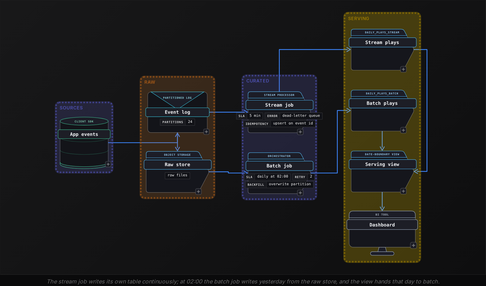

Intermediate·Pipeline Architecture · 25 min · 3 challenges

# How Data Moves: Intermediate

Every December, Spotify ships Wrapped: a personalized recap of a year of listening, delivered to hundreds of millions of accounts within a few days of release. By October, the engineer who owns the plays table has a year of streaming events that landed through the real-time path, a nightly job reloading changed rows against a stored watermark, podcast metadata trickling in from a partner API that pages 100 items at a time, and everything in Parquet partitioned by day. Then a product manager asks: how many plays did we double count when the consumer restarted in March? Answering touches delivery guarantees, incremental loading, file layout and the boundary between the batch and streaming paths. Interviewers ask the same question in many versions, to learn whether you can trace a wrong number back to the mechanism that produced it.


<br>

### What you will be able to do

Describe the high-water mark pattern and name the 4 ways it loses or duplicates rows, with the lookback window that fixes 3 of them

Trace a consumer crash through offset commit timing and state which delivery guarantee the code actually provides

Answer 'Why Parquet?' with the 3 skipping mechanisms and the arithmetic that shows how many bytes a query reads

Design API ingestion that survives rate limits, pagination drift and mid-run crashes, starting from the request count

Explain where a batch path and a stream path meet, which one wins on disagreement, and what a bug fix to history costs


<br>

---

## Batch Mechanics

The question arrives dressed as a capacity complaint: 'The orders table holds 2 billion rows and the nightly full reload no longer finishes before the dashboards refresh. What do you change?' Every candidate can describe reading only new rows. The score comes from the failure cases, so the interviewer repeats the pattern back to you and then waits for the part where you explain what it misses.

The high-water mark pattern keeps 1 value from the last successful run, the largest updated_at that run saw, in a small control table. The next run asks the source for every row past that value. The mark is written in the same transaction that commits the loaded rows, so a run that fails halfway leaves it untouched and the retry reads the same rows again instead of skipping them.

```sql
SELECT
  order_id,
  status,
  updated_at
FROM source.orders
WHERE updated_at > TIMESTAMP '2026-10-18 02:00:00'
```

| Run | Rows read | Max updated_at seen | Mark stored after run | Outcome |
| --- | --- | --- | --- | --- |
| 1 (full load) | 2,000,000,000 | 2026-10-18 02:00 | 02:00 | baseline established |
| 2 | 1,340,000 | 2026-10-18 03:00 | 03:00 | committed |
| 3 | 1,180,000 | 2026-10-18 04:00 | 03:00 (unchanged) | failed before commit |
| 4 | 2,510,000 | 2026-10-18 05:00 | 05:00 | committed, rereads run 3's rows |

Run 3 shows the behaviour the interviewer checks for. It read 1.18 million rows and failed before commit, so the mark stayed at 03:00. Run 4 then covered 2 hours of changes, 2.51 million rows, and many of those rows had already reached the staging area during the failed attempt. The load has to tolerate seeing a row twice, which is the first place the pattern leans on deduplication, and a candidate who moves the mark at the start of the run has described a pipeline that silently drops an hour of orders.

A monotonic id works as the mark too, but only for tables that are append-only. An order_id mark picks up new orders and misses every status change to an existing one, because an update never produces a larger id. The interviewer is testing whether you ask how the source table changes before you choose the column to watch.


<br>

### The 4 breaks the interviewer expects

- Clock skew: an app server 90 seconds behind its peers stamps a row before the mark, and that row is never loaded.
- Long transactions: a row committed at 03:02 is stamped 02:58, when its transaction opened, so a 03:00 mark skips it.
- Hard deletes: a removed row has no timestamp to cross the mark, so the warehouse copy outlives the source row.
- Wall-clock marks: storing the run's end time skips rows stamped after the query read but before the run finished.

The fix for the first 3 breaks is a lookback: the run subtracts a window from the stored mark before querying, rereading rows it already has in exchange for catching stragglers whose timestamps fell behind. A window longer than the extraction itself also recovers what an end-time mark skipped, though the cleaner fix is to store the largest source value seen. Keeping the run's start time rereads instead of dropping, but only while the extractor's clock agrees with the database's: an extractor 2 minutes ahead opens a 2-minute hole. Deletes are the fourth break, and no window reaches them. Expect to defend the width of that window. It should exceed the longest transaction the source permits plus the worst clock drift between its writers, and every minute you add catches more stragglers but rereads more rows on every run. Say the source caps transactions at 15 minutes and its writers drift up to 90 seconds apart: a 30-minute window clears both, and on hourly runs it means rereading about half of each run's rows, roughly 670,000, to cover those cases. Rereading means duplicates in staging, so the merge step keeps the newest version of each key and discards the rest.

```sql
SELECT
  order_id,
  status,
  updated_at
FROM (
  SELECT
    order_id,
    status,
    updated_at,
    ROW_NUMBER() OVER (
      PARTITION BY order_id
      ORDER BY updated_at DESC
    ) AS rn
  FROM staging.orders_delta
)
WHERE rn = 1
```

- **2B** — rows per full reload
- **1.3M** — rows per incremental run
- **1,500x** — fewer rows read per run

A row deleted from the source has no updated timestamp to cross the mark, so the warehouse copy stays and the row count drifts upward month after month. The answers that score are a soft-delete flag the application sets instead of removing the row, or a change feed from the database's transaction log that emits the delete as a record of its own. Raising deletes before the interviewer does signals that you have run this in production and been paged for the drift.

✓Do

- Store the largest value actually loaded, in the same transaction as the load
- Subtract a lookback wider than the longest source transaction
- Deduplicate the overlap on the business key, newest version wins
- Ask how deletes reach the source before choosing the pattern

✗Don't

- Record the run's wall-clock end time, or any clock other than the source's, as the mark
- Advance the mark before the load commits
- Use an auto-increment id as the mark on a table that gets updated in place
- Assume the source's clocks agree with each other

> **TIP**
>
> State the boundary operator out loud. Reading updated_at > mark drops rows that share the mark's exact timestamp with the last loaded row; >= with deduplication is the safe default, and naming that choice unprompted is worth a point on its own.


<br>

---

## Stream Guarantees

This one comes out of your own answer. You describe a streaming pipeline, mention exactly-once in passing, and the interviewer says: 'Walk me through the consumer crashing after it has processed 3 events but only committed 2.' The rubric separates candidates who know the 3 guarantee names from candidates who can point at the line where the guarantee is decided.


<br>

### Commit before processing, or after

A consumer reads from 1 partition of the log at an offset, processes the event, and at some point tells the log it is done by committing that offset. The guarantee follows from whether the commit happens before or after the processing. Commit first and a crash in between loses the event, because the log believes it was handled. Process first and a crash in between replays the event, because the log believes it was never handled. The log stores bytes and offsets and promises neither outcome on its own.

| Offset | Event | Processed before crash | Committed before crash | Replayed after restart |
| --- | --- | --- | --- | --- |
| 0 | play A | yes | yes | no |
| 1 | play B | yes | yes | no |
| 2 | play C | yes | no | yes, a duplicate |
| 3 | play D | no | no | yes |
| 4 | play E | no | no | yes |

Offset 2 is the event that counts twice. The consumer wrote play C to the sink, crashed before committing offset 2, and on restart the log handed back offset 2 as the next unread position. In a plays table that is 1 extra row; in a payments table it is a double charge. At-least-once is the accurate name for this pipeline, and most production streams run exactly here, with deduplication downstream doing the work the word 'exactly' implies.

| Guarantee | Commit timing | After the crash above | Typical use |
| --- | --- | --- | --- |
| At-most-once | before processing | play C lost, D and E processed once | metrics where a gap is cheaper than a repeat |
| At-least-once | after processing | play C processed twice | most pipelines, paired with deduplication |
| Exactly-once processing | atomically with the write, or idempotent sink | play C visible once in the sink | billing, inventory, ledgers |

Exactly-once is a property of the whole path, and the phrase interviewers want is 'exactly-once processing, built from at-least-once delivery plus a sink that tolerates repeats.' One way to get that tolerance is for the sink to accept the offset and the output in 1 transaction, so a crash rolls back both together. The other is an idempotent write, meaning repeating it leaves the same single row, usually because the sink keys on event_id and the second copy overwrites or is rejected. Either way, the log alone cannot deliver it; the sink has to participate, and saying so is the difference between hand-waving and an answer.


<br>

### The numbers behind deduplication

Deduplication needs a key and a window, and the window is the tradeoff to name. The sink keeps the set of keys it has seen for some retention, and a duplicate arriving after that retention passes through. A longer window costs memory or a wider lookup on every write; a shorter one admits late duplicates. Size it from the consumer side and the producer side. On the consumer side, the input is the longest outage you intend to recover from without manual cleanup, because a consumer restarting after a long stall replays every event it processed but never committed, and those copies arrive as late as the outage was long. On the producer side, it is the retry horizon: a producer that retries a send after a timeout can write the same event to the log twice before any consumer runs. A team whose on-call restores any stalled consumer within 20 hours, with producers retrying for at most 10 minutes, adds a few hours of margin to that sum to set the retention. Producer-side sequence numbers or a stable event id minted on the client give every copy the same key, which is what lets the window catch it.

- **24h** — dedup state retention
- **1 partition** — unit of ordering guarantee
- **2** — duplicate sources: replay and retry

```sql
SELECT
  event_id,
  COUNT(*) AS copies
FROM plays
WHERE event_date = DATE '2026-03-14'
GROUP BY event_id
HAVING COUNT(*) > 1
```

The ordering follow-up comes next. The log orders events within 1 partition and makes no promise across partitions, so a cancel and the order it cancels can arrive in either sequence if they hash to different partitions. The answer is to key both by the order id so they share a partition, and to accept that this concentrates all of 1 busy customer's traffic on 1 consumer. Naming that cost shows you have chosen a key under pressure before.

✓Do

- Say which side of processing the commit happens on before naming the guarantee
- Mint the event id on the producer so retries carry the same key
- Name the dedup window and what a duplicate older than it does
- Key related events together when their order matters

✗Don't

- Claim exactly-once without describing the sink's part in it
- Treat the log's ordering as global
- Commit offsets before the write has been acknowledged
- Forget the producer retry as a duplicate source


<br>

---

## File Format Depth

'Why Parquet?' is a screening question, and the screening answer, 'it is columnar and compressed', earns 1 point of a possible 4. The interviewer wants the mechanisms that let a query read less, because they decide whether a dashboard loads or times out, and because a candidate who knows them also knows when the format is the wrong choice.


<br>

### Skipping columns, files and row groups

A Parquet file is split into row groups, each holding a slice of rows, and within a row group every column is stored as its own contiguous chunk. Each chunk records statistics, at minimum the smallest and largest value in it, and a footer at the end of the file lists the schema and the byte offset of every chunk. A reader opens the footer first, fetches only the chunks for the columns the query names, and skips any row group whose statistics prove the filter can't match. Those are the 3 skipping mechanisms, and each skips something different.

| Mechanism | What it skips | What it needs from the writer |
| --- | --- | --- |
| Partition pruning | whole directories | the partition column in the WHERE clause |
| Column projection | every column the query does not name | nothing, the layout provides it |
| Row group statistics | groups whose min and max exclude the filter value | data sorted or clustered on the filter column |

Dictionary and run-length encoding often get offered as a fourth mechanism, and the interviewer hears a category error. Encoding skips nothing: a query that needs the status chunk still reads all of it. What encoding changes is the size of that chunk. A dictionary stores each distinct value once and replaces every row's value with a small index, so a status column with 6 possible values needs 3 bits per row, and run-length encoding then collapses a run of identical indexes into 1 value and a count. The 3 skipping mechanisms cut how many chunks are read; encoding cuts the bytes inside each one.

Put figures on it, because the interviewer will. Take a 1 terabyte table of 50 equal-width columns, partitioned by day across 365 days, queried for 1 day and 3 columns. Partition pruning removes the other 364 directories, projection removes 47 columns, and row group statistics on a sorted key remove most of what remains. Each step is a sentence in the answer, and the final figure is the one worth remembering.

| Step | Bytes read |
| --- | --- |
| Full scan | 1 TB |
| Prune to 1 of 365 daily partitions | about 2.7 GB |
| Project 3 of 50 columns | about 165 MB |
| Statistics on sorted user_id, 1 of about 21 row groups matches | about 8 MB |

*The last step assumes row groups of about 128 MB, about 21 per partition; the reader opens 1 group and still fetches only 3 of its 50 column chunks.*

Row group statistics only help when values are clustered. If user_id is scattered randomly, every group's minimum sits near 1 and its maximum near the highest id, no group can be ruled out, and the statistics are noise. Sorting or bucketing on the filter column at write time is what turns statistics into skipping, and mentioning the write side separates the answer from the screening version.


<br>

### When the answer is a row format

✓Row formats win (JSON lines, Avro)

- Appending 1 record at a time from a stream
- Fetching 1 whole record by key
- Landing raw payloads before any parsing
- Schemas that change weekly

✗Column formats win (Parquet, ORC)

- Scans over millions of rows and a few columns
- Wide tables with 50 or more columns
- Partitions that are written once and read many times
- Output of a compaction job

The common mistake is writing column files directly from a stream. A job that flushes a file every 10 seconds produces 8,640 files per day per partition, each with its own footer, and the query planner opens every footer before reading a byte of data. Past a few thousand files the planning time exceeds the scan time. The standard fix lands stream output in a row format, then compacts it on a schedule into column files sized between 128 megabytes and 1 gigabyte, which keeps row groups large enough for their statistics to mean something.

Schema change is the follow-up tied to this domain. Because the schema is stored in each file's footer, adding a nullable column is safe: old files report the column absent and readers fill null. Renaming a column is worse than an error. Readers match columns by name, old files have no column with the new name, and every row written before the rename reads back as null with nothing failing; a revenue dashboard shows a cliff on the rename date and no alert fires. A type change breaks on old files unless the reader supports that specific widening, such as a 32-bit integer read as a 64-bit one; narrowing, or turning a string into a number, fails. The pipeline stays safe with additive change only, enforced at the write step, with renames handled as a new column plus a view.

> **TIP**
>
> Have the codec tradeoff ready: snappy decompresses fastest and suits hot data, zstd gives the best ratio for a modest CPU cost, gzip is slower than zstd at a similar ratio and tends to be inherited rather than chosen.


<br>

---

## API Patterns

The advanced probe hands you a vendor API and a figure: 'We need all 10 million records, the API allows 1,000 requests per hour and returns 100 records per page. Design the ingestion.' Candidates who start describing a loop have missed the question. The interviewer wants the arithmetic first, because the arithmetic rules out the design most people begin with.

- **100,000** — requests for one full pull
- **100 h** — wall time at the rate limit

Once a complete copy takes longer than 4 days, the design has to avoid complete copies. Only 2 directions survive: an incremental filter such as updated_since, which shrinks each run to the records that changed, and a bulk export endpoint if the vendor offers one, which trades API calls for a file drop. The incremental path carries every hazard from the batch section, including clock drift between the vendor's servers and the need for an overlap window, and saying so is the connection the interviewer hopes to hear.


<br>

### Offset versus cursor pagination

| Property | Offset pagination | Cursor pagination |
| --- | --- | --- |
| Request shape | offset=3600&limit=100 | cursor=opaque token from the last page |
| Inserts and deletes during the pull | positions shift: inserts repeat records, deletes skip them | position is anchored to a record, so nothing shifts |
| Resume after a crash | store the page number | store the last cursor |
| Jump to an arbitrary page | yes | no, pages are sequential |
| Server cost on deep pages | grows with the offset | constant |

Offset pagination fails in a way tutorials rarely show. Suppose the feed is sorted newest first and page 37 asks for positions 3,600 through 3,699. If the vendor creates 2 records before you request page 38, every existing record moves 2 positions later: the old 3,698 and 3,699 become 3,700 and 3,701 and arrive again at the top of page 38. Deletes do the reverse. If 2 records you already read are deleted, the first 2 records of page 38 slide back onto page 37's range and are never read. Inserts produce repeats and deletes produce gaps. Sorted oldest first, new records land at the end and shift nothing, but a feed sorted by update time is the worst case: an edited record you already read leaves its old position, which shifts the rest back and skips 1, then reappears at the end, where you read it again. A cursor hands back an opaque token marking a position in the data rather than a count, so neither inserts nor deletes can move it.

```sql
import random
import time


def fetch_pages(session, url, cursor=None):
    delay = 1.0
    while True:
        params = {"limit": 100, "updated_since": "2026-10-18T02:00:00Z"}
        if cursor:
            params["cursor"] = cursor
        resp = session.get(url, params=params, timeout=30)
        if resp.status_code == 429:
            wait = float(resp.headers.get("Retry-After", delay))
            time.sleep(wait + random.uniform(0, 1))
            delay = min(delay * 2, 60.0)
            continue
        resp.raise_for_status()
        delay = 1.0
        page = resp.json()
        cursor = page.get("next_cursor")
        yield page["items"], cursor
        if cursor is None:
            return
```

The interviewer scores 2 details in that loop. The generator yields the cursor alongside each page so the caller can persist it after the page is written to raw storage; a crash on page 612 then resumes at 612 instead of page 1 with 611 wasted requests. And the retry honours the Retry-After header before falling back to doubling with jitter, because clients that retry on a fixed schedule synchronise with each other and keep the vendor's limiter saturated for everyone.


<br>

### Webhooks and the reconciliation poll

When the interviewer offers webhooks as the alternative, the scored answer treats them as the fast path and keeps a slow path beside them. A webhook arriving during your outage is retried by the vendor for a bounded period and then dropped, and vendors do send the same event twice. The pattern is to accept the webhook, write the raw body, acknowledge immediately, and run a reconciliation poll on a schedule with the change filter set a day back, deduplicating on the vendor's event id. The poll is the batch leg of a small hybrid, which is where the next section begins.

- 'What if the vendor changes a field type?' Land the raw response first and parse in a separate step you can rerun.
- 'How do you know you received everything?' Compare against a count endpoint, or run the reconciliation poll.
- 'The rate limit is shared with 3 other teams.' One central client holds the budget; 4 independent ones fight over it.
- 'Which time zone is updated_since in?' Send UTC, record what the vendor returns, and keep the overlap window.

> **TIP**
>
> Size the reconciliation poll before the interviewer asks. If 50,000 records change in a day, a poll set a day back at 100 per page costs 500 requests, half an hour of the 1,000-per-hour limit. Give it a fixed off-peak slice of the budget, so a burst of missed webhooks cannot starve the incremental pull.


<br>

---

## Hybrid Architectures

The hybrid question is always a follow-up. You propose a streaming job for the live dashboard, the interviewer nods, and then: 'Your stream processor shipped a bug on Tuesday and has been emitting wrong totals for 3 days. How do you fix history, and what does the dashboard show while you do?' The grading is about the seam: which path owns which data, and who wins when the 2 disagree.


<br>

### The 2 shapes a fix can take

|  | Two paths (batch plus speed layer) | One path replayed (log as source of truth) |
| --- | --- | --- |
| Code | 2 implementations of the same logic | 1 implementation |
| Correcting history | rerun the batch job over the affected days | reset the stream job to an earlier offset and reprocess |
| What it demands | a raw store the batch job can read, and reconciliation between the 2 outputs | log retention covering the oldest day you might need to redo |
| Failure mode | the 2 paths drift and disagree | retention expired, or replay slower than new data arrives |
| Where it fits | heavy batch logic that would be costly to express as a stream | logic that is already a stream and a log you can afford to keep |

Both shapes answer the Tuesday bug, with different bills. In the 2-path shape the seam has already contained the damage. The batch job is an independent implementation, and at 02:00 each night it replaced the stream's Tuesday and Wednesday with its own output from the raw store, so the closed days are correct and only today's stream output is wrong. The correction is to fix and redeploy the stream code and recompute today; rerunning batch over the affected days matters only when the bug lives in the batch job or in logic both paths share. The replay shape has 1 implementation, so all 3 days carry the bug. It resets the stream job to Tuesday morning's offset, writes into a fresh output table, and swaps it in once it has caught up to the present. Replay requires that the log still holds Tuesday, and that's a storage decision someone made months earlier.

- **400 GB** — events produced per day
- **12 TB** — log retained for 30-day replay




<br>

### The seam

The seam in that diagram is a date boundary. The stream job writes continuously into its own table, and the batch job owns every closed day: at 02:00 it recomputes yesterday from the raw store into the batch table, and from then on the view serves that day from batch. Batch wins on disagreement because it runs later, sees the late events that arrived after midnight, and runs the reviewed code path. Events that land after 02:00 for a day already closed are the late-data case. The batch job reprocesses 1 extra day of lookback on every run, which corrects events up to about 1 day late and no later. The 02:00 run on 20 October recomputes the 19th and the 18th; an event for the 18th that lands at 09:00 on the 20th is never picked up, because the next run covers the 20th and the 19th. Older stragglers need a wider lookback or a backfill triggered for their date, and that width is the number to defend, as with the high-water mark: each extra day rereads another 400 GB from the raw store on every run.

```sql
WITH boundary AS (
  SELECT
    MAX(event_date) AS last_batch_date
  FROM gold.daily_plays_batch
)

SELECT
  event_date,
  plays
FROM gold.daily_plays_batch

UNION ALL

SELECT
  s.event_date,
  s.plays
FROM gold.daily_plays_stream AS s
CROSS JOIN boundary AS b
WHERE s.event_date > b.last_batch_date
```

The serving view is where the paths touch, and the interviewer checks the filters. If both branches could return the same date, totals double for that day. A view that hard-codes `current_date` as the boundary has the opposite bug: between midnight and the 02:00 batch, yesterday belongs to neither branch and drops off the dashboard, and a batch job 3 hours late stretches the hole past 5 hours. Keying the boundary on the latest date the batch table holds lets the stream serve every day batch has not closed, and a day changes owner the moment batch writes it. That answers 'what does the dashboard show while you fix it': the stream's number until batch replaces it, never a blank day and never a doubled one.

- A named boundary: which partition, date range or table each path owns.
- A tiebreak with a reason: batch wins because it runs later and sees late data.
- A correction route with a duration: rerun 3 days of batch, or replay from an offset.
- A storage bill: the raw store the batch reads, or the log retention the replay needs.

> **TIP**
>
> If you've described a stream, have the batch correction ready before it is asked for. The follow-up is so predictable that answering it unprompted reads as experience, and it lets you choose the seam rather than defend one.


<br>

---

## Putting It All Together

A food delivery marketplace pays restaurants every Monday for the previous week's orders. Order events stream from the app into a live operations dashboard, a nightly batch job rebuilds each day's order totals from the raw store, payment-processor fees arrive from a vendor API limited to 1,000 requests per hour, and the whole lake is Parquet partitioned by order date. On a Thursday, finance reports that 212 restaurants were paid for orders that appear twice.

- The duplicate orders trace to a consumer that committed offsets after processing and restarted on Tuesday; the audit query grouping on event_id finds the day, and an upsert keyed on event_id in the orders table ends the recurrence.
- The fee pull from the processor's API uses updated_since with a 2-hour lookback, so fees for the duplicated orders were fetched once, which is why the fee total disagreed with the order total and exposed the problem.
- The nightly batch job owns every closed day and overwrites it from the raw store, so rerunning Tuesday through Thursday corrects the payout totals while the stream keeps the operations dashboard live for today.
- Because the orders lake is sorted by restaurant_id within each daily partition, the correction query for 212 restaurants reads a few row groups per day instead of the full week.
- The payout job itself reads from the batch-owned partitions only, through the same date seam as the serving view, so Monday's run never sees the stream's uncorrected version of a day.


<br>

---

## Key Takeaways

- The high-water mark is scored on its failures: clock skew, long transactions, deletes and wall-clock marks, with a lookback window and key-level deduplication as the fixes.
- A delivery guarantee is decided by where the offset commit sits relative to processing; exactly-once needs the sink to participate through a transaction or an idempotent write.
- 'Why Parquet?' is answered with 3 skipping mechanisms and the arithmetic from 1 TB down to 1 row group, plus the small-files case where a row format wins.
- API ingestion starts with request arithmetic, then cursor pagination, checkpointed cursors, Retry-After with jitter, raw landing and a reconciliation poll beside any webhook.
- A hybrid design is graded on its seam: which path owns which dates, why batch wins on disagreement, and what rewriting 3 days of history costs in storage or retention.
