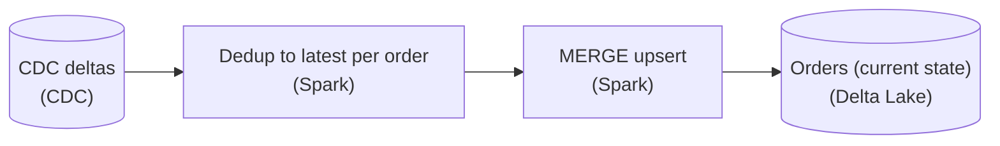
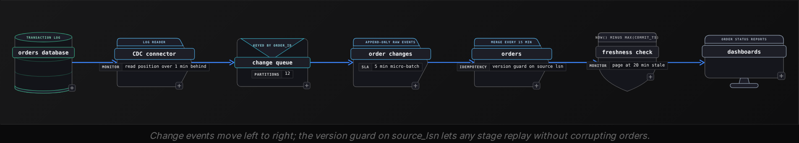
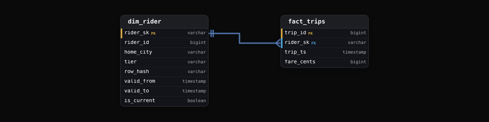
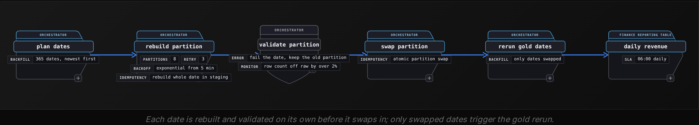
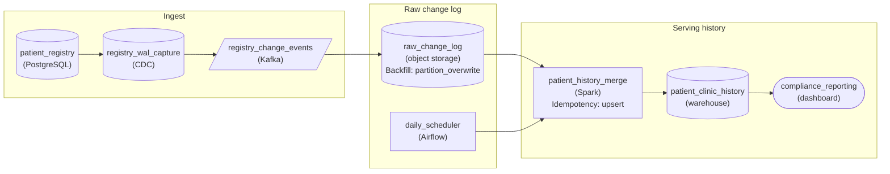
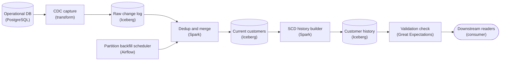

Intermediate·Pipeline Architecture · 25 min · 3 challenges

# Keeping Data Fresh: Intermediate

Odile is an hour into her onsite at Uber when the interviewer sketches a trips table in the operational database and its copy in the analytics lake, reloaded every night. The product team now wants that copy no more than 15 minutes behind. Tips and fare adjustments, meanwhile, land on trips up to 3 days after the ride. Odile proposes an hourly upsert. The interviewer keeps pulling threads. Which files does each upsert rewrite? How would you prove the copy is 40 minutes stale rather than 15? When a rider moves cities, which city gets last month's revenue? Engineering renames `fare` to `fare_cents`. A bug wrote wrong fares for every trip in March. Every one of these follow-ups asks how to keep a copy current without breaking it.


<br>

### What you will be able to do

Choose a write strategy by the files each run rewrites and what a rerun does, weighing MERGE and partition overwrite against append with dedupe or a full rebuild

Trace a change event from source commit to the merged table and assign end-to-end lag to the stage that owns it

Write an SCD Type 2 MERGE that expires and inserts in 1 commit, and defend a deterministic surrogate key

Work out which directions a schema change is compatible in, if any, and sequence a rename as expand, migrate, contract

Plan a partition backfill whose idempotent tasks run in a capped slot pool and pass a validation gate before downstream jobs rerun


<br>

---

## Merge Strategies

Every refresh job ends in a write, and that write decides 3 things an interviewer will press on: how much data each run rewrites, what happens when the same batch runs twice, and what a reader sees while the write is in flight. Nearly every design uses 1 of 4 strategies, and they differ on all 3.

| Strategy | What one run writes | Same batch run twice | What readers pay |
| --- | --- | --- | --- |
| Full rebuild and swap | Every row of the table | Same result: output depends only on the source | Nothing; the swap is atomic |
| Partition overwrite | Every row of each partition the batch touches | Same result: each partition is replaced whole | Nothing, if the overwrite commits atomically |
| MERGE (upsert) | Every file holding a matched row, plus files for inserts | Same result only with a version guard | Nothing after commit |
| Append, dedupe on read | Only the changed rows | Duplicate rows land in the table | A window function over every version of every key |


<br>

### Cost follows the files a batch touches

Take an orders table of 1.8 billion rows, partitioned by `order_date` across 2 years: 730 partitions of about 2.5 million rows, each stored as 10 files of 250,000 rows. A daily batch carries 4 million changes: 3 million new orders for yesterday and 1 million updates to orders from the previous 90 days, such as refunds and delivery confirmations. Spread evenly, that is about 11,000 updates per partition and 1,100 per file, so every file in those 90 partitions holds at least 1 matched row. A copy-on-write MERGE rewrites each touched file in full, and partition overwrite rewrites each touched partition in full, so for this batch they rewrite the same data, many times the volume that changed.

- **228M** — rows rewritten by the daily batch
- **57x** — write amplification of the batch

Change the update pattern and the ranking changes. If the 1 million updates land only in the 3 days before yesterday, both strategies rewrite 4 partitions, about 10 million rows. If instead 1,000 corrections are scattered across all 730 partitions, partition overwrite rewrites the whole table, while a MERGE rewrites at most 1,000 of the 7,300 files. The interview answer starts with the batch's spread. Measure from the change log how many partitions and files a typical batch touches, and pick the strategy from that number.

> Merge-on-read moves the bill
>
> Some table formats let a MERGE record removed rows in small delete files and write only the new versions, so the daily batch writes about 4 million rows. Every query then reads those delete files and filters superseded rows until compaction rewrites the affected files. The 228M-row rewrite still happens; it moves to a compaction job scheduled when readers are quiet.


<br>

### The 2 ways a MERGE goes wrong

The first is duplicate source keys. A 15-minute CDC batch routinely holds 3 updates to the same order, and the SQL standard treats 2 source rows matching 1 target row as a cardinality error, so the statement fails. Collapse the batch to the latest version per key before the MERGE. The second is order. A rerun of yesterday's batch after today's has landed would write an older status over a newer one. Put a version column in the match condition: the source's log sequence number works, as does an `updated_at` the source maintains reliably. The MERGE then ignores any row older than the version the target holds, and rerunning or replaying a batch leaves the table unchanged.

The guard still misses hard deletes. Once a row is deleted, a replayed older update finds no target row, falls through to the insert, and resurrects the order. Keeping a tombstone instead, the row with `is_deleted = true` and its `source_lsn`, gives the guard something to compare against, and a view filters tombstones out for readers.

```sql
MERGE INTO orders AS t
USING (
  SELECT
    order_id,
    order_date,
    status,
    amount_cents,
    op,
    source_lsn
  FROM (
    SELECT
      order_id,
      order_date,
      status,
      amount_cents,
      op,
      source_lsn,
      ROW_NUMBER() OVER (
        PARTITION BY order_id
        ORDER BY source_lsn DESC
      ) AS rn
    FROM order_changes
    WHERE batch_id = 4812
  ) AS ranked
  WHERE rn = 1
) AS s
ON t.order_id = s.order_id
  AND t.order_date = s.order_date
WHEN MATCHED AND s.source_lsn > t.source_lsn THEN
  UPDATE SET
    status = s.status,
    amount_cents = s.amount_cents,
    is_deleted = (s.op = 'd'),
    source_lsn = s.source_lsn
WHEN NOT MATCHED THEN
  INSERT (order_id, order_date, status, amount_cents, is_deleted, source_lsn)
  VALUES (s.order_id, s.order_date, s.status, s.amount_cents, s.op = 'd', s.source_lsn)
```

The `ROW_NUMBER` subquery keeps 1 row per `order_id`, the latest by `source_lsn`. Matching on `order_date` as well as `order_id` lets the engine read only the partitions the batch touches, which is correct as long as an order's date never changes after creation. Every write to an existing row is gated by `s.source_lsn > t.source_lsn`, and a delete event becomes an update that sets `is_deleted`.


<br>

### Defending the choice under pushback

> Which strategy, when
>
> - Changes land in a few recent partitions: partition overwrite, idempotent by construction with the fewest moving parts.
> - Sparse corrections spread across years of history: MERGE, so the rewrite tracks the files touched.
> - Minute-level arrival with few readers: append and dedupe on read, compacted on a schedule.
> - A table small enough to rebuild inside the refresh window: full rebuild and swap, with no state to drift.

Interviewers push on the edges of the choice. 'Why not MERGE everything?' When a batch touches most files anyway, a MERGE pays for the join and the match bookkeeping on top of the same rewrite an overwrite would do. 'Why not overwrite everything?' Because 1,000 scattered corrections would rewrite all 1.8 billion rows. 'What does a dashboard see mid-write?' The previous table version, provided the write commits as a single atomic operation.


<br>

---

## Pipeline Architecture

### Exercise 1 of 1

**● TASK**

Finance's daily order totals keep coming in high: each night's CDC changes for orders are only ever appended to the order table, so an edited order sits there twice, its stale version beside the new one. Rework the load so every nightly batch folds into the existing table and the newest version of each order replaces the prior one in place.

**Starting canvas** (already placed for you):

- CDC deltas (source, CDC)
- Append-only loader (transform, Spark)
- Orders (append-only) (storage)


<br>

### Solution

#### What this actually is

This is a merge-strategy question wearing a duplicate-orders costume. The CDC feed hands you **change events**, and the append-only loader inserts every one, so an order edited on Tuesday now lives twice: the old row and the new row, side by side, both counted in the daily total. A full nightly reload of `orders` would also clear the duplicates, but it rewrites the whole table to apply a sliver of change. The incremental answer is to load only the delta and upsert it on the order's key, so the newest version REPLACES the prior one in place. The trap in this instance is not the `MERGE` itself, it is the batch: one order can be edited twice in a single night, so the delta holds 2 rows for the same `order_id`, and if you feed both to a `MERGE` it either errors on multiple matches or overwrites with whichever version the engine happened to touch last.



*The append-only loader becomes 2 Spark stages: collapse each batch to one row per `order_id`, then `MERGE` it into a Delta Lake `orders` table keyed on `order_id`.*

#### Building the correct load

1. **Collapse the batch to one row per `order_id`**

   Before anything touches the target, rank the night's CDC rows with `ROW_NUMBER() OVER (PARTITION BY order_id ORDER BY change_ts DESC, cdc_seq DESC)` and keep `rn = 1`. This is what makes the `MERGE` legal: a `MERGE` source must have at most one row per join key, and CDC gives you 2 whenever an order is edited twice in the window. The tie-break on `cdc_seq` matters because 2 edits can share a `change_ts` to the second.

2. **`MERGE` the deduped delta into the current-state table**

   Join the deduped delta to `orders` on `order_id`. `WHEN MATCHED` updates the row in place; `WHEN NOT MATCHED` inserts the brand-new order. Guard the update with `src.change_ts >= tgt.change_ts` so a late or replayed batch carrying an OLDER version can never stomp a newer one already landed. That one predicate turns a correct-once load into a correct-every-time load.

3. **Make re-running the batch a no-op**

   Because the target holds one row per order and the update is version-guarded, replaying the same night's batch changes nothing: matched rows fail the `>=` check or write identical values, and unmatched rows are already present. That is idempotency, and it is the property that lets you retry a failed run without hand-deleting rows or inflating the totals a second time.

**Deterministic dedup, then version-guarded MERGE**

```sql
/* Stage 1: keep only the newest CDC row per order in this batch */
CREATE OR REPLACE TEMP VIEW orders_delta AS
SELECT order_id, op, total_amount, status, change_ts
FROM (
    SELECT
        order_id, op, total_amount, status, change_ts,
        ROW_NUMBER() OVER (
            PARTITION BY order_id
            ORDER BY change_ts DESC, cdc_seq DESC
        ) AS rn
    FROM cdc_orders_raw
    WHERE batch_date = CURRENT_DATE
) ranked
WHERE rn = 1;

/* Stage 2: replace each order in place, guarded against stale replays */
MERGE INTO orders AS tgt
USING orders_delta AS src
  ON tgt.order_id = src.order_id
WHEN MATCHED AND src.op = 'DELETE' THEN DELETE
WHEN MATCHED AND src.change_ts >= tgt.change_ts THEN UPDATE SET
    total_amount = src.total_amount,
    status       = src.status,
    change_ts    = src.change_ts
WHEN NOT MATCHED AND src.op <> 'DELETE' THEN INSERT
    (order_id, total_amount, status, change_ts)
    VALUES (src.order_id, src.total_amount, src.status, src.change_ts);
```

*The design the canvas encodes: `ROW_NUMBER()` to one row per order, then an idempotent `MERGE` into the Delta Lake `orders` table.*

| Trick: The `MERGE` is easy; the dedup is the exam |
| --- |
| Everyone reaches for `MERGE` on "replace in place." What separates a passing design is remembering that CDC can emit several changes per key per batch, so you must collapse to `rn = 1` FIRST. Skip it and Delta Lake refuses the `MERGE` because multiple source rows matched the same target row. Engines that don't check silently apply an arbitrary version. |

| Pitfall: Ordering by `change_ts` alone loses same-second edits |
| --- |
| 2 edits to one order inside the same second share a `change_ts`, so `ORDER BY change_ts DESC` picks a non-deterministic winner and your "newest version" is a coin flip. Always carry the change log sequence (`cdc_seq`) as the tie-break. It is the only monotonic thing you actually trust. |

| ✕ Append-only loader (the bug) | ✓ Dedup + MERGE (the fix) |
| --- | --- |
| Every CDC event becomes an `INSERT`. An order edited twice yields 3 rows and `SUM(total_amount)` triple-counts it. Reruns pile on more copies, so the load is not idempotent and totals drift on every retry. | One row per `order_id` survives the batch and `MERGE` overwrites in place. `SUM(total_amount)` sees each order once, and the `change_ts >= tgt.change_ts` guard makes a rerun a no-op. Current state is exact and retries are safe. |

| Interviewer: The version guard is the seniority tell |
| --- |
| A mid-level answer stops at dedup-plus-`MERGE`. The tell an interviewer waits for is the `src.change_ts >= tgt.change_ts` predicate: it proves you thought about out-of-order and replayed batches, not just the happy path. Say the words "late data" out loud: a batch can arrive carrying a version older than what already landed, and this is the line that survives it. |

| Performance: Under 100M rows, a keyed `MERGE` beats a full reload |
| --- |
| A 50M-row `orders` table with a 200K-row nightly delta sits at half the lesson's 100M-row line, where a keyed `MERGE` is straightforward and correct. A full reload would rewrite 250 times more data than changed. Keep the `MERGE` cheap by clustering `orders` on `order_id` (Z-ordering in Delta Lake) so file pruning reads only the files the delta touches. Past 100M rows, switch to replacing the affected date partitions instead. |

**Follow-up questions**

1. The order table grows past a few hundred million rows and the `MERGE` gets slow. What do you change?\
   *Tests the size-based switch from a keyed `MERGE` to deleting and reinserting only the date partitions the delta touches, in one transaction.*
2. How do you handle a CDC `DELETE` for an order that was never loaded?\
   *Tests whether the `WHEN NOT MATCHED` branch correctly ignores deletes rather than inserting a tombstone.*
3. The nightly batch fails halfway and you rerun it. What guarantees the totals don't double?\
   *Idempotency: one row per key plus the version guard make a replay a no-op.*


<br>

---

## CDC Patterns

A log-based CDC pipeline has 5 stages, and naming all 5 is what lets you locate a lag problem instead of guessing at it. The source database records every committed change in its transaction log. A connector tails that log and turns each change into an event. A durable queue holds the events, partitioned by primary key so that changes to the same key stay in order. A landing job appends events to a raw table. A merge job folds the raw events into the current-state table that readers query.




<br>

### What a change event carries

```sql
{
  "op": "u",
  "before": {
    "order_id": 88172,
    "status": "placed",
    "amount_cents": 2450
  },
  "after": {
    "order_id": 88172,
    "status": "refunded",
    "amount_cents": 2450
  },
  "source": {
    "lsn": 50331712,
    "commit_ts": "2025-03-14T10:00:00Z",
    "tx_id": 9921
  },
  "emitted_ts": "2025-03-14T10:00:02Z"
}
```

Downstream, 4 fields matter. `op` marks a create with `c` and a delete with `d`; updates carry `u`, and connectors commonly add `r` for rows read during a snapshot. `before` and `after` are row images: a delete has an `after` of null, which is how hard deletes reach the warehouse at all, and comparing the 2 images shows which columns changed. `lsn` is the change's position in the log, increasing with every change, so it orders changes for the MERGE's version guard. `commit_ts` is when the change became true in the source; freshness is measured from it, and SCD validity intervals start at it.


<br>

### The snapshot handoff

A new pipeline needs the rows that existed before the connector started. The connector notes the current log position, reads the table as a consistent snapshot at that position, emits every row as a read event, and then streams from the noted position, so each change lands exactly once. Big tables are often snapshotted in chunks while streaming already runs, and then a row can arrive from both a chunk and the stream; tagging chunk rows with the log position at which they were read lets the version guard keep the newer copy. Starting the stream at any position later than the snapshot's leaves a gap that no later run can see.

The log itself is finite. Depending on the database, the source either retains log until the connector confirms it has read it, or deletes log after a fixed retention period. In the first case a connector that is down for 6 hours makes the source keep 6 hours of log, 12 GB on a database writing 2 GB an hour, on the source's own disk. In the second, an outage longer than the retention period loses the position, and the only recovery is a fresh snapshot.


<br>

### Diagnosing lag one hop at a time

Freshness is the gap between a change's `commit_ts` and the moment readers can query it. Stamp the event at each hop and that gap splits into stages, each owned by a single component. Here is a single order refund, traced through a pipeline whose readers complain the orders table is 'about 45 minutes behind'.

| Hop | Timestamp | Time in stage |
| --- | --- | --- |
| Committed in source | 10:00:00 | start |
| Read by connector | 10:00:02 | 2 s |
| Appended to queue | 10:00:03 | 1 s |
| Landed in order_changes | 10:05:00 | 4 min 57 s |
| Visible in orders | 10:47:00 | 42 min |

The merge stage owns 42 of the 47 minutes. The connector and the queue are healthy, and the landing delay is the 5-minute micro-batch doing what it was built to do. The merge job processes 50,000 events per minute of run time, and through the morning peak the queue delivers 60,000 per minute, so the merge's position advances only five-sixths of a minute of source time per minute of wall clock. Lag grows by 10 seconds every minute, reaches about 40 minutes after 4 hours of peak, and drains overnight once traffic drops below 50,000 a minute. A job falls behind whenever it processes events more slowly than they arrive, whatever its schedule says.

If the current job applies every event in turn, collapsing each batch to the latest event per order changes the arithmetic: at an average of 3 events per order, the MERGE sees 20,000 rows a minute, well inside its capacity.

> Where each stage's lag comes from
>
> - Connector: a huge source transaction, such as a 40-million-row update, must be read in full before later changes are emitted.
> - Queue: too few partitions or a hot key, visible as consumer lag on 1 partition while the rest sit near zero.
> - Landing: the micro-batch interval itself, a floor on freshness that only a shorter interval lowers.
> - Merge: processing slower than arrival, visible as lag that climbs through the peak and drains overnight.

> **TIP**
>
> Alert on `now() - max(commit_ts)` in the table readers query, and on consumer lag per queue partition. The first says readers are stale; the second says which stage to open. A quiet source looks stale at 03:00 by the first measure, so have the source write a heartbeat row every minute.


<br>

---

## SCD in Pipelines

Type 2 keeps 1 row per version of each dimension member. `valid_from` and `valid_to` bound each version. Inside a pipeline the work splits into 3 problems: detecting which members changed in this batch, closing the old version and opening the new one in a single atomic write, and giving every version a key that fact rows can carry. Here the dimension is riders and the fact is trips.




<br>

### Detecting change with a row hash

Comparing the tracked columns one at a time makes a long condition that mishandles NULL: `NULL <> 'Austin'` evaluates to NULL, so a rider whose city goes from unknown to Austin never registers as changed. Hashing the tracked columns into `row_hash` turns detection into a single comparison of 2 strings. NULLs are coalesced to a marker, and a separator sits between fields so that `ab` plus `c` hashes differently from `a` plus `bc`. Columns that change constantly without business meaning, such as a `last_login_ts`, stay out of the hash so they never spawn a version.

```sql
CREATE TABLE stg_rider AS
SELECT
  rider_id,
  home_city,
  tier,
  changed_at,
  to_hex(md5(to_utf8(coalesce(home_city, '~') || '|' || coalesce(tier, '~')))) AS row_hash
FROM rider_changes_latest
```


<br>

### Expire and insert in one MERGE

A MERGE clause either updates the matched target row or inserts a new one, and a changed rider needs both: its current version closed and a new version opened. The standard construction feeds each changed rider into the MERGE twice. One copy carries the real `rider_id` as `merge_key` and expires the current row it matches. The other carries a NULL `merge_key`; with no match, it falls through to the insert. A new rider appears once and goes straight to the insert because nothing matches it. An unchanged rider matches with an equal hash, so no clause fires. The expire and the new `valid_from` both use `changed_at`, the CDC commit time, so the old interval ends exactly where the new one begins.

```sql
MERGE INTO dim_rider AS t
USING (
  SELECT
    s.rider_id AS merge_key,
    s.rider_id,
    s.home_city,
    s.tier,
    s.row_hash,
    s.changed_at
  FROM stg_rider AS s
  UNION ALL
  SELECT
    CAST(NULL AS bigint) AS merge_key,
    s.rider_id,
    s.home_city,
    s.tier,
    s.row_hash,
    s.changed_at
  FROM stg_rider AS s
  JOIN dim_rider AS d
    ON d.rider_id = s.rider_id
    AND d.is_current
  WHERE d.row_hash <> s.row_hash
) AS u
ON t.rider_id = u.merge_key
  AND t.is_current
WHEN MATCHED AND t.row_hash <> u.row_hash THEN
  UPDATE SET
    valid_to = u.changed_at,
    is_current = false
WHEN NOT MATCHED THEN
  INSERT (rider_sk, rider_id, home_city, tier, row_hash, valid_from, valid_to, is_current)
  VALUES (
    to_hex(md5(to_utf8(CAST(u.rider_id AS varchar) || '|' || CAST(u.changed_at AS varchar)))),
    u.rider_id,
    u.home_city,
    u.tier,
    u.row_hash,
    u.changed_at,
    TIMESTAMP '9999-12-31 00:00:00',
    true
  )
```

Staged in this batch: rider 7 moved from Austin to Denver on 2025-03-01, rider 8 is unchanged, and rider 9 is new. Rider 7 is the only one that enters the MERGE twice. The MERGE performs 1 expire and 2 inserts in 1 commit, so no reader ever sees rider 7 with 2 current versions or with none.

dim_rider before the batch

| rider_sk | rider_id | home_city | valid_from | valid_to | is_current |
| --- | --- | --- | --- | --- | --- |
| 3c1e | 7 | Austin | 2024-06-02 | 9999-12-31 | true |
| b07a | 8 | Boston | 2024-11-20 | 9999-12-31 | true |

dim_rider after the batch

| rider_sk | rider_id | home_city | valid_from | valid_to | is_current |
| --- | --- | --- | --- | --- | --- |
| 3c1e | 7 | Austin | 2024-06-02 | 2025-03-01 | false |
| e44d | 7 | Denver | 2025-03-01 | 9999-12-31 | true |
| b07a | 8 | Boston | 2024-11-20 | 9999-12-31 | true |
| 51f9 | 9 | Chicago | 2025-03-01 | 9999-12-31 | true |

*Each rider_sk is shown as the first 4 of its 32 hex characters.*


<br>

### Surrogate key design

Facts must point at the version that was true when they happened, so each version needs its own key; the natural `rider_id` is shared by all of a rider's versions. The 2 common designs are an integer drawn from a sequence and a hash of `rider_id` with `valid_from`, the pair that identifies a version.

✓Sequence integer

- 8 bytes per key, the narrowest join column
- Needs a single writer or a coordinated counter
- A rebuild hands out different numbers, so every fact keyed against the old ones must be reloaded
- The same version gets a new key if its load is rerun

✗Hash of rider_id and valid_from

- Same inputs give the same key on every rerun and rebuild
- Any number of parallel writers, no coordination
- 32 hex characters, or 16 bytes stored as binary
- Collision odds below 1 in 10^20 at 1 billion versions

Reproducibility is the strongest case for the hash in an interview. When a bug forces a rebuild of `dim_rider` from the raw change log, hash keys come out identical and every `fact_trips` row still points at the right version. With a sequence, the rebuild renumbers versions, and the fix grows from 1 dimension into a reload of every fact table that references it. The cost is width: as binary the hash is 16 bytes against the integer's 8, and as a hex varchar 32, so the join column on every `fact_trips` row grows 2x to 4x. Store it as binary, and the width matters only on the hottest fact joins.


<br>

### Assigning the key to facts

A trip gets the version whose interval contains the trip's time. Intervals are half-open: a version is valid from `valid_from` up to but excluding `valid_to`, and each version's `valid_to` equals the next version's `valid_from`. A trip at exactly 2025-03-01 00:00 therefore matches Denver alone, where a `BETWEEN` join would match both versions and count the trip twice.

```sql
SELECT
  f.trip_id,
  d.rider_sk,
  f.trip_ts,
  f.fare_cents
FROM stg_trips AS f
JOIN dim_rider AS d
  ON d.rider_id = f.rider_id
    AND f.trip_ts >= d.valid_from
    AND f.trip_ts < d.valid_to
```

> What this MERGE leaves to you
>
> - A rider with 2 changes in 1 batch: both match the same current row, so the MERGE fails. Collapse them, or apply them in order.
> - A late change dated before the current `valid_from` belongs mid-history, which means splitting an existing interval in 2.
> - A delete event should close the current version with `is_current = false`, which needs a matched branch of its own.


<br>

---

## Schema Migration

A schema change is safe to ship when every reader and writer alive during the rollout keeps working. Rollouts take hours or days. For that whole window old and new producers run alongside old and new consumers, and data already stored under the old schema is still there to be read. Compatibility is the property that makes that overlap survivable, and it has a direction.


<br>

### Backward and forward compatibility

Backward compatible means a reader on the new schema can read data written under the old one. Forward compatible means a reader on the old schema can read data written under the new one. For records a producer writes and a consumer decodes, with fields resolved by name and missing fields filled from defaults, the common changes classify as follows.

| Change | Backward | Forward | Why |
| --- | --- | --- | --- |
| Add a field with a default | Yes | Yes | New readers fill old records with the default; old readers ignore the new field |
| Add a field with no default | No | Yes | New readers find nothing to fill it with in old records |
| Remove a field that had a default | Yes | Yes | Old readers fall back to the default when the field is missing |
| Remove a field with no default | Yes | No | Old readers require it and new records lack it |
| Widen int to bigint | Yes | No | New readers hold every old value; old readers cannot hold large new ones |
| Rename a field, no alias | No | No | Each side looks for a name the other side never wrote |

For warehouse tables the consumers are SQL queries, and a query that names a dropped or renamed column fails at once. Defaults don't help there: dropping or renaming a column breaks every table reader that names it.

The direction sets the rollout order. A backward-compatible change ships consumers first, since upgraded readers handle both the old data still arriving and the new data to come, and producers switch afterwards. A forward-compatible change ships producers first, since old readers tolerate the new data. A change that is neither, such as a rename or a narrowing type change, has no safe order, so it must be split into steps that are each compatible.


<br>

### Expand, migrate, contract

The trips table stores `fare` as dollars in a DOUBLE, and finance wants `fare_cents` as a BIGINT so sums stop drifting by fractions of a cent. `fare` has 16 readers. Of those, 14 are downstream queries and 2 are dashboards, and renaming the column in place breaks all of them the moment it happens. The expand, migrate, contract sequence reaches the same end with every intermediate state compatible.

| Step | What changes | Who breaks if this step ships alone |
| --- | --- | --- |
| 1 Expand | Add nullable `fare_cents` | Nobody: no reader names it yet |
| 2 Dual write | Producers write both columns from the same source value | Nobody: `fare` is unchanged |
| 3 Backfill | Fill `fare_cents` for history, 1 partition at a time | Nobody: readers still use `fare` |
| 4 Migrate readers | Move the 16 readers to `fare_cents`, each checked against `fare` | A reader moved before step 3 finished sees NULLs |
| 5 Contract | Stop writing `fare`, then drop it | Any reader missed in step 4 |

Step 3 is a backfill and inherits every rule of one. The guard on `fare_cents IS NULL` lets a failed partition be rerun safely and keeps the backfill from overwriting rows the dual write already filled. Rounding before the cast makes the conversion exact: `0.29 * 100` evaluates to 28.999999999999996 in DOUBLE arithmetic, and a conversion that truncated would store 28 cents.

```sql
UPDATE trips
SET fare_cents = CAST(round(fare * 100) AS bigint)
WHERE trip_date = DATE '2024-07-04'
  AND fare_cents IS NULL
```

Step 5 waits on 2 checks. A query counting rows where `fare_cents` differs from the rounded `fare * 100` must return 0 for every partition. The query log must show no reader naming `fare` for a full reporting cycle, a month if finance closes monthly, because a monthly job that missed step 4 fails only on the 1st.


<br>

### A view as the contract

Readers that query a view instead of the table let the table change underneath them. During this migration the view can keep exposing `fare`, computed from `fare_cents`, so a reader missed in step 4 survives step 5 and can be moved on its own schedule.

```sql
CREATE OR REPLACE VIEW trips_v AS
SELECT
  trip_id,
  rider_sk,
  trip_date,
  fare_cents,
  CAST(fare_cents AS double) / 100 AS fare
FROM trips
```

> How CDC turns source changes into incidents
>
> - A source rename can arrive as a dropped column plus a new one: a MERGE listing the old name fails, or the column fills with NULLs.
> - A source widening from INT to BIGINT overflows the raw table's narrower column unless the landing schema widens first.
> - Explicit column lists fail loudly on a missing column; `SELECT *` passes new columns to readers who never agreed to them.

✓Do

- Settle the compatibility direction of every change before picking a rollout order
- Split renames and type changes into expand, migrate, contract steps
- Check the query log for readers of a column before dropping it

✗Don't

- Rename a column in place on a table with live readers
- Drop the old column in the same release that adds the new one
- Backfill a new column without a guard that skips rows already filled


<br>

---

## Partition-Level Backfill

A backfill is the regular pipeline pointed at the past, many runs at once. Its unit of work is the partition: each task rebuilds 1 `trip_date` from raw data, and because the task replaces that partition whole, running it twice leaves the same result as running it once. The rest of the backfill is only as safe as that single-partition task.


<br>

### The single-partition task

The task is safe to run in parallel and to retry when it has 3 properties. It is parameterized by its date, read from the orchestrator's run instead of from `current_date`, so a task for 2024-07-04 run today rebuilds July 4th. It reads only the inputs for its date, so 2 tasks never compete for the same rows. And it publishes atomically: it builds the partition in a staging table and swaps it in, because a DELETE followed by a separate INSERT shows readers an empty partition for as long as the INSERT runs.


<br>

### Validate before you swap

The swap is the only irreversible step, so a check runs before it. The query below profiles the staged partition: row count must equal distinct trips, and null fares must be 0. A second query counts the raw table's distinct trips for that date, which must sit within 2% of the staged row count. `total_fare_cents` is compared with the published partition's total, where the corrected fare rule predicts the delta. A failure leaves the old partition published and fails only that date's task.

```sql
SELECT
  COUNT(*) AS row_count,
  COUNT(DISTINCT trip_id) AS distinct_trips,
  COUNT_IF(fare_cents IS NULL) AS null_fares,
  SUM(fare_cents) AS total_fare_cents
FROM trips_rebuild
WHERE trip_date = DATE '2024-07-04'
```


<br>

### Sizing the run

The March fare bug needs 31 partitions rebuilt, about 72 minutes at 8 tasks at a time. Applying finance's corrected fare rule to the whole past year needs 365, and each rebuild takes 18 minutes. Tasks run in waves the size of the concurrency limit, so wall-clock time is the number of waves times 18 minutes, while the total work stays the same at any concurrency. The cluster has 40 slots, and the nightly load needs 24 of them between 01:00 and 04:00.

- **6,570** — task-minutes for the full year
- **13.8 h** — full year at 8 concurrent tasks
- **5.7 h** — full year at 20 concurrent tasks

Concurrency 20 finishes far sooner, but 20 backfill slots plus the nightly 24 is 44 on a 40-slot cluster, so between 01:00 and 04:00 either the nightly load waits or the backfill does. A dedicated slot pool for backfill tasks removes the conflict: 8 slots overnight leaves the nightly load its 24 with room to spare, and the pool can grow to 16 during the day. If the backfill runs as extra runs of the daily pipeline, the scheduler's cap on concurrent runs of that pipeline counts them too, and tonight's run can queue behind historical ones; a separate backfill pipeline with its own cap avoids that.




<br>

### Order, isolation and the cascade

- Newest first: recent dates carry most dashboard reads, so the first hours of the run fix what people look at.
- Do not retry a failed validation: it fails the same way again, and 3 retries would burn 54 task-minutes.
- Pin 1 code version for the whole run, or the history ends up computed under 2 different fare rules.
- Rerun every downstream table for each swapped date, or gold totals disagree with the silver rows beneath them.
- Announce the window: readers of a date mid-rebuild see the old values until its swap, then the new ones.

```sql
backfill:
  target: silver.trips
  partitions:
    column: trip_date
    start: "2024-03-15"
    end: "2025-03-14"
    order: newest_first
  code_version: fare-rule-v2
  pool: backfill
  pool_slots: 8
  retries: 3
  on_validation_failure: keep_existing_partition
  downstream:
    - gold.daily_revenue
    - gold.city_revenue
```

When the interviewer asks what happens if the run dies at partition 200, point at the plan: it is a list of dates with a status each, every task is idempotent, and resuming means rerunning the dates not marked done. When they ask how long it takes, give total task-minutes over concurrency, then name what caps concurrency: cluster slots, the source's read limits if the rebuild reads from an operational database, and the nightly window.


<br>

---

## Putting It All Together

A ride-hailing company moves its trips table from a nightly reload to a 15-minute freshness target, and in the same quarter finance asks for fares in integer cents while an audit finds a bug that wrote wrong fares for every trip in March.

- CDC events carry the source_lsn that the MERGE's version guard compares, so chunked-snapshot overlaps and replayed batches are both absorbed.
- The rider dimension's MERGE uses the CDC commit time as valid_from, so each fare joins to the city the rider lived in at trip time.
- Collapsing each batch to the latest event per key is the same step that keeps the MERGE from failing and keeps the merge stage ahead of arrival.
- The fare_cents backfill in the expand step runs as partition tasks under the same slot pool and NULL guard as the March fix.
- Because rider_sk is a hash, rebuilding March's trips looks up the same keys the original load assigned, so only March's gold dates need a rerun.
- Freshness alerting on max(commit_ts) separates a stalled merge from a backfill that is holding cluster slots.


<br>

---

## Pipeline Architecture

### Exercise 1 of 2

**● TASK**

Asked which clinic a patient belonged to on any past date, our compliance analysts can only get today's answer: the Postgres patient registry holds its 4 million patients as they are right now, and front-desk address corrections, clinic reassignments and deletions of duplicate records all overwrite in place. Design the path from that registry to a new warehouse history table that answers the clinic-on-any-date question, takes changes without adding query load to the registry, and can rerun any single day without leaving duplicate history behind.


<br>

### Solution

#### Why this problem exists in real interviews

This is a Type 2 slowly changing dimension fed by WAL-based change capture, and the capstone lives in the seam between the two. Anyone can draw a log reader, a queue and a warehouse. The trap is where the dates come from. Stamp `valid_from` with load time and a patient reassigned at 4pm on the 14th still shows the old clinic until the next morning's run; rerun that day and every version moves again. Drop the delete events and a merged-away duplicate stays `is_current` forever, answering audit questions for a patient who no longer exists.

| Trick: 3 sections, one table |
| --- |
| The history is only as good as 3 decisions under it. Capture from the write-ahead log, so deletes and every intermediate edit arrive in commit order at zero query cost. Version on the registry's commit time, so the new row's `valid_from` and the old row's `valid_to` are the same commit instant. Key each version on `patient_id` plus commit time and land raw changes by commit day, so a rerun of any day rewrites the same rows instead of adding new ones. |

#### Walk the requirements

1. **Read the log, not the tables**

   The registry is hot from 7am to 7pm and the DBA will not add load. A log reader tails committed changes the database already writes, so the front desk feels nothing. It is also the only option that sees a delete at all: a deleted duplicate leaves no row for a query to find. Put the events on `registry_change_events` so the warehouse side can fall behind or restart without the capture losing its place.

2. **Land every change by commit day**

   Write the raw events to `raw_change_log`, partitioned by the day the registry committed them, and keep them. That partition is the unit of rerun: a bad day means overwriting one partition and replaying it, never re-extracting from the registry. At roughly 50,000 edits a day, each partition is tiny and cheap to keep for years.

3. **Close the old version, open the new one**

   For each change, `patient_history_merge` ends the patient's current row with `valid_to` set to the commit time and inserts a new current row starting at that same instant. An address fix and a clinic move both version the row; compliance filters on the clinic. A delete event ends the current row and opens nothing, so the duplicate is visible up to the moment it was removed and absent after.

4. **Make the rerun a no-op when nothing changed**

   Key each version on `patient_id` plus the commit timestamp and write it as an upsert. Replaying a day produces the same keys, so the rows are overwritten in place, not appended. Derive the surrogate key from that same pair (a hash) rather than a sequence, or a rerun mints new keys and breaks every downstream join. `daily_scheduler` owns the nightly run and the one-day rerun.

#### The shape that fits



*The log reader takes every committed edit and delete off the registry at no query cost; `raw_change_log` holds them by commit day; `patient_history_merge` upserts dated versions to `patient_clinic_history`, rerunnable one day at a time.*

| ✕ Nightly query of the registry | ✓ Reading the write-ahead log |
| --- | --- |
| A `SELECT` on `updated_at` scans the registry while it is busy, never sees a deleted row, and collapses a patient moved twice in one day to a single change, so the first clinic never existed as far as the history knows. | Every committed insert, update and delete arrives in commit order with its commit timestamp. 2 moves in a day are 2 versions, a delete is an event, and the registry does no extra work. |

| Pitfall: Load time is not when it happened |
| --- |
| The version that ships first sets `valid_from` to `now()` inside the merge. It looks right on day one. Then a load runs late, or a day is rerun 3 weeks later, and every version it touches jumps to the rerun date. Compliance asks where a patient was on the 14th and gets an answer that depends on when the pipeline last ran. Carry the commit timestamp from the log all the way through. |

| Interviewer: Rerunnable is a key, not a flag |
| --- |
| Strong candidates say what makes the rerun safe: a version key of `patient_id` plus commit time, a surrogate key derived from it, and a partition of raw changes to replay. Weak ones say "we make it idempotent" and stop. The follow-up is always "what exactly gets written twice?" |

| Performance: Four million rows is merge territory |
| --- |
| At 4 million patients and about 50,000 edits a day, the history grows by tens of thousands of rows nightly. A keyed merge on the patient is well under the size where you would reach for partition swaps on the dimension itself; the partitioning that matters is on `raw_change_log`, where it makes a one-day rerun a small, isolated job. |

**Follow-up questions**

1. A bad load on the 3rd is found on the 20th, after later days already versioned the same patients. What does rerunning the 3rd have to get right?\
   *Tests whether the candidate sees that a reinserted version must close at the next existing version's `valid_from`, not stay current, so the replay respects versions that already follow it.*
2. The registry team renames `clinic_id` to `home_clinic_id` without warning. What breaks, and where do you absorb it?\
   *Tests schema migration: map the rename at the capture or landing layer so `patient_clinic_history` keeps one stable column, and old change partitions still replay.*


<br>

### Exercise 2 of 2

**● TASK**

Change events reach us at least once and sometimes out of order, and a corrected day has to be replayable without duplicating a single customer row. From our Postgres change capture, design the pipeline that lands those changes in a transactional table, keeps each customer's attribute history, survives upstream column changes without breaking readers, and reprocesses one partition at a time through a scheduler and a validation check.

**Starting canvas** (already placed for you):

- Operational DB (source, PostgreSQL)
- CDC capture (transform)


<br>

### Solution

#### 4 hats, one discipline

Strip the freshness costume and this is the whole lesson wearing one discipline: **idempotent writes keyed on identity plus version**. Change data capture dedup, SCD history, schema evolution and partition backfill are 4 places the same question gets asked: if a change event arrives twice, late, or out of order, does the table still land in exactly one correct state? Candidates wire each stage as a happy path and demo it alone; what separates them is seeing where the stages touch.

The trap lives at those seams. A backfill that replays old change events can re-open every closed history row, and a column change that renames the merge key silently turns upserts into inserts. Get either wrong and the customer dimension quietly doubles overnight while every dashboard still reads green. The design below gives ordering, versioning and reprocessing exactly one owner each.



*Change events land append-only, are ordered and merged by `lsn` into a transactional table, are versioned into customer history, then pass validation before any reader sees them. The scheduler re-enters backfills at `Dedup and merge`, never at the readers.*

1. **Order the change stream before you merge**

   Log-based capture delivers at least once, so `Raw change log` is append-only and full of duplicates and out-of-order events. Never merge on arrival order. Dedup by primary key keeping the highest `lsn`, then `MERGE INTO` `Current customers` on that key. That is what makes the pipeline replay-safe: run the same batch twice and the highest-`lsn` winner is identical, so the second merge is a no-op.

2. **Version current state into history**

   The `SCD history builder` reads merged current state and closes and opens rows in `Customer history`. Only when a tracked attribute changes do you stamp the old row's `effective_to` and insert a new row with `is_current = true`. Compare against the current version, never blindly append, or a re-delivered unchanged event spawns a phantom version. Done right, an unchanged record produces zero new rows.

3. **Let the table format absorb column changes**

   Both tables are Iceberg, so an added column lands as nullable with a default and existing readers keep reading the columns they know. The rule on top is backward compatibility: never rename or retype the merge key in place. A rename is a two-phase move: add the new column, dual-write, migrate readers, then retire the old one.

4. **Backfill one partition at a time, behind the check**

   When a day is wrong, the Airflow `Partition backfill scheduler` re-runs `Dedup and merge` for that one partition from `Raw change log`, one task per day, and overwrites the partition atomically rather than deleting rows. Because it re-enters at the merge, it rides the same ordering and history logic as live traffic, so a backfilled day matches a live one. The `Validation check` runs its expectations before readers see the corrected partition.

| Trick: One idempotency key rules all 4 stages |
| --- |
| Every write is keyed on natural key plus a version token. Dedup keys on PK plus `lsn`; history keys on PK plus `effective_from`; backfill keys on partition. Once every stage is a deterministic function of its input keyed this way, re-running any stage, or the whole pipeline, converges to the same table. That one property lets backfill and live traffic share a single code path. |

| Pitfall: A replay must not re-open closed history |
| --- |
| The classic failure: the backfill replays historical change events, the history builder treats them as fresh changes, and re-opens rows you already closed, exploding version history and breaking `is_current` uniqueness. The builder must diff against existing history and no-op on versions it has already seen. If it cannot survive a full replay, it is not idempotent yet. |

| ✕ Dedup on arrival order | ✓ Dedup on lsn |
| --- | --- |
| Taking the last-arrived row per key means a redelivery of an OLD event overwrites newer state. The table flickers backward, and the bug only surfaces under retry storms, so it passes every calm-day demo. | Keeping `MAX(lsn)` per key makes the winner independent of arrival order and delivery count. Re-run the batch, replay the log, or backfill: the merged row is identical. Order-independence is the whole point of change data capture done right. |

| Interviewer: The backfill arrow points at the merge |
| --- |
| The tell of a senior answer is drawing the backfill edge into `Dedup and merge`, not into the readers. Juniors bolt on a second pipeline that writes history directly, then spend the interview reconciling 2 paths that drift. Pointing backfill at the same merge, so it inherits ordering, history and validation for free, signals you have run one of these for real. |

**Follow-up questions**

1. How do you handle a hard delete in the source, where the row vanishes from `Operational DB`?\
   *Tests whether they know capture emits a delete operation and the history builder closes the row with `is_current = false` rather than physically removing history.*
2. A late event arrives with an `lsn` older than a version you have already closed in history. What happens?\
   *Probes out-of-order handling and whether the version diff is robust to non-monotonic arrival.*
3. You need to add a tracked attribute to the dimension. How do you backfill history for it without re-opening every existing row?\
   *Combines schema evolution and partition backfill: an additive column plus a bounded, idempotent reprocess.*


<br>

---

## Key Takeaways

- A merge strategy's cost follows the files and partitions a batch touches, so measure the batch's spread before choosing.
- MERGE needs 1 source row per key and a version guard. Add tombstones for deletes, and rerunning or replaying a batch leaves the table unchanged.
- CDC lag is a sum of stages: stamp each hop, and the slowest stage names its owner; a job falls behind whenever arrival outpaces processing.
- SCD Type 2 in 1 MERGE feeds changed members twice, and a hash of natural key and valid_from gives keys that survive rebuilds.
- Check which directions a schema change is compatible in; a change compatible in neither ships as expand, migrate, contract.
- A backfill is many idempotent partition tasks under a capped pool, validated before an atomic swap, with dependent dates rerun.
