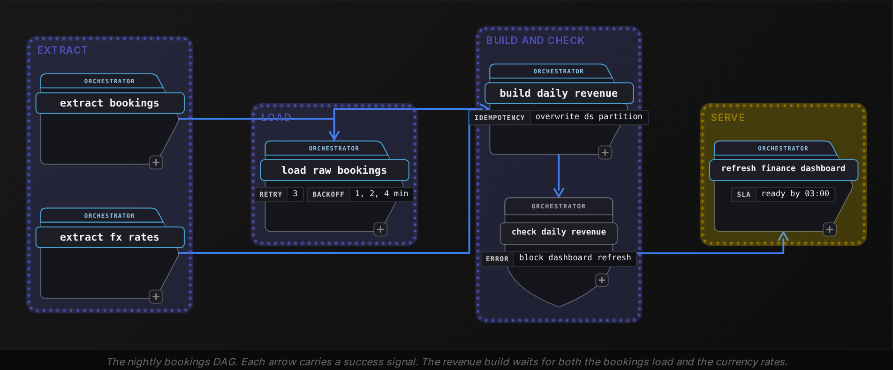
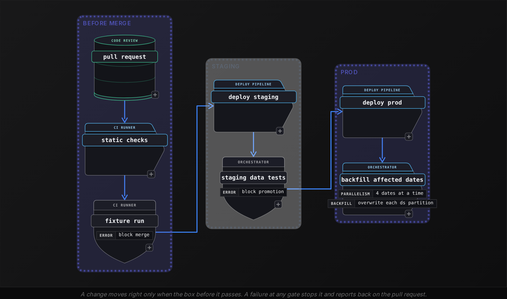

Beginner·Pipeline Architecture · 20 min · 4 challenges

# Making It Repeatable: Beginner

Ines is 40 minutes into her data engineering loop at Airbnb, the company whose data team open-sourced a workflow orchestrator now used across the industry. On the shared screen are 5 boxes: pull yesterday's bookings, load them raw, build a nightly revenue table, check it, refresh the finance dashboard. "Right now these are separate cron jobs at fixed times," the interviewer says. "Last Tuesday the load ran long, the revenue job started on schedule anyway, and finance saw half a day of bookings. Someone reran it by hand and revenue doubled. Then a fix shipped straight to production and broke the dashboard for a morning. How would you make this repeatable?" Ines recognizes the pattern under the story: order tasks by data readiness, make every rerun safe, and give changes a path to production that catches mistakes first.


<br>

### What you will be able to do

Draw a pipeline as a DAG and explain what the orchestrator does in each task state

Choose how a task waits on data produced in the same DAG, and how it waits when another team or an external system produces it

Make a task safe to retry by keying it on the logical date and overwriting its partition

Set up dev and staging environments that run the same code as prod but cannot write to prod

Describe the checks and deploy steps a pipeline change passes before and after it reaches prod


<br>

---

## DAG Orchestration

### The question behind a broken schedule

Orchestration questions rarely use the word DAG. They arrive as a broken schedule: job A at 01:00, job B at 02:00, and on a bad night B read an empty table because A ran for 70 minutes. The structure the interviewer wants named is a DAG, a directed acyclic graph. Each task is a node, and an arrow from task X to task Y means Y starts only after X succeeds. Directed means every arrow points in a single direction. Acyclic means that following arrows never leads back to the task you started from, so some tasks always have no upstream and can begin the run.

A cron schedule encodes a guess about duration. It bets the load finishes within an hour because it usually does, and on the night it runs long, the revenue job reads whatever has landed so far. A DAG removes the bet: `build_daily_revenue` starts when `load_raw_bookings` reports success, whether the load took 20 minutes or 3 hours. The diagram shows the nightly bookings pipeline that every section of this lesson builds on.




<br>

### What the orchestrator owns on every run

Responsibilities you should be able to list

- **Scheduling** *a run per interval*\
  Creates a run for each day or hour and stamps it with the interval it covers.
- **Dependency resolution** *who may start now*\
  Starts a task only when its upstream tasks are in states its trigger rule accepts.
- **State tracking** *per task, per run*\
  Records every task's state in every run, so a rerun skips work that already succeeded.
- **Retries** *bounded and spaced out*\
  Reruns a failed task after a wait, up to a set number of attempts, then marks it failed.
- **Backfill** *runs for past dates*\
  Creates runs for a range of earlier intervals so history can be rebuilt with current code.


<br>

### Logical date and wall clock

Every run carries the interval it processes, called its logical date. The run for 2026-03-14 handles bookings made on March 14. That data is complete only after midnight, so the run starts at 01:00 on March 15. Retry it on March 17 and it still processes March 14. Interviewers probe this because a task that computes "yesterday" from the clock gets a different day each time it runs, which turns a harmless retry into a run against the wrong data.

| Run | Logical date | Starts (wall clock) | Reads |
| --- | --- | --- | --- |
| Scheduled | 2026-03-14 | 2026-03-15 01:00 | `ds = '2026-03-14'` |
| Retry after a timeout | 2026-03-14 | 2026-03-15 01:35 | `ds = '2026-03-14'` |
| Backfill after a fix | 2026-03-14 | 2026-03-20 09:12 | `ds = '2026-03-14'` |

Across the 3 rows the logical date stays fixed while the wall clock moves. That fixed date is what makes a run repeatable, and Safe Retries builds directly on it.


<br>

### Task states worth naming

| State | Meaning | What follows |
| --- | --- | --- |
| queued | Upstream finished; waiting for a free worker | Runs when a slot opens |
| running | Executing now | Ends in success or failed |
| success | Finished without error | Downstream tasks become eligible |
| failed | Errored on every allowed attempt | Downstream tasks become upstream_failed |
| upstream_failed | Never started because a dependency failed | Runs once the failed task is fixed and cleared |
| skipped | A branch condition left it out | Counts as finished under rules that allow skips |

When a task fails at 01:40, recovery starts from that task. Clearing it resets it and everything downstream of it, while tasks that already succeeded keep their state. State tracking belongs in an answer for that reason: it decides how much work a recovery costs.


<br>

### How the scheduler picks the next task

The scheduler repeatedly looks for tasks whose upstream tasks have all finished. The order that falls out is a topological sort. This sketch applies the same rule to the bookings DAG and prints each wave of tasks that can start together.

```sql
dag = {
    "extract_bookings": [],
    "extract_fx_rates": [],
    "load_raw_bookings": ["extract_bookings"],
    "build_daily_revenue": ["load_raw_bookings", "extract_fx_rates"],
    "check_daily_revenue": ["build_daily_revenue"],
    "refresh_finance_dashboard": ["check_daily_revenue"],
}

done = set()
wave = 1
while len(done) < len(dag):
    ready = [
        t for t, ups in dag.items()
        if t not in done and all(u in done for u in ups)
    ]
    if not ready:
        raise ValueError("cycle detected")
    print(wave, sorted(ready))
    done.update(ready)
    wave += 1
```

It prints 5 waves. Wave 1 holds `extract_bookings` and `extract_fx_rates` because neither has an upstream, so they run in parallel; every later wave holds a single task. The `raise` line is the reason cycles are banned: if X needs Y and Y needs X, neither is ever ready, the loop cannot progress, and a real scheduler would wait forever. Orchestrators reject a cycle when the DAG is loaded, so it never reaches a run.

> Try it
>
> Add `send_daily_summary` with `check_daily_revenue` as its only upstream. Which wave does it join? Then add an arrow from `refresh_finance_dashboard` back to `extract_bookings` and predict exactly what the sketch prints before it stops.

*The new task joins wave 5 beside the dashboard refresh. With the back arrow, wave 1 prints only extract_fx_rates, because extract_bookings now waits on the last task; the next pass finds nothing ready and raises the cycle error.*

> **TIP**
>
> A complete opening answer: model the jobs as a DAG, start each task on upstream success, stamp every run with its logical date, and let the orchestrator handle scheduling and retries while it keeps track of each task's state.


<br>

---

## Task Dependencies

### 3 places a dependency comes from

Arrows inside a single DAG are handled by the scheduler on its own. Dependency questions push past them to data owned by someone else, because that's where pipelines fail quietly.

| Kind | Example | How the task waits |
| --- | --- | --- |
| Inside the DAG | `build_daily_revenue` needs `load_raw_bookings` | An arrow; the scheduler handles it |
| Another team's pipeline | The payments team's `payments.refunds` for 2026-03-14 | A sensor on that partition's completion record |
| An external system | A partner drops the day's exchange-rate file around 00:30 | A sensor polling storage for the file and its marker |

A sensor is a task whose only job is to wait. It checks a condition every few minutes and succeeds once the condition holds. It also carries a timeout, and when the timeout passes it fails, which turns "the data never arrived" into an alert someone sees before the dashboard deadline.


<br>

### Wait for a readiness signal

The classic failure: a sensor checks that the refunds partition for 2026-03-14 exists. It does, because the payments job has written 3 of its 12 files. The revenue task reads a quarter of the day's refunds and still succeeds, so it publishes a wrong number with no error anywhere. The repair is a signal the producer writes last: a `_SUCCESS` marker file, a row in a partition status table, or a published event. Because the producer writes it after every data file, its presence means the data is complete.

```sql
SELECT
  table_name,
  ds,
  status,
  row_count
FROM ops.partition_status
WHERE table_name = 'payments.refunds'
  AND ds = '2026-03-14'
  AND status = 'COMPLETE'
```

Pair the marker with a volume check. If refunds usually run between 9,000 and 14,000 rows a day and the status row says 1,200, the producer may have marked a partial load complete. Stopping costs a late dashboard. Continuing costs a wrong one, and a wrong number already copied into a finance report is far more expensive to unwind.


<br>

### Fan-out, fan-in and trigger rules

Fan-out is a task feeding several others, such as `load_raw_bookings` feeding both the revenue table and a cancellations table. Fan-in is several tasks feeding one, such as `build_daily_revenue` waiting on bookings and currency rates. A trigger rule defines what "upstream is done" means for a task. Names differ between orchestrators; these 4 cover most interview cases.

| Trigger rule | Starts when | Use it for |
| --- | --- | --- |
| `all_success` (default) | Every upstream task succeeded | Any task that reads upstream output |
| `all_done` | Every upstream task finished, in any state | Cleanup, such as dropping temp tables |
| `one_failed` | At least 1 upstream task failed | Paging the on-call engineer |
| `none_failed` | No upstream failed; skips are allowed | The join after an if/else branch |

Interviewers like the cleanup case. Under `all_success`, a task that drops temp tables never runs on a night the build fails, so temp tables pile up and storage grows with every failure. Under `all_done` it runs after success and failure alike.


<br>

### The critical path sets the finish time

Parallel branches overlap, so a run lasts as long as its longest chain of dependent tasks, called the critical path. These are durations from a typical night, with the run starting at 01:00.

| Task | Duration | Upstream |
| --- | --- | --- |
| extract_bookings | 25 min | none |
| extract_fx_rates | 5 min | none |
| load_raw_bookings | 40 min | extract_bookings |
| build_daily_revenue | 30 min | load_raw_bookings, extract_fx_rates |
| check_daily_revenue | 5 min | build_daily_revenue |
| refresh_finance_dashboard | 10 min | check_daily_revenue |

The tasks on the bookings chain take 25 minutes, then 40, then 30, then 5, then 10. The currency branch is done after 5 minutes and then idles while the load finishes. Making `extract_fx_rates` faster saves nothing; trimming 15 minutes from `load_raw_bookings` moves the dashboard 15 minutes earlier.

- **110 min** — critical path length
- **02:50** — dashboard refreshed

> Try it
>
> `build_daily_revenue` now also needs `payments.refunds`, which usually completes at 02:30. The dashboard must be ready by 03:00. When does it refresh, which chain is critical, and what would you raise with the payments team?

*The build waits until 02:30 where it used to start at 02:05, so it ends at 03:00, the check at 03:05 and the refresh at 03:15, 15 minutes late. The refunds wait is now the critical path, so tuning the bookings load cannot help; the conversation is about when refunds can be complete.*

> **TIP**
>
> When asked what happens if upstream data is late, give 3 parts: wait on a readiness signal, fail at a timeout set from the deadline, and alert the owner. Running on whatever happens to be there is the wrong answer.


<br>

---

## Safe Retries

### Retries happen whether you plan for them

Most pipeline failures are transient. A source database drops a connection, a worker is preempted, an API returns 503. The same task usually succeeds a few minutes later, so orchestrators retry by default, and engineers rerun tasks by hand during incidents and backfills. That puts a requirement on every task: running it twice for the same logical date must leave the same result as running it once. The name for that property is idempotency.


<br>

### The append bug

Here is the revenue step written the way most first drafts are. On March 15 at 01:40 it wrote its rows, then the worker died before the orchestrator recorded success, so the orchestrator retried it.

```sql
INSERT INTO analytics.daily_revenue
SELECT
    ds,
    city,
    SUM(amount_usd) AS revenue_usd
FROM raw.bookings
WHERE ds = '2026-03-14'
GROUP BY
    ds,
    city
```

After the first attempt

| ds | city | revenue_usd |
| --- | --- | --- |
| 2026-03-14 | Lisbon | 48200 |
| 2026-03-14 | Austin | 61750 |

After the retry

| ds | city | revenue_usd |
| --- | --- | --- |
| 2026-03-14 | Lisbon | 48200 |
| 2026-03-14 | Austin | 61750 |
| 2026-03-14 | Lisbon | 48200 |
| 2026-03-14 | Austin | 61750 |

Any query summing March 14 revenue now returns 219,900 dollars where the true figure is 109,950. Nothing errored, so nothing alerted; finance finds out when the number looks too good.


<br>

### Overwrite the partition

The fix gives the task ownership of a slice of the table. A partition here is every row with a single `ds` value, and the task replaces its partition on every run: delete the rows for its date, then write them fresh. A second run replaces the first one's rows, so 2 attempts leave 2 rows for March 14, the same as 1 attempt.

```sql
DELETE FROM analytics.daily_revenue
WHERE ds = '2026-03-14';

INSERT INTO analytics.daily_revenue
SELECT
    ds,
    city,
    SUM(amount_usd) AS revenue_usd
FROM raw.bookings
WHERE ds = '2026-03-14'
GROUP BY
    ds,
    city;
```

Between the delete and the insert, a reader sees an empty partition. You can close that gap by building the new rows in a staging table and swapping it into place in a single step, or by using a table format that replaces a partition atomically. Either way a reader sees the complete old rows or the complete new rows.


<br>

### Key the work on the logical date

Overwriting protects you only if the retry targets the same partition. A filter on `current_date - INTERVAL '1' DAY` processes March 14 when it runs on March 15, and March 16 when someone retries it on March 17. The retry rebuilds March 16, a date it was never asked to touch, and the broken March 14 partition is never repaired.

✓Filter reads the clock

- ds = CAST(current_date - INTERVAL '1' DAY AS varchar)
- Retry on March 17 rebuilds March 16
- Backfill of March 1 to 31 rebuilds yesterday 31 times

✗Filter reads the run

- ds = '{{ logical_date }}', filled in by the orchestrator
- Retry on March 17 rebuilds March 14
- Backfill of March 1 to 31 rebuilds each of the 31 days once


<br>

### Which failures to retry

| Error | Transient? | Action |
| --- | --- | --- |
| Connection timeout to the source database | Yes | Retry with backoff |
| HTTP 503 or 429 from an API | Yes | Retry with backoff; honour `Retry-After` |
| Worker lost or preempted | Yes | Retry |
| Column not found after an upstream schema change | No | Fail fast and alert the owner |
| Bad cast or division by zero in the SQL | No | Fail fast and alert the owner |
| Quality check: 0 revenue rows for the day | No | Fail and block downstream tasks |

Retrying a logic error only delays the alert, and retrying a failed quality check can let bad data through if the second attempt reads different input. Backoff spaces retries out by doubling the wait: 1 minute, then 2, then 4, which gives a struggling source time to recover. Doubling alone keeps tasks that failed together in lockstep, so each wait also gets a few seconds of random jitter, and the waiting clients reach the source one at a time instead of all at the same moment.

- **7 min** — wait before the alert fires
- **3** — retries configured per task


<br>

### Side effects a delete cannot undo

Some tasks act outside the tables they own: emailing a report, calling a payout API, publishing an event. Deleting a partition does not unsend an email. Give each action a deterministic key built from the target and the logical date, such as `payout:host_8812:2026-03-14`. Record each key once its action is done, so a retry skips the ones already sent.

```sql
def send_payout(host_id, ds, amount_usd, sent_log, api):
    key = f"payout:{host_id}:{ds}"
    if key in sent_log:
        return "skipped"
    api.post(
        "/payouts",
        json={"host_id": host_id, "amount_usd": amount_usd},
        headers={"Idempotency-Key": key},
    )
    sent_log.add(key)
    return "sent"
```

If the worker dies after the post but before `sent_log.add`, the retry posts again. The key also travels to the API in the `Idempotency-Key` header for that reason: a receiver that honours such keys drops the second request.

> Try it
>
> An hourly task runs `INSERT INTO raw.clicks SELECT ... WHERE event_time >= current_timestamp - INTERVAL '1' HOUR`. Yesterday the 14:00 run failed and was retried at 14:20. Name both defects and the fix for each.

*The insert appends, so rows from the first attempt are counted twice; overwrite the hour's partition. The window moves with the clock, so the retry covered 13:20 to 14:20, missing 13:00 to 13:20 and overlapping the next run's hour; filter on the run's logical hour.*

> **TIP**
>
> Answer retry questions in this order: what makes the task idempotent, how the run's date is fixed, which errors are retried with what backoff, and how side effects outside the warehouse are deduplicated.


<br>

---

## Dev/Staging/Prod

### One pipeline, 3 environments

The question usually sounds like "how would you test a change to the revenue job without breaking the finance dashboard?" The answer is a set of environments, each running the same code against different targets, with rules about which way code and data may move.

| Environment | Purpose | Reads | Writes to | Deployed by |
| --- | --- | --- | --- | --- |
| dev | Build and debug a change | A 1% sample of prod sources, PII masked | `dev_<engineer>` schemas | The engineer |
| staging | Prove the change on full data, on the real schedule | Prod sources, read-only | `staging_analytics` | The deploy pipeline after merge |
| prod | Serve dashboards and other teams | Prod sources | `analytics` | The deploy pipeline after staging passes |

The rule interviewers listen for: code moves up from dev to staging to prod, and nothing outside prod can write to a prod table. Dev and staging read prod sources through read-only credentials, and no identity outside prod holds write access to `analytics`. A bug in staging can damage only `staging_analytics`.


<br>

### Same code, different config

If a query names `analytics.daily_revenue` directly, running it in dev overwrites prod. So queries name tables through variables, and a config file supplies the values for each environment. Only the config differs between environments. The SQL and DAG code are identical everywhere, and so are the tests, which means what staging tested is exactly what prod runs.

```sql
dev:
  source_schema: raw_sample
  target_schema: dev_priya
  schedule: manual
  alert_channel: none
staging:
  source_schema: raw
  target_schema: staging_analytics
  schedule: "0 1 * * *"
  alert_channel: data-staging-alerts
prod:
  source_schema: raw
  target_schema: analytics
  schedule: "0 1 * * *"
  alert_channel: data-oncall
```

Staging runs on the same 01:00 schedule as prod, so it meets the same late upstreams and a full day of bookings. A change that runs past the 03:00 dashboard deadline at full volume shows up in staging a night before it could reach finance. Dev runs on demand against the sample, which keeps the edit-and-run loop under 2 minutes.


<br>

### Getting data into lower environments

| Approach | Good for | Cost |
| --- | --- | --- |
| Read prod sources, read-only | Real volume and real edge cases | Needs a strict split between read and write credentials |
| Sample, such as 1% of bookings | Fast dev loops | Misses rare cases, like a city with 1 booking that day |
| Masked copy | Work near personal data | The masking job must rerun on every refresh |
| Synthetic rows | Unit tests and CI fixtures | Covers only the cases someone thought to write |

Copying all of prod into staging doubles storage and copies every privacy obligation attached to the data. Most teams let staging read prod sources in place and keep only its outputs separate.


<br>

### Where environment setups break

- A hardcoded analytics. table name in 1 query sends a dev test run's writes into prod.
- Staging shares prod's alert channel, so on-call is paged at 01:30 for a test failure.
- Dev credentials can write to prod for convenience, and a test truncates a prod table.
- Staging falls weeks behind prod, so a change passes against old schemas and fails on release.
- A backfill launched from a laptop with prod credentials skips review and the deploy pipeline.

Each failure on that list is a broken isolation boundary. When an interviewer describes an incident like these, name the boundary that leaked, then the control that restores it: a variable for the table name, a separate alert channel, a credential without write access.

> Try it
>
> An engineer changes `build_daily_revenue` to convert each booking at the hourly rate for its booking time, replacing the single day-end rate. Walk the change through the 3 environments. What does each one tell you that the one before it could not?

*Dev on the 1% sample shows the SQL runs and totals shift by a plausible amount. Staging on full prod sources at 01:00 shows the run still beats the 03:00 deadline and that an hourly rate exists for every currency booked in a full day. Prod is the first place finance sees it, after both have passed.*

> **TIP**
>
> For "how do you test without breaking prod": same code in 3 environments, config chooses the schemas, lower environments read prod read-only and write only to their own schemas, and promotion happens only through the deploy pipeline.


<br>

---

## CI/CD for Data

CI, continuous integration, runs automated checks on every proposed change before it merges. CD names 2 practices for what follows a merge. Continuous delivery keeps every merged change deployable, and the prod release can still wait for an approval. Continuous deployment releases to prod automatically once every check passes. The path below is continuous deployment: a change that passes its staging data tests reaches prod with no manual step. For an application, the checks cover code. A data pipeline adds 2 more things a change can break: the data it reads, whose shape it assumes, and the tables other teams read from it.


<br>

### The path from pull request to prod




<br>

### What CI checks before merge

| Check | Catches | Runs in |
| --- | --- | --- |
| Lint and SQL parse | Syntax errors, banned patterns such as `SELECT \*` | Seconds |
| DAG validation | Cycles, missing upstream tasks, import errors | Seconds |
| Unit tests on transforms | Wrong logic on hand-written input rows | Under a minute |
| Fixture run | Whole DAG on a small fixed dataset, output compared to expected rows | A few minutes |
| Schema diff | A dropped or renamed column that downstream tables read | Seconds |


<br>

### Unit testing a transform

Logic that lives in a function can be tested on rows you write by hand, including the rows that break things. This conversion step is the one `build_daily_revenue` calls.

```sql
def to_usd(amount, currency, rates):
    if currency not in rates:
        raise ValueError(f"no rate for {currency}")
    return round(amount * rates[currency], 2)


def test_to_usd_converts_eur():
    assert to_usd(100.0, "EUR", {"EUR": 1.09}) == 109.0


def test_to_usd_rejects_missing_rate():
    try:
        to_usd(50.0, "JPY", {"EUR": 1.09})
    except ValueError:
        return
    assert False, "expected ValueError"
```

The second test records a decision: a booking in a currency with no rate fails the run, where silently counting it as zero would understate revenue with no error.


<br>

### Data tests that gate promotion

A data test is a query that returns the rows breaking a rule, and it passes when it returns 0 rows. After the staging run, these tests decide whether the change is promoted to prod.

```sql
SELECT
  ds,
  city,
  COUNT(*) AS row_count
FROM staging_analytics.daily_revenue
WHERE ds = '2026-03-14'
GROUP BY ds, city
HAVING COUNT(*) > 1
```

Other data tests on the revenue build

- Not null: revenue_usd has no nulls.
- Relationship: every currency in the day's raw.bookings rows has a row in the rates table.
- Volume: the day's row count is within 50% of the trailing 7-day average.
- Freshness: the latest ds equals the run's logical date.


<br>

### A logic change ships with its backfill

Merging a new revenue formula changes every partition built from tomorrow on. The 90 partitions of the current quarter still hold the old formula, so a dashboard comparing this month with last shows a jump that is only the code change. The release therefore includes a backfill: rerun `build_daily_revenue` for the affected dates. Because the task overwrites its own partition and reads its date from the run, the backfill can be paused halfway and resumed, or run twice, without duplicating a row.


<br>

### Rolling back

✓Rolling back code

- Revert the commit and redeploy
- Takes minutes
- Fixes every run from now on

✗Rolling back data

- Partitions written by the bad version stay wrong
- Rerun the affected dates on the reverted code
- Safe only because each task overwrites its partition

✓Do

- Run the whole DAG on fixture data in CI
- Block promotion on failed staging data tests
- Diff output schemas against the queries downstream teams run
- Ship the backfill in the same release as the logic change

✗Don't

- Deploy to prod by copying files by hand
- Let a failed staging test be overridden without review
- Rename a column without a deprecation window
- Assume a code revert fixes data already written

> Try it
>
> A pull request renames `city` to `city_name` in `daily_revenue`. It passes lint, and DAG validation and the unit tests pass too. Which check should stop it, and what happens the next morning if none does?

*The schema diff should flag it, because the finance dashboard query and a marketing table both read city. Without that check, the change deploys, the revenue task succeeds, and the failures surface the next morning in pipelines other teams own, where the cause is hardest to trace.*

> **TIP**
>
> For a CI/CD question, name 3 layers. Checks on code and schemas run before merge, and data tests on staging output run before promotion; the third layer is a backfill and rollback plan for partitions already written.


<br>

---

## Putting It All Together

A vacation rental marketplace's finance team closes each month from a daily revenue table built at 01:00 and needed on the dashboard by 03:00. A new rule converts foreign-currency bookings at the hourly rate for each booking time, it must apply to the whole current quarter, and the payments team's refunds table often lands late.

- The refunds table enters the DAG through a sensor on its completion record, so the revenue build never reads a partial day of refunds, and the sensor's timeout pages someone before 03:00.
- The new conversion rule lives in a unit-tested function, and the missing-rate test fixes the decision that an unknown currency fails the run.
- Staging runs the change on full prod sources at 01:00 but writes only to staging_analytics. Before promotion, the uniqueness and volume tests must pass.
- The release backfills the quarter's 90 partitions; because each run overwrites its own ds partition, the backfill can stop halfway and resume without duplicates.
- If the formula proves wrong, reverting the code and rerunning the same dates restores the old numbers. This works only because every task is idempotent.


<br>

---

## Key Takeaways

- A DAG replaces guesses about duration with success signals; the orchestrator schedules runs and resolves dependencies, and it tracks each task's state and retries the ones that fail.
- Every run is stamped with a logical date. Retries and backfills of that run keep the same date as the scheduled run.
- Wait on a readiness marker the producer writes last, never on a partition merely existing, and give the wait a timeout that raises an alert.
- A run finishes when its critical path does, so only tasks on that path are worth speeding up.
- A task is safe to retry when it reads its date from the run and replaces its output partition atomically.
- Retry transient errors with backoff; fail fast on logic errors and failed quality checks.
- Dev and staging run the same code as prod, with config picking the schemas, and only prod can write to prod tables.
- CI checks code and schemas before merge, staging data tests gate promotion, and a logic change ships with its backfill.
