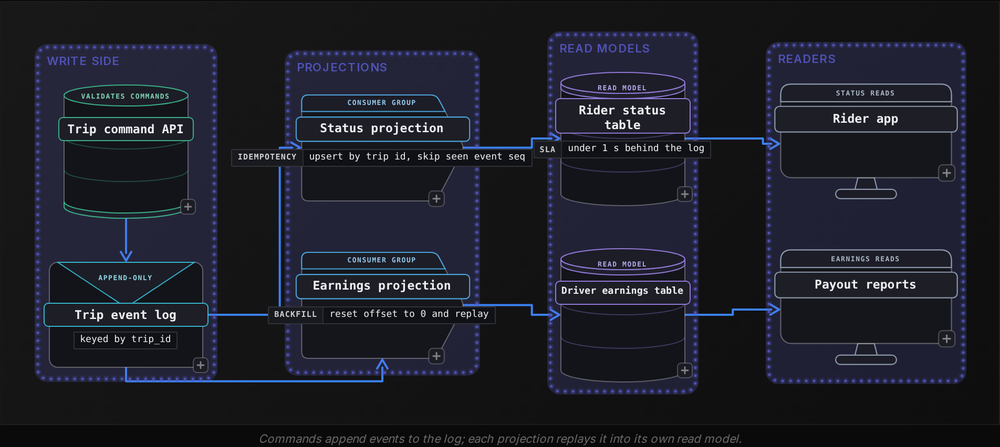
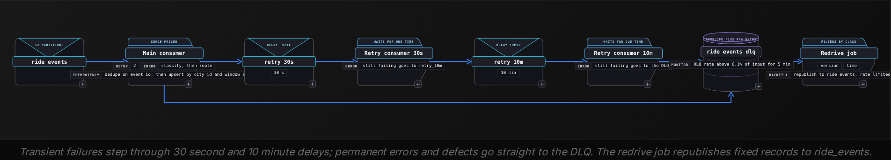

Intermediate·Pipeline Architecture · 25 min · 4 challenges

# Streaming Systems: Intermediate

Renata is in the final round at Uber. The interviewer draws a box labelled ride requests and a second labelled surge pricing, then asks her to build the path between them: every city gets a request count each minute, and she must explain what happens when a worker dies halfway through a batch. She starts with partitions and a group of readers. The follow-ups keep coming. Finance wants any trip's fare history replayable; what is stored? A phone in a tunnel uploads its request 90 seconds late; does that minute get recounted? A deploy ships a parser bug and 40,000 events fail; where do they go, and how do they come back? Micro-batch engine or record-at-a-time? Each answer leans on the one before it, and this lesson walks the chain in the interviewer's order, with the actual offsets and timestamps at each step and actual failure counts where things break.


<br>

### What you will be able to do

Trace where a consumer crash or rebalance creates gaps or duplicates from the commit point, and pick the exactly-once pattern that closes it.

Decide whether a domain needs event sourcing and whether it needs CQRS, then state what each costs.

Pick a window type, then set the watermark bound and allowed lateness from a measured lateness distribution.

Classify streaming failures and design the retry topics and DLQ envelope that hold them, plus a redrive that is safe to run.

Pick between a micro-batch and a continuous engine by naming the requirement that decides it.


<br>

---

## Consumer Groups and Offsets

### How a group divides a topic

A consumer group is a set of processes sharing a group name, and the broker assigns each partition of a topic to a single member. The running example here is a topic called `ride_events` with 12 partitions, read by the group `surge-pricer`. With 4 members, each owns 3 partitions; with 6, each owns 2. Grow the group to 13 and the 13th member sits idle, because a partition is never split across members. Partition count caps parallelism within a group, and raising it later remaps keys to different partitions, breaking per-key ordering for records in flight.

| Members | Partitions per member | Idle members |
| --- | --- | --- |
| 4 | 3 | 0 |
| 6 | 2 | 0 |
| 12 | 1 | 0 |
| 13 | 1 | 1 |


<br>

### Offsets are positions the consumer commits

Every record in a partition has an offset that grows by 1 per record. The group stores a committed offset per partition: the next offset to read after a restart. The consumer decides when that commit happens, and its delivery guarantee follows from where the commit sits relative to the side effect.

#### Worked crash: offsets 1000 to 1499

Consumer C2 owns partition 7 and has committed offset 1000. It polls 500 records, offsets 1000 through 1499, adds them to per-city counters, writes the counters to the pricing store, and commits offset 1500. Kill it between 2 of those steps and restart it.

| Order of steps | Crash lands between | Restart reads from | Effect on counts |
| --- | --- | --- | --- |
| Commit, then write | commit and write | 1500 | Offsets 1000 to 1499 never counted |
| Write, then commit | write and commit | 1000 | Offsets 1000 to 1499 counted twice |
| Write and commit in a single transaction | no gap: 1 atomic step | The offset the store holds | Each record counted once |

Row 2 is the usual choice, and the right default: lost records vanish silently, while duplicates can be found and removed. At-least-once describes delivery. Duplicates become harmless only when processing a record twice has the same effect as processing it once, which is a property of the sink.


<br>

### Rebalances replay uncommitted work

Crashes are rare; rebalances happen on every deploy. When a member joins or leaves, the group reassigns partitions, and the same happens when a member misses its heartbeat deadline (a long garbage-collection pause is enough). Each new owner starts from the last committed offset. Records the old owner processed but had not committed run again. With commits every 5 seconds and partition 7 carrying 2,000 records per second, each move of partition 7 can repeat up to 10,000 records.


<br>

### Lag is the number that pages someone

Lag per partition is the log end offset minus the committed offset. If partition 7 ends at 88,400 and the group has committed 82,400, lag is 6,000 records. The drain rate tells you whether it matters: a consumer processing 2,500 records per second against 2,000 arriving clears those 6,000 in 12 seconds, while a drain rate of 0 never clears. Alert on lag that keeps growing for several minutes, since a fixed lag threshold pages during every normal burst.


<br>

### 3 ways to an exactly-once effect

No protocol can promise that a record reaches your code exactly once across crashes, because a sender cannot tell a lost acknowledgement from a lost message. Pipelines aim for an exactly-once effect instead: at-least-once delivery into a sink that absorbs repeats.

- **Idempotent writes** *A repeat overwrites itself*\
  Upsert the absolute count keyed by city_id and window_start, or dedupe on an event_id the producer assigns. Replaying offsets 1000 to 1499 rewrites identical rows. An increment such as count = count + n breaks this, because it doubles on replay.
- **Offsets stored with the output** *One transaction covers both*\
  Write results and the partition's next offset to the sink database in a single transaction, and on startup read the offset from that table instead of from the broker. The commit and the side effect can no longer diverge.
- **Transactional read-process-write** *For log-to-log pipelines*\
  The producer writes output records and the consumed offsets in a single log transaction, and downstream readers use read-committed isolation so aborted output stays invisible. It covers only effects that land in the log.

```sql
def run(consumer, db, partition):
    consumer.seek(partition, db.read_offset(partition))
    while True:
        batch = consumer.poll(partition, max_records=500)
        if not batch:
            continue
        counts = count_by_city_minute(batch)
        with db.transaction() as tx:
            for (city_id, window_start), n in counts.items():
                tx.increment_count(city_id, window_start, n)
            tx.save_offset(partition, batch[-1].offset + 1)
```

The counter write here is an increment, which pattern 1 forbids. Pattern 2 makes it safe because the offset update shares its transaction: a crash rolls back both, and the batch replays against the old counts. Move `save_offset` outside the `with` block and the same line double-counts on every rebalance.


<br>

### Where exactly-once ends

Each pattern stops at systems that can join the transaction or absorb a repeat. A card charge cannot be rolled back, and neither can a push notification or a partner API call. For those, derive an idempotency key from the record, such as `trip_id` plus event type, and have the receiving service reject keys it has seen. The strong answer to "make this exactly-once" names the boundary. It says which effects sit inside a transaction and which are idempotent on their own, then lists the external calls that carry a key.

> Disguises of this question
>
> - "We see double counts after every deploy." Rebalance replay into a sink that increments outside a transaction.
> - "Can we turn on exactly-once and stop worrying?" Only effects inside the log transaction are covered.
> - "Adding consumers did not raise throughput." Members beyond the partition count sit idle.
> - "Lag hit 1 million at 2am, then recovered." Check the drain rate before treating it as an incident.


<br>

---

## Event Sourcing Patterns

### State as a fold over facts

A conventional trip service keeps a row per trip and overwrites its status and fare on each change. Event sourcing makes the system of record an append-only log of events per entity, and computes current state by applying those events in order. The row you would have stored becomes a cache, rebuildable at any time.

| event_seq | event_type | occurred_at | payload |
| --- | --- | --- | --- |
| 1 | TripRequested | 12:00:05 | city_id=31, est_fare_cents=1840 |
| 2 | DriverAssigned | 12:00:19 | driver_id=880 |
| 3 | TripStarted | 12:04:52 | none |
| 4 | TripCompleted | 12:21:10 | fare_cents=2150 |
| 5 | FareAdjusted | 14:02:33 | delta_cents=-300, reason=route_dispute |

Folding trip 5521's 5 events gives status completed and a fare of 1,850 cents. A mutable row would hold those 2 values and nothing more. The log also answers what the row cannot: the fare at 13:00 (2,150 cents), who changed it and why, and how long the rider waited for a driver (14 seconds).

```sql
SELECT
  trip_id,
  MAX_BY(event_type, event_seq) AS last_event,
  SUM(COALESCE(fare_cents, 0) + COALESCE(delta_cents, 0)) AS fare_cents_as_of,
  MAX(occurred_at) AS last_changed_at
FROM trip_events
WHERE occurred_at <= TIMESTAMP '2026-10-24 13:00:00'
GROUP BY trip_id
```


<br>

### Snapshots bound the replay

Trip 5521 has 5 events. A driver's earnings account gains an event for every completed trip and payout, and an active driver can reach 20,000 within a few years. Replaying all of them on each read is too slow, so the store writes a snapshot of folded state every N events and replays only what follows it. With N set to 1,000, a read loads 1 snapshot and at most 999 events. Snapshots are caches as well, so a change to the fold logic means throwing them away and rebuilding them from the log.


<br>

### CQRS splits writes from reads

Command Query Responsibility Segregation separates the path that changes state from the paths that read it. A command such as AdjustFare is validated against the write model, which for an event-sourced trip is its folded state, and if accepted it appends events. Projections consume the log and maintain read models, each shaped for its queries: a status table for the rider app, a per-driver earnings table, a wide table for analysts. Each projection is its own consumer group with its own committed offsets, so rebuilding one means resetting its offset to 0 and replaying.



The cost CQRS adds is staleness. A rider who taps cancel may read the status table a few hundred milliseconds before the projection applies the event, and see the trip still active. The common mitigations are to return the new state in the command's response, or to have the client wait until the projection's committed offset passes the offset of the event it wrote.

✓Use event sourcing when

- History is the product: ledgers, fares, balances, inventory
- Support or auditors must answer what state was at time T
- New read models keep appearing and must backfill from the first event
- Bugs in derived state are fixed by correcting code and replaying

✗Skip it when

- The domain is plain CRUD and nobody asks about past states
- Every read must see the latest write, with no lag allowed
- Personal data must be erasable and no key-deletion scheme exists
- Nobody will own event schema versioning for the log's lifetime


<br>

### The costs interviewers probe

What goes wrong, and the standard answer

- **Event versioning.** Events live forever, so FareAdjusted v1, with a dollar amount as a float, and v2, with delta_cents as an integer, both stay in the log. An upcaster converts old versions on read so the fold handles a single shape.
- **Erasure.** Deleting a rider's address from an immutable log breaks its guarantee. Encrypt personal fields with a per-rider key and delete the key on request: the events remain, the personal data becomes unreadable.
- **Replay time.** Rebuilding a projection over 2 billion events at 50,000 events per second takes about 11 hours, so a new projection version runs beside the old one until it catches up, then reads switch over.
- **Ordering.** A trip's events must be applied in sequence. Keying the log by trip_id keeps each trip in 1 partition, so order holds per trip and nowhere else.

These patterns are separable. CQRS without event sourcing is common: an ordinary database holds the write model and change data capture feeds the read models. Event sourcing without CQRS is rare, because answering queries by folding the raw log is slow, so an event-sourced system grows projections almost at once.

> **TIP**
>
> If an interviewer asks how finance can reconstruct a fare at any past moment, that is the event sourcing question in disguise. If reads are slow because they contend with writes on the same table, that is the CQRS question.


<br>

---

## Windowing and Watermarks

### Pick the window from the question

A window assigns each event to finite buckets of event time so an unbounded stream can be aggregated. Surge pricing asks for requests per city per minute across 600 cities, which is a tumbling window: fixed size, no overlap. A smoothed rate covering the last 5 minutes, refreshed every minute, is a hopping window. Grouping a rider's taps until 30 minutes of silence is a session window, whose length depends on the data.

| Window | Parameters | Windows per event | State grows with |
| --- | --- | --- | --- |
| Tumbling | size 1 min | 1 | open windows times keys |
| Hopping | size 5 min, slide 1 min | 5 | 5 times the tumbling state |
| Session | gap 30 min | 1, merged as events arrive | active sessions, no fixed length |

Say the cost in the third column out loud: every event lands in 5 hopping windows, so across 600 cities the job keeps 5 times the state of the tumbling version and does 5 times the update work.


<br>

### Event time versus processing time

Each ride event carries `event_time`, stamped on the phone when the rider tapped, and receives a processing time when the engine reads it. Network delay and client retries open a gap between the 2, and so does a phone that buffers events while offline. Windowing by processing time is cheap and wrong for rides: the backlog after a consumer restart would pour 10 minutes of requests into the current minute and spike surge in every city at once. Windowing by event time puts each request in the minute it happened, and raises the question this section answers: when is a minute finished?


<br>

### A watermark is a claim about completeness

A watermark W asserts that no more events with `event_time` below W are expected. Once W passes a window's end, the window emits its result. The usual strategy is bounded out-of-orderness: W is the largest event time seen minus a fixed bound. With a 10 second bound, the window from 12:00:00 to 12:01:00 fires once an event stamped 12:01:10 or later arrives. The trace follows the events of a single partition for city 31.

| Arrival | event_time | Max seen | Watermark | Outcome |
| --- | --- | --- | --- | --- |
| 1 | 12:00:41 | 12:00:41 | 12:00:31 | Counted in 12:00 window |
| 2 | 12:00:58 | 12:00:58 | 12:00:48 | Counted in 12:00 window |
| 3 | 12:00:52 | 12:00:58 | 12:00:48 | Out of order, still counted |
| 4 | 12:01:12 | 12:01:12 | 12:01:02 | 12:00 window fires |
| 5 | 12:00:57 | 12:01:12 | 12:01:02 | Late: its window already fired |
| 6 | 11:59:42 | 12:01:12 | 12:01:02 | Tunnel phone, 90 s behind |

Row 3 is why the bound exists: out-of-order events within 10 seconds of the newest are absorbed. Rows 5 and 6 arrive after their windows fired, and what happens to them is a separate decision with 3 options.

- **Drop** *Cheapest*\
  Count them in a late-events metric and discard them. Acceptable when a correction would land after the surge multiplier it fixes has already expired.
- **Allowed lateness** *Keep window state open longer*\
  Keep each window's state for 2 minutes after it fires and emit an updated count for each late event. Row 5 joins the 12:00 window, held until the watermark passes 12:03:00. Row 6 joins the 11:59 window, held until 12:02:00, and the watermark is only 12:01:02. The sink must accept updates, so it needs the idempotent upsert on city_id and window_start.
- **Side output** *Route to a late stream*\
  Send late events to their own topic and let an hourly batch job fold them into a corrected table. The stream stays fast and the corrected total arrives later.


<br>

### Choose the bound from measured lateness

The bound trades latency for completeness, and it should come from data. Measure each event's lateness as the max event time seen when it arrives minus its own `event_time`, over a week of traffic. Suppose ride events show p50 of 1 second, p99 of 8 seconds and p99.9 of 75 seconds. A 10 second bound emits each minute around 10 seconds after it ends and counts at least 99% of events on time. An 80 second bound catches 99.9%, but every surge multiplier is then older than the minute it describes. Surge pricing takes the 10 second bound and lets allowed lateness correct the tail.

Both knobs cost memory. A window's state lives from its first event until the watermark passes its end plus the allowed lateness, so a larger bound keeps more windows per key open at once, and so does more allowed lateness.

- **190 s** — lifetime of each 1-minute window
- **2,400** — peak open windows across 600 cities


<br>

### Idle partitions freeze the clock

An engine reading 12 partitions tracks a watermark per partition and uses the minimum, so the slowest partition holds back every window. If partition 9 carries a small city that goes quiet at 4am, its watermark stops advancing, so no window anywhere can fire. An idleness timeout fixes this: after, say, 60 seconds with no records, partition 9 drops out of the minimum until it produces again. Set the timeout longer than normal gaps on busy partitions, or a brief stall turns their next records into late data.

Whatever the late-data choice, keep a batch query over the stored events that recomputes the same windows by event time. Comparing its counts with what the stream emitted shows whether the bound still fits as traffic changes.

```sql
SELECT
  city_id,
  DATE_TRUNC('minute', event_time) AS window_start,
  COUNT(*) AS requests
FROM ride_events_raw
WHERE event_time >= TIMESTAMP '2026-10-24 12:00:00'
  AND event_time < TIMESTAMP '2026-10-24 13:00:00'
GROUP BY city_id, DATE_TRUNC('minute', event_time)
```

> **TIP**
>
> Asked which watermark you would use, answer with the lateness distribution you would measure, the bound you would choose from it, and what the late tail does: dropped, corrected through allowed lateness, or reconciled by batch.


<br>

---

## DLQ Patterns

### Classify before you route

A dead letter queue holds records the pipeline has given up on. Which failures belong there depends on a single test: would waiting change the outcome? A database timeout will probably succeed in a minute. A record with a malformed timestamp will fail identically forever. Handling both the same way either floods the DLQ with recoverable records or retries poison records until they jam the partition.

| Class | Example | Retry helps? | Route |
| --- | --- | --- | --- |
| Transient | Pricing store returns 503 or times out | Yes, within seconds to minutes | Short backoff, then retry topics |
| Dependency not ready | `driver_id` 880 missing from the driver lookup | Yes, once upstream catches up | Delayed retry topic |
| Permanent data error | Unparseable `event_time`, missing `city_id` | No | DLQ at once |
| Code defect | Valid record throws after a deploy | Only after a fix | DLQ, tagged with app version |

The 4th class is the hard one. A parser bug looks like a permanent data error from inside the consumer, yet the records are fine and the code is wrong. Tagging every DLQ record with the application version that failed it separates the two later: a burst from a single version, starting at a deploy timestamp, is a defect.


<br>

### Retry topics keep partitions moving

Retrying in place, by sleeping inside the consumer, blocks the partition: nothing behind the failing record moves. With 5 attempts and a backoff that doubles from 1 second up to 16, partition 7 stalls for 31 seconds, and at 2,000 records per second that is 62,000 records of lag behind a single bad record. Retry topics move the record aside instead: the consumer publishes it to a delay topic and commits its offset, so the partition keeps moving. A retry consumer reads each delay topic and processes a record only once its due time has passed.



The cost is ordering. If trip 5521's DriverAssigned event sits in a retry topic, its TripStarted can be processed first. Per-minute counts do not care. A projection that folds each trip's events in sequence does, so its consumer must also park later events for any key with a record in retry, by tracking a set of blocked keys and routing their new events to the retry path.


<br>

### The envelope makes reprocessing possible

A DLQ record holding only the payload is useless a week later: nobody knows which partition it came from, which code failed it, or how often it was tried. Keep the original bytes untouched, because a record that failed to parse cannot be safely re-serialized, and wrap them in metadata. The payload below decodes to `{"trip_id":5521}` with no `city_id`, so it reached the DLQ on its first attempt.

```sql
{
  "source_topic": "ride_events",
  "source_partition": 7,
  "source_offset": 1041,
  "key": "5521",
  "payload_base64": "eyJ0cmlwX2lkIjo1NTIxfQ==",
  "error_class": "PERMANENT_DATA",
  "error_message": "missing required field city_id",
  "app_version": "surge-pricer 4.17.2",
  "attempts": 1,
  "first_failed_at": "2026-10-24T12:00:59Z",
  "redrive_count": 0
}
```


<br>

### Redrive without making it worse

Say surge-pricer 4.18.0 ships a parser that rejects a new optional field, and 40,000 valid events reach the DLQ as code defects within 20 minutes. A summary over the DLQ table shows the incident's shape: 1 error class, 1 version, 1 start time.

```sql
SELECT
  error_class,
  app_version,
  COUNT(*) AS failed_events,
  MIN(first_failed_at) AS first_seen
FROM ride_events_dlq
WHERE first_failed_at >= CURRENT_TIMESTAMP - INTERVAL '1' DAY
GROUP BY error_class, app_version
ORDER BY failed_events DESC
```

Redrive is a deliberate job, run once 4.18.1 is deployed. It filters the DLQ by error class and app version within a time range, republishes the original bytes to `ride_events` with `redrive_count` incremented, and leaves everything else untouched. Its safety depends on 3 properties. The main consumer must drop duplicates on the producer's `event_id` before counting, because a redrive job that crashes halfway is rerun and republishes part of its batch at new offsets, and an upsert of a count that already includes them stores the doubled number. Redrive must be rate limited, since 40,000 records arriving at once on partitions already carrying 2,000 per second trip the lag alert and delay live traffic. And a cap on `redrive_count`, 3 here, stops a record that still fails from cycling forever.

Redriven events are hours old, so the windows they belong to closed long ago and the watermark treats them as late. They take the side output from the windowing section into the hourly reconciliation, which is how the 12:00 counts finally include them.

✓Do

- Classify errors in code and store the class on every DLQ record
- Keep the original bytes next to the topic-partition and offset they came from
- Alert on DLQ rate as a share of input, per error class
- Redrive by filter after a fix, rate limited, with a redrive cap

✗Don't

- Retry permanent data errors, which fail the same way every time
- Sleep in the consumer for long backoffs and block the partition
- Redrive the whole DLQ blindly after every deploy
- Let the DLQ grow with no owner and no retention policy


<br>

---

## Spark Streaming vs Flink

The 2 engines in this section's title are the best-known examples of 2 execution models, and the interview question is about the models. Micro-batch cuts the stream into small batches and runs each as a short batch job. Continuous dataflow deploys long-running operators that pass records along as they arrive. Most tradeoffs follow from that difference.


<br>

### How each model runs the surge job

✓Micro-batch

- A coordinator plans a batch every trigger interval, say 5 seconds
- Each batch reads a fixed offset range from all 12 partitions
- Each batch writes its output before checkpointing offsets and state
- The watermark advances once per batch

✗Continuous dataflow

- Operators are deployed once and run until the job stops
- Each record flows from source to sink as soon as it arrives
- Keyed state lives inside operators, often in a local embedded store
- Checkpoint barriers travel with the data to snapshot every operator consistently


<br>

### Latency: where the floor comes from

A micro-batch job cannot emit a result until its batch commits, and the batch first has to be planned and run. End-to-end latency is the trigger interval plus processing time, which usually comes to a second or more. A continuous job can emit within milliseconds of a record arriving, limited by network hops and the sink. A fraud check that must answer within 200 milliseconds, before a ride is confirmed, rules micro-batch out.

For surge pricing the engine barely matters, and saying so is the strongest point you can make. With 1-minute tumbling windows and a 10 second watermark bound, no count leaves either engine until about 10 seconds after its minute ends, and a 5 second trigger adds at most another 5. The window and the watermark set the latency floor before the engine does, so check them first.

- **15 s** — worst surge count delay, micro-batch


<br>

### Timers and stateful logic

Both models support event-time windows and watermarks. They differ beyond built-in windows. The continuous model exposes keyed state and per-key timers directly: a function holds trip 5521's state, registers a timer for 15 minutes after TripRequested, and flags the trip if no DriverAssigned has arrived when it fires. The micro-batch model offers arbitrary stateful functions too, but they run per batch, so a timeout is noticed at the first batch after it falls due, and state is checkpointed every batch. Logic built from many timers and event patterns per key fits the continuous model more naturally.


<br>

### Exactly-once and back-pressure

Each model reaches an exactly-once effect with the patterns from the first section. Micro-batch uses a replayable source, a deterministic batch tied to a batch id, and a sink idempotent per batch id, so a rerun batch overwrites its own output. Continuous dataflow uses barrier checkpoints for internal state and a sink that pre-commits at each checkpoint and commits when the checkpoint completes, a 2-phase commit. Overload looks different too. A micro-batch job shows it as batches outlasting the trigger interval, so batches queue up behind each other and latency climbs. A continuous job pushes back-pressure upstream operator by operator until the source slows its reads and lag builds in the log.

| Requirement | Leans toward | Why |
| --- | --- | --- |
| Answer within 1 s per event | Continuous | No batch planning between arrival and result |
| Per-key timers, event patterns | Continuous | Timers and keyed state are first-class |
| Team already runs batch jobs on the same engine | Micro-batch | Shared API and code for batch and stream |
| Freshness of 1 minute or looser | Either | Window and watermark dominate latency |
| High throughput, relaxed latency | Micro-batch | Larger batches spread per-batch overhead |
| Small team, no streaming specialists | Micro-batch | Failures resemble the batch jobs they already debug |


<br>

### Answering the comparison question

A strong answer opens with requirements: the latency budget, whether logic needs per-key timers, the expected state size, and what the team already operates. Then it names the model those requirements point to and what that choice costs. "I'd pick the continuous engine because it's faster" is weak. "Our budget is 200 milliseconds and each trip needs a timeout, so continuous dataflow; we accept a codebase separate from our batch jobs and the work of upgrading stateful jobs safely" is strong.

> Follow-ups to expect
>
> - "What happens to state when the job's code changes?" Snapshot, migrate the state schema, restore.
> - "How do you backfill a day?" Replay the log from an offset, or run the same logic over a bounded range.
> - "What breaks first at 10x traffic?" The 12 partitions cap parallelism before either engine does.


<br>

---

## Putting It All Together

A food delivery platform streams order events (OrderPlaced, CourierAssigned, PickedUp, Delivered, Refunded) into a 24-partition topic keyed by order_id. Operations wants an alert within seconds when an order stalls, finance wants every refund reconstructable as of any past day, and a dashboard shows orders per restaurant per 5 minutes.

- The order log is event-sourced: refunds are adjustment events, and finance's as-of report is the fold cut off at a timestamp.
- Each read model (alerts, dashboard, finance table) is a projection with its own consumer group and offsets, rebuilt by replaying from offset 0.
- The dashboard's 5-minute windows take their watermark bound from measured courier-app lateness, with a side output feeding finance's hourly reconciliation.
- A stall alert needs a per-order timer 10 minutes after CourierAssigned with no PickedUp, which points to the continuous model for that job.
- A courier-app release that breaks parsing sends events to the DLQ as defects tagged with its version; redrive after the fix is safe because every projection upserts by order_id and event_seq, and the replayed events take the late path into reconciliation.


<br>

---

## Key Takeaways

- Delivery guarantees come from where the offset commit sits relative to the side effect; an exactly-once effect is at-least-once delivery plus an idempotent or transactional sink.
- Event sourcing makes the log the system of record and state a fold over it; CQRS splits write and read models, and the price is staleness plus event versioning for the log's lifetime.
- Pick the watermark bound from measured lateness, decide separately what late events do, and remember that window state lives for window size plus bound plus allowed lateness.
- Route failures by whether waiting helps. Transient ones go through retry topics, while permanent errors and defects go straight to the DLQ, where a filtered redrive later sends them back into idempotent consumers.
- Choose an engine by naming the requirement first; at 1-minute windows the watermark sets latency before the engine does.
