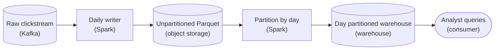
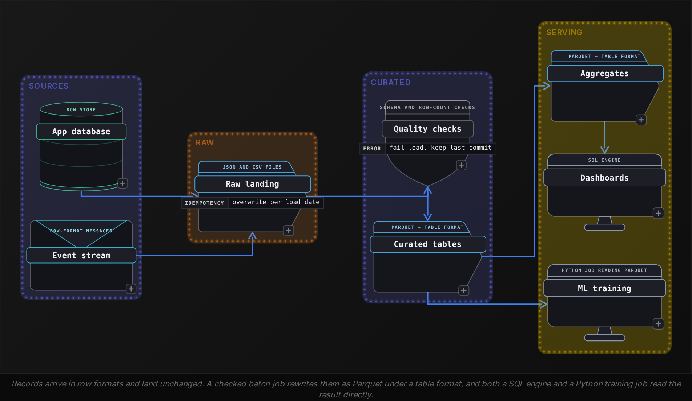
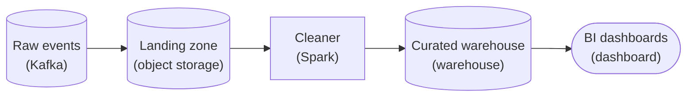
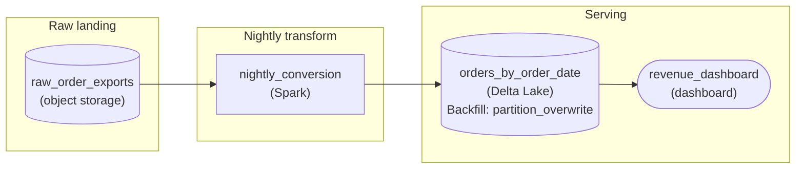
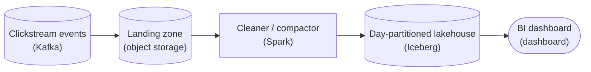

Beginner·Pipeline Architecture · 20 min · 4 challenges

# Where Data Lives: Beginner

Dalia is 40 minutes into a data engineering interview at Netflix, the company whose engineers created one of the open table formats this lesson covers. The interviewer pastes a schema: playback events, a row for every press of play or pause and another when the viewer stops, 40 columns wide and roughly 1 billion rows a day. 'These land as CSV today. Why would you store them as Parquet, and what would you partition by?' Dalia says Parquet is columnar, and stops. The interviewer waits for the rest: which bytes a query gets to skip, what compression does to the storage bill, what breaks if the table is partitioned by account, and what stops a dashboard from reading half a write. Each of those follow-ups has a reason behind it, and this lesson builds them decision by decision.


<br>

### What you will be able to do

Explain why a columnar file suits analytic queries, and name the write patterns it makes expensive

Choose a compression codec from how often data is read and whether the file can be split across workers

Pick a partition column, and spot over-partitioning and filters that defeat pruning

Tell a data lake from a warehouse by storage and schema checks, and say which write guarantees a lakehouse adds to the lake

Explain how a table format turns a directory of Parquet files into a transactional table, and what upkeep it needs


<br>

---

## Columnar vs Row

### What the screen is checking

'Why Parquet?' works as a screening question because the answer shows whether a candidate knows where bytes sit on disk. A full answer names the layout, the reads it makes cheaper, and the writes it makes expensive. Every section of this lesson uses the same table, `playback_events`: 40 columns, roughly 10 bytes per value, around 1 billion rows landing each day.


<br>

### Same 4 rows, 2 layouts

A file is a single long run of bytes, so a format has to pick an order. A row format writes every field of the first row, then every field of the second. A columnar format writes all the values of a column for a block of rows, then all the values of the next. Below, 4 playback events are stored both ways, listed in the order their values appear in the file.

Row layout, as in CSV

| order in file | values written |
| --- | --- |
| first | e1, a77, BR, mobile, 312 |
| second | e2, a12, US, tv, 1840 |
| third | e3, a77, BR, mobile, 95 |
| fourth | e4, a40, US, tv, 2210 |

Columnar layout, as in Parquet

| order in file | values written |
| --- | --- |
| first | event_id: e1, e2, e3, e4 |
| second | account_id: a77, a12, a77, a40 |
| third | country: BR, US, BR, US |
| fourth | device_type: mobile, tv, mobile, tv |
| fifth | watch_seconds: 312, 1840, 95, 2210 |

Now run the query analysts send most: total watch time by country for a single day. It needs `country` and `watch_seconds` along with `event_date`, which is 3 of the 40 columns. In the row layout those values are interleaved with 37 other fields, so the reader pulls every byte of every row off storage to reach them. In the columnar layout each needed column sits in its own contiguous run, and the reader fetches those runs and skips the rest. That skip is column pruning, and it's the first reason in any answer.

```sql
SELECT
  country,
  SUM(watch_seconds) AS total_watch_seconds
FROM playback_events
WHERE event_date = DATE '2026-10-01'
GROUP BY country
```

- **400 GB** — scanned per day, row layout
- **30 GB** — scanned per day, columnar layout


<br>

### What else the layout buys

- **Compression works better** *A column's values, side by side*\
  Values of the same type and meaning sit together, which hands a codec long stretches of repeats to shrink. The next section works through how much that saves.
- **Whole blocks get skipped** *Min and max per row group*\
  Parquet splits a file into row groups and stores each column's minimum and maximum for every group. A filter like watch_seconds > 3600 skips any group whose maximum is at or below 3600 without reading its data.
- **The schema travels with the file** *Names and types in the footer*\
  Column names and types live in the file's footer, so no reader has to guess whether 0012 is a string or the number 12, a guess CSV forces on every consumer.

| row group | min watch_seconds | max watch_seconds | for watch_seconds > 3600 |
| --- | --- | --- | --- |
| 1 | 0 | 2900 | skipped |
| 2 | 4 | 7200 | read |
| 3 | 0 | 3400 | skipped |
| 4 | 12 | 9800 | read |

Here the filter reads 2 of 4 row groups. The skip depends on clustering: if long sessions are scattered across every group, every maximum sits above 3600 and nothing is skipped. Sorting rows by the filtered column before writing is what makes these statistics pay off.


<br>

### What columnar costs

The layout that speeds up reads slows down some writes, and a full answer says which. Appending 1 row means adding a value to 40 separate column runs, so writers buffer thousands of rows in memory and flush a whole row group at a time. Changing 1 row means rewriting its file, because a Parquet file can't be edited once it is closed. Reading 1 complete record means visiting 40 places in the file instead of 1.

| ✓ Row formats fit | ✗ Columnar formats fit |
| --- | --- |
| • An application database reading and writing a single order at a time<br><br>• A stream of events where each message is a complete record<br><br>• Landing files from a source as they arrive, before any query runs<br><br>• Lookups that need every field of a single record | • Queries that aggregate a few columns across millions of rows<br><br>• Tables written in large batches and rarely changed afterwards<br><br>• Long histories where compressed size drives the storage bill<br><br>• Filters that can rule out whole row groups by statistics |

> **TIP**
>
> Name the write cost before you are asked. 'Columnar is faster' leaves the interviewer to probe; 'columnar is faster for reads of a few columns, and costs me batched writes and no in-place edits' shows you know where the format stops fitting.


<br>

### Try it: pick the layout

> For each workload, row or columnar?
>
> - A mobile app saves each user's profile and reads the whole profile back at login.
> - Finance sums revenue by month over 3 years of orders.
> - Devices send a playback heartbeat every 10 seconds into a message queue.
> - A nightly job writes yesterday's events once, and analysts query them for a year.

Row, columnar, row, columnar. The profile and the heartbeats are complete records written and read individually. The revenue sum touches 2 or 3 columns over millions of rows. The nightly job is the shape Parquet was built for: written in a batch, read many times by column. Pipelines often use both, landing heartbeats in a row format and rewriting them into Parquet in a later batch step.


<br>

### The answer in 30 seconds

> A complete screening answer
>
> 'Parquet stores each column's values together, so a query that touches 3 of 40 columns reads roughly 3/40 of the bytes. Similar values side by side compress well. Each row group also stores min and max statistics, so the engine can skip any block a filter rules out. The schema is stored in the file. The cost is on the write side: rows have to be batched, and changing a row means rewriting its file, so I keep a row format wherever records are written or read individually.'


<br>

---

## Compression

Compression questions arrive in 2 forms: 'which codec would you use?' and 'why is this job so slow?' Both turn on 3 properties of a codec: how small it makes the data, how much CPU it spends getting there, and whether the compressed file can still be shared among many workers.


<br>

### Ratio against speed

Every codec trades ratio against speed. A higher ratio means fewer bytes stored and fewer bytes pulled from storage by each query. A faster codec means less CPU burned on every read and write. A table is usually written once and read many times, so for anything queried often, decompression speed outweighs compression speed.

| codec | ratio | decompression | where it fits |
| --- | --- | --- | --- |
| Snappy | lower | fast | Hot tables read all day; long a common default for Parquet writers |
| LZ4 | lower | fastest of these 4 | Data read seconds after it is written, such as between job stages |
| Gzip | higher | slow | Data written once and read rarely, or handed to other teams |
| Zstd | high, tunable by level | fast | A balanced default: low levels for hot data, high levels for archives |

Ratio depends on the data more than on the codec, so a quoted ratio is a measurement on someone's data. Suppose a day of `playback_events` as Parquet holds 400 GB of uncompressed column data, Snappy writes it as 100 GB, and Zstd at a moderate level writes it as 75 GB. Kept for a year, that difference is about 9 TB of storage, and every query scanning the year pulls a quarter fewer bytes.


<br>

### Why columns give a codec more to work with

A codec shrinks data by finding byte patterns it has seen recently and replacing each repeat with a short reference back. A Parquet page of the `country` column holds thousands of 2-letter codes, and the same handful of countries make up most of them, so references are short and frequent. A CSV row puts an event ID that never repeats next to a timestamp, then a device name and a number, so matching patterns sit far apart. Parquet records a codec for each column chunk, which lets a writer vary it by column, though most tables use a single codec throughout.


<br>

### The pitfall: a file only 1 worker can read

Engines go fast by cutting a large file into byte ranges and handing each range to a different worker. That requires a worker to be able to start decoding in the middle. A CSV compressed with Gzip as a whole is a single stream: byte 5,000,000 decodes only after every byte before it, so the engine gives the entire file to 1 worker.

| ✓ events.csv.gz, 40 GB | ✗ events.parquet, 40 GB, Gzip codec |
| --- | --- |
| • A single Gzip stream from first byte to last<br><br>• Can't be cut into ranges<br><br>• One worker reads all 40 GB while the rest wait<br><br>• Runtime grows with file size | • Compressed page by page inside each column chunk<br><br>• Row groups decode independently of each other<br><br>• Each row group can go to a different worker<br><br>• Runtime grows with file size divided by worker count |

The codec stayed the same and the container changed. Parquet compresses inside its own structure, so the file splits on row group boundaries whatever codec it uses, and at a common row group size of 128 MB a 40 GB file offers hundreds of ranges. Splittable codecs for plain text do exist, but the usual pipeline fix is to land raw files as they arrive and convert them to Parquet in the first transform.

- **1** — read range in the 40 GB gzip CSV
- **320** — row groups in the 40 GB Parquet file


<br>

### Matching the codec to the data

| data | how often it is read | pick |
| --- | --- | --- |
| Raw files landed from a source and kept for replay | Rarely, during a rerun or backfill | Gzip or high-level Zstd, written as many files so workers share the load |
| Curated playback_events queried all day | Thousands of times a day | Snappy or low-level Zstd |
| Intermediate data passed between stages of a job | Once, seconds after it is written | LZ4 or Snappy |
| Compliance archive kept for 7 years | Almost never | The highest-ratio setting the write budget allows |

> **TIP**
>
> Answer 'which codec?' with the access pattern first: how often the data is read, and by how many workers at once. The codec follows from that, so the interviewer hears a reason before a name.


<br>

### Try it: the 3-hour job

A nightly job runs for 3 hours. Its input is one 60 GB file, `clicks_2026-10-01.json.gz`. The cluster has 200 workers. What do you check first, and what would you change?

> One answer
>
> Check how many tasks read the input. A single Gzip stream yields 1 task, so 199 workers sit idle. Either have the source write the day as many smaller compressed files, or add a step that converts the landed file to Parquet once, after which every downstream job reads it in parallel. Swapping Gzip for Zstd on the same single stream leaves it unsplittable and the job still serial.


<br>

---

## Partitioning

Partitioning splits a table into directories by the value of a column, so a query that filters on that column opens only the directories that match. It's the cheapest speedup a file-based table offers and the most common way to slow one down. Interviewers ask you to choose a partition column, then probe whether you can name what makes that choice backfire.


<br>

### What the engine does with a partition filter

Partitioned by `event_date`, `playback_events` keeps a directory per day, and each directory's name carries its date. The engine compares the query's filter with those names and never lists or opens a directory that can't match. Inside a directory it does open, column pruning still applies, and so do the row group statistics. With Zstd, each day holds 75 GB in 96 files of about 780 MB.

| directory | files | opened for event_date = 2026-10-01 |
| --- | --- | --- |
| playback_events/event_date=2026-09-29/ | 96 | no |
| playback_events/event_date=2026-09-30/ | 96 | no |
| playback_events/event_date=2026-10-01/ | 96 | yes |
| playback_events/event_date=2026-10-02/ | 96 | no |
| 361 more directories | 34,656 | no |

- **1 of 365** — directories a 1-day query opens
- **27 TB** — stored data the same query skips

```sql
CREATE TABLE playback_events (
  event_id VARCHAR,
  account_id BIGINT,
  country VARCHAR,
  device_type VARCHAR,
  watch_seconds INTEGER,
  event_ts TIMESTAMP,
  event_date DATE
)
WITH (
  format = 'PARQUET',
  partitioned_by = ARRAY['event_date']
)
```


<br>

### Choosing the partition column

A good partition column has 3 traits. Most queries filter on it, or the pruning never fires. It has few enough values that each partition holds real volume: a common target is data files of 128 MB to 1 GB, so each partition should fill at least 1 such file. And its value is fixed when the row is written, so a row never has to move between directories. For an events table, the event date meets all 3, which is why it is the default answer.


<br>

### Pitfall 1: too many partitions

Adding `account_id` under `event_date` sounds selective, since a query roughly 1 account would open 1 directory. Say a day's 1 billion events come from 50 million active accounts. Each daily load then writes 50 million files averaging 20 events, about 1.5 KB apiece. The engine spends its time listing directories and opening files instead of reading data, and every file costs a storage request whatever its size. This is the small file problem, and over-partitioning is a frequent cause of it.

| partition by | partitions per year | data per partition |
| --- | --- | --- |
| event_date | 365 | 75 GB |
| event_date, country | about 69,000 | tens of GB for the largest country, a few KB for the smallest |
| event_date, account_id | about 18 billion | about 1.5 KB |


<br>

### Pitfall 2: filtering on the wrong column

The table is partitioned by `event_date`, and an analyst filters on `event_ts`, the full timestamp. To a person the 2 columns are related; to the engine they are unrelated. Directory names carry `event_date` values only, so a filter on `event_ts` rules none of them out. The result is correct, but the engine lists all 365 directories and reads every file's footer before row group statistics can skip anything.

```sql
SELECT
  country,
  SUM(watch_seconds) AS total_watch_seconds
FROM playback_events
WHERE event_ts >= TIMESTAMP '2026-10-01 18:00:00'
  AND event_ts < TIMESTAMP '2026-10-01 22:00:00'
GROUP BY country
```

```sql
SELECT
  country,
  SUM(watch_seconds) AS total_watch_seconds
FROM playback_events
WHERE event_date = DATE '2026-10-01'
  AND event_ts >= TIMESTAMP '2026-10-01 18:00:00'
  AND event_ts < TIMESTAMP '2026-10-01 22:00:00'
GROUP BY country
```

> **TIP**
>
> When a query on a partitioned table runs as slowly as on an unpartitioned one, read its WHERE clause for the partition column first. The usual cause is a filter on a related column, such as a timestamp, that the engine can't match to directory names.


<br>

### Late data lands in old partitions

Partitioning by event date has a pipeline consequence. An event from October 1 that arrives on October 3 belongs in the October 1 directory, so a daily job can't assume it only ever writes today's partition. If the job for October 1 is rerun and overwrites its directory, the rerun has to read every event for that date, including the late ones; otherwise it silently drops them. Partitioning by arrival date keeps old partitions closed, at the price of pruning, since analysts filter on when an event happened.


<br>

### Try it: an orders table

> Which partition column?
>
> An `orders` table holds 5 years of history, about 2 million orders a day across 30,000 stores. Dashboards filter by order date and sometimes by store. Which column do you partition by, and why not add store?

Order date: around 1,826 partitions of 2 million rows each, matching how dashboards filter. Adding store would make about 55 million partitions averaging around 67 orders, far below any healthy file size. Store filters still benefit if files within each day are sorted by store, since row group statistics then skip most of every file.


<br>

---

## Pipeline Architecture

### Exercise 1 of 1

**● TASK**

A daily batch lands the raw clickstream as one giant Parquet file in cheap object storage, which stays the cheap source of truth. Analysts almost always pull a single day at a time, yet every one of those queries scans the whole table today. Stand up a query-optimized warehouse copy organized by day, so a single-day query reads only that day's data instead of the entire file.

**Starting canvas** (already placed for you):

- Raw clickstream (source, Kafka)
- Daily writer (transform, Spark)
- Unpartitioned Parquet (storage, S3)

<details>
<summary><strong>Solution</strong></summary>

#### What this really is

Strip the costume off and this is **partitioning for partition pruning**, nothing more. Analysts filter by day, but the physical file is one undivided blob, so the engine has no way to skip anything: every query opens the whole thing and throws away 364/365 of what it read. The fix is not a faster engine or a wider cluster, it is physical layout: lay the warehouse copy out as one directory per day so the predicate `event_date = '...'` maps to a folder the planner can open and the rest it can ignore. The trap on THIS instance is thinking Parquet already solved it because Parquet is columnar. Columnar buys you column pruning (read only the columns you select); it does nothing for skipping rows across days when all days live in one file. Miss that distinction and you 'optimize' by adding compute to a scan that was never going to shrink.



*The raw Parquet stays the cheap source of truth; a daily job rewrites it into a warehouse copy partitioned by `event_date`, and analysts query that copy.*

| Trick: Partition on the column the analysts filter on |
| --- |
| The one move that cracks this: the partition key must be the predicate. Analysts filter by day, so partition by `event_date`. That writes one physical path per day (`event_date=2026-09-17/`), and the engine turns `WHERE event_date = '2026-09-17'` into 'open exactly one directory'. Partition on anything the queries don't filter on and you pay the write cost of partitioning with none of the read benefit. |

| ✕ One giant file | ✓ Partitioned by day |
| --- | --- |
| All days interleaved in a single Parquet object. A single-day query has no directory to prune to, so the engine scans the entire table, decodes every row group, and filters `event_date` in memory. Cost scales with total history, not with the day requested. | One directory per day under `event_date=`. `WHERE event_date = '2026-09-17'` prunes to that folder before any bytes are read. Cost scales with one day's volume and stays roughly constant as history grows. Same Parquet, same columns; only the physical layout changed. |

#### Building it without breaking what works

1. **Leave the raw landing zone exactly as it is**

   The unpartitioned Parquet in object storage is the cheap source of truth, and it stays. You are adding a derived copy, not migrating. If the partitioned copy ever gets corrupted or you change the layout, you rebuild it from raw. Rewriting the source of truth in place is how a layout experiment turns into data loss.

2. **Add a batch job that writes the data partitioned by day**

   Read raw with Spark, then `write.partitionBy("event_date")`. The `partitionBy` is the whole point: it puts `event_date` into the storage path instead of only inside the file. Do a `repartition("event_date")` first so each day's rows land together and you don't emit a smear of tiny files, one per input partition per day.

3. **Register the partitions so the engine can prune**

   Writing `event_date=` folders is not enough: the table's metastore has to know each partition exists (an `MSCK REPAIR TABLE` or an explicit add-partition after every run). The query engine only prunes partitions the catalog lists. Skip this and every query silently falls back to a full scan, which looks fine in dev and quietly costs money in prod.

**The daily partition job**

```python
raw = spark.read.parquet("s3://lake/raw/clickstream/")

# One physical directory per day: s3://warehouse/clickstream/event_date=2026-09-17/
(raw
    .repartition("event_date")     # shuffle so each day lands as a few big files
    .write
    .partitionBy("event_date")     # the key goes into the path, not just the file
    .mode("overwrite")
    .parquet("s3://warehouse/clickstream/"))

```

*Same Parquet, same columns; only the physical layout changes.*

| Pitfall: Right column, wrong granularity |
| --- |
| The subtle miss is partitioning too finely. Day is correct here because analysts pull 'a single day at a time'. Partition by hour and you get 24x the directories and a small-files problem (thousands of sub-128MB objects, each with fixed open and metadata overhead that swamps the scan). Partition by `user_id` and you get millions of directories and a metastore that chokes. Match partition granularity to the query grain, not to the finest timestamp you happen to have. |

| Interviewer: The tell: naming the read pattern before touching layout |
| --- |
| A strong answer starts with 'analysts query one day, so partition by day' and derives the design from the access pattern. A weak answer jumps to 'add Parquet / add a bigger cluster / add caching' without connecting the layout to the predicate. Saying out loud that raw stays untouched and the day-partitioned copy can always be rebuilt is the second tell. |

| Performance: Why the plan stays cheap as history grows |
| --- |
| With one file, a single-day query over 3 years scans ~1000 days of data to return one. Partitioned by `event_date`, the same query prunes to one directory and reads ~1/1000th of the bytes, and that ratio holds no matter how many years accumulate: cost is a function of the day requested, not of total history. Many engines bill by bytes scanned, so pruning is a direct line on the invoice, not just latency. |

| Real world: The copy is a contract, not a one-off |
| --- |
| Once the day-partitioned copy exists, dashboards depend on each day's partition appearing on schedule. Registering partitions after every run, and handling a day that arrives 2 days late, become real operational concerns, not footnotes. |

**Follow-up questions**

1. A day's data arrives 48 hours late. How does your job add just that `event_date=` partition without rewriting the others?\
   *Tests overwriting a single partition instead of rewriting the whole table.*
2. Analysts start filtering by both day and country. Do you add `country` as a second partition column?\
   *Tests multi-column partitioning against partition count and small files.*
3. Within a single day the files are still thousands of tiny objects. What do you change in the write?\
   *Tests file sizing, targeting roughly 128MB-1GB per partition.*
4. A teammate proposes partitioning by hour 'for finer pruning'. What do you tell them?\
   *Tests the over-partitioning pitfall: pruning gains versus per-file overhead.*

</details>


<br>

---

## Lake vs Warehouse

'How is a data lake different from a data warehouse?' sounds like a definitions question. The answer that lands compares them on 4 things a pipeline depends on: where the bytes sit, who controls their format, when the schema is checked, and what a write promises to a reader. Lakehouse questions get answered on the same 4 lines.

| property | data lake | data warehouse | lakehouse |
| --- | --- | --- | --- |
| Where bytes sit | Files in object storage | Storage the warehouse engine manages | Files in object storage |
| File format | Open: Parquet, JSON, CSV, images, anything | The engine's own internal format | Open, mostly Parquet |
| Schema checked | At read time, by each query | At load time, by the warehouse | At write time, against the table's metadata |
| Who reads it directly | Any engine that understands the files | The warehouse engine | Any engine that supports the table format |
| A write is | Files appearing as each is written | A transaction: all of it or none | A transaction committed through metadata |
| Cost shape | Cheapest storage; compute rented separately | Storage and compute billed by a single system | Lake storage prices with transactional writes |


<br>

### Where a plain lake breaks

A lake is a set of files any engine can read, which is both its strength and its exposure. Three failures come up in interviews, each tied to a pipeline event.

- **A reader during a write** *Partial results*\
  A job writes 96 files for October 1. A dashboard query runs when 40 have landed and reports 40/96 of the day's watch time, with no error.
- **A retry after a crash** *Duplicates*\
  The job dies after writing 60 files and is retried. Unless it clears its own output first, the directory holds 60 stale files plus 96 new ones, and the day's totals come out about 1.6 times too high.
- **A schema change upstream** *Silent nulls or failed reads*\
  The source renames watch_seconds to watch_ms. New files carry the new name, and a query reading by name sees nulls for new rows or fails, depending on the engine.

A warehouse prevents all 3 by owning the write path. A load is a transaction, so readers see the table before it or after it. A failed load rolls back, so its retry inserts the rows once. A file whose columns do not match the table's schema is rejected at load. The price: data has to be loaded into the warehouse's storage before anything can query it, and other engines reach it only through that warehouse.


<br>

### The lakehouse: warehouse guarantees on lake files

A lakehouse keeps data as open files in object storage and adds a metadata layer recording which files make up the table at each moment. Writes become commits to that metadata, so readers never see half a write and a retry of a failed write cannot double a day. Lakehouse is the name of an architecture: a lake with a table format on top, read by whichever engines support that format. The next section opens that layer up.



Each layer answers a failure from the list above. Raw landing keeps source data unchanged, so a bad transform can be rerun from it. The quality check runs before the commit, so a renamed column stops the load instead of reaching dashboards. Curated tables commit atomically, so the dashboard never reads 40 of 96 files. Two kinds of consumer read the same curated files, which is why teams keep data in open formats instead of loading it into a single engine.

> **TIP**
>
> Asked 'lake or warehouse?', describe both, then name what decides between them: how many engines need the data, how structured it is on arrival, and what a reader may see while a write is in progress.


<br>

### Try it: place each dataset

> Lake, warehouse or lakehouse?
>
> - Raw camera images kept for a model that may be trained next year
> - Month-end revenue tables read by a single SQL engine and audited every quarter
> - Event tables queried by SQL dashboards and read directly by a Python training job

Lake for the images: they have no tabular schema and no SQL query reads them. Warehouse for the revenue tables: only one engine reads them, and they need a strict schema and transactional loads with an audit trail. Lakehouse for the event tables: 2 kinds of engine need the same files, and the dashboards need commits no reader can catch halfway.


<br>

---

## Pipeline Architecture

### Exercise 1 of 1

**● TASK**

Raw events land cheaply in object storage, but the BI team needs fast SQL aggregations over the cleaned data. Keep the raw data in cheap storage while giving BI a fast query surface to read from.

**Starting canvas** (already placed for you):

- Raw events (source, Kafka)
- Landing zone (storage, S3)
- Cleaner (transform, Spark)

<details>
<summary><strong>Solution</strong></summary>

#### 2 tiers, 2 jobs

Under the costume this is the lake-plus-warehouse split. Raw stays in the cheap data lake as the source of truth, and BI reads a **separate, cleaned, query-optimized copy**. The trap is treating it as one decision. Some candidates point the dashboards straight at the raw landing prefix, so every chart is a full scan of row-oriented JSON. Others load everything into the warehouse and drop the landing zone, which means paying warehouse rates for raw history nobody queries and losing the ability to replay. Miss it and BI waits minutes per chart, or the storage bill grows faster than the data does.



*Raw data lands in object storage and stays there. A batch `Spark` job writes cleaned, columnar tables into the warehouse, and BI reads only the warehouse.*

#### Why not just query the raw?

| ✕ BI reads the raw landing zone | ✓ BI reads the curated warehouse |
| --- | --- |
| Every `SUM(amount)` reads every byte of every column of every JSON event, then decompresses and reparses the text. There is no columnar layout and nothing to prune. Cheap to store, brutal to ask. | The table is columnar, so `SUM(amount)` touches only `amount` and skips the other 40 columns. Only the cleaned slice pays warehouse storage; raw history stays at object-storage prices. |

1. **Land raw cheaply and keep it**

   The event stream writes into object storage as-is, schema-on-read. That landing zone is your replayable record. You never delete it and never point BI at it. Its job is durability, plus the ability to reprocess when the cleaning logic changes.

2. **Batch-clean into a structured copy**

   A scheduled `Spark` job cleans the day's raw files and loads them into the warehouse, where the schema is enforced on write. BI aggregates tolerate a daily refresh, so a streaming job would buy freshness nobody asked for. The switch from JSON to columnar is the single biggest query win.

3. **Partition on what BI filters by**

   Partition the curated table by `event_date`, because dashboards filter by time range and pruning skips every partition outside it. Partitioning by `user_id` instead explodes into millions of tiny partitions and recreates the small-files problem.

| Trick: The lake is the truth, the warehouse is a materialization |
| --- |
| Neither tier alone is the answer. The lake holds everything cheaply and flexibly. The warehouse materializes only the hot, cleaned queries BI runs every day. Say both halves, and say why each exists. |

| Pitfall: Columnar and partitioned still crawls with tiny files |
| --- |
| Wiring the `Cleaner` to emit one small file per run looks fine on day one. Within weeks each `event_date` partition holds thousands of files, and every query pays a fixed open cost per file. Size the batch output so each partition holds a few large files. |

| Interviewer: Say why raw survives the warehouse |
| --- |
| The junior answer drops the landing zone once the warehouse exists. The senior tell is saying, without being asked, that raw stays in object storage for cost and replay, while the warehouse holds only cleaned data for BI. |

| Performance: Terabytes scanned become gigabytes |
| --- |
| With 40 columns, a one-month `SUM(amount)` drops from about 2TB of raw JSON to a few GB. Column pruning removes roughly 95% of the bytes, and partition pruning drops 11 of 12 months. Minutes become seconds, and the scan bill falls with them. |

**Follow-up questions**

1. BI now wants data less than 15 minutes old instead of daily. What changes?\
   *Batch vs streaming judgment, and how shorter intervals multiply small files.*
2. A late event arrives for an `event_date` 3 days ago. How does it land?\
   *Why date partitioning turns late data into a rewrite of one partition.*
3. The cleaning logic had a bug all last week. How do you fix the warehouse?\
   *Why keeping raw data is load-bearing: reprocess from the lake instead of patching the serving copy.*

</details>


<br>

---

## Table Formats

Table format questions run from 'what is it?' through 'why not plain Parquet?' to 'what does it cost to operate?' A single mechanism answers all 3: the table is defined by a list of files kept in metadata, and every change to the table publishes a new list.


<br>

### A table as a list of files

In a plain Parquet directory, the table is whatever files the directory holds right now. Under a table format, the table is whatever files the current metadata names. A commit writes its data files first, then writes new metadata that, read with the versions before it, defines the complete file set. Last, it makes that metadata current in 1 atomic step, such as swapping a pointer or creating the next numbered log file. A reader therefore gets the old list or the new one, never something in between.

| version | operation | data files in the table | what a reader sees |
| --- | --- | --- | --- |
| v1 | append September 30 | A1 to A96 | September 30, complete |
| v2 | append October 1 | A1 to A96, B1 to B96 | 2 complete days |
| none | append October 2, crashed after C1 to C60 | unchanged | still v2; C1 to C60 sit in storage, listed nowhere |
| v3 | retry of October 2 | A1 to A96, B1 to B96, D1 to D96 | 3 complete days, no duplicates |

Run the plain-lake failures through this table. A dashboard query during the crashed write read v2, a complete table. The retry committed 96 fresh files as v3, and the orphans from the crash appear in no version, so October 2 counts once. Atomicity covers a crash before the commit. If a job commits and then dies before reporting success, the orchestrator retries it, and the retry appends October 2 again as v4. The load itself has to be idempotent: it overwrites the October 2 partition instead of appending, or it checks whether that date's commit already exists before writing. The Parquet files themselves never changed; only the definition of the table did.


<br>

### What the metadata buys

- **Atomic commits** *No partial reads, safe retries*\
  Shown above: a writer's files count only once its commit lands.
- **Time travel** *Query an older version*\
  Older metadata still names older file sets, so a query can read v2 to compare against v3, and a bad load can be rolled back by making v2 current again.
- **Schema evolution** *Changes without rewriting files*\
  When the format tracks each column by an ID as well as a name, renaming watch_seconds changes metadata only, and old files still map to the right column.
- **Planning without listing** *File paths and statistics in metadata*\
  The metadata already holds each file's path and partition values, plus column statistics for it, so the engine plans a query from metadata instead of listing directories.

```sql
SELECT
  snapshot_id,
  committed_at,
  operation
FROM "playback_events$snapshots"
ORDER BY committed_at DESC
LIMIT 3
```

| snapshot_id | committed_at | operation |
| --- | --- | --- |
| 7310259846612833005 | 2026-10-03 03:20:41 | append |
| 5126604783913204198 | 2026-10-02 02:11:05 | append |
| 2944118075530912416 | 2026-10-01 02:09:48 | append |

The 3 rows run newest first, from v3 down to v1. The crashed run on October 3 left no row, because it never committed.


<br>

### What it costs to run

The guarantees come with upkeep, and naming it is the practical awareness interviewers listen for. Every commit leaves metadata behind and keeps replaced data files alive for time travel, so storage grows until old versions are expired on a schedule. Files from failed writes stay in storage until a cleanup job deletes whatever no version names. Frequent small appends pile up small files, which a compaction job rewrites into larger ones. Two writers committing at once race for the atomic step; the first wins, and the other must retry its commit against the new version.

- **8,760** — snapshots a year at hourly commits
- **35,040** — snapshots a year at 15-minute commits

| ✓ Do | ✗ Don't |
| --- | --- |
| • Expire snapshots on a schedule that matches how far back time travel must reach<br><br>• Run orphan-file cleanup so failed writes stop holding storage<br><br>• Compact tables fed by frequent small appends<br><br>• Retry a rejected commit against the latest version | • Copy files into a table's directory with a tool that skips the commit step<br><br>• Delete data files by hand to reclaim space<br><br>• Keep every snapshot forever because nobody set a retention<br><br>• Assume a plain Parquet directory gives readers transactional reads |


<br>

### Answering 'which table format?'

Three open table formats are in wide use, and all share the mechanism above: metadata that names a set of data files, usually Parquet, and an atomic commit that makes that metadata current. They differ in metadata layout, in how they handle frequent row-level updates, and in which engines read and write them well. A practical answer starts from the team: which engines must read and write the table, whether writes are large daily appends or a steady stream of updates, and which format every one of those engines supports today.

> A complete answer, start to finish
>
> 'A table format adds metadata over Parquet files that names exactly which files form each version of the table. A commit writes data files and then makes new metadata current in an atomic step, so readers never see a partial write and a job that dies before committing can be retried without double-counting. For a crash after the commit, I make each load overwrite its date partition so a rerun replaces it. The same metadata gives time travel, schema changes without rewrites, and query planning without directory listing. In return I schedule snapshot expiry and orphan cleanup alongside compaction, and I pick the format the team's engines support well.'


<br>

### Try it: the copied files

A colleague loads yesterday's data by copying valid Parquet files straight into the table's data directory, bypassing the table format's write path. What does a query against the table return for yesterday, and why?

> Answer
>
> The query returns nothing for yesterday, because the copied files appear in no metadata version, so no reader sees them, and the next orphan-file cleanup may delete them. Data enters a table-format table only through a commit.


<br>

---

## Putting It All Together

A video streaming service ingests about 1 billion playback events a day as gzip-compressed JSON from its devices. Analysts query a year of history by date and country, a recommendations team trains models on the same events in Python, and the nightly load sometimes fails halfway and gets retried.

- The raw gzip JSON lands unchanged for replay, and the first transform rewrites it as Parquet so every later job reads it in parallel.
- Low-level Zstd keeps the curated table small without slowing the dashboards that scan it all day.
- Partitioning by event date lets a 1-day query open 1 of 365 directories, while late events make the daily job rewrite old dates with every row that belongs to them.
- Because both a SQL engine and a Python job read the events, they stay as open files in the lake instead of inside a warehouse.
- A table format makes each nightly load a single commit, so a failed run leaves the last good version visible and its retry counts the day once.


<br>

---

## Pipeline Architecture

### Exercise 1 of 2

**● TASK**

An analyst's weekly revenue dashboard uses six of the roughly one hundred columns in the nightly order export and only the last 7 order dates, yet every query scans the entire flat folder of CSV files the finance job dumps into object storage. Redesign where and how those orders are stored so her queries read only the columns and order dates they ask for, and so a nightly load that dies halfway never shows her a partial day.

<details>
<summary><strong>Solution</strong></summary>

#### Why this problem exists in real interviews

This is the whole lesson in one folder. 3 separate storage questions hide behind one complaint: the file format decides which columns get read, the folder layout decides which days get read, and the table format decides whether a half-written night is visible. The trap is answering one and calling it done. Converting the CSVs to Parquet in the same flat folder cuts the columns but still opens every day since the job started. Splitting folders by the night the export landed cuts nothing, because the dashboard filters on `order_date`, not on load date. Miss either and the scan bill barely moves.

| Trick: 3 layers, 3 separate savings |
| --- |
| Columnar format skips the 94 columns nobody reads. A daily `order_date` layout skips the days nobody asked for. A table format like Delta Lake makes each nightly load land all at once or not at all. Each fix is invisible to the other two, so a strong answer names all three. |

#### Walk the requirements

1. **Stop reading columns the dashboard never uses**

   CSV is row-oriented: to get `net_amount` the engine reads every row end to end, all hundred fields. Parquet stores each column together, so a query for six columns reads six. Same-typed values packed together also compress far better, and a fast codec such as Snappy or Zstd keeps decompression cheap for an interactive dashboard.

2. **Lay the table out by `order_date`, one folder per day**

   Partition pruning lets the engine skip every date folder outside the filter, so a seven-day query opens 7 folders. Key it on `order_date`, because that is what the dashboard filters on and late orders arrive in later exports. At about 2 GB a night, daily is the right grain; hourly would only multiply tiny files.

3. **Put a table format on top of the files**

   Raw Parquet in a folder has no transaction guarantee: a job that dies after writing half its files leaves half a day visible. Delta Lake or Iceberg commits a load through a transaction log, so readers see the previous night until the new one is complete.

4. **Keep the raw exports, point the dashboard elsewhere**

   The CSV folder stays as the cheap lake copy for audits and reprocessing. The nightly job converts it into `orders_by_order_date`, and that curated table is the only thing the dashboard reads.

#### The shape that fits



*Raw CSVs stay cheap in `raw_order_exports` on object storage; `nightly_conversion` writes a Delta table split by `order_date`; the dashboard reads only `orders_by_order_date`.*

| ✕ Today: one flat CSV folder | ✓ Redesign: Delta table by order date |
| --- | --- |
| Every query reads all hundred columns of every row of every night ever exported. A load that fails halfway leaves stray files the dashboard happily sums. | A query reads six columns from 7 `order_date` folders, compressed. A failed load never commits, so the dashboard keeps showing the last complete night. |

| Performance: Under one percent of the old scan |
| --- |
| Six of a hundred columns is about 6% of the column data. 7 days out of a year of history is about 2% of the folders. Multiplied, that is roughly 0.1% of what the CSV scan reads, before compression shrinks the columnar files several times further. |

| Interviewer: Order date, not arrival date |
| --- |
| The strong candidate asks which date the dashboard filters on before choosing the folder key. Laying files out by load date looks tidy and prunes nothing, since last week's orders are scattered across every night that carried a late one. |

| Pitfall: Hourly folders for a daily question |
| --- |
| Over-partitioning trades one problem for another: 2 GB a night split by hour, or by `order_date` and store, becomes thousands of tiny files, and listing them costs more than reading them. The dashboard never asks below a day, so the layout should not either. |

**Follow-up questions**

1. Analysts start filtering by store region as well as `order_date`. Do you add region as a second folder key?\
   *Tests the over-partitioning instinct: a second key multiplies folders and shrinks files, so date stays the folder key unless region is low-cardinality and in nearly every query.*
2. Finance restates last Tuesday's orders and sends a corrected export. How does the table take it without the dashboard seeing a mix of old and new rows?\
   *Tests using the table format: rewrite only Tuesday's `order_date` partition and commit it as one transaction, so readers see either the old day or the corrected one.*

</details>


<br>

### Exercise 2 of 2

**● TASK**

Put it all together: design end-to-end storage for a clickstream platform. Raw events must land cheaply, the cleaned data must be partitioned for day-scoped queries, and BI needs a fast warehouse surface with reliable table semantics for concurrent writers.

**Starting canvas** (already placed for you):

- Clickstream events (source, Kafka)
- Landing zone (storage, S3)
- Cleaner / compactor (transform, Spark)

<details>
<summary><strong>Solution</strong></summary>

Strip the costume off and this is the **raw lake with a lakehouse on top** you just learned, sized down to one page. The words 'end-to-end storage' make it sound like one decision; it is three, because no single storage choice satisfies 'land cheaply', 'query by day', and 'reliable concurrent writes' at once. The trap is treating the object-storage landing zone as the thing BI queries. It lands as thousands of tiny row-oriented files, so pointing a query engine at it means full scans over unindexed JSON and, worse, readers seeing half-written partitions. Get the tiering wrong and the demo works on a day of data and falls over at a month.



*Raw JSON lands in object storage, a batch job rewrites it as day-partitioned Parquet under Iceberg, and BI reads the lakehouse table.*

#### The 3 decisions, in order

1. **Land raw cheaply from the stream**

   `Kafka` is a stream; the landing zone is not. You sink micro-batches into object storage as append-only, row-oriented files (JSON or Avro), with no cleaning and no reshaping. The point of this tier is durability and cheapness: keep the untouched bytes so you can reprocess when a downstream bug surfaces. This is where **batch and streaming meet**. You ingest continuously, but you do NOT try to clean per event.

2. **Compact and convert to columnar in batch**

   The `Spark` job earns its place by doing 2 things the landing zone cannot. First it compacts: the stream sink produced thousands of tiny files, so it coalesces them into a handful of right-sized ones. Second it rewrites row JSON into columnar `Parquet` and partitions by `event_date`, so a day-scoped BI query reads one partition of a few large, column-pruned files instead of scanning the month. Batch is the right tool because compaction and rewrite are throughput jobs, not low-latency ones.

3. **Serve through a table format, not a directory of files**

   Clean `Parquet` is still not a table; it is files in prefixes. 'Reliable table semantics for concurrent writers' is the phrase that forces `Iceberg` (or `Delta`). Its metadata layer gives an atomic commit and snapshot isolation, so a BI reader never sees a half-finished compaction and 2 writers do not clobber each other's partition. That is what turns the curated lake into a lakehouse: a warehouse surface BI can trust, still sitting on cheap object storage.

| Trick: The small-files problem is the whole reason step 2 exists |
| --- |
| A stream sink writing every few seconds produces one small file per micro-batch. Query engines pay a fixed open-list-read cost per file, so a partition of 10,000 tiny files is dramatically slower than the same bytes in 10 files. The compactor's job is not cosmetic: coalescing small files is often the single biggest query speedup in the whole pipeline. |

| Pitfall: Partitioned Parquet directories are not atomic |
| --- |
| The tempting shortcut is to skip the table format and point BI at the partitioned `Parquet` prefixes. It reads fine in a demo and corrupts under concurrency: a reader hitting a partition mid-rewrite sees a mix of old and new files, and 2 writers to the same partition have no commit protocol. Directories give you layout; only a table format gives you `MERGE`, snapshot isolation, and safe concurrent writes. |

| ✕ Landing zone (raw) | ✓ Curated lakehouse (served) |
| --- | --- |
| Row-oriented JSON/Avro on object storage, append-only, no schema enforcement, tiny files, partitioned little or not at all. Optimized for cheap durable capture and reprocessing. | Columnar `Parquet` under `Iceberg`, partitioned by `event_date`, compacted, ACID commits. Optimized for day-scoped BI scans and safe concurrent writers. |

| Interviewer: Naming why each layer's format differs signals seniority |
| --- |
| Anyone can draw the boxes. The tell is explaining WHY the format changes at each hop: row format lands cheap and reprocessable, columnar `Parquet` prunes columns for analytics, and the table format adds the commit protocol. A candidate who says 'store everything as `Parquet` everywhere' has missed that raw capture wants row-oriented append and that files alone are not a table. |

| Performance: Partition on the column the queries filter |
| --- |
| Partitioning by `event_date` means a 'last 7 days' dashboard touches 7 partitions, not the full history; the engine skips the rest before reading a byte. Partition by a high-cardinality column like `user_id` and you recreate the small-files problem with millions of one-row partitions. Match the partition key to the dominant query predicate, which for clickstream BI is almost always the day. |

**Follow-up questions**

1. BI now wants freshness under an hour, not daily. What changes?\
   *Tests whether they add more frequent commits into the table format without abandoning the batch cleanup tier.*
2. Late-arriving events land 2 days after their `event_date`. How does the curated table stay correct?\
   *Tests understanding of table-format `MERGE`/upsert and partition rewrites versus naive append.*
3. Why keep the raw landing zone at all once data is curated?\
   *Tests the reprocessing and replay argument for a cheap immutable raw tier.*

</details>


<br>

---

## Key Takeaways

- Columnar files read only the columns a query names and compress well. Min/max statistics let them skip row groups. They cost batched writes and whole-file rewrites.
- Codec choice follows the access pattern: decompression speed for data read often, ratio for data read rarely, and a container that stays splittable.
- Partition on the column most queries filter by, keep partitions large enough to hold full-size files, and filter on that column itself.
- A lake is open files read by any engine, a warehouse owns storage and enforces transactions, and a lakehouse adds a table format to the lake.
- A table format defines the table as the files its current metadata names, so commits are atomic and a retry is safe. In exchange, expiry and cleanup become routine jobs, along with compaction.
