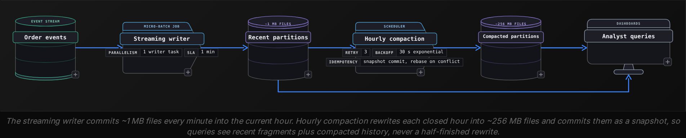
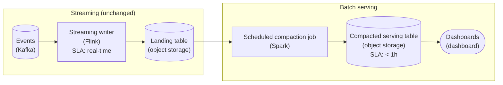
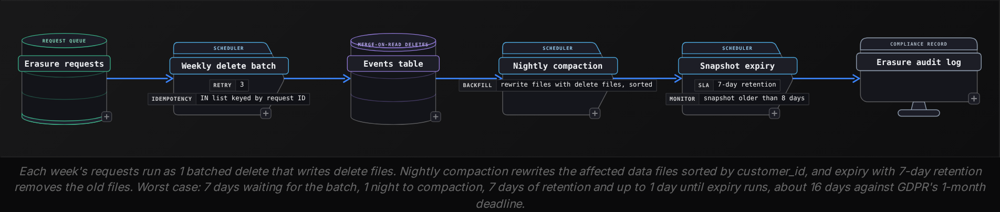
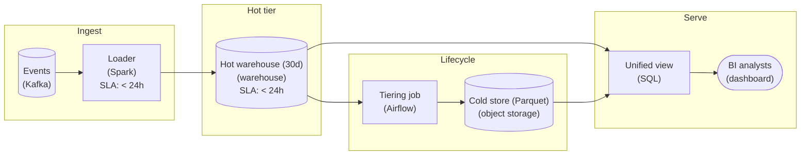
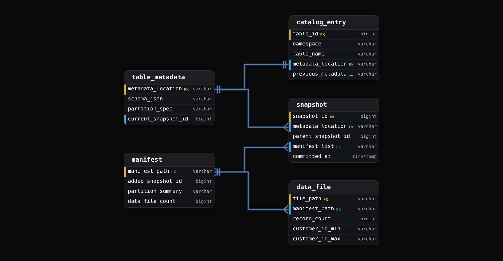
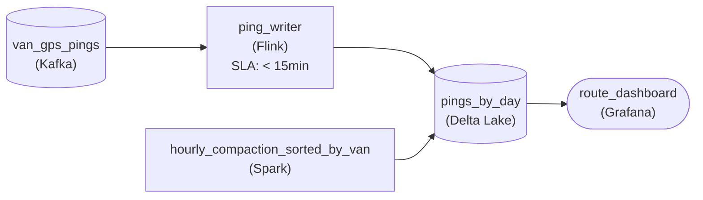
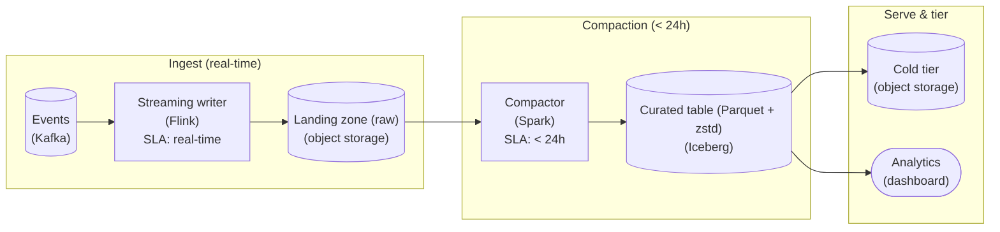

Intermediate·Pipeline Architecture · 25 min · 4 challenges

# Where Data Lives: Intermediate

Ines is 40 minutes into a data engineering loop at Netflix, whose engineers designed an open table format after directory-based tables on object storage kept failing them at scale. The interviewer sketches a viewing-events table: Parquet files, partitioned by day, fed by a streaming job. Then come the probes, each one a step deeper. Why is the `device_type` column a hundredth the size of `session_id`? Queries got slower after the streaming job went live; what happened? A member asks to be forgotten; how many files must change? Finance wants the storage bill halved. And how does every engine find the same version of this table? Ines knows each piece in isolation. What the loop is testing is whether she can attach a mechanism and a number to every answer, and say what each fix costs.


<br>

### What you will be able to do

Predict which Parquet encoding a column gets from its cardinality and sort order, and size the result

Diagnose a small file problem from file counts and average sizes, and choose between write-time fixes and compaction

Estimate the bytes rewritten to erase a single customer, and cut that with sorting, delete files and snapshot expiry

Price a tiering plan, find the read rate where a colder tier stops saving money, and name what breaks the plan

Explain what the catalog stores per table and how its pointer swap makes concurrent commits safe


<br>

---

## Encoding Types

Inside a Parquet file, each column chunk is cut into pages of roughly 1 MB, and every page passes through 2 stages on its way to disk. Encoding comes first: it rewrites values into a compact form that still knows the data type, turning repeated strings into small integers and sorted timestamps into small differences. Compression comes second, running a general-purpose codec such as Snappy or ZSTD over the encoded bytes. Interview probes aim at the first stage because that is where the shape of the data matters. The same codec over the same values can produce files 10x apart, and the gap traces back to which encoding the writer chose.


<br>

### The 4 encodings worth knowing

| Encoding | How it stores values | Wins on | Loses on |
| --- | --- | --- | --- |
| PLAIN | Every value in full; strings carry a 4-byte length prefix | Fast to write; the fallback for everything else | Every repeat paid for in full |
| RLE_DICTIONARY | Distinct values once in a dictionary page, then a bit-packed index per row | Low and medium cardinality: country, status, device type | High cardinality, where the dictionary outgrows its cap |
| DELTA_BINARY_PACKED | First value, then differences between neighbours, bit-packed per block | Sorted integers, timestamps, increasing IDs | Random order, where differences are as wide as values |
| RLE / bit-packing hybrid | A repeated value as (value, count); short stretches bit-packed | Booleans, null tracking, dictionary indices | Values that change on every row |


<br>

### Sizing a country column

Take a `country` column of 10 million rows holding 200 distinct codes that average 8 bytes. Written PLAIN, each value costs its 8 bytes plus the 4-byte length prefix, so the column weighs around 120 MB before compression. With a dictionary, the 200 strings are stored once, around 2.4 KB, and each row keeps only an index. The 200 values fit under 2 to the 8th power, 256, so each index needs 8 bits and the indices total 10 MB. Sort the rows by country before writing and the hybrid encoding stores each country as a single run: 200 runs of (index, count), a few kilobytes in all.

- **12x** — smaller with a dictionary, unsorted


<br>

### Dictionary fallback to PLAIN

The writer builds the dictionary as rows arrive, and common writers cap the dictionary page at 1 MB by default. Once a column chunk's distinct values outgrow the cap, the writer stops adding entries and writes every remaining page of that chunk as PLAIN. A `session_id` column of 36-character UUIDs reaches 1 MB after around 26,000 distinct values, so in a row group of 1,048,576 rows nearly every page falls back. The footer records the switch: the column chunk lists both encodings, and that pair is the signature of a fallback.

```sql
{
  "row_group": 0,
  "num_rows": 1048576,
  "columns": [
    {
      "path_in_schema": "device_type",
      "encodings": [
        "RLE",
        "RLE_DICTIONARY"
      ],
      "total_uncompressed_size": 412318,
      "total_compressed_size": 287104
    },
    {
      "path_in_schema": "session_id",
      "encodings": [
        "RLE",
        "RLE_DICTIONARY",
        "PLAIN"
      ],
      "total_uncompressed_size": 41943040,
      "total_compressed_size": 25165824
    }
  ]
}
```

The `RLE` entry on both columns is the encoding of the definition levels that track nulls. The `device_type` chunk holds 8 values, so its indices need 3 bits and it stays dictionary-encoded throughout. The `session_id` chunk started with a dictionary, overflowed it, and finished in PLAIN at roughly 40 bytes a row. Compression recovers some of that, because hex characters use few of a byte's possible values, but random identifiers never repeat across rows, so the codec has no long matches to exploit.


<br>

### Sort order decides more than the codec

Encoding works on neighbouring values, so the order in which rows are written changes the result. Dictionary indices only collapse into runs when equal values sit next to each other. Delta encoding of an `event_time` column stores 8-byte microsecond timestamps as differences: when events arrive in order a few milliseconds apart, each difference fits in roughly 12 bits, under a fifth of the original 64. Shuffle a day of those rows and the differences swing between large positive and negative values that can span the whole day, around 86 billion microseconds. Covering that span needs roughly 38 bits with the sign, roughly 3 times the sorted 12, so most of the saving disappears. Sorting also narrows the value range each row group covers, so the choice that shrinks the file is the same one that lets readers skip row groups by their statistics.

✓Sorted by device_type, then event_time

- device_type indices form a handful of long runs per row group
- event_time stays ordered inside each device run, so deltas stay positive and small
- Row-group statistics on device_type are narrow, so filters skip groups
- Costs a sort of every batch before it is written

✗Arrival order

- device_type indices are bit-packed but rarely form runs
- event_time is already ordered, so delta encoding still works well
- Every row group spans every device type, so a device filter skips nothing
- No sort, so the fastest path to disk


<br>

### Probes you will hear

> Probes and the answer behind each
>
> - 'Why is this column so large?' Read the footer: PLAIN listed beside RLE_DICTIONARY means the dictionary overflowed.
> - 'Should we raise the dictionary cap?' Only when distinct values sit near it; far past it, writer memory grows for nothing.
> - 'Would sorting help?' Yes for low-cardinality filter columns, at the price of a sort on every write.
> - 'Why not switch to a stronger codec?' The codec runs after encoding, so better encoding shrinks what it has to compress.

> **TIP**
>
> Answer Parquet questions in write order: rows fill row groups, row groups split into column chunks, chunks into pages, and each page is encoded then compressed, with the footer recording encodings and statistics. Every follow-up lands somewhere on that path, and naming where shows you know the whole file.


<br>

---

## The Small File Problem

A 1 TB table can be stored as about 8,000 files or about 1,000,000 files, and the second layout reads far slower even when every query touches the same bytes. Every file carries fixed costs that do not shrink with its size: a storage request to open it, a footer read to learn its schema and statistics, an entry in the table's metadata, and a split for the engine to schedule. At 128 MB those costs hide behind the scan. At 1 MB they become the scan.


<br>

### Where the files come from

Common sources of small files

- **Streaming micro-batches** *files per day = writer tasks x commits per day*\
  A job with 50 writer tasks committing every 60 seconds adds 50 files a minute, 72,000 a day, each holding a minute of 1 task's slice.
- **Shuffle fan-out** *files = tasks x partitions each task touches*\
  A backfill where 200 tasks each hold rows for 365 date partitions writes 73,000 files, about 2 MB each for a 140 GB load.
- **Over-partitioning** *partition count outruns data volume*\
  Partitioning by date and customer splits a 5 GB day into 40,000 partitions, so the average file holds about 125 KB.


<br>

### Putting a number on the opens

Opening a file on object storage costs a round trip before the first byte arrives, commonly 10 to 50 ms, and a Parquet reader needs a second read for the footer. Use 20 ms per file and a cluster running 100 reads at once. At 8,192 files, opens add up to 164 seconds of latency spread across 100 readers: under 2 seconds of wall time. At 1,048,576 files the same arithmetic gives roughly 21,000 seconds, roughly 3.5 minutes of wall time before a single column is decoded, and the planner first has to read 1,048,576 metadata entries before it can schedule anything.

1 TB in 128 MB files

| Measure | Value |
| --- | --- |
| Files | 8,192 |
| Wall time opening files | 1.6 s |
| Rows per file, 128-byte rows | ~1,000,000 |
| Metadata entries to plan | 8,192 |

1 TB in 1 MB files

| Measure | Value |
| --- | --- |
| Files | 1,048,576 |
| Wall time opening files | 210 s |
| Rows per file, 128-byte rows | ~8,000 |
| Metadata entries to plan | 1,048,576 |

Small files also hurt inside each file. Every file writes its own dictionary pages and footer, so a 1 MB file spends a larger share of its bytes on overhead, and a dictionary rebuilt every 8,000 rows saves less than a dictionary covering 1,000,000 rows. Table format metadata grows with the count too: each commit appends manifest entries, so the cost of planning a query rises with every streaming commit that hasn't yet been compacted.


<br>

### Diagnosing it from the metadata

Ask for 2 numbers per partition: how many files, and their average size. Table formats expose file-level metadata as a queryable table; here it is `orders$files`, holding 1 row per live data file with its partition and size in bytes.

```sql
SELECT
  "partition",
  COUNT(*) AS file_count,
  ROUND(SUM(file_size_in_bytes) / 1048576.0 / COUNT(*), 1) AS avg_file_mb
FROM "orders$files"
GROUP BY "partition"
ORDER BY file_count DESC
LIMIT 10
```

| partition | file_count | avg_file_mb |
| --- | --- | --- |
| {order_date=2026-10-23} | 1,440 | 0.9 |
| {order_date=2026-10-24} | 1,437 | 0.9 |
| {order_date=2026-10-22} | 12 | 118.4 |
| {order_date=2026-10-21} | 11 | 121.7 |

Read the pattern, then name the cause. A count near 1,440 a day is 1 file per minute: a single streaming writer committing every 60 seconds. Older partitions sitting near 120 MB show that compaction exists but runs only on partitions more than 2 days old, so every query on recent data pays the full open cost. Counts that tracked the number of writer tasks would point to shuffle fan-out instead, and uniformly tiny files in every partition would point to a partition key that is too fine.


<br>

### Fix it at write time, then compact

✓At write time

- Repartition by the partition key before writing, so each partition gets 1 writer
- Lengthen the streaming trigger: commits every 10 minutes cut file count 10x
- Coarsen the partition key, such as daily instead of daily per customer
- Costs: staler data for consumers, or a shuffle on every write

✗After the fact with compaction

- A scheduled job rewrites small files into 256 MB to 512 MB targets
- Commits as a new snapshot, so running queries keep their view
- Can sort while rewriting, which tightens statistics and encodings
- Costs: every byte written twice, plus commit conflicts with live writers



Compaction can't run on the hour still being written without fighting the streaming writer for commits, so recent data always carries some small files. The design question is how long that window lasts: compacting hourly keeps at most 60 uncompacted files in a partition, while compacting daily lets 1,440 pile up.

> **TIP**
>
> State the target size with its reason: files of 256 MB to 512 MB make open costs negligible while leaving enough files to keep every reader busy. A 1 TB table at 512 MB is about 2,000 files, plenty to spread across 100 readers.


<br>

---

## Pipeline Architecture

### Exercise 1 of 1

**● TASK**

A real-time writer lands a new 4 KB Parquet file every few seconds, and after a month the landing table holds millions of tiny files, so every dashboard query burns its time opening files instead of reading them. Keep the streaming ingest into that landing zone exactly as it is, and add a scheduled job that rolls the tiny files into a handful of right-sized ones in a separate serving table. Point the dashboards at that compacted serving table so they read far fewer, larger files while the live ingest keeps flowing.

**Starting canvas** (already placed for you):

- Events (source, Kafka)
- Streaming writer (transform, Flink)
- Tiny files table (millions of 4 KB Parquet) (storage, S3)
- Dashboards (consumer, Tableau)


<br>

### Solution

#### The pattern in disguise

Strip the slow-dashboard costume off and this is the **small-files problem**, straight out of the lesson. Your streaming writer is doing exactly what you asked: seal a durable file every few seconds so events are queryable in near real-time. But every sealed file carries fixed overhead the reader pays again on every scan (open the object, read the Parquet footer, decode row-group metadata), so a `landing` table of millions of 4 KB files is a per-file overhead tax, not a data-volume problem. The bytes are tiny; the bookkeeping is enormous. The skill being probed: can you keep the low-latency write path AND give readers a scan-friendly layout, without letting one job stomp the other?

The trap is where the 2 jobs meet. The obvious fix, rewrite the tiny files into big ones in place, quietly puts your compaction job in a foot-race with a writer that is still appending to that same table this second. The move this problem forces is to split write-optimized from read-optimized: leave `landing` alone as the streaming sink, and stand up a second `serving` table that a scheduled batch job rebuilds from it. 2 tables, 2 owners, one direction of data flow.



*The streaming writer keeps landing small files for freshness; an hourly batch job rewrites sealed partitions into few large files in a separate serving table, and the dashboards read only that side.*

#### Partition on time, and never compact the open one

The whole design hinges on partitioning `landing` by ingest time, say `dt` and `hour`. That gives you a clean seam: at any moment the writer is appending only to the current hour's partition, and every earlier partition is **sealed**, no more writes coming. Your compaction job walks sealed partitions only. It never opens the hour that is still live, so there is no race with the streaming writer at all, by construction, not by locking.

| Pitfall: Compacting the hot partition races the writer |
| --- |
| The mistake real candidates make is compacting up to `now()`. The streaming writer is mid-flight in the current hour; if your job reads that partition, rewrites it, and swaps it, you either drop the files that landed during your run or clobber the writer's next commit. Cut the job off at the last CLOSED partition (`hour < date_trunc('hour', now())`, with a small grace for late arrivals). Leave the live edge to the streaming side. |

1. **Scope the run to sealed partitions**

   List partitions in `landing` where the hour is strictly before the current hour (minus a lateness grace). Each such partition is a self-contained unit of work: all its files, and only its files, get rewritten. No cross-partition shuffle, so the job scales with new data, not total history.

2. **Rewrite each partition into a handful of large files**

   Read every tiny file in the partition and write it back coalesced toward the 128 MB to 1 GB target, sized as `total_bytes / target_file_size`. You are re-packing rows, not transforming them, so the job is I/O-bound and cheap. At a few files a minute, an hour holds only megabytes, so each hour becomes a single file; that is your cue to make the serving table's partition grain daily.

3. **Publish by atomic partition swap, idempotently**

   Write the compacted files to the matching partition in `serving` and swap them in as one atomic operation (`INSERT OVERWRITE` on that partition, or an Iceberg or Delta commit). Because the unit is a whole sealed partition and the publish is overwrite-not-append, a retried or double-fired run produces the identical result, not a double-count.

| Trick: Idempotency is the partition overwrite, not a dedup pass |
| --- |
| Make the compaction of a sealed partition a pure function of that partition's input. `INSERT OVERWRITE` on a `serving` partition replaces its contents wholesale, so the output never depends on how many times the job ran. That is what lets the scheduler retry on failure, backfill a week, or fire twice on a hiccup without corrupting the serving table. Append-based compaction duplicates rows the first time a task retries. |

| ✕ Full recompaction every run | ✓ Incremental, sealed-partition only |
| --- | --- |
| Recompact the entire `serving` table on every run. Correct and trivially idempotent, but you rewrite all of history to fix the few new partitions. Cost and runtime grow with total data, not new data. Fine for the first week, a budget fire by month three. | Compact only partitions that closed since the last run (track a high-water mark of processed hours). Each run touches a bounded slice, cost is flat per hour of ingest, and because each publish is an idempotent overwrite you keep the full rebuild's safety at the incremental price. This is the full-versus-incremental call you should make out loud. |

| Performance: Fewer opens, not fewer bytes |
| --- |
| A month of a file every few seconds is roughly a million 4 KB objects in `landing`: a dashboard query over it spends nearly all its wall-clock opening objects and parsing footers, and LIST/GET requests dominate the bill. The same month in `serving` is a few hundred files. Request counts drop by about 1000x and reads turn sequential. You did not read less data; you stopped paying per-file overhead a million times. |

| Interviewer: Name who owns the live edge |
| --- |
| The tell that separates a senior answer: you volunteer that the streaming ingest is untouched and name the exact boundary between the 2 jobs (the last sealed partition). Candidates who say 'just have the writer flush bigger files' missed that real-time freshness needs small, frequent commits; candidates who compact in place missed the race. 'Streaming stays as-is, the batch side serves reads, they meet only at closed partitions' is the whole point. |

**Follow-up questions**

1. How do you handle late events that arrive for an `hour` partition you already compacted?\
   *Tests lateness handling: a grace window before sealing, or a targeted re-overwrite of that one partition, safe because the publish is idempotent.*
2. The dashboards want data no more than 5 minutes stale, but compaction runs hourly. What do you do?\
   *Tests the read-merge: union the compacted `serving` partitions with the live tail of `landing`, or shorten the compaction cadence and weigh its compute cost.*
3. Who deletes the tiny files in `landing` after they are compacted, and when is that safe?\
   *Tests retention ordering: expire a `landing` partition only after its `serving` counterpart is committed, so no data is lost between the 2 tables.*


<br>

---

## Deleting Records From a Data Lake

A deletion request names a single customer. The lake holds that customer as a few hundred rows spread across Parquet files that can't be edited in place: a file is written once, and changing any row in it means writing a replacement without that row. The cost of a delete is therefore the number of files holding at least 1 matching row, times their size. That number depends on how rows were laid out when written, and on whether the table rewrites files during the delete or records the deletion and rewrites later.


<br>

### Counting the files for 1 erasure

Take an `events` table holding 3 years of data, partitioned by `event_date`, at about 40 GB a day in 128 MB files: 320 files per day and around 350,000 in total. Customer `c_48213` was active on 200 of those days and produced roughly 6,000 rows, roughly 30 on each active day. With rows stored in arrival order, those 30 rows land in around 20 of the day's 320 files.

| Layout within each day | Files holding the customer | Bytes rewritten | Rows removed |
| --- | --- | --- | --- |
| Arrival order | 200 days x 20 = 4,000 | 512 GB | ~6,000 |
| Sorted by customer_id | 200 days x 1 = 200 | 25.6 GB | ~6,000 |

- **20x** — fewer bytes rewritten with sorted files

Sorting pays off through the per-file statistics on `customer_id`. When each day's files are written sorted by that column, every file covers a narrow, non-overlapping range of IDs, so the engine reads the metadata, finds the 1 file per day whose range contains `c_48213`, and leaves the other 319 untouched. In arrival order every file's range spans nearly all customers, and the statistics prune nothing. The sort can happen during compaction, so the job that fixes small files is the same job that makes deletes affordable.

```sql
DELETE FROM events
WHERE customer_id = 'c_48213'
```


<br>

### Rewrite now or record now and rewrite later

Table formats apply a delete in 1 of 2 ways. Copy-on-write rewrites every affected data file during the delete and commits the replacements as a new snapshot. Merge-on-read leaves the data files alone and writes a small delete file listing the rows to drop, either by position (file path plus row number) or by value (`customer_id = 'c_48213'`). Every reader then filters those rows out as it scans, until a later compaction folds the deletes into rewritten data files and the delete files can be dropped.

✓Copy-on-write

- Delete cost: rewrite 200 files, 25.6 GB
- Reads afterwards cost what they did before
- Suits rare, batched deletes on read-heavy tables
- Concurrent deletes touching the same files conflict at commit

✗Merge-on-read

- Delete cost: about 200 delete files of a few KB each
- Every scan pays to match data rows against delete files
- Suits frequent small deletes and streamed updates
- Delete files accumulate until compaction rewrites the data


<br>

### The delete commits; the bytes remain

A committed delete produces a new snapshot without the customer's rows. The previous snapshot still exists, and so does every data file it references; that history is what makes time travel work. With merge-on-read the original data file is even part of the current snapshot, hidden only by a delete file, so compaction must rewrite it first. Until older snapshots expire and the files only they reference are physically removed, anyone querying an earlier version can still read the customer's data.




<br>

### Batching many requests

Batching changes the commit count more than the bytes. Suppose 500 customers ask to be erased in a week, each touching 200 files. Handled individually with copy-on-write, that is 100,000 file rewrites, 12.8 TB, in 500 commits competing with the streaming writer. As 1 delete with an IN list, files shared between customers are rewritten once: about 87,000 files, 11.1 TB, in 1 commit. Merge-on-read moves that rewrite out of the delete itself: the batch commits delete files in minutes, and the next compaction pays for the 11.1 TB.

> **TIP**
>
> Answers often stop at 'run DELETE'. Carry it through 3 steps: count the files a match forces you to rewrite, name the layout that keeps that count small, and finish with the snapshot expiry that makes the erasure physical. The expiry step is the one most answers leave out.


<br>

---

## Storage Tiering

Object storage sells the same bytes at several price points. A hot tier charges the most per GB-month and nothing per read. An infrequent-access tier charges roughly half as much to store but bills every GB read, usually with a 30-day minimum stay. An archive tier costs a fraction of either, imposes a minimum stay of 90 days or more, and cannot serve a read until the object is restored, which takes minutes to hours. Tiering bets that a byte's age predicts how often it will be read.


<br>

### An example rate card

| Tier | Storage per GB-month | Retrieval per GB | First byte | Minimum stay |
| --- | --- | --- | --- | --- |
| Hot | $0.023 | $0 | Milliseconds | None |
| Infrequent access | $0.0125 | $0.01 | Milliseconds | 30 days |
| Archive | $0.004 | $0.03 | 3 to 5 hours, after a restore request | 90 days |

*These rates are illustrative, chosen to work the arithmetic below. Real prices vary by provider and region, but the ratios between tiers are typical.*


<br>

### Pricing a 500 TB lake

A clickstream lake holds 500 TB partitioned by event date. The last 90 days, 60 TB, feed daily dashboards. Days 91 through 730, 190 TB, are scanned a few times a quarter for trend reports. The remaining 250 TB is kept for audits and almost never read. Kept entirely hot, that is 500,000 GB at $0.023, or $11,500 a month.

| Age range | Size | Tier | Monthly storage |
| --- | --- | --- | --- |
| Last 90 days | 60 TB | Hot | $1,380 |
| Days 91 to 730 | 190 TB | Infrequent access | $2,375 |
| Older than 730 days | 250 TB | Archive | $1,000 |
| Total | 500 TB | Mixed | $4,755 |

- **59%** — cut in the monthly storage bill
- **$80,940** — storage saved per year


<br>

### The read rate where tiering stops paying

Infrequent access saves $0.0105 per GB-month against hot and charges $0.01 per GB read, so the break-even is roughly 1 full read of the data per month. Read once a month, a GB still nets $0.0005; read twice, it loses $0.0095. Apply that to the 190 TB range: a trend report scanning all of it costs $1,900 in retrieval per run, against $1,995 a month saved by the tier. At 4 runs a year, most of the saving survives. A backfill that rescans the range weekly turns it into a $74,860 annual loss.

The archive tier follows the same arithmetic with a harsher term: a read needs a restore request first, and the data stays unreadable for hours. Archive only ranges that no scheduled job, dashboard or backfill reaches, and treat any read of them as a planned restore with a ticket.


<br>

### What breaks a tiering plan

Failure modes to name

- **Compaction resets the clock.** Age-based lifecycle rules look at object creation time. A compaction or delete that rewrites a 3-year-old partition creates new objects that land hot and restart the countdown, and the replaced archive objects may bill their unmet minimum stay.
- **Small files multiply transition fees.** Each move between tiers is a request billed per object. At an illustrative $0.05 per 1,000 transitions, 1,048,576 small files cost about $52 to move; the same bytes as 8,192 files cost under $0.50.
- **Archived files break queries.** Table metadata still lists the file, so a query planned over an archived partition stalls or fails at read time. Move archived partitions to a separate table, or exclude them from default views.
- **Erasure reaches archived data too.** A deletion request against a 2-year-old partition means restoring files, rewriting them, and paying early-deletion charges on the originals.

Partitioning by event date is what makes this plan workable: a lifecycle rule can target a prefix or a tag per partition only when age maps to location. A table partitioned by customer has no cold partitions, since every partition contains last week's rows.

✓Do

- Compute the break-even read rate before choosing a tier
- Tier whole date partitions so no query mixes tiers
- Compact a partition before it transitions, so fewer objects move
- Keep table metadata and manifests in the hot tier

✗Don't

- Archive a range that a scheduled job still scans
- Let compaction rewrite partitions already sitting in a cold tier
- Expect the catalog to know which files are archived
- Ignore minimum stays when data is deleted or rewritten early

> **TIP**
>
> When the question is 'cut the storage bill', ask for the access pattern by age before naming a tier. Answer with a table of age range, size, read rate, tier and monthly cost, then name the job that would break the plan.


<br>

---

## Pipeline Architecture

### Exercise 1 of 1

**● TASK**

Two years of event history sits in one hot warehouse table. 95% of queries touch the last 30 days, but the team pays hot-storage prices for all of it. Design tiered storage that keeps recent data fast and old data cheap, still queryable.

**Starting canvas** (already placed for you):

- Events (source, Kafka)
- Loader (transform, Spark)
- Hot warehouse (2 yrs) (storage, Snowflake)


<br>

### Solution

#### What this really is

Under the cost-cutting framing this is **partition lifecycle management**, the partitioning pattern applied to storage tiers. Reads are skewed, with 95% hitting the last 30 days, but storage is flat: every row of two years sits at hot-warehouse prices. The fix is to make the storage tier follow the access curve. Keep the recent slice hot, age the rest to object storage, and present both as one queryable surface. The trap is the partition key. Partition on `event_date` and the tiering job, the hot queries and the cold scans all prune on the same boundary. Partition on anything else and the job that saves money scans the whole table every night to find what aged out.



*The warehouse holds a rolling 30 days. A nightly job ages older date partitions to Parquet on object storage, and a view unions both tiers so queries never see the boundary move.*

#### Why the key is the event date

1. **Shrink the hot table to a rolling window**

   Keep only the last 30 days in the warehouse, clustered on `event_date`. That is where 95% of queries land, so it stays fast, and you now pay hot prices for about 4% of the rows instead of all of them.

2. **Age whole partitions nightly**

   A scheduled job unloads partitions where `event_date < current_date - 30` to object storage as `event_date=YYYY-MM-DD/` folders, verifies the write, then drops them from the hot table. Copy, verify, drop, in that order, so a failed export never loses data.

3. **Expose one surface over both tiers**

   Put an external table over the Parquet and a view `events_all` that does `UNION ALL` of `events_hot` and `events_cold`. A last-week query touches only hot partitions; the rare two-year report reaches into cold and pays object-store scan rates, which is the trade you want.

| Trick: One column, 3 payoffs |
| --- |
| `event_date` is at once the tiering predicate, the hot-query pruning key and the cold folder layout. Align all 3 on it and tiering is nearly free to run; miss it and every layer full-scans. |

| Pitfall: Drop partitions, never DELETE rows |
| --- |
| Ageing data with `DELETE FROM events WHERE event_date < ...` on a two-year table is a lock-heavy rewrite that churns storage blocks and can cost more than the storage you meant to save. Drop whole partitions after a verified export. |

| ✕ Hot tier, last 30 days | ✓ Cold tier, 30 days to 2 years |
| --- | --- |
| The warehouse, clustered on `event_date`. Serves the month-back queries. Expensive per TB, but a tiny fraction of the rows. | Parquet on object storage under `event_date=` folders, read via an external table. Roughly 10 times cheaper per TB, slower per scan, and rarely read. |

| Performance: The bill drops by about 85% |
| --- |
| If 30 days is about 4% of a 24-month table and object storage is about 10x cheaper per TB, moving the other 96% cuts storage cost by roughly 85 to 90%. Hot latency is untouched, because those queries never read old partitions. |

| Real world: The window is an SLA you monitor |
| --- |
| This is how warehouse external tables and lake query engines get used in practice. Size the hot window to real query recency, keep the tiering job idempotent so reruns are safe, and track how often queries reach cold: if that climbs, the window is too short. |

**Follow-up questions**

1. A late event arrives with an `event_date` 3 months back, after that partition went cold. Where does it land?\
   *Out-of-order and backfilled data across the tier boundary.*
2. An analyst runs `SELECT * FROM events_all` with no date filter. How do you stop a two-year cold scan?\
   *Pruning guards and default date filters on the view.*
3. Marketing wants sub-hour freshness on the last day. What changes?\
   *Adding a streaming slice without moving the tiering boundary.*


<br>

---

## The Table Catalog

A query names `analytics.orders`. The engine has to turn that name into a schema and a list of Parquet files, and the files in storage cannot tell it which of them belong to the current version of the table: some are mid-write, some were replaced by compaction, some await expiry. The catalog answers that question. It keeps a small record per table, and the field that matters most is a pointer to the table's current metadata file.


<br>

### The catalog's record for each table

| Field | Example | Who reads it |
| --- | --- | --- |
| Namespace and name | analytics.orders | Every engine resolving a query |
| Current metadata location | lake/orders/metadata/v42.metadata.json | Engines, to find the current snapshot |
| Previous metadata location | lake/orders/metadata/v41.metadata.json | Writers and operators tracing history |
| Table location | lake/orders/ | Writers placing new files |
| Properties | target file size 512 MB, snapshot retention 7 days | Compaction and expiry jobs |
| Owner and grants | owner commerce-data, read access for analysts | Access control at query time |

Catalogs come in 2 designs. The older, directory-based design stores the schema and every partition with its directory, so a table with 500,000 partitions means 500,000 catalog rows to read during planning and a directory to list for each partition scanned. The table-format design keeps almost nothing in the catalog itself: the pointer leads to a metadata file holding schema, partition spec and the snapshot list; each snapshot leads to manifests; manifests list data files with row counts and per-column minimums and maximums.



Only the first hop of that chain lives in the catalog. Everything after it is files in the table's own location, so history, statistics and the file list travel with the data, and any engine that reads the same pointer plans against the same snapshot. One metadata file holds the whole snapshot list, and `current_snapshot_id` marks which one readers get. A manifest written by one commit stays in the manifest list of every later snapshot until a rewrite replaces it, so a single data file is reachable from many snapshots at once.


<br>

### The pointer swap that makes commits safe

Files in object storage can't be locked, so 2 writers appending to the same table need a single place to agree on order. The catalog provides it with a compare-and-swap. A writer reads the pointer, sees version 41, writes its data files and a new metadata file for version 42, then asks the catalog to move the pointer from 41 to 42 only if it still says 41. If another writer got there first, the swap is refused, and the losing writer re-reads the newer version, checks whether its change conflicts, writes a fresh metadata file and tries again. Readers never see a half-written commit, because until the swap succeeds, nothing points at the new files.

| Time | Writer A (streaming append) | Writer B (compaction) | Catalog pointer |
| --- | --- | --- | --- |
| 10:00:00 | Reads pointer: v41 | Reads pointer: v41 | v41 |
| 10:00:04 | Writes 6 files and metadata v42 | Rewriting 300 files | v41 |
| 10:00:05 | Swap 41 to 42: accepted |  | v42 |
| 10:01:30 |  | Swap 41 to 42: refused | v42 |
| 10:01:31 |  | Re-reads v42; A only appended, so no overlap; writes v43 | v42 |
| 10:01:33 |  | Swap 42 to 43: accepted | v43 |

Contention follows from commit rate. With 20 streaming jobs committing every 10 seconds, 1 pointer takes 120 commits a minute, 1 every half second. A compaction job whose rewrite takes 90 seconds sees about 180 commits land in that window, so its first swap almost certainly fails, and each retry must re-read, re-check and write new metadata inside the half second before the next commit. Rewriting in smaller groups that commit separately, or having writers commit less often, keeps retries bounded. The number to quote is commits per minute per table.


<br>

### Failures that start in the catalog

> Catalog failure modes
>
> - Catalog unavailable: every engine fails at planning, even though all data files are intact.
> - 2 catalogs for 1 table: engine A commits through catalog 1, engine B reads catalog 2 and serves a stale snapshot.
> - Pointer moved by hand to an old metadata file: a silent rollback that drops every later commit.
> - Directory-based catalog with millions of partitions: planning spends minutes listing them.
> - Files deleted outside the table format: metadata still lists them, so scans fail on missing files.

Every successful swap leaves a row in the table's snapshot history, which the same metadata-table convention exposes as `orders$snapshots`.

```sql
SELECT
  snapshot_id,
  parent_id,
  committed_at,
  operation
FROM "orders$snapshots"
ORDER BY committed_at DESC
LIMIT 5
```

Each row is a swap that succeeded. A run of `append` rows seconds apart is the streaming writer; a `replace` row is compaction rewriting files without changing their contents; a `delete` or `overwrite` row is where an erasure landed. When 2 engines report different latest snapshots for the same table name, they are reading through different catalogs.

> **TIP**
>
> Open catalog answers with the mapping: table name to current metadata file, with an atomic swap of that pointer as the commit. Concurrent writers, engines that disagree and silent rollbacks all trace back to that pointer.


<br>

---

## Putting It All Together

A food delivery company keeps 3 years of order and courier-location events in a lake. A streaming job commits every minute, privacy law requires erasing a customer within a month of the request, and finance has asked for the storage bill to fall by half without slowing the dashboards that read the last quarter.

- Minute-level commits create small files, so hourly compaction is the first job to build, and sorting by customer_id while compacting tightens both statistics and encodings.
- That same sort turns each erasure from thousands of file rewrites into 1 file per active day, and merge-on-read lets weekly batches commit in minutes.
- Snapshot expiry completes each erasure and also frees the replaced files, which feeds the cost target directly.
- Tiering by event date halves the bill only if compaction never rewrites cold partitions and transitions move compacted files instead of millions of fragments.
- The streaming writer, compaction, delete batch and expiry all commit through 1 catalog pointer, so their combined commit rate decides how often they collide.


<br>

---

## Pipeline Architecture

### Exercise 1 of 2

**● TASK**

Pings have to reach the ops team's route dashboard within 15 minutes, and every dashboard query already filters on a date range, yet the dashboard keeps getting slower on a lake table where 4,000 delivery vans each land a GPS ping every 5 seconds, filed into a separate folder for every van and every hour. Lay out how that table should be written, sized and periodically rewritten so the dashboard recovers and stays fast as months of pings accumulate.


<br>

### Solution

#### What this really is

This is the **small file problem** wearing a dashboard complaint. The date filter is working fine: it prunes to 7 days. The trap is that each day has been shredded into 96,000 van-hour folders, and with a writer committing every minute that is about 5.8 million files a day of a kilobyte or 2 each. A one-week query opens roughly 40 million files, and the open, read footer, close overhead dwarfs the few GB of actual pings.

The reflex fixes miss. Bigger cluster: still 40 million opens. Write once an hour instead: files get bigger, but the 15-minute freshness promise is gone. The answer has to keep writes frequent AND end up with big files, which means the layout, the write size and a periodic rewrite all change together.

| Trick: Fresh writes are allowed to be small, briefly |
| --- |
| Split the job in two. The stream writer commits small files every few minutes into day folders so dispatchers see pings in time. A rewrite job runs every hour and folds those files into 128 MB to 1 GB files ordered by `van_id`. Small files exist for an hour, never for a month. |

#### Walk the fix

1. **Collapse the folders to one per day**

   A day of pings is about 1 GB compressed. Splitting it into 96,000 folders guarantees every file is tiny no matter what else you do. Partition on `ping_date` only: the dashboard's date range still prunes whole days, and each day is now big enough to hold a few properly sized files.

2. **Keep the writer inside the 15-minute budget**

   The stream writer commits every 5 minutes with a handful of tasks: a few thousand files per day at most, each already far larger than today's one-minute van-hour slivers, and every ping visible well inside 15 minutes.

3. **Rewrite each hour into large files**

   An hourly Spark job compacts the current day in `pings_by_day` into files in the 128 MB to 1 GB band. A settled day ends up as one to eight files, so a week-long query opens under 60 files instead of 40 million.

4. **Sort by `van_id` while rewriting**

   Van left the folder path, so the one-van filter needs another way to skip data. Ordering rows by `van_id` during compaction gives each row group a tight min/max on `van_id`, so pushdown skips every row group for other vans. It also makes the `van_id` column dictionary encode and run-length compress to almost nothing.

#### The shape that fits



*The writer lands pings every 5 minutes into `pings_by_day`, split by `ping_date` only; `hourly_compaction_sorted_by_van` rewrites each day into 128 MB to 1 GB columnar files sorted by `van_id`; the dashboard reads the compacted table.*

| ✕ Folder per van per hour | ✓ Folder per day, sorted by van |
| --- | --- |
| 96,000 folders a day, about 5.8 million files of a kilobyte or two. The `ping_date` filter prunes correctly, then opens 40 million files for a week. | 7 folders for a week, each holding one to eight large files. `ping_date` prunes the days, `van_id` min/max statistics skip row groups inside them. |

| Performance: The cost is an hourly rewrite |
| --- |
| Compaction reads and rewrites about 1 GB per day, a few times over as the day grows. That is cheap next to 40 million file opens per dashboard query, and it is the only way to keep 15-minute freshness without living with small files. |

| Interviewer: The diagnosis comes before the fix |
| --- |
| Strong candidates notice the filter already prunes and ask how many files a day holds before proposing anything. Counting 4,000 vans times 24 hours of folders out loud is the moment the interviewer relaxes. |

| Pitfall: Compacting once is not a fix |
| --- |
| A one-off compaction makes the dashboard fast on Monday and slow again by Friday, because the writer never stopped producing small files. Keeping van-hour folders and compacting inside them also fails: a van-hour holds about 1 MB, so no rewrite can ever reach a 128 MB file. |

**Follow-up questions**

1. New van firmware adds a `battery_level` field to every ping. What happens to the files already compacted?\
   *Tests schema evolution: adding a nullable column is safe, old files read it as `NULL`, and compaction does not need to rewrite history.*
2. Finance wants 2 years of pings kept, but dispatchers only look at the last 7 days. Where should the old days live?\
   *Tests storage tiering: recent compacted days stay hot, older days move to cheaper object storage tiers without changing the dashboard's path.*


<br>

### Exercise 2 of 2

**● TASK**

At two billion events a day arriving every few seconds, a naive writer buries the lake in tiny files, and upstream teams add new fields without warning. Design storage for the analytics team's event lake where files stay right-sized, a query filtered by date reads only the files it needs, data older than 90 days sits on cheap object storage while recent data stays fast, and new fields never force a rewrite of history.

**Starting canvas** (already placed for you):

- Events (source, Kafka)
- Streaming writer (transform, Flink)
- Compactor (transform, Spark)


<br>

### Solution

#### What this really asks

Strip the 4 asks and it is one decision: how bytes land in object storage. This is the compaction-plus-columnar pattern from the lesson; the hinge is where you compress. The trap is heavy `gzip` at the streaming writer: it fossilizes thousands of tiny non-splittable files no scan can prune, and every requirement fights the storage layer.



*2 write tiers: streaming buys latency; compaction owns codec, file size and column layout.*

1. **Keep the streaming writer dumb and fast**

   The `Flink` writer is graded on time-to-visible, so let it write for latency: small files, a cheap splittable codec like `snappy` or none. Skip `zstd` at max level in the hot path; those files are throwaway anyway.

2. **Make the compactor the rewrite boundary**

   The `Spark` compactor rewrites each window of tiny files into large 128-512 MB `Parquet` files with `zstd`, sorted on the filter columns. Small files die here; min/max stats are born here.

| Trick: Split the codec across the 2 tiers |
| --- |
| The move that cracks this: `snappy` or none on the way in for write latency, `zstd` on the way to rest for bytes scanned and stored. `zstd` matches gzip at several times the decode speed and stays splittable inside `Parquet`; its CPU is paid once but read thousands of times. |

| Pitfall: Whole-file gzip kills parallelism |
| --- |
| A `.json.gz` object is not splittable: the engine hands the whole file to one task, so a 1 GB file gets no parallelism. `zstd` inside `Parquet` compresses per row group, so the file still splits. Whole-file `gzip` is a storage knob mistaken for a scan-plan decision. |

One rewrite pays off all 4 asks. Pushdown rides on the columnar container: sorted `Parquet` with tight per-row-group min/max stats lets row-group skipping actually skip. Tiering ages a few big objects to cheap archival storage, not per-object tax on small files. `Iceberg` tracks columns by ID, so a new nullable field is metadata, not a rewrite.

**Follow-up questions**

1. Compaction runs daily, but a team needs sub-minute freshness on the newest events. How do you serve both?\
   *Tests whether they union raw landing with the curated table at read time.*
2. Your `zstd` level 19 job starts missing its `< 24h` SLA as volume grows. What do you trade?\
   *Tests that compression level is a CPU-vs-ratio dial to lower or parallelize.*


<br>

---

## Key Takeaways

- Encoding runs before compression and depends on neighbours: cardinality picks dictionary or PLAIN, and sort order decides whether runs and deltas pay off.
- PLAIN listed beside RLE_DICTIONARY in a footer means the dictionary overflowed its page cap.
- File count is a cost of its own: divide bytes by files per partition, then trace the count to commits, tasks or partitioning.
- A delete costs the bytes of every file holding a match; sorting by the column the delete filters on shrinks that, and merge-on-read moves the rewrite to compaction.
- An erasure is physical only after snapshot expiry removes the files that older snapshots still reference.
- A colder tier pays off only below its break-even read rate, around 1 full read a month in the example rate card.
- The catalog maps a name to the current metadata file, and its compare-and-swap on that pointer is the commit.
