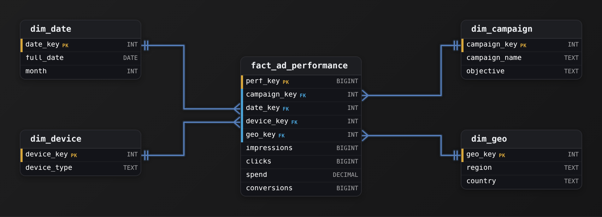
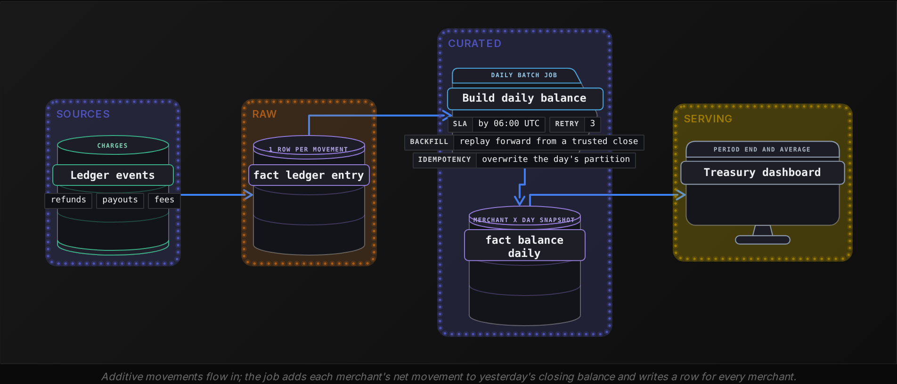
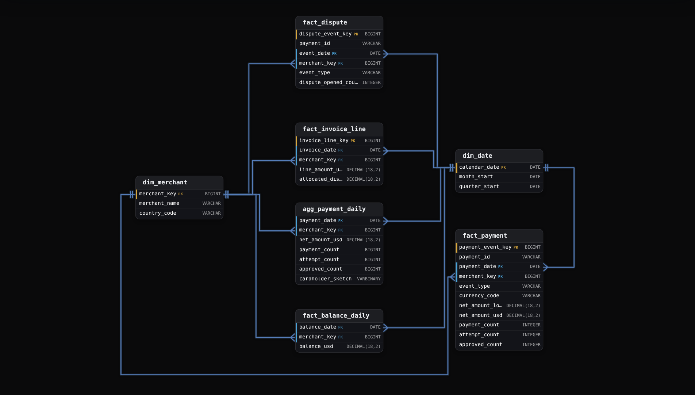
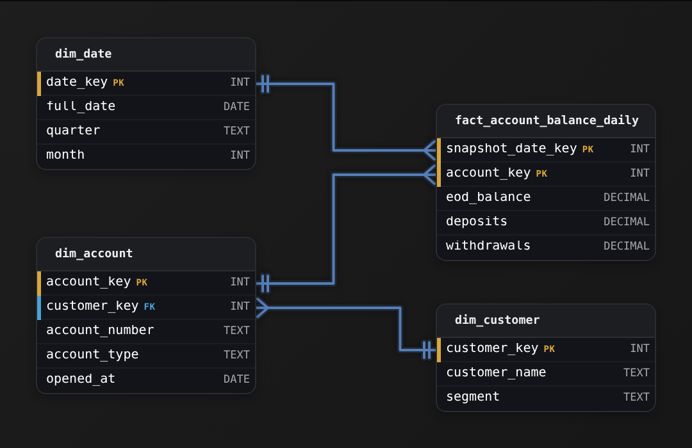
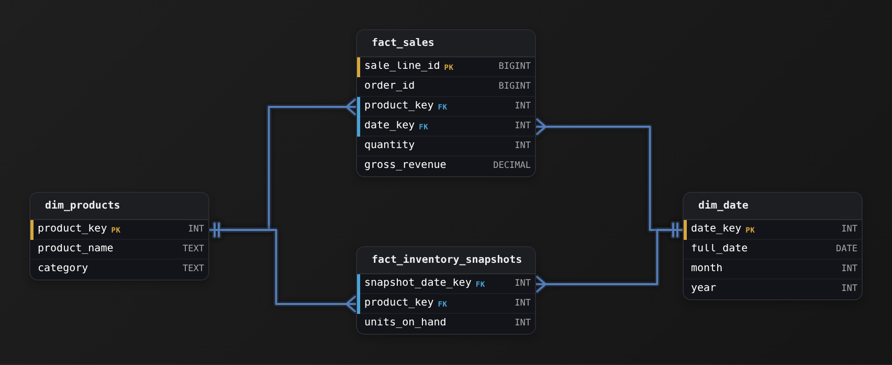
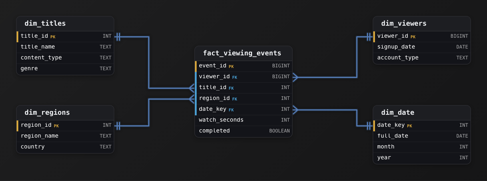

Advanced·Data Modeling · 25 min · 4 challenges

# Additive Measures: Advanced

Ilse is 40 minutes into a Stripe onsite when the interviewer shares a schema: a payments fact, a daily merchant balance table and a dashboard spec. The spec wants monthly payment volume and end-of-month balance on it, along with authorization rate and unique cardholders, all rolled up by country and by quarter. "Which of these can the dashboard SUM?" the interviewer asks. Ilse says volume sums along every dimension. Then she pauses on balance: adding 30 daily balances reports about 30 times the money any merchant holds. Authorization rate is worse, because averaging per-merchant rates gives a corner shop the same weight as a marketplace. The interviewer pushes again: payments arrive in dozens of currencies, so does volume really sum everywhere? This lesson rebuilds her answer from how each measure behaves along each dimension, then turns that into fact tables whose totals stay correct at every rollup.


<br>

### What you will be able to do

Treat time and currency as dimensions too, and classify any measure as fully additive, semi-additive or non-additive along every dimension it can be grouped by.

Choose and defend the time rule for a balance or level, whether that is the period-end or period-average reading or a running sum over ledger movements.

Rebuild ratios correctly at any grain from stored numerators and denominators, and do the same for percentiles from bucket counts and for distinct counts from mergeable sketches.

Spot and repair the table designs that make sums lie: mixed grains, header amounts copied onto lines, and joins that multiply rows.


<br>

---

## "Can You Sum This Metric?"

The interview question this lesson prepares for rarely contains the word additive. It shows up as a symptom or a spec: a dashboard total that disagrees with finance, a monthly figure that differs from the sum of its weeks, a country filter that pushes a percentage past 100, or a request to design a fact table for a metric the interviewer picked because it is awkward. Underneath each version sits one mechanical question. A reporting tool groups rows by a coarser key and applies SUM. Is the result true?


<br>

### One test, run once per dimension

Pick a measure and one dimension of its fact table. Split the rows into 2 groups along that dimension, compute the measure on each group, and add the 2 results. If the sum equals the measure computed over all rows at once, the measure is **additive along that dimension**. Repeat for every dimension, because the verdict belongs to the measure and the dimension together. One sample can pass by accident, so the useful habit is asking why the groups might overlap or mix units, then checking with numbers.

#### Worked example: 4 payments

| payment_id | day | merchant | currency | amount | cardholder |
| --- | --- | --- | --- | --- | --- |
| p1 | Oct 1 | M1 | USD | 100.00 | c7 |
| p2 | Oct 1 | M2 | EUR | 80.00 | c7 |
| p3 | Oct 2 | M1 | USD | 50.00 | c9 |
| p4 | Oct 2 | M2 | USD | 20.00 | c9 |

Amount needs a check before the split. Along merchant the arithmetic passes: M1's 150.00 plus M2's 100.00 equals the grand total of 250.00. Neither side means anything, though. M2's 100.00 adds 80 euros to 20 dollars, and the 250.00 mixes both currencies too. The split test assumes every row shares a unit, so confirm that first. Amount is a quantity only within one currency, which makes currency a dimension of its own in the verdict. Unique cardholders show a true failure of the split itself. Along day they pass by luck: Oct 1 has c7, Oct 2 has c9, and 1 + 1 matches the true 2. They fail along merchant. Each of M1 and M2 saw both cardholders, so the per-merchant counts add to 4 while only 2 people paid.

Those 2 failures generalize. Mixed units (currencies, gross against net, readings taken in different time zones) break addition even for quantities that flow. Overlapping membership (people, devices, sessions that cross midnight) breaks it for anything counted by identity.


<br>

### The verdict grid

Running the test over every measure in the payments platform used throughout this lesson produces a grid. Draw it on the whiteboard before writing any SQL, since the rest of the answer builds on it.

| Measure | Across merchants | Across days | Across currencies |
| --- | --- | --- | --- |
| net_amount_local | Within 1 currency | Within 1 currency | No |
| net_amount_usd | Yes | Yes | Yes |
| payment_count | Yes | Yes | Yes |
| balance_usd (end of day) | Yes | No: last or average | Yes |
| authorization rate | No: ratio of sums | No: ratio of sums | No: ratio of sums |
| unique cardholders | No: overlap | No: overlap | No: overlap |

The grid sorts measures into 3 families. Yes in every column is fully additive. Yes everywhere except time is semi-additive, and time is nearly always the exception because a balance is a reading taken at a moment, and so is a stock level or a subscriber count. A row of noes is non-additive, and its repair moves out of the query and into the table design.


<br>

### Why the grid decides architecture

Rollup tables assume their measures combine by SUM, and so do cubes and cached dashboard tiles. On a platform taking 50M payments a day, a fully additive measure lets a monthly chart read a daily rollup instead of 1.5B raw rows. Each no in the grid marks a place where that shortcut returns a wrong number with no error, so the grid also tells you which measures can live in pre-aggregated tables and which need their parts stored there instead.

> Disguises this question wears
>
> - "Our weekly actives don't add up to monthly actives. Is the pipeline broken?"
> - "Design the fact table behind a subscription company's MRR dashboard."
> - "Finance's quarter-end balance is 90x what treasury reports. Debug it."
> - "Add a region filter to the conversion dashboard without breaking the rate."
> - "Pre-aggregate this 50M-row-a-day table so dashboards load in under 2 seconds."


<br>

### What a complete answer contains

The answer, in the order to say it

- Classify: the verdict grid, one cell per measure and dimension, with currency and time called out.
- Rule: for every no, the aggregation that is true instead, such as last value, average, ratio of sums or merged set.
- Storage and cost: what the fact table holds so the rule can run, and what that costs in rows, scan time or approximation error.

> **TIP**
>
> Interviewers probe the third layer. Saying balance is semi-additive only classifies it. The design answer says the daily snapshot feeds both month-end and average balance at 1 row per merchant per day, and it names what happens to quiet merchants. That second answer is the one the question scores.


<br>

---

## Data Modeling

### Exercise 1 of 1

**● TASK**

A digital advertising platform is building the reporting table behind its campaign performance dashboards, where analysts slice results by campaign, day, device type, and region in any combination. Every rate they read (click-through rate, cost per click, conversion rate) has to reconcile whether they are looking at one campaign on a single day or the whole account over a quarter. Design the fact table and its dimensions so that the product team's proposed measures (impressions, clicks, spend, conversions, click-through rate, cost per click, conversion rate) roll up correctly along every dimension.


<br>

### Solution

#### What this problem is really testing

This is a measure-additivity classification wearing a dashboard-build costume. The product spec handed you seven numbers, and the trap is treating all seven as columns because they were all asked for. 4 of them (`impressions`, `clicks`, `spend`, `conversions`) sum cleanly along every dimension. The other three (`click_through_rate`, `cost_per_click`, `conversion_rate`) are ratios, and a ratio does not survive a rollup: the quarter's click-through rate is not the sum of the daily rates, nor their average. Store the ratios and the first time an analyst widens the date range, the dashboard quietly lies.

| Trick: Run the SUM test on every measure |
| --- |
| For each proposed number, ask: if I SUM this across all dimensions, does the result make business sense? `clicks` summed across days, devices, and regions is a real total, so it stays. `click_through_rate` summed across three days gives a number over 100 percent, which is nonsense, so it cannot be stored. Keep what passes; decompose what fails into the parts that do. |

#### Work it measure by measure

1. **Declare the grain first**

   One row is the counts for a single campaign, on one day, for one device type, in one region. Every measure you keep must be additive at exactly this grain, and this grain must be fine enough to support the slicing analysts asked for.

2. **Keep the 4 additive counts**

   `impressions`, `clicks`, `spend`, and `conversions` all pass the SUM test on every dimension. They are the atomic, fully additive measures and they belong on the fact as-is.

3. **Refuse the three ratios, keep their ingredients**

   `click_through_rate` is `clicks / impressions`, `cost_per_click` is `spend / clicks`, `conversion_rate` is `conversions / clicks`. None can be stored. But notice their numerators and denominators are already the 4 counts from step 2, so you store nothing extra: the components are on the fact, and the ratio is computed after aggregation.

4. **Conform the 4 dimensions**

   campaign, date, device, and region each become a dimension table joined by a surrogate key. That is what lets an analyst pivot on any combination without the fact carrying redundant descriptive text.

#### The reference model



*Only the 4 additive counts sit on `fact_ad_performance`; the three rates are derived downstream from those counts.*

| Interviewer: The line that reads as senior |
| --- |
| Saying out loud: 'I would not store `conversion_rate`; I would store `conversions` and `clicks` and let the BI tool divide after aggregation' is the strong-hire signal. It shows you design for correct rollups, not for whatever the spec happened to list. |

| Pitfall: Averaging an average |
| --- |
| The classic wrong turn is storing `click_through_rate` per row and then AVG-ing it in the dashboard. A day with 10 impressions and a day with 10,000 impressions get equal weight, so the rolled-up rate is meaningless. The only correct rate is `SUM(clicks) / SUM(impressions)` over the counts. |

| ✕ Store the ratio | ✓ Store the components |
| --- | --- |
| `click_through_rate` lives on the fact.<br><br>* Reads look convenient at the base grain<br>* Any rollup across days or devices is wrong<br>* The number can exceed 100 percent once summed<br>* Unrecoverable: the components are gone | `clicks` and `impressions` live on the fact.<br><br>* Every rollup is exact at any level<br>* The rate is one division in the BI layer<br>* No extra columns needed, the parts were already there<br>* The dashboard and the detail report always reconcile |

**Follow-up questions**

1. The team now wants `unique_users_reached` on the same dashboard. Where does that measure fit in the additive classification?\
   *Tests whether the candidate recognizes a distinct count as non-additive and does not blindly SUM it across dimensions.*
2. Finance wants a `daily_budget_remaining` number shown per campaign. How would you treat it differently from `spend`?\
   *Probes recognition of a snapshot-style measure that does not sum across time, without requiring the full semi-additive handling.*
3. If most rate computations are the same three divisions, would you ever precompute them, and where?\
   *Tests the boundary between the additive fact and a downstream aggregate or view layer that is still recomputed from stored counts.*


<br>

---

## Fully Additive Measures

A fully additive measure records something that flows through the business: cents captured, payments attempted, seconds of compute billed. Each row owns its amount, and no unit of it is recorded in a second row, so the rows sum back to the grand total however they are partitioned, by merchant alone or by day and country together. At 50M payments per day that property pays for itself: the platform writes a daily rollup with 1 row per active merchant per day and answers monthly questions from it, and quarterly or yearly ones too.

- **~400K** — rollup rows written per day
- **125x** — fewer rows than raw payments


<br>

### Additivity is built in the pipeline

Measures that look additive in a source system are usually one design decision away from it. The same 3 repairs come up in nearly every payments model, and orders and billing models need them as well. The interviewer will ask what each one costs.

#### Repair 1: sign the reversals

A source that logs a refund as a positive 30.00 with event_type = 'refund' produces a fact where SUM(amount) returns gross charges plus refunds, which is neither number finance reports. Signing net_amount so that charges are positive and refunds negative makes the plain sum equal net volume. Keeping the unsigned amount and event_type beside it leaves gross volume and refund volume each one filter away.

| event_id | event_type | amount | net_amount |
| --- | --- | --- | --- |
| e1 | charge | 100.00 | 100.00 |
| e2 | charge | 50.00 | 50.00 |
| e3 | refund | 30.00 | -30.00 |
| SUM |  | 180.00 | 120.00 |

*The unsigned total of 180.00 matches neither gross volume (150.00) nor net volume (120.00).*

#### Repair 2: carry the count as a column

COUNT(\*) counts payments only while 1 row equals 1 payment. Once the fact is pre-aggregated into agg_payment_daily, COUNT(\*) counts merchant-days, and an average ticket computed from it is off by the number of payments per merchant-day. A payment_count column holding 1 on every atomic row, and the summed count on every rollup row, keeps SUM(payment_count) correct at every level, including rollups built from other rollups.

#### Repair 3: put every amount in one currency

net_amount_local adds only within its currency, so a cross-currency total needs conversion before the sum. Converting each row at the rate on its payment date and storing net_amount_usd makes the measure fully additive along every dimension. The conversion can also wait until query time, joining a daily rate table on currency and date. Either way, someone has to own the rate and decide when it may change.

✓Convert when the row is written

- net_amount_usd is a plain column that every rollup sums
- Rollups stay valid because the stored rate never changes after load
- A new rate policy, such as month-end rates for finance, needs a backfill of history
- A rate that arrives late forces a reload of the affected days

✗Convert when the query runs

- Every query joins a rate table on currency and date
- Any rate policy is one join condition away, with no backfill
- Rollups must keep currency as a key, which multiplies their rows
- A missing rate drops or nulls rows unless the join is checked

A common resolution stores both: net_amount_local with currency_code on every row for audit and restatement, and net_amount_usd at the payment-date rate for dashboards that need a single total. Document which rate the stored column uses. If 2 teams sum "USD volume" under different rate policies, they will disagree by the size of that month's currency moves, and both will be internally consistent.


<br>

### Rollups of rollups

Once the amounts are signed and in a single currency, with the count carried as its own column, a monthly view reads the daily rollup and sums again. The SUM of daily SUMs equals the SUM over raw payments because each payment sits in exactly 1 merchant-day. Average ticket size then becomes the ratio of 2 of these sums, a pattern that returns when the measures stop adding.

```sql
SELECT
  DATE_TRUNC('month', payment_date) AS payment_month,
  merchant_key,
  SUM(net_amount_usd) AS net_volume_usd,
  SUM(payment_count) AS payments
FROM agg_payment_daily
GROUP BY DATE_TRUNC('month', payment_date), merchant_key
```

> **TIP**
>
> Store money as integer cents in a BIGINT or as a DECIMAL. Floating-point addition is order-sensitive, so a DOUBLE column summed by parallel workers can return totals that differ in the last cents between runs, and every reconciliation against the ledger will flag them.


<br>

---

## Semi-Additive Measures

A semi-additive measure is a reading of a level at a moment: a merchant's balance at end of day, units on hand in a warehouse, open support tickets, active subscriptions, people on payroll. At any single moment the readings add across whatever holds them, a merchant or a warehouse, because each reading belongs to exactly one of them. Across time they stop adding, because the same money is read again every day it stays in the account.


<br>

### Worked example: M1's balance over 3 days

| balance_date | merchant | balance_usd |
| --- | --- | --- |
| Oct 1 | M1 | 1,000.00 |
| Oct 2 | M1 | 1,200.00 |
| Oct 3 | M1 | 900.00 |

Summing the readings gives 3,100.00, money M1 never held on any day. The same 3 readings support several true answers, each serving a different business question, so name the question before choosing the rule.

| Rule | Result for Oct 1 to 3 | Business question |
| --- | --- | --- |
| Period end (last) | 900.00 | What do we owe merchants at the close of the period? |
| Period start (first) | 1,000.00 | What did the period open with, for a roll-forward? |
| Average of daily readings | 1,033.33 | How much money sat with us on a typical day, for float yield? |
| Minimum or maximum | 900.00 / 1,200.00 | What was the low point, for credit or liquidity limits? |
| Sum | 3,100.00 | Only as dollar-days, the input to interest accrual |


<br>

### Collapse time first, then sum across merchants

Order of operations decides correctness. Apply the period rule per merchant, which yields 1 value per merchant per period, then sum those values across merchants, or up to country or plan. Summing all merchants per day first and then keeping the last day gives the same period-end total only when every merchant has a row on that last day, which is the assumption the next design choice tests.

```sql
WITH merchant_month AS (
  SELECT
    merchant_key,
    DATE_TRUNC('month', balance_date) AS balance_month,
    MAX_BY(balance_usd, balance_date) AS month_end_balance_usd,
    AVG(balance_usd) AS avg_daily_balance_usd
  FROM fact_balance_daily
  GROUP BY merchant_key, DATE_TRUNC('month', balance_date)
)

SELECT
  balance_month,
  SUM(month_end_balance_usd) AS total_month_end_balance_usd,
  SUM(avg_daily_balance_usd) AS total_avg_daily_balance_usd
FROM merchant_month
GROUP BY balance_month
```

max_by(balance_usd, balance_date) returns the balance on each merchant's latest date in the month. On a dense snapshot that date is the month's last day. On a sparse one it is the last day the balance moved, which is still the right month-end value, but a merchant with no movement all month has no row and vanishes from the total. AVG(balance_usd) is correct only when every day has a row, because it divides by the rows present.


<br>

### Dense, sparse or derived from movements

The design decision underneath the question is how the balance gets stored, and each option moves cost to a different place. The platform has 2M merchants, most of them idle on a given day.

- **730M** — dense snapshot rows per year
- **146M** — sparse rows/year if 400K move daily

| Design | Row per | Period-end query | Average query | Cost |
| --- | --- | --- | --- | --- |
| Dense snapshot | merchant per day | Filter to last day, sum | Sum, divide by days in period | Most storage; quiet merchants repeat daily |
| Sparse snapshot | merchant per day with movement | Last row per merchant, then sum | Fill gaps first, then average | Every reader must carry values forward |
| Derived from ledger | ledger entry | Running sum to period end | Running sum per day, then average | No snapshot, but each query scans history from the first entry |

The dense snapshot is the usual default: the time rule becomes a filter, the average becomes a division by days in the period, and every BI tool can do both. Its storage cost is real but predictable. Sparse snapshots save rows when most merchants are idle, then push gap-filling into every consumer, which is where wrong averages come from: averaging the rows that exist overweights change-days and ignores quiet ones. Deriving balances on demand from the ledger avoids a second copy of the truth, at the price of scans as long as the account's history.



The snapshot is built from fully additive movements, which is how the 2 families coexist. Each day's job reads yesterday's closing balance, adds the day's net movement per merchant, and writes a row for every merchant, including those with no movement. Because each day depends on the one before, a correction to an old ledger entry means replaying every later day for that merchant, so the backfill plan belongs in the answer.

#### Which day's exchange rate

A balance held in euros converts to balance_usd at the rate on the reading date. A merchant holding a flat 1,000.00 EUR all month then shows a changing USD balance, and that change is revaluation: a movement with no ledger entry behind it. Converting at each deposit's own rate would keep the snapshot equal to summed movements but misstate what the money is worth at period end. Pick one rate rule and record the choice, and show revaluation as its own line.

> **TIP**
>
> Record next to balance_usd, wherever query tools read metric definitions, that its time aggregation is last. Otherwise a default SUM produces a quarter-end balance roughly 90x too large the moment someone switches a chart's axis from day to quarter.


<br>

---

## Non-Additive Measures

Non-additive measures fail the test along every dimension. Ratios and averages are the common ones; percentiles and distinct counts behave the same way, as do unit prices and exchange rates. No grouping makes them sum. The design move is shared across all of them. Keep the finished measure out of the table as its only copy, store quantities that do add, sum those at whatever grain the question asks for, and compute the measure as the final step.


<br>

### Ratios: sum the parts, divide at the end

| merchant | attempts | approved | authorization rate |
| --- | --- | --- | --- |
| M1 | 100 | 90 | 90.0% |
| M2 | 1,000 | 500 | 50.0% |
| Average of rates |  |  | 70.0% |
| Ratio of sums | 1,100 | 590 | 53.6% |

Averaging the 2 rates gives M1's 100 attempts the same weight as M2's 1,000. The true rate for the pair divides summed approvals by summed attempts. Store attempt_count and approved_count as fully additive columns, and let every rollup divide only after it sums. Average ticket size works the same way: net volume over payment count, both summed first.

- **16.4 pts** — overstatement from averaging rates

```sql
SELECT
  m.country_code,
  SUM(f.approved_count) AS approved,
  SUM(f.attempt_count) AS attempts,
  CAST(SUM(f.approved_count) AS DOUBLE) / NULLIF(SUM(f.attempt_count), 0) AS authorization_rate
FROM agg_payment_daily AS f
JOIN dim_merchant AS m
  ON f.merchant_key = m.merchant_key
GROUP BY m.country_code
```

Dividing 2 BIGINT sums performs integer division, so 590 / 1100 returns 0, and the CAST to DOUBLE prevents it. NULLIF turns a country with no attempts into a NULL rate instead of a NaN that would poison any later calculation.


<br>

### Distinct counts: recompute or merge

Unique cardholders failed along merchant in the opening example because the same cardholder appears in several groups. Daily distinct counts cannot be summed into a month, and monthly counts can't be summed into a quarter. There are 2 correct designs. Recompute from atomic rows for every grain. That answer is exact, but it scans every payment in the period. Or store a mergeable sketch per merchant per day: a fixed-size summary of the set that combines with other sketches and estimates the size of their union.

```sql
SELECT
  DATE_TRUNC('month', payment_date) AS payment_month,
  CARDINALITY(MERGE(CAST(cardholder_sketch AS HYPERLOGLOG))) AS approx_unique_cardholders
FROM agg_payment_daily
GROUP BY DATE_TRUNC('month', payment_date)
```

Each daily row stores approx_set(cardholder_id) as varbinary. merge combines the month's sketches and cardinality reads the estimate, with a standard error under 2% at the default sketch size. The cost is that the number is an estimate: acceptable for a growth chart, unacceptable for a count that drives billing, which must recompute exactly from atomic rows.


<br>

### Percentiles: store a histogram

A daily p95 of checkout latency cannot be averaged into a monthly p95, because the average of 30 daily p95 values is not the 95th percentile of the month's requests. Counts per latency bucket are additive, though. Store request_count with 1 row per merchant per day per bucket. Any rollup sums those counts, and the percentile is read off the cumulative counts. The answer is exact to within one bucket width, so the bucket edges are a precision decision made at design time.

| bucket | Oct 1 | Oct 2 | Month |
| --- | --- | --- | --- |
| 0-100 ms | 900 | 400 | 1,300 |
| 100-200 ms | 80 | 450 | 530 |
| 200-400 ms | 20 | 150 | 170 |

Oct 1's p95 lands in the 100-200 ms bucket and Oct 2's in the 200-400 ms bucket, and no average of those 2 locates the month's 1,900th request out of 2,000. The summed buckets do: cumulative counts reach 1,830 at 200 ms, so the monthly p95 lies between 200 and 400 ms.


<br>

### Prices and rates multiply, then sum

A unit price or an exchange rate is a multiplier. Multiply it into an additive quantity on each row, then sum the products. SUM(quantity) \* AVG(unit_price) is wrong whenever prices vary: a 1-unit sale at 500.00 and a 1,000-unit sale at 2.00 total 2,500.00, while that formula returns 251,251.00.

✓Do

- Store numerator and denominator as separate additive columns
- Sum parts at the target grain, then divide
- Keep a mergeable sketch per day when an estimate is acceptable
- Store bucket counts for any percentile users will roll up

✗Don't

- Keep a rate or average as the only stored copy of a metric
- Average daily percentiles or daily rates into a month
- Sum daily distinct counts into weekly or monthly figures
- Multiply summed quantities by an averaged price


<br>

---

## Fact Tables That Sum Correctly

Classifying measures correctly is half the answer. Correct measures still produce wrong totals when the table around them breaks additivity: a fact that mixes grains, a header amount copied onto line rows, or a join that multiplies rows before the sum. Each of these returns a number with no error, which is why interviewers plant them in the schema they hand over.


<br>

### Fact table type predicts the measure family

| Fact table type | 1 row means | Measures it usually holds |
| --- | --- | --- |
| Transaction | 1 event: a charge, a refund, a dispute event | Fully additive amounts and counts |
| Periodic snapshot | 1 entity at 1 moment: a merchant at end of day | Semi-additive levels, plus additive flows for the period |
| Accumulating snapshot | 1 process instance, updated as it moves: an invoice from issued to paid | Additive amounts; lag in days sums, average lag is a ratio |


<br>

### One grain per fact table

An invoice carries 3 line items and an invoice-level discount of 12.00. A line-grain fact that copies the discount onto every line reports 36.00 of discount for that invoice, and the error grows with line count, so invoices with more lines look like heavier discounters. The sum stays true only if the discount is either allocated across the lines or kept in a fact of its own.

Discount copied to lines

| line | line_amount | invoice_discount |
| --- | --- | --- |
| L1 | 50.00 | 12.00 |
| L2 | 30.00 | 12.00 |
| L3 | 20.00 | 12.00 |
| SUM | 100.00 | 36.00 |

Discount allocated by amount

| line | line_amount | allocated_discount |
| --- | --- | --- |
| L1 | 50.00 | 6.00 |
| L2 | 30.00 | 3.60 |
| L3 | 20.00 | 2.40 |
| SUM | 100.00 | 12.00 |

Allocation spreads the header amount across lines in proportion to line_amount, so discount can be sliced by product as well as by invoice. Rounding breaks the sum unless one rule assigns the remainder: 10.00 split across 3 equal lines is 3.33, 3.33 and 3.34, with the extra cent on the last line. The alternative is a separate invoice-grain fact for header amounts. It is exact and needs no allocation policy, but questions about discount by product become unanswerable.


<br>

### Fan-out: joins that multiply rows

A payment can pass through several dispute events: opened, evidence submitted, closed. Joining fact_payment to fact_dispute on payment_id to find volume under dispute repeats each disputed payment once per event, so a 200.00 payment with 3 events contributes 600.00. Any join to a table with several rows per key inflates sums the same way: promotions applied, tags, account owners.

The repair collapses the many side to the grain of the question before the join. Volume under dispute needs 1 row per disputed payment, so reduce `fact_dispute` to its distinct `payment_id` values first. Merchant-day aggregates cannot answer this question, because a dispute's `event_date` falls days or weeks after its payment's `payment_date`, and the 2 facts would meet on different days.

```sql
WITH disputed AS (
  SELECT DISTINCT
    payment_id
  FROM fact_dispute
)

SELECT
  p.merchant_key,
  SUM(p.net_amount_usd) AS disputed_volume_usd
FROM fact_payment AS p
JOIN disputed AS d
  ON p.payment_id = d.payment_id
WHERE p.event_type = 'charge'
GROUP BY p.merchant_key
```

After the join each disputed charge appears once, so the 200.00 payment contributes 200.00 however many events its dispute passes through. A different request puts net volume beside disputes opened, per merchant per day, on one chart. Drill-across answers it: aggregate each fact to its shared keys of merchant and day, then join the aggregates. Each side then has 1 row per key, so the join has nothing to multiply, and each measure keeps the date that belongs to its own fact.

```sql
WITH payments AS (
  SELECT
    merchant_key,
    payment_date AS activity_date,
    SUM(net_amount_usd) AS net_volume_usd
  FROM fact_payment
  GROUP BY merchant_key, payment_date
),
disputes AS (
  SELECT
    merchant_key,
    event_date AS activity_date,
    SUM(dispute_opened_count) AS disputes_opened
  FROM fact_dispute
  GROUP BY merchant_key, event_date
)

SELECT
  COALESCE(p.merchant_key, d.merchant_key) AS merchant_key,
  COALESCE(p.activity_date, d.activity_date) AS activity_date,
  COALESCE(p.net_volume_usd, 0) AS net_volume_usd,
  COALESCE(d.disputes_opened, 0) AS disputes_opened
FROM payments AS p
FULL OUTER JOIN disputes AS d
  ON p.merchant_key = d.merchant_key
    AND p.activity_date = d.activity_date
```

The FULL OUTER JOIN keeps merchant-days that appear in only one fact, and COALESCE turns the missing side into 0. The pattern works only when both facts use the same merchant and date keys with the same meaning. Dimensions shared that way are called conformed, and they are the precondition for putting any 2 facts on one chart.


<br>

### Write the rule next to the measure

A correct model still gets summed wrong by the next analyst who drags balance_usd onto a quarterly chart. Recording each measure's aggregation rule in a metrics layer, a config that query tools read, turns the verdict grid into something the tools enforce instead of something people remember.

```sql
metrics:
  - name: net_volume_usd
    source: agg_payment_daily.net_amount_usd
    aggregation: sum
  - name: merchant_balance_usd
    source: fact_balance_daily.balance_usd
    aggregation: sum
    time_aggregation: last
  - name: authorization_rate
    numerator: sum(agg_payment_daily.approved_count)
    denominator: sum(agg_payment_daily.attempt_count)
  - name: unique_cardholders
    source: agg_payment_daily.cardholder_sketch
    aggregation: merge_sketch
```



> Before a measure ships
>
> - State the grain of its table in one sentence and check every column belongs to it
> - Mark it additive, semi-additive with its time rule, or non-additive with its formula
> - For a non-additive measure, confirm its additive parts are stored beside it
> - Check every join in its queries for keys with more than 1 row on the far side
> - Reconcile one month's total against the source ledger before the dashboard launches


<br>

---

## Putting It All Together

A subscription software company asks for one board dashboard showing monthly recurring revenue, new bookings, logo churn rate and active accounts, sliceable by region, plan and quarter, with customers billed in 4 currencies.

- New bookings is a transaction-grain flow: signed for downgrades and cancellations, converted to one reporting currency, and summed at any grain from a daily rollup.
- MRR is a level, read as a month-end snapshot per account. It sums across accounts and regions; across months it takes the period-end value and is never added month to month.
- Converting MRR at each snapshot date's rate makes currency revaluation its own movement instead of letting it hide inside churn.
- Churn rate stores churned_accounts and starting_accounts per region and month. Churned accounts sum across the quarter's months, while starting accounts is a level taken from the quarter's first month only; both sum across regions before the divide.
- Active accounts counts snapshot rows per region, so it adds across regions and takes the last value across months.
- The metrics layer records each rule, so a quarterly chart picks quarter-end MRR and the ratio of summed churn parts without anyone choosing them by hand.


<br>

---

## Data Modeling

### Exercise 1 of 3

**● TASK**

A retail bank records every account's end-of-day balance in a daily snapshot, one row per account per day, alongside the deposits and withdrawals that posted that day. The reporting team needs a proper fact table for this snapshot and a rule for reporting each account's figures across a full quarter, because their current quarter numbers come out about 90 times too large. Design the fact table, and for every measure state how it should roll up to a quarter.


<br>

### Solution

#### What this problem really is

This is a stock-versus-flow classification problem wearing a time-rollup costume. The table hands you 3 numbers that all look like ordinary money, and the whole test is whether you notice that `eod_balance` behaves differently from `deposits` and `withdrawals` the moment you cross the date dimension. The ninetyfold blowup is the tell: someone wrote `SUM(eod_balance)` over a quarter and added 90 days of the same money that was only ever there once. Add up `deposits` the same way and you are correct; add up `eod_balance` and you have invented cash that never moved.

| Trick: The balance is a level, not an amount that piles up |
| --- |
| A `deposits` value is money that CHANGED hands that day, so days accumulate. An `eod_balance` value is the money SITTING there at day's end, a photograph of a level. You can add photographs across accounts on one day (whole-bank balance), but adding them across days is nonsense. That single asymmetry is the entire problem. |

#### Break down the requirements

1. **Declare the snapshot grain**

   One row per account per day, keyed by `account_key` and `snapshot_date_key`. Because every open account gets a row every day whether or not it moved money, this is a periodic snapshot, and that regular heartbeat is exactly what makes summing the balance so tempting and so wrong.

2. **Keep the flows as plain accumulating measures**

   `deposits` and `withdrawals` add cleanly across every dimension: across accounts, across days, across the quarter. They are the easy, fully-summable case, and leaving them on the fact as raw amounts is correct.

3. **Mark the balance as point-in-time**

   `eod_balance` sums correctly across accounts but must never be summed across the date dimension. A quarter's balance is the balance on the quarter's last day (`LAST_VALUE` ordered by date), or the average daily balance (`AVG`) if the team wants a representative level. Encode that expectation in a naming convention or a documented rollup rule so the next analyst cannot fall into `SUM`.

4. **Refuse to store ratios and averages**

   Do not add an `avg_balance` or `savings_rate` column. A figure computed once for the quarter cannot be re-aggregated to a month or a region. Store the raw ingredients and compute the ratio at read time.

#### The reference model

A periodic-snapshot fact keyed on account and day, with the level and the flows sitting side by side but classified differently. The dimensions (`dim_account`, `dim_customer`, `dim_date`) let the team slice by segment and period without ever changing how each measure rolls up.



*Periodic snapshot at one row per account per day. `eod_balance` is a level (never SUM across days); `deposits` and `withdrawals` accumulate.*

#### The rollup that tells the truth

**Quarter figures per account**

```sql
SELECT
    f.account_key,
    SUM(f.deposits)                                   AS quarter_deposits,
    SUM(f.withdrawals)                                AS quarter_withdrawals,
    AVG(f.eod_balance)                                AS avg_daily_balance,
    (ARRAY_AGG(f.eod_balance ORDER BY d.full_date DESC))[1] AS quarter_end_balance
FROM fact_account_balance_daily f
JOIN dim_date d ON d.date_key = f.snapshot_date_key
WHERE d.quarter = '2026-Q1'
GROUP BY f.account_key
```

*Flows are summed; the balance is averaged or taken at quarter close. `SUM(f.eod_balance)` here would be the ninetyfold bug.*

| ✕ The dashboard that lies | ✓ The correct rollup |
| --- | --- |
| `SUM(eod_balance)` grouped by quarter. Adds ~90 daily photographs of the same money, so a $10k account reports a ~$900k balance. Passes every unit test because the number is a plausible-looking large figure. | `AVG(eod_balance)` for a typical level, or the last day's balance for quarter close. `SUM(deposits)` and `SUM(withdrawals)` for the flows. Each measure rolls up by its own rule, so filtering by month AND segment stays correct. |

| Interviewer: Grain first, then classify every measure |
| --- |
| A strong candidate states the snapshot grain out loud, then walks each measure and says how it rolls up before drawing a single arrow. Saying the words 'this balance is a level, the deposits accumulate' is the exact signal of seniority here. |

| Pitfall: Storing `avg_balance` to be helpful |
| --- |
| The most common well-meaning mistake is precomputing an `avg_balance` or `savings_rate` column so analysts don't have to. That figure is frozen at one grain; the moment someone filters to a single month or a region it is silently wrong, and no rollup can rescue it. Store `eod_balance`, `deposits`, `withdrawals` and let the ratio be a query. |

| Performance: How it scales |
| --- |
| At a few million accounts times ~90 days a quarter, the fact is hundreds of millions of rows. Partition by `snapshot_date_key` so a quarter read prunes to its own range, and the AVG and last-value rollups stay a single grouped scan. The wrong SUM is not just incorrect, it also invites full-history scans to 'reconcile' a number that never made sense. |

**Follow-up questions**

1. Compliance wants the average daily balance for interest, but marketing wants the balance on the statement date. Does the fact table change?\
   *Tests that both are read-time rollups of the same `eod_balance`, not 2 stored columns.*
2. The team asks you to add `overdraft_rate` (days in overdraft over days in quarter). Where does it live?\
   *Tests non-additive handling: store an `is_overdrawn` flag or the raw days, compute the rate at query time.*
3. An account opens mid-quarter, so it has fewer daily rows than the others. Does that break either rollup?\
   *Tests that AVG over present days and SUM of flows both stay correct, while a naive SUM of balance gets even more distorted.*


<br>

### Exercise 2 of 3

**● TASK**

An e-commerce dashboard reports revenue, units sold, average order value, and inventory on hand, and its monthly totals never match the detail report. Design the fact and dimension tables so every one of those measures aggregates correctly: classify each measure's additivity and store it, or its ingredients, at a grain that makes a wrong rollup impossible.


<br>

### Solution

#### The classification does the design work

Every measure on that dashboard belongs to one of the 3 additivity classes, and the class tells you exactly where it lives. Revenue and quantity are fully additive: SUM them by product, category, month, or any combination and the answer is right, so they sit as plain columns on the transaction-grain sales fact. Inventory on hand is semi-additive because it is a level, not a flow: it gets its own periodic snapshot fact, where summing across products on one date is meaningful and summing across dates is nonsense. Average order value is non-additive: a stored ratio is destroyed by the very first rollup, so you store its ingredients (gross revenue plus the order identifier that supports a distinct count) and divide at query time. Once each measure is classified, the two-fact design is not a choice, it is a consequence.



*2 facts at 2 grains, sharing conformed dimensions. AOV has no column; it is derived from `gross_revenue` and `order_id`.*

| Key insight: Why 2 facts |
| --- |
| Putting `units_on_hand` on the sales fact is the exact bug in the prompt: the balance repeats once per order line, so any monthly SUM multiplies it by the number of sales. Separating the snapshot fact means the only way to read inventory is date-pinned, which is the only correct way to read a semi-additive measure. Month-end inventory is the last snapshot of the month, never the sum of 30 snapshots. |

| Pitfall: The stored ratio |
| --- |
| The tempting wrong version stores `avg_order_value` as a column and averages it upward. Averaging averages weights every group equally regardless of order volume, so a category with 3 orders moves the number as much as one with thirty thousand. That is precisely why the dashboard total never matched the detail report. Store clicks-and-impressions style ingredients, here `gross_revenue` and `order_id`, and the ratio is correct at every slice. |

**AOV derived at query time, correct at any slice**

```sql
SELECT
    p.category,
    SUM(f.gross_revenue) / COUNT(DISTINCT f.order_id) AS avg_order_value
FROM fact_sales f
JOIN dim_products p ON p.product_key = f.product_key
JOIN dim_date d ON d.date_key = f.date_key
WHERE d.year = 2026 AND d.month = 3
GROUP BY p.category
```

**Follow-up questions**

1. Finance wants monthly inventory reported as an average level across the month instead of month-end. What changes?\
   *Extends the semi-additive concept: AVG across snapshot dates is a legitimate read of a level, and it is a query-time choice, not a schema change.*
2. A new dashboard tile needs distinct purchasing customers per month. Where does that measure live?\
   *Extends the non-additive concept: distinct counts do not sum across months, so the fact stores `customer_id` and the count is computed at query time for each slice.*


<br>

### Exercise 3 of 3

**● TASK**

A streaming service wants a reporting model for monthly active viewers: how many distinct people watched at least one title in a month, sliceable by title, by region, and by any combination of the two. The same person watches many titles in a month and often streams from more than one region while travelling. Design the schema an analyst queries for these active-viewer counts alongside total watch time, at daily, monthly, title, and region grain.


<br>

### Solution

#### Why this problem exists in real interviews

This is a **non-additive measure hiding inside a KPI request**. The ask sounds like revenue reporting, but 'monthly unique active viewers' is a distinct count, and distinct counts do not sum. The trap is a fact table with a `monthly_unique_viewers` column: it reads cheap and looks additive, so the analyst sums it across regions to get a national number. The frequent traveller who streamed from 3 regions gets counted 3 times, and your active-viewer total is silently inflated. The interviewer is watching whether you catch that before you draw the column.

| Trick: A distinct count is a property of the raw set, not of its parts |
| --- |
| You cannot reconstruct `COUNT(DISTINCT viewer_id)` for a month from per-title or per-region distinct counts, because the buckets overlap. The only inputs that survive a rollup are the atomic events with the `viewer_id` on every row. Keep the grain, and the distinct count is always recomputable; store the count, and you have thrown the overlap information away. |

#### Break down the requirements

1. **Classify each metric before you place it**

   Total `watch_seconds` and play count are fully additive and sum across every dimension. The active-viewer count is a distinct count, which is non-additive: it breaks on any rollup where an entity can appear in more than one bucket. Sort the measures into these two buckets first; that decision drives the whole model.

2. **Declare the atomic grain**

   `fact_viewing_events` is one row per viewer per title per viewing session, carrying `viewer_id`, `title_id`, `region_id`, `date_key`, and `watch_seconds`. Because the viewer key rides on every row, an analyst can compute distinct viewers for any title, region, month, or combination without a pre-aggregate lying to them.

3. **Store the additive companion, drop the non-additive one**

   Put `watch_seconds` on the fact so it sums correctly. Do NOT put a unique-viewer count anywhere in the stored measures. If a fast path is needed, that is a query-time or sketch decision, not a summable column.

4. **Conform the rollup dimensions**

   `dim_titles`, `dim_regions`, and `dim_date` hang off the fact so active viewers roll up by title, by region, and by any combination. These dimensions are what turn 'filter by region AND month' into a correct query instead of a reconciliation meeting.

#### The reference model

One defensible design: an atomic event fact with fully additive measures and conformed dimensions. The active-viewer count is never stored; it is computed with `COUNT(DISTINCT viewer_id)` over the grain, scoped by whatever dimensions the analyst filters on.



*`fact_viewing_events` keeps `viewer_id` on every atomic row; the active-viewer count is derived, never stored as a summable measure.*

**Monthly active viewers by title, computed correctly**

```sql
SELECT
    t.title_name,
    d.year,
    d.month,
    COUNT(DISTINCT f.viewer_id) AS active_viewers,
    SUM(f.watch_seconds) AS total_watch_seconds
FROM fact_viewing_events f
JOIN dim_titles t ON t.title_id = f.title_id
JOIN dim_date d ON d.date_key = f.date_key
GROUP BY t.title_name, d.year, d.month
```

| ✕ Stored uniques (the trap) | ✓ Atomic events (correct) |
| --- | --- |
| A rollup fact with `monthly_unique_viewers` per title per region.<br><br>* Reads are cheap<br>* Summing across regions double-counts travellers<br>* The overlap is gone forever, so the number cannot be corrected downstream | `fact_viewing_events` at viewer-title-session grain.<br><br>* `COUNT(DISTINCT viewer_id)` is correct at any grain<br>* `watch_seconds` still sums cleanly<br>* Cost of the distinct scan is the price of correctness |

| Performance: When exact distinct is too expensive, sketches merge |
| --- |
| At 4 billion events a month an exact `COUNT(DISTINCT viewer_id)` rescans the fact for every query. Precompute a per-day, per-title, per-region HyperLogLog sketch; sketches MERGE across days, titles and regions to give an approximate distinct count without touching the raw rows. A sketch is mergeable where a stored integer count is not, which is exactly what makes it a legitimate additive-style structure and a raw uniques column a lie. |

| Interviewer: Classify the measure out loud |
| --- |
| Strong candidates name the measure as non-additive before drawing anything and say they will not store it. They separate the fully additive `watch_seconds` from the distinct count, and they only reach for sketches after explaining why summing a stored count is wrong. |

| Pitfall: Distinct-of-distincts does not add up |
| --- |
| The most common miss is treating unique viewers like revenue: storing it per bucket and summing. Summing per-region monthly uniques over-counts anyone who streamed from two regions, and summing daily uniques into a month over-counts anyone who watched on two days. Neither error is recoverable once the raw grain is dropped. |

**Follow-up questions**

1. The dashboard needs monthly active viewers across all titles for a region in under a second. How do you serve that without a summable count?\
   *Tests whether the candidate reaches for daily mergeable sketches or a query-time distinct over a pruned partition rather than a stored total.*
2. Product now wants a 90-day rolling active-viewer count. What changes?\
   *Tests that the candidate keeps the atomic grain (or overlapping sketches) rather than summing 3 monthly numbers.*
3. How would you let the model answer average watch time per active viewer at the category level?\
   *Tests decomposition into a stored additive numerator (`watch_seconds`) and a distinct-count denominator computed at query time, never a stored ratio.*


<br>

---

## Key Takeaways

- Additivity belongs to a measure and a dimension together, so the verdict grid gets its own columns for currency and time.
- Fully additive measures are built: sign the reversals, carry counts as columns, convert to one currency, and store money as integers or DECIMAL.
- For balances and levels, collapse time per entity with a named rule before summing across entities. Period end is the usual rule. Period start, the average and the min or max also work.
- Dense snapshots buy simple queries with storage; sparse snapshots and ledger-derived balances push the cost into every reader.
- Rebuild a ratio from its summed numerator and denominator, and rebuild distinct counts and percentiles the same way from merged sketches and summed bucket counts.
- Table structure breaks sums too: keep 1 grain per fact, allocate header amounts with a remainder rule, and drill across instead of joining facts row to row.
