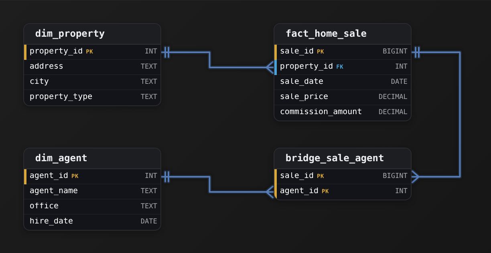
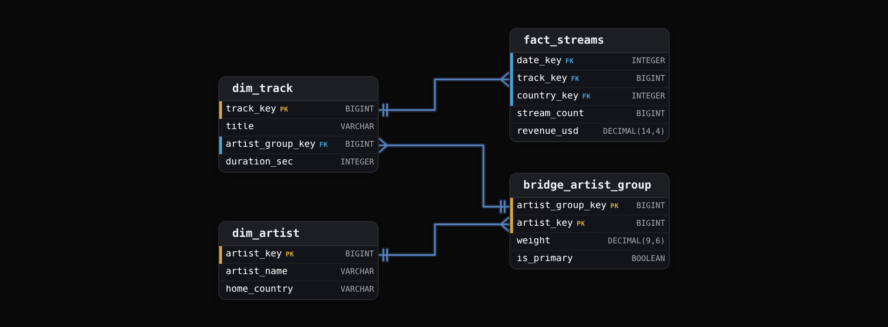
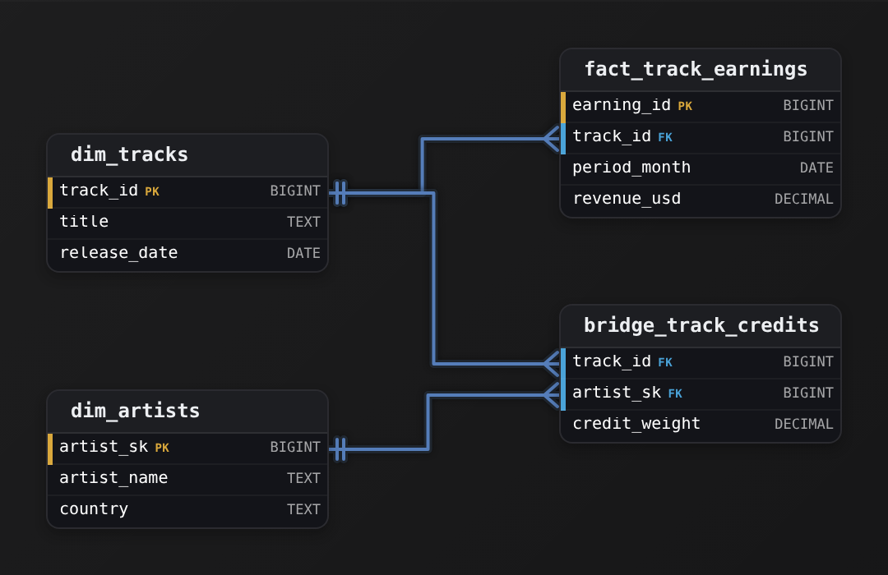
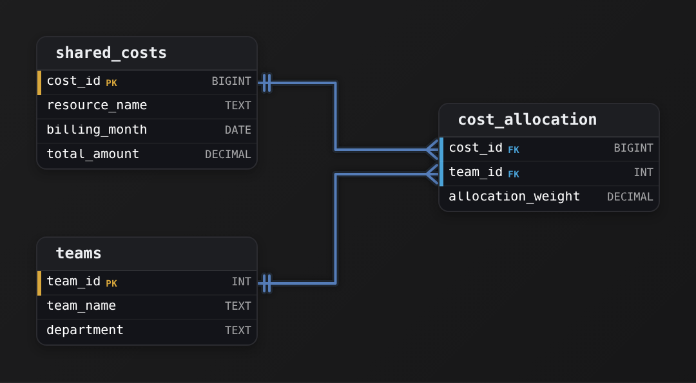
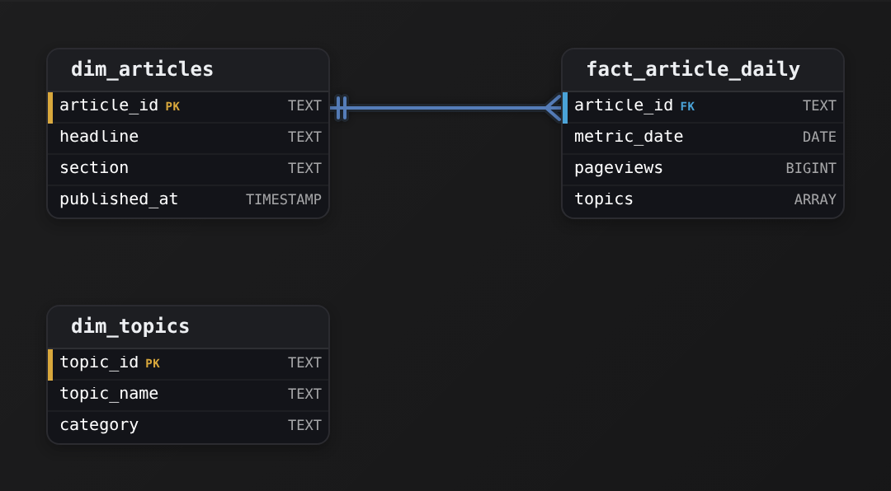
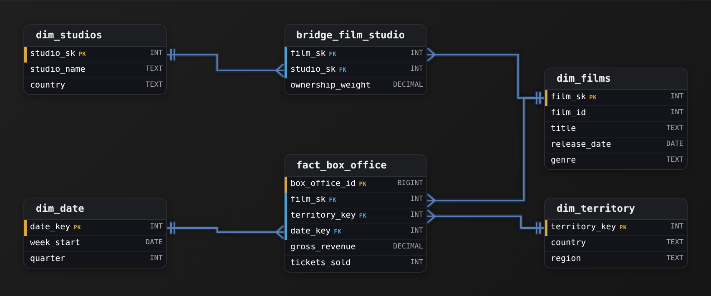
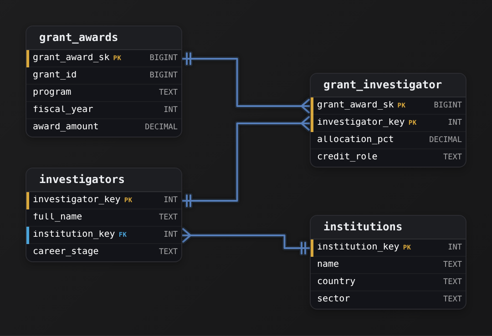
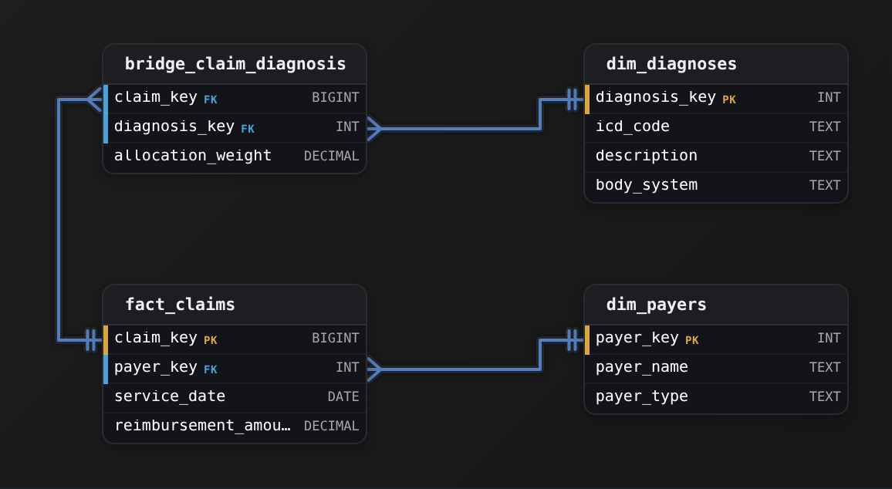

Advanced·Data Modeling · 25 min · 7 challenges

# Bridge Tables: Advanced

Priya is 40 minutes into an onsite at Spotify when the interviewer draws 2 boxes on the whiteboard: a streams fact and a track dimension beside it. "Many tracks credit more than 1 artist," she says. "The royalties team wants streams per artist, and finance insists the artist totals add back up to the company total. Model it." Priya knows the join that answers the first request and the double count it causes for the second. The question turns on where the many-to-many relationship lives, how each artist's share is decided, and what happens when a credit changes after the fact. This lesson works through the bridge table pattern the way that interview expects it: the fan-out it prevents, the structure of the bridge, the weighting factor that makes totals reconcile, the array column that competes with it, and the way to defend the choice out loud.


<br>

### What you will be able to do

Spot a multi-valued dimension in any domain and predict the fan-out a plain join produces

Design a bridge table, choose between a group key and a direct key, and state what 1 row of each table means

Assign decimal weights that sum to 1 per group, test them, and know which measures may never be allocated

Decide between a bridge and an array or map column from the queries, the tooling and the rate of change

Deliver the design in a 2-minute spoken answer and handle the follow-ups about history, testing and scale


<br>

---

## When One Row Maps to Many

### The grain holds until the second dimension arrives

Start with a fact table that behaves. `fact_streams` holds 1 row per track per country per day with 2 measures, `stream_count` and `revenue_usd`. `dim_track` holds 1 row per track. Every fact row finds exactly 1 track row, so a join between them neither adds nor removes rows, and a `SUM(stream_count)` returns the same figure with or without the join. That property, 1 fact row in and 1 row out, is what every report on the table depends on.

Then the royalties team asks for streams by artist. Track 501, Midnight Drive, credits 3 artists: Lena Ko, DJ Orbit and Marco Vell. A mapping table `track_artist` holds 3 rows for track 501. Join the fact to that mapping and each fact row for track 501 becomes 3 rows. On 1 October the track recorded 1,200,000 streams across all countries. After the join the same day sums to 3,600,000.

| track_key | artist | stream_count after the join |
| --- | --- | --- |
| 501 | Lena Ko | 1,200,000 |
| 501 | DJ Orbit | 1,200,000 |
| 501 | Marco Vell | 1,200,000 |
| Total |  | 3,600,000 |

The damage hides because half of the result is right. Each artist did take part in 1,200,000 streams, so a dashboard filtered to Lena Ko shows a true number. Clear the filter and the total for the day climbs from 48,000,000 to 61,500,000, because every multi-artist track in the catalog has multiplied itself. No row is null and no query fails. The report with the filter and the report without it disagree, and the person who notices is in finance, 3 weeks later, reconciling against the payout file.


<br>

### Recognizing the question in disguise

Interviewers rarely say the words bridge table. They describe a fact whose rows can each relate to several members of 1 dimension, then ask for a report by that dimension. The pattern surfaces in any industry:

- A hospital visit with several diagnoses, and a cost report per diagnosis
- A bank account with joint holders, and a balance report per customer
- An order with several promotions applied, and discount spend per promotion
- A support ticket with several tags, and resolution time per tag
- A sales opportunity with 3 reps on the deal, and quota credit per rep
- An insurance claim spanning several coverages, and loss per coverage

The tell is a phrase like per diagnosis, per holder or per rep where the fact row can carry more than 1 of that thing, often followed by a second phrase: the totals have to tie out. The first phrase creates the fan-out. The second phrase forbids it. Hearing both means the interviewer wants an allocation, and an allocation needs a weight. Hearing only the first means an involvement count may be enough, and saying which one you heard is the opening move of a strong answer.


<br>

### Three questions before drawing anything

Ask the interviewer, in this order

- **How many members per group?** *typical and maximum*\
  A track averages 1.4 credited artists with a maximum of 12. A visit averages 3 diagnoses with a maximum of 40. The maximum sets the worst-case fan-out and decides whether a nested column stays readable.
- **Must totals reconcile?** *allocation or involvement*\
  Royalty payouts must sum to the revenue pool. A report of how many streams involved an artist may exceed it. The answer decides whether a weight exists at all.
- **Does membership change?** *and does history matter*\
  An artist credit added after a dispute changes the split from that date. If past payouts must stay as they were, the relationship needs effective dates.

Each answer feeds a decision later in the lesson. The reconciliation requirement decides whether the bridge carries a weight and which reports must apply it. The change frequency decides whether the bridge needs effective dates. The maximum group size, together with how often membership changes, bears on whether a nested column on the parent row can stand in for the bridge. One more fact matters once the members are listed: whether the same member sets recur across parents, as they do across the tracks of an album. That answer decides between a shared group key and a key on each parent. Asking before drawing shows the interviewer that the schema follows from requirements rather than from habit, and it buys the numbers you will need to defend the design later.

> **TIP**
>
> Name the double count before proposing anything. Saying 'a plain join triples track 501's streams, so the totals will not tie out' tells the interviewer you see the failure the pattern exists to prevent, and it earns the time to explain the fix.


<br>

---

## Data Modeling

### Exercise 1 of 1

**● TASK**

A residential brokerage tracks every home sale and the commission it earns. Co-listings are routine here: one sale is frequently credited to several agents, and every agent works many sales across a season. Model this so the analytics team can report commission by agent while a company-wide commission total still ties out to what the brokerage actually earned.

<details>
<summary><strong>Solution</strong></summary>

#### What this problem really is

Strip the commission-reporting story away and this is a many-to-many between one fact and one dimension: a home sale connects to several agents, and each agent connects to many sales. The reflex trap is to hang an `agent_id` on `fact_home_sale`. The moment two agents co-list a deal that single column cannot hold both, and the candidate who 'fixes' it by joining a flat sale-to-agent list watches an $18,000 commission become $54,000 the instant 3 agents share the sale. Get the grain wrong here and every per-agent revenue report overstates the brokerage.

| Trick: Name the cardinality before you draw anything |
| --- |
| Say it out loud: one sale maps to many agents, and one agent maps to many sales. Both directions are 'many'. That is the tell that no foreign key on either table can carry the relationship, and the link has to move into a table of its own. |

#### Work through it

1. **Fix the fact grain first**

   One row of `fact_home_sale` is one sale, and it stores `commission_amount` exactly once. That grain is the thing you must protect: the whole design is judged on whether the sale's commission survives a join without multiplying.

2. **Refuse the column on the fact**

   An `agent_id` on `fact_home_sale` can only name one agent. Adding `agent_id_1`, `agent_id_2`, `agent_id_3` is worse: it caps the co-listing size and turns 'commission per agent' into an unmaintainable set of OR joins. The relationship does not belong on the sale row.

3. **Give the relationship its own table**

   Introduce `bridge_sale_agent` with `sale_id` and `agent_id`, one row per sale-and-agent pairing. A solo sale contributes one row, a three-way co-listing contributes three. Now agents attach to a sale without ever touching the sale's grain.

#### The reference model

The link table sits between the fact and the agent dimension. `fact_home_sale` keeps its measure once, `dim_agent` stays a clean list of agents, and `bridge_sale_agent` holds only the pairing. Its composite key (`sale_id`, `agent_id`) is what pins the grain to one row per pairing.



*`bridge_sale_agent` carries the many-to-many; `fact_home_sale` still holds `commission_amount` exactly once.*

| Interviewer: The tell that you understand grain |
| --- |
| A strong candidate states the inflation problem before being asked: 'A sale credited to three agents would triple in a naive SUM.' Then they keep the commission on the fact at one row per sale and move the agent links out. Interviewers listen for that sentence. |

| Pitfall: Multiple agent columns is the same mistake, dressed up |
| --- |
| Widening the fact to `agent_id_1..agent_id_3` looks like it dodges the linking table, but it hard-codes a maximum, wastes columns on solo sales, and makes 'commission by agent' a query nobody wants to write. It is still a foreign key on the fact, just repeated. |

#### Why the fact grain matters

**The inflation a naive join creates**

```sql
/* One sale, three co-listing agents, $18,000 commission. */
/* Joining the sale straight to its agent links multiplies the measure: */
SELECT SUM(s.commission_amount) AS reported_commission
FROM fact_home_sale s
JOIN bridge_sale_agent b ON b.sale_id = s.sale_id;
/* reported_commission = 54000, not 18000. */

/* The company total stays honest only when you sum at the sale grain: */
SELECT SUM(commission_amount) AS company_commission
FROM fact_home_sale;
```

*The linking table resolves the relationship; keeping the fact at one row per sale is what keeps the total correct.*

| Real world: Recognition first, allocation next |
| --- |
| Right now the goal is recognizing the many-to-many and giving it a home without corrupting the fact grain. Deciding how much of the $18,000 each agent actually earned is a separate step you build on top of this structure later; you cannot allocate a relationship you have not modeled yet. |

**Follow-up questions**

1. How would you report total commission per agent from this model without overstating any single sale?\
   *Tests whether the candidate keeps the sale-grain SUM separate from per-agent slicing through the linking table.*
2. What changes if the brokerage later wants to know each agent's share of a co-listed deal?\
   *Opens the door to allocation on the link rows, the natural next step after recognizing the many-to-many.*
3. A sale is recorded with zero agents attached during data entry. How does your model behave?\
   *Tests whether the fact can stand alone and whether missing bridge rows silently drop the sale from agent reports.*

</details>


<br>

---

## The Bridge Table Structure

A bridge table stores the many-to-many relationship in a table of its own so that the fact keeps its grain and the dimension keeps its grain. The fact never mentions artists. The track dimension never repeats a track. Between them sits a table whose only job is to say which artists belong to which track, and in what proportion.



Read 1 row of each. A `fact_streams` row is 1 track, 1 country, 1 day. A `dim_track` row is 1 track, pointing at 1 artist group. A `bridge_artist_group` row is 1 artist's membership in 1 group, with its share. A `dim_artist` row is 1 artist. The bridge's primary key is the pair `(artist_group_key, artist_key)`, which is why both columns carry the PK badge, and that pair is what stops a member appearing in the same group twice, which would otherwise double that member's share without anyone touching the weight column. Once the bridge keeps history, later in this section, `effective_from` joins that key.


<br>

### Group key or direct key

The bridge can hang off the track directly, keyed by `track_key`, or off a separate group key that the track points to. The direct form is shorter to explain. The group form pays off when the same set recurs. An album of 12 tracks credited to the same 3 artists needs 36 direct rows or 3 group rows plus 1 group key on each track. A hospital with 40,000,000 visits and a few hundred thousand distinct diagnosis combinations compresses even further. When every set is unique to its parent, the group key adds a lookup with nothing to share, and the direct form is the right call.

| artist_group_key | artist_key | artist_name | weight | is_primary |
| --- | --- | --- | --- | --- |
| 9001 | 11 | Lena Ko | 0.500000 | true |
| 9001 | 12 | DJ Orbit | 0.250000 | false |
| 9001 | 13 | Marco Vell | 0.250000 | false |

*Track 501 and the 11 other tracks on the same album all carry artist_group_key 9001, so the 3 rows above serve 12 tracks.*


<br>

### The join that returns the right total

```sql
SELECT
  a.artist_name,
  SUM(f.stream_count * b.weight) AS allocated_streams
FROM fact_streams AS f
JOIN dim_track AS t
  ON f.track_key = t.track_key
JOIN bridge_artist_group AS b
  ON t.artist_group_key = b.artist_group_key
JOIN dim_artist AS a
  ON b.artist_key = a.artist_key
WHERE f.date_key = 20261001
GROUP BY a.artist_name
```

The path is fact to track to bridge to artist, and the multiplication by `b.weight` happens inside the `SUM` so that each fact row contributes its full count once, split across members. For track 501 on 1 October the query returns 600,000 for Lena Ko and 300,000 each for DJ Orbit and Marco Vell, which add back to 1,200,000. Remove `b.weight` from the expression and the same query returns 1,200,000 for each artist, which is the involvement report, a separate and legitimate answer that the next section takes up.


<br>

### Where the group key belongs

Attach the group key to the row the set describes. Artists are a property of the track, so `dim_track` carries the key. Diagnoses are a property of the visit, and the visit is the fact row, so the group key sits on the fact table itself, with the bridge joined straight to it and no dimension in between. Reps on a deal are a property of the opportunity, which is usually the fact grain, so the same placement applies. The question to ask is which row would change if the set changed, and that row owns the key.


<br>

### When membership changes

A credit dispute adds a fourth artist, Sami Hart, to every track on the Midnight Drive album from 1 December, and the new contract pays Lena Ko 40 percent and each featured artist 20 percent. Overwriting the 3 bridge rows with 4 rewrites every past payout, because the October facts now join to the December split. The repair is 2 columns on the bridge, `effective_from` and `effective_to`, and a new version of the group's rows instead of an update. Group 9001 keeps its key, so `dim_track` never changes, and the primary key becomes `(artist_group_key, artist_key, effective_from)`, which lets Lena Ko hold 1 row per version. Every row of a version shares the same 2 dates, and the old version's `effective_to` equals the new version's `effective_from`.

| artist_group_key | artist_key | weight | effective_from | effective_to |
| --- | --- | --- | --- | --- |
| 9001 | 11 | 0.500000 | 20250601 | 20261201 |
| 9001 | 12 | 0.250000 | 20250601 | 20261201 |
| 9001 | 13 | 0.250000 | 20250601 | 20261201 |
| 9001 | 11 | 0.400000 | 20261201 | 99991231 |
| 9001 | 12 | 0.200000 | 20261201 | 99991231 |
| 9001 | 13 | 0.200000 | 20261201 | 99991231 |
| 9001 | 14 | 0.200000 | 20261201 | 99991231 |

The join treats each range as half-open: a fact row matches a version when `f.date_key >= b.effective_from` and `f.date_key < b.effective_to`. Streams on 30 November match only the old rows, streams on 1 December match only the new ones, and the current version stays open with an `effective_to` of 99991231. An inclusive `BETWEEN` would put 1 December inside both versions, so that day's streams for each album track would join to 7 rows with weights summing to 2, and a track with 1,200,000 streams that day would be allocated 2,400,000.

```sql
SELECT
  a.artist_name,
  SUM(f.stream_count * b.weight) AS allocated_streams
FROM fact_streams AS f
JOIN dim_track AS t
  ON f.track_key = t.track_key
JOIN bridge_artist_group AS b
  ON t.artist_group_key = b.artist_group_key
    AND f.date_key >= b.effective_from
    AND f.date_key < b.effective_to
JOIN dim_artist AS a
  ON b.artist_key = a.artist_key
WHERE f.date_key BETWEEN 20261125 AND 20261205
GROUP BY a.artist_name
```

Versioning the group works because the change covers every track that shares it. When a credit changes on 1 track of a shared group, that track moves to a new group key instead, which is a change to `dim_track` and needs the track dimension to keep its own history; versioning group 9001 there would hand Sami Hart a share of 11 tracks the artist never appeared on. Effective dating is the future requirement most bridge designs skip, and an interviewer raises it once the base design is on the board. Adding it later means backfilling dates for every existing row, so design for it on day 1 even if the first load writes a single open-ended range per group.

> The 3 structural decisions
>
> - Key placement: the group key lives on whichever row would change if the set changed
> - Group key versus direct key: group when sets recur across parents, direct when every set is unique
> - Effective dates: present from the first load, because a change without them rewrites history


<br>

---

## Data Modeling

### Exercise 1 of 1

**● TASK**

A music streaming service records each track's earnings monthly, storing one row per track per month. Artist credits are stored separately, with most tracks crediting multiple collaborators. A naive join-and-sum by artist inflates the totals: a track earning $1,000 credited to three artists appears as $3,000 across those artists. Design a bridge table with allocation weights that splits each track's earnings across its credited artists, so per-artist totals reconcile to actual earnings.

<details>
<summary><strong>Solution</strong></summary>

#### What this problem really is

This is a **many-to-many attribution** wearing a royalty-report costume: one track's dollars have to reach several artists, and one artist collects from many tracks. Anyone can join `fact_track_earnings` to the artist credits, and that join is exactly the trap. Fan a $1,000 track out to its three credited artists and a plain sum reports $3,000, because the revenue row is repeated once per credit. The fix is a bridge table with an allocation `credit_weight`, and the tell of a senior answer is that the weights for one track sum to 1.0.

#### Break down the requirements

1. **Declare the two grains**

   `fact_track_earnings` is one row per track per month, carrying `revenue_usd`. The relationship between a track and its artists is separate and coarser: it does not change month to month. Two grains means two tables, not one wide row.

2. **Build the bridge with a share**

   `bridge_track_credits` holds only `track_id`, `artist_sk`, and `credit_weight`. Grain is one row per track-artist pair, keyed by the composite of both foreign keys. The `credit_weight` is the whole point: it is neither a track fact nor an artist attribute, so it can only live here.

3. **Attribute by scaling before summing**

   Join earnings to the bridge on `track_id`, then to `dim_artists` on `artist_sk`, and sum `revenue_usd * credit_weight`. Because a track's weights sum to 1.0, the attributed dollars add back up to the track's actual revenue instead of a multiple of it.

#### The reference model



*The composite key on `bridge_track_credits` is (`track_id`, `artist_sk`); its `credit_weight` values sum to 1.0 per `track_id`.*

**Attributed revenue per artist**

```sql
SELECT
    a.artist_name,
    SUM(e.revenue_usd * b.credit_weight) AS attributed_revenue
FROM fact_track_earnings e
JOIN bridge_track_credits b ON b.track_id = e.track_id
JOIN dim_artists a ON a.artist_sk = b.artist_sk
GROUP BY a.artist_name
ORDER BY attributed_revenue DESC
```

*For a $1,000 track split 0.5 / 0.3 / 0.2, this returns $500, $300, $200: total $1,000, not $3,000.*

| Interviewer: The sum-to-one check is the signal |
| --- |
| A strong candidate volunteers the invariant unprompted: `credit_weight` per `track_id` must sum to 1.0, and they would enforce it upstream because the schema alone cannot. Say it out loud and walk the math on a sample track; that is the depth the interviewer is probing for. |

| Pitfall: Weights without the constraint still lie |
| --- |
| Adding a `credit_weight` column but never asserting it sums to 1.0 is the subtle failure. Weights of 0.5 / 0.5 / 0.5 across three artists quietly attribute $1,500 of a $1,000 track. The column is necessary but the invariant is what makes the totals honest. |

#### Trade-offs

| ✕ Naive join, no weight | ✓ Weighted bridge |
| --- | --- |
| Join `fact_track_earnings` straight to a credits table and `SUM(revenue_usd)`.<br><br>* One line of SQL<br>* Every multi-artist track inflates by its credit count<br>* The number looks plausible, which is why it ships and then fails an audit | Route the join through `bridge_track_credits` and `SUM(revenue_usd * credit_weight)`.<br><br>* Totals reconcile to actual revenue by construction<br>* Costs one numeric column and an upstream sum-to-one check<br>* Extends cleanly to per-country or per-month attribution |

| Real world: Money math gets audited |
| --- |
| Royalty numbers land in artist statements and tax filings, so an inflated aggregate is not a cosmetic bug: it is a payout that does not tie out. Modeling the split as data on the bridge, rather than baking dollars onto it, means a restated month reprices every artist automatically the next time the query runs. |

**Follow-up questions**

1. A label wants earnings attributed by both artist and country of streaming. How does the model change?\
   *Tests whether the candidate adds a second bridge or a conformed dimension without duplicating the weight logic.*
2. A track's split is renegotiated retroactively. How do you keep historical statements reproducible?\
   *Tests versioning the bridge (effective dates) versus overwriting weights in place.*
3. How would you enforce that weights per track sum to 1.0 if the schema itself cannot?\
   *Tests moving the invariant to an upstream validation or a scheduled reconciliation check.*

</details>


<br>

---

## Weighting Factors and Allocation

The same bridge answers 2 different questions, and the interview turns on knowing which one is being asked. An involvement report counts a stream for every artist on the track and ignores the weight. An allocated report splits each stream across the artists by weight. The first can exceed the fact total and is honest about it. The second must equal the fact total, to the stream.

Involvement, no weight

| artist | streams |
| --- | --- |
| Lena Ko | 1,200,000 |
| DJ Orbit | 1,200,000 |
| Marco Vell | 1,200,000 |
| Total | 3,600,000 |

Allocated, weight applied

| artist | weight | streams |
| --- | --- | --- |
| Lena Ko | 0.50 | 600,000 |
| DJ Orbit | 0.25 | 300,000 |
| Marco Vell | 0.25 | 300,000 |
| Total | 1.00 | 1,200,000 |

Both tables are correct. The left answers how many streams involved each artist, the figure a marketing team wants for a reach report. The right answers how many streams each artist is credited with, the figure finance wants for payouts. A dashboard that shows the left table under a heading that implies the right one is the most common bridge table bug in production, and the reason every report title should carry the word involved or allocated.


<br>

### Where the weights come from

The default weight is an equal split, 1 divided by the member count, assigned by the pipeline when nothing better exists. A better source is the business rule that already governs the money: a contract that gives the primary artist 50 percent and splits the remainder among featured artists, or a sales plan that credits the account owner 60 percent and the overlay specialist 40 percent. When 2 measures split by different rules, the bridge carries 2 weight columns, `stream_weight` and `revenue_weight`, and the invariant below holds for each column on its own.


<br>

### The invariant and its test

Every group's weights sum to exactly 1, version by version: each dated version of a group sums to 1 on its own, and the versions of a group together sum to the number of versions. The query that enforces it runs as a quality gate after each bridge load and before any report reads the table, and a non-empty result blocks the publish.

```sql
SELECT
  artist_group_key,
  effective_from,
  SUM(weight) AS weight_sum,
  COUNT(*) AS member_count
FROM bridge_artist_group
GROUP BY artist_group_key, effective_from
HAVING SUM(weight) <> 1
```

A bridge with 2 weight columns runs the same gate with `HAVING SUM(stream_weight) <> 1 OR SUM(revenue_weight) <> 1`, so neither split can drift while the other passes. A second gate compares the allocated total to the raw fact total for the load date, and passing the first gate does not guarantee it. A track with no bridge row drops out of the inner join and loses 100 percent of its streams from the artist report while the fact table still counts them. An `artist_key` with no row in `dim_artist` drops out at the last join and takes its share with it. Date ranges that overlap allocate a day's streams twice, and ranges that leave a gap allocate them not at all, even when every version sums to 1. Logging the difference between the 2 totals, rather than a pass or fail alone, tells you on the first morning how many streams went missing and in which direction.


<br>

### Rounding

Equal splits with 3, 6 or 7 members do not divide evenly in decimal. Stored as `DECIMAL(9,6)`, a 3-way split gives each member 0.333333, and the 3 together fall 1 millionth short of a full group. With tracks averaging 1.4 artists, most of a day's 48,000,000 streams sit on single-artist groups with a weight of exactly 1, so the loss is small: if 10,000,000 of the day's streams sit on 3-way equal splits, about 10 streams vanish from the allocated total. Small is still a failure, because finance reconciles exactly and because the weight gate above flags every group that falls short before any report runs. The fix assigns the leftover millionth to the primary member, so the primary carries 1 millionth more than the others, the group sums to 1 exactly, and the gate passes. Floating point columns make the shortfall vary with summation order, which is why the weight column is a decimal and the gate uses an exact comparison.

- **0.999999** — 3-way group sum before adjustment
- **0.333334** — primary member's adjusted weight


<br>

### Which measures allocate

| ✓ Allocate by weight | ✗ Never allocate |
| --- | --- |
| • stream_count<br><br>• revenue_usd<br><br>• discount_amount<br><br>• cost_usd<br><br>• Any measure that adds across rows | • Distinct listeners (half a listener has no meaning)<br><br>• Ratios such as completion rate<br><br>• Maximums and minimums<br><br>• Counts of distinct tracks or days |

Additive measures split cleanly because a fraction of a stream added to other fractions still totals streams. A distinct count does not, so listeners per artist comes from the involvement join with `COUNT(DISTINCT listener_key)`, and the report states that a listener who heard 2 of an artist's tracks counts once for that artist and may also count for another. Ratios are computed last, from allocated numerators and allocated denominators, never allocated themselves. Allocating a completion rate of 0.8 by a 0.5 weight produces 0.4, a figure with no meaning that still looks like a percentage on a chart.


<br>

---

## Data Modeling

### Exercise 1 of 1

**● TASK**

A platform engineering group receives one monthly bill per infrastructure resource, split among the product teams that use it. Design the schema with allocation weights for each cost and team pair, where weights for any one cost sum to 1.0. A team's allocated cost is the billing amount times their weight, and the allocated shares reconcile to the invoice instead of inflating it.

<details>
<summary><strong>Solution</strong></summary>

#### What this problem is really about

Beneath the finance framing this is a **metric additivity** problem across a many-to-many. One `shared_costs` row meets many `teams`, so the moment you join `total_amount` through a plain junction the cost is copied onto every team row and `SUM(total_amount)` reports a multiple of the invoice. The fix is not a bigger join; it is a fractional `allocation_weight` on the bridge that splits the one cost into shares that add back to the whole. Miss it and finance sees infrastructure spend inflated by the number of teams, then spends a day hunting a bug that lives in your grain.

#### Break down the requirements

1. **Fix the fact grain**

   One row in `shared_costs` is one resource for one billing month, and `total_amount` lives there exactly once. Repeating the amount anywhere else is what invites double-counting later.

2. **Bridge the many-to-many**

   `cost_allocation` sits between `shared_costs` and `teams` at the grain of one row per (`cost_id`, `team_id`), with a composite key and foreign keys to both sides. This much you already know from the earlier sections.

3. **Put the weight on the bridge**

   Add `allocation_weight` to `cost_allocation`: the fraction of that cost's amount this team carries. It belongs on the bridge, not on the team, because the split is a property of the cost-to-team pairing and it drifts month to month as usage shifts.

4. **Make the shares reconcile**

   For any single `cost_id` the weights across its teams must sum to 1.0. That invariant is what guarantees the allocated shares add back to `total_amount`, and stating the validation check unprompted is the senior tell here.

#### The reference model

`shared_costs` holds the invoice once, `teams` is the dimension, and `cost_allocation` is the weighted bridge. Each team's share is `total_amount * allocation_weight`, which stays additive across the many-to-many; a plain `SUM(total_amount)` through the join never does.



*`cost_allocation` carries `allocation_weight`; per `cost_id` the weights sum to 1.0 so shares reconcile to `total_amount`.*

| Trick: The weight is what makes SUM safe again |
| --- |
| A junction alone answers who uses what. Adding `allocation_weight` turns the bridge into an allocation model: `SUM(total_amount * allocation_weight)` grouped by team is additive and reconciles to the invoice, because the weights for each cost sum to 1.0. |

| Pitfall: AVG is not a weighted average |
| --- |
| Asked for average allocated cost, candidates reach for `AVG(total_amount * allocation_weight)`. That averages the shares, not the amounts. The weighted average is `SUM(total_amount * allocation_weight) / SUM(allocation_weight)`. |

| Interviewer: Reconciliation stated before the query |
| --- |
| The strong answer opens with the double-counting problem, designs weights that sum to 1.0, and mentions the per-cost weight validation check without being asked. Reaching straight for a plain junction, with no weight and no reconciliation, is the fail. |

**Follow-up questions**

1. The split percentages change every month as usage shifts. Does your bridge still work?\
   *Tests time-varying allocation: weights already live per `cost_id` on the bridge, so monthly drift is captured naturally rather than as a static team attribute.*
2. For one cost nobody has agreed on the split yet. How do you allocate its amount?\
   *Tests the unknown-allocation case: a default even split (1/n) or an unallocated bucket, while keeping the per-cost sum at 1.0.*
3. How would you catch a cost whose team weights do not add up to 1.0 before finance sees it?\
   *Tests the validation instinct: a check that groups the bridge by `cost_id` and flags any sum that is not 1.0.*

</details>


<br>

---

## Bridges vs Array and Map Columns

Columnar warehouses support nested columns, and that gives the interviewer a second design to put on the table: store the artists on the track row itself as `artist_keys ARRAY(BIGINT)` and the shares as `artist_weights MAP(BIGINT, DECIMAL(9,6))`. The many-to-many relationship still exists. It now lives inside 1 row of `dim_track` instead of in 3 rows of a bridge, and the query has to unpack it.

```sql
SELECT
  a.artist_name,
  SUM(f.stream_count * u.weight) AS allocated_streams
FROM fact_streams AS f
JOIN dim_track AS t
  ON f.track_key = t.track_key
CROSS JOIN UNNEST(t.artist_weights) AS u(artist_key, weight)
JOIN dim_artist AS a
  ON u.artist_key = a.artist_key
WHERE f.date_key = 20261001
GROUP BY a.artist_name
```

The `UNNEST` turns the map back into 3 rows at read time, which means the nested design is a bridge that the query engine rebuilds on every read. Everything the bridge did explicitly, the map does implicitly, including the fan-out, which is why the weight still sits inside the `SUM` and why a query that forgets the weight inflates the total in exactly the same way.


<br>

### What each design makes cheap

| Operation | Bridge table | Array and map columns |
| --- | --- | --- |
| Streams for tracks involving artist 12 | Join through the bridge, then filter | `contains(t.artist_keys, 12)` with no extra join |
| Artist attributes in the report, such as home country | Join `dim_artist` as a normal dimension | `UNNEST` first, then join |
| A credit changes and history is kept | Add effective dates to bridge rows | Rewrite the track row; history survives only if the dimension is versioned |
| Weight invariant check | `GROUP BY` with `HAVING` | `UNNEST` then `GROUP BY`, or validate at write time |
| Drag and drop in a BI tool | Modeled as a standard join path | Unsupported in most semantic layers |
| Storage for a 3-artist track | 3 bridge rows | 1 wider track row |
| Group of 40 members | 40 rows, query shape unchanged | 40-element array, still 1 row |

Group size moves the balance between the 2 designs. A track's maximum of 12 artists makes a readable array and a map small enough to inspect by eye. A visit with 40 diagnoses still fits in 1 row, but correcting 1 diagnosis rewrites the whole array, and every per-member question, from the weight check to a join on diagnosis attributes, runs through `UNNEST` first. As the maximum grows and members change more often, each of those costs lands on more rows, and the bridge's 1 row per member becomes the cheaper layout to maintain.


<br>

### The decision rule

Choose the array when the set is read together with its parent, filtered by member key rather than by member attributes, consumed by engineers writing SQL rather than by analysts in a BI tool, and changed rarely enough that rewriting the row is acceptable. Tags on a support ticket meet every one of those conditions. Choose the bridge when the member has a dimension of its own with attributes that reports group by, when the history of membership matters, when weights encode a business rule that someone audits, or when a BI tool needs to walk the relationship. Artists with payouts meet every one of those, and the audit alone would settle it.

The 2 designs also coexist. Keep the bridge as the system of record, with its effective dates and its tested weights, and materialize `artist_keys` onto `dim_track` from the bridge in the same nightly build. Reports and payouts read the bridge. Search filters such as which tracks involve artist 12 read the array. Because the array is derived, a mismatch between the 2 is a pipeline defect rather than a modeling question, and a check that `cardinality(t.artist_keys)` equals the bridge's member count for the track's group catches it before anyone reads a stale filter result.


<br>

### The derived array is a snapshot

```sql
SELECT
  artist_group_key,
  ARRAY_AGG(artist_key ORDER BY artist_key) AS artist_keys
FROM bridge_artist_group
WHERE effective_to = 99991231
GROUP BY artist_group_key
```

The filter on `effective_to` is a decision, and it has a consequence the interviewer may probe: the array holds today's members only. After 1 December, `contains(t.artist_keys, 14)` is true for all 12 album tracks, so a report that filters October streams with it counts them as involving Sami Hart, who was credited on none of them until December. A historical filter has to go through the bridge and its dates. Keeping the array current suits search and recommendation features that ask who is on the track now. A team that wants the array to answer as of a date has to version `dim_track` as well, which rebuilds the bridge's history inside a second table and doubles the places a credit change must land.

| ✓ Do | ✗ Don't |
| --- | --- |
| • Keep 1 design as the source of truth and derive the other from it<br><br>• Put the weight inside the SUM in both designs<br><br>• Test weight sums after every load, before publishing<br><br>• State involved or allocated in every report title | • Store weights as DOUBLE and expect the sum to land on 1<br><br>• Overwrite bridge rows when a credit changes<br><br>• Put array columns in front of a BI tool that cannot unnest them<br><br>• Allocate distinct counts by weight |


<br>

---

## Data Modeling

### Exercise 1 of 1

**● TASK**

A news publisher on BigQuery tracks daily article metrics, with each article tagged at publish with one to six topics, each carrying a static prominence weight. Model topic membership as a nested array on the fact row pairing topic ID with prominence weight (not a bridge table), so analysts can attribute daily pageviews proportionally; maintain separate dimensions for stable topic attributes and keep the fact grain at one row per article per day.

<details>
<summary><strong>Solution</strong></summary>

#### Why this problem exists in real interviews

Strip the newsroom framing and this is one decision: when a many-to-many is small, frozen, and read by a single fact, does it still deserve its own bridge table? On a columnar warehouse, it does not. The relationship here caps at six topics, the weights are set once and never move, and nothing else reads the mapping, which is exactly the profile where a nested `ARRAY<STRUCT>` on the fact row beats a junction table. The trap is reflex: a candidate who just learned bridge tables builds `article_topic_bridge` out of habit, multiplying the row count and adding a join for a relationship that never needed to leave the fact.

| Trick: 4 signals flip the decision |
| --- |
| Nesting wins when all 4 hold: cardinality is low (at most six per row), the weights are static, the mapping is used by one fact only, and the engine supports arrays (BigQuery, Snowflake, Databricks). Flip any one of those and the bridge table is back in play. State the checklist out loud before you draw anything. |

#### Break down the requirements

1. **Read the cardinality and volatility signals**

   Six topics maximum, weights fixed at publish, one consumer. Each of those is a reason NOT to pay for a separate table. A bridge earns its keep when relationships grow unboundedly or their weights drift over time; neither is true here.

2. **Nest the membership on the fact**

   Put a repeated `topics` column on `fact_article_daily`. The many-to-many now lives inside the row it describes, so adding a new topic to the taxonomy touches `dim_topics`, never the metrics table.

3. **Keep the weight paired with each topic ID**

   The prominence weight belongs to the article-topic pairing, not to the topic globally, so it travels with the topic ID in each element. That is what lets you split a day's pageviews additively once the array is exploded.

4. **Flatten with UNNEST at query time**

   `UNNEST(topics)` produces one row per article-topic pair on demand, the same shape a bridge join would give you, but the fact at rest stays compact. The relationship is materialized only for the queries that need it.

#### The reference model

One fact, 2 dimensions, no bridge. The topic membership rides inside `fact_article_daily.topics` as a repeated struct pairing topic ID and weight; `dim_topics` holds the stable attributes so a topic rename never rewrites a fact row.



*Topics are nested inside `fact_article_daily` as an `ARRAY<STRUCT>` holding topic ID and prominence weight together; `dim_topics` supplies stable attributes and is queried after `UNNEST`.*

#### The analysis pattern

**Weighted pageviews per topic, today**

```sql
SELECT
    dt.topic_name,
    SUM(f.pageviews * topic.prominence) AS weighted_pageviews
FROM fact_article_daily f,
     UNNEST(f.topics) AS topic
JOIN dim_topics dt ON dt.topic_id = topic.topic_id
WHERE f.metric_date = CURRENT_DATE()
GROUP BY dt.topic_name
ORDER BY weighted_pageviews DESC
```

*UNNEST flattens the array into rows, then `dim_topics` supplies the names.*

| Performance: The fact never fans out |
| --- |
| With a bridge, six topics per article turn one metrics row into six, so a table that should scan N rows scans up to 6N and every topic query pays a join. Nested, the fact stays exactly one row per article per day; `UNNEST` only expands the rows a given query touches, and columnar storage keeps the array cheap to skip when a query ignores topics. |

| Interviewer: Name both, then choose |
| --- |
| The senior tell is that you describe BOTH options and the switch conditions, not that you pick nesting and stop. Say it plainly: nested `ARRAY<STRUCT>` for low-cardinality static relationships on an array-capable engine, a bridge table the moment weights change over time, the mapping is reused across facts, or the query has to run on an engine without arrays. |

| Pitfall: The name outlives the row |
| --- |
| Denormalizing `topic_name` into the struct feels convenient until a topic is renamed and you have to rewrite every fact row that ever referenced it. Store only `topic_id` and `prominence` in the struct and join `dim_topics` for the label, so the mutable attribute lives in exactly one place. |

#### Trade-offs and alternatives

| ✕ Nested ARRAY on the fact | ✓ Separate bridge table |
| --- | --- |
| Membership and weight live inside the row.<br><br>* Fact stays one compact row per article per day<br>* New topics need no schema change to the metrics table<br>* Needs `UNNEST` and only runs on modern columnar warehouses<br>* Awkward when the same mapping must feed a second fact | `article_topic_bridge` with explicit weight columns.<br><br>* Standard joins, works on every engine<br>* One mapping reusable across many facts<br>* Handles weights that change over time, versioned by date<br>* Row count grows with relationships and every topic query pays a join |

**Follow-up questions**

1. Editors start revising prominence weights every week. Does your model still hold?\
   *Tests whether the candidate recognizes that changing weights break the static assumption and push toward a bridge with a validity window.*
2. A new video-plays fact needs the same article-to-topic mapping. Now what?\
   *Tests the cross-fact-reuse trigger: a mapping read by more than one fact belongs in a shared bridge, not duplicated in 2 nested columns.*
3. This pipeline also has to run on Postgres. How does the design change?\
   *Tests whether the candidate ties the nesting choice to engine support and falls back to a bridge table where arrays are unavailable.*

</details>


<br>

---

## Explaining Your Bridge Design

The interviewer grades the order of the reasoning as much as the schema. An answer that opens with a bridge table and works backward to the problem sounds memorized. An answer that opens with the grain, finds the fan-out, and arrives at the bridge because nothing else keeps the totals honest sounds like someone who has shipped one and been paged about it.

The answer in 6 moves

- **State the grain**\
  1 row per track per country per day, with stream_count and revenue_usd.
- **Show the fan-out**\
  A track with 3 artists triples its own streams in a plain join, and the daily total rises with it.
- **Place the relationship**\
  A bridge keyed by an artist group on the track, because albums reuse the same set.
- **Define the weights**\
  Contract shares when they exist, equal split otherwise, stored as decimals, summing to 1 per group.
- **Prove reconciliation**\
  Allocated total equals the fact total on every load, enforced by a quality gate.
- **Name what breaks it**\
  A credit change without effective dates rewrites every past payout.


<br>

### A spoken answer, in order

"The fact is 1 row per track per country per day. Each fact row relates to several artists, so the relationship is many-to-many, and a direct join to artist multiplies rows; a 3-artist track reports 3 times its streams and the day's total climbs with it. I would keep the fact at its grain and add a bridge: the track points at an artist group key, the bridge lists each artist in the group with a decimal weight, and the weights sum to 1 per group. Royalty reports multiply stream_count by the weight inside the SUM, so totals tie to the fact. Reach reports skip the weight and say so in the title. The weights come from the contract split, 50 percent to the primary and the rest equal, with an equal split as the fallback. A quality gate checks weight sums and compares the allocated total to the raw total on every load. The bridge carries effective dates from day 1 because credits change, and without dates a December credit change would rewrite October's payouts."

That answer runs under 2 minutes, touches every decision the pattern contains, and leaves the interviewer with follow-ups rather than gaps. Each follow-up below probes 1 of the 6 moves, so an answer that covered all 6 has already prepared its own defense.


<br>

### Follow-ups and what each one probes

| Follow-up | What it probes | The core of the answer |
| --- | --- | --- |
| A fourth artist is added next year. What changes? | Effective dating | Close the old rows with effective_to set to the change date, open 4 new rows from that date with re-normalized weights, join on a half-open range. |
| Why not add artist_key to the fact? | Grain discipline | The fact would hold 3 rows per track, country and day for a 3-artist track, every other report would triple, and the weight problem moves into the fact. |
| Contract shares are unknown for half the catalog. | Missing rules | Equal split with is_primary set, a flag marking the weight as estimated, and a reload when contracts arrive. |
| How do you know the numbers are right? | Testing | Weight sum gate and allocated-versus-raw gate on every load, with the difference logged. |
| Marketing wants unique listeners per artist. | Measure additivity | Involvement join with a distinct count, labeled as overlapping across artists. |
| Could this be an array column instead? | Tradeoff judgement | Yes for filters, no for payouts with history and audited weights; derive the array from the bridge. |


<br>

### The number to bring

Bring the size of the bridge, because it decides whether the group key is worth its indirection. A catalog of 100,000,000 tracks averaging 1.4 credited artists produces 140,000,000 direct bridge rows. If 30 percent of tracks share their artist set with another track on the same album, the group form drops below 100,000,000 rows. Those are illustrative figures, and saying so is part of the answer. The point is that you measured the fan-out before choosing the form, and that the bridge stays a fraction of the fact table either way, so the fact scan dominates the join cost and the bridge's shape is chosen for correctness and reuse rather than for speed.

> Capstone problems
>
> - A visit fact has 1 row per visit with total_cost, and visits carry 1 to 40 diagnoses. Design the bridge, decide where the group key lives, and state which report must reconcile.
> - A sales fact credits 2 or 3 reps per opportunity, with the owner at 60 percent. A rep changes territory mid-quarter. Show bridge rows before and after, and the join condition.
> - A ticketing team stores tags as an array. Analysts want resolution time per tag in a BI tool. Argue for or against a bridge, and name the quality check if you add one.

> **TIP**
>
> If you want to practice explaining the design, say the spoken answer aloud with a different domain each time: diagnoses, joint account holders, promotions. The structure stays fixed while the nouns change, and that transfer is what the interview tests.


<br>

---

## Data Modeling

### Exercise 1 of 1

**● TASK**

A film distribution company records box office results, storing one row per film per territory per week with that week's gross revenue and tickets sold. Most titles here are co-productions: several studios back a single film and split its economics by an agreed ownership share, while each studio backs many films. Design a dimensional model that reports each studio's attributed share of box office revenue without letting a film's gross count more than once.

<details>
<summary><strong>Solution</strong></summary>

#### Why this problem exists in real interviews

Underneath the box office framing this is a weighted many-to-many between films and studios, and the whole problem is refusing to let one film's gross count more than once. Anyone can drop a `studio_sk` onto the fact or join `dim_films` to `dim_studios`; the moment you do, a co-production with 3 backers reports triple its real gross. The skill being probed is putting the split in a bridge that carries an `ownership_weight`, and narrating why before you draw it.

| Trick: Narrate it in five moves |
| --- |
| Name the many-to-many, state the inflation risk, introduce the weighted bridge, show the `SUM(gross * weight)` query, then volunteer the sum-to-one check. That sequence hits every rubric item and takes about a minute out loud. |

#### Break down the requirements

1. **Name the many-to-many**

   Say it plainly: one film is backed by several studios and one studio backs many films. Neither side owns the other, so `dim_films` cannot carry a `studio_sk` and `dim_studios` cannot carry a `film_sk`.

2. **State the aggregation risk**

   Join a film to its studios and every box office row repeats once per backer, so `SUM(gross_revenue)` overcounts by the number of studios on the film. Name that inflation before you fix it; interviewers wait to hear it said.

3. **Introduce the weighted bridge**

   Create `bridge_film_studio`: one row per film-and-studio pairing carrying `ownership_weight`, the agreed fraction of that film's economics. The weights for a single film total exactly 1.0.

4. **Show the query pattern**

   Attributed revenue is `SUM(gross_revenue * ownership_weight)` grouped by studio. Each studio collects only its share, and the shares of one film sum back to that film's true gross.

5. **Mention the validation**

   Add a data quality check: `ownership_weight` summed per `film_sk` must equal 1.0. A film totalling 0.8 has a missing backer; one totalling 1.2 has a duplicate pairing. Volunteering this is what reads as senior.

#### The reference model

Keep `fact_box_office` at its natural grain of one row per film per territory per week; it never gains a studio column. The bridge sits between the fact's `film_sk` and `dim_studios`, so per-studio attribution is a join through the bridge rather than a fan-out of the fact itself.



*`fact_box_office` holds one gross per film per territory per week; `bridge_film_studio` carries `ownership_weight` summing to 1.0 per `film_sk`.*

| Key insight: The weight lives on the bridge |
| --- |
| Not on the fact, not on the dimension. That is what lets one physical box office row serve every studio at once while each studio reads only its `ownership_weight` fraction of the gross. |

| Interviewer: Grain and validation, unprompted |
| --- |
| A strong candidate names the many-to-many, calls out the double-count, then reaches for the weighted bridge without being pushed, and volunteers the sum-to-one check before being asked for data quality. |

| Pitfall: The studio column on the fact |
| --- |
| Putting `studio_sk` directly on `fact_box_office` looks additive and passes a smoke test on solo titles, then silently triples revenue the first time a three-studio co-production lands. |

#### The query pattern

**Attributed revenue per studio**

```sql
SELECT
    s.studio_name,
    SUM(f.gross_revenue * b.ownership_weight) AS attributed_revenue
FROM fact_box_office f
JOIN bridge_film_studio b ON b.film_sk = f.film_sk
JOIN dim_studios s ON s.studio_sk = b.studio_sk
GROUP BY s.studio_name
```

*The `ownership_weight` multiplier is what keeps the co-production's gross from counting more than once.*

| ✕ Weighted bridge | ✓ `studio_sk` on the fact |
| --- | --- |
| `bridge_film_studio` holds `ownership_weight`; the fact stays one row per film-week.<br><br>* Gross is never duplicated<br>* `SUM(gross * weight)` gives each studio its share<br>* Splits validate with a sum-to-one check | Every box office row is stamped with one studio.<br><br>* A co-production needs many rows or a duplicated row<br>* `SUM(gross_revenue)` triples the real total<br>* No place for a fractional share to live |

**Follow-up questions**

1. A studio sells its stake mid-run and the ownership split changes partway through the year. How does the model capture a weight that changes over time?\
   *Tests whether the candidate versions the bridge with effective dates rather than overwriting a single weight.*
2. How would you attribute `tickets_sold`, which is a count, the same way?\
   *Tests that the weighting generalizes to any additive measure, and whether fractional tickets are acceptable for reporting.*
3. Finance wants attributed revenue per studio per quarter and per territory. Where do those grains enter without disturbing the bridge?\
   *Tests joining through `dim_date` and `dim_territory` on the fact while the split stays anchored on the bridge.*

</details>


<br>

---

## Putting It All Together

An online retailer records 1 row per order line with net_revenue and discount_amount, and a line can carry up to 5 promotions at once: a coupon, a loyalty discount, a bundle price and 2 vendor-funded offers. Marketing wants revenue influenced by each promotion for reach reporting, and finance must bill each vendor for its exact share of the discount, with the shares summing to the discount on the line.

- The order line fact keeps its grain; a promotion group key on the line points to a bridge of promotion memberships, because the set belongs to the line rather than to any dimension.
- Marketing's influenced revenue is the involvement join, allowed to exceed total revenue and labeled as such in the report title.
- Finance's vendor billing is the allocated join, with discount_weight set from each funding agreement and tested to sum to 1 per group before publishing.
- A vendor renegotiates its funding share in November, so the bridge rows carry effective dates and the join checks the order date against them.
- A promotion_ids array on the line serves the storefront's filter for orders with coupon X, derived nightly from the bridge and checked against its member count.


<br>

---

## Data Modeling

### Exercise 1 of 2

**● TASK**

A national science funder records one row per grant award: the funding program, the fiscal year, and the total dollars awarded. Every grant is credited to several principal and co-investigators, each based at one institution, and each investigator carries a documented share of the credit. Model this so the finance team can report total funding attributed to each institution in a fiscal year without any dollar being counted twice, see how many grants each investigator is credited on, and read the true average award size across grants. Decide how an investigator's share of a grant is represented and where it lives so institution totals always reconcile back to the sum of awards.

<details>
<summary><strong>Solution</strong></summary>

#### Why this problem exists in real interviews

Strip the funding story away and this is a **weighted many-to-many** between `grant_awards` and `investigators`, dressed up as a finance report. Anyone can see a grant has several investigators. The trap is the rollup: join `grant_awards` to the credits and every `award_amount` fans out to one copy per investigator, so `SUM(award_amount)` grouped by institution counts the same dollars two, three, 5 times. The fix is a weight on the bridge. Each credit carries an `allocation_pct`, the shares sum to 1.0 per grant, and you attribute `award_amount * allocation_pct`. Miss it and a five-investigator grant reports 500% of its own funding.

| Trick: The weight lives on the bridge, not the fact |
| --- |
| The moment a grant credits more than one investigator, the split cannot sit on `grant_awards` (which investigator's share would it be?) and cannot sit on `investigators` (it changes per grant). It belongs on the row that represents the pairing: the bridge. Put `allocation_pct` there, constrain it to sum to 1.0 per grant, and every downstream total reconciles. |

#### Break down the requirements

1. **Declare the fact grain and leave it alone**

   `grant_awards` is one row per grant per fiscal year, carrying the full `award_amount`. That grain is what makes average award size and the total awards ledger trivial. Do not shred it to one row per investigator: the moment you do, the one true award figure is gone.

2. **Model the credit as a bridge**

   `grant_investigator` is one row per (grant, investigator), with a composite key of `grant_award_sk` and `investigator_key`. This is the junction that resolves the many-to-many without repeating investigator columns on the fact or duplicating grants on the dimension.

3. **Put the weight on the bridge and make it additive**

   Add `allocation_pct` to the bridge. Attribution becomes `SUM(award_amount * allocation_pct)`. Because the shares sum to 1.0 per grant, the attributed dollars sum back to exactly the award total: additive, reconcilable, no double count.

4. **Roll investigators up to one institution**

   Each investigator sits at exactly one institution, so `investigators.institution_key` is a plain FK. Institution funding is the weighted attribution grouped through that FK, and because the weight already de-fanned the dollars, the rollup stays clean.

#### The reference model

A classic star with a weighted bridge in the middle. `grant_awards` holds the dollars, `grant_investigator` holds the shares, and `investigators` snowflakes out to `institutions` so credit rolls up one hop.



*`allocation_pct` on `grant_investigator` sums to 1.0 per grant, so `award_amount` * `allocation_pct` reconciles to the award total.*

| Performance: The bridge stays small, the fact stays clean |
| --- |
| With a few million grants and an average of 3 credits each, `grant_investigator` is a slim two-key table the optimizer joins on integer keys. Attribution is one hash join and a grouped sum. Nothing scans the wide fact twice, and the ledger reconciliation is a single `SUM(award_amount)` against `SUM(award_amount * allocation_pct)`. |

| Interviewer: Say the words: weighted allocation, reconciles to the total |
| --- |
| Strong candidates name the many-to-many out loud, put the weight on the bridge unprompted, and state that the shares sum to 1.0 so attribution is additive. They also volunteer the `AVG` trap before being asked: average award size is computed over `grant_awards`, never over the joined credit rows. |

| Pitfall: Averaging the fanned-out rows |
| --- |
| The subtle failure is not the SUM (people usually weight that). It is `AVG(award_amount)` computed after joining the bridge: a grant with 6 investigators contributes its amount 6 times, so big-team grants dominate the mean. Compute averages on the un-joined fact, or `SUM(weighted) / COUNT(DISTINCT grant_id)`. |

#### Bridge or a nested array?

| ✕ Weighted bridge table | ✓ ARRAY of credit structs on the fact |
| --- | --- |
| `grant_investigator` with `allocation_pct`.<br><br>* Filters and aggregates by investigator with a plain join<br>* Joins credits to `institutions` for the rollup<br>* Reconciliation is one grouped sum<br>* Costs an extra table to maintain | A repeated `credits` column of (investigator, share) on `grant_awards`.<br><br>* One row per grant, no join to read a grant's credits<br>* Needs UNNEST before any per-investigator or per-institution aggregate<br>* Institution attributes still require a join after unnest<br>* Fine on BigQuery or Snowflake for read-mostly, credit-with-the-grain access |

**Follow-up questions**

1. An investigator changes institutions mid-year. How do you attribute a grant they were credited on before the move?\
   *Tests whether the candidate reaches for an SCD Type 2 on investigators or captures institution on the bridge at credit time.*
2. A grant's shares were never recorded. What does your model report for it?\
   *Tests a sane default (equal split across credited investigators) that keeps institution totals reconciling, plus an imputed flag.*
3. Finance now wants funding split by both institution and program without any total exceeding the ledger. Does your design already support it?\
   *Tests that the weighted attribution composes across dimensions because the weight lives on the bridge, not on a single rollup.*

</details>


<br>

### Exercise 2 of 2

**● TASK**

A hospital revenue-cycle team needs to report reimbursement dollars per diagnosis, but each insurance claim pays one lump sum and covers multiple diagnoses. Clinical coders assign each diagnosis a severity-based share (shares sum to the full claim); model the schema with the reimbursement measure on the claim fact table and allocation shares on the bridge, so per-diagnosis totals reconcile to the claim ledger without double-counting.

<details>
<summary><strong>Solution</strong></summary>

#### What this problem really is

Strip the hospital costume and this is a **weighted bridge table** that must reconcile to a control total. A claim pays a lump `reimbursement_amount` but covers several diagnoses, so claim-to-diagnosis is many-to-many. The trap: fan `fact_claims` out to one row per diagnosis and `SUM(reimbursement_amount)` counts each dollar once per code, so a four-diagnosis claim reports 4 times its cost.

1. **Name the many-to-many**

   A claim lists many diagnoses and a diagnosis appears on many claims. Resolve it with its own table, never `diagnosis_1`/`diagnosis_2` columns and never by joining `dim_diagnoses` onto the fact.

2. **Declare the bridge grain**

   `bridge_claim_diagnosis` is one row per claim per diagnosis, keyed on `(claim_key, diagnosis_key)`, both foreign keys. The dollars stay on `fact_claims` at one row per claim.

3. **Put the severity share on the bridge**

   `allocation_weight` is a diagnosis fraction of the claim. It lives on the bridge, not `dim_diagnoses`, because the same diagnosis carries a different weight on every claim. Constrain a claim's weights to sum to 1.0.



*`reimbursement_amount` lives once on `fact_claims`; `allocation_weight` on `bridge_claim_diagnosis` sums to 1.0 per claim.*

| Trick: The weight is a partition of the dollar |
| --- |
| Because a claim's `allocation_weight` values sum to 1.0, `SUM(reimbursement_amount * allocation_weight)` across its diagnoses equals that claim's own `reimbursement_amount`, so the rollup ties back to the ledger. |

| Pitfall: The AVG trap and the raw SUM |
| --- |
| `SUM(reimbursement_amount)` across the bridge counts each dollar once per diagnosis and overstates cost. `AVG(reimbursement_amount)` silently assumes equal weights and ignores severity. Only the weighted sum is correct. |

**Reimbursement by diagnosis**

```sql
SELECT
    d.icd_code,
    d.description,
    SUM(c.reimbursement_amount * b.allocation_weight) AS allocated_reimbursement
FROM fact_claims c
JOIN bridge_claim_diagnosis b ON b.claim_key = c.claim_key
JOIN dim_diagnoses d ON d.diagnosis_key = b.diagnosis_key
GROUP BY d.icd_code, d.description
ORDER BY allocated_reimbursement DESC
```

| ✕ Weighted bridge table | ✓ Array column on the fact |
| --- | --- |
| `allocation_weight` on the bridge, summing to 1.0 per claim: rollups reconcile and severity is honored. | A diagnoses array on `fact_claims` adds no table, but rollups need `UNNEST` plus the same weight math, and the sum-to-one rule is harder to enforce. |

**Follow-up questions**

1. Finance wants reimbursement by body system, not individual ICD code. Does the allocation change?\
   *Rolling up through `dim_diagnoses` is a `GROUP BY` change; the weighted sum stays additive.*
2. How would you enforce that each claim's `allocation_weight` values sum to 1.0 at load time?\
   *Tests a validation aggregate check, since the schema cannot express a cross-row `CHECK`.*

</details>


<br>

---

## Key Takeaways

- A join through a multi-valued relationship multiplies fact rows, and the inflated totals look correct under a filter.
- The bridge holds the relationship in its own table so the fact and the dimension both keep their grain.
- A decimal weight per member, summing to 1 per group, turns an involvement count into an allocation that reconciles.
- Distinct counts and ratios come from the involvement join; only additive measures take a weight.
- Arrays rebuild the bridge at read time and win on filters; bridges win on history, attributes and BI tools.
- Effective dates on the bridge are the requirement that breaks a design without them.
