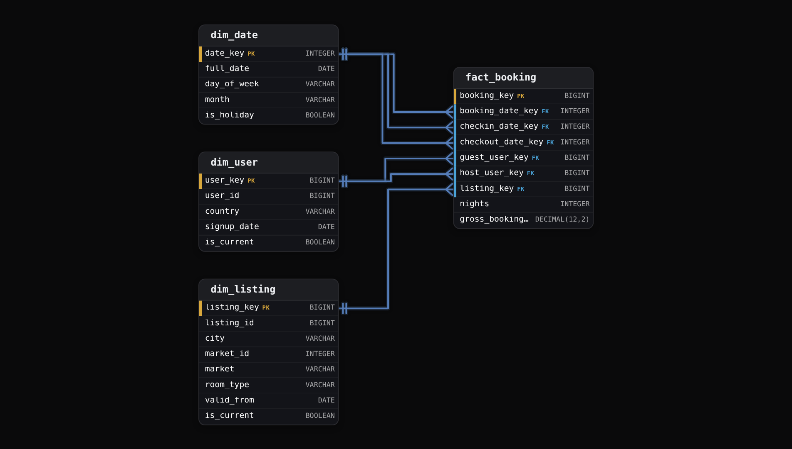
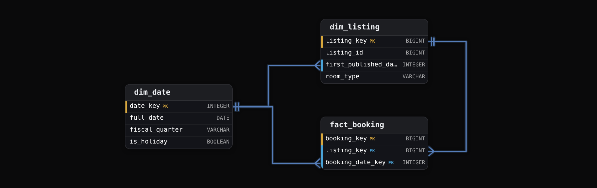
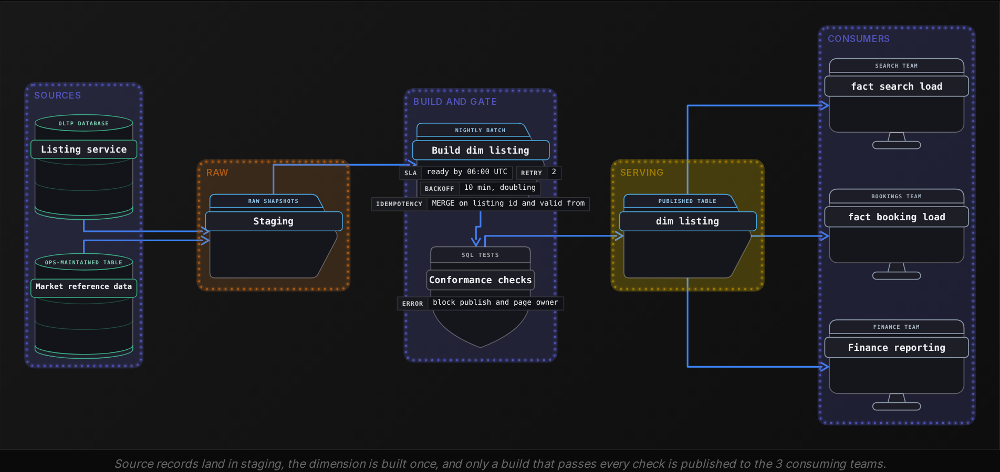

Advanced·Data Modeling · 25 min · 7 challenges

# Conformed and Role-Playing Dimensions: Advanced

Ines is in the final data modeling round at Airbnb. The interviewer draws 2 boxes: one for bookings, one for search events. 'Product wants search-to-booking conversion by city and by host tenure. The search team and the bookings team each built their own listing table, and the numbers never match. Fix it.' Then comes a second turn: a booking has 3 dates, and its guest and host are both users. Ines has met each idea alone. The interviewer is testing whether she can hold them together: a dimension every fact table agrees on, one user table joined in 2 roles, and a guest profile whose trust tier changes weekly without the user table tripling in size. This lesson builds that answer piece by piece, with the row counts behind each choice.


<br>

### What you will be able to do

Explain why a cross-process metric needs a conformed dimension, and write the drill-across query that groups each fact table before joining.

State when 2 tables count as conformed, either because their keys and values match or because one is a shrunken rollup of the other, and place every process on a bus matrix.

Model a dimension in several roles with role views, and decide when a role deserves a table of its own.

Use growth arithmetic to decide when to flatten an attribute, and when it should move to an outrigger or a mini-dimension instead.

Describe who owns a shared dimension, and which gated tests and late-arrival rules keep it consistent across teams.


<br>

---

## Two Fact Tables, One Dimension

### Grain first, metric second

Search-to-booking conversion takes its numerator from one fact table and its denominator from another. `fact_search` records 1 row per listing impression, a listing shown to a guest on a results page. `fact_booking` records 1 row per confirmed booking. The 2 grains differ, their volumes differ by orders of magnitude, and no column in either table points at a row in the other. What they can share is the context around each event: which listing, which city, which day. When 2 business processes agree on that context down to every key and every value, it is a conformed dimension. A metric that spans 2 processes can be no more correct than the dimension both of them read.


<br>

### Two private copies of the listing table

Suppose each team built a listing table of its own. The search team took city from the search index's region field, which groups suburbs into metro areas. The bookings team took city from the pricing market each listing is assigned to, which folds Oakland into San Francisco. Both tables are internally consistent, and both load without a single failed row. Here are the same 3 listings in each.

search_listing_dim (search team)

| listing_id | city | room_type |
| --- | --- | --- |
| 4417 | SF Bay Area | Entire home |
| 5120 | Oakland | Private room |
| 6038 | San Francisco | Entire home |

booking_listing_dim (bookings team)

| listing_id | city | room_type |
| --- | --- | --- |
| 4417 | San Francisco | entire_home |
| 5120 | San Francisco | private_room |
| 6038 | San Francisco | entire_home |

On one day the 3 listings took 30 bookings from 1,200 impressions, 12 from 800, and 18 from 1,000. Each team groups its fact table by its own city column, and an analyst joins the 2 results on city. The last column shows what a single shared dimension would have reported. That dimension puts 4417 and 6038 in San Francisco, and 5120 in Oakland.

| city | impressions | bookings | reported conversion | conversion on 1 shared dimension |
| --- | --- | --- | --- | --- |
| San Francisco | 1,000 | 60 | 6.0% | 2.2% (48 of 2,200) |
| SF Bay Area | 1,200 | 0 | 0.0% | not a city value |
| Oakland | 800 | 0 | 0.0% | 1.5% (12 of 800) |

The reported San Francisco rate is almost 3 times the true one, Oakland looks like it never converts, and no query failed. Every join matched on a real string. The room_type column fails the same way: `'Entire home'` and `'entire_home'` describe one category to a reader and 2 groups to `GROUP BY`. Divergence of this kind shows up as a credible wrong number, which is why the fix belongs in the dimension and nowhere downstream.


<br>

### Never join fact to fact

A shared dimension removes the label problem, and a second trap remains. Joining `fact_search` to `fact_booking` row to row on listing and date multiplies rows: listing 4417's 1,200 impression rows each match all 30 of its booking rows for that day, and every booking is counted once per impression.

- **36,000** — rows from 1 listing on 1 day
- **1,200x** — overcount of listing 4417's bookings

The technique that avoids this is drill-across. Aggregate each fact table to the shared grain on its own, then join the small result sets on conformed attributes. The fact tables never meet.

```sql
WITH searches AS (
  SELECT
    l.city,
    COUNT(*) AS impressions
  FROM fact_search AS s
  JOIN dim_listing AS l
    ON s.listing_key = l.listing_key
  WHERE s.event_date_key BETWEEN 20260901
  AND 20260930
  GROUP BY l.city
),
booked AS (
  SELECT
    l.city,
    COUNT(*) AS bookings
  FROM fact_booking AS b
  JOIN dim_listing AS l
    ON b.listing_key = l.listing_key
  WHERE b.booking_date_key BETWEEN 20260901
  AND 20260930
  GROUP BY l.city
)

SELECT
  COALESCE(s.city, b.city) AS city,
  COALESCE(s.impressions, 0) AS impressions,
  COALESCE(b.bookings, 0) AS bookings,
  CAST(COALESCE(b.bookings, 0) AS DOUBLE) / NULLIF(s.impressions, 0) AS conversion
FROM searches AS s
FULL OUTER JOIN booked AS b
  ON s.city = b.city
```

Both CTEs read `city` from the same `dim_listing`, so the values agree by construction and the final join cannot miss on spelling. The `FULL OUTER JOIN` keeps a city that has bookings but no impressions, such as one fed entirely by shared links, and `NULLIF` stops a city with zero impressions from dividing by zero. The join key between the result sets is a dimension attribute; neither fact table's own key appears in it.

Drill-across also sets a limit. The shared grain is the finest one both fact tables can reach. If `fact_search` recorded search sessions with a destination but no listing, conversion could be conformed on day and market and never on listing or room type, and an interviewer who adds 'by room type' is checking whether you notice.

> What the interviewer listens for
>
> - You state the grain of each fact table before you write the metric.
> - You refuse a fact-to-fact join and say what it does to row counts.
> - You group each fact separately and join the results on dimension attributes.
> - You trace the divergence to the dimension both queries read.

> **TIP**
>
> When an interviewer hands you a conversion number that looks wrong, ask which table each side reads its city from before you touch the SQL. The question is usually testing whether you suspect the dimension.


<br>

---

## Designing a Conformed Dimension

### The conformance test

Agreement in meaning falls short of conformance. Two dimensions are conformed when they are the same table, or when one is an exact subset of the other and, wherever their rows and columns overlap, the keys match and so do the column names and values. The test is mechanical: an analyst can group 2 fact tables by the same column and join the results with no mapping table and no `CASE` expression in between.

- **Identical keys** *Same surrogate key, same member*\
  Listing 4417 has the same listing_key in every fact table that references it, generated once by the dimension build.
- **Identical values** *Same strings, same codes*\
  Every shared column, market and room_type included, holds the same spelling and casing for every consumer.
- **Subsets only** *Fewer rows or columns, never different ones*\
  A coarser table may drop columns or roll rows up, and every value it keeps comes from the base dimension.


<br>

### History is part of the contract

Every consumer of a conformed dimension inherits its single grain and its history policy, and the history policy depends on a surrogate key. That key is an integer the warehouse generates in place of the listing service's `listing_id`, which lets several versions of one listing coexist, each stamped with `valid_from` and an `is_current` flag. Under type 2 history, a change to a tracked column closes the current row and inserts a new row with a new key, and each fact row is loaded with the key of the version in effect when the event happened.

The decision an interviewer probes is which columns are tracked, because on a conformed dimension that choice changes the numbers in every fact table on the bus at once. Say ops redraws boundaries on 2026-07-01 and listing 4417 moves from the San Francisco market to Peninsula.

✓market tracked as type 2

- June bookings stay in San Francisco; July onward land in Peninsula.
- Published quarterly reports reproduce exactly on a re-run.
- Reporting by today's boundaries needs a join to the current row.

✗market overwritten (type 1)

- Every past booking of 4417 moves to Peninsula on the next build.
- Last quarter's published finance numbers change without anyone editing them.
- The table stays at 1 row per listing.

Many teams need both views, and the usual answer carries both on the row: `market` tracked as type 2 for as-was reporting, plus `current_market` overwritten on every version of the listing for as-is reporting. Kimball labels that hybrid type 6. Its cost is a rewrite of all of a listing's version rows whenever the current value changes, which is cheap for markets and expensive for anything that changes weekly, a problem the mini-dimension section returns to.

> **TIP**
>
> Ask which reports leave the company. Numbers published to investors or regulators must reproduce on a re-run, so the history policy for every column they group by is fixed before any other team gets a vote.


<br>

### Shrunken dimensions for coarser facts

Finance sets a monthly booking target per market in `fact_market_target`. It has no listing and no day, so it cannot reference `dim_listing` or `dim_date`. It needs `dim_market` and `dim_month`, and those conform only when they are derived from the base dimensions: markets from the market columns of `dim_listing`, months from the month columns of `dim_date`. Kimball calls these shrunken dimensions. Built that way, actual bookings rolled up through `dim_listing.market_id` and targets keyed by `dim_market.market_id` share every key, and target against actual becomes a drill-across like the one in the previous section.

```sql
CREATE TABLE dim_market AS
SELECT
    market_id,
    MAX_BY(market, valid_from) AS market,
    MAX_BY(region, valid_from) AS region,
    MAX_BY(country, valid_from) AS country
FROM dim_listing
GROUP BY market_id
```

The tempting alternative is a market list that finance maintains by hand. It drifts the first time ops reassigns a market's region, and the drift appears as a target with no actuals beside it. The same rule covers `dim_month`: fiscal months come from the fiscal columns of `dim_date`, so a change to the fiscal calendar lands in every report on the same run.


<br>

### The bus matrix

The design artifact for conformance is the bus matrix: 1 row per business process, which in practice means 1 row per fact table, and 1 column per dimension. A cell says the process uses that dimension and at what grain. Reading across a row tells you what a new fact table must reference. Reading down a column tells you every team a change to that dimension will reach. The Host cell for search reads via listing because `fact_search` carries no host key, while each `dim_listing` row names the listing's host. Conversion by host tenure is then a drill-across in which both CTEs group by the tenure band reached through `dim_listing`.

| Process (fact table) | Date | Listing | Guest | Host | Market |
| --- | --- | --- | --- | --- | --- |
| Search impressions (fact_search) | day | yes | yes | via listing | via listing |
| Bookings (fact_booking) | day, 3 roles | yes | yes | yes | via listing |
| Reviews (fact_review) | day | yes | yes | yes | via listing |
| Host payouts (fact_payout) | day | yes | none | yes | via listing |
| Market targets (fact_market_target) | month | none | none | none | yes |


<br>

---

## Role-Playing Dimensions

### Several foreign keys, one table

A booking is made on one day, and the stay it covers starts and ends on 2 other days. `booking_date_key` on `fact_booking` references `dim_date`, and so do `checkin_date_key` and `checkout_date_key`. The fact also carries `guest_user_key` and `host_user_key`, both referencing `dim_user`. Each foreign key is a role: the same physical dimension, stored once, read under a different meaning. Copying `dim_date` into 3 tables would triple the calendar logic to maintain and break conformance the first time a holiday is added to one copy.




<br>

### Each role is a separate join

Lead time, the days between booking and check-in, needs `dim_date` twice. Splitting it by guest and host country needs `dim_user` twice. The query below asks for average lead time on holiday check-ins.

```sql
SELECT
  g.country AS guest_country,
  h.country AS host_country,
  AVG(DATE_DIFF('day', bd.full_date, cd.full_date)) AS avg_lead_days,
  COUNT(*) AS bookings
FROM fact_booking AS f
JOIN dim_date AS bd
  ON f.booking_date_key = bd.date_key
JOIN dim_date AS cd
  ON f.checkin_date_key = cd.date_key
JOIN dim_user AS g
  ON f.guest_user_key = g.user_key
JOIN dim_user AS h
  ON f.host_user_key = h.user_key
WHERE cd.is_holiday = TRUE
GROUP BY g.country, h.country
```

The failure mode is silent. Change `cd.is_holiday` to `bd.is_holiday` and the query still runs, now returning bookings made on a holiday, which is a different population and a different average. Join `h` on `guest_user_key` by mistake and host country equals guest country on every row. Neither error raises anything, and both produce plausible output.


<br>

### Role views carry the role in the name

Hand-written aliases depend on every analyst getting every join right. A semantic layer that joins on matching column names has the opposite problem: given 3 columns that each reference `date_key`, it either picks one path for every question or refuses to choose. Publishing 1 view per role fixes both, because every column name now states its role.

```sql
CREATE VIEW dim_checkin_date AS
SELECT
    date_key AS checkin_date_key,
    full_date AS checkin_date,
    day_of_week AS checkin_day_of_week,
    month AS checkin_month,
    is_holiday AS checkin_is_holiday
FROM dim_date
```

A view stores nothing and inherits every correction made to `dim_date`, so conformance is preserved by construction. The fact table's `checkin_date_key` now matches a column of the same name, and `checkin_is_holiday` cannot be mistaken for the booking date's holiday flag in a report built months later by someone who never saw the schema.

#### History inside a role

Roles interact with type 2 history. `host_user_key` is resolved when the booking loads, so it points at the host's version at booking time: the country they lived in then. A question about the host's current country needs a second hop through `user_id` to the row where `is_current` is true. Decide per role which one each report means, and name the view columns to match, such as `host_country_at_booking`.


<br>

### When a role gets its own table

Guest and host are both users, and many people are both. A single `dim_user` keeps one identity for them: one `user_id`, one signup date, one country. Hosts, though, carry columns guests never have: superhost status, active listing count, response rate, payout currency. Suppose `dim_user` holds 150 million rows and 4 million of them are hosts. Adding 12 host-only columns leaves those columns null on 146 million rows, and every change to superhost status, which can flip at each periodic review, creates a new version of the whole user row.

- **97%** — of user rows null on host-only columns

✓One dim_user, 2 roles

- A person who both hosts and travels is 1 row, with 1 history.
- Host-only columns sit empty on almost every row.
- Host status changes version the entire user row.

✗dim_user plus dim_host

- dim_host holds 4 million rows with host columns and their own history.
- Shared identity still resolves through user_id.
- One more dimension on the bus, with its own conformance tests and documentation.

Roles share a table while they share attributes and change rates, and split when those diverge. When they split, both tables keep the same natural key, so a user who is both guest and host still resolves to one person in any drill-across.

> **TIP**
>
> Before any SQL, draw the fact table and label each foreign key with its role. Interviewers ask for lead time or for guest-to-host country pairs specifically to see whether you notice 2 joins to the same table.


<br>

---

## Outrigger and Mini-Dimensions

### An outrigger hangs off a dimension

`dim_listing` needs to answer questions about when each listing first went live: bookings by listing cohort, or how fast new listings earn their first review. You can flatten, copying `first_published_date` into `dim_listing` along with the month and quarter it falls in and its fiscal period. Or you can store `first_published_date_key` and point it at `dim_date`. A dimension referenced by another dimension, rather than by a fact table, is an outrigger.



✓Flatten into dim_listing

- Every cohort query is 1 join from the fact table.
- Fiscal and holiday logic is copied and can drift from dim_date.
- Fits when only 1 or 2 columns are needed.

✗Outrigger to dim_date

- Cohort queries reuse every calendar column dim_date already has.
- Queries take a second join that the fact table cannot reach directly.
- Fits when another team owns the referenced table, or when that table is wide or shared.

The outrigger is a role too: `first_published_date_key` is the listing-publish role of `dim_date`, and it deserves a role view of its own. Kimball's guidance is to use outriggers sparingly, because each one adds a join an analyst has to know about. Where a fact table is queried by market constantly, give the fact its own `market_id` column so market rollups skip the listing hop, at the cost of one more key to populate on load.


<br>

### How type 2 history explodes

Trust and safety segments guests by profile, and so do marketing and pricing. A profile pairs a lifetime booking band and an account-age band with a trust tier, which takes 4 values: new, verified, trusted or flagged. These values change often, and every team wants bookings attributed to the profile the guest had at the time. Tracking them as type 2 on `dim_user` means each band crossing writes a new version of the user row. With 150 million users and 5% of them crossing a band each month, that is 7.5 million new versions every month.

- **90M** — new dim_user versions per year
- **60%** — of today's rows, added each year

Within 4 years the table has more than tripled, every query that filters on current rows scans the history, and the slow attributes that justified type 2 in the first place, such as country, are buried among versions created by booking-band crossings.


<br>

### The mini-dimension

Move the volatile, bandable attributes out of `dim_user` into `dim_guest_profile`, with 1 row for each combination of band values. That gives 4 trust tiers times 5 booking bands times 6 account-age bands, or 120 rows. The table is built once and extended only when a band is added. `fact_booking` gains `guest_profile_key`, set at load time to the combination the guest had at booking. `dim_user` keeps its slow columns and stops versioning when a profile changes.

| guest_profile_key | trust_tier | booking_band | account_age_band |
| --- | --- | --- | --- |
| 1 | new | 0 | under 30 days |
| 2 | new | 0 | 30 to 364 days |
| 57 | verified | 3 to 5 | 1 to 3 years |
| 120 | flagged | more than 20 | more than 5 years |

```sql
SELECT
  p.trust_tier,
  COUNT(*) AS bookings,
  SUM(f.gross_booking_value) AS gross_booking_value
FROM fact_booking AS f
JOIN dim_guest_profile AS p
  ON f.guest_profile_key = p.guest_profile_key
WHERE f.booking_date_key BETWEEN 20260101
AND 20260930
GROUP BY p.trust_tier
```

The segmentation query no longer touches the 150 million row table at all, but the mini-dimension has costs an interviewer will ask about.

What the mini-dimension gives up

- Precision: the booking band 3 to 5 cannot answer exactly 4 bookings, so the exact count belongs in a fact or a snapshot.
- Coverage between events: the profile is recorded only when a booking loads, so a guest who changes tier without booking leaves no trace.
- Current state: a report on today's trust tier needs a path from the user, which the fact table does not give.

The standard repairs are a monthly snapshot fact keyed by user and month that records `guest_profile_key` for every guest, and a `current_guest_profile_key` column on `dim_user`, overwritten in place on each build. That column is an outrigger from the user to the mini-dimension, and Kimball calls the combination type 5. Because it is a type 1 column, it adds no versions to the user table.

Where each attribute belongs

- Changes less than about once a year per member: keep it on the dimension, tracked as type 2.
- Changes monthly or faster and can be banded: move it to a mini-dimension.
- A continuous number such as lifetime spend: store it as a measure in a fact or snapshot.

> **TIP**
>
> Run the arithmetic out loud: members times monthly change rate times 12. The result tells you whether type 2 history is affordable, and saying it shows the interviewer you sized the problem before choosing a pattern.


<br>

---

## Cross-Functional Consistency

### One owner, many readers

Conformance decays one local fix at a time. A search engineer adds a `CASE` that maps SF Bay Area to San Francisco, a finance analyst keeps a lookup for reassigned markets, and within a year the private copies from the first section are back. The pattern that holds is a single owning team that builds and publishes `dim_listing`, consumers that read it and never rebuild it, and a change process. New columns are additive and ship on request. Changing the definition of an existing column is a breaking change, so it is announced ahead and ships as a new column beside the old one.




<br>

### Tests that run on every build

Checks the gate runs

- **Uniqueness:** exactly 1 row per listing_id where is_current is true.
- **Orphans:** every listing_key in every fact table exists in the dimension.
- **Value sets:** every market_id in dim_listing exists in dim_market, and the reverse.
- **Reconciliation:** booking value by market from fact_booking matches the finance ledger within an agreed tolerance.

The orphan check catches a broken key pipeline before any dashboard does. It runs against every fact table in the dimension's column of the bus matrix, which is one practical reason to keep the matrix current.

```sql
SELECT
  'fact_search' AS fact_table,
  COUNT(*) AS orphan_rows
FROM fact_search AS f
LEFT JOIN dim_listing AS d
  ON f.listing_key = d.listing_key
WHERE d.listing_key IS NULL

UNION ALL

SELECT
  'fact_booking' AS fact_table,
  COUNT(*) AS orphan_rows
FROM fact_booking AS f
LEFT JOIN dim_listing AS d
  ON f.listing_key = d.listing_key
WHERE d.listing_key IS NULL
```

> **TIP**
>
> Before the first build, agree a reconciliation tolerance with finance in both money and percent. A gate with no agreed threshold either pages the owner every night or gets switched off.


<br>

### Late-arriving members

A listing can be created and booked within the same hour, while `dim_listing` builds nightly. The booking arrives with a `listing_id` the dimension has never seen, and the load has 3 options.

| approach | fact row kept | correct listing later | cost |
| --- | --- | --- | --- |
| Drop the booking | no | not applicable | revenue missing from every report until a manual reload |
| Point at an Unknown row, key -1 | yes | only by rewriting fact rows | bookings pile up under an Unknown market |
| Insert an inferred member | yes | yes, on the next build | the build must fill placeholder rows in place |

An inferred member is a placeholder row carrying the real `listing_id`, a new surrogate key and null attributes, flagged as inferred. The fact loads against it immediately, and the next build overwrites the placeholder's attributes instead of versioning them, because no earlier version existed. The booking stays attached to the right listing throughout, and the orphan check stays at zero.


<br>

### When two teams mean different things

Some disagreements are real. Finance's market follows legal entities, because tax is filed per entity and so are payouts. The ops market follows supply-planning regions. Forcing one `market` column makes one team's numbers wrong by definition. The answer that scales keeps the listing conformed and the meanings separate by name: `ops_market` and `finance_market` side by side on the same row of `dim_listing`, each defined by its team and published by the single owner. The failure mode is 2 columns, in 2 tables, both called `market`.


<br>

### What conformance costs

The owning team runs a release process, and every consumer gives up some autonomy: a team that wants a new attribute waits for the owner's next release instead of adding it locally that afternoon. That cost is worth paying for a dimension that appears in several rows of the bus matrix, where one divergent copy corrupts a cross-process metric. A dimension used by a single fact table can stay with that team until a second process needs it; the migration then is a key mapping from the local surrogate keys to the conformed ones, plus a backfill of the fact table's foreign keys.

> A complete answer, in order
>
> - State each fact table's grain and why the metric needs drill-across.
> - Name the conformed dimensions and draw the bus matrix row for each process.
> - List every role, and publish a view for each one.
> - Size the churn, then choose type 2, a mini-dimension or a snapshot.
> - Name the owner, the checks at the gate and the rule for late arrivals.

✓Do

- Derive every rollup dimension from its base dimension in the same build.
- Publish a view per role with the role in every column name.
- Block publishing when an orphan or value-set check fails.

✗Don't

- Let a consuming team rebuild a shared dimension locally.
- Join 2 fact tables to each other at row level.
- Give 2 different definitions the same column name.


<br>

---

## Putting It All Together

A home-sharing marketplace launches long-term stays. A new fact_lease table needs conversion from search, revenue against finance's monthly targets per market, and segmentation by guest trust tier, and every one of those numbers must match what the short-stay teams already publish.

- The lease fact joins the bus matrix through the existing dim_listing, reusing dim_date and dim_user as well, so conversion is a drill-across against fact_search.
- The lease fact uses dim_date in 3 roles: the signing date, and the start and end of the lease. Each role is published as its own view.
- Revenue against targets rolls up through dim_market. Because dim_market is derived from dim_listing, actuals and targets share every key.
- Trust tier comes from dim_guest_profile at signing time, keeping dim_user from versioning on every tier change.
- The lease team requests new columns from the dimension owner, and the orphan check covers the new fact table from its first load.


<br>

---

## Key Takeaways

- A cross-process metric is computed by aggregating each fact table separately and joining the results on conformed dimension attributes.
- Conformed means identical keys and values, or an exact subset derived from the base dimension.
- The history policy of a shared dimension changes every fact on the bus at once, so it is decided with every consumer.
- A role-playing dimension is 1 physical table joined once per role and published as role views.
- Outriggers trade a second join for reuse; mini-dimensions trade precision for a dimension that stops growing.
- A shared dimension stays conformed when one team owns it and publishes only builds that pass their tests. It also needs an explicit rule for late-arriving members.
