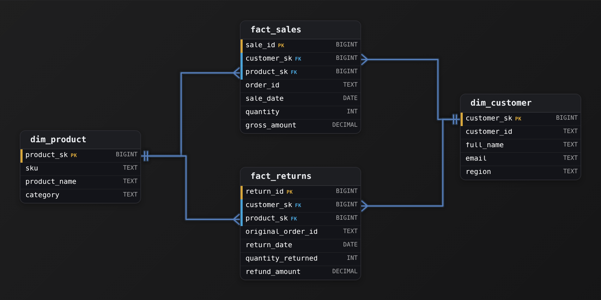
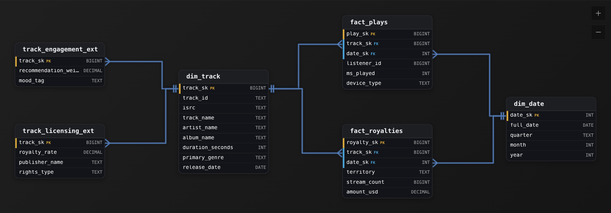
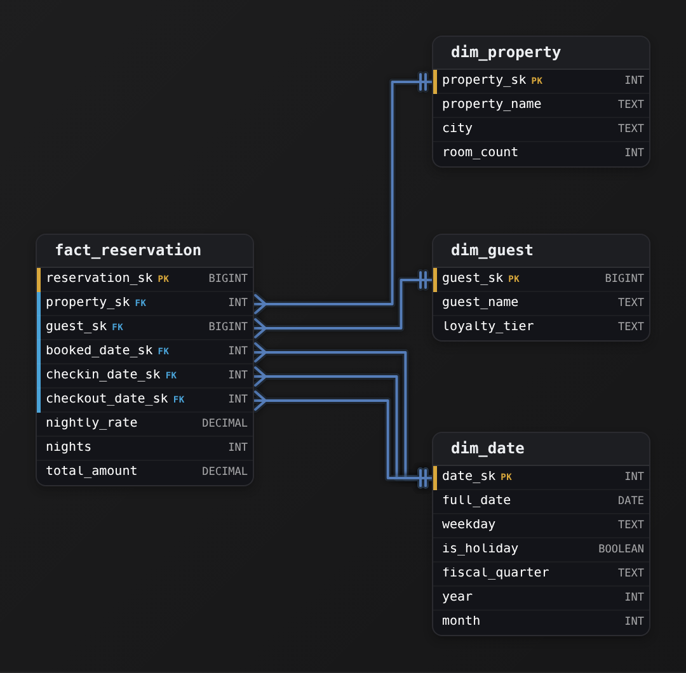
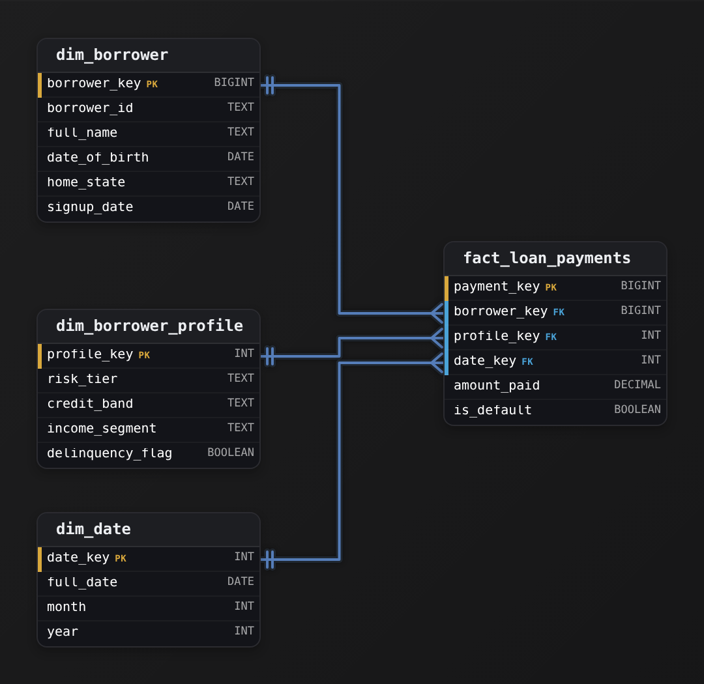
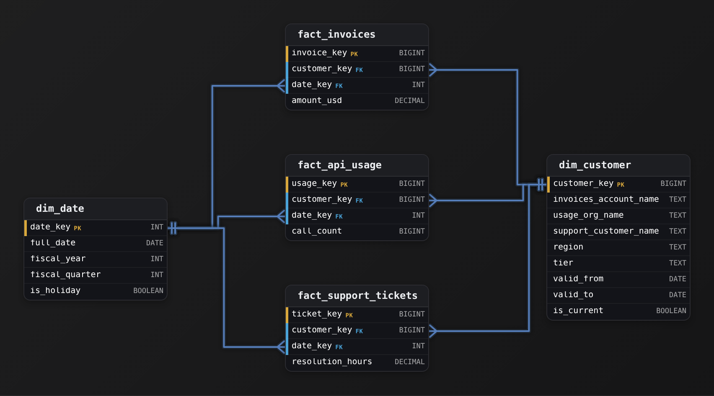
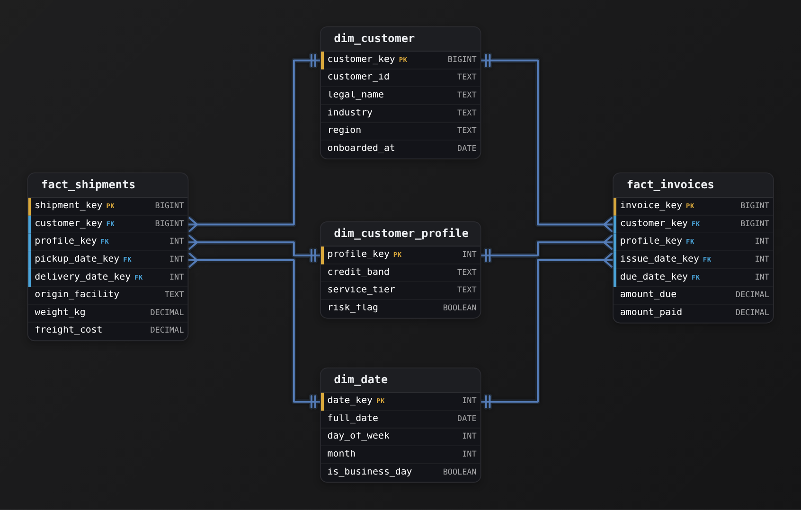
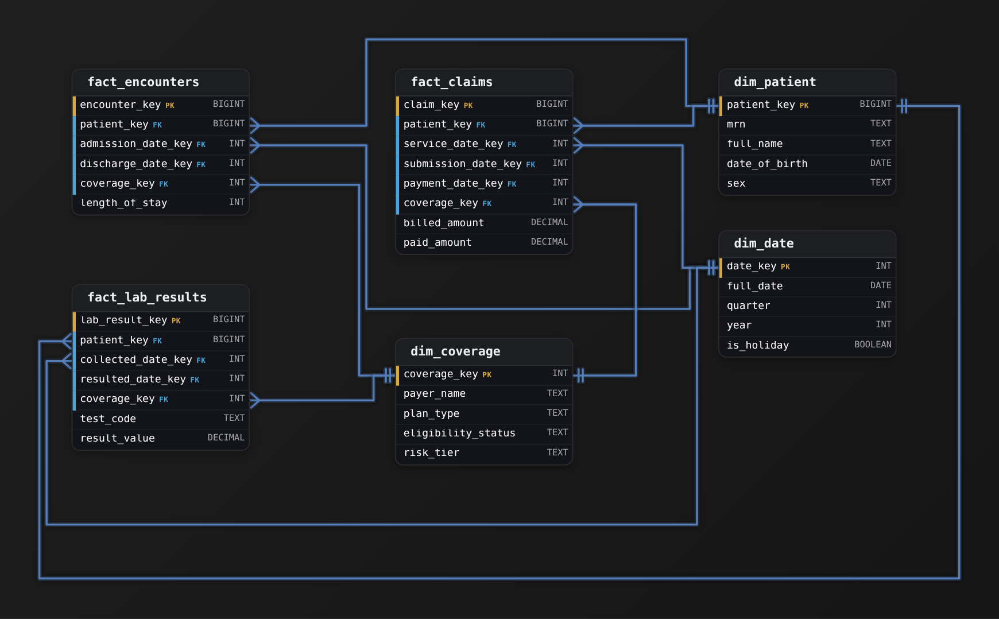

Advanced·Data Modeling · 25 min · 7 challenges

# Conformed and Role-Playing Dimensions: Advanced

Ines is in the final data modeling round at Airbnb. The interviewer draws 2 boxes: one for bookings, one for search events. 'Product wants search-to-booking conversion by city and by host tenure. The search team and the bookings team each built their own listing table, and the numbers never match. Fix it.' Then comes a second turn: a booking has 3 dates, and its guest and host are both users. Ines has met each idea alone. The interviewer is testing whether she can hold them together: a dimension every fact table agrees on, one user table joined in 2 roles, and a guest profile whose trust tier changes weekly without the user table tripling in size. This lesson builds that answer piece by piece, with the row counts behind each choice.


<br>

### What you will be able to do

Explain why a cross-process metric needs a conformed dimension, and write the drill-across query that groups each fact table before joining.

State when 2 tables count as conformed, either because their keys and values match or because one is a shrunken rollup of the other, and place every process on a bus matrix.

Model a dimension in several roles with role views, and decide when a role deserves a table of its own.

Use growth arithmetic to decide when to flatten an attribute, and when it should move to an outrigger or a mini-dimension instead.

Describe who owns a shared dimension, and which gated tests and late-arrival rules keep it consistent across teams.


<br>

---

## Two Fact Tables, One Dimension

### Grain first, metric second

Search-to-booking conversion takes its numerator from one fact table and its denominator from another. `fact_search` records 1 row per listing impression, a listing shown to a guest on a results page. `fact_booking` records 1 row per confirmed booking. The 2 grains differ, their volumes differ by orders of magnitude, and no column in either table points at a row in the other. What they can share is the context around each event: which listing, which city, which day. When 2 business processes agree on that context down to every key and every value, it is a conformed dimension. A metric that spans 2 processes can be no more correct than the dimension both of them read.


<br>

### Two private copies of the listing table

Suppose each team built a listing table of its own. The search team took city from the search index's region field, which groups suburbs into metro areas. The bookings team took city from the pricing market each listing is assigned to, which folds Oakland into San Francisco. Both tables are internally consistent, and both load without a single failed row. Here are the same 3 listings in each.

search_listing_dim (search team)

| listing_id | city | room_type |
| --- | --- | --- |
| 4417 | SF Bay Area | Entire home |
| 5120 | Oakland | Private room |
| 6038 | San Francisco | Entire home |

booking_listing_dim (bookings team)

| listing_id | city | room_type |
| --- | --- | --- |
| 4417 | San Francisco | entire_home |
| 5120 | San Francisco | private_room |
| 6038 | San Francisco | entire_home |

On one day the 3 listings took 30 bookings from 1,200 impressions, 12 from 800, and 18 from 1,000. Each team groups its fact table by its own city column, and an analyst joins the 2 results on city. The last column shows what a single shared dimension would have reported. That dimension puts 4417 and 6038 in San Francisco, and 5120 in Oakland.

| city | impressions | bookings | reported conversion | conversion on 1 shared dimension |
| --- | --- | --- | --- | --- |
| San Francisco | 1,000 | 60 | 6.0% | 2.2% (48 of 2,200) |
| SF Bay Area | 1,200 | 0 | 0.0% | not a city value |
| Oakland | 800 | 0 | 0.0% | 1.5% (12 of 800) |

The reported San Francisco rate is almost 3 times the true one, Oakland looks like it never converts, and no query failed. Every join matched on a real string. The room_type column fails the same way: `'Entire home'` and `'entire_home'` describe one category to a reader and 2 groups to `GROUP BY`. Divergence of this kind shows up as a credible wrong number, which is why the fix belongs in the dimension and nowhere downstream.


<br>

### Never join fact to fact

A shared dimension removes the label problem, and a second trap remains. Joining `fact_search` to `fact_booking` row to row on listing and date multiplies rows: listing 4417's 1,200 impression rows each match all 30 of its booking rows for that day, and every booking is counted once per impression.

- **36,000** — rows from 1 listing on 1 day
- **1,200x** — overcount of listing 4417's bookings

The technique that avoids this is drill-across. Aggregate each fact table to the shared grain on its own, then join the small result sets on conformed attributes. The fact tables never meet.

```sql
WITH searches AS (
  SELECT
    l.city,
    COUNT(*) AS impressions
  FROM fact_search AS s
  JOIN dim_listing AS l
    ON s.listing_key = l.listing_key
  WHERE s.event_date_key BETWEEN 20260901
  AND 20260930
  GROUP BY l.city
),
booked AS (
  SELECT
    l.city,
    COUNT(*) AS bookings
  FROM fact_booking AS b
  JOIN dim_listing AS l
    ON b.listing_key = l.listing_key
  WHERE b.booking_date_key BETWEEN 20260901
  AND 20260930
  GROUP BY l.city
)

SELECT
  COALESCE(s.city, b.city) AS city,
  COALESCE(s.impressions, 0) AS impressions,
  COALESCE(b.bookings, 0) AS bookings,
  CAST(COALESCE(b.bookings, 0) AS DOUBLE) / NULLIF(s.impressions, 0) AS conversion
FROM searches AS s
FULL OUTER JOIN booked AS b
  ON s.city = b.city
```

Both CTEs read `city` from the same `dim_listing`, so the values agree by construction and the final join cannot miss on spelling. The `FULL OUTER JOIN` keeps a city that has bookings but no impressions, such as one fed entirely by shared links, and `NULLIF` stops a city with zero impressions from dividing by zero. The join key between the result sets is a dimension attribute; neither fact table's own key appears in it.

Drill-across also sets a limit. The shared grain is the finest one both fact tables can reach. If `fact_search` recorded search sessions with a destination but no listing, conversion could be conformed on day and market and never on listing or room type, and an interviewer who adds 'by room type' is checking whether you notice.

> What the interviewer listens for
>
> - You state the grain of each fact table before you write the metric.
> - You refuse a fact-to-fact join and say what it does to row counts.
> - You group each fact separately and join the results on dimension attributes.
> - You trace the divergence to the dimension both queries read.

> **TIP**
>
> When an interviewer hands you a conversion number that looks wrong, ask which table each side reads its city from before you touch the SQL. The question is usually testing whether you suspect the dimension.


<br>

---

## Data Modeling

### Exercise 1 of 1

**● TASK**

An online marketplace runs two reporting stacks: the sales team measures completed orders and the returns team measures refunded items, and the two teams report different customer counts for the same month. Model a warehouse where order revenue and return refunds report against a single, shared definition of a customer and of a product, so that one query can compare what a customer bought against what they sent back. Keep orders and returns as separate fact tables at their own grains.


<br>

### Solution

#### Why this problem exists in real interviews

This is a **conformed dimension** problem wearing a reconciliation complaint as a costume. The sales team and the returns team report different customer counts for the same month, and the tell is that each team built its own customer table with its own key. The skill being probed: can you serve two fact tables from ONE `dim_customer`, keyed by one `customer_sk`, so that a customer is the same row no matter which fact you count from. Build a `dim_customer` per team and you have rebuilt the exact divergence you were asked to fix: the two counts will never tie, and no single query can compare what a customer bought against what they returned.

#### Break down the requirements

1. **Find the entity both facts describe**

   Orders and returns are different events, but both happen to the same customer and the same product. Those repeated entities are the ones that must become SHARED dimensions. A customer who bought in `fact_sales` and refunded in `fact_returns` has to resolve to a single row.

2. **Give each shared entity one surrogate key**

   `dim_customer` gets a single `customer_sk`, and both facts carry that same key as a foreign key: one key, one definition of who a customer is. The same holds for `dim_product`, since the SKU that was sold is the SKU that was returned.

3. **Leave the two facts separate**

   Do not merge sales and returns into one table. They sit at different grains (one row per order line versus one row per returned line) and carry different measures (`gross_amount` versus `refund_amount`). Conformance is about the shared dimensions between the facts, not about collapsing the facts.

#### The reference model

One `dim_customer` and one `dim_product` sit in the center. `fact_sales` and `fact_returns` each reference both through surrogate keys. To compare purchases and returns for a customer, aggregate each fact by `customer_sk` and line them up: because both counts come from the same dimension, they finally agree.



*One `dim_customer` and one `dim_product`, each keyed by a surrogate and shared by both facts.*

| Trick: One key is the whole trick |
| --- |
| The moment both facts share `customer_sk`, `COUNT(DISTINCT customer_sk)` means the same thing on either side. That single shared key is what makes the warehouse a warehouse rather than two disconnected marts. |

| Interviewer: Say the definition lives once |
| --- |
| Interviewers want to hear that both facts hang off the same dimension by the same key, and that a shared dimension is the only thing that lets two teams' numbers reconcile. Naming the failure (two customer tables, two definitions) before you draw shows you have watched it break in production. |

| Pitfall: Two tables, two truths |
| --- |
| The common mistake is a `dim_customer` per fact, often with subtly different attributes or keys. Each is correct inside its own mart and useless across them, which is precisely the disagreement the prompt describes. |

| ✕ One conformed `dim_customer` | ✓ A customer table per fact |
| --- | --- |
| Both facts join to the same row by `customer_sk`. Counts reconcile, and cross-fact questions (bought vs returned) are one join path. Cost: one owner must maintain the shared definition. | `fact_sales` and `fact_returns` each keep their own customer table. Each team's numbers are internally consistent but never tie to the other, and no query can join the two facts on a common customer. This is the bug, not a design. |

**Follow-up questions**

1. How would you extend this so a new `fact_support_tickets` also reports by the same customer?\
   *Tests whether the candidate sees conformance as reusing the one dimension, not adding another customer table.*
2. The sales pipeline and the returns pipeline spell `region` differently. Where does that get resolved?\
   *Tests that attribute definitions live once, in the shared dimension, not per fact.*
3. How do you count distinct customers who both bought and returned in the same month?\
   *Tests the shared-key join path across two facts through `dim_customer`.*


<br>

---

## Designing a Conformed Dimension

### The conformance test

Agreement in meaning falls short of conformance. Two dimensions are conformed when they are the same table, or when one is an exact subset of the other and, wherever their rows and columns overlap, the keys match and so do the column names and values. The test is mechanical: an analyst can group 2 fact tables by the same column and join the results with no mapping table and no `CASE` expression in between.

- **Identical keys** *Same surrogate key, same member*\
  Listing 4417 has the same listing_key in every fact table that references it, generated once by the dimension build.
- **Identical values** *Same strings, same codes*\
  Every shared column, market and room_type included, holds the same spelling and casing for every consumer.
- **Subsets only** *Fewer rows or columns, never different ones*\
  A coarser table may drop columns or roll rows up, and every value it keeps comes from the base dimension.


<br>

### History is part of the contract

Every consumer of a conformed dimension inherits its single grain and its history policy, and the history policy depends on a surrogate key. That key is an integer the warehouse generates in place of the listing service's `listing_id`, which lets several versions of one listing coexist, each stamped with `valid_from` and an `is_current` flag. Under type 2 history, a change to a tracked column closes the current row and inserts a new row with a new key, and each fact row is loaded with the key of the version in effect when the event happened.

The decision an interviewer probes is which columns are tracked, because on a conformed dimension that choice changes the numbers in every fact table on the bus at once. Say ops redraws boundaries on 2026-07-01 and listing 4417 moves from the San Francisco market to Peninsula.

✓market tracked as type 2

- June bookings stay in San Francisco; July onward land in Peninsula.
- Published quarterly reports reproduce exactly on a re-run.
- Reporting by today's boundaries needs a join to the current row.

✗market overwritten (type 1)

- Every past booking of 4417 moves to Peninsula on the next build.
- Last quarter's published finance numbers change without anyone editing them.
- The table stays at 1 row per listing.

Many teams need both views, and the usual answer carries both on the row: `market` tracked as type 2 for as-was reporting, plus `current_market` overwritten on every version of the listing for as-is reporting. Kimball labels that hybrid type 6. Its cost is a rewrite of all of a listing's version rows whenever the current value changes, which is cheap for markets and expensive for anything that changes weekly, a problem the mini-dimension section returns to.

> **TIP**
>
> Ask which reports leave the company. Numbers published to investors or regulators must reproduce on a re-run, so the history policy for every column they group by is fixed before any other team gets a vote.


<br>

### Shrunken dimensions for coarser facts

Finance sets a monthly booking target per market in `fact_market_target`. It has no listing and no day, so it cannot reference `dim_listing` or `dim_date`. It needs `dim_market` and `dim_month`, and those conform only when they are derived from the base dimensions: markets from the market columns of `dim_listing`, months from the month columns of `dim_date`. Kimball calls these shrunken dimensions. Built that way, actual bookings rolled up through `dim_listing.market_id` and targets keyed by `dim_market.market_id` share every key, and target against actual becomes a drill-across like the one in the previous section.

```sql
CREATE TABLE dim_market AS
SELECT
    market_id,
    MAX_BY(market, valid_from) AS market,
    MAX_BY(region, valid_from) AS region,
    MAX_BY(country, valid_from) AS country
FROM dim_listing
GROUP BY market_id
```

The tempting alternative is a market list that finance maintains by hand. It drifts the first time ops reassigns a market's region, and the drift appears as a target with no actuals beside it. The same rule covers `dim_month`: fiscal months come from the fiscal columns of `dim_date`, so a change to the fiscal calendar lands in every report on the same run.


<br>

### The bus matrix

The design artifact for conformance is the bus matrix: 1 row per business process, which in practice means 1 row per fact table, and 1 column per dimension. A cell says the process uses that dimension and at what grain. Reading across a row tells you what a new fact table must reference. Reading down a column tells you every team a change to that dimension will reach. The Host cell for search reads via listing because `fact_search` carries no host key, while each `dim_listing` row names the listing's host. Conversion by host tenure is then a drill-across in which both CTEs group by the tenure band reached through `dim_listing`.

| Process (fact table) | Date | Listing | Guest | Host | Market |
| --- | --- | --- | --- | --- | --- |
| Search impressions (fact_search) | day | yes | yes | via listing | via listing |
| Bookings (fact_booking) | day, 3 roles | yes | yes | yes | via listing |
| Reviews (fact_review) | day | yes | yes | yes | via listing |
| Host payouts (fact_payout) | day | yes | none | yes | via listing |
| Market targets (fact_market_target) | month | none | none | none | yes |


<br>

---

## Data Modeling

### Exercise 1 of 1

**● TASK**

An analyst reconciling a music-streaming platform's numbers finds the product team's plays fact and the licensing team's royalties fact both slicing by track and calendar date, each against its own definition. Design conformed track and date dimensions that both facts share, where a track's shared identity is its name, artist, album, ISRC, release date, duration and genre. Product also keeps recommendation weights and mood tags per track, and licensing keeps royalty rates, publisher and rights terms per track.


<br>

### Solution

#### What this problem is really testing

Beneath the streaming story, this is a conformed-dimension design, and the whole exam is one decision: what earns a seat on the shared `dim_track` and what does not. The trap is generosity. You know product needs a recommendation weight and licensing needs a royalty rate, so the tempting move is to hang both on `dim_track` where everyone can reach them. Do that and you have quietly welded the two teams together: the day licensing adds a rights column, product's dimension load has to change too, and the 'one definition' you were hired to build starts drifting the moment either team touches its own attributes.

| Trick: The seat test |
| --- |
| An attribute belongs on the conformed core only if BOTH teams read it and read it the same way. `artist_name` passes: plays and royalties both mean the same artist. `royalty_rate` fails: product never reads it. Everything that fails the test goes in an extension keyed to `track_sk`, never on the shared table. |

#### Work the requirements

1. **Fix the grain and the key**

   One row per track. Give it a surrogate `track_sk` and keep the natural keys (`isrc`, source `track_id`) as columns. The surrogate is what every fact and every extension will point at, so it has to be stable and meaningless.

2. **Fill the conformed core**

   Only the identity both teams agree on: `track_name`, `artist_name`, `album_name`, `isrc`, `duration_seconds`, `primary_genre`, `release_date`. This is the sentence the interviewer wants to hear: one definition, shared everywhere. When product groups by genre and licensing groups by genre, they get the same buckets.

3. **Push team attributes to extensions**

   `track_engagement_ext` carries `recommendation_weight` and `mood_tag`; `track_licensing_ext` carries `royalty_rate`, `publisher_name`, and `rights_type`. Each is keyed by `track_sk`, which is both its primary key and its reference to `dim_track`, making it a 1:1 extension of the core. Neither team can now break the other's dimension load.

4. **Conform the calendar too**

   Both facts reference the same `dim_date` via `date_sk`. That is the other half of drill-across: a quarter means the same quarter whether you are reading plays or payouts, so the two reports reconcile on time as well as on track.

#### The reference model

Two facts, two shared dimensions, and two thin extensions. The core `dim_track` is deliberately boring: it holds nothing that would give one team a reason to alter it on the other's behalf.



*`dim_track` and `dim_date` are conformed across both facts; team attributes live in extensions whose `track_sk` points back at `dim_track`.*

| ✕ Conformed core | ✓ Extension |
| --- | --- |
| Everything both teams read identically: `track_name`, `artist_name`, `isrc`, `primary_genre`, `release_date`. Changing it is a shared decision because both reports depend on it. | Everything one team owns: `recommendation_weight` (product), `royalty_rate` and `rights_type` (licensing). Keyed to `track_sk`, changed freely by its owner, invisible to the other team. |

| Interviewer: The line they wait for |
| --- |
| A strong candidate says 'one definition, shared everywhere' and then, unprompted, names an attribute that does NOT belong on the core and explains where it goes instead. Naming the extension split is the seniority signal; anyone can draw a shared table. |

| Pitfall: Bloating the shared dimension |
| --- |
| Dumping `royalty_rate` and `recommendation_weight` onto `dim_track` looks convenient and is the most common miss. It couples the teams: a licensing column change now touches product's load, and the shared table grows a column no one but one team can interpret. Extensions exist precisely to break that coupling. |

| Performance: Why the split also scales |
| --- |
| At ~80M tracks, the core stays narrow, so product's and licensing's dimension loads never contend on the same wide table. Each extension is a 1:1 join on `track_sk` only when that team's report needs it, and neither fact pays for columns it never groups by. |

**Follow-up questions**

1. Marketing now wants a per-track campaign segment for a third fact table. Where does it go?\
   *Tests that the candidate reaches for a third extension, not another column on the conformed core.*
2. A track's genre is recategorized. How do both reports pick up the change consistently?\
   *Tests that a single update to the conformed core propagates to both facts, which is the payoff of conformance.*
3. Licensing wants `royalty_rate` to vary by territory. Does that still fit the extension?\
   *Tests recognizing that a territory-varying rate is no longer 1:1 with the track and needs its own grain, not a track extension.*


<br>

---

## Role-Playing Dimensions

### Several foreign keys, one table

A booking is made on one day, and the stay it covers starts and ends on 2 other days. `booking_date_key` on `fact_booking` references `dim_date`, and so do `checkin_date_key` and `checkout_date_key`. The fact also carries `guest_user_key` and `host_user_key`, both referencing `dim_user`. Each foreign key is a role: the same physical dimension, stored once, read under a different meaning. Copying `dim_date` into 3 tables would triple the calendar logic to maintain and break conformance the first time a holiday is added to one copy.


<br>

### Each role is a separate join

Lead time, the days between booking and check-in, needs `dim_date` twice. Splitting it by guest and host country needs `dim_user` twice. The query below asks for average lead time on holiday check-ins.

```sql
SELECT
  g.country AS guest_country,
  h.country AS host_country,
  AVG(DATE_DIFF('day', bd.full_date, cd.full_date)) AS avg_lead_days,
  COUNT(*) AS bookings
FROM fact_booking AS f
JOIN dim_date AS bd
  ON f.booking_date_key = bd.date_key
JOIN dim_date AS cd
  ON f.checkin_date_key = cd.date_key
JOIN dim_user AS g
  ON f.guest_user_key = g.user_key
JOIN dim_user AS h
  ON f.host_user_key = h.user_key
WHERE cd.is_holiday = TRUE
GROUP BY g.country, h.country
```

The failure mode is silent. Change `cd.is_holiday` to `bd.is_holiday` and the query still runs, now returning bookings made on a holiday, which is a different population and a different average. Join `h` on `guest_user_key` by mistake and host country equals guest country on every row. Neither error raises anything, and both produce plausible output.


<br>

### Role views carry the role in the name

Hand-written aliases depend on every analyst getting every join right. A semantic layer that joins on matching column names has the opposite problem: given 3 columns that each reference `date_key`, it either picks one path for every question or refuses to choose. Publishing 1 view per role fixes both, because every column name now states its role.

```sql
CREATE VIEW dim_checkin_date AS
SELECT
    date_key AS checkin_date_key,
    full_date AS checkin_date,
    day_of_week AS checkin_day_of_week,
    month AS checkin_month,
    is_holiday AS checkin_is_holiday
FROM dim_date
```

A view stores nothing and inherits every correction made to `dim_date`, so conformance is preserved by construction. The fact table's `checkin_date_key` now matches a column of the same name, and `checkin_is_holiday` cannot be mistaken for the booking date's holiday flag in a report built months later by someone who never saw the schema.

#### History inside a role

Roles interact with type 2 history. `host_user_key` is resolved when the booking loads, so it points at the host's version at booking time: the country they lived in then. A question about the host's current country needs a second hop through `user_id` to the row where `is_current` is true. Decide per role which one each report means, and name the view columns to match, such as `host_country_at_booking`.


<br>

### When a role gets its own table

Guest and host are both users, and many people are both. A single `dim_user` keeps one identity for them: one `user_id`, one signup date, one country. Hosts, though, carry columns guests never have: superhost status, active listing count, response rate, payout currency. Suppose `dim_user` holds 150 million rows and 4 million of them are hosts. Adding 12 host-only columns leaves those columns null on 146 million rows, and every change to superhost status, which can flip at each periodic review, creates a new version of the whole user row.

- **97%** — of user rows null on host-only columns

✓One dim_user, 2 roles

- A person who both hosts and travels is 1 row, with 1 history.
- Host-only columns sit empty on almost every row.
- Host status changes version the entire user row.

✗dim_user plus dim_host

- dim_host holds 4 million rows with host columns and their own history.
- Shared identity still resolves through user_id.
- One more dimension on the bus, with its own conformance tests and documentation.

Roles share a table while they share attributes and change rates, and split when those diverge. When they split, both tables keep the same natural key, so a user who is both guest and host still resolves to one person in any drill-across.

> **TIP**
>
> Before any SQL, draw the fact table and label each foreign key with its role. Interviewers ask for lead time or for guest-to-host country pairs specifically to see whether you notice 2 joins to the same table.


<br>

---

## Data Modeling

### Exercise 1 of 1

**● TASK**

A vacation-rental booking platform needs a warehouse model for its reservations, each of which records when it was booked, when the guest checks in, and when they check out, along with the property, the guest, the nightly rate, and the total charge. Analysts have to report revenue by booking month, room-nights by check-in month, and departures by checkout month, all sliced by the same calendar attributes such as weekday, holiday flag, and fiscal quarter. Design the dimensional model that serves all three time-based views without duplicating the calendar logic.


<br>

### Solution

#### Why this problem exists in real interviews

Beneath the booking story this is a **role-playing dimension** probe in a hospitality setting. Three date columns on one fact (`booked_date`, `checkin_date`, `checkout_date`) tempt you to draft three date tables. The interviewer is waiting to hear 'one `dim_date`, referenced three times.' If you build three calendars instead, the holiday flag, the fiscal-quarter boundaries and the weekday logic drift apart the moment someone patches one of them. Then 'revenue by booking month' stops reconciling with 'room-nights by check-in month', because the 2 views no longer share a calendar.

#### Break down the requirements

1. **Declare the grain**

   One row in `fact_reservation` is one reservation, keyed by a surrogate `reservation_sk`. The nightly rate, nights and total charge are known once, at this grain, so they sit on the fact and never on a calendar.

2. **One calendar, three foreign keys**

   The fact carries `booked_date_sk`, `checkin_date_sk` and `checkout_date_sk`, and all three point at the same physical `dim_date`. There is one physical table and three logical uses of it. You do not create `dim_booking_date`, `dim_checkin_date` and `dim_checkout_date`.

3. **Alias the role per query**

   A time view chooses which FK to join on. Revenue by booking month joins `dim_date` on `booked_date_sk`; room-nights by check-in month joins the same `dim_date` on `checkin_date_sk`. The query has the same shape each time, only the role changes, and there is one set of calendar attributes.

#### The reference model

A clean star: `fact_reservation` at reservation grain, `dim_property` and `dim_guest` around it, and a single `dim_date` reached through three role-playing foreign keys. The calendar attributes (`weekday`, `is_holiday`, `fiscal_quarter`) live in `dim_date` exactly once.



*One `dim_date` reached through `booked_date_sk`, `checkin_date_sk` and `checkout_date_sk`: three roles, one physical calendar.*

| Key insight: One physical table, three logical roles |
| --- |
| This is what a role-playing dimension is: a single `dim_date` serves several analytical roles through separate foreign keys. Every time view stays on one calendar, so `is_holiday` and `fiscal_quarter` mean the same thing whether you slice by booking, check-in or checkout. |

| Interviewer: Name the pattern unprompted |
| --- |
| A senior candidate says 'three foreign keys, all pointing at one `dim_date`, each playing a different role' before being asked. Candidates who reach for three separate date tables are drawing a star schema by rote without understanding why the dimension is shared. |

| Pitfall: Three calendars that drift |
| --- |
| Building `dim_booking_date`, `dim_checkin_date` and `dim_checkout_date` looks tidy until someone updates the holiday list in one and not the others. After that, the same date is a holiday in one view and not in another, and no time-based report reconciles. |

#### The query pattern

**Same table, different role**

```sql
/* Revenue by booking month: join on the booked role */
SELECT bd.year, bd.month, SUM(r.total_amount) AS revenue
FROM fact_reservation r
JOIN dim_date bd ON bd.date_sk = r.booked_date_sk
GROUP BY bd.year, bd.month;

/* Room-nights by check-in month: same dim_date, check-in role */
SELECT cd.year, cd.month, SUM(r.nights) AS room_nights
FROM fact_reservation r
JOIN dim_date cd ON cd.date_sk = r.checkin_date_sk
GROUP BY cd.year, cd.month;
```

*Only the foreign key column and its alias change; `dim_date` is one table.*

| ✕ One role-playing `dim_date` | ✓ Three separate date dimensions |
| --- | --- |
| One `dim_date` with three FKs (`booked_date_sk`, `checkin_date_sk`, `checkout_date_sk`). The calendar attributes are defined once, every time view reconciles, and adding a calendar attribute means adding a single column. | `dim_booking_date`, `dim_checkin_date` and `dim_checkout_date` as separate tables. The holiday and fiscal logic is maintained three times, the views silently disagree when one drifts, and every calendar change is an edit to three tables. |

**Follow-up questions**

1. The business adds a cancellation date, populated only for cancelled reservations. How does it fit the model?\
   *Tests whether the candidate adds a fourth nullable role FK to the same `dim_date` rather than a new date table.*
2. Analysts want lead time, the days between `booked_date` and `checkin_date`. Where does that live?\
   *Tests whether a span between 2 roles is a fact measure (or derived) rather than a dimension attribute.*
3. How would you extend this to report against local time when properties span multiple time zones?\
   *Tests whether the candidate separates the calendar date from the time of day and keeps the role-playing calendar shared.*


<br>

---

## Outrigger and Mini-Dimensions

### An outrigger hangs off a dimension

`dim_listing` needs to answer questions about when each listing first went live: bookings by listing cohort, or how fast new listings earn their first review. You can flatten, copying `first_published_date` into `dim_listing` along with the month and quarter it falls in and its fiscal period. Or you can store `first_published_date_key` and point it at `dim_date`. A dimension referenced by another dimension, rather than by a fact table, is an outrigger.


✓Flatten into dim_listing

- Every cohort query is 1 join from the fact table.
- Fiscal and holiday logic is copied and can drift from dim_date.
- Fits when only 1 or 2 columns are needed.

✗Outrigger to dim_date

- Cohort queries reuse every calendar column dim_date already has.
- Queries take a second join that the fact table cannot reach directly.
- Fits when another team owns the referenced table, or when that table is wide or shared.

The outrigger is a role too: `first_published_date_key` is the listing-publish role of `dim_date`, and it deserves a role view of its own. Kimball's guidance is to use outriggers sparingly, because each one adds a join an analyst has to know about. Where a fact table is queried by market constantly, give the fact its own `market_id` column so market rollups skip the listing hop, at the cost of one more key to populate on load.


<br>

### How type 2 history explodes

Trust and safety segments guests by profile, and so do marketing and pricing. A profile pairs a lifetime booking band and an account-age band with a trust tier, which takes 4 values: new, verified, trusted or flagged. These values change often, and every team wants bookings attributed to the profile the guest had at the time. Tracking them as type 2 on `dim_user` means each band crossing writes a new version of the user row. With 150 million users and 5% of them crossing a band each month, that is 7.5 million new versions every month.

- **90M** — new dim_user versions per year
- **60%** — of today's rows, added each year

Within 4 years the table has more than tripled, every query that filters on current rows scans the history, and the slow attributes that justified type 2 in the first place, such as country, are buried among versions created by booking-band crossings.


<br>

### The mini-dimension

Move the volatile, bandable attributes out of `dim_user` into `dim_guest_profile`, with 1 row for each combination of band values. That gives 4 trust tiers times 5 booking bands times 6 account-age bands, or 120 rows. The table is built once and extended only when a band is added. `fact_booking` gains `guest_profile_key`, set at load time to the combination the guest had at booking. `dim_user` keeps its slow columns and stops versioning when a profile changes.

| guest_profile_key | trust_tier | booking_band | account_age_band |
| --- | --- | --- | --- |
| 1 | new | 0 | under 30 days |
| 2 | new | 0 | 30 to 364 days |
| 57 | verified | 3 to 5 | 1 to 3 years |
| 120 | flagged | more than 20 | more than 5 years |

```sql
SELECT
  p.trust_tier,
  COUNT(*) AS bookings,
  SUM(f.gross_booking_value) AS gross_booking_value
FROM fact_booking AS f
JOIN dim_guest_profile AS p
  ON f.guest_profile_key = p.guest_profile_key
WHERE f.booking_date_key BETWEEN 20260101
AND 20260930
GROUP BY p.trust_tier
```

The segmentation query no longer touches the 150 million row table at all, but the mini-dimension has costs an interviewer will ask about.

What the mini-dimension gives up

- Precision: the booking band 3 to 5 cannot answer exactly 4 bookings, so the exact count belongs in a fact or a snapshot.
- Coverage between events: the profile is recorded only when a booking loads, so a guest who changes tier without booking leaves no trace.
- Current state: a report on today's trust tier needs a path from the user, which the fact table does not give.

The standard repairs are a monthly snapshot fact keyed by user and month that records `guest_profile_key` for every guest, and a `current_guest_profile_key` column on `dim_user`, overwritten in place on each build. That column is an outrigger from the user to the mini-dimension, and Kimball calls the combination type 5. Because it is a type 1 column, it adds no versions to the user table.

Where each attribute belongs

- Changes less than about once a year per member: keep it on the dimension, tracked as type 2.
- Changes monthly or faster and can be banded: move it to a mini-dimension.
- A continuous number such as lifetime spend: store it as a measure in a fact or snapshot.

> **TIP**
>
> Run the arithmetic out loud: members times monthly change rate times 12. The result tells you whether type 2 history is affordable, and saying it shows the interviewer you sized the problem before choosing a pattern.


<br>

---

## Data Modeling

### Exercise 1 of 1

**● TASK**

A consumer-lending platform models its borrowers in a dimension with roughly 40 attributes. Four of these, risk tier, credit band, income segment, and delinquency flag, are re-scored weekly. With eight million borrowers and approximately 3 rescores per week, applying Type 2 slowly-changing to these four attributes alone creates roughly one billion rows per year (8M borrowers × 3 rescores × 50 weeks), making the dimension unjoinable.

Analysts need every payment in fact_loan_payments to remain sliceable by these four attribute values as they stood on the payment date.

To keep dimensions joinable while preserving point-in-time slicing, extract the volatile attributes into their own dimension, keyed by unique combinations of attribute values rather than by borrower or date. The main borrower dimension contains only stable attributes.

For sizing context: risk tier has 5 distinct values, credit band has ten, income segment has eight, and delinquency flag has 2 values.


<br>

### Solution

#### What this problem is really testing

This is a **storage-cost-of-history** question wearing a schema-design costume. The real skill: recognizing that when a fistful of attributes in a wide dimension churn weekly, versioning the whole row is a math error, not a design choice. The trap is the reflexive answer, apply history-tracking to every column. Do that here and `dim_borrower` grows by 8M borrowers times 3 changes times 50 weeks, roughly 1.2 billion rows a year, and the dimension stops being joinable. The move that separates a senior candidate is splitting the volatile attributes into their own small dimension and letting the fact point at whichever combination was live on the payment date.

#### Work the problem

1. **Do the row-count math before you commit**

   Say the number out loud. Versioning all 4 weekly attributes on `dim_borrower` is 8M borrowers x ~3 weekly changes x 50 weeks, over a billion rows a year against a dimension analysts join on every query. The whole design pivots on refusing that.

2. **Split volatile from stable**

   Identity, birth date, home state and signup date change almost never, so they stay on `dim_borrower`. Risk tier, credit band, income segment, and delinquency flag change weekly, so they move to a new `dim_borrower_profile`. 2 tables, 2 churn rates.

3. **Key the profile by combination, not by borrower**

   `dim_borrower_profile` gets its own surrogate key and holds one row per distinct combination of the volatile attributes: 5 tiers × 10 bands × 8 segments × 2 delinquency flags is 800 rows, full stop. Two million borrowers can share the same profile row, and a re-score just re-points a borrower at a different existing row.

4. **Attach the profile at event time on the fact**

   `fact_loan_payments` carries a second FK, `profile_key`, set to whichever combination was active on the payment date. That is what preserves point-in-time slicing: a payment made under risk tier 3 stays tier 3 forever, even after the borrower is re-scored to tier 2.

#### The reference model

The anchor is that `dim_borrower` stays stable and small in churn, `dim_borrower_profile` is a tiny bounded lookup, and `fact_loan_payments` records BOTH keys so history lives on the fact rows rather than exploding the dimension.



*`dim_borrower_profile` holds approximately 800 combination rows; `fact_loan_payments` carries both `borrower_key` and `profile_key` so the profile is captured at event time.*

| Trick: The number is the whole answer |
| --- |
| The line that lands the point is '800 rows total.' Extracting the volatile attributes turns a billion-row-a-year history problem into a bounded lookup that millions of borrowers share. Stating the cardinality proves you actually did the arithmetic instead of pattern-matching to Type 2 everything. |

| Interviewer: The re-score becomes a re-point |
| --- |
| Strong candidates note that a weekly re-score does not write a new dimension row at all: the borrower's future fact rows simply reference a different existing `profile_key`. No new rows in either dimension, and past payments keep the combination they were booked under. |

| Pitfall: Versioning the whole row |
| --- |
| The failing answer is applying full history-tracking to all volatile columns on `dim_borrower`. It technically preserves history, but at 8M × 3 × 50 rows a year the dimension is unjoinable inside 12 months, and the interviewer has watched you skip the cost calculation entirely. |

| Pitfall: Mistaking the profile for a slowly-changing dimension |
| --- |
| Another trap is building `dim_borrower_profile` with `borrower_key` and date-versioning columns (`effective_date`, `end_date`). That recreates the billion-row problem: one row per borrower per combination, per week. The profile is a *combinatorial lookup*, keyed by `profile_key` only; a re-score simply re-points the borrower to an existing row. |

| Performance: Why the joins stay cheap |
| --- |
| `dim_borrower` stays near 8M rows because stable attributes rarely change; `dim_borrower_profile` fits in under a thousand rows and lives in cache. The fact-to-profile join is effectively a hash against a tiny table, so slicing default rate by risk tier and credit band stays fast at any fact volume. |

#### The fork in the road

| ✕ History on every column | ✓ Volatile attributes in a mini-dimension |
| --- | --- |
| Track all volatile attributes as versioned rows on `dim_borrower`.<br><br>* One place to look for a borrower<br>* 1.2B rows/year, dimension becomes unjoinable<br>* Every query pays for history it does not use | Extract the churning attributes into `dim_borrower_profile`, add `profile_key` to the fact.<br><br>* Approximately 800 bounded combination rows, shared by millions<br>* Point-in-time slicing preserved on the fact<br>* Re-score equals re-point, no new dimension rows |

**Follow-up questions**

1. A new volatile attribute, `channel_segment` with 12 values, needs adding. What happens to the profile dimension?\
   *Tests whether the candidate keeps combination cardinality in check (now approximately 9,600 rows) or reaches for a second mini-dimension when the combination count would explode.*
2. The team also wants to know each borrower's CURRENT risk tier, not just the tier on each payment. How do you serve that?\
   *Tests holding a current `profile_key` on `dim_borrower` for as-of-now reporting, separate from the event-time key on the fact.*
3. Credit band is a bucketed continuous score. What breaks if the bucket boundaries are redefined next quarter?\
   *Tests awareness that the profile grain depends on stable bucketing, and that re-bucketing is a versioned metadata change, not a silent overwrite.*


<br>

---

## Cross-Functional Consistency

### One owner, many readers

Conformance decays one local fix at a time. A search engineer adds a `CASE` that maps SF Bay Area to San Francisco, a finance analyst keeps a lookup for reassigned markets, and within a year the private copies from the first section are back. The pattern that holds is a single owning team that builds and publishes `dim_listing`, consumers that read it and never rebuild it, and a change process. New columns are additive and ship on request. Changing the definition of an existing column is a breaking change, so it is announced ahead and ships as a new column beside the old one.


<br>

### Tests that run on every build

Checks the gate runs

- **Uniqueness:** exactly 1 row per listing_id where is_current is true.
- **Orphans:** every listing_key in every fact table exists in the dimension.
- **Value sets:** every market_id in dim_listing exists in dim_market, and the reverse.
- **Reconciliation:** booking value by market from fact_booking matches the finance ledger within an agreed tolerance.

The orphan check catches a broken key pipeline before any dashboard does. It runs against every fact table in the dimension's column of the bus matrix, which is one practical reason to keep the matrix current.

```sql
SELECT
  'fact_search' AS fact_table,
  COUNT(*) AS orphan_rows
FROM fact_search AS f
LEFT JOIN dim_listing AS d
  ON f.listing_key = d.listing_key
WHERE d.listing_key IS NULL

UNION ALL

SELECT
  'fact_booking' AS fact_table,
  COUNT(*) AS orphan_rows
FROM fact_booking AS f
LEFT JOIN dim_listing AS d
  ON f.listing_key = d.listing_key
WHERE d.listing_key IS NULL
```

> **TIP**
>
> Before the first build, agree a reconciliation tolerance with finance in both money and percent. A gate with no agreed threshold either pages the owner every night or gets switched off.


<br>

### Late-arriving members

A listing can be created and booked within the same hour, while `dim_listing` builds nightly. The booking arrives with a `listing_id` the dimension has never seen, and the load has 3 options.

| approach | fact row kept | correct listing later | cost |
| --- | --- | --- | --- |
| Drop the booking | no | not applicable | revenue missing from every report until a manual reload |
| Point at an Unknown row, key -1 | yes | only by rewriting fact rows | bookings pile up under an Unknown market |
| Insert an inferred member | yes | yes, on the next build | the build must fill placeholder rows in place |

An inferred member is a placeholder row carrying the real `listing_id`, a new surrogate key and null attributes, flagged as inferred. The fact loads against it immediately, and the next build overwrites the placeholder's attributes instead of versioning them, because no earlier version existed. The booking stays attached to the right listing throughout, and the orphan check stays at zero.


<br>

### When two teams mean different things

Some disagreements are real. Finance's market follows legal entities, because tax is filed per entity and so are payouts. The ops market follows supply-planning regions. Forcing one `market` column makes one team's numbers wrong by definition. The answer that scales keeps the listing conformed and the meanings separate by name: `ops_market` and `finance_market` side by side on the same row of `dim_listing`, each defined by its team and published by the single owner. The failure mode is 2 columns, in 2 tables, both called `market`.


<br>

### What conformance costs

The owning team runs a release process, and every consumer gives up some autonomy: a team that wants a new attribute waits for the owner's next release instead of adding it locally that afternoon. That cost is worth paying for a dimension that appears in several rows of the bus matrix, where one divergent copy corrupts a cross-process metric. A dimension used by a single fact table can stay with that team until a second process needs it; the migration then is a key mapping from the local surrogate keys to the conformed ones, plus a backfill of the fact table's foreign keys.

> A complete answer, in order
>
> - State each fact table's grain and why the metric needs drill-across.
> - Name the conformed dimensions and draw the bus matrix row for each process.
> - List every role, and publish a view for each one.
> - Size the churn, then choose type 2, a mini-dimension or a snapshot.
> - Name the owner, the checks at the gate and the rule for late arrivals.

✓Do

- Derive every rollup dimension from its base dimension in the same build.
- Publish a view per role with the role in every column name.
- Block publishing when an orphan or value-set check fails.

✗Don't

- Let a consuming team rebuild a shared dimension locally.
- Join 2 fact tables to each other at row level.
- Give 2 different definitions the same column name.


<br>

---

## Data Modeling

### Exercise 1 of 1

**● TASK**

A B2B cloud platform runs three independent reporting stacks: finance tracks monthly invoices, the product team tracks daily API usage, and support tracks tickets. Each stack was built on its own, so each one stores its own copy of the customer's name and region alongside its own raw event date, and no 2 stacks agree on how a given customer is identified. Design a warehouse model that lets one executive dashboard report revenue, API volume, and support load for the same customer across the same fiscal quarters.


<br>

### Solution

#### Why this problem exists in real interviews

This looks like an ETL merge, but it is really a **conformed-dimension governance** problem wearing a merge costume. The finance, product, and support stacks each grew their own idea of a customer, so `fact_invoices` calls it `account_name`, `fact_api_usage` calls it `org_name`, and `fact_support_tickets` calls it `customer_name`. The trap is to solve it the way each team already did: keep three customer lists and join on those name strings. Do that and the executive dashboard can never place one customer's revenue, usage, and support load in the same row, because there is no agreed key that says 'this is the same company'.

| Trick: The one key everything hangs on |
| --- |
| Build ONE `dim_customer` with a warehouse-minted `customer_key`, build ONE `dim_date` that carries the fiscal calendar, and make all three facts point at both. The three source identifiers stop being join keys and become plain columns on the customer row. Conformance is not achieved by everyone agreeing to be careful; it is achieved by everyone sharing the same surrogate key. |

#### Break down the requirements

1. **Declare the conformed customer grain**

   One row in `dim_customer` is one real-world organization, regardless of what any stack called it. Give it a surrogate primary key, `customer_key`, that no source system knows about. That key is the thing all three facts will share.

2. **Make the surrogate key the join, keep source ids as attributes**

   The section's red flag is 'we'll just join on natural keys'. Natural keys change, get reused, and arrive in different formats per system. So `account_name`, `org_name`, and `customer_name` become columns on `dim_customer`, each mapped once to a single `customer_key`. The facts never join on a name again.

3. **Build one date dimension with the fiscal calendar**

   The fiscal year starts February 1, so a raw `invoice_date` or `usage_date` forces every query to re-derive quarter boundaries, and they drift. A shared `dim_date` with `fiscal_year` and `fiscal_quarter` means all three stacks bucket periods identically, and 'the same fiscal quarter' means one thing across the warehouse.

4. **Rewire the facts and strip the duplicates**

   Each fact keeps its own grain and measures but drops its embedded customer name and region, replacing them with `customer_key`, and drops its raw date, replacing it with `date_key`. Once every fact points at the 2 conformed dimensions, cross-team reporting is a set of joins, not a reconciliation project.

#### The reference model

2 conformed dimensions, three facts at three grains. The customer table is owned by one team and read by all three; the source identifiers live on it as attributes so lineage back to each stack is preserved without letting any stack own the key.



*One `dim_customer` keyed by `customer_key` and one `dim_date` keyed by `date_key`, shared by all three facts. The three source names live as attributes on `dim_customer`.*

| Performance: Why it scales cleanly |
| --- |
| `dim_customer` is around 40k rows and `dim_date` is a few thousand, so both broadcast into any join. The tens-of-millions-per-day `fact_api_usage` never carries a text name or re-parses a date; it carries 2 small integer keys. Every per-customer, per-fiscal-quarter rollup becomes a key join plus a `GROUP BY`, and adding a fourth team's fact later costs 2 foreign keys, not a fourth customer list. |

| Interviewer: The vocabulary that reads as senior |
| --- |
| Strong candidates say 'the surrogate key IS the conformance mechanism' and 'one team owns the conformed dimension, the others subscribe to it'. They reach for a shared date dimension before being asked, and they name the governance line: changes to the shared table are gated, so it does not become a dumping ground of one team's private columns. |

| Pitfall: The three phrases that sink the answer |
| --- |
| 'Each team should own their own dimensions' rebuilds the exact silo the design exists to prevent. 'We'll just join on the customer name' breaks the first time a name is edited or reused. 'We don't need a date table, the date column is fine' leaves each query to re-derive the February fiscal boundary, so finance and product quietly disagree on which quarter a row belongs to. |

#### The analysis pattern this unlocks

**Revenue, usage, and tickets per customer per fiscal quarter**

```sql
WITH revenue AS (
    SELECT f.customer_key, d.fiscal_year, d.fiscal_quarter,
           SUM(f.amount_usd) AS revenue
    FROM fact_invoices f
    JOIN dim_date d ON d.date_key = f.date_key
    GROUP BY f.customer_key, d.fiscal_year, d.fiscal_quarter
),
usage AS (
    SELECT f.customer_key, d.fiscal_year, d.fiscal_quarter,
           SUM(f.call_count) AS api_calls
    FROM fact_api_usage f
    JOIN dim_date d ON d.date_key = f.date_key
    GROUP BY f.customer_key, d.fiscal_year, d.fiscal_quarter
),
tickets AS (
    SELECT f.customer_key, d.fiscal_year, d.fiscal_quarter,
           COUNT(*) AS ticket_count
    FROM fact_support_tickets f
    JOIN dim_date d ON d.date_key = f.date_key
    GROUP BY f.customer_key, d.fiscal_year, d.fiscal_quarter
)
SELECT c.usage_org_name AS customer,
       r.fiscal_year, r.fiscal_quarter,
       r.revenue, u.api_calls, t.ticket_count
FROM revenue r
JOIN dim_customer c ON c.customer_key = r.customer_key
LEFT JOIN usage u   ON u.customer_key = r.customer_key
                   AND u.fiscal_year = r.fiscal_year
                   AND u.fiscal_quarter = r.fiscal_quarter
LEFT JOIN tickets t ON t.customer_key = r.customer_key
                   AND t.fiscal_year = r.fiscal_year
                   AND t.fiscal_quarter = r.fiscal_quarter
ORDER BY c.usage_org_name, r.fiscal_year, r.fiscal_quarter
```

*Each fact is aggregated to its own grain first, then joined on the shared `customer_key` and fiscal period. This only lines up because both dimensions are conformed.*

**Follow-up questions**

1. A fourth team wants to add a `sales_region` column that only their reports use. Where does it go, and who approves it?\
   *Tests the governance line: gated changes to the shared dimension versus a per-team outrigger, not an ad hoc column on the shared table.*
2. A customer's `tier` changes mid-year. How do you keep last year's revenue attributed to the old tier?\
   *Tests slowly changing history on the conformed dimension rather than an in-place overwrite.*
3. 2 source systems turn out to describe the same company under different names. How does the model absorb that without breaking existing facts?\
   *Tests that the surrogate key, not the natural name, is the stable anchor: the names collapse onto one `customer_key`.*


<br>

---

## Putting It All Together

A home-sharing marketplace launches long-term stays. A new fact_lease table needs conversion from search, revenue against finance's monthly targets per market, and segmentation by guest trust tier, and every one of those numbers must match what the short-stay teams already publish.

- The lease fact joins the bus matrix through the existing dim_listing, reusing dim_date and dim_user as well, so conversion is a drill-across against fact_search.
- The lease fact uses dim_date in 3 roles: the signing date, and the start and end of the lease. Each role is published as its own view.
- Revenue against targets rolls up through dim_market. Because dim_market is derived from dim_listing, actuals and targets share every key.
- Trust tier comes from dim_guest_profile at signing time, keeping dim_user from versioning on every tier change.
- The lease team requests new columns from the dimension owner, and the orphan check covers the new fact table from its first load.


<br>

---

## Data Modeling

### Exercise 1 of 2

**● TASK**

A freight-logistics platform is building one warehouse to serve two reporting teams off the same operational data: the operations team measures shipments, where each shipment records when it was picked up and when it was delivered, and the finance team measures invoices, where each invoice records its issue date and its payment-due date. Both teams analyze metrics by stable shipper attributes like legal name, industry, and region, as well as by each shipper's credit band and service tier as they stood at the time of each event, since the risk team re-rates these roughly every three weeks. Design a dimensional model that lets both teams report on the same shippers without their customer counts drifting apart.


<br>

### Solution

#### Why this problem exists in real interviews

Beneath the freight vocabulary this is three advanced dimensional patterns stacked into one problem, and the interviewer wants to see all three without being prompted. Two teams reporting on the same shippers is a **conformed-dimension** ask: one `dim_customer` both facts share, not a sales-customer and a finance-customer that quietly drift apart. The four date columns across the two facts are a role-playing ask: one `dim_date` referenced by four foreign keys, not four calendar tables. And the credit band and service tier that get re-rated every few weeks are the mini-dimension trap: leave them on `dim_customer` and you either lose history or churn a wide, mostly-stable row every three weeks. Miss any one of the three and the numbers stop agreeing.

| Trick: One spine, one calendar, one profile |
| --- |
| The move that cracks this is refusing to duplicate. Build `dim_customer` ONCE and point both facts at it. Build `dim_date` ONCE and reference it four times through different foreign keys. Peel the volatile attributes off into `dim_customer_profile` and let the facts carry a `profile_key` next to the `customer_key`. Every 'the two teams disagree' symptom traces back to a dimension that got copied instead of shared. |

#### Break down the requirements

1. **Declare two grains**

   State them out loud: `fact_shipments` is one row per shipment, `fact_invoices` is one row per invoice. They measure different events, so they are separate facts. The instinct to merge them into one wide table is what forces double counting later.

2. **Conform the customer**

   Both teams count shippers, so there is exactly one `dim_customer` with a surrogate `customer_key`, referenced by both facts. Keep it lean: `legal_name`, `industry`, `region`, `onboarded_at`. Anything specific to ops or finance does NOT belong here, because attribute stuffing is what couples the teams and breaks conformance.

3. **Let `dim_date` play four roles**

   The four date columns are all the same calendar. Reference one `dim_date` from `pickup_date_key` and `delivery_date_key` on shipments and from `issue_date_key` and `due_date_key` on invoices. The meaning lives in the foreign key's role, not in a duplicated table; expose each role through an aliased join or a view so queries can name `pickup_date` versus `delivery_date`.

4. **Split off the volatile profile**

   Credit band and service tier are re-rated every few weeks. Put their distinct combinations in a tiny `dim_customer_profile` keyed by `profile_key`, and carry that key on BOTH facts. Now the fact row remembers the profile in effect at event time, and `dim_customer` stays stable and narrow.

#### The reference model

One conformed customer spine, one calendar playing four roles, one mini-dimension for the churning attributes, and two facts that meet only through shared keys. The two teams can now compute their own measures and still agree on which shipper is which.



*`dim_customer` and `dim_customer_profile` are conformed across both facts; `dim_date` is referenced four times through role-named foreign keys.*

| Interviewer: The tells of a senior answer |
| --- |
| A strong candidate names 'conformed dimension', 'role-playing dimension' and 'mini-dimension' unprompted, points both facts at the SAME `dim_customer`, and reuses one `dim_date` for all four date roles instead of drawing four calendars. They also volunteer WHY the volatile attributes leave `dim_customer`: to avoid Type 2 churn on a wide row. |

| Pitfall: The copy that breaks the count |
| --- |
| The most common failure is a `sales_customer` and a `finance_customer` table, each loaded independently. The first time onboarding logic differs by a day, the two shipper counts disagree and no one can reconcile them. The second failure is jamming `credit_band` and `service_tier` onto `dim_customer`: either you overwrite and lose the profile a shipment was billed under, or you version the whole row weekly. |

| Performance: Why the split stays cheap |
| --- |
| `dim_customer_profile` is tiny: credit band times service tier times a flag is a few dozen distinct rows, not one per customer. Both facts join to it on a small integer `profile_key`, so the mini-dimension fits in memory and the profile-in-effect lookup is effectively free even at low-millions-of-shipments-a-month scale. |

**Follow-up questions**

1. Finance wants to know the credit band a shipper had at delivery, not at invoice time. Does your model already answer that?\
   *Tests whether the candidate sees that the `profile_key` on `fact_shipments` captures the delivery-time profile independently of the invoice's `profile_key`.*
2. A new team wants to report on shipments by the facility's `region`. Do you add region to `fact_shipments` or model it as a dimension?\
   *Tests conformed-dimension instinct versus denormalizing an attribute onto a fact.*
3. Two shippers merge into one legal entity mid-year. How does the conformed dimension absorb that without breaking historical facts?\
   *Tests survivorship and whether history stays attributable to the pre-merge surrogate keys.*
4. How would you stop the ops and finance teams from each redefining `dim_customer` 6 months from now?\
   *Tests governance: single ownership of the conformed grain and a change contract, the section-4 point that conformance fails on process, not schema.*


<br>

### Exercise 2 of 2

**● TASK**

A regional hospital network runs two reporting stacks where the clinical quality team and the revenue-cycle team each maintain their own patient list and calendar, leading to different active-patient counts reported in the same quarter. Design one warehouse where a single patient dimension and a single date dimension serve 3 facts (encounters, claims, lab results); insurance coverage, eligibility status, and clinical risk tier change frequently, so model them as a separate dimension of their distinct combinations, with each fact carrying the applicable coverage key at event time. Encounters record admission and discharge dates, claims record service, submission, and payment dates, and lab results record collection and result dates.


<br>

### Solution

#### What this problem really is

This looks like a reconciliation dispute, but it is a conformed-dimension design test wearing a lab coat. Two teams disagree on the active-patient count because each built its own patient list and its own calendar, so `patient` and `quarter` mean two different things. The fix is one shared `dim_patient` and one shared `dim_date` under all 3 facts. The trap is what you do with coverage: shove insurance plan, eligibility, and risk tier onto `dim_patient` and you either freeze stale coverage or trigger a Type 2 row on the patient every time a plan flips. Get that wrong and 400k patients turn into millions of versioned rows, and point-in-time coverage still comes out ambiguous.

| Trick: Active is a measure, not a column |
| --- |
| Nobody stores an `is_active` flag on the patient. Clinical counts patients touched by an encounter or lab in the window; billing counts patients with an adjudicated claim. Both filter the SAME `dim_patient` by the SAME key over the SAME quarter on `dim_date`. Once the spine is shared, any leftover gap is a real definitional difference you can explain, not a modeling artifact. |

#### Break down the requirements

1. **Declare the 3 grains**

   `fact_encounters` is one row per encounter, `fact_claims` is one row per claim, `fact_lab_results` is one row per resulted test. Different grains, so they stay separate facts and only ever meet through shared dimensions, never through a row-level join.

2. **Conform the patient**

   One `dim_patient` keyed by a surrogate `patient_key`, carrying only stable identity: MRN, name, date of birth, sex. Every fact references that one key, so the clinical patient and the billing patient are provably the same row.

3. **Conform the calendar, then role-play it**

   One `dim_date` where quarter, fiscal period, and holidays are defined once. Each fact points at it several times: admission and discharge, service and submission and payment, collected and resulted. Same table, many roles, so both teams inherit the identical quarter.

4. **Split volatile coverage into a mini-dimension**

   Payer, plan type, eligibility status, and risk tier change several times a year. Model the distinct combinations as `dim_coverage` and stamp the `coverage_key` onto each fact at event time. `dim_patient` stays small and stable; point-in-time coverage falls out of the fact row itself.

#### The reference model

The spine is `dim_patient` and `dim_date`, shared by all 3 facts; `dim_coverage` is the mini-dimension that absorbs the churn. Each fact keeps its own grain and its own role-playing date keys.



*`dim_patient` and `dim_date` are conformed across all 3 facts; `dim_date` is role-played through admission/discharge, service/submission/payment, and collected/resulted; `dim_coverage` is the mini-dimension carrying the volatile attributes.*

| Interviewer: Shared key beats matching names |
| --- |
| A strong candidate says conformance means the SAME surrogate key, not two `patient` tables that happen to share column names. They also volunteer that `active` is a per-fact measure and reach for the mini-dimension the moment coverage churn comes up, without being pushed. |

| Pitfall: The Type 2 patient explosion |
| --- |
| Putting `plan_type`, `eligibility_status`, and `risk_tier` on `dim_patient` and versioning it forces a new patient row on every coverage flip. 400k patients balloon into millions of versions and point-in-time queries get slower and more error prone. The mini-dimension keeps the churn off the patient entirely. |

| Performance: How it scales |
| --- |
| `dim_patient` stays around 400k rows and `dim_coverage` is a few thousand distinct combinations, so both are broadcastable. The facts (3M encounters, 8M claims, 20M labs a year) partition cleanly by their service or event `date_key`, and quarter rollups on the shared calendar prune to one partition set for both teams. |

**Follow-up questions**

1. The board now wants patient counts by the payer in effect on the LAST day of the quarter, not at each event. How does your model answer that?\
   *Tests whether point-in-time-at-event (mini-dimension on the fact) versus current-state snapshots are different questions needing different structures.*
2. Clinical adds a `dim_provider` they want to slice encounters and labs by, but not claims. Is that a conformed dimension?\
   *Tests the conformance boundary: a dimension shared by a subset of facts is still conformed if the shared attributes agree; it does not have to touch every fact.*
3. Revenue-cycle wants fiscal quarters that do not align to calendar quarters. How do you avoid re-forking the calendar?\
   *Tests adding fiscal columns to the one `dim_date` rather than letting a team build a second calendar, which is exactly how the dispute started.*


<br>

---

## Key Takeaways

- A cross-process metric is computed by aggregating each fact table separately and joining the results on conformed dimension attributes.
- Conformed means identical keys and values, or an exact subset derived from the base dimension.
- The history policy of a shared dimension changes every fact on the bus at once, so it is decided with every consumer.
- A role-playing dimension is 1 physical table joined once per role and published as role views.
- Outriggers trade a second join for reuse; mini-dimensions trade precision for a dimension that stops growing.
- A shared dimension stays conformed when one team owns it and publishes only builds that pass their tests. It also needs an explicit rule for late-arriving members.
