Advanced·Data Modeling · 25 min · 7 challenges

# Fact Table Selection: Advanced

You are 20 minutes into an onsite at Amazon when the interviewer draws a box labeled orders on the whiteboard and starts talking. An order is placed and picked, then goes through packing and shipping before it is delivered, usually within 4 days, sometimes not for 40. Finance wants daily revenue by product. Operations wants the median time from pack to ship, by warehouse. Leadership wants to know how many orders are sitting unshipped right now. Design the fact tables. Answering with a single table is the mistake most candidates make here. Each of those consumers wants a different grain, a different write pattern and a different row count, and the complete answer names which of the 4 fact table types serves each one and what each costs to keep current. This lesson builds that answer piece by piece, with the numbers the interviewer expects you to say out loud.


<br>

### What you will be able to do

Recognize a fact table selection question in any disguise and map the consumer's question to one of the 4 fact table types

State the grain of each type in one sentence and derive its row count, which follows events or process instances for 2 of the types and entities times periods for the other 2

Write the queries each type makes cheap, and name the query each type makes expensive or impossible

Explain the write pattern of each type, including in-place updates and late-arriving data, and what each costs to keep current

Defend a design that pairs a transaction table with a coverage table or with a snapshot of either kind derived from it, and name the future requirement that breaks it


<br>

---

## "Which Fact Table Would You Use?"

Every version of this question hides the same 2 decisions. The first is grain: what 1 row of the fact table means. The second is write pattern: a row is inserted once and left alone, or new rows land on a schedule even when nothing changed. The third possibility is that a row gets revisited and rewritten as a process moves forward. Combine those 2 decisions and you get exactly 4 fact table types, and the interviewer wants to hear the type named and the grain defended, with a figure for what it costs to keep.

| Type | 1 row means | Written when | Row updated later? | Serves the question |
| --- | --- | --- | --- | --- |
| Transaction | 1 event: an order line, a payment, a click | at the moment the event occurs | never | what happened, and how much |
| Periodic snapshot | 1 entity at the end of 1 period: an account per day | on a schedule, even if nothing changed | never | what the level was at a point in time |
| Accumulating snapshot | 1 instance of a process, 1 column per milestone | when the process starts | yes, each milestone fills a column | how long each step took, and what is stuck |
| Factless or coverage | 1 occurrence or eligibility with no numeric measure | when the condition holds | never | what was possible, and what did not happen |


<br>

### 4 questions that reveal the type

The disguise falls away when you interrogate the consumer rather than the source system. Ask these 4 questions out loud. The interviewer hears a method, and the answers land directly on a row of the table above.

- Does the consumer ask what happened, what the level is, how long a step took, or what did not happen?
- Is a row written once and never touched, or revisited as the business process advances?
- Is the measure additive across every dimension, including time, or does summing across days produce nonsense?
- Does the row count scale with events, with entities multiplied by periods, or with process instances?


<br>

### One business, 4 fact tables

Take a retailer with 200,000 SKUs across 40 warehouses and 2,000 stores. Stock movements are events, receipts and picks as well as transfers and adjustments: 50 million a day, each one an insert. The buyer asking how much of SKU 48812 is on hand this morning wants a level, and computing a level from events means summing every movement since the SKU was first stocked. The planner asking how long an inbound purchase order takes from issued to received wants a lifecycle: 1 row per purchase order with a date for each milestone. The marketing analyst asking which promoted products sold zero units wants coverage, the list of what was eligible, so that absence has something to join against. Each of the 4 questions needs its own grain and so its own fact table, all fed from the same operational system.

| Type | Rows scale with | Retailer example | Rows per year |
| --- | --- | --- | --- |
| Transaction | events | 50M inventory movements a day | 18.25B |
| Periodic snapshot | entities x periods | 200,000 SKUs x 40 warehouses x 365 days | 2.92B |
| Accumulating snapshot | process instances | 3M purchase orders a year | 3M |
| Coverage | eligible combinations | 5,000 promoted SKUs x 2,000 stores x 365 days | 3.65B |

Row counts separate the types as cleanly as grain does. The accumulating snapshot is 3 orders of magnitude smaller than its neighbours because a process instance is rare compared with the events inside it, and the coverage table is as large as the snapshot because eligibility, like a level, exists every day whether or not anything sold. Say the formula before the number and the interviewer knows you have sized one of these before.

> The same question in 5 disguises
>
> - Model a ride-hailing trip: transaction for fares and tips, accumulating snapshot for request to pickup to dropoff
> - Model a bank account: transaction for postings, daily snapshot for balances
> - Model support tickets: accumulating snapshot for opened to resolved, transaction for every status change
> - Model a school: factless fact for attendance, coverage table for who was registered
> - Model ad campaigns: transaction for impressions, coverage for which ads were live in which placement


<br>

### The cost of choosing wrong

A single transaction table can technically answer all 4 questions, which is why candidates reach for it, and why the follow-up hurts. The level question becomes a scan of all history on every query. The lifecycle question becomes a pivot of 5 event types into columns, repeated on every run. The absence question has no rows at all to join against. The strong answer names the second table and its grain, then gives the row count and the refresh cost, so the interviewer can see you weighed the duplication rather than defaulted to it.

> **TIP**
>
> State the grain in 1 sentence before you name a single column. 'One row per order line at the moment the order is placed' tells the interviewer the type, which measures will be additive, and the row-count formula, before the schema is drawn.


<br>

---

## Data Modeling

### Exercise 1 of 1

**● TASK**

A recruiting analytics team tracks every job application through the hiring pipeline: applied, screened, interviewed, offer, and decision. They want to measure how many days pass between consecutive stages and find where candidates stall. Design a fact table with one row per application, including stage-to-stage duration measures and dimensions for recruiter and job opening.


<br>

### Solution

#### What this question is really asking

Beneath the recruiting language, this is a lifecycle-tracking table dressed up as pipeline analytics. The real question the interviewer is timing you on: is each row a discrete event that happens once, or the state of one thing as it changes over time? An application is not an event. It is one entity that marches through `applied`, `screened`, `interviewed`, `offer`, and `decision`, and the business wants to know how long it sat at each gate. That makes it an accumulating snapshot: **one row per application, revised in place as milestones land**. The trap is to log every stage change as its own row, which turns "how many days from screen to interview" into a self-join across rows and makes "where is this application right now" expensive. Model the wrong shape and every stalled-pipeline metric downstream is wrong.

#### Classify it in 60 seconds

1. **Ask: event or state?**

   A discrete thing that happens once and never changes is a transaction fact: a click, a payment, an order line. A thing whose state evolves is a snapshot. An application clearly evolves, so you are in snapshot territory. Say this out loud before you draw anything.

2. **Ask: milestones or periodic?**

   Snapshots split 2 ways. A periodic snapshot samples a state on a fixed cadence, like a daily account balance. An accumulating snapshot tracks an entity with a defined lifecycle of milestones. A hiring pipeline has named milestones with a beginning and an end, so it is accumulating, not periodic. You do not want a fresh row per application per day.

3. **State the grain**

   Say it precisely: one row per job application. That row is born when the application arrives and is updated in place as each milestone completes. Naming the grain first is what separates a senior answer from a junior one.

4. **Name the measures and their additivity**

   The useful measures are the day counts between consecutive stages, for example `days_applied_to_screen` and `days_screen_to_interview`. Those are additive: you can average them across recruiters and openings. The milestone dates themselves and the `current_stage` label are not summable. Calling out additivity unprompted signals you are thinking about how the table aggregates, not just how it loads.

#### The reference model

One fact table, one row per application, with a foreign key to a role-playing `dim_date` for each milestone and the stage durations pre-computed as measures. The dimensions are the candidate, the job opening, and the recruiter.

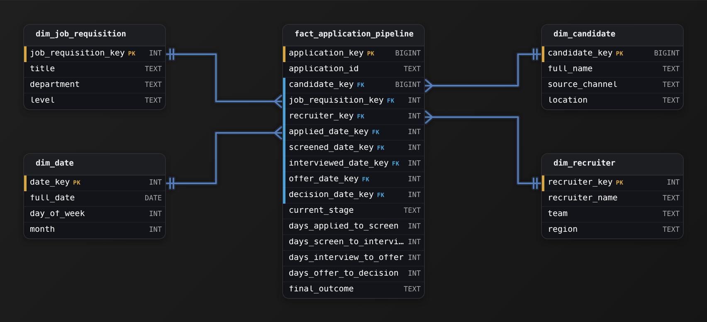

*One row per application; each milestone is a role-playing `dim_date` FK; the stage durations are the additive measures.*

| Key insight: The row is the application |
| --- |
| The whole point of an accumulating snapshot is that the row IS the application. `WHERE current_stage = 'interview'` answers "what is in the pipeline right now" with no aggregation, and a stage lag is a plain subtraction on the same row instead of a self-join across event rows. |

| Interviewer: Classify out loud, then declare the grain |
| --- |
| A strong candidate classifies out loud (event vs state, then milestones vs periodic), declares the grain as one row per application, and names which measures are additive without being asked. Fumbling any of those 3 reads as someone who has only loaded fact tables, never designed one. |

| Pitfall: One row per stage change |
| --- |
| Logging one row every time an application changes stage (a transaction fact) because "everything is an event" feels natural and is wrong here: every lag metric becomes a self-join, and finding an application's current state means scanning all of its rows. That milestone-per-row shape answers a different question than the one asked. |

| ✕ Accumulating snapshot (correct here) | ✓ One row per stage event |
| --- | --- |
| One row per application, milestone date FKs filled in over time, durations as measures.<br><br>* Current state is a single column read<br>* Stage lag is a subtraction on one row<br>* Row count equals application count | One row every time an application changes stage.<br><br>* Current state needs the latest row per application<br>* Stage lag needs a self-join across rows<br>* Row count balloons with pipeline activity |

**Follow-up questions**

1. The business now wants the count of applications sitting in each stage at the end of every week. Does that change your fact table?\
   *Tests whether they reach for a periodic snapshot for a point-in-time count, complementing the accumulating snapshot rather than replacing it.*
2. A candidate is rejected at one stage and re-enters later after a referral. How do you model that?\
   *Tests grain discipline: a genuine re-entry on the same row versus a separate application.*
3. Which of your measures would you refuse to SUM in a BI tool, and why?\
   *Tests additivity understanding beyond just naming it: milestone dates and current stage are not summable.*


<br>

---

## Transaction Fact Tables

A transaction fact table records 1 row per event at the grain of the event itself, written when the event occurs and never touched again. The grain is the finest the source can offer: an order line rather than an order, a payment attempt rather than a payment, a single inventory movement rather than a day of movements. Anything coarser can be derived by aggregation, but nothing finer can be recovered once it's thrown away.

Modeling at 1 row per order pushes the line items into an array or a second table, and the question 'units of product 48812 sold in March' now needs an unnest or a join on every run. Modeling at 1 row per order line makes the order a degenerate dimension and answers the product question with a filter. The cost is row count: an order averaging 3.2 lines becomes 3.2 rows, and order-level totals need a GROUP BY on `order_id`.

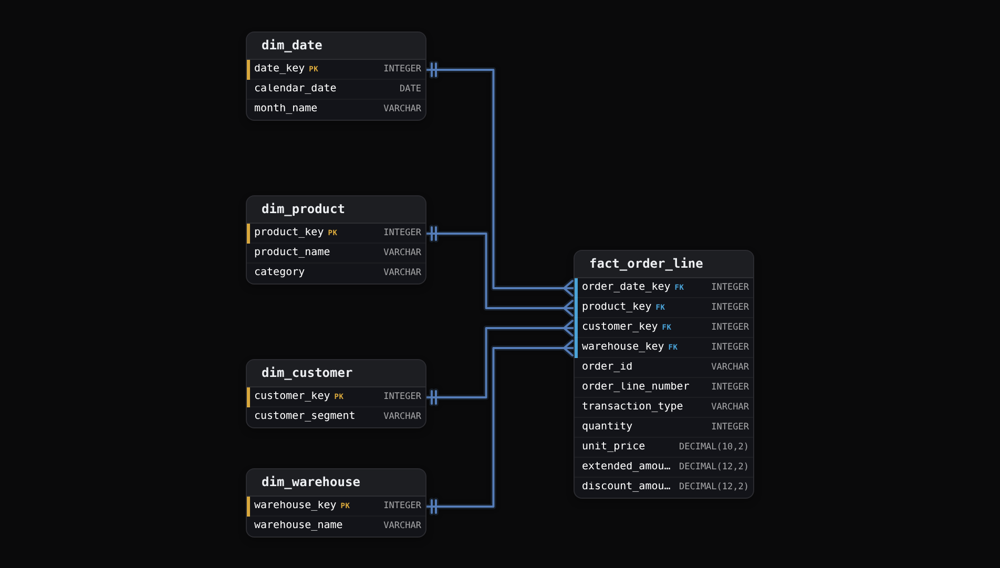

The table has 4 foreign keys, 1 degenerate dimension (`order_id` has no attributes of its own, so it lives on the fact row), and 4 measures. Of the measures, `quantity` and `extended_amount` are fully additive, and so is `discount_amount`: sum any of them across any slice of any dimension, time included, and the total means something. `unit_price` is non-additive. The 3 sale rows below sum to 288.98, which prices nothing. Keep it on the row for reference, and compute an average price as `SUM(extended_amount) / SUM(quantity)`, never as a SUM or AVG of `unit_price`.

| order_date_key | product_key | customer_key | order_id | line | transaction_type | quantity | unit_price | extended_amount |
| --- | --- | --- | --- | --- | --- | --- | --- | --- |
| 20260301 | 48812 | 7730041 | O-2291 | 1 | sale | 2 | 19.99 | 39.98 |
| 20260301 | 11207 | 7730041 | O-2291 | 2 | sale | 1 | 249.00 | 249.00 |
| 20260301 | 48812 | 9102 | O-2292 | 1 | sale | 6 | 19.99 | 119.94 |
| 20260302 | 48812 | 7730041 | O-2291 | 1 | cancel | -2 | 19.99 | -39.98 |

The last row is how an immutable table handles a cancellation: a reversing event with negative quantity, inserted on the day the cancellation happened, carrying a transaction type that distinguishes it from a sale. Rewriting the original row would erase the fact that 2 units were sold on March 1 and unsold on March 2, and it would silently change every aggregate that already counted the sale.


<br>

### Queries a transaction table makes cheap

```sql
SELECT
  d.calendar_date,
  p.product_name,
  SUM(f.quantity) AS units,
  SUM(f.extended_amount) AS revenue
FROM fact_order_line AS f
JOIN dim_date AS d
  ON f.order_date_key = d.date_key
JOIN dim_product AS p
  ON f.product_key = p.product_key
WHERE d.calendar_date BETWEEN DATE '2026-03-01'
AND DATE '2026-03-31'
GROUP BY d.calendar_date, p.product_name
```

*The date filter prunes partitions when the table is partitioned by order date, which it should be, because that is the column nearly every query filters on.*

Every additive question costs 1 scan of the partitions in the date range. The table is sparse in time, meaning a day with no sales of a product has no row for it, and dense in dimensions, meaning every row carries every foreign key. That sparsity is why the row count tracks events and nothing else.

- **12M** — order lines inserted a day
- **4.38B** — rows after one year
- **0** — rows ever updated in place


<br>

### Levels and lifecycles get expensive

Ask this table how many units of product 48812 were on hand at the end of March 3 and the answer is the sum of every movement for that product from the first day it was stocked. Across a year of history that is a scan of hundreds of partitions for 1 number, and the dashboard showing on-hand for all 200,000 SKUs runs that scan for each of them. Partition pruning does nothing, because the answer depends on every partition before the date asked about. The lifecycle question hurts in a different way: placed-to-shipped time needs the shipped event matched back to the placed event, a self-join on `order_id` filtered by transaction type, for every order, on every run.

✓Cheap on a transaction table

- Sum of any measure over any dimension, including time
- Counts of events inside a date window
- Filters on any attribute as it stood at event time
- Reprocessing a day, because rows are immutable and partitioned by event date

✗Expensive or impossible

- A balance or level at a point in time
- Elapsed time between 2 events of the same entity
- Anything about events that didn't happen
- The current stage of a long-running process


<br>

### The decisions an interviewer probes

Follow-ups you should expect

- Late-arriving events are inserted into the partition of their event date with the load date stored on the row, so a reprocessed day is complete and auditable.
- Idempotency comes from a natural key, order_id plus order_line_number plus transaction_type, deduplicated at load, so a replayed file adds no rows.
- Grain is set at the finest event the business can act on, because a coarser grain throws away the question nobody has asked yet.
- Ratios and balances do not belong here. Store numerator and denominator as additive measures and divide at query time.

Treat the transaction table as the source the other measured fact types are derived from, and say so in the interview: the periodic snapshot is this table rolled forward, and the accumulating snapshot is this table pivoted. The coverage table is the exception. Its rows record what was eligible, so it's loaded from its own source and joined against this table to expose what did not happen. For promotions that source is the promotion calendar; elsewhere it might be a schedule or an eligibility list. That framing turns 4 tables into 1 design: 1 source of events, 2 tables derived from it, and 1 independent denominator.


<br>

---

## Data Modeling

### Exercise 1 of 1

**● TASK**

A digital wallet product records every money movement on a user's balance: top-ups, purchases, refunds, and peer transfers. Design a fact table for this event stream where each transaction is one immutable row, use a signed amount (positive for inflows, negative for outflows) so totals by user, merchant, and day stay additive across dimensions, and model corrections as new events rather than updates to the original.


<br>

### Solution

#### What this problem is really testing

This is an append-only transaction fact wearing a fintech costume. The skill: model one immutable row per money-movement event, with a **signed, additive** amount, so any total by user, merchant, or day is a plain `SUM`. The trap arrives as the follow-up. The interviewer asks for each wallet's current balance, and a shaky candidate bolts a mutable `current_balance` column onto the fact and updates it on every transaction. Do that and you throw away the one property a transaction fact exists to guarantee: the row you wrote yesterday still says exactly what happened yesterday.

#### Break down the requirements

1. **Declare the grain**

   One row equals one discrete money-movement event: a single top-up, purchase, refund, or transfer. Not one row per wallet, not one row per day. Carry `transaction_id` as a degenerate dimension and `occurred_at` as the event timestamp so the stream is fully ordered.

2. **Make the measure signed and additive**

   Store one `signed_amount`: positive for top-ups and refunds, negative for purchases and outbound transfers. A single `SUM(signed_amount)` then works across every type and every dimension. Separate `debit_amount` / `credit_amount` columns force CASE logic on every query and quietly invite double counting.

3. **Keep it append-only**

   A refund, chargeback, or correction is a NEW row with its own `occurred_at` and its own signed amount, never an `UPDATE` to the original event. Immutability is what makes the ledger auditable and safe to reprocess from raw events.

4. **Wire the dimensions**

   Foreign keys to `dim_wallets`, `dim_users`, `dim_merchants`, `dim_transaction_type`, and `dim_date`. These are the exact axes the analysts asked to slice money flow by.

#### The reference model

One transaction fact surrounded by conformed dimensions. Every measure on `fact_wallet_transactions` is additive at the event grain, and nothing on the row is ever overwritten.

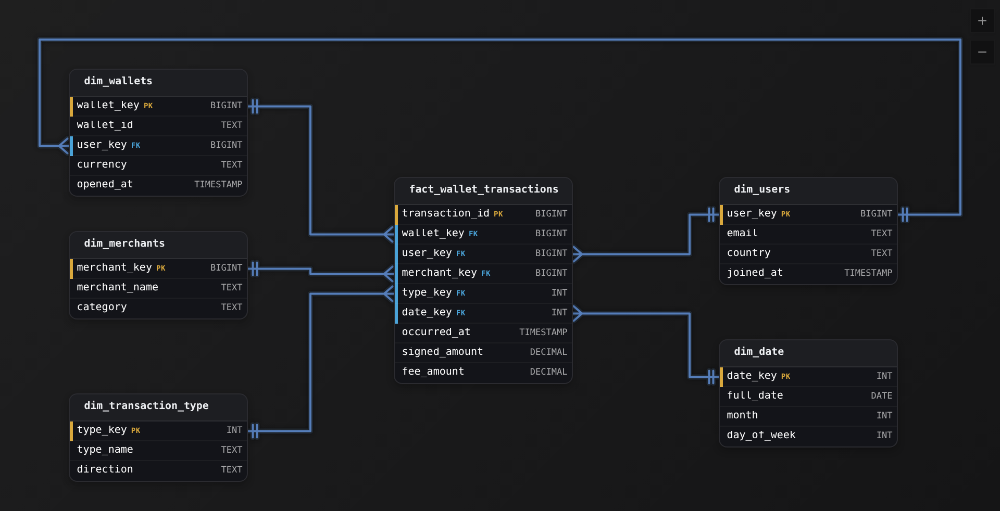

*`fact_wallet_transactions` is append-only at one-row-per-event grain; there is no stored balance column.*

| Trick: Balance is a query, not a column |
| --- |
| A wallet's balance at any moment is the running `SUM(signed_amount)` for that wallet ordered by `occurred_at`. Because it is derivable from the events, it never belongs on the fact row. Storing it there is the fast path to a number that silently disagrees with the events that produced it. |

| Interviewer: The current-state question is bait |
| --- |
| A strong candidate answers 'what is the current balance?' by aggregating the events, and notes that if state reads dominate traffic you later add a derived snapshot alongside the transaction fact. What they never do is mutate the event rows to hold state. |

| Pitfall: The mutable-balance trap |
| --- |
| Adding `current_balance` to the fact and updating it in place on every transaction. It turns an immutable event log into mutable state, so a failed reprocess or an out-of-order write corrupts a number you can no longer reconstruct, and the audit trail is gone. |

#### Trade-offs

| ✕ One signed measure | ✓ Separate debit/credit columns |
| --- | --- |
| `signed_amount` positive for inflow, negative for outflow.<br><br>* Totals are a plain `SUM` across every type and dimension<br>* Reversals are just another negative row<br>* Reads never branch on transaction type | `debit_amount` and `credit_amount` side by side.<br><br>* Every total needs `SUM(credit) - SUM(debit)`<br>* Easy to sum the wrong column and double count<br>* Type logic leaks into every downstream query |

**Follow-up questions**

1. The interviewer wants every wallet's balance as of the end of last month. How do you answer it with no stored balance?\
   *Tests deriving state as a running `SUM(signed_amount)` per wallet up to a cutoff, straight from the event fact.*
2. A purchase is reversed 3 days after it settled. Which rows change?\
   *Tests immutability: a new negative row is appended with its own `occurred_at`, and zero existing rows are updated or deleted.*
3. Balance reads are now 80 percent of traffic and the running sum is too slow at 40M events a day. What do you add?\
   *Tests knowing that a derived periodic snapshot complements the transaction fact for state reads rather than replacing it or mutating it.*


<br>

---

## Periodic Snapshot Tables

A periodic snapshot fact table writes 1 row per entity per period on a schedule, even for an entity nothing happened to. The grain reads 'one product per warehouse per day' or 'one account per month end', and the measures are levels: quantity on hand, balance, headcount, open ticket count. The table exists to turn the level question from a sum over history into a lookup of a single period.

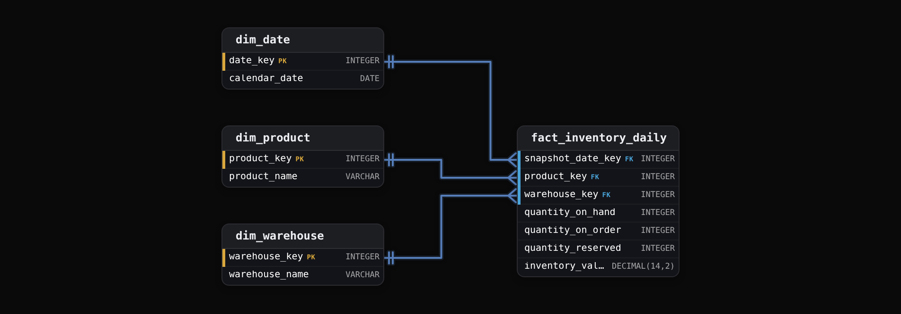

| snapshot_date_key | product_key | warehouse_key | quantity_on_hand | quantity_on_order | quantity_reserved | inventory_value |
| --- | --- | --- | --- | --- | --- | --- |
| 20260301 | 48812 | 7 | 348 | 500 | 12 | 6956.52 |
| 20260302 | 48812 | 7 | 340 | 500 | 12 | 6796.60 |
| 20260303 | 48812 | 7 | 340 | 500 | 10 | 6796.60 |
| 20260304 | 48812 | 7 | 840 | 0 | 10 | 16791.60 |

*A row exists for March 3 although no movement touched the SKU in warehouse 7 that day. That guaranteed row is what makes the level a lookup.*


<br>

### Semi-additive measures

`quantity_on_hand` sums correctly across products and across warehouses: the on-hand total for warehouse 7 is the sum over its SKUs. It does not sum across days. Adding the 4 rows above gives 1,868 units, a figure that describes nothing in the building. Across time you can take the last value or the average, or the minimum and maximum, and the interviewer will ask you to write whichever one finance wants.

```sql
WITH month_end AS (
  SELECT
    DATE_TRUNC('month', calendar_date) AS month_start,
    MAX(date_key) AS last_date_key
  FROM dim_date
  WHERE calendar_date BETWEEN DATE '2026-01-01'
  AND DATE '2026-03-31'
  GROUP BY DATE_TRUNC('month', calendar_date)
)

SELECT
  m.month_start,
  w.warehouse_name,
  SUM(f.inventory_value) AS month_end_value
FROM fact_inventory_daily AS f
JOIN month_end AS m
  ON f.snapshot_date_key = m.last_date_key
JOIN dim_warehouse AS w
  ON f.warehouse_key = w.warehouse_key
GROUP BY m.month_start, w.warehouse_name
```

The wrong version of this query filters the fact table to the quarter and sums `inventory_value` directly, which adds 90 days of levels together and reports an inventory 90 times too large. Candidates write it under time pressure. The fix is to constrain the date dimension to 1 period before any SUM touches a semi-additive column.


<br>

### Building the snapshot by rolling forward

The snapshot is derived from the transaction table 1 period at a time: yesterday's level plus today's net movement. Materializing that roll-forward nightly moves the cost of the level question from every query to 1 batch job.

```sql
SELECT
  20260304 AS snapshot_date_key,
  COALESCE(y.product_key, m.product_key) AS product_key,
  COALESCE(y.warehouse_key, m.warehouse_key) AS warehouse_key,
  COALESCE(y.quantity_on_hand, 0) + COALESCE(m.net_quantity, 0) AS quantity_on_hand
FROM (
  SELECT
    product_key,
    warehouse_key,
    quantity_on_hand
  FROM fact_inventory_daily
  WHERE snapshot_date_key = 20260303
) AS y
FULL OUTER JOIN (
  SELECT
    product_key,
    warehouse_key,
    SUM(quantity) AS net_quantity
  FROM fact_inventory_movement
  WHERE movement_date_key = 20260304
  GROUP BY product_key, warehouse_key
) AS m
  ON y.product_key = m.product_key
    AND y.warehouse_key = m.warehouse_key
```

A late-arriving movement dated March 2 that lands on March 5 makes every snapshot from March 2 onward wrong, so the job must detect late data and rebuild forward from the earliest affected day. And because each day is built from the previous one, a corrupt snapshot propagates. A full rebuild from the transaction table on a fixed cadence, monthly for instance, bounds how far an error can travel.


<br>

### Sizing the period

- **2.92B** — snapshot rows per year at daily grain
- **70B** — rows per year at hourly grain
- **96M** — rows per year at monthly grain

Row count is entities times periods, and it does not shrink on quiet days, so the period is the only size control you have. A retailer with 200,000 SKUs in 40 warehouses pays a fixed daily cost of 8 million rows regardless of sales volume. Hourly grain multiplies that by 24 for a question almost nobody asks. Monthly grain divides it by 30 and loses every intra-month stockout. The interview answer picks daily, states the row count, and names the consumer who would need something finer.

✓Reach for a snapshot when

- The question is a level at a point in time
- The level is the net of millions of events
- Dashboards read the level for every entity at once
- Finance or a regulator needs a reproducible period-end figure

✗Stay with transactions when

- Entities number in the hundreds of millions and the level is rarely read
- The period would have to be finer than the event rate
- The measure is already additive and events are sparse
- Levels are needed only for a handful of entities on demand

The future requirement that breaks a daily snapshot asks about the state between 2 snapshots. When operations starts asking what was on hand at 11am when the truck arrived, the daily table cannot say. A good answer offers a finer period for the few warehouses that need it, or the transaction table for that single question, and quotes the row-count cost of each.


<br>

---

## Data Modeling

### Exercise 1 of 1

**● TASK**

A grocery distributor's supply team keeps getting asked how many units of each product were sitting in each warehouse at the end of any given past day, and today the only way to answer is to replay the whole stream of receipts and shipments from the beginning. Design the fact table and its dimensions so that a single day's end-of-day on-hand quantities read straight off one day's rows, and set the grain so the level for a product at a warehouse is captured once per day.


<br>

### Solution

#### What you just built

This is the **periodic snapshot** pattern in a grocery costume. Receipts and shipments are a flow, but the supply team keeps asking for a level: units on the shelf at close of business. Reading a level off a flow means replaying every movement, so you store the level itself, once per day. The trap: on-hand quantity is semi-additive, add it across products and warehouses on one day, but `SUM` it across dates and you multiply the same standing stock by the day count.

The grain is the whole design: one row per product per warehouse per close of one calendar day. Each grain column is a foreign key into a conformed dimension (`dim_date`, `dim_product`, `dim_warehouse`), never free text on the fact. Carry the level forward on days a product did not move, so any past day reads off one day's rows.

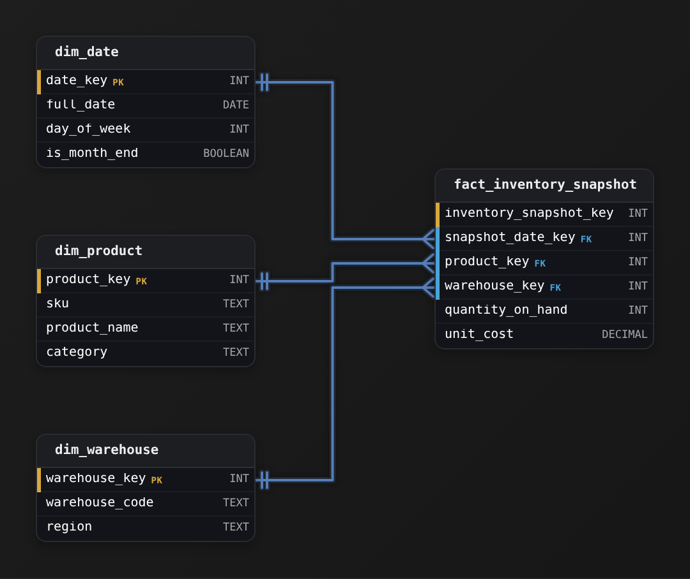

*Grain: one closing level per product per warehouse per day. The three keys on `fact_inventory_snapshot` are foreign keys into conformed dimensions; `inventory_snapshot_key` is the surrogate.*

| Key insight: State, not flow |
| --- |
| Ask any measure: does it HAPPEN (a shipment, a sale) or simply exist (a balance on hand)? A happening is a transaction fact you sum freely over time; a standing level is a snapshot you sum only within a single day. |

| Pitfall: Summed across dates, it's fiction |
| --- |
| `SUM(quantity_on_hand)` from Jan 1 to Mar 31 adds every day's standing stock, so a warehouse holding 10,000 units all quarter reports 900,000. For a range, pick one day or average the daily levels. |

**On-hand by warehouse as of a chosen day**

```sql
SELECT
    w.warehouse_code,
    SUM(f.quantity_on_hand) AS units_on_hand
FROM fact_inventory_snapshot f
JOIN dim_date d ON d.date_key = f.snapshot_date_key
JOIN dim_warehouse w ON w.warehouse_key = f.warehouse_key
WHERE d.full_date = DATE '2024-03-31'
GROUP BY w.warehouse_code
ORDER BY units_on_hand DESC
```

*One day's rows summed across products; the `SUM` is safe because it never crosses a date.*

| ✕ Periodic snapshot (this model) | ✓ Transaction/movement fact |
| --- | --- |
| One closing `quantity_on_hand` per product per warehouse per day. Point-in-time questions read one day's rows. Additive across products and warehouses within a day, never across dates. | One row per receipt or shipment with a signed `quantity_change`. Flow questions sum over the range, but on-hand as of a date needs scanning all history, wrong for a level. |

**Follow-up questions**

1. The buyer wants total units SHIPPED in March. Does this fact answer it?\
   *A flow question needs the movement fact, where the measure IS additive over time.*
2. Finance wants average inventory over the quarter, which aggregate is valid on `quantity_on_hand`?\
   *AVG across daily snapshots is valid for a semi-additive level; SUM is not.*


<br>

---

## Accumulating Snapshot Tables

An accumulating snapshot fact table holds 1 row per instance of a process that has a defined start and end and a known sequence of milestones between them. An order moves from placement to pick to pack to ship to delivery. A mortgage application moves from submitted to underwritten to approved to funded. A support ticket moves from opened to assigned to resolved. The row is inserted when the instance starts, and each milestone writes its date into a column that was NULL until that night.

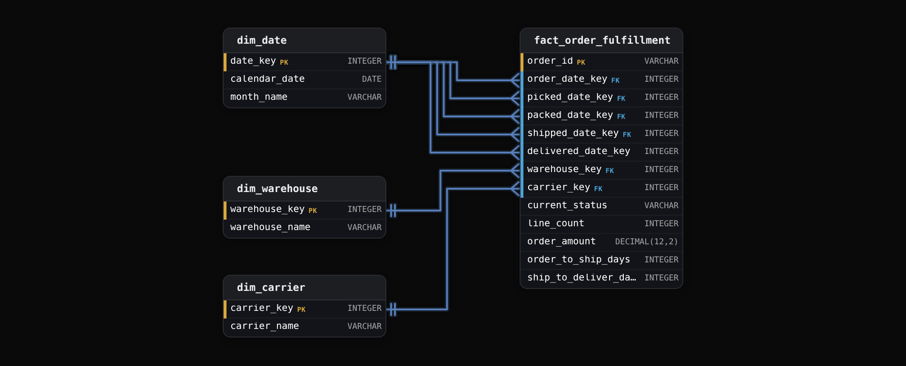

Five foreign keys point at the same date dimension, 1 per milestone. That is a role-playing dimension: 1 physical `dim_date` table joined under 5 aliases, so 'orders placed in March but delivered in April' is a filter on 2 of the 5 keys with no self-join anywhere.


<br>

### One row, rewritten as the order moves

| load night | order_id | order_date_key | picked_date_key | packed_date_key | shipped_date_key | delivered_date_key | order_to_ship_days | current_status |
| --- | --- | --- | --- | --- | --- | --- | --- | --- |
| Mar 1 | O-2291 | 20260301 | NULL | NULL | NULL | NULL | NULL | placed |
| Mar 2 | O-2291 | 20260301 | 20260302 | 20260302 | NULL | NULL | NULL | packed |
| Mar 4 | O-2291 | 20260301 | 20260302 | 20260302 | 20260303 | 20260304 | 2 | delivered |

*The row count never grows past 1 per order. The columns fill in, and the lag is written on the night the shipped date arrives.*

This is the only fact type whose rows change after they're written, and the change is the whole point. The lag between milestones becomes a column subtraction stored once at update time rather than a self-join of 5 event types computed on every query. The price is that every assumption the transaction table gave you about immutability is gone: the row keeps changing for days or weeks after its first insert.

Measure the difference. The transaction table of status events holds 5 rows per order. The placed-to-shipped question needs the shipped row matched to the placed row for each order, a self-join over 2 of 5 event types across the whole date range, and then the median of the result. The accumulating row already holds `order_to_ship_days`, and the median is 1 pass over 1 column. For a month of orders the self-join reads 5 times the rows and repeats the match work on every run. The accumulating table did that match once, on the night the order shipped.


<br>

### Queries the accumulating row makes cheap

```sql
SELECT
  w.warehouse_name,
  DATE_TRUNC('month', ds.calendar_date) AS ship_month,
  COUNT(*) AS orders_shipped,
  APPROX_PERCENTILE(f.order_to_ship_days, 0.5) AS median_days_to_ship,
  APPROX_PERCENTILE(
    DATE_DIFF('day', dp.calendar_date, ds.calendar_date),
    0.5
  ) AS median_pack_to_ship_days,
  SUM(
    CASE
      WHEN f.order_to_ship_days <= 2 THEN 1
      ELSE 0
    END
  ) * 1.0 / COUNT(*) AS pct_within_2_days
FROM fact_order_fulfillment AS f
JOIN dim_warehouse AS w
  ON f.warehouse_key = w.warehouse_key
JOIN dim_date AS ds
  ON f.shipped_date_key = ds.date_key
JOIN dim_date AS dp
  ON f.packed_date_key = dp.date_key
GROUP BY w.warehouse_name, DATE_TRUNC('month', ds.calendar_date)
```

Leadership's whiteboard question, how many orders are sitting unshipped right now, is also cheap. Open instances are rows where a milestone column is still NULL, and their age is the gap between today and the order date.

```sql
SELECT
  w.warehouse_name,
  f.current_status,
  COUNT(*) AS unshipped_orders,
  MAX(DATE_DIFF('day', d.calendar_date, CURRENT_DATE)) AS oldest_age_days
FROM fact_order_fulfillment AS f
JOIN dim_date AS d
  ON f.order_date_key = d.date_key
JOIN dim_warehouse AS w
  ON f.warehouse_key = w.warehouse_key
WHERE f.shipped_date_key IS NULL
GROUP BY w.warehouse_name, f.current_status
ORDER BY unshipped_orders DESC
```


<br>

### The cost of updating in place

On storage that rewrites whole files, an in-place update means rewriting the partition that holds the row. Partition by `order_date_key` and the rewrite set stays bounded: an order placed on March 1 is touched by nightly loads until it is delivered, and after a close-out window its partition is never rewritten again. If the typical order closes in 4 days and the slowest 1 percent close within 45, the nightly job rewrites 45 partitions and leaves the other 320 of the year untouched. Lag columns are stored rather than computed so that the rewrite does the subtraction once.

- **3.75M** — fulfillment rows added a day
- **1.37B** — process rows after one year


<br>

### Repeating milestones break it

The type assumes a fixed sequence of milestones, each occurring at most once. A ticket reopened 3 times has 3 resolved dates and 1 column. A shipment split into 2 parcels has 2 delivered dates. Each fix is a compromise: keep the first or latest date plus a `reopen_count` measure, add a column per repeat up to a cap, or push the repeating milestone back into a transaction table of status changes and keep the accumulating row for the single-occurrence milestones only. Name the compromise and its blind spot, and the interviewer hears judgement rather than a memorized pattern.

✓Do

- Partition by the start-date key so nightly rewrites touch only partitions holding open instances
- Store lag columns at update time: a subtraction done once beats one done on every query
- Keep a current_status column so open-item dashboards filter without testing 5 NULL columns
- Keep the transaction table of status events alongside it as the source of truth

✗Don't

- Use it for a process whose milestones can repeat or loop back, or that has optional branches
- Leave the close-out window open-ended, because unbounded rewrites eat the nightly budget
- Store only timestamps: a date key per milestone is what joins to each dim_date role
- Treat a row as an event: 1 row is 1 order, so COUNT(\*) counts orders, never line items


<br>

---

## Data Modeling

### Exercise 1 of 1

**● TASK**

A consumer-lending platform moves every loan application through the same checkpoints in order: submitted, documents verified, underwriting decision, and funds disbursed. The analytics team keeps getting asked how long applications sit at each stage and which ones have been approved but are not yet funded, broken down by loan product. Design the fact table and the dimensions it needs so analysts answer these without stitching separate events back together or subtracting dates by hand.


<br>

### Solution

#### Why this problem exists in real interviews

Beneath the lending story this is an **accumulating snapshot**, the one fact type where a row is born incomplete and updated as it grows up. The trap is modeling each checkpoint as its own event row, a transaction fact. Do that and 'which applications are approved but not funded' becomes a self-join across event rows, and every stage-duration number forces analysts to pair events and subtract dates by hand. The accumulating snapshot collapses the whole lifecycle into one updatable row with a date column per checkpoint, so the same questions are a `WHERE` clause and a plain `AVG`.

| Trick: One row that fills in over time |
| --- |
| The moment you hear 'the same fixed set of milestones, in order, and we want to know where things sit and how long each stage takes,' reach for `fact_loan_application_lifecycle` at one row per application. Give each milestone its own `*_date_sk`, let `NULL` mean 'not there yet,' and precompute the gaps. |

#### Break down the requirements

1. **Declare the grain: one application, not one event**

   The lifecycle instance is the loan application, so `fact_loan_application_lifecycle` holds exactly one row per application. Every dimension (`dim_applicant`, `dim_loan_product`, `dim_loan_officer`) attaches at that grain. This is the choice that separates candidates: pick per-event and everything downstream becomes a self-join.

2. **Give each milestone its own date key**

   `submitted_date_sk`, `verified_date_sk`, `decisioned_date_sk`, `funded_date_sk` all live on the one row and all point at the same `dim_date`. A `NULL` means the checkpoint has not been reached, so 'approved but not funded' is `decisioned_date_sk IS NOT NULL AND funded_date_sk IS NULL`.

3. **Precompute the lags and denormalize the status**

   Store `days_to_verify`, `days_to_decision`, and `days_to_fund` so 'average time to decision per product' is `AVG(days_to_decision)` with no date math. Add a `current_status` column ('`in_review`', 'approved', 'funded', 'denied', 'withdrawn') so dashboards filter state without decoding which date columns are populated.

4. **Accept that rows are updated in place**

   The row is inserted at submission with only `submitted_date_sk` set, then UPDATEd as each later checkpoint lands, backfilling its date and the corresponding lag. This is the only fact type where in-place UPDATE is the correct pattern, and saying so out loud is the tell an interviewer listens for.

#### The reference model

Below is one sound design. The anchor is that `fact_loan_application_lifecycle` is a single wide, updatable row per application, with a date key per milestone and precomputed lags, hanging off conformed dimensions.

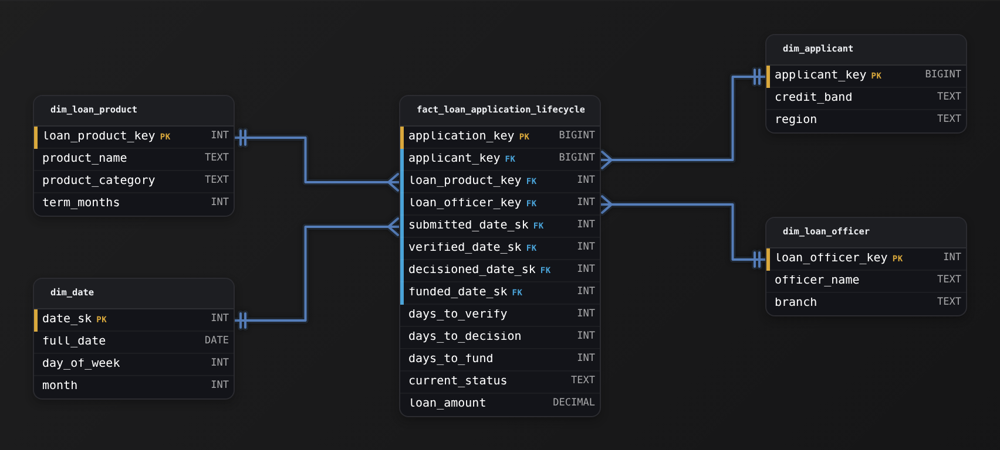

*One row per application; each milestone key points at the shared `dim_date`, and NULL means not yet reached.*

| Performance: The pipeline query stays a single scan |
| --- |
| At 40,000 applications a month the fact table stays small because the row count is applications, not events. 'Approved but not funded' is one indexed predicate on `decisioned_date_sk` and `funded_date_sk`; 'average days to decision by product' is one `GROUP BY` on `loan_product_key`. No self-join, no window function, no per-row date arithmetic. |

| Interviewer: Say the row gets updated |
| --- |
| A strong candidate names the grain first, then volunteers that this is the one fact type that is UPDATEd in place and that `NULL` milestone dates encode progress. Naming those 2 things unprompted is what signals they have actually built one, not just read about it. |

| Pitfall: Do not model milestones as event rows |
| --- |
| The common miss is four rows per application, one per checkpoint, treating this like a transaction fact. Then every stage-duration metric needs a self-join to pair the 'submitted' row with the 'funded' row, and 'stuck at underwriting' needs an anti-join. The second miss is a single mutable `status_date` column that overwrites history: you lose the per-milestone timestamps the lags depend on. |

#### Trade-offs and alternatives

| ✕ Accumulating snapshot | ✓ Transaction fact per milestone |
| --- | --- |
| One updatable row per application with a `*_date_sk` per milestone and precomputed lags.<br><br>* 'Approved but not funded' is one predicate<br>* Stage durations are direct aggregations<br>* Requires in-place UPDATE as milestones land | One immutable row per checkpoint event.<br><br>* Clean append-only load<br>* Preserves a raw event log<br>* Every lag and 'stuck at stage X' becomes a self-join or anti-join, and current state must be reconstructed per query |

**Follow-up questions**

1. The business adds an appraisal checkpoint between verification and decision. How does the model change?\
   *Tests whether the candidate adds one `appraised_date_sk` plus its lag to the same row, and understands schema evolution on a fixed-milestone snapshot.*
2. An applicant can reopen a withdrawn application months later. How do you keep both attempts?\
   *Tests whether the candidate keeps the grain honest by treating a reopen as a new application row rather than resurrecting and overwriting the old one.*
3. Leadership wants a daily count of how many applications sat in each stage, historically, not just today. Does this table answer it?\
   *Tests the boundary between an accumulating snapshot (current state) and a periodic snapshot needed for a day-by-day historical stage census.*


<br>

---

## Factless Facts and Coverage Tables

A factless fact table has foreign keys and no numeric measure. The row itself is the fact: this student attended this class on this date, this product was on promotion in this store on this day, this job posting was visible to this candidate. There are 2 flavors, and they serve different questions. An event factless table records something that happened but carries nothing to measure. A coverage table records something that was possible, so that you can find what didn't happen.

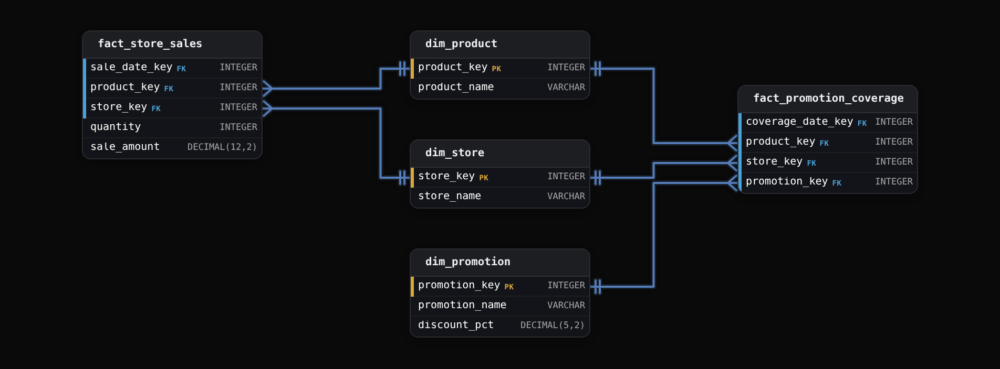


<br>

### The question only coverage can answer

Which promoted products sold nothing on a day they were promoted? The sales fact has no rows for products that did not sell, so no filter on it can produce the list. The coverage table supplies the denominator: every product on promotion, in every store, on every day the promotion ran, written on the day the condition held. Absence becomes a LEFT JOIN followed by a NULL test.

```sql
SELECT
  c.coverage_date_key,
  s.store_name,
  p.product_name
FROM fact_promotion_coverage AS c
JOIN dim_store AS s
  ON c.store_key = s.store_key
JOIN dim_product AS p
  ON c.product_key = p.product_key
LEFT JOIN fact_store_sales AS f
  ON f.sale_date_key = c.coverage_date_key
    AND f.store_key = c.store_key
    AND f.product_key = c.product_key
WHERE c.coverage_date_key BETWEEN 20260301 AND 20260307
  AND f.product_key IS NULL
```

The same shape answers every absence question: customers eligible for an offer who did not redeem, employees scheduled who didn't clock in, pages served that received no click. In each case the coverage table holds what was true, the transaction table holds what happened, and the gap between them is the business question. The coverage table must sit at exactly the grain of the transaction table it joins against. Coverage at product-by-store-by-day joined to sales rolled up to product-by-store-by-week matches each weekly sales row to 7 coverage rows and reports 7 times the sales. Reverse the mismatch and the coverage side fans out: a weekly coverage row matches up to 7 daily sales rows, so counts of promoted combinations run up to 7 times too high and a day with no sale never surfaces as a NULL.


<br>

### Why a promotion flag on the product fails

The tempting shortcut is an `on_promotion` flag on `dim_product`. It fails on 2 axes at once: a promotion applies in some stores and not others, and it runs between a start date and an end date. Tracking that as a slowly changing attribute means a new product version for every store and date combination, which turns a 200,000-row dimension into millions of versions and still cannot say which store. The coverage table places the condition at the grain it varies on: product by store by day.

> Phrases that always mean coverage
>
> - Which of the eligible ones did not: redeem, sell, attend, respond, convert
> - What share of what we offered was taken up, where the offer is the denominator
> - Show me every combination that was live, including the ones with zero activity


<br>

### Sizing

Coverage rows scale with eligible combinations, and the combinations are dense in the way a snapshot is. A week-long promotion on 5,000 products across 2,000 stores is 70 million rows for 1 promotion. Running promotions every day of the year puts the table in the same size class as the daily inventory snapshot, which is the number to say out loud, because the interviewer wants to hear that you've seen the denominator cost more than the numerator.

- **3.65B** — coverage rows a year with daily promos
- **0** — numeric measures per row


<br>

### The attendance flavor

Event factless tables are the other flavor: `fact_class_attendance` with `student_key`, `class_key`, `date_key` and nothing else. The question is a count: how many students attended, what share of registered students attended, which classes fell under 50 percent attendance. COUNT(\*) is the measure. Some teams add a column named `attended` holding the constant 1 so that SUM works in every reporting tool. It costs 1 byte per row and spares the analyst a special case. The pair of tables, registration coverage and attendance events, has the same shape as promotion coverage and sales.

✓Event factless

- A row says something happened
- Written when the event occurs
- The measure is COUNT(\*)
- Sparse, like a transaction table
- Attendance, logins, impressions

✗Coverage

- A row says something was possible
- Written for every period the condition holds
- The measure is the join to what happened
- Dense, like a periodic snapshot
- Promotions, eligibility, schedules


<br>

### Putting the 4 together

The whiteboard question now has a complete answer with named parts. Daily revenue by product comes from the transaction table at order-line grain. Pack-to-ship time by warehouse comes from the accumulating snapshot, 1 row per order with a date key per milestone. Orders stuck unshipped is a NULL test on that same accumulating row. The moment someone asks which listed products were never ordered, that's a coverage table of listings joined against order lines. So 2 tables serve the 3 consumers, with the transaction table underneath feeding the accumulating snapshot, and a third table is ready for the absence question that always arrives.

> **TIP**
>
> When you present the design, give each table its grain sentence and its row-count formula with a number attached. Then say how it is written and which 1 question it cannot answer.


<br>

---

## Data Modeling

### Exercise 1 of 1

**● TASK**

A video-streaming service licenses each title for specific regions, and those licensing windows shift day to day as deals start and expire. The catalog team needs a model that captures which titles were available to stream in which regions on each day, and that can surface the titles a region was paying to license but that nobody streamed. Design the schema. The availability table should contain only the three foreign keys (title_id, region_id, date_id) as a composite primary key, with no measure or flag columns.


<br>

### Solution

#### Why this problem exists in real interviews

This is a **factless coverage fact** wearing a licensing-analytics costume. The question everyone gets wrong is the one that isn't asked out loud: what is the measure? There isn't one. A title being streamable in a region on a day is a relationship that existed, not a number that was produced. Candidates who assume every fact table holds numbers reach for a play count on the availability row, and the moment they do, they can no longer answer the question the catalog team actually cares about: which licensed titles got zero plays. You cannot count rows that were never written.

| Trick: The row's existence is the fact |
| --- |
| The tell is 'which titles were available in which regions on which days' with no quantity attached. That is a factless fact: grain `(title_sk, region_sk, date_sk)`, zero measure columns. Coverage is `COUNT(*)`. To find what did NOT happen, anti-join this coverage fact against the actual `fact_title_play` events. |

#### Break down the requirements

1. **Name the grain, then look for the measure**

   One row per title, per region, per day of availability. Now ask what number lives on that row. Nothing does: the row asserts eligibility to stream, not an event with a magnitude. That absence is the signal, not a mistake to fix.

2. **Model `fact_title_availability` with keys only**

   It holds `title_sk`, `region_sk`, and `date_sk`, and those three together are the primary key. No `play_count`, no `is_available` flag: a flag on a coverage fact is redundant, because the row would not exist if the title were dark.

3. **Keep actual plays in their own fact**

   Real streams are transactional events, so `fact_title_play` records them at `(title_sk, region_sk, date_sk)` too. 2 facts, one asserting what COULD happen and one recording what DID. The gap between them is the whole point of the design.

#### The reference model

2 facts share the same conformed dimensions. `fact_title_availability` is the coverage table (factless); `fact_title_play` is the event table. Because both are keyed on the same three surrogate keys, the anti-join that finds wasted licensing spend is a clean join, not a fuzzy match.

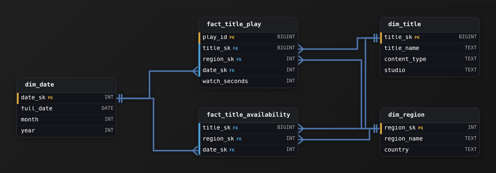

*`fact_title_availability` carries no measures; its composite key of `title_sk`, `region_sk` and `date_sk` IS the record.*

| Key insight: 2 facts, one asks CAN, one asks DID |
| --- |
| `fact_title_availability` answers what was possible; `fact_title_play` answers what occurred. Blending them into one table with a nullable `watch_seconds` looks tidier but destroys the coverage semantics: a null play does not prove the title was licensed that day. |

| Interviewer: Saying the word factless unprompted |
| --- |
| Strong candidates state 'this is a factless fact, the count of rows is the metric' before drawing anything, and they immediately explain what the coverage table is FOR: gap analysis. That framing is the seniority tell here. |

| Pitfall: A play count on the coverage row cannot find zeros |
| --- |
| Putting `play_count` on `fact_title_availability` and deriving coverage from `SUM` feels natural and is a trap. To find titles that were licensed but never streamed, you need rows that exist for availability and are absent for plays. A single blended fact with a zero count only exists if someone thought to write the zero, which nobody does. |

#### The power query: what did NOT happen

**Licensed but never streamed**

```sql
SELECT a.title_sk, a.region_sk, a.date_sk
FROM fact_title_availability a
LEFT JOIN fact_title_play p
  ON p.title_sk = a.title_sk
 AND p.region_sk = a.region_sk
 AND p.date_sk  = a.date_sk
WHERE p.play_id IS NULL
```

*The unmatched coverage rows are the wasted licensing spend: available, but zero plays.*

| ✕ Factless coverage fact | ✓ Blended fact with a measure |
| --- | --- |
| `fact_title_availability` holds only `(title_sk, region_sk, date_sk)`.<br><br>* Coverage is `COUNT(*)`<br>* 'Never streamed' is a clean anti-join<br>* No zero rows to fabricate | One table with `watch_seconds` nullable.<br><br>* A missing stream is indistinguishable from a missing license<br>* Gap analysis needs rows that were never inserted<br>* Coverage becomes a fragile `COUNT(DISTINCT ...)` over event data |

**Follow-up questions**

1. The team now wants total watch time per available title-region. Does that change your factless fact?\
   *Tests whether the candidate keeps the coverage fact factless and adds the measure to `fact_title_play`, rather than corrupting the coverage grain.*
2. Licensing windows are contiguous ranges, sometimes months long. Would you still write one row per day?\
   *Tests the daily-grain versus range-row tradeoff: daily rows keep the date anti-join trivial but explode volume; a range fact is compact but complicates coverage counting.*
3. How would you answer 'which titles were available in every region for the whole month'?\
   *Tests reasoning over the factless fact with COUNT and completeness checks against `dim_region` and `dim_date`.*


<br>

---

## Putting It All Together

A food delivery company asks you to model the order side of its business. Every tap, order line, courier assignment and payment is an event. Finance closes the month on gross order value by city. Operations tracks the time from order placed to restaurant accepted to courier pickup to doorstep, and wants a live list of orders past 45 minutes with no pickup. Marketing runs restaurant-level promotions in some zones and wants to know which promoted restaurants received zero orders during the promotion. Supply planning wants, for every zone and hour, how many couriers were online whether or not they took an order.

- Order lines and payments are a transaction fact at 1 row per order line, written at placement, with refunds as reversing rows, and finance's monthly close is a GROUP BY over it.
- The placed-accepted-pickup-doorstep lifecycle is an accumulating snapshot at 1 row per order, partitioned by order date and rewritten only inside a 1-day close-out window. Each of its 4 milestones carries a timestamp alongside its date key, and the 45-minute list filters on placed timestamps older than 45 minutes where the pickup timestamp is NULL.
- Promoted restaurants with zero orders need a coverage table at restaurant by zone by day, LEFT JOINed to the order transaction table at the same grain, with the NULL side as the answer.
- Couriers online per zone per hour is a periodic snapshot at hourly grain, because headcount is a level, it does not sum across hours, and a row must exist for zones where nobody ordered.
- The order transaction table feeds the accumulating lifecycle table, the courier snapshot is built from courier online and offline events, and the promotion coverage table is loaded from the promotion schedule. A complete design names those 3 sources and states that an hourly courier snapshot across 400 zones is 3.5 million rows a year, while the order lifecycle table is bounded by orders rather than events.


<br>

---

## Data Modeling

### Exercise 1 of 2

**● TASK**

A hotel group's warehouse tracks four reporting needs, each requiring a different fact table shape: Finance needs every folio charge and payment linked to a reservation with signed amounts; Revenue needs nightly snapshot counts (total, sold, unsold) per property and type; Operations needs each reservation with date keys for booking, check-in, check-out, and settlement, plus calculated inter-milestone days; Marketing needs rate-plan offerings (which rates per room type per night) with no measures. Design the fact tables and conformed dimensions.


<br>

### Solution

#### What this problem is really testing

Four business questions, one hotel, and the whole test is whether you can hear the fact table TYPE inside each request. The trap is treating them as four flavours of the same wide table, or worse, picking a type that quietly breaks the math: model the nightly unsold-rooms count as a transaction fact and someone will `SUM(rooms_available)` across March to get a number 30 times too big, and nobody will notice until revenue management builds a forecast on it. The skill being probed is fast, correct classification: event, level, lifecycle, or coverage.

| Trick: Classify each request before you draw anything |
| --- |
| Each of the four needs maps to one canonical shape. Folio charges are discrete events, so a transaction fact. Unsold rooms is a level captured at a cadence, so a periodic snapshot. A reservation crawling through ordered milestones is an accumulating snapshot. A rate plan that was merely on offer is a factless coverage table. Name the four before you touch a column. |

#### Walk the four decisions

1. **Folio: one row per posted event, linked to the reservation**

   Finance wants the single spa charge and the single card settlement, so the grain is one row per line, inserted and never updated. Keep `amount` signed (payments and refunds negative) and it stays fully additive: a stay total, a daily total, and a property total are all just `SUM(amount)`. Add a `reservation_key` foreign key so Finance can answer 'what did this stay cost?' and 'which guest incurred this charge?'

2. **Inventory: one row per property, room type, night**

   Revenue management asks a level question: how many rooms stood unsold at close of night. That is a periodic snapshot. Store `rooms_total`, `rooms_sold`, `rooms_available` per hotel per room type per night. The `rooms_available` measure is semi-additive: sum it across properties on one night, never across nights.

3. **Reservation: one row, updated as milestones arrive, with a date key per milestone**

   Operations wants the whole journey and the lag between legs. That is an accumulating snapshot: one row per reservation, a separate date foreign key for each milestone (`booked_date_key`, `checkin_date_key`, `checkout_date_key`, `invoice_settled_date_key`), and pre-computed lags like `booking_to_checkin_days`. The row is revisited as milestones land; a cancelled reservation simply leaves later milestones empty. The per-milestone date keys are what make the lags queryable and the lifecycle trackable.

4. **Rate availability: record the offer, not a number**

   Marketing wants rate plans that were bookable but never booked. There is nothing to measure, only a relationship that existed. That is a factless fact: one row per date, hotel, room type, and rate plan offered. Carry only the foreign keys, no numeric column. Zero-booking rates fall out of a left join from this table to the reservations that reference the same rate plan.

#### The reference model

Four facts, 5 conformed dimensions. Every fact points at the same `dim_date`, `dim_hotel`, and `dim_room_type`, so the same slicing works everywhere. The shapes differ on purpose: `fact_folio_transactions` grows by insert and links to `fact_reservation_lifecycle` via `reservation_key`, `fact_room_inventory_snapshot` grows one batch per night, `fact_reservation_lifecycle` is updated in place, and `fact_rate_availability` carries no measure at all.

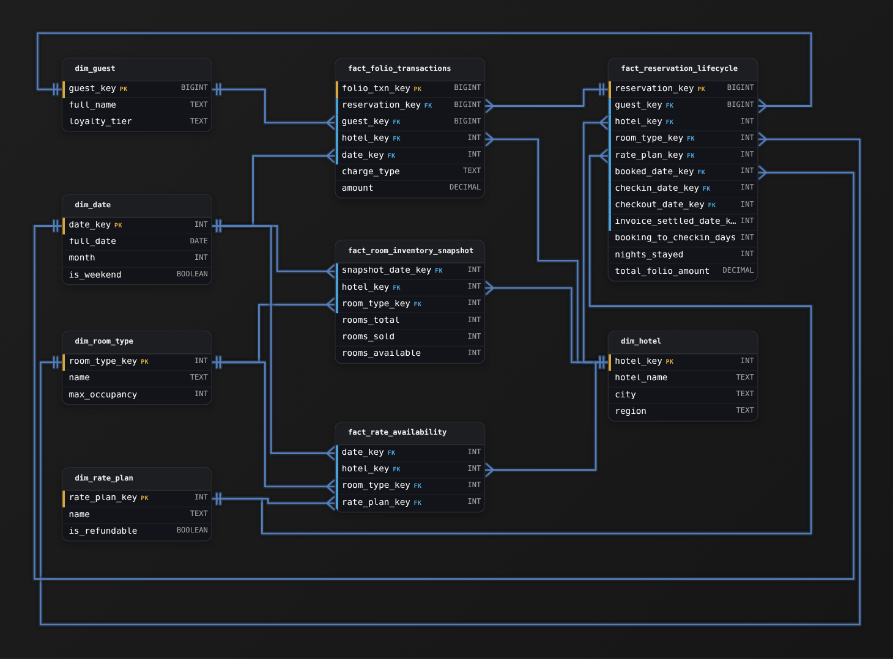

*`fact_folio_transactions` links to `fact_reservation_lifecycle` via `reservation_key` (BIGINT); `fact_room_inventory_snapshot` has a composite grain of (`snapshot_date_key`, `hotel_key`, `room_type_key`); `fact_rate_availability` is factless with a composite key over all four foreign keys and no numeric columns.*

| Interviewer: The strongest candidates name the semi-additive trap unprompted |
| --- |
| A senior answer says out loud that `rooms_available` sums across properties on a night but never across nights, and that a period-over-period view uses an average or a period-end pick, not a `SUM`. Saying it before being asked is the single clearest seniority tell on this problem. |

| Pitfall: One wide events table for all four |
| --- |
| The most common failure is folding every request into a single fact keyed by event time. Reservation lifecycle needs an in-place update the insert-only design cannot express, the inventory level becomes wrongly additive, and the offered-but-unbooked rate has no event to hang on at all. Four shapes exist because one shape cannot answer all four questions correctly. |

| ✕ Accumulating snapshot for reservations | ✓ Transaction fact of milestone events |
| --- | --- |
| One row per reservation, updated as milestones land. Lags like `booking_to_checkin_days` are a single subtraction, and `WHERE checkin_date_key IS NULL` finds no-shows instantly. | One row per milestone reached. Correct, but every lag becomes a self-join across rows of the same reservation, and pipeline funnel counts need conditional aggregation. Slower to query and easier to get wrong. |

**Follow-up questions**

1. Revenue management wants average nightly occupancy per property for a quarter. Why can't that be `SUM(rooms_sold)` over the quarter, and what do you write instead?\
   *Tests whether the candidate truly internalised semi-additivity: the level must be averaged across time or picked at period end, never summed.*
2. A reservation is cancelled after check-in but before check-out. How does that look in `fact_reservation_lifecycle`?\
   *Tests handling of partial and non-linear lifecycles in an accumulating snapshot (empty later milestones, and whether cancellation needs its own milestone or status).*
3. Marketing wants, per room type, the count of rate plans offered in a month that produced zero bookings. Which tables do you touch?\
   *Tests use of the factless coverage table as the left side of an anti-join against reservations on the conformed rate-plan and room-type keys.*
4. The inventory snapshot is now hundreds of millions of rows a year. How do you keep the nightly-level queries cheap?\
   *Tests scale reasoning: partitioning the snapshot by date and pruning on `snapshot_date_key`, and whether a rolling window needs a coarser monthly grain.*


<br>

### Exercise 2 of 2

**● TASK**

A property insurer's claims director needs cycle-time reporting on every claim as it moves through a fixed lifecycle: submitted, then adjudicated, then paid. Design the analytical model that stores the days between each milestone pair (submit to adjudicate, adjudicate to pay, and submit to pay) as measures on each claim row and enables listing the claims currently sitting between two milestones with no further movement. Every claim reaches the milestones in that order, and the model must reflect a claim's progress even before it is fully paid.


<br>

### Solution

#### What this problem really is

Strip the insurance costume and this is a lifecycle-tracking model: one business object (`a claim`) that passes through a fixed, ordered set of milestones, and reporting that lives on the gaps between those milestones. This is the **accumulating snapshot** shape, and the interview separation is entirely in the grain. Reach for one row per milestone event and cycle time becomes a self-join every time someone opens the dashboard. Reach for one row per claim per day and you multiply two thousand claims a month by their age in days for numbers that never change. The right answer is one row per claim that you keep updating as the claim moves.

| Trick: One row that grows up |
| --- |
| The whole trick: the row is born when the claim is `submitted`, with `adjudicated_date` and `paid_date` still null, and you UPDATE those columns in place as each milestone arrives. The claim's entire life is one row. That is what makes cycle time a subtraction and 'stuck between milestones' a null check. |

#### Break down the requirements

1. **Declare the grain: one row per claim**

   Say it out loud before drawing anything: the grain of `fact_claim_lifecycle` is one row per claim, the lifecycle instance. Not one row per milestone (that is a transaction fact) and not one row per claim per period (that is a periodic snapshot). Everything below only works because the grain is the claim.

2. **Give every milestone its own date column**

   `submitted_date_key`, `adjudicated_date_key`, and `paid_date_key` all sit on the same row, each a foreign key into `dim_date`. The later two are nullable and start empty. As the claim advances you fill them in with an UPDATE. A claim adjudicated but not paid has `adjudicated_date_key` populated and `paid_date_key` null, which is exactly the 'stuck' filter the director wants.

3. **Store the durations as measures**

   The headline metric is time between milestones, read all day. Pre-compute `days_submit_to_adjudicate`, `days_adjudicate_to_pay`, and `days_submit_to_pay` as columns on the row, filled in when the closing milestone lands. Now the dashboard averages a stored number instead of self-joining a heap of event rows to reconstruct each duration.

4. **Attach the conformed dimensions**

   Hang the claim on `dim_policyholders`, `dim_adjusters`, and `dim_claim_type`, and point all three milestone date keys at a shared `dim_date`. Reusing one date dimension for all three milestones is what lets you slice cycle time by submission month, adjudication quarter, or payment week from the same row.

#### The reference model

One accumulating-snapshot fact at claim grain, three date foreign keys into a shared calendar, the pre-computed lag measures, and the conformed dimensions around it. The row is created at submission and updated twice more over the claim's life.

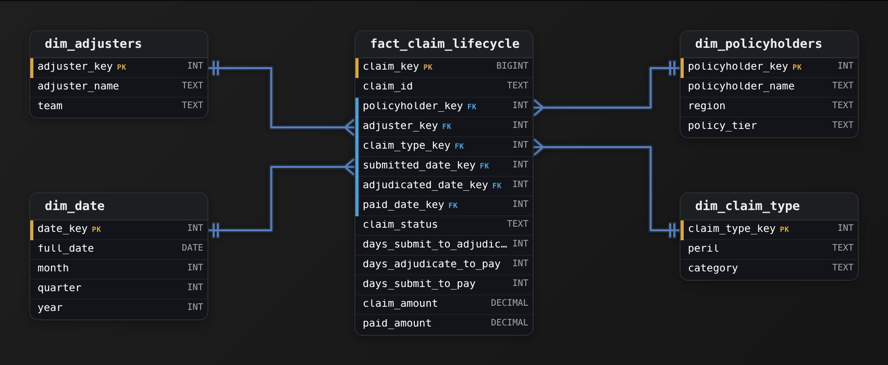

*`fact_claim_lifecycle` is one row per claim; `adjudicated_date_key` and `paid_date_key` are null until reached, and the days_* measures fill in as milestones close.*

| Interviewer: Grain named before tables drawn |
| --- |
| A strong candidate says 'one row per claim, updated in place' inside the first 30 seconds and then explains why the milestone dates are nullable. Watch for whether they volunteer that `days_*` durations are non-additive across claims: you average them, you never SUM them across the fact. |

| Pitfall: The event-row grain that looks right |
| --- |
| The common miss is one row per milestone event (`claim_id`, `milestone`, `event_date`). It inserts cleanly and feels like a tidy transaction fact, but every cycle-time number now needs a self-join to pair a claim's submit row with its adjudicate row, and 'stuck between milestones' becomes a NOT EXISTS. At dashboard read rates that is the wrong grain. |

| Performance: Small table, cheap reads |
| --- |
| One row per claim means the fact stays tiny (roughly the count of claims ever filed), and cycle time is a stored subtraction rather than an aggregation. Updates touch a single row when a milestone lands. Contrast the periodic-snapshot alternative, which would append a row per open claim every day and balloon for numbers that do not change until the next milestone. |

#### Why not the other fact shapes

| ✕ Transaction fact (one row per milestone) | ✓ Accumulating snapshot (one row per claim) |
| --- | --- |
| Insert-only, never updated. Great for counting events. But cycle time forces you to pivot a claim's `submitted` and `adjudicated` rows back together with a self-join, and listing claims stuck mid-lifecycle means proving a row's absence. Wrong tool for gap reporting. | Row created at `submitted`, UPDATEd at `adjudicated` and `paid`. Cycle time is `paid_date_key` minus `submitted_date_key`, precomputed. Stuck claims are `adjudicated_date_key IS NOT NULL AND paid_date_key IS NULL`. The lifecycle question and the model shape line up exactly. |

**Follow-up questions**

1. A claim can be denied at adjudication and never paid. How does the model represent that without looking like missing data?\
   *Tests whether they use `claim_status` plus a permanently-null `paid_date_key` as a valid end state rather than an incomplete row.*
2. The director now wants the average time in each milestone by submission month. Why can't you SUM the days_* columns to get there?\
   *Tests additivity awareness: durations are non-additive across claims and must be averaged.*
3. Compliance adds a fourth checkpoint, 'reviewed', between submitted and adjudicated. What changes in the model?\
   *Tests whether they extend the same row with another date key and lag measure rather than reaching for a new fact table.*
4. How would you also answer 'how many claims were open on the last day of each month'?\
   *Tests whether they recognize that count-open-over-time is a periodic-snapshot question that complements, not replaces, the accumulating snapshot.*


<br>

---

## Key Takeaways

- Fact table type is the product of 2 decisions: what 1 row means, and whether that row is rewritten as a process advances or only inserted, once or every period.
- Transaction tables are the source of truth: 1 row per event, immutable, fully additive, with rows that scale with event volume and a level question that costs a scan of all history.
- Periodic snapshots make the level question a lookup at the price of entities times periods rows per year, and their level measures never sum across time.
- Accumulating snapshots hold 1 row per process instance, rewritten as milestones arrive, so lags are a stored subtraction and stuck items are a NULL test, bounded by a close-out window on the start-date partition.
- Coverage tables supply the denominator for absence questions, sit at exactly the grain of the transaction table they join, and cost as many rows as a snapshot.
- A complete answer pairs tables and gives each one a grain and a row count, along with the future requirement it can't meet.
