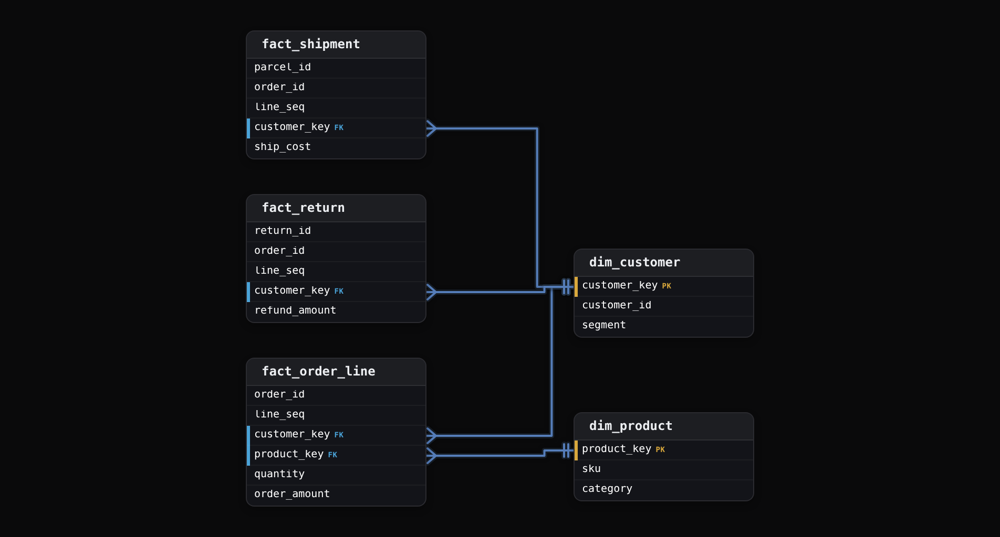
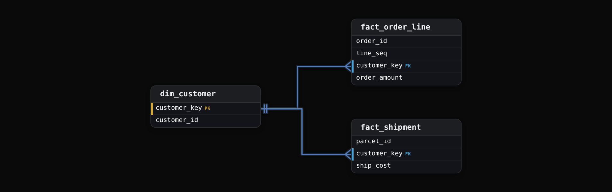

Advanced·Data Modeling · 25 min · 4 challenges

# Grain and Fan Traps: Advanced

You are 25 minutes into a modelling round at an e-commerce company. The interviewer has fact_order_line and fact_shipment on the board, both hanging off dim_customer.
"Finance ran shipping cost against revenue by customer last quarter, and shipping came out 3 times what the carrier invoiced. The query looks fine to them. Tell me what happened, then tell me what these tables should have promised."
He caps the marker. Nothing on the board says how many parcels an order ships in, and the query itself is nowhere on it. Most candidates ask to see the SQL, but the ratio already tells you what the join did and what it says about each table's grain.
What he is scoring is whether you reason from each table's grain to the shape of the error, and whether you then say what the model should guarantee so the same report cannot break again.


<br>

### What you will be able to do

Recognize a grain question whether it arrives as a design request, a wrong number, or a request to add 1 column

State a fact table's grain as a contract with an enforcing key, and write the uniqueness query that tests it

Diagnose a fan trap from the inflation ratio alone and fix it by aggregating each fact to the shared dimension

Diagnose a chasm trap from lost rows, choose between FULL OUTER JOIN of aggregates and drill-across, and defend the choice

Write the grain where analysts, the semantic layer and the build all read it, and name the cost when nobody did


<br>

---

## "What Is the Grain of This Table?"

The word grain almost never appears in the question. It arrives as a request to design a fact table for checkout, as a wrong number somebody in finance has already noticed, or as a casual suggestion to add 1 more column to a table that was never built to carry it. Each disguise tests the same move: whether you state what 1 row of the table represents before you name a single column. A candidate who opens with column names has told the panel that the schema came first and the meaning will be fitted around it afterwards, which is the habit that produced the broken report they're about to describe.


<br>

### 5 ways the question arrives

- "Design the fact table for checkout." The business process is named and the row is left to you.
- "The shipping numbers came out 3 times too high." A grain mismatch has already broken a report. Find it.
- "Can we add returns to this table?" A new event with its own grain, pushed into a table built for another.
- "Finance wants revenue by day and the dashboard wants it by order." Two grains are being asked of 1 table.
- "Why does this join double the count?" The fan trap, phrased as a debugging question.

The second and fifth disguises sink experienced candidates, because they look like SQL debugging and invite you to ask for the query. The query is a symptom. A measure that comes out 3 times its invoice means each of its rows met an average of 3 same-key rows in the other table, weighted by that measure, and that's readable from the 2 grains with no SQL in front of you. Saying so first is the difference between diagnosing the model and patching the report.

The first disguise tests the opposite failure. Handed a blank board and a process, most candidates draw dim_customer, dim_product, dim_date and a fact in the middle, then start listing measures. The panel waits for the sentence that was skipped: what 1 row of that fact is. Checkout produces orders, order lines, payments, shipments and returns, and each happens a different number of times per order. A fact table that does not say which of those it holds will eventually hold 2 of them, and from that day its sums stop meaning anything a reader can name.

The pair of tables on the board rarely stands alone: an aggregate table, 2 dashboards and a finance extract were built from them, each inheriting the grain without restating it. When you say what 1 row is, say also what depends on that definition, because changing a grain is a migration with downstream restatements rather than an `ALTER TABLE` on a Friday afternoon.

> What gets written down after your opening
>
> - Whether the grain was stated as a sentence about 1 row, or left to be inferred from the columns you listed
> - Whether you named the key that would make a violation visible in the data itself
> - Whether you asked which other business events touch the same row before adding anything to it
> - Whether a wrong number was traced to a grain mismatch or blamed on duplicate rows in the source

The round often adds a cost question: "How long was that report wrong, and what did it drive?" Finance closed a quarter on it, or a carrier contract was renegotiated against a shipping figure nobody could reproduce. The panel wants to hear that a grain error produces plausible numbers, which is why it survives review, and that the fix is a model change, because every other query against the same pair of tables carries the same defect. Editing the 1 report that was noticed fixes 1 of an unknown number.

*Interviewers reuse this question across design, debugging and SQL rounds because it separates people who model from people who draw. The same opening sentence scores in all 3 rooms.*

> **TIP**
>
> Before answering any variant, say the grain of every table on the board out loud, including the ones you did not design. A table whose grain you can't state in 1 sentence is the one hiding the problem, and the panel already knows which one it is.


<br>

---

## What Does One Row Represent?

Say it as a contract: "The grain is 1 row per order line, unique on (order_id, line_seq)." Then say what a violation looks like: a GROUP BY on those 2 columns that returns any count above 1 means the table no longer holds the fact it claims to hold. The second sentence is the one being scored, because it treats the grain as something checked against data rather than a label attached to a diagram. A grain with no key behind it is a comment in a design document, and comments do not fail a build.

Then ask the question that changes the grain before the interviewer asks it for you: "Does 1 order line ever ship in more than 1 parcel? If it does, shipment is its own event and gets its own fact table." That clarifying question tells the panel you have been handed a table whose grain turned out to be wrong in production and do not intend to repeat it. List dimensions and measures only once the answer leaves the grain intact, because each has to live at that grain or it does not belong in the table.




<br>

### The rubric for the grain statement

| What the candidate says | What the panel hears |
| --- | --- |
| "A fact table for orders" | No unit of analysis. The follow-up will be "what is 1 row?" and the answer decides the round. |
| "1 row per order" | A unit, with the line question left open. Multi-line orders break every product-level measure. |
| "1 row per order line" | Item-level thinking. Quantity, unit price and product key all sit cleanly at this grain. |
| "1 row per order line, unique on (order_id, line_seq), with shipments and returns as separate facts" | The grain, its enforcing key, and the events that would have corrupted it, named before they are asked about. |

The jump from the third row to the fourth is naming the key that enforces the grain and the events deliberately kept out. The interviewer listens for the enforcement mechanism because that's what turns a sentence into a test. The excluded events matter because the most common way a grain is broken is by adding, 6 months later, a column from a process that happens a different number of times per row, and the person adding it had no sentence to check against.


<br>

### A uniqueness query you can point at

```sql
SELECT
  order_id,
  line_seq,
  COUNT(*) AS n
FROM fact_order_line
GROUP BY order_id, line_seq
HAVING COUNT(*) > 1
```

Writing this query unprompted separates a candidate who has operated a warehouse from one who has drawn it. It also sets up the next 10 minutes, because every complication the interviewer introduces can be answered by saying what happens to this query. Amend an order and the duplicate appears here first; the fix is a version column in the key, and the query grows a third column in its GROUP BY. The query is the grain made executable, and a panel that sees it stops asking whether you understand grain and starts asking what you would do with it.


<br>

### The question that changes the grain

| Follow-up | What it does to the grain |
| --- | --- |
| "What if an order is amended after it is placed?" | The grain stays at order line. A version column joins the key, (order_id, line_seq, version), and the current row carries the highest version. |
| "Returns happen. Add them." | A separate process at its own grain: 1 row per return request per order line. Join it to the line fact after summing returns to line grain, so a line with 2 returns is never counted twice. |
| "Now I want daily revenue by product." | A second table at (date, product_key), built by summing the line fact. The aggregate derives from the transaction grain, never the reverse. |
| "Can a line ship in 2 parcels?" | Shipment becomes a third process: 1 row per parcel per order line. Parcel columns on the line fact would double the line. |

Every time the design moves, say the sentence out loud: "That changes the grain. 1 row is now..." Tracking the grain through each decision is what the panel is watching for, and a grain that drifts silently is scored as a grain that was never declared. The hardest follow-up is the third, because it tempts you to put a daily_revenue column on the line fact. That column would repeat the same figure on every line of the day, summing it would multiply it by the line count, and the fact would hold 2 grains at once. Measures at the aggregate grain live in the aggregate table, with the arithmetic that produces them written down beside it.

Grain also has a cost dimension that the round probes. An order line grain at 40 million lines a day is 14.6 billion rows a year, and the panel may ask why not store orders. The answer is that a coarser grain throws away questions: product mix, line-level discounting and partial returns all vanish, and no aggregate can be rebuilt finer than its source. Store the finest grain the process produces, aggregate upward on a schedule, and accept the storage, which on columnar formats compresses far below what the row count suggests.


<br>

---

## Fan Traps That Inflate Metrics

The words to say: "A fan trap is a join where both sides are 1-to-many from a dimension they share. Every order row meets every shipment row for the same customer, the result holds the product of the 2 counts, and a SUM over either measure is multiplied by the row count from the other table. Nothing errors or warns, and the total is plausible and wrong." Say "plausible and wrong" in those words, because that is what makes the trap worth a question: a report that fails loudly is fixed the same day, and one that fails quietly gets presented to a board.



The interviewer draws 2 tables with different row counts per key and asks you to combine them. The grade comes from whether you see the grain mismatch before the query is written, or only after the total is read back to you with "does that look right?" The JOIN syntax scores nothing. Here is the whiteboard version for 1 customer, with 2 single-line orders so the arithmetic stays visible.

fact_order_line for alice

fact_shipment for alice

Alice has 2 orders worth $300 and 3 parcels costing $20 to ship. Join the 2 facts on customer_key and each order row meets each shipment row: 2 times 3 is 6 rows. Summing order_amount over those 6 rows gives $900, because each order appears 3 times, once per parcel. Summing ship_cost gives $40, because each parcel appears twice, once per order. Walk that arithmetic in the interviewer's hearing, pointing at the rows below, in about 10 seconds. Doing it at that speed shows the panel you have seen this before and did not need to run it.

| order_id | order_amount | parcel_id | ship_cost |
| --- | --- | --- | --- |
| 1001 | 200 | P1 | 8 |
| 1001 | 200 | P2 | 7 |
| 1001 | 200 | P3 | 5 |
| 1002 | 100 | P1 | 8 |
| 1002 | 100 | P2 | 7 |
| 1002 | 100 | P3 | 5 |

Then name the shape: each side is inflated by the other side's row count. Revenue scales with parcels per customer and shipping scales with orders per customer, so a customer base averaging 3 orders a quarter reads 3 times the real shipping, which is the figure the carrier's invoice contradicted in the opening scene. That sentence converts a wrong total into a per-key inflation factor the panel can verify, and it is also how you tell a fan from genuine duplicate rows in the source, which inflate by a constant rather than by the other table's count.

> **TIP**
>
> Divide the inflated total by the real one before you speak. The ratio is the other table's rows per key, averaged with this measure as the weight, so big customers dominate it. A ratio of 1.0 on one measure and 3.0 on the other means only 1 side fanned.


<br>

### Aggregate to the shared grain, then join

```sql
WITH order_totals AS (
  SELECT
    customer_key,
    SUM(order_amount) AS total_orders
  FROM fact_order_line
  GROUP BY customer_key
),
ship_totals AS (
  SELECT
    customer_key,
    SUM(ship_cost) AS total_shipping
  FROM fact_shipment
  GROUP BY customer_key
)

SELECT
  c.customer_id,
  o.total_orders,
  s.total_shipping
FROM dim_customer AS c
LEFT JOIN order_totals AS o USING (customer_key)
LEFT JOIN ship_totals AS s USING (customer_key)
```

The principle to state: 2 facts are never joined directly; each is aggregated to the grain of the shared dimension, and the aggregates are joined. The CTE names make each intermediate grain visible to the next reader, which is the reason to write them as CTEs rather than nested subqueries. The verification is a row count: dim_customer has some number of rows, and the final result has that same number, no more and no fewer. Say that check out loud, because the panel wants a test rather than a belief.

The follow-up that tests whether you have done this: "The shipment table carries order_id. Does that change anything?" It changes the join grain and nothing else. Shipments can be aggregated to order rather than customer, giving shipping cost per order, and the join to the order fact is then at order grain. One order still has many lines, so a per-order shipping cost placed on each line fans again the moment someone sums it across lines. The answer is to aggregate lines to order as well, or to allocate the shipping cost across lines, which is a modelling decision with its own meaning and belongs in the grain contract rather than in the query.


<br>

### No-hire and strong-hire answers

✓Answers that lose the round

- Joins fact_order_line to fact_shipment on customer_key and reads the total without checking it
- Explains the inflation as duplicate rows in the source rather than as a property of the join
- Fixes the symptom with SUM(DISTINCT order_amount), which breaks the moment 2 orders share an amount
- Removes duplicates with DISTINCT on the whole row, which hides the grain problem for exactly 1 query

✗Answers that win it

- Says "these are 2 grains" before writing a line and names the product of the counts
- Aggregates each fact to the shared grain in a named CTE, then joins 1-to-1
- States the inflation factor as the other side's row count, so the check is per key rather than per total
- Asks whether the dimension is conformed, because a fan across an unconformed key is 2 bugs at once

The sentence that names the cost: pre-aggregating to customer answers "spend and shipping per customer" and nothing finer. If the next question is "shipping cost per order line", the customer-level aggregate cannot answer it, and saying so is part of the fix. Every pre-aggregation chooses which questions the result can still answer, and a strong answer says which ones it gave up. At scope, the same choice decides what the semantic layer exposes: a metric defined on the customer aggregate cannot be sliced by product, and a BI user who tries will either get an error or, worse, a silent fan through the product dimension.

- **0** — warnings a fan trap raises


<br>

---

## Chasm Traps From Missing Links

The words to say: "A chasm trap is the inverse: the join loses rows. An INNER JOIN from 1 fact through a dimension to another keeps only members present on both sides, so a customer with orders and no shipments disappears, as does one with shipments and no orders, and a low total draws less suspicion than a high one." The last clause is the one to stress. Inflation gets caught because somebody holds an invoice to compare against. Loss gets caught months later, when a quarter-over-quarter line bends for no reason anyone can find.

The names are unstable across traditions, and the panel may use them the other way round. Business Objects and the BI tools that followed it call the inflation of the previous section a chasm trap, and a parent measure repeated down a 1-to-many chain a fan trap. Describe the mechanism, inflation or loss, and let the label follow. An interviewer who hears you say "the names vary, the mechanism is rows lost at the join" stops testing vocabulary and starts testing judgement, which is the part of the round you want to reach.

The whiteboard version uses 4 customers. Orders exist for alice, bob and carol. Shipments exist for alice and dave, because dave's order was placed before the current load window of the order fact, and bob's and carol's parcels have not left the warehouse. Both gaps are ordinary: a fact that lags another by a day, and a fact whose history starts later, are the normal state of a warehouse rather than a defect in it, which is why an inner join between facts is wrong on principle and not only on this particular data.

Orders aggregated to customer

Shipments aggregated to customer

Narrate the damage in percentages, because that is how the business will describe it: "Real order revenue is $1,000 and the report shows $300, so revenue is 70% too low. Real shipping is $80 and the report shows $20, so shipping is 75% too low. Bob and carol were dropped because they have no shipment rows, dave because he has no order rows, and the only customer who survived is the one who happened to appear in both facts." Then say where the check lives: the row count of the result against the row count of the dimension. A result with 1 row against a 4-row dimension is a chasm; 6 rows against 4 is a fan.

> **TIP**
>
> When a total is too low, find which side lost the keys. Missing from a fact side is a chasm, fixed by an outer join. Missing from the dimension is a load-order problem: a query driven from the dimension can't return a member it lacks, and the fix is a late-arriving placeholder row.


<br>

### FULL OUTER JOIN of aggregates, or drill-across

```sql
WITH o AS (
  SELECT
    customer_key,
    SUM(order_amount) AS orders
  FROM fact_order_line
  GROUP BY 1
),
s AS (
  SELECT
    customer_key,
    SUM(ship_cost) AS shipping
  FROM fact_shipment
  GROUP BY 1
)

SELECT
  COALESCE(o.customer_key, s.customer_key) AS customer_key,
  COALESCE(o.orders, 0) AS total_orders,
  COALESCE(s.shipping, 0) AS total_shipping
FROM o
FULL OUTER JOIN s
  ON o.customer_key = s.customer_key
```

The panel scores 2 details in that query. The first is the COALESCE on the key. Without it, the key column holds NULL for dave, whose row exists only on the shipment side, and the next join downstream drops him again. The second is that COALESCE to 0 on the measures is a decision rather than a reflex: 0 shipping for bob is true, and 0 orders for dave is false, because dave's order exists outside the load window. Saying so, and proposing NULL for dave's orders with a note in the metric definition, is the precision the panel is listening for.

✓Pre-aggregate and FULL OUTER JOIN

- One result with every customer from either side, suited to a single grid a dashboard reads
- Needs the COALESCE on the key and a decision on 0 versus NULL for each measure
- Still 1 query: the 2 CTEs each scan 1 fact and the join is 1-to-1 on the dimension key
- Right when both measures belong on the same row and the consumer wants 1 table

✗Drill-across: separate queries, merged at the consumer

- Each fact is queried alone at its own grain and the results meet in the semantic layer or BI tool
- Kimball's term is drill-across: 1 query per fact, aligned on the conformed dimension
- Right when joining the facts would imply a relationship that does not exist, such as shipping cost against orders that never shipped
- Costs 2 scans and a merge step, which is cheap next to a wrong number

The judgement the interviewer wants is which fix the situation calls for. A finance report that reconciles shipping invoices to order revenue by customer wants the first: every customer, both measures, 0 where nothing happened. A dashboard that shows order trend and shipping trend as 2 charts wants the second, because joining them invites a reader to divide 1 by the other for customers where the ratio has no meaning. Naming drill-across, and the conformed dimension as the thing that makes it possible, places the answer in the vocabulary the panel uses with each other after you leave the room.

There is a version of this trap that outer joins do not fix. If dim_customer itself is loaded after the facts, or the surrogate key for a new customer is assigned late, rows from both facts fall out of the dimension join rather than out of each other. The check is the same, result rows against dimension rows, but the fix is a late-arriving dimension row: a placeholder member the facts can point at until the real attributes arrive, updated in place once they do. Mentioning it tells the panel you have run the loads and not only written the queries against them.


<br>

---

## Grain as a Communication Tool

A grain statement does more work outside the design review than inside it. It's the sentence an analyst reads before writing a query, the sentence the semantic layer enforces when 2 metrics are placed side by side, and the sentence finance quotes back when a number does not reconcile. The panel in this round is checking whether you treat the grain as a contract between teams rather than a note to yourself, because every incident in the lesson so far began with a reader who did not know what 1 row was and had nowhere to look it up.


<br>

### Writing the grain down in 3 places

```sql
models:
  - name: fact_order_line
    description: >
      Grain: 1 row per order line, unique on (order_id, line_seq).
      Shipments and returns are separate facts. Never join to
      fact_shipment directly; aggregate both to a shared dimension.
    tests:
      - dbt_utils.unique_combination_of_columns:
          combination_of_columns: [order_id, line_seq]
```

Put it in 3 places: the model description, the metric definition in the semantic layer, and the test that fails the build. The description catches the analyst. The metric definition catches the BI tool, but only if it lists the dimensions the metric is valid across, so the semantic layer can refuse a slice that would fan; without that list, the slice fans silently. The test catches the engineer who adds a parcel column at 2 in the morning.


<br>

### Allocation changes what a row means

The shipping question from the fan section returns here, because allocation is the move that lets a shipment measure live at line grain, and it has to be communicated as a change of meaning. Order 1001 has 2 lines worth $150 and $50 and ships in 1 parcel for $12. Allocating by value puts $9 on the first line and $3 on the second; allocating by count puts $6 on each. Both sum back to $12, so the measure is additive across lines, yet neither figure is a fact anyone observed. The column name has to say so.

| line_seq | line_amount | allocated by value | allocated by count |
| --- | --- | --- | --- |
| 1 | 150 | 9.00 | 6.00 |
| 2 | 50 | 3.00 | 6.00 |
| total | 200 | 12.00 | 12.00 |

The sentence to say: "allocated_ship_cost is derived under a stated rule, and the rule is part of the grain contract." Then name the consequence for the systems next door: a report that sums allocated shipping by product is now sensitive to the rule, and changing the rule restates every historical product margin. Allocation is a decision whose cost is paid in the downstream reports, so it is made once, documented once, and changed only with a restatement note sent to every consumer of the column.


<br>

### The cost of a grain nobody wrote down

Ask what the panel is really pricing. A fan in a shipping report overstated a carrier's cost for 2 quarters; a chasm in a retention metric dropped every customer who hadn't yet shipped and made a flat quarter look like decline. In both cases the query was correct for the grain its author assumed, and the assumption was never written anywhere a second person could read it. The fix the panel wants is organizational: a grain statement per fact, a metric layer that enforces it, and a rule that 2 facts are only ever combined after each is aggregated to a conformed dimension. A candidate who answers with a better query has answered the smaller question.

> Sentences that carry the grain into the room
>
> - "The grain is 1 row per X, unique on (keys)." Said before any column.
> - "That changes the grain. 1 row is now..." Said every time the design moves.
> - "These are 2 grains; aggregate each to the shared dimension, then join 1-to-1." Said before any JOIN.
> - "This measure is derived under rule R, and changing R restates history." Said about every allocation.

✓Do

- State the grain as 1 row per X, before naming any column
- Back every grain with a key uniqueness test that fails the build
- Aggregate each fact to a conformed dimension before combining facts
- Check result rows against dimension rows after every multi-fact join
- Write the grain in the model description, metric definition and test

✗Don't

- Add a column from a process with a different count per row
- Join 2 facts row-to-row when grains differ; bring both to a shared grain first
- Patch a fan with SUM(DISTINCT) or a whole-row DISTINCT
- COALESCE a missing measure to 0 without deciding 0 is true
- Change an allocation rule without a restatement note to consumers


<br>

---

## Putting It All Together

A grocery delivery company is renegotiating its courier contract and needs courier payout per customer order against order revenue for the last 2 quarters. Payouts live in fact_courier_payout at 1 row per delivery attempt, orders in fact_order_line at 1 row per line, and both hang off dim_customer and dim_date. The first draft joined the 2 facts on customer_key and showed payouts at 2.4 times what the courier had been paid; the second used an inner join and lost every customer whose order was delivered on the first of the following month.

- The 2.4 ratio is the fan: each payout row met every order line for the same customer, so payouts were multiplied by order lines per customer, and 2.4 is that count averaged with payout as the weight, readable before the query is opened.
- The lost month-end customers are the chasm: fact_courier_payout lags fact_order_line by a day, so an inner join dropped members present on only 1 side.
- The fix aggregates each fact to (customer_key, month) and joins the aggregates with a FULL OUTER JOIN, with NULL for payouts not yet loaded and 0 for customers with no deliveries.
- Payout per order line, if the contract team asks for it, is an allocation under a stated rule, and the rule goes in the model description beside the grain and the uniqueness test.
- The grain statements for both facts, written into the semantic layer, are what stop the next analyst from drawing the same join for the next contract.


<br>

---

## Key Takeaways

- The grain question arrives disguised as a design request, a wrong number or a request to add 1 column; the answer opens the same way every time.
- A grain is a sentence around 1 row plus the key that enforces it, and the uniqueness query makes it a test rather than a comment.
- A fan trap multiplies each measure by the other fact's row count per key; fix it by aggregating both facts to the shared dimension first.
- A chasm trap drops members missing from either fact; FULL OUTER JOIN of aggregates or drill-across restores them, and 0 versus NULL is a decision.
- Write the grain where analysts, the semantic layer and the build all read it, and treat allocation rules as part of that contract.
