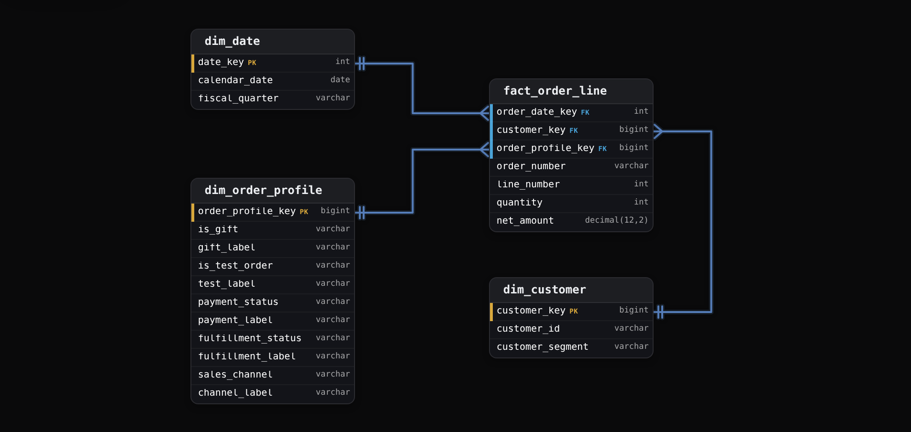
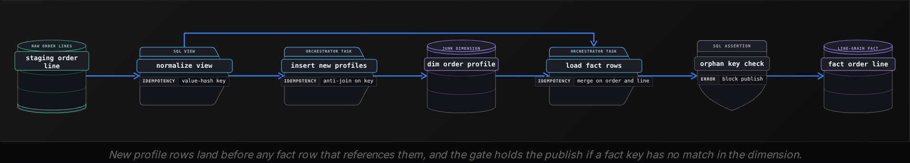
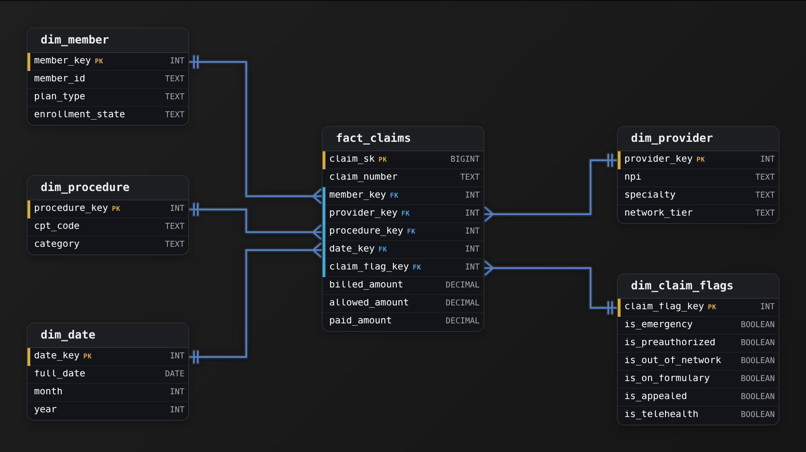
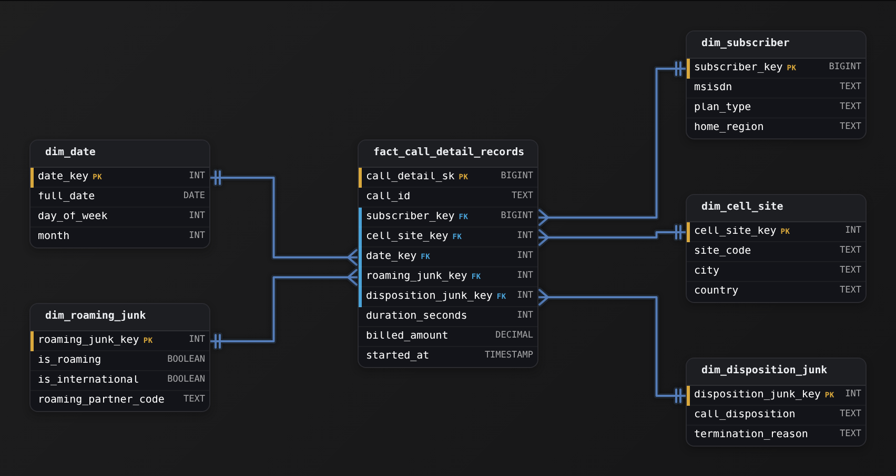
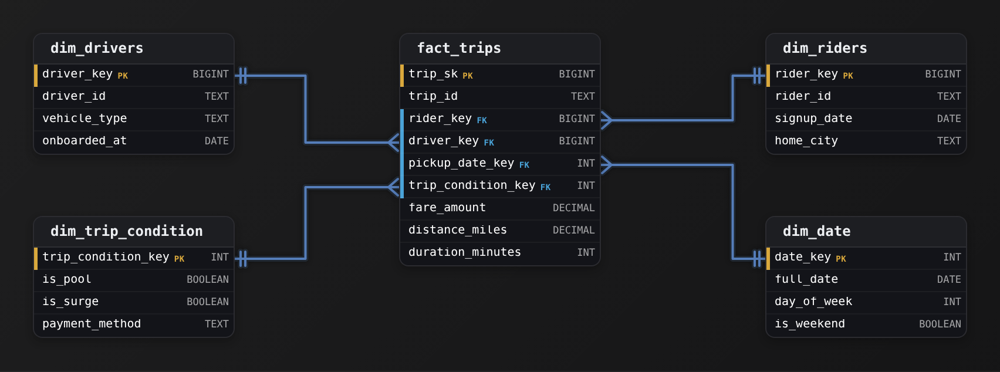

Advanced·Data Modeling · 25 min · 3 challenges

# Junk and Degenerate Dimensions: Advanced

Ines is in the data modeling round of a Shopify data engineering loop. The interviewer shares an order payload: an order number like #1042, payment and fulfillment statuses, flags for test orders and gifts, and the sales channel. The whiteboard already holds a date dimension next to customer and product. 'Model the order line fact,' the interviewer says, 'and tell me where each of these leftover fields lives.' Ines puts all 6 on the fact. The follow-ups arrive fast: why not one dimension per flag, what does a row of that dimension mean, what happens to your design when merchants add a coupon code with 50,000 values, and how do you count orders without double counting the shipping fee? Each answer needs a number and a named cost. This lesson builds both.


<br>

### What you will be able to do

Use grain and cardinality to decide whether a leftover field goes in a junk dimension or stays on the fact as a degenerate key, and when it belongs in its own dimension or an existing one instead.

Build a junk dimension with value-derived keys and a load that survives NULLs and reruns.

Use a degenerate order number for basket counts and cross-fact joins without double counting order-level money.

Predict junk dimension growth from field cardinalities and decide when to split it or evict a field.

Defend the design under pushback by naming each rejected option's cost and the requirement that breaks yours.


<br>

---

## Attributes with No Natural Home

Every transaction source emits fields about the event itself: how the order was paid, whether it was a gift, which channel it came through. The customer dimension has no slot for them, and neither do product or date. Push `payment_status` into the customer dimension and the customer row changes whenever that customer places an order with a different status, so the row comes to mean 'this customer as of their latest order' and every earlier order reports the wrong value. The field lives at the grain of the fact, and the design question is how to store it at that grain.


<br>

### The placement test: what does the field describe?

Any leftover field can be placed with 2 questions. First, does the value describe this one transaction, or a stable entity such as a store or a product? Second, how many distinct values does it have, and does each value carry attributes of its own? The running example is `fact_order_line`, one row per order line: 2 billion rows covering 800 million orders, with 5 order-level fields to place: `is_gift`, `is_test_order`, `payment_status`, `fulfillment_status`, `sales_channel`.

| Field | Describes | Distinct values | Own attributes | Placement |
| --- | --- | --- | --- | --- |
| `customer_segment` | the customer | 6 | none | customer dimension |
| `is_gift` | this order | 2 | none | junk dimension |
| `payment_status` | this order | 5 | none | junk dimension |
| `sales_channel` | this order | 4 | none | junk dimension |
| `order_number` | this order | 800 million | none the star lacks | degenerate, on the fact |
| `coupon_code` | the promotion | 50,000 | campaign, discount, valid dates | promotion dimension |
| `gift_message` | this order | nearly unique | none, free text | order detail table, outside the star |

The junk rows share a profile: they describe the transaction, have a handful of values, and mean nothing beyond their label. The order number also describes the transaction, but it has 800 million values, and every interesting fact about the order is already reachable through the profile key or the date and customer keys, so a table built for it would hold one column. That makes it a degenerate dimension, kept on the fact. The gift message is per order but free text: never grouped or filtered, and repeated on every line it widens the fact for no query, so it sits in a side table keyed by `order_number` for drill-through. The coupon code is per order as well, yet each code has a discount and valid dates and belongs to a campaign, so it gets a dimension of its own.


<br>

### 4 ways to store 5 small fields

| Option | Keys on the fact | One dimension row means | Cost |
| --- | --- | --- | --- |
| Flags as fact columns | 0, plus 5 columns | no dimension | Labels and code decoding repeat in every query and dashboard; no list of valid combinations |
| One dimension per flag | 5 | one value of one flag | 5 joins behind one filter panel; 5 tables of 2 to 5 rows each |
| Fold into the customer dimension | 0 | a customer as of their latest order | Wrong history; customer rows churn with every order |
| Junk dimension | 1 | one combination of the 5 values | 1 join, 240 known combinations at most, one governed place for labels |


<br>

### Fact width is the weakest argument now

The original case for a junk dimension was fact width. Stored as uncompressed strings, the 5 fields average about 25 bytes per row, around 50 GB across the fact. The hashed `order_profile_key` is a `bigint`, 8 bytes per row uncompressed, roughly 16 GB. Columnar file formats store a low-cardinality column with dictionary encoding: each distinct value once, and each row as a bit-packed index into that dictionary. A column with 2 values needs 1 bit per row, a column with 5 values needs 3, and the key, with only 240 distinct values, needs 8.

| Layout | Bits per row | Size at 2 billion rows |
| --- | --- | --- |
| 5 flag columns, uncompressed strings | about 200 | about 50 GB |
| 5 flag columns, dictionary encoded | 1 + 1 + 3 + 2 + 2 = 9 | about 2.3 GB |
| 1 junk key with 240 values, dictionary encoded | 8 | about 2.0 GB |

Encoded, the 2 layouts differ by a few hundred megabytes, so defend the junk dimension on reasons that still hold. It is the one governed place where `'Y'` becomes 'Gift order', so a relabel touches a few hundred rows instead of every dashboard. It lists the combinations that occur, which a filter panel can offer. It gives the fact 1 key to join instead of 5 columns to decode. If the interviewer opens with fact width, agree that it was the original reason and move to these.

> **TIP**
>
> Say the meaning of one row out loud: 'one row of `dim_order_profile` is one combination of the gift and test flags, the payment and fulfillment statuses, plus the channel.' It shows the table has no business entity behind it, and it bounds the row count by the product of the cardinalities.

> Place these 3 fields
>
> - `device_type` on a web order, with 3 possible values: desktop, phone, tablet
> - `store_manager_name` on a point-of-sale order
> - `tracking_number` from the carrier, one per parcel

*Answers: device_type describes the session behind this order and has 3 values, so it joins the junk dimension. The store manager describes the store, so it is a store dimension attribute, with history if managers rotate. A tracking number belongs to a parcel, and one order can ship in several, so it lives in a shipment fact as a degenerate key.*


<br>

---

## Building a Junk Dimension

The table is `dim_order_profile`: one row per combination of the 5 order-level fields, where each field has a code column and a display label column. The fact carries a single `order_profile_key`. The build still needs 3 decisions: which combinations to store, how to make the key, and what the load does when a value is missing.




| is_gift | gift_label | payment_status | fulfillment_status | sales_channel |
| --- | --- | --- | --- | --- |
| Y | Gift order | paid | fulfilled | web |
| N | Not a gift | paid | fulfilled | pos |
| unknown | Gift flag not captured | paid | unfulfilled | marketplace |


<br>

### Pre-build every combination, or insert what appears

| ✓ Cartesian, built once | ✗ Observed, grown by each load |
| --- | --- |
| • All 240 rows exist before the first fact row arrives<br><br>• The fact load only looks keys up and never inserts<br><br>• Filter panels offer combinations that never happen, such as a point-of-sale order awaiting fulfillment<br><br>• A new value in any field forces a rebuild | • A row appears the first time its combination does<br><br>• Each load inserts new combinations before the fact rows land<br><br>• The row count reports real combinations, often a fraction of the ceiling<br><br>• Kimball Group's published modeling techniques recommend this form |

Cartesian fits when the ceiling is in the hundreds and every value list is governed, such as an enum in the source schema. The build is a cross join of the value lists. Once any field comes from a free-form source, observed growth is the safer default, because the source can send a value no list anticipated.

```sql
SELECT
  g.is_gift,
  t.is_test_order,
  p.payment_status,
  f.fulfillment_status,
  c.sales_channel
FROM UNNEST(ARRAY['Y', 'N']) AS g(is_gift)
CROSS JOIN UNNEST(ARRAY['Y', 'N']) AS t(is_test_order)
CROSS JOIN UNNEST(ARRAY['pending', 'authorized', 'paid', 'refunded', 'voided']) AS p(payment_status)
CROSS JOIN UNNEST(ARRAY['unfulfilled', 'partial', 'fulfilled']) AS f(fulfillment_status)
CROSS JOIN UNNEST(ARRAY['web', 'mobile_app', 'pos', 'marketplace']) AS c(sales_channel)
```


<br>

### A key that survives a rerun

A sequential key from `row_number()` depends on the order rows were inserted in. Rebuild the dimension in a new environment and the combination ('N', 'N', 'paid', 'fulfilled', 'web') can land on key 117 instead of 64, and every fact row that pointed at 64 now describes a different profile. A key computed from the values comes out the same on every run, so a fact backfill and a dimension rebuild can run in either order, and the fact load can compute its key without joining the dimension.


<br>

### The NULL that drops fact rows

Source fields go missing: orders from before the gift feature have no `is_gift`, and marketplace orders can arrive without a fulfillment status. An equality join never matches NULL, so an inner join to the dimension drops those lines from the fact, and a left join leaves their key empty. Concatenation fails the same way: NULL joined to a string is NULL, so the hash comes out NULL, and the key built from it does too. Normalize once, in a staging view that every later step reads, and map each missing value to an explicit 'unknown' that the dimension holds as a real row. Each field that can arrive empty gains a value, so an 'unknown' gift flag lifts the ceiling from 240 known combinations to 360.

```sql
CREATE VIEW staging_order_line_normalized AS
SELECT
    n.*,
    from_big_endian_64(xxhash64(to_utf8(
        n.is_gift || '|' || n.is_test_order || '|' || n.payment_status || '|' || n.fulfillment_status || '|' || n.sales_channel
    ))) AS order_profile_key
FROM (
    SELECT
        order_number,
        line_number,
        order_date,
        customer_key,
        coupon_code,
        quantity,
        net_amount,
        coalesce(is_gift, 'unknown') AS is_gift,
        coalesce(is_test_order, 'unknown') AS is_test_order,
        coalesce(payment_status, 'unknown') AS payment_status,
        coalesce(fulfillment_status, 'unknown') AS fulfillment_status,
        coalesce(sales_channel, 'unknown') AS sales_channel
    FROM staging_order_line
) AS n
```

Without the `'|'` delimiter, the values ('ab', 'c') and ('a', 'bc') concatenate to the same string and share a key. A 64-bit hash keeps accidental collisions rare at this size: even at 1 million combinations, the chance of any collision is around 3 in 100 million. Keep a uniqueness check on the key anyway, because it costs one query and a collision would merge 2 profiles without an error.


<br>

### Load order: dimension first, then facts



```sql
INSERT INTO dim_order_profile (order_profile_key, is_gift, gift_label, is_test_order, test_label, payment_status, payment_label, fulfillment_status, fulfillment_label, sales_channel, channel_label)
SELECT DISTINCT
    n.order_profile_key,
    n.is_gift,
    lg.label,
    n.is_test_order,
    lt.label,
    n.payment_status,
    lp.label,
    n.fulfillment_status,
    lf.label,
    n.sales_channel,
    lc.label
FROM staging_order_line_normalized AS n
LEFT JOIN dim_order_profile AS d
    ON d.order_profile_key = n.order_profile_key
LEFT JOIN profile_code_label AS lg
    ON lg.field_name = 'is_gift'
    AND lg.code = n.is_gift
LEFT JOIN profile_code_label AS lt
    ON lt.field_name = 'is_test_order'
    AND lt.code = n.is_test_order
LEFT JOIN profile_code_label AS lp
    ON lp.field_name = 'payment_status'
    AND lp.code = n.payment_status
LEFT JOIN profile_code_label AS lf
    ON lf.field_name = 'fulfillment_status'
    AND lf.code = n.fulfillment_status
LEFT JOIN profile_code_label AS lc
    ON lc.field_name = 'sales_channel'
    AND lc.code = n.sales_channel
WHERE d.order_profile_key IS NULL
```

Rerun this step and it inserts nothing, because every key it computes already exists. Labels come from `profile_code_label`, a small table the analytics team owns, so 'unknown' can display as 'Gift flag not captured' while the stored code never changes.

> **TIP**
>
> Interviewers often ask what happens to a combination that stops occurring. Keep it: the row costs nothing, older fact rows still point at it, and deleting it would orphan them.


<br>

---

## Degenerate Dimensions in Facts

`order_number` sits on `fact_order_line` as a dimension key with no table behind it. A `dim_order` built for it would hold 800 million rows with nothing useful besides the number, because the fact already holds keys for the order's profile and customer, and for its date. Kimball Group's published techniques call this a degenerate dimension: a dimension key whose interesting attributes have already been placed in other dimensions.


<br>

### What the order number pays for

- **Basket counts** *orders from lines*\
  count(DISTINCT order_number) turns a line-grain fact into an order count, and from there into units and revenue per order.
- **Drill-through** *back to the source*\
  An analyst who finds an odd total can hand the number to support and open the order in the operational system.
- **Cross-fact joins** *one key, several facts*\
  Shipment and return facts carry the same number, so line revenue meets shipping cost at the order grain.
- **Rerun safety** *a natural key*\
  order_number with line_number identifies a fact row, so a reloaded day merges instead of landing twice.

```sql
SELECT
  d.sales_channel,
  APPROX_DISTINCT(f.order_number) AS orders,
  SUM(f.quantity) / CAST(APPROX_DISTINCT(f.order_number) AS DOUBLE) AS units_per_order,
  SUM(f.net_amount) / APPROX_DISTINCT(f.order_number) AS revenue_per_order
FROM fact_order_line AS f
JOIN dim_order_profile AS d
  ON d.order_profile_key = f.order_profile_key
JOIN dim_date AS dt
  ON dt.date_key = f.order_date_key
WHERE dt.fiscal_quarter = '2026-Q3'
GROUP BY d.sales_channel
```

An exact `count(DISTINCT)` over hundreds of millions of order numbers has to hold every distinct value somewhere while it counts, and the numbers compress poorly because nearly every one is unique. `approx_distinct` keeps a fixed-size HyperLogLog sketch with a default standard error of 2.3%, which suits a dashboard trend and fails a finance reconciliation. Choose per consumer, and say which one you chose.


<br>

### Order-level money on a line-grain fact

Order #1042 has 3 lines and a 9.00 shipping fee charged once for the whole order. The source sends the fee on the order header, and the tempting move is to copy it onto each line so the fact holds everything. Then someone sums it.

Fee copied to every line

| order_number | line_number | net_amount | shipping_fee |
| --- | --- | --- | --- |
| #1042 | 1 | 40.00 | 9.00 |
| #1042 | 2 | 25.00 | 9.00 |
| #1042 | 3 | 15.00 | 9.00 |
| Total |  | 80.00 | 27.00 |

Fee allocated by line value

| order_number | line_number | net_amount | shipping_fee |
| --- | --- | --- | --- |
| #1042 | 1 | 40.00 | 4.50 |
| #1042 | 2 | 25.00 | 2.81 |
| #1042 | 3 | 15.00 | 1.69 |
| Total |  | 80.00 | 9.00 |

Copying overstates shipping revenue by the average number of lines per order, 2.5 across this fact. The error also differs by channel: if point-of-sale orders average 1.2 lines and web orders average 3, web shipping reads at 3 times its true value and point-of-sale at 1.2 times, so a channel comparison stays wrong even after someone notices the total.

#### Where the fee can live

- Allocate it to lines by net amount. Sums work at every grain, but the rule is a finance decision, and rounding must be pushed to one line so the order still totals 9.00.
- Build fact_order at order grain, with order_number as its degenerate key. The fee is stored once; join to lines only after aggregating lines to orders, or the join fans out again.
- Store it on the first line only. Sums are correct until a filter on product drops line 1, and then the fee vanishes.

With one order-level measure, allocation is often enough. Once the header carries several, such as shipping and tax or an order discount, an order-grain fact is the cleaner home, and the degenerate number is the column that joins the 2 facts.


<br>

### When the number stops being degenerate

- The order gains a lifecycle: it needs a fact of its own at order grain, keyed by the order number.
- Numbers repeat: invoice numbers that restart per store each year need store and year in the key.
- Two sources issue numbers: #1042 from 2 storefronts merges 2 baskets, so add a source system column.
- Analysts start filtering on order traits: those traits move to the junk dimension or a real one.

> **TIP**
>
> Ask the interviewer whether order numbers are unique across every source and every year. It is a 10-second question, and an answer of no changes the fact's natural key, and with it the basket counts and every cross-fact join.

> Predict the total
>
> A returns fact carries `order_number` along with `line_number` and `refund_amount`. Order #1042 returned line 2 for a refund of 25.00. An analyst joins the returns fact to `fact_order_line` on `order_number` alone and sums `refund_amount` from the joined rows. What total appears, and what fixes it?

*The single return row matches all 3 order lines, so the refund reads 75.00. Joining on order_number and line_number, or summing each fact to the order before joining, counts it once.*


<br>

---

## When Junk Dimensions Grow

A junk dimension has 2 sizes. The ceiling is the product of the field cardinalities, 240 for the running example's known values. The observed count is what the loads have produced, and it is the size that matters for joins and filter panels. Growth arrives in 3 ways: a new field multiplies the ceiling, a new value in an existing field adds a slice of combinations, and a high-cardinality field multiplies the ceiling by thousands.

- **720** — ceiling with device type added
- **36M** — ceiling with coupon codes added too

The first figure is harmless: a few hundred more rows, and a lookup that still fits in memory on every worker. The second turns a lookup table into something the size of a small fact, with each coupon repeated across every combination of the other fields and a filter panel nobody can scroll. Every new field is a multiplication, so size the change before making it.


<br>

### Observed rows grow slower than the ceiling

Real fields are correlated, and correlation caps the observed count. If point-of-sale orders are always fulfilled at the till, the `pos` slice drops from 60 combinations to 20. Test orders that are always voided remove most of another slice. A new value behaves differently by build: a sixth payment status such as 'chargeback' adds 48 combinations to the ceiling, which a cartesian dimension must build before the first such order lands, and which an observed dimension inserts on the next load as they occur.

```sql
SELECT
  COUNT(*) AS combinations_with_coupon,
  COUNT(DISTINCT profile) AS combinations_without_coupon
FROM (
  SELECT DISTINCT
    is_gift || '|' || is_test_order || '|' || payment_status || '|' || fulfillment_status || '|' || sales_channel AS profile,
    coupon_code
  FROM staging_order_line_normalized
  WHERE order_date >= DATE_ADD('day', - 90, CURRENT_DATE)
) AS combos
```

Read the ratio as a decision. Near 1, the field is mostly determined by the others and joins the junk dimension at little cost. In the thousands, the field has an identity of its own: if its values carry attributes, as coupons do, it gets its own dimension, and if they carry none, it stays on the fact as a degenerate column.


<br>

### Split along the lines that move together

When the observed count passes tens of thousands of rows, split the dimension. Group fields by correlation and by the people who filter on them: a payment profile holding `payment_status` and `is_test_order`, and a fulfillment profile holding `fulfillment_status` and `sales_channel` together with `is_gift` and `device_type`. Their ceilings are 10 and 72, so both stay small and the fact carries 2 keys. The cost: a filter that crosses the groups needs 2 joins, and which payment profile occurs with which fulfillment profile is now recorded only in the fact.


<br>

### Statuses that change after the sale

Nearly every web order is placed 'unfulfilled' and becomes 'fulfilled' days later. Updating the fact row's profile key when the status moves rewrites history: last week's count of orders placed unfulfilled changes after it was reported, and the transaction fact stops recording the transaction. Keep the junk key as the status at placement. Put the lifecycle in an accumulating snapshot, one row per order with a date key per milestone, or in a status-change fact with one row per transition. Interviewers raise this because statuses look like attributes to update, and in a transaction fact they are facts about a moment.


<br>

### Adding a field to a live junk dimension

| ✓ Sequential keys | ✗ Value-hash keys |
| --- | --- |
| • Add device_type with 'not captured' on every existing row<br><br>• Every existing fact key stays valid, so no fact rows are rewritten<br><br>• New combinations get new keys as they appear<br><br>• A full rebuild can renumber keys, so keep a stored key map | • The hash input gains a field, so every combination gets a new key<br><br>• All 2 billion fact rows need their key recomputed and rewritten<br><br>• Any rebuild, in any environment, produces the same keys<br><br>• The fact load computes keys without a lookup join |

Hash keys can stay stable if the new field enters the hash input only when its value differs from 'not captured'. Existing combinations then hash exactly as before, and a phone order gets a new key from the longer string. The catch is that key stability now depends on a convention every future engineer must keep, so it belongs in the dimension's written contract and in a test that recomputes old keys. The alternative with zero rewrite is a second junk dimension for the new fields, at the cost of one more key on the fact.

> **TIP**
>
> Relabeling is the cheapest change in the star: renaming 'Not a gift' to 'Standard order' updates a few hundred dimension rows and no fact rows. Keep that contrast ready against the cost of changing a hash input.

> Size this request
>
> A product manager wants `delivery_window`, with 12 values, added to `dim_order_profile` after `device_type` is in. Give the new ceiling, then name the query you would run before agreeing.

*The ceiling becomes 8,640. Run the with-and-without count from above on delivery_window: windows tied to channel, such as none for point-of-sale, keep the observed ratio well under 12, and a ratio near 12 argues for a separate fulfillment profile.*


<br>

---

## Defending Your Dimension Design

In a design round the interviewer pushes on the schema you drew, and the signal is whether you can name the option you rejected and what it would have cost. The answer has 4 parts. State the grain, place each field with its cardinality, say what one row of each table means and how many rows it holds, and name the requirement that breaks the design along with your fix.


<br>

### The 4-part answer for the order line prompt

About 2 minutes, spoken

- **Grain** *what one fact row is*\
  One row per order line: 2 billion rows covering 800 million orders.
- **Placement** *every field, with its cardinality*\
  Customer and product get dimensions, as does date. dim_order_profile takes the 5 small fields: gift and test, payment and fulfillment, plus channel. The order number stays on the fact as a degenerate key, and the coupon code gets a promotion dimension.
- **Meaning and size** *what each table holds*\
  One profile row is one combination, 240 known at most. Shipping and other header money live in an order-grain fact joined by order number.
- **What breaks it** *raised before you are asked*\
  The requirement you name before the interviewer does, with its fix, from the table further down.


<br>

### Pushback to expect, and what it tests

| Pushback | What it tests | A strong reply |
| --- | --- | --- |
| 'Why not leave the flags on the fact?' | Whether you know why the pattern exists today | 'Storage is close to even once both are dictionary encoded. I want one place for labels and a list of valid combinations; a team that needs neither can keep flags on the fact.' |
| 'Why not one dimension per flag?' | Join count and browsing | 'That is 5 tables of 2 to 5 rows, 5 joins behind one filter panel, and no record of which values occur together.' |
| 'Order number should be its own dimension.' | Whether you can explain degenerate keys | 'It would be 800 million rows with nothing but the number. When orders earn attributes or money of their own, I add an order-grain fact keyed by the same number.' |
| 'Your junk dimension will explode.' | Growth reasoning in numbers | 'The ceiling is the product of cardinalities, 240 known combinations today. I measure observed combinations before adding a field, and split or evict once they pass tens of thousands.' |
| 'Fulfillment status changes after the sale.' | History semantics | 'The profile key records status as placed and is never updated. The lifecycle goes in an accumulating snapshot.' |

Of those replies, 2 give ground on purpose. When you concede that storage is close to even, and that some teams can keep flags on the fact, the interviewer hears that you chose the design for a requirement you can name, and a named requirement is harder to argue with than a rule.


<br>

### The same answer, recited or reasoned

| ✓ Recites the pattern | ✗ Reasons about this schema |
| --- | --- |
| • 'Junk dimensions save space by combining flags.'<br><br>• 'Degenerate dimensions are dimensions without tables.'<br><br>• 'I'd use a junk dimension because it's the standard pattern.'<br><br>• 'It might get big, so we'd monitor it.' | • 'Encoded, 5 flags cost about the same as 1 key; I want governed labels.'<br><br>• 'The order number has 800 million values and no attribute the star lacks.'<br><br>• 'Each row of the profile is a combination; there can be 240.'<br><br>• 'A 50,000-value coupon code would push the ceiling to 12 million, so it gets a promotion dimension.' |


<br>

### Requirements that break the design

| Future requirement | What breaks | Fix |
| --- | --- | --- |
| Filter revenue by coupon campaign | Adding coupons multiplies the profile ceiling by 50,000 | Promotion dimension with its own key on the fact |
| Show each order's status history | The transaction fact holds status as placed | Accumulating snapshot or status-change fact |
| A second storefront issues order numbers | Basket counts merge orders across sources | Source system column in the natural key |


<br>

### Scope beyond the whiteboard

A complete answer also says who owns the dimension. A junk dimension is a shared contract: a relabel reaches every dashboard that filters on it, so someone has to approve new fields and new labels. Sharing it across facts needs the same care. A returns fact might want `payment_status` too, but status at return time and status at placement describe different moments. One profile dimension that means 'as placed' in one fact and 'as returned' in another misleads whoever compares them, so give each moment its own named profile, such as `dim_return_profile`.

| ✓ Do | ✗ Don't |
| --- | --- |
| • State what one row of each table means before listing its columns.<br><br>• Quote the ceiling as a product of cardinalities, then the observed count.<br><br>• Map missing values to an explicit 'unknown' before hashing or joining.<br><br>• Store order-level money once, in an order-grain fact keyed by the order number.<br><br>• Record status as placed and keep the lifecycle in its own fact. | • Rest the case for a junk dimension on fact width.<br><br>• Put a 50,000-value code or free text into a junk dimension.<br><br>• Copy an order fee onto every line of a line-grain fact.<br><br>• Update a profile key on a loaded fact row when status moves.<br><br>• Share one profile dimension between facts that capture values at different moments. |

> Practice it aloud
>
> Give the 4-part answer for a ride-hailing trip fact. Each trip carries a trip id, a surge flag, a pool-or-solo flag, 1 of 4 payment methods, a rider rating from 1 to 5 and an optional promo code. Name your junk dimension's ceiling, the degenerate key, the field you evict, and the requirement that would break the design.

*One defensible answer: the surge and pool flags go into a junk dimension with payment method, for a ceiling of 16. The rating gets averaged, so it is a measure on the fact. The trip id is degenerate, the promo code gets a promotion dimension, and a rating that arrives hours after the trip is the requirement to raise, because it changes a row that was already loaded.*


<br>

---

## Putting It All Together

An online grocer launches a third-party marketplace channel and a coupon program in the same quarter. Within a week, finance reports that shipping revenue by channel has jumped, marketplace lines are missing from the order line fact, and the marketing team asks for coupon codes on the order profile so campaigns can be filtered.

- The coupon request is a placement question: 50,000 codes with campaigns and discounts get a promotion dimension, and adding them to the profile would multiply its ceiling by 50,000.
- The missing marketplace lines are a NULL fulfillment status: the inner join dropped them, and an 'unknown' value in the normalized view brings them back with a real profile row.
- The shipping jump comes from a header fee copied onto lines; an order-grain fact keyed by the degenerate order number stores it once.
- The new channel is one more value: an observed dimension inserts its combinations on the next load, while a cartesian one needs a rebuild first.
- Explaining all three to finance uses the 4-part answer, from grain and placement through each table's meaning and size to the requirement that broke the old design.


<br>

---

## Data Modeling

### Exercise 1 of 3

**● TASK**

A health-insurance analytics team runs a claims warehouse where every claim carries six yes/no attributes: whether it was an emergency, whether it was pre-authorized, whether it went out-of-network, whether the drug was on formulary, whether it was appealed, and whether it was delivered via telehealth. A prior team gave each flag its own dimension table, and analysts now bolt six extra joins onto every query and complain about the cost. Redesign the model so those flags stop multiplying the join count, and decide where each claim's identifier belongs given that it is unique to one claim and carries nothing else worth storing.

<details>
<summary><strong>Solution</strong></summary>

#### What this problem is really testing

Beneath the insurance framing this is the dimension-explosion clean-up: a prior team treated every yes/no flag as if it deserved its own `dim_` table, so a claim now drags six one-column dimensions behind it and every query pays six joins for six booleans. The skill being probed is recognizing that a low-cardinality flag is neither a measure nor a real dimension, and that the right home for a pile of them is ONE junk dimension. The trap sits on the other side: the claim identifier looks like it wants a table too, and a candidate who reflexively normalizes it builds `dim_claim_number` keyed one-to-one with the fact. That table adds a join that hands back the exact value already on the fact row and describes nothing.

| Trick: Two homes, decided by what the column carries |
| --- |
| Ask one question per orphan column: does it have a small set of repeating values shared across rows, or is it unique per row with nothing to describe? Repeating low-cardinality flags collapse INTO a junk dimension. A per-row identifier with no attributes stays ON the fact as a degenerate dimension. Six flags go one way, `claim_number` goes the other. |

#### Working it out

1. **Name the anti-pattern out loud**

   Six dimensions that each hold a single boolean is the dimension-explosion smell. A `dim_emergency` table with two rows ('yes' and 'no') earns nothing over a boolean, and it forces a join. The fix is consolidation, not another round of the same.

2. **Fold the flags into one junk dimension**

   Build `dim_claim_flags` with one surrogate key and all six boolean columns. Each row is a distinct COMBINATION of the six values. The fact loses six foreign keys and gains one: `claim_flag_key`. Six joins become one.

3. **Leave the identifier on the fact**

   `claim_number` is unique to one claim and carries no further attributes, so a table for it would be keyed one-to-one with the fact and describe nothing. Keep it as a plain column on `fact_claims` with no surrogate: that is a degenerate dimension, and it is the correct home.

4. **Protect the real dimensions**

   Member, provider, procedure and date are genuine descriptive dimensions with many attributes. Consolidation is a tool for orphan flags only; do not let the clean-up sweep real dimensions into the junk table.

#### The reference model

`fact_claims` sits at one row per claim. It keeps foreign keys to the 4 real dimensions plus a single `claim_flag_key` into the junk dimension, holds the additive measures, and carries `claim_number` inline as a degenerate dimension. `dim_claim_flags` holds the six booleans behind one surrogate key.



*Six flag dimensions collapse into `dim_claim_flags`; `claim_number` rides on `fact_claims` as a degenerate dimension.*

| Performance: Sixty-four is the ceiling, twenty is the reality |
| --- |
| Six booleans can produce at most 2^6 = 64 rows in `dim_claim_flags`, and in practice only the ~20 combinations that actually occur ever get loaded. Every claim query drops from six flag joins to one join against a table that fits in a single page of memory. The join count falls; the plan gets cheaper on every query, not just the flag-heavy ones. |

| Interviewer: The identifier decision is the tell |
| --- |
| Strong candidates state the grain first, name the six flags as a junk dimension, and then explicitly refuse to build a table for `claim_number`, calling it a degenerate dimension. Volunteering WHY a per-row attribute-less identifier stays on the fact is the senior signal; drawing the junk dimension without addressing the identifier leaves the interviewer's real question unanswered. |

| Pitfall: Normalizing the identifier |
| --- |
| The most common miss is minting `dim_claim_number` with a surrogate key mapped one-to-one to the fact. It stores nothing the fact does not already hold and adds a mandatory join to retrieve a value that was already sitting on the row. Unique-per-row plus no attributes is the exact signature of a degenerate dimension, not a table. |

#### When one junk dimension stops being enough

| ✕ Keep one junk dimension | ✓ Split into two flag dimensions |
| --- | --- |
| Six flags, and even the two or three more product wants, keep the realistic combination count in the dozens against a 64-to-few-hundred ceiling. One table, one join, trivial to load. | Once the realistic combinations climb into the thousands, or one cluster of flags churns far more often than another, split them: for example clinical flags in one dimension and adjudication flags in another. Two small joins beat one bloated dimension. |

**Follow-up questions**

1. Product adds three more yes/no flags next quarter. Does your junk dimension survive?\
   *Tests whether the candidate reasons about the combinatorial ceiling and names a split threshold rather than assuming one table scales forever.*
2. One new flag is not boolean but a four-value status code. Does it still belong in `dim_claim_flags`?\
   *Tests that junk dimensions absorb low-cardinality codes too, and that the candidate re-checks the row-count math when a column has more than two values.*
3. Analysts want to filter claims by `is_out_of_network` without touching the fact. How does the junk dimension help?\
   *Tests understanding that consolidated flags remain independently queryable through the single dimension join.*

</details>


<br>

### Exercise 2 of 3

**● TASK**

A mobile carrier is building a warehouse over its call-detail records, one row per completed call. Every record carries two stable yes/no attributes, whether the call roamed off the home network and whether it crossed an international boundary, alongside two codes that keep expanding as partners are onboarded: the roaming-partner code and the call-disposition code. Each record also holds a globally unique call identifier that dispute agents look up but that carries no other attributes. Model the star so the network and outcome attributes get a home, the call identifier is stored without its own lookup table, and the design absorbs new partner and disposition codes without the flag combinations exploding into an unmanageable table.

<details>
<summary><strong>Solution</strong></summary>

#### Why this problem exists in real interviews

This is a junk-dimension design where the twist is **cardinality you cannot bound**. Anyone can sweep four orphan columns into one junk dimension. The real skill being probed is what you do when two of those columns (`roaming_partner_code`, `call_disposition`) keep growing forever as new carriers onboard. Put all four in one table and its row count is the product of every cardinality, so it balloons every quarter. The trap is treating the flag space as fixed: the candidate who cross-joins two flags with a growing partner list and a growing disposition list ships a dimension that is unmaintainable within a year, and who then tries to pre-populate every combination discovers there is no full list to pre-populate.

| Trick: Additive beats multiplicative |
| --- |
| The insight that cracks it: group the orphan attributes by subject area so the fact carries two SMALL junk keys instead of one huge one. Network attributes (`is_roaming`, `is_international`, `roaming_partner_code`) go in one dim, call-outcome codes (`call_disposition`, `termination_reason`) in another. Total rows become the SUM of two dims, not their product, and each dim absorbs a new code with a single new row loaded on demand. |

#### Break down the requirements

1. **Name the grain and sort the orphans**

   One row per completed call. Walk the columns: `duration_seconds` and `billed_amount` are measures; `subscriber`, `cell_site`, and `date` are real dimensions; the two flags and two codes are neither, so they are junk candidates; `call_id` is unique per row with no attributes, so it is a degenerate dimension.

2. **Do the combinatorial math before you draw a table**

   A single junk dim is `2 x 2 x partners x dispositions`. At 200 partners and 15 dispositions that is 12,000 rows, and both factors keep climbing. Splitting by domain gives `2 x 2 x partners` (about 800) plus `dispositions x termination_reasons` (about 120): roughly 920 rows, additive, with each factor growing on only one side.

3. **Load the junk dims insert-on-demand**

   You cannot enumerate the partner or disposition codes up front, so during the fact load you look up each observed combination and insert a junk row only when it first appears. The dims then hold only combinations that actually occurred, and a brand-new partner or code costs exactly one row.

4. **Leave the call identifier in the fact**

   `call_id` is unique per call and has no descriptive attributes. A lookup table would carry one row per fact row and add a join that buys nothing. Keep it as a degenerate dimension: a plain column on the fact, no surrogate key, filtered directly on dispute lookups.

#### The reference model

The star below carries the real dimensions plus two domain-grouped junk dimensions and the degenerate `call_id`. The anchor decision is that `dim_roaming_junk` and `dim_disposition_junk` are separate tables loaded on demand, which is what keeps the flag space bounded as carriers onboard.



*`call_id` is a degenerate dimension inside the fact; `dim_roaming_junk` and `dim_disposition_junk` are domain-grouped and loaded insert-on-demand.*

| Performance: How the split holds at scale |
| --- |
| Combined, the junk dim is `2 x 2 x partners x dispositions x termination_reasons`, growing multiplicatively on two unbounded axes. Split, `dim_roaming_junk` tops out near `4 x partners` and `dim_disposition_junk` near `dispositions x termination_reasons`, and insert-on-demand means each only ever holds combinations that actually occurred. Onboarding a new carrier adds one row to one dim, not a new slice of a cross product. |

| Interviewer: The growth question is the real test |
| --- |
| A strong candidate volunteers the multiplicative-versus-additive math before being pushed, names insert-on-demand loading by its behavior, and refuses to promote `roaming_partner_code` to its own dimension while it is a bare code. Stating grain first and classifying `call_id` as degenerate without prompting are the other tells. |

| Pitfall: One junk dim, pre-populated |
| --- |
| The common failure is a single `dim_call_junk` holding all four attributes, then trying to pre-build every combination. There is no full list of partner or disposition codes to enumerate, so the cross product is both impossible to seed and unbounded in growth. Giving `call_id` its own table is the sibling mistake: a lookup with one row per fact row. |

#### The design fork

| ✕ One combined junk dimension | ✓ Domain-grouped junk dimensions |
| --- | --- |
| All four attributes in `dim_call_junk`.<br><br>* Fewer FKs on the fact<br>* Row count is the product of every cardinality<br>* Two unbounded axes make it grow forever<br>* Cannot be pre-populated, no full code list exists | Network attributes and outcome codes split into two dims.<br><br>* Row counts are additive, not multiplicative<br>* Each unbounded axis lives in one dim only<br>* Insert-on-demand keeps each dim to seen combinations<br>* One extra FK on the fact, a cheap trade |

**Follow-up questions**

1. The business adds 3 more network flags next quarter. Which dimension changes and by how much?\
   *Tests whether the candidate can reason about adding columns to a junk dim versus its effect on row cardinality, and whether new flags belong with the stable network group.*
2. Roaming partners now arrive with a country and a settlement rate. Does anything move out of the junk dimension?\
   *Tests the boundary between a bare code (junk) and a real conformed dimension once descriptive attributes appear.*
3. How would you keep the junk-dimension lookup fast during a high-volume fact load?\
   *Tests insert-on-demand implementation detail: caching seen combinations, a unique constraint on the attribute set, avoiding duplicate junk rows under concurrency.*

</details>


<br>

### Exercise 3 of 3

**● TASK**

We run a ride-hailing marketplace and are building a warehouse over completed trips, one row per finished trip, each with a rider, a driver, a pickup timestamp, and the fare. Three attributes analysts filter on constantly ride on every trip: whether it was a pooled ride, whether surge pricing applied, and how the rider paid. Every trip also carries its own confirmation code, trip_id, unique to that single row. Design the dimensional model, and be ready to defend where trip_id lives and how the three low-cardinality attributes get a home.

<details>
<summary><strong>Solution</strong></summary>

#### Why this problem exists in real interviews

This is two homelessness problems wearing a ride-hailing costume, and the interviewer's suggestion is the trap. `trip_id` is a unique identifier with zero descriptive attributes; the flags `is_pool`, `is_surge`, and `payment_method` are attributes that are neither measures nor keys. The tell of seniority is refusing both bad homes the interviewer floats: a dedicated `dim_trips` (a one-to-one dimension, one row per fact row, joined to nothing) and parking `trip_id` in `dim_riders` (which silently changes the rider grain to one row per trip). Get either wrong and every rider-level rollup double counts.

| Trick: The unique ID stays put; the orphans move together |
| --- |
| A column that is unique per fact row and has no attributes is a **degenerate dimension**: it lives in the fact table with no key and no table. The scattered low-cardinality flags do the opposite, they collapse into one junk dimension so the fact keeps a single narrow FK instead of three wide columns. |

#### Break down the requirements

1. **Sort every column into measure, key, or orphan**

   Fare, distance, and duration are additive measures. Rider, driver, and pickup date are dimension keys. What is left is `trip_id` (a unique identifier) and `is_pool`, `is_surge`, `payment_method` (low-cardinality attributes). The orphans are the whole exam.

2. **Give `trip_id` a degenerate home**

   `trip_id` stays in `fact_trips` as an ordinary column, no surrogate, no table. A `dim_trips` would have exactly one row per trip and nothing to describe, so the join buys nothing and doubles the storage. Name it out loud: this is a degenerate dimension.

3. **Reject the rider-dimension parking spot**

   Putting `trip_id` in `dim_riders` is worse than a wasted table. The rider dimension is one row per rider; hanging a per-trip identifier on it forces one row per trip, so every rider attribute repeats per ride and a distinct-rider count breaks. Wrong grain, not just wrong place.

4. **Consolidate the flags into one junk dimension**

   `is_pool`, `is_surge`, and `payment_method` go into `dim_trip_condition`, keyed by a surrogate, one row per observed combination. `fact_trips` carries a single `trip_condition_key` instead of three raw columns, and analysts filter every combination from one small table.

#### The reference model

The anchor is that `trip_id` is a degenerate dimension inside the fact, while the three orphan attributes share one junk dimension. The rider, driver, and date dimensions stay conformed at their own natural grain.



*`trip_id` is a degenerate column on `fact_trips` with no FK and no table; `is_pool`, `is_surge`, and `payment_method` live once in `dim_trip_condition`.*

| Performance: The junk dimension is tiny and stays tiny |
| --- |
| Row count is the cross product of cardinalities: `is_pool` (2) times `is_surge` (2) times `payment_method` (4) caps at 16 rows. Even after next quarter's `is_scheduled` and `is_business_ride` flags it is 64. Split into two junk dimensions only when the combinations balloon or go sparse; group attributes that vary together. |

| Interviewer: They want the words, not the boxes |
| --- |
| The signal here is the defense, not the diagram. A strong candidate says **degenerate dimension** for `trip_id` unprompted, explains why a one-to-one dimension is dead weight, and catches that the rider-dimension suggestion changes the grain. Naming the pattern is the pass. |

| Pitfall: The one-to-one dimension |
| --- |
| Building `dim_trips` keyed by `trip_id` feels tidy and is the most common miss. It produces one dimension row per fact row, joined to describe nothing, doubling storage and adding a join to every query. A unique identifier with no attributes never earns a table. |

#### Trade-offs and alternatives

| ✕ `trip_id` as a degenerate dimension | ✓ `trip_id` as its own dimension |
| --- | --- |
| `trip_id` sits in `fact_trips` as a plain column.<br><br>* No extra table, no extra join<br>* Still fully available for lookups and dedup<br>* You must name it a degenerate dimension so reviewers know it is intentional | A `dim_trips` keyed by `trip_id`.<br><br>* One dimension row per fact row, describing nothing<br>* A mandatory join on every query for zero benefit<br>* Storage roughly doubles as the fact scales |

**Follow-up questions**

1. Product adds `is_scheduled` and `is_business_ride` next quarter. Does the junk dimension change shape?\
   *Tests whether the candidate understands junk dims absorb new flags by adding combination rows, not new tables, and knows the split threshold.*
2. Analysts want to dedup replayed trip events by `trip_id`. Does keeping it degenerate still support that?\
   *Tests that a degenerate dimension is fully queryable despite having no table.*
3. A new requirement adds a free-text driver note per trip. Does that belong in the junk dimension?\
   *Tests the low-cardinality boundary: high-cardinality or free-text attributes break the junk-dim row-count bound.*

</details>


<br>

---

## Key Takeaways

- Place each leftover field by what it describes and how many values it has: a small per-transaction field goes to the junk dimension, and a unique, attribute-free one stays degenerate. Anything with attributes of its own gets a dimension.
- One row of a junk dimension is one combination of values; its ceiling is the product of cardinalities, and the observed count is the size to quote.
- Value-derived keys make loads rerunnable and lookups optional, and missing values need an explicit 'unknown' before hashing or joining.
- A degenerate order number powers basket counts, drill-through and cross-fact joins, and order-level money belongs at order grain.
- Each later pressure, whether growth or a status that changes or a new field, has a named fix: split, evict, record status as placed, or add a second profile dimension.
