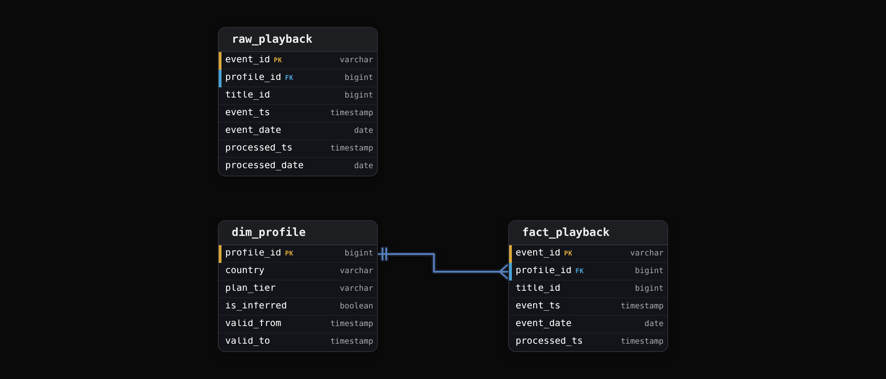
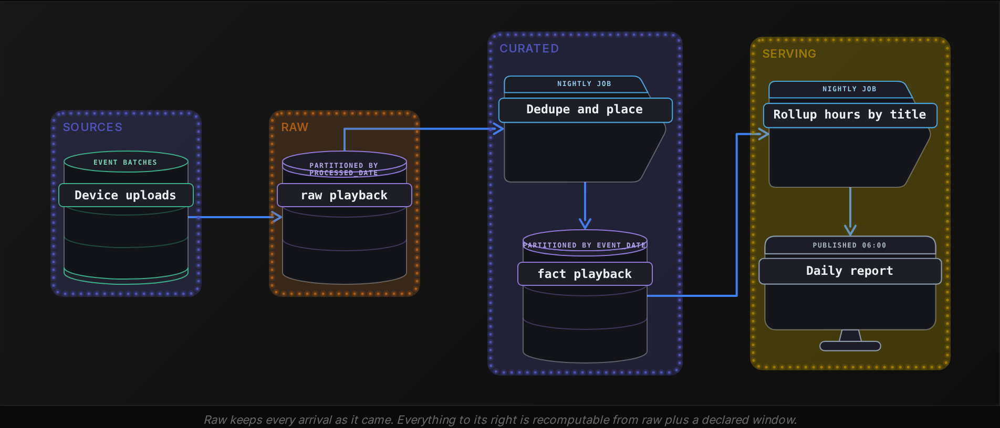
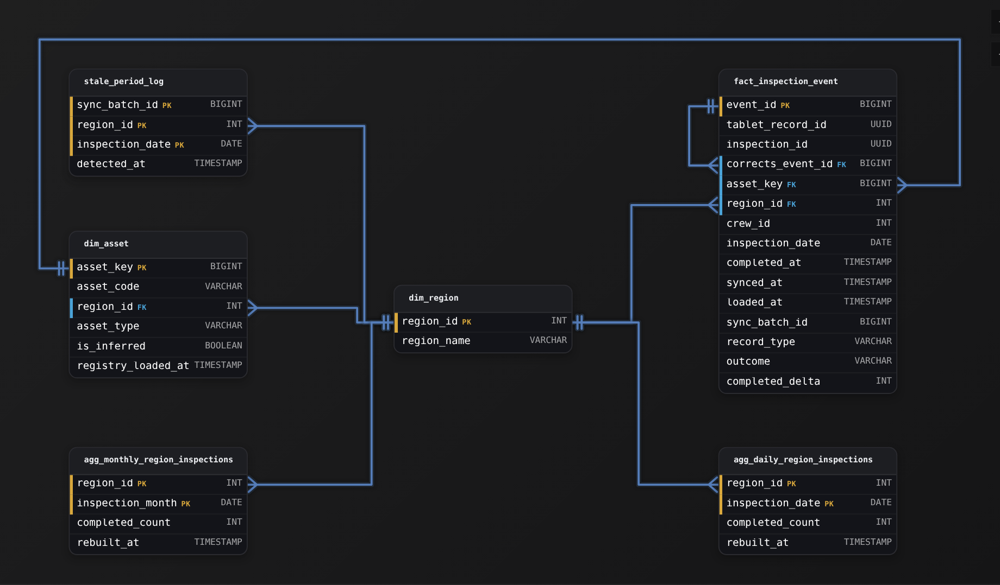
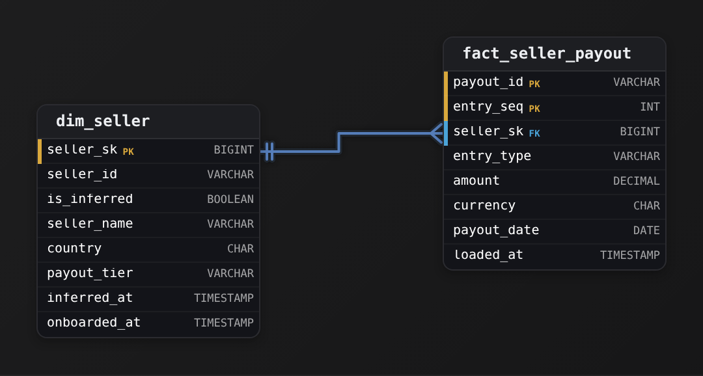

Advanced·Data Modeling · 25 min · 2 challenges

# Late-Arriving Data: Advanced

The interviewer at Netflix slides a schema across the table: a `fact_playback` table partitioned by `event_date`, loaded once a night, feeding the hours-watched report that product teams read every morning. Then the question. A member downloads 3 episodes, watches them on a 9-hour flight in airplane mode, and gets home 2 days later. Those playback events reach the pipeline on Thursday carrying Tuesday's timestamps. Tuesday's partition closed on Wednesday morning and the report already went out. What happens to those plays, and what should? The candidate who answers 'append them to Tuesday' has named one option. The candidate who asks how late the rows run, what the report promised its readers, and who pays for a rewrite is reasoning about the pattern. This lesson builds that second answer. It starts with late facts and late dimension members, moves on to corrections, and ends on the design that lets any of them be replayed without fear.


<br>

### What you will be able to do

Recognize a late-arriving data question even when it's posed as a drifting report or an orphaned foreign key, and when it comes in as a refund or a reprocessing request

Choose where a late fact lives, putting numbers on each choice's read and write cost and on its restatement schedule

Insert an inferred dimension member and repair it correctly, and decide between re-keying facts and resolving versions at read time

Carry corrections as reversal rows that sum correctly and still preserve what was reported when the job reruns

Scope a reprocessing request by the partitions and downstream tables it rewrites, then by the people who must hear about it


<br>

---

## "What If Data Lands After the Run?"

Every row in a fact table carries 2 clocks. The event clock says when the thing happened: the member pressed play at 21:14 on Tuesday. The arrival clock says when the pipeline first saw the row: Thursday at 03:40, when the device reconnected and flushed its upload queue. Late-arriving data is the gap between those clocks growing past the point where the pipeline already acted on the partition the row belongs to. The row is correct. The pipeline's assumption that Tuesday was finished was the error, and every technique in this lesson is a way of either narrowing that assumption or paying to revisit it.

Model both clocks as columns: event_ts for when it happened and processed_ts for when it landed. Lateness is processed_ts - event_ts, and a histogram of that difference over a few weeks of history is the most useful artifact in this whole topic, because every design choice below is a bet on its shape.




<br>

### The lateness distribution for our running example

The example this lesson follows is a streaming service's playback fact, with one row per play event. The table is partitioned by `event_date` and loaded nightly. Devices buffer events locally and upload in batches. A downloaded title watched offline uploads nothing until the device next reaches a network. Measured over 6 weeks of history, the lateness falls into 4 bands, and the bands matter more than the exact figures.

| Arrival after event | Share of events | Cumulative | Typical cause |
| --- | --- | --- | --- |
| Same day | 96.0% | 96.0% | Connected device, batch upload within minutes |
| Day 1 to day 3 | 3.5% | 99.5% | Device asleep overnight, weekend travel |
| Day 4 to day 30 | 0.49% | 99.99% | Offline downloads, long trips |
| After day 30 | 0.01% | 100% | Device retired, then powered on months later |

Those 4 bands map to 4 costs. Same-day rows cost nothing. Rows in the 3-day band decide the size of the nightly lookback. The 30-day band decides whether a monthly rebuild exists at all. The final sliver decides whether a row is ever allowed to be discarded, and that is a business question rather than an engineering one, because the long tail of a day is still thousands of plays whose creators are paid by the hour watched.

- **50M** — playback events per day
- **250K** — rows arriving day 4 or later
- **5K** — rows landing after day 30

*Throughout, the percentages are the example's measured history, not an industry constant. Your pipeline's own histogram is the one that matters, and the first thing to build.*


<br>

### The 4 disguises the question wears

- A published daily number changed after the morning it went out, and nobody edited anything
- A fact row references a customer, profile or product the dimension has never heard of
- A refund, cancellation or corrected amount arrives for a transaction loaded weeks ago
- The source resends a corrected feed for a closed quarter and asks you to reprocess it

The question arrives as a late fact or a late dimension member, and just as often as a correction or a request to reprocess. Interviewers rarely name the pattern. They describe a symptom and watch whether you reach for the 2 clocks before you reach for a fix, because a fix chosen without the histogram is a guess about how late is late.


<br>

### What the pipeline promised

Every option that follows trades between 3 promises a table can make to its readers, and a table can't keep all 3 at full strength. The decision an interviewer is listening for is which one you weaken and by how much, and then whether the readers were told.

> 3 promises a fact table can make
>
> - Timely: the partition is queryable by 06:00 the next morning, so the number may still move for days
> - Complete: the partition is published only after 99.5% of its rows have arrived, so it waits 3 days
> - Reproducible: a number read on Wednesday can be read again next year and match, so restatements must be visible as rows, never as overwrites

A growth dashboard wants timely and tolerates a 3.5% upward drift over the following mornings. A royalty payment to content owners wants complete and will wait. A finance close wants reproducible and would rather carry a correction row than see history rewritten in place. The same playback table often serves all 3 readers, which is why the sections that follow keep every row's arrival clock on the row itself: it's the one property that lets a single physical table answer all 3.

The 3 promises also settle what 'late' even means. A timely table counts anything after 06:00 as late. A complete table treats nothing inside 3 days as late at all. Under reproducible, no row is late, because every row is recorded with its arrival and the question becomes which arrival cutoff a reader applies. The word 'closed' hides the same decision. A partition is closed when the pipeline chose to stop waiting, and that moment comes from the histogram: close at day 3 and you've committed to 99.5% completeness and a 3-partition lookback, close at day 30 and you have bought 99.99% for a 30-partition rewrite or a 30-day delay. No closing rule is correct in the abstract, only one that matches a stated promise.

> **TIP**
>
> When the interviewer says 'the report changed', ask which clock the report filters on. A report filtered on event_date drifts as late rows arrive. A report filtered on processed_date never drifts, but misstates when things happened. Naming that fork in your first sentence tells them you have seen this before.


<br>

---

## Late Facts in Closed Partitions

Tuesday's partition was written Wednesday at 03:00. On Thursday 40,000 Tuesday plays arrive. There are 3 places those rows can go, and each one moves a cost somewhere else rather than removing it.

| Where the late row lives | Nightly write cost | Query by event_date | Report behaviour | History kept |
| --- | --- | --- | --- | --- |
| A: rewrite the event_date partition | Rewrites every partition in the lookback window | Reads 1 partition | Drifts upward until the window closes | Only if processed_ts stays on the row |
| B: append to the processed_date partition | Writes only the rows that arrived | Scans up to 30 partitions and filters | Drifts upward for as long as rows arrive | Yes, append-only |
| C: side table for late rows, union at read time | Writes only the late rows | Reads 1 partition plus the side table | Drifts, and every reader must remember the union | Yes |


<br>

### Option A: the lookback rewrite

The nightly job deletes the 3 most recent event_date partitions and rebuilds them from raw, so a Tuesday row arriving Thursday lands where every reader expects it. The price is write volume: 3 partitions of 50 million rows, around 30 GB in a columnar format at 200 bytes a row, rewritten to place roughly 1.75 million late rows that occupy 350 MB. That's about 85 bytes rewritten for every late byte placed. It remains the most common choice, because it keeps every query a single-partition read and keeps the schema honest: event_date means event date.

```sql
DELETE FROM fact_playback
WHERE event_date BETWEEN date '2026-10-19' AND date '2026-10-21'
```

```sql
INSERT INTO fact_playback
SELECT
  event_id,
  profile_id,
  title_id,
  event_ts,
  event_date,
  processed_ts
FROM (
  SELECT
    event_id,
    profile_id,
    title_id,
    event_ts,
    event_date,
    processed_ts,
    row_number() OVER (
      PARTITION BY event_id
      ORDER BY processed_ts ASC
    ) AS rn
  FROM raw_playback
  WHERE event_date BETWEEN date '2026-10-19' AND date '2026-10-21'
    AND processed_date BETWEEN date '2026-10-19' AND date '2026-10-22'
) d
WHERE rn = 1
```

The design depends on 2 details. The dedupe on `event_id` makes the rewrite idempotent: run it twice and the partition is identical, so a failed night can be retried without inspection. And the filter on `processed_date` bounds the raw scan to 4 arrival partitions, which is the mechanical form of the 3-day promise. A row that arrives on day 5 is never read by this job. Such a row needs either a slower second path or a rewritten promise.


<br>

### Option B: partition by arrival, filter by event

Flip the partition key to `processed_date` and keep `event_date` as a column. Loading becomes a pure append of whatever arrived, nothing is ever rewritten, and a row's position records when you learned about it. The cost moves to every reader. A question about Tuesday must scan every arrival partition that could hold a Tuesday row, which under the 30-day tail means 30 partitions, and the predicate on `event_date` does the real work.

```sql
SELECT
  event_date,
  COUNT(*) AS plays
FROM fact_playback_by_arrival
WHERE processed_date BETWEEN DATE '2026-10-14'
  AND DATE '2026-11-13'
  AND event_date = DATE '2026-10-14'
GROUP BY event_date
```

Column statistics and clustering on `event_date` inside each partition let most of those 30 scans skip quickly, but the reader must know to write both predicates, and a reader who writes only the `event_date` filter scans the whole table. Option B suits a raw layer and an audit layer, where append-only history is the point. It's a poor serving layer, because it asks every analyst to understand the pattern this lesson teaches.

Option C, a separate late table unioned in a view, is option B with a smaller search space: the side table holds only the 4% that was late, so the union is cheap. It fails in the same place, at the reader. The day an analyst queries the base table directly, the number is 4% low and nobody is alerted. Treat it as a staging area that feeds option A's rewrite, never as a destination.


<br>

### Which partitions are closed, and who gets told

The lookback window is also a restatement schedule. Under option A, Tuesday's count rises each morning from Wednesday through Friday, then freezes, except for the 0.49% that arrives later and is placed by a monthly rebuild of the previous 31 partitions. Every downstream rollup built from the fact must rebuild that window in the same nightly run; otherwise the fact and its rollup disagree for 3 days. The strong answer says that unprompted: the window belongs to the lineage. It is declared once and every job in the lineage reads it, so no job carries its own typed constant.

| ✓ Nightly lookback of 3 partitions | ✗ Monthly rebuild of 31 partitions |
| --- | --- |
| • Rewrites 30 GB to place 1.75 million rows<br><br>• Captures 99.5% of plays<br><br>• Reports freeze after 3 mornings<br><br>• Rollups rebuild the same 3 days | • Rewrites 310 GB once a month<br><br>• Captures the 0.49% offline tail<br><br>• Restates a whole month in one morning<br><br>• Needs a restatement notice to readers |

#### Choosing the window from the histogram

Set the window where the next day of waiting costs more to catch than to restate later. Widening from 3 to 7 days more than doubles the nightly rewrite, from 30 GB to 70 GB, and catches only a slice of the remaining 0.49%, because the offline tail is spread across 4 weeks rather than bunched at day 4. The 3-day window plus a monthly rebuild captures 99.99% for 30 GB a night and 310 GB a month. Those 2 figures, read off the histogram, are the answer an interviewer wants to hear justified.

> **TIP**
>
> Say the number. 'I would rewrite a 3-day window because 99.5% of rows arrive within 3 days, and a monthly rebuild catches the tail' is a complete answer. 'I would use a lookback window' is an incomplete one, because the window's size is the design.


<br>

---

## Inferring Late Dimension Members

A new member creates a profile at 21:13 and presses play at 21:14. The playback event reaches the fact load that night. The profile row reaches `dim_profile` through a separate feed that runs hourly and had a 3-hour outage. The fact join finds no profile. A late dimension member is a fact that knows more than the dimension does, and the job has 3 choices at the moment of the join.

| Choice | What the fact table holds | What the morning report shows | Repair later |
| --- | --- | --- | --- |
| Drop the row | Nothing | Undercounts plays, silently | Needs a reload from raw |
| Park it in a suspense table | Nothing until the profile arrives | Undercounts plays, visibly, with a count of parked rows | A retry job re-joins and loads |
| Insert an inferred member | The play, keyed to a placeholder profile | Correct totals, unknown attributes for a few rows | Overwrite the placeholder in place |

Dropping is a defect. Suspense is the right choice when the attribute matters more than the count, for instance a billing fact that must never post against an unknown account. The inferred member is the right choice for a volume fact like playback, where hours watched are what the report sums and the profile's country is a slice of it. The job inserts a dimension row that says: this profile exists, we know its natural key, and nothing else yet.

```sql
INSERT INTO dim_profile
SELECT
  f.profile_id,
  'unknown' AS country,
  'unknown' AS plan_tier,
  true AS is_inferred,
  timestamp '1900-01-01 00:00:00' AS valid_from,
  timestamp '9999-12-31 00:00:00' AS valid_to
FROM (
  SELECT DISTINCT
    profile_id
  FROM stg_playback
) f
LEFT JOIN dim_profile d
  ON d.profile_id = f.profile_id
WHERE d.profile_id IS NULL
```

*If the dimension carries a surrogate key column, the inferred row must receive the same key the real row would have received, which is the deterministic key argument of the final section.*


<br>

### The repair: overwrite, do not version

Here `dim_profile` is a slowly changing dimension of type 2: each profile has one row per version. `valid_from` and `valid_to` bound each version, and a fact joins to the version in effect at its event time. When the real profile record arrives 3 hours later, the tempting move is the standard one: close the inferred row and open a new version carrying the real country and plan. That's wrong. The inferred row recorded the pipeline's ignorance, and a new version would leave the first 3 hours of plays attached to 'unknown' forever. Overwrite the inferred row's attributes in place and flip `is_inferred` to false: the facts keyed to it resolve untouched, and its 1900 `valid_from` floor still catches a late play with any event time.

dim_profile at 03:00

| profile_id | country | plan_tier | is_inferred | valid_from |
| --- | --- | --- | --- | --- |
| 88213 | unknown | unknown | true | 1900-01-01 00:00:00 |

dim_profile at 06:00, after the feed

| profile_id | country | plan_tier | is_inferred | valid_from |
| --- | --- | --- | --- | --- |
| 88213 | BR | standard | false | 1900-01-01 00:00:00 |

This is the one place in a type 2 dimension where an in-place update is correct, and interviewers probe it: 'doesn't that break your history?' The answer is that there was no history to break, only a placeholder. The first genuine change to the profile, a plan upgrade next month, opens a version in the normal way, and from then on the row behaves like every other member.


<br>

### The harder case: the change itself arrives late

Profile 88213 upgraded from standard to premium on 1 October. The subscription system's export failed for 2 weeks, and the dimension feed delivers the change on 15 October, correctly stamped with the 1 October effective date. The loader does the right thing and opens a premium version with `valid_from` of 1 October. Now look at the facts. Every play from 1 to 15 October was loaded while the standard version was current, and if the fact stored a version surrogate key, 2 weeks of plays point at the standard row. The dimension is right and the fact is wrong, and the plays-by-plan report has misattributed premium hours for 14 days without a single failed job.

This case has 2 workable designs. The first stores only the natural key `profile_id` on the fact and resolves the version at query time with a range join on event time. Nothing needs re-keying, and the price is a join predicate on every query plus a dimension that must stay small enough to broadcast. The second stores the version key for speed and accepts a re-keying job. Whenever a dimension version arrives with an effective date in the past, that job rewrites every fact partition from the backdated `valid_from` forward, which in this case means 15 partitions and 150 GB.

```sql
SELECT
  d.plan_tier,
  COUNT(*) AS plays
FROM fact_playback AS f
JOIN dim_profile AS d
  ON d.profile_id = f.profile_id
    AND f.event_ts >= d.valid_from
    AND f.event_ts < d.valid_to
WHERE f.event_date = DATE '2026-10-05'
GROUP BY d.plan_tier
```

> The judgement the interviewer wants
>
> - Volume facts with wide dimensions: natural key on the fact, range join at read time, no re-keying ever
> - Facts queried thousands of times a day on fixed slices: version key on the fact, plus a re-key job that watches for backdated versions
> - Either way, log every backdated version with its effective date and arrival date, because that log is the list of partitions whose attribution changed


<br>

---

## Correction and Reversal Patterns

On 2 October the billing feed delivers charge 7731: account 4410, 15.49. It loads into `fact_charge` in the 2 October partition and the month's revenue report sums it. On 9 October the feed delivers a correction: charge 7731 was prorated and should have been 9.99. The 2 October partition is closed, the report went out, and finance has read it. A correction is a late fact that disagrees with a fact already loaded, and that disagreement is what makes it harder than plain lateness, because now 2 rows claim the same event.


<br>

### 3 ways to carry a correction

| Pattern | Rows after correction | sum(amount) | Audit trail | Partition touched |
| --- | --- | --- | --- | --- |
| Update in place | 1 row: 9.99 | 9.99 | Lost | 2 October, rewritten |
| Reversal rows | 3 rows: +15.49, -15.49, +9.99 | 9.99 | Complete, in the table | 9 October, appended |
| Versioned rows | 2 rows, version 1 and 2, is_current on the second | 9.99 only with an is_current filter | Complete | Either, with a flag rewrite |

Update in place is what a transactional system does and what a fact table should refuse. It rewrites a closed partition, leaves no trace that 15.49 was reported, and a reader reproducing the 3 October revenue report gets a number it never showed. Versioned rows keep the history but push a filter onto every reader, and the moment someone forgets `is_current = true`, revenue doubles for every corrected charge.

A 4th shape deserves a name: the accumulating snapshot, one row per charge whose columns update as the charge is posted, then prorated, then refunded. It's a legitimate design for process-tracking facts with a bounded lifecycle, and it is update in place by construction, so it belongs on a table nobody reproduces historical numbers from.


<br>

### The reversal ledger

A reversal appends 2 rows: an exact negation of the row being corrected, and the corrected row. Additive measures sum correctly with no filter at all. Counting is the one thing the pattern breaks, and a sign column fixes it.

| charge_id | source_version | charge_date | processed_date | amount | row_sign |
| --- | --- | --- | --- | --- | --- |
| 7731 | 1 | 2026-10-02 | 2026-10-02 | 15.49 | 1 |
| 7731 | 2 | 2026-10-02 | 2026-10-09 | -15.49 | -1 |
| 7731 | 2 | 2026-10-02 | 2026-10-09 | 9.99 | 1 |

`sum(amount)` is 9.99 and `sum(row_sign)` is 1, so a count of charges is a sum of signs, never `count(*)`, which would say 3. Every measure on the table must be additive or be computed from additive parts. A `max(amount)` over this ledger returns 15.49 and means nothing, and an average must be `sum(amount) / sum(row_sign)`. That constraint is the real cost of the reversal pattern, and it's the one to state in an interview before the interviewer asks.

```sql
INSERT INTO fact_charge
SELECT
  f.charge_id,
  c.source_version,
  f.account_id,
  f.charge_date,
  c.received_date AS processed_date,
  -1 * f.amount AS amount,
  -1 AS row_sign
FROM stg_charge_correction c
JOIN fact_charge f
  ON f.charge_id = c.charge_id
  AND f.source_version = c.supersedes_version
  AND f.row_sign = 1
LEFT JOIN fact_charge applied
  ON applied.charge_id = c.charge_id
  AND applied.source_version = c.source_version
WHERE applied.charge_id IS NULL
```

The join on `supersedes_version` negates the exact row the source says it is correcting, so a charge corrected twice reverses version 2 and leaves version 1's reversal alone. The anti-join against rows already carrying this correction's `source_version` is what makes the job safe to rerun. Without it, a retried load appends a second reversal, revenue for the account goes negative, and the error is found by an accountant rather than a test. The corrected 9.99 row is the second half of a `UNION ALL` in the same statement, omitted here, so a run writes both rows or neither.


<br>

### Which partition holds the reversal

The ledger above puts the reversal in the 9 October arrival partition while keeping `charge_date` of 2 October on the row. That is option B from section 1 applied to one row, with the same consequence: a report filtered on `charge_date` must scan forward through later arrival partitions to see the correction. If the serving table is partitioned by `charge_date`, the reversal lands in the 2 October partition through the lookback rewrite, which works only when the correction arrives inside the window. A correction 3 months late falls outside every window, the strongest argument for keeping `processed_date` on every row: with it, 'in the 3 October report, this charge was 15.49' remains answerable after the row has moved.

| ✓ Do | ✗ Don't |
| --- | --- |
| • Negate the exact row being corrected, by source_version, never the account's running total<br><br>• Carry row_sign and sum it for counts and averages<br><br>• Anti-join on the correction's version before inserting<br><br>• Keep processed_date on reversal rows so as-of reads still work | • Update a closed partition's amount in place<br><br>• Use count(\*) or max() on a ledger of reversals<br><br>• Apply a correction to a row that another correction already superseded<br><br>• Let a retry append a second reversal |


<br>

---

## Designing for Reprocessability

The widest form of this question drops the symptom entirely. 'The billing provider is resending the whole of Q3 with corrected tax. What do you do?' Every technique so far is a special case of one capability: can you recompute any derived partition from raw whenever you choose and get the same answer the original run would have produced from the same inputs? A pipeline that can is reprocessable, and reprocessability is designed in, in 5 places, long before the resend arrives.




<br>

### 5 design decisions

- **Raw is append-only and partitioned by arrival** *The one layer that is never rewritten*\
  Every row keeps its original payload and its processed_ts. Reprocessing reads raw. It never reads a derived table, because a derived table may already carry a past mistake.
- **Every derived partition is a function of raw rows in a declared window** *No current_date inside a transform*\
  The job takes a run date and a window as parameters. Rerun for 2026-07-14 with the same raw rows and it produces the identical partition, byte for byte.
- **Keys are deterministic** *Hash or natural key, never a sequence*\
  A surrogate key issued by a counter differs on every rerun, and every fact pointing at it breaks. Derive keys from the natural key so a rebuilt dimension row gets the key it had before.
- **Both clocks live on every row** *event_ts and processed_ts, plus source_version where the source corrects itself*\
  Without processed_ts you can rebuild the present but never a past belief, and the past belief is what an audit asks for.
- **A run log records what each run read** *Run date, window, raw partitions read, row counts out*\
  The log is how you answer 'what was in the 14 July partition on 15 July?' without guessing, and how you find every rollup that read a partition you are about to change.


<br>

### Reading the table as it was

Because every row carries `processed_ts`, the same `fact_playback` partition answers 2 different questions. 'How many plays happened on 14 October?' reads the partition as it stands today. 'How many plays did the 15 October report show for 14 October?' adds a single predicate on the arrival clock.

```sql
SELECT
  event_date,
  COUNT(*) AS plays_as_known
FROM fact_playback
WHERE event_date = DATE '2026-10-14'
  AND processed_ts < TIMESTAMP '2026-10-15 06:00:00'
GROUP BY event_date
```

The second query reproduces a published number from a table the lookback has since rewritten 3 times. That holds because the rewrite keeps the first arrival per `event_id`, with its original `processed_ts`, and because corrections arrive as reversal rows with their own arrival clock rather than as edits. Remove either property and the as-of read is gone. A table with this property is bitemporal: one axis for when it happened, one for when you knew, and a report is a cut along the second.


<br>

### Scoping the reprocessing request

Back to the Q3 resend. The answer is a blast radius computed from the lineage, and then a conversation with the people inside it.

| Step | What it touches | Size in the example | Who must hear about it |
| --- | --- | --- | --- |
| Land the resend | Appends 92 new raw partitions, old ones kept | 184 GB, 2 GB a day | Nobody yet |
| Reverse changed charges | A reversal and a corrected row per changed charge, by `source_version`, over 92 charge dates | 2 rows per changed charge | Owners of downstream rollups |
| Rebuild rollups | Monthly revenue by region and tax by jurisdiction, 2 tables | Rewrites 6 monthly partitions | Finance, before it runs |
| Publish a restatement | Old and new totals side by side, from the as-of query | One table of 92 rows | Everyone who read the Q3 numbers |

Each step leans on a design choice above. Raw makes step 1 an append. Reversal rows guarded by `source_version` make step 2 a loop over 92 dates that is safe to rerun. The run log names the rollups that read those partitions. Step 4 works because each original amount stays in `fact_charge` beside its reversal, so an as-of cutoff on `processed_date` still returns the old total that a rebuild in place would erase. The compute takes hours. Without the old totals, the restatement conversation with finance takes weeks.

> Where the pattern breaks, and what it costs
>
> - Partitions larger than a nightly rewrite can afford: a 3-day window over 10 GB partitions is 30 GB, over 1 TB partitions it is a different design, usually option B with a compaction job
> - Sources that correct without a version: you cannot anti-join on a version that does not exist, so you generate one from a hash of the payload
> - Readers who will not accept restatements: then the promise is complete, the partition waits 3 days, and the morning report is 3 days stale by design

> **TIP**
>
> End a reprocessing answer by counting what you will rewrite and who you will tell: '92 partitions and 2 rollups, plus 1 restatement notice to finance'. An answer with neither count leaves the interviewer to assume you have never run one.


<br>

---

## Putting It All Together

An advertising platform bills advertisers monthly for conversions attributed to clicks. Conversions arrive up to 28 days after the click, because offline sales are uploaded in weekly batches. Advertisers dispute conversions, which the platform reverses. New campaigns appear in conversion rows hours before the campaign dimension syncs. Once a quarter the attribution model changes and every month since the last invoice must be recomputed, and finance needs to show advertisers the old and new totals side by side.

- The 28-day conversion lag is the lateness histogram of section 0, and the invoice is a complete promise: the month cannot bill until the tail has arrived, so the window is 28 days rather than 3
- A conversions fact partitioned by click_date with a 28-day lookback is option A from section 1 at a much larger rewrite cost, which pushes the raw and audit layers toward arrival partitioning
- Campaigns seen in conversions before the dimension syncs are inferred members from section 2, overwritten in place when the campaign feed catches up
- Disputed conversions are reversal rows from section 3, negated by the exact attribution version and summed with row_sign so the count of billable conversions stays right
- The quarterly model change is the reprocessing request of section 4: raw clicks and conversions are appended and never rewritten, the attribution job is a pure function of raw plus a window, and the as-of query produces the old totals finance must show


<br>

---

## Data Modeling

### Exercise 1 of 2

**● TASK**

Utility crews save inspections on offline tablets out of signal, syncing them days later; interrupted syncs resend. The analyst who owns the per-region daily and monthly counts published on the operations dashboard needs each inspection to count on its actual date, deduplicated by tablet record ID, with region directly on every fact row; if the asset isn't registered yet, create a placeholder asset marked as inferred so the fact loads without waiting; corrections and voids arrive as new rows with a delta value linked to the original. The sync log captures (region, inspection_date) pairs with a composite key, the aggregates are keyed on (region, inspection_date) and (region, inspection_month) with a rebuild timestamp, and rebuilds overwrite only stale periods so the pipeline is fully replayable from scratch.

<details>
<summary><strong>Solution</strong></summary>

#### 2 clocks and a number already published

This is the late-arriving data pattern with every branch firing at once: facts that land days after the day they describe, an asset that does not exist in the dimension yet, edits to rows already counted, and a published number that has to move. Almost everyone remembers to store `inspection_date`. The trap is what the rebuild is keyed on. A pipeline that recomputes only today, or slots each sync into the day it landed, credits a Tuesday inspection to Friday. Tuesday stays short forever, Friday runs high, and a crew that spent the week at a remote site looks idle.

#### Build it in order

1. **Key the fact on the day the work happened**

   `fact_inspection_event` holds one row per synced version of an inspection, and `inspection_date` comes from the tablet's `completed_at`, never from the load. `synced_at` and `loaded_at` sit beside it as processing time. 2 clocks on one row answer both 'how many inspections happened Tuesday' and 'what did we know on Tuesday'.

2. **Give a missing asset a placeholder**

   When a crew inspects an asset the registry has not loaded, the load inserts a `dim_asset` row with `is_inferred` true and only the `asset_code` from the tablet, then points the fact at its `asset_key`. When the registry catches up, that row is filled in and the flag flips. The fact never waits and never needs rewriting, because it holds the surrogate key.

3. **Append every edit as a pair of rows**

   An edit arrives as 2 new rows: one cancelling the original with `completed_delta` of -1 and `corrects_event_id` pointing at it, and one carrying the amended version at +1. A void is the cancelling row alone. The count is `SUM(completed_delta)`, so it nets out, and every version an auditor might ask about survives.

4. **Record which days each sync touched**

   Every load appends one `stale_period_log` row per region and `inspection_date` present in its batch. That table is the recompute queue: it says the north region's Tuesday is stale because batch 8812 carried Tuesday rows, which is precisely the fact a load-date pipeline throws away.

5. **Rebuild only what went stale**

   The rebuild picks periods whose log `detected_at` is later than the aggregate's `rebuilt_at`, overwrites those `agg_daily_region_inspections` rows from the fact, then rebuilds the containing `agg_monthly_region_inspections` months from the daily table. Every step overwrites by region and date instead of incrementing, so running it twice, or from an empty warehouse, lands on the same numbers.

#### The reference model



*`fact_inspection_event` is append-only and keyed on event time; `stale_period_log` lists the region-days each sync touched, driving overwrite rebuilds of the daily and monthly aggregates.*

| ✕ Increment the published count | ✓ Overwrite the stale period |
| --- | --- |
| Adding each late row's +1 onto `agg_daily_region_inspections` is fast until a resent sync adds it twice or a rerun adds it again. The count drifts and nothing in the model says by how much. | Recomputing a stale region-day as `SUM(completed_delta)` from the fact makes the aggregate a pure function of the fact. A resend is stopped at `tablet_record_id`, and a rerun lands on the same total. |

| Pitfall: Region cannot depend on the asset row |
| --- |
| Deriving region by joining through `dim_asset` looks tidy, but an inferred asset has no registry region yet. Those inspections vanish from every regional count until the registry loads. Carry `region_id` on the fact, taken from the work order. |

| Interviewer: A rebuild from empty must match what was published |
| --- |
| The closing question is always whether you can drop every aggregate and rebuild. An append-only fact, a replay-safe `tablet_record_id`, and aggregates that overwrite by region and date make the answer yes. The senior answer names which piece guarantees which property. |

| Performance: A sync touches a handful of days, not the year |
| --- |
| At 40,000 inspections a day across 30 regions, a batch usually spans three or 4 `inspection_date` values, so a rebuild rewrites roughly a hundred region-day rows and one or two months. Scanning the fact for only those dates stays cheap when it is laid out by `inspection_date`. |

| Real world: Show managers why the number moved |
| --- |
| Once a published count can change, surface `rebuilt_at` on the dashboard. A manager who saw 212 on Monday and 238 on Thursday should see that Thursday's sync restated Monday, not suspect a bug. |

**Follow-up questions**

1. Regulators ask what the dashboard showed for a region on a past date. What does the model need?\
   *Tests as-of reporting from `loaded_at` on an append-only fact, and whether aggregate history is retained.*
2. The registry reveals an inferred asset sits in a different region than the work order said. Which rows change?\
   *Tests correcting via appended cancel-and-replace pairs plus a `stale_period_log` entry for both regions.*
3. Finance closes the month on the 3rd. How do June inspections that sync on July 10 get handled?\
   *Tests separating the operational count from a frozen reporting snapshot without editing the fact.*

</details>


<br>

### Exercise 2 of 2

**● TASK**

Design the seller dimension and payout fact so that payouts count in today's totals immediately, even when the seller hasn't onboarded yet. The dimension must have a business key (seller_id), a surrogate key the facts reference, and a boolean flag marking inferred placeholders; when onboarding data arrives, populate attributes on that surrogate-keyed row without changing the key. Never update payout amounts; instead, append entries to the fact table using source identifiers (payout_id and entry_sequence) as the natural key, with an entry_type column distinguishing originals, reversals, and restatements. Build every key from source data so replaying from any date produces identical rows.

<details>
<summary><strong>Solution</strong></summary>

#### Paid before the seller exists

This is the **inferred member pattern**, and the capstone twist is that three sections of the lesson have to hold at once. The trap is the reflex fix for a missing seller: park the payout until onboarding lands, or point it at one shared 'Unknown' row. Parking it breaks finance's rule that today's totals are complete today. The shared row looks fine until the seller onboards, and then every one of their payouts has to be re-keyed from the bucket to the real row: an in-place fact update, and a rerun that can land differently each time. Mint a placeholder per `seller_id` on first sighting and the fact never has to move.

#### Break down the requirements

1. **Mint the seller row on first sighting**

   When the payout loader meets a `seller_id` with no row in `dim_seller`, it inserts one: a fresh `seller_sk`, the `seller_id`, `is_inferred` set to true, and 'Unknown' in the descriptive columns. The payout loads in the same run against that key. Nothing waits on the onboarding batch.

2. **Land real attributes on the same row**

   When onboarding delivers the seller, the loader finds the row by `seller_id`, fills `seller_name`, `country` and `payout_tier`, and flips `is_inferred` to false. `seller_sk` never changes, so every payout already loaded reports under the real attributes without a single fact row being touched. The placeholder is overwritten, not versioned: it never described anyone.

3. **Append corrections, never edit**

   A finance correction becomes new rows in `fact_seller_payout` under the same `payout_id`: a reversal at the next `entry_seq` carrying the negated amount, then the restated amount after it. Summing `amount` gives the corrected total; `entry_seq = 0` is the original the analyst still has to see. A second correction repeats the pair.

4. **Key everything off the source**

   `seller_id` carries a unique key, so a rerun that meets the same unknown seller finds the placeholder it already made instead of minting a twin. The fact key is (`payout_id`, `entry_seq`), both from the source, so reloading a day rewrites the same rows rather than stacking copies stamped with a new load id.

#### The reference model



*Every payout entry points at `seller_sk`, which exists from the first payout onward and never changes when onboarding fills the row.*

Two tables. `dim_seller` holds one row per seller, keyed by `seller_sk`, with `seller_id` as the unique business key and `is_inferred` marking rows still waiting on onboarding. `fact_seller_payout` holds one row per payout entry, the original and every reversal or restatement, keyed by `payout_id` and `entry_seq`. `payout_date` puts the money in the day finance totals; `loaded_at` records when the row actually arrived.

| ✕ One shared Unknown row | ✓ A placeholder per seller |
| --- | --- |
| Every orphan payout points at `seller_sk` -1. Totals are complete today, but the fact no longer says whose money it is, and onboarding means finding those payouts and rewriting their key in place. | Each unknown `seller_id` gets its own row with `is_inferred` true. Payouts load against the key they keep forever; onboarding changes one dimension row and every past payout follows. |

| Performance: Placeholders cost one row per stranger |
| --- |
| At two million payouts a day and a few thousand new sellers, the late-seller cost is a few thousand `dim_seller` rows, not payout rewrites. Partition `fact_seller_payout` on `payout_date` and the daily total reads one partition; a correction appends two rows and never rewrites a file. |

| Interviewer: `is_inferred` is the senior tell |
| --- |
| Juniors mint the placeholder and stop. Seniors add the flag and say why: the onboarding loader needs it to know which rows it may overwrite, and the analyst needs it to report how much of today's money sits with sellers still showing 'Unknown'. |

| Pitfall: Editing the amount erases the audit trail |
| --- |
| The tempting correction is `UPDATE fact_seller_payout SET amount = ...`. The total comes out right and the original is gone, along with the basis of every report already sent. Reversal plus restatement keeps both, and a rerun replays them in the same `entry_seq` order. |

**Follow-up questions**

1. Finance now wants payouts reported under the `payout_tier` in force at payout time. What changes?\
   *Versioning `dim_seller` while the first real arrival still overwrites the placeholder instead of adding a version.*
2. A rebuild from scratch reissues every `seller_sk`. How do you keep reruns identical then?\
   *Deriving the surrogate key deterministically from `seller_id`, the reprocessability rule.*
3. A payout arrives dated to last week, after that day's totals were published. Where does it land?\
   *Late-arriving facts: `payout_date` versus `loaded_at`, and inserting into a closed partition.*

</details>


<br>

---

## Key Takeaways

- Every late-arriving question is a gap between 2 clocks: event time and arrival time. The lateness histogram decides every design choice that follows
- A fact table can't keep all 3 of its promises at full strength, and the lookback window is the number that says which one you weakened and by how much
- Rewriting event_date partitions keeps reads cheap at 85 bytes rewritten per late byte placed; partitioning by arrival keeps writes cheap and taxes every reader
- An inferred dimension member is overwritten in place when the real record arrives, and a backdated dimension version forces a choice between re-keying facts and resolving versions at read time
- Corrections travel as reversal rows with a row_sign column, negated by exact version and guarded by an anti-join, never as updates to a closed partition
- Reprocessability is an append-only raw layer, parameterized windows, deterministic keys, both clocks on every row and a run log, and it turns a quarter-wide resend into a loop over 92 dates
