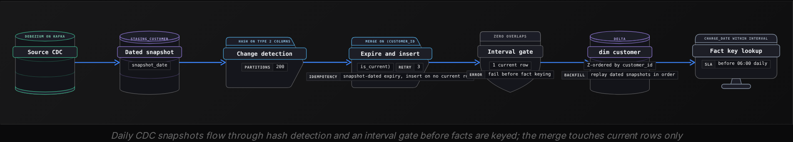

Advanced·Data Modeling · 25 min · 4 challenges

# SCD Strategy: Advanced

You are 40 minutes into a modeling round at a B2B subscription company.
"Our customer table has about 2 million accounts. Sales reps get reassigned, accounts move between regions when territories are redrawn, and tiers change on renewal. Finance says last quarter's regional revenue report changed after the quarter closed. Fix the model."
He turns a laptop toward you with 6 columns of `dim_customer` on screen. Nobody has said which attributes finance reports on, whether a territory redraw is an event or a correction, or whether a closed quarter is allowed to move at all. The first move most candidates make is to announce Type 2 on the whole table, which commits 2 million rows to versioning before anyone has named a single attribute that needs it.
What he is testing is whether you decide history attribute by attribute, and whether you can say what each decision costs.


<br>

### What you will be able to do

Spot the question when it arrives as a disputed closed report, a compliance as-of request or an account that changed territory

Pick a type for each attribute from Types 1 to 3, citing the report that justifies it, and estimate how fast the dimension will grow

Write a Type 2 schema and a merge that survives reruns and backfills, even when changes arrive out of order

Price Type 6 write amplification and name the Type 2 current-view and Type 4 mini-dimension hybrids that replace it

Say when versioning a dimension is the wrong design and what to build instead


<br>

---

## When Dimensions Change

The question almost never says slowly changing dimension. It arrives as a complaint about a report, a question about a customer who moved, or a regulator asking for an as-of view, and the interviewer wants to see you translate the complaint into a decision about one attribute at a time. The moment you hear a historical, point-in-time or audit-trail requirement attached to a dimension attribute, you are in this question.

- "A customer moved cities. How does your model handle that?"
- "A closed quarter's regional revenue moved after sign-off. Why?"
- "Compliance needs the merchant category this account was in on the day of the disputed charge."
- "Sales comp is computed by rep, and reps get reassigned. Who gets credit for March?"
- "Show me what the product catalog looked like at the start of the fiscal year."


<br>

### The same decision under every disguise

Each phrasing asks one thing: when a fact row is read, does the reader need the attribute value that was true when the fact happened, or the value that is true now? If the answer is 'when it happened' for an attribute, that attribute needs versioning. If the answer is 'now', versioning it adds rows that nobody will ever join to. The decision is made attribute by attribute, and the strongest opening says so before naming any type.

The example this lesson keeps returning to is dim_customer at a subscription business with 2 million accounts, joined by fact_subscription_charges, whose grain is one row per customer per charge line per billing period. The dimension carries customer_id, name, city, region, tier and account_owner. Finance reports monthly revenue by region and by tier, and sales operations computes commission by account owner. No published report groups by name or city.

> 4 questions to ask before naming a type
>
> - Which attributes appear in a GROUP BY or a filter of a published report, especially one that gets closed or audited?
> - For each of those, does the report mean the value at the time of the fact, or the value today?
> - How often does each attribute change per entity per year, and is a change an event or a correction?
> - Which published numbers are allowed to move after publication, and who signs off when they do?

| Attribute | Who reads its history | Changes per customer per year | Decision |
| --- | --- | --- | --- |
| name | Nobody | Under 0.1 | Type 1 |
| city | Nobody | 0.2 | Type 1 |
| region | Finance monthly close | 0.3, territory redraws | Type 2 |
| tier | Finance and product | 1.0 | Type 2 |
| account_owner | Sales compensation | 4.0 | Type 2, with a growth estimate |
| previous_region | One reorg comparison dashboard | Same as region | Type 3 column beside region |


<br>

### Events versus corrections

A territory redraw moves Acme Robotics from West to Northwest on 2025-07-01. Both values were true, each for its own period, so this is an event and it deserves a new version. A city stored as 'Portlnd' and corrected to 'Portland' is a correction: the old value never described the world, and inserting a version for it manufactures a history that a point-in-time query will faithfully report as fact. Before you version anything, ask whether the old value was ever true. Corrections overwrite in place even on attributes that are otherwise versioned, which means the pipeline needs a way to tell the 2 apart: a change-reason code from the source, or a rule that an edit to the same attribute within a short window of the original entry counts as a correction.

The part of the answer that reads as judgement is the organizational one. A Type 1 overwrite on `region` rewrites every closed month's regional revenue without a trace, and finance finds out when the Q2 number in the board deck disagrees with the Q2 number in the warehouse. A Type 2 version on `region` freezes closed months, which is what finance wants, and it also means a redraw intended to apply from the start of the year has to be modelled as a backdated change rather than as a version opening today. Say out loud who owns the answer to 'can a published number move', because the model follows that policy rather than setting it.

> **TIP**
>
> State each decision as one sentence with the reason attached: 'Type 2 on region because the monthly close groups by it and closed months cannot move; Type 1 on city because no report groups by it.' A type named without its attribute and its reason scores as recitation.


<br>

---

## Type 1 vs 2 vs 3 Tradeoffs

The types trade 4 things against each other: whether history survives, how many rows the dimension carries, how a query has to be written to read the right version, and how much logic the pipeline needs to produce it. The interview scores the comparison under the constraints you were given, so every tradeoff you name should be tied to an attribute on the table in front of you.

✓Type 1: overwrite in place

- One row per entity, so the dimension stays the size of the entity count
- Old facts read the current value, the same as new ones
- Pipeline is an upsert on the natural key with no date logic
- Right for corrections and for attributes no published report groups by
- Wrong for any attribute in a closed or audited report, because history restates without warning

✗Type 2: new row per version

- One row per entity per version, with a surrogate key per row
- Each fact reads the value that was current when it happened
- Pipeline expires the old row and inserts the new one, with effective dates
- Right for region, tier, owner, anything that attributes revenue or credit
- Wrong for a high-churn attribute without a growth estimate, because rows multiply

Type 1 after the redraw on 2025-07-01

Type 2 after the redraw on 2025-07-01

Run the January 2025 revenue-by-region report against each. Under Type 1, Acme's January charges roll up to Northwest, a region Acme did not belong to until July, and the number finance closed in February has moved. Under Type 2, January charges carry `customer_sk` 1001 and roll up to West, July charges carry 1002 and roll up to Northwest, and the closed month is unchanged. Say this while pointing at the rows: the surrogate key is what makes the point-in-time read correct, because the fact stored a pointer to a version rather than to an entity.


<br>

### Type 3 keeps exactly one prior value

Type 3 adds a `previous_region` column beside `region` and overwrites both on change, so the table holds the current value and the one before it. There are no dates and no extra rows. It answers one question well: compare this year's performance under the new territories against what it would have been under the old ones, on a single row with no self-join. It fails on the second change, when the value before the previous one is gone, and it fails on 'when did it change', because there is no date. Interviewers raise it to test whether you can name those 2 limits. In practice it appears as a column added for one migration dashboard and dropped a year later.


<br>

### Pricing Type 2 before promising it

Dimension growth is the number the comparison turns on, and it's arithmetic you can do at the whiteboard. With 2 million customers whose `tier` changes about once a year, the dimension adds around 2 million versions a year; `account_owner` reassigned 4 times a year adds 8 million. After 3 years the dimension holds around 32 million rows instead of 2 million, which is fine for a warehouse join on `customer_sk` and uncomfortable for every analyst who reads the table with `is_current` forgotten. The attribute that breaks the pattern is one that changes daily, such as a last-activity date or a rolling health score: versioning it turns every customer into 365 rows a year, and the dimension stops being a dimension.

- **730M** — rows a year from one daily attribute

| What the interviewer hears | What it signals |
| --- | --- |
| "I'd use Type 2 for everything" | A memorized default; no growth estimate and no attribute-level reasoning |
| "Type 2 on the table, Type 1 for corrections" | Knows corrections exist, has not priced the churn |
| "Type 2 on region and tier, Type 1 on name and city, growth estimated" | Chooses per attribute and defends each with a report and a number |
| "Owner changes 4 times a year, so I'd estimate before versioning it" | Has watched a dimension balloon and knows the cost arrives at read time |

> The follow-up that tests the Type 1 answer
>
> - Interviewer: 'Why not Type 1 on region and keep the table small?'
> - Answer: 'Because the monthly close groups by region, and an overwrite restates every closed month without anyone being told.'
> - Then name the exception: on a dimension used only for contact details, where no report groups by region, Type 1 is the right call.


<br>

---

## Type 2 with Effective Dates

The conceptual answer is where most candidates stop, so the interviewer escalates to 'write it'. The schema takes about 60 seconds, the merge another 2 minutes, and the follow-ups are where the round is decided, because each one probes a decision the schema makes without saying so.

```sql
CREATE TABLE dim_customer (
  customer_sk    BIGINT GENERATED ALWAYS AS IDENTITY,
  customer_id    VARCHAR(50)  NOT NULL,
  name           VARCHAR(200),
  city           VARCHAR(100),
  region         VARCHAR(50),
  tier           VARCHAR(20),
  account_owner  VARCHAR(50),
  effective_from DATE NOT NULL,
  effective_to   DATE NOT NULL DEFAULT DATE '9999-12-31',
  is_current     BOOLEAN NOT NULL DEFAULT TRUE,
  row_hash       CHAR(32) NOT NULL,
  PRIMARY KEY (customer_sk)
);
```

`customer_sk` is generated by the warehouse and never reused; facts join on it. `customer_id` is the natural key, shared by every version of a customer, and it is what you filter on to list a customer's versions. `effective_from` and `effective_to` define the validity interval. The sentinel `9999-12-31` on the open row is the convention interviewers expect, and it exists because a NULL end date breaks `BETWEEN`: no date is between a value and NULL. `is_current` repeats what the sentinel says, kept because a boolean filter is cheaper to index and cheaper to read than a date comparison. `row_hash` is an MD5 hex digest, which fits `CHAR(32)` (SHA-256 needs `CHAR(64)`), over the Type 2 columns only, so an edit to a Type 1 column such as `name` does not open a version.

Decide the interval convention before you write the merge and say which one you chose. A closed interval on dates, where `effective_to` is the last valid day and the next row starts the following day, reads naturally with BETWEEN and fails when 2 changes land on the same day, because the first version would have to end the day before it began. A half-open interval on timestamps, where `effective_to` of one row equals `effective_from` of the next and the query uses `>=` and `<`, handles intra-day changes and never matches 2 rows at the boundary. The schema above uses dates for readability; a production table at any volume uses timestamps and the half-open form.


```sql
-- Step 0: overwrite Type 1 columns on every version of the customer
UPDATE dim_customer d
SET name = s.name,
    city = s.city
FROM staging_customer s
WHERE d.customer_id = s.customer_id
  AND (d.name IS DISTINCT FROM s.name
    OR d.city IS DISTINCT FROM s.city);

-- Step 1: expire current rows whose tracked columns changed
UPDATE dim_customer d
SET effective_to = s.snapshot_date - 1,
    is_current   = FALSE
FROM staging_customer s
WHERE d.customer_id = s.customer_id
  AND d.is_current  = TRUE
  AND d.row_hash   <> s.row_hash;

-- Step 2: insert a version for every customer with no current row
-- (brand-new customers, and the ones step 1 just expired)
INSERT INTO dim_customer
  (customer_id, name, city, region, tier, account_owner,
   effective_from, effective_to, is_current, row_hash)
SELECT s.customer_id, s.name, s.city, s.region, s.tier, s.account_owner,
       s.snapshot_date, DATE '9999-12-31', TRUE, s.row_hash
FROM staging_customer s
LEFT JOIN dim_customer d
  ON d.customer_id = s.customer_id
 AND d.is_current  = TRUE
WHERE d.customer_sk IS NULL;
```

The interviewer checks 3 details here. Step 0 exists because `row_hash` covers only Type 2 columns, so without it a changed `name` never reaches the table; it overwrites every version, so history shows the corrected name too, and you should say that choice aloud. Expiry reads the staging snapshot date, never `CURRENT_DATE`, so a rerun 3 days later produces the same intervals. And step 2 inserts where no current row exists rather than repeating the hash test, so a second run of the same snapshot inserts nothing. Delta Lake folds steps 1 and 2 into one MERGE, and Snowflake and BigQuery accept the same statement. Its source is the staging rows UNION ALL the changed rows again with a NULL merge key: WHEN MATCHED AND the hash differs THEN UPDATE expires the old row, and WHEN NOT MATCHED THEN INSERT opens the new version.


<br>

### The follow-ups held in reserve

> 4 follow-ups and the sentence that answers each
>
> - Same customer changes twice in one batch: staging carries a change timestamp, and the merge inserts one version per change with half-open timestamps, or keeps only the last and says so.
> - Source corrects a historical value: Type 2 records what the source said, so a correction is a Type 1 overwrite on the affected version with a reason code, never a new version.
> - A change arrives 3 days late with a backdated effective date: split the interval it lands in, and re-key any facts loaded in the gap.
> - Read a customer's region at charge time: join on `customer_sk` if the fact stored it, or on the natural key with the charge date inside the interval if it did not.

The backdated change is the one that separates candidates who have run this from those who have read it. The redraw was effective 2025-07-01, but the source emitted it on 2025-07-04, and 3 days of charges have already been loaded with `customer_sk` 1001. The merge above would open the new version on the 4th and leave July 1 to 3 attributed to West. The correct handling opens the new version on the 1st, closes the old one on June 30, and re-keys the 3 days of facts to 1002, which is an UPDATE on a fact table and the reason the pipeline needs a reconciliation step rather than an append-only load. Say that the fix touches the fact, because that's the cost the interviewer wants named.

```sql
-- Fact stored the surrogate key at load time
SELECT f.charge_date, f.amount, d.region
FROM fact_subscription_charges f
JOIN dim_customer d
  ON d.customer_sk = f.customer_sk;

-- Fact stored the natural key only
-- (half-open timestamps would use >= and < instead)
SELECT f.charge_date, f.amount, d.region
FROM fact_subscription_charges f
JOIN dim_customer d
  ON d.customer_id = f.customer_id
 AND f.charge_date BETWEEN d.effective_from AND d.effective_to;
```

The first form is what the surrogate key buys: the lookup happened once, at fact load, by finding the version whose interval contained the charge date, and every later read is an equi-join with no date logic. The second form is the fallback when the fact carries the natural key, and it is the one a filter on `is_current = TRUE` breaks, because that returns today's region for a charge from 2 years ago. Name both, say which the fact table in front of you supports, and add that the surrogate lookup at load time must use the event date: a charge arriving late is attributed to the version current when it happened, never to the version current when it loaded.


<br>

---

## Hybrid SCD and Type 6

Type 6 comes up when a dashboard needs 2 values on the same row: the tier the customer was in when the charge happened, and the tier they are in today, so that a churn analyst can ask 'of the customers who were Gold in January, how many are Platinum now?' Pure Type 2 answers that with a self-join from the version at charge time to the current version on `customer_id`, and that self-join is what Type 6 removes. The name is Kimball's: 1 plus 2 plus 3, because every row carries a Type 2 history, a Type 1 overwritten current value, and the Type 3 habit of holding 2 values side by side.

| customer_sk | tier | current_tier | effective_from | effective_to |
| --- | --- | --- | --- | --- |
| 1001 | Gold | Platinum | 2023-03-15 | 2025-06-30 |
| 1002 | Gold | Platinum | 2025-07-01 | 2025-09-30 |
| 1004 | Platinum | Platinum | 2025-10-01 | 9999-12-31 |

These are Acme's 3 versions after the region redraw in July and a tier upgrade on 2025-10-01. Walk the rows: `tier` differs by version, which is the Type 2 component. `current_tier` reads Platinum on all 3 rows, because the upgrade overwrote it on every historical row for the customer, which is the Type 1 component. A January charge joined on `customer_sk` 1001 now reads Gold and Platinum from one row with no second join. The interviewer is listening for the word overwrite applied to historical rows, because that overwrite is what Type 6 costs.


<br>

### Write amplification is the cost to name first

Every change to a Type 6 attribute updates `current_*` on every historical row of the entity. A customer with 50 versions costs 50 row updates per change, and a nightly batch of 10,000 changes against customers with that depth of history costs 500,000 row updates. On a row store that is an index-maintenance problem. On Parquet, including Delta and Iceberg tables, it is worse, because an update rewrites the whole file that holds the row, and 500,000 rows spread across the dimension can mean rewriting most of the table every night. The return is a single scan for any 'was X, now Y' question. Price the write against the number of dashboards that ask that question; in most companies it is 1.


<br>

### Hybrids that keep the question and drop the cost

Type 2 with a current view gets the same read without the write: `dim_customer` stays pure Type 2, and `dim_customer_current` is a view or a materialized table of the rows where `is_current = TRUE`, joined on `customer_id` when a query needs today's value. The write amplification disappears and the self-join comes back, which is acceptable because it runs against a 2 million row filtered set rather than the full history. The other hybrid is the Type 4 mini-dimension: take the attributes that churn, such as a monthly engagement band or a health score, out of `dim_customer` into a small `dim_customer_profile` with one row per combination of values, and store its key on the fact at load time. The customer dimension stops growing from churn, the fact carries the profile that was true at charge time, and the mini-dimension holds a few thousand rows regardless of customer count.

| Question the dashboard asks | Choice | Why |
| --- | --- | --- |
| Revenue by region at time of charge | Type 2 | Only the historical value is needed; today's value is irrelevant to the metric |
| Customers who were Gold then and Platinum now | Type 6 on tier | Both values on one row; 5,500 re-tiers a night at 16 versions each is about 88,000 overwrites |
| Before and after the territory redraw | Type 3 column beside region | Only the immediately prior value, for one comparison, no dates needed |
| Engagement band at time of charge, band changes monthly | Type 4 mini-dimension | Churn would multiply the customer dimension 12 times a year |
| Commission by owner at time of charge, current owner on lookups | Type 2 plus current view | No dashboard needs owner then and now on one row, and Type 6 would cost 350,000 overwrites a night, 4 times tier's |

> Answers that cost points
>
> - 'Type 6 is the best type': each type trades something away, and this reads as learned from a blog post.
> - 'I haven't heard of Type 6': know the name and the write cost even if you have never built one.
> - 'Add a current_ column for every attribute': an overwrite you haven't priced, multiplied by the attribute count.
> - 'Materialize current state as a separate table' without saying how it stays in step with the merge.

> **TIP**
>
> The sentence that closes the question: 'Type 6 on tier, because the churn dashboard needs both values: 5,500 re-tiers a night at 16 versions each is 88,000 overwrites. Owner is 22,000 a night, 350,000 overwrites, and no report asks for owner then and now, so it stays Type 2 with a current view.' On Delta both touch most files, so the choice comes down to whether a dashboard asks for both values.


<br>

---

## SCD at Pipeline Scale

The last escalation moves the dimension to 100 million rows with a daily feed of changes, and the question becomes operational: how the merge runs in minutes rather than hours, what happens when it runs twice, and how it recovers when the source sends history out of order. Candidates who have operated this name the failure first and the mechanism second.




<br>

### Change detection in constant time per row

The naive merge compares each staging row against every dimension row for that customer, and at 100 million rows that is a join on the natural key against the full history. The fix has 2 parts. The hash on tracked columns reduces the comparison to 1 equality instead of 1 per column. And the join target is the current rows only, found through an index or a clustering key on `(customer_id, is_current)`, so each staging row touches 1 dimension row. On Delta or Iceberg the equivalent is file pruning plus a Z-order or sort on `customer_id`, and the figure to cite is that a MERGE which can't prune rewrites every file it touches: 10,000 changed customers a night should rewrite the files that hold those 10,000 customers, never the whole table.


<br>

### Reruns and backfills

Reruns are safe for the reason the merge already showed: it reads the snapshot date and never the clock. What a 30-day backfill adds is order. Replay day 13 before day 12, and day 12's merge expires day 13's version with an `effective_to` of day 11, an interval that ends before it begins. Skip day 12, and its changes land in day 13 with day 13's effective date. They're a day late and nothing flags them. So the orchestrator passes the snapshot date as a parameter, refuses to start a backfill with a gap in the dates, and treats a replay of one day as a replay of every day after it.


<br>

### History that arrives out of order

Acme's July 1 redraw showed the single backdated change: split the interval, re-key the facts in the gap. Scale adds the reordered pair. Birch Dental moves Silver to Gold effective 2025-09-15 and Gold to Platinum effective 2025-10-01, and the Platinum change arrives first. Applied in arrival order, the changes leave Gold as the current version, with Platinum closed behind it. The repair sorts a customer's pending changes by effective timestamp, rebuilds its intervals from the earliest affected date (Silver to 09-14, Gold to 09-30, Platinum open) and re-keys facts from 09-15. The gate catches what the repair misses, and the interviewer will ask you to write it.

```sql
-- Two versions of one customer valid on the same day
SELECT a.customer_id, a.customer_sk, b.customer_sk
FROM dim_customer a
JOIN dim_customer b
  ON  a.customer_id = b.customer_id
 AND a.customer_sk < b.customer_sk
 AND a.effective_from <= b.effective_to
 AND b.effective_from <= a.effective_to;

-- Zero or 2 current rows for one customer
SELECT customer_id, COUNT(*) AS current_rows
FROM dim_customer
WHERE is_current = TRUE
GROUP BY customer_id
HAVING COUNT(*) <> 1;
```

The second query catches the failures that leave 2 current rows: a hash-keyed insert that committed after its expiry was rolled back, 2 overlapping merge runs on one snapshot, or an interval repair that opened a version without closing the one it split. Joins on `customer_sk` are unaffected, but every natural-key join and the fact-key lookup match both rows, so each new charge for that customer loads twice. That's why the gate sits before fact keying, and it costs a few seconds against a clustered table.


<br>

### When versioning the dimension is the wrong design

The answer that reads as scope includes the case where Type 2 should not be built. If the source already emits an event stream, such as a subscription-changed topic with timestamps, the versions are derivable from the events and the dimension is a projection that can be rebuilt; versioning it separately creates a second history that will one day disagree with the first. If several attributes churn daily, a full snapshot of the dimension partitioned by date is cheaper to operate than a merge: an as-of query reads 1 partition, there is no interval logic to get wrong, and a rerun overwrites 1 partition. The snapshot costs about 1 copy of the dimension per day, which on object storage priced near 2 cents per gigabyte-month is usually cheaper than the engineering time the merge consumes. And if the only consumer of history is an audit team that asks twice a year, an append-only change log with no dimension versioning may satisfy them at a fraction of the cost.


✓Do

- For each attribute, pick the type that its report and its churn rate justify
- Hash only the Type 2 columns, so a Type 1 correction never opens a version
- Read expiry dates from the snapshot, never from the clock, so reruns and backfills match
- Gate every load on zero overlaps and exactly 1 current row per entity
- Estimate dimension growth per year before promising Type 2 on any attribute

✗Don't

- Default to Type 2 on a whole table without naming which attribute needs it
- Filter a point-in-time join on is_current, which returns today's value for old facts
- Promise Type 6 without pricing the overwrite across historical rows
- Version a correction, which manufactures a history that was never true
- Build a merge when the source already emits an event stream you can project


<br>

---

## Putting It All Together

A payments company keeps a merchant dimension of 40 million accounts. Risk re-tiers merchants monthly, a merchant category code changes when a merchant changes its line of business, and the merchant's assigned account manager changes about 3 times a year. A card network dispute arrives for a transaction 14 months old and asks which category the merchant was in on that day, finance reports interchange revenue by category and tier in a close that cannot move, and the risk team wants a dashboard of merchants whose tier was High at onboarding and is Low now.

- The dispute and the close both need the value at the time of the fact, so category and tier are Type 2, and the transaction fact carries the version key assigned by transaction date. The merchant's display name and support phone are Type 1.
- The risk dashboard's then-and-now question fits Type 6 on tier only if monthly re-tiering is cheap across each merchant's history; at 12 changes a year the overwrite rewrites the dimension nightly, so tier goes Type 2 with a current view.
- The account manager at 3 changes a year adds 120 million versions a year, which is where the growth estimate decides between Type 2 on the dimension and a Type 4 mini-dimension keyed on the fact.
- The dispute 14 months back is safe only if the merge never read the clock and the interval gate held every night, because 1 merchant with 2 current rows would have doubled its revenue in the close.
- If the risk system publishes a tier-changed event stream, the tier history is a projection of those events, and a separate Type 2 history for it is a second copy that will eventually disagree with the first, so argue against building it.


<br>

---

## Key Takeaways

- SCD is decided per attribute. Version what a closed or audited report groups by and overwrite the rest, and be ready to give the reason for each.
- A Type 2 fact stores a pointer to a version; the surrogate key assigned at load by event date is what makes closed months stay closed.
- The merge reads the snapshot date and hashes only tracked columns. Because it inserts only where no current row exists, a rerun or backfill gives the same result as the first load.
- Type 6 buys a single-row then-and-now read with an overwrite across every historical row; price it, and reach for a current view or a mini-dimension when churn is high.
- At scale the answer names the gate: zero overlapping intervals, exactly 1 current row per entity, and a repair path for changes that arrive late.
