Advanced·Pipeline Architecture · 35 min · 11 challenges

# Batch vs Streaming: Advanced

Suppose LinkedIn's profile-view counter were built from 2 jobs: a nightly batch over every view ever logged and a stream job counting today's. On Tuesday they disagree by 340 views for one member, because last week's bot filter change landed in the batch code only. This lesson is about how a pipeline ends up with 2 answers, and how it gets back to 1.


<br>

---

## Lambda Architecture

### Three layers that answer one question

Lambda architecture computes every answer twice and merges the 2 results. The batch layer keeps an append-only master dataset of every event ever received and periodically recomputes a batch view from scratch over all of it. The speed layer processes events as they arrive and keeps a realtime view covering only the events the last batch run has not yet absorbed. The serving layer merges the 2 views at query time: a recomputed answer plus a thin slice of recent data.

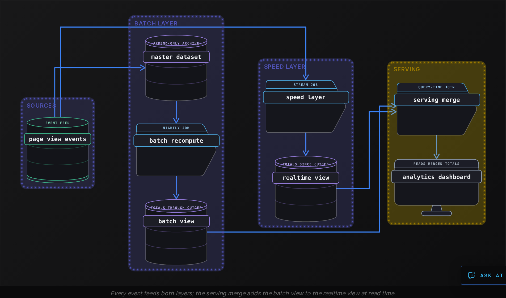


<br>

### A worked merge

Take a news site counting views per article. The batch job runs at 01:00 and recomputes every article's total from the master dataset up to midnight. The speed layer counts views per article since the last cutoff; once a batch view covering up to midnight lands, it drops its counts from before midnight and keeps the rest. At 15:00 the serving layer adds the 2, and article a-1101, published at 09:00, has no batch row yet.

| article_id | batch view (through 00:00) | realtime view (since 00:00) | served total |
| --- | --- | --- | --- |
| a-1042 | 1,208,311 | 4,517 | 1,212,828 |
| a-1077 | 88,402 | 12,960 | 101,362 |
| a-1101 | no row | 2,344 | 2,344 |

```sql
SELECT
  COALESCE(b.article_id, s.article_id) AS article_id,
  COALESCE(b.views, 0) + COALESCE(s.views, 0) AS served_views
FROM batch_view AS b
FULL OUTER JOIN realtime_view AS s
  ON s.article_id = b.article_id
```

Lambda's correctness comes from the batch side of the merge. A speed-layer mistake, such as a view double-counted after a crash, survives only until the next batch run, because the batch view is recomputed from the master dataset without reading the speed layer's output. Whatever the realtime view gets wrong, the next recompute replaces, so the team can throw that view away at any time.


<br>

### The constraints of 2012

Nathan Marz, whose stream engine Twitter open-sourced in 2011, laid out the design in a blog post that year and named it Lambda in his later book. It answered the limits of that era's engines: a crash could redeliver a message into a running count that then stayed wrong for good, stream state lived in process memory and vanished on restart, and no batch engine could recompute years of events fast enough to serve recent data, so recency needed a second path.

| ✓ Constraint in 2012 | ✗ Same constraint today |
| --- | --- |
| • A crash could replay a message into a count that had already absorbed it<br><br>• Stream state lived in worker memory and vanished on restart<br><br>• A full recompute took longer than the freshness consumers accepted<br><br>• The event feed kept hours of data, so history lived only in the archive | • Engines checkpoint state and read position together, so a restart resumes without double counting<br><br>• State is persisted to local disk and checkpointed, holding billions of keys<br><br>• Recompute is a replay of the log through the same job, at many times the live rate<br><br>• Logs retain weeks or months, so the log itself can be the history |

> The cost of a second codebase
>
> - Every metric definition exists twice, and both forms must change on the same day
> - A fix in one layer only leaves served totals right in one slice and wrong in the other
> - Two runtimes mean 2 sets of failure modes, on-call skills and capacity plans

Lambda bought correctness a single stream job could not deliver, and paid with 2 implementations of every rule. Once a stream job could survive a crash without corrupting its counts and the log could hold months of history, replaying the stream job itself could do the batch layer's recompute. That design is next.

**A product manager wants views from known crawler IP ranges excluded from article totals starting today. Under the Lambda design above, what is the smallest change that makes served totals correct from tomorrow on?**

- **A.** Add the filter to the speed layer only; tonight's batch recompute picks it up, since the master dataset holds every raw event.
- **B.** Add the filter to the batch recompute only, since the nightly batch view replaces whatever the speed layer got wrong.
- **C.** Add the filter to both the batch recompute and the speed layer, and accept mixed totals today until the 01:00 run rebuilds the batch view.
- **D.** Add the filter to the serving merge query, so both views are corrected at read time without touching either layer.

<details>
<summary>Solution</summary>

**C.** Add the filter to both the batch recompute and the speed layer, and accept mixed totals today until the 01:00 run rebuilds the batch view.

Both implementations hold the rule, so both must change; the mixed window closes when the batch view is recomputed with the new code.

**Why the others are wrong**

- **A.** The batch recompute reads the master dataset through its own code, so it keeps counting crawlers until that code changes too.
- **B.** The error recurs daily: every served total includes crawler views counted since 00:00 by the unfixed speed layer.
- **D.** The views hold counts per article, with no IP column; the merge can't subtract rows it never sees.

</details>


<br>

---

## Pipeline Architecture

### Exercise 1 of 2

**● TASK**

The canvas holds a Lambda architecture missing its third layer: an immutable Kafka log feeds a nightly Hadoop batch view in Snowflake and a Flink speed view in Redis, and the dashboard reads both separately. Add a serving-layer store (HBase, Cassandra or DynamoDB) that merges the batch view, up to the last batch run, with the speed view, for everything since. The dashboard reads only from that store; leave the batch and speed layers unchanged.

**Starting canvas** (already placed for you):

- Kafka master event log (immutable) (source, Kafka)
- Hadoop nightly batch view (transform, Hadoop)
- Flink speed view (approximate) (transform, Flink)
- Snowflake batch_view_canonical (storage, Snowflake)
- Redis speed_view_delta (storage, Redis)
- Analytics dashboard (consumer, Metabase)

<details>
<summary><strong>Solution</strong></summary>

#### The serving layer is the piece that makes Lambda one system

Lambda architecture has 3 layers, and the section just walked you through all three. The **batch layer** (`Hadoop` recomputing over the immutable `Kafka` log into `batch_view_canonical`) is accurate but hours stale. The speed layer (`Flink` producing an approximate `speed_view_delta` in `Redis`) is fresh but only covers what happened since the last batch run. The third layer, the one you had to add, is the serving layer: a single store the dashboard queries that stitches those two views into one answer. Without it you don't have Lambda, you have two half-answers wired to the same screen.

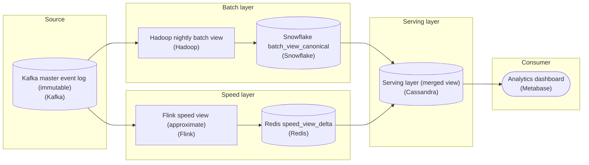

*The completed Lambda pipeline: one serving-layer store takes both views, and the dashboard reads only from it.*

| Trick: The merge rule is a time boundary, not a blend |
| --- |
| The serving layer doesn't average the two views. It reads `batch_view_canonical` for everything up to the last batch run, and `speed_view_delta` for everything since. That single watermark is why the speed layer is allowed to be approximate: every batch run re-derives those recent events exactly from the `Kafka` log and overwrites the estimate, so the approximation only ever lives for one batch window. The serving layer is where that hand-off happens on every query. |

| Pitfall: Merging in the consumer just moves the drift |
| --- |
| The broken starting state is the tell: the dashboard queried `Snowflake` and `Redis` separately and got inconsistent numbers. It's tempting to "fix" that in the dashboard, fetch both and merge in the query, but that pushes the merge logic into every consumer, and the next consumer reinvents it (differently). The whole point of the serving layer is that the merge is done once, in one place, and the dashboard reads a single clean view. The correct delta was one new storage node with two inbound edges, not a change to how the dashboard reads. |

| ✕ Batch view alone | ✓ Speed view alone |
| --- | --- |
| `batch_view_canonical` is recomputed from scratch over the full immutable log, so it is exact and self-correcting, but it is as stale as the nightly `Hadoop` run. Ask it about the last hour and it has nothing. | `speed_view_delta` is fresh to the second, but it is incremental and approximate, and it only holds events since the last batch run. Ask it about last month and it has nothing. Neither view is a complete answer alone, which is exactly why the serving layer takes both. |

| Real world: A key-value store serves, a warehouse recomputes |
| --- |
| The serving layer is chosen for low-latency reads by key, not for recompute, so a wide-column or key-value store (`HBase`, `Cassandra`, `DynamoDB`) fits, while a warehouse like `Snowflake`, great for the batch view, is the wrong tool to sit in front of a live dashboard. It also stays separate from the `Redis` speed view: that store holds a working delta, not the merged answer every consumer should read. |

**Follow-up questions**

1. What happens the moment a nightly `Hadoop` run finishes and publishes a new `batch_view_canonical`?\
   *Tests whether you see that the batch watermark advances and the now-superseded portion of `speed_view_delta` can be expired.*
2. If a new consumer needs the same merged numbers, where does its merge logic live?\
   *Reinforces that the serving layer merges once so no consumer reimplements the batch and speed hand-off.*

</details>


<br>

### Exercise 2 of 2

**● TASK**

One Flink job turns the Kafka orders log into a live view, but the log keeps only days, so a bug fix needing a month of replay cannot run. Back the log with tiered object storage holding 12 to 24 months of events. Add a parallel warehouse view the corrected stream job replays the log into while the live view keeps serving, then cut the dashboard over once it validates. Keep it Kappa: no batch layer, replay runs through the same streaming code.

**Starting canvas** (already placed for you):

- Kafka orders event log (in-cluster retention, days) (source, Kafka)
- Flink streaming pipeline v1 (transform, Flink)
- Snowflake mart_orders_v1 (storage, Snowflake)
- Orders dashboard (consumer, Looker)

<details>
<summary><strong>Solution</strong></summary>

#### Kappa: replay is the whole point

Kappa keeps one code path and treats batch as nothing more than a **replay** of the event log through the same streaming job. The reason your v1 system could not fix a month-old bug is that the log was the weak link: Kafka's in-cluster retention held only a few days, so there was no history to replay. The 2 edits you made both serve that single idea: make the log durable enough to replay, and make room to replay into a fresh view without touching the live one.

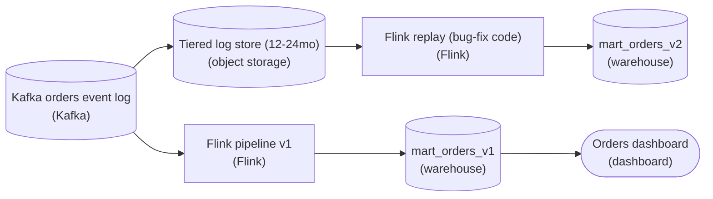

*Live v1 keeps serving while the fixed job replays the tiered log into `mart_orders_v2`; the dashboard cuts over only after v2 catches up to live and validates.*

Edit one, tiered storage, is what buys the replay. Offloading old log segments to object storage lets the log affordably hold a year or 2 of events instead of days, so a bug fix or schema migration can replay the full window. Edit two, the parallel `mart_orders_v2`, is what makes replay safe: the corrected job backfills a second view while `mart_orders_v1` keeps feeding the dashboard uninterrupted. Cutover is a read switch, not a rebuild.

| Pitfall: A batch layer is not the fix |
| --- |
| The instinct is to bolt on a Spark batch job to reprocess history. That is Lambda, and it forces you to maintain the transform logic twice and reconcile 2 answers. Kappa refuses the second code path: the same Flink job that runs live is the one you replay. The prompt bars the batch layer for exactly this reason. |

| Real world: v2 is a temporary lane, not a fork |
| --- |
| In production the parallel view is short-lived. You spin up `mart_orders_v2`, replay, diff it against `mart_orders_v1` at the live tip, flip the dashboard, then retire v1. Standing up a permanent second pipeline is how a clean Kappa cutover quietly becomes 2 systems to babysit. |

**Follow-up questions**

1. How do you know `mart_orders_v2` has actually caught up to live before cutting the dashboard over?\
   *Tests understanding that replay must reach the live offset and be validated, not just finish.*
2. What breaks about replay if the orders events are not keyed and partitioned to preserve per-order ordering?\
   *Connects tiered-log replay to stream-processing correctness under reordering.*

</details>


<br>

---

## Kappa: Stream Only, Batch Replay

### One job, one log, one codebase

Kappa architecture removes the batch layer and keeps the log. Every event is written to an append-only log that retains messages for a configured window, and a single stream job reads it and maintains the output table. To change logic or undo a bug, the team starts a second copy of the job at the oldest retained position, lets it rebuild a fresh output table from history, and points consumers there once it catches up. Recomputation becomes replay: the program that handles live data handles history too.

*Jay Kreps named the pattern in 2014, while at LinkedIn, in the article Questioning the Lambda Architecture, written as a response to the 2-codebase cost.*

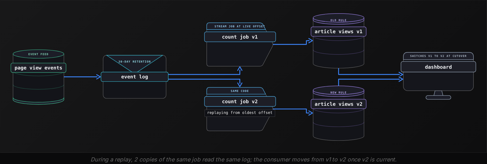


<br>

### A replay with numbers

The news site receives 2,000 views per second on average, and its log retains 30 days, 5.18 billion events. The crawler filter ships as job v2, reading from the oldest retained offset. A replaying job never waits for events, so it runs as fast as the engine and output table allow. At 100,000 events per second it gains on the log head at a net 98,000, because new views keep arriving, and catches up after roughly 52,900 seconds, 14.7 hours. Meanwhile v1 serves the dashboard with the old rule.

| clock | job v1 | job v2 | dashboard reads |
| --- | --- | --- | --- |
| Mon 09:00 | live, old rule | started at oldest offset, 30 days behind | article_views_v1 |
| Mon 17:00 | live, old rule | 8 hours in, about 17 days replayed | article_views_v1 |
| Mon 23:41 | live, old rule | caught up, now live | article_views_v1 |
| Mon 23:45 | live, old rule | live | article_views_v2 (switched) |
| Tue 09:00 | stopped, table dropped | live, the only copy | article_views_v2 |

Lambda needed 2 edits, 2 deploys, a nightly run and a check that the views agree; Kappa needs 1 edit, 1 deploy and a table swap. The replay was also the test: v2's output over 30 days of real history sat beside v1's before any consumer switched, and diffing the 2 tables shows which articles moved and by how much.


<br>

### Retention sets the replay horizon

The master dataset lived in a file archive that cost little and kept everything. The log is built for many sequential readers at once, replicates each message to several brokers so a disk loss drops nothing, and holds those bytes on the disks of brokers serving live traffic. A site writing 1TB of events a day with 3 replicas pays for 3TB of broker disk per retained day. Retention is a budget, and the replay horizon is exactly that budget: a bug found 45 days after it shipped can't be undone by replaying a 30-day log.

- **21TB** — replicated log, 7-day retention
- **270TB** — replicated log, 90-day retention

The plain Kappa answer keeps retention long and pays the broker bill, which works while volume is modest. Another option keeps a short hot window in the log, copies older events to cheap files, and teaches the job's reader to read the archive first and switch to the log at the archive's last offset: 1 transform, 2 input readers, and a handoff seam where each event must appear once. A team can also accept a bounded horizon and patch older history by hand. Each choice states how far back the team expects to recompute.

**A Kappa pipeline retains 14 days of events. On day 60 the team finds that a deploy on day 15 has been dropping events from one app version. Which statement about recovery is correct?**

- **A.** Replaying the log rebuilds days 46 through 60 correctly; days 15 through 45 stay wrong unless an archive outside the log still holds those events.
- **B.** Replaying the log from its oldest offset rebuilds all 45 affected days, because the stream job reads history and live data with exactly the same code.
- **C.** Replaying is unnecessary, because the fixed job corrects the stored counts as new events arrive and the window rolls forward.
- **D.** Replaying the log rebuilds all 45 days, as long as the replay job is started before the current 14-day window rolls past day 60.

<details>
<summary>Solution</summary>

**A.** Replaying the log rebuilds days 46 through 60 correctly; days 15 through 45 stay wrong unless an archive outside the log still holds those events.

The replay horizon is the retention window, 14 days, so only events written since day 46 still exist in the log.

**Why the others are wrong**

- **B.** The code is the same, but the oldest offset in a 14-day log is day 46; earlier events were deleted.
- **C.** A fix applies to events the job sees from the offset it starts at; counts already written for days 15 through 59 stay as they are.
- **D.** Retention is measured from each message's write time; day 15's events were deleted on day 29 regardless of when a replay starts.

</details>


<br>

---

## Pipeline Architecture

### Exercise 1 of 2

**● TASK**

Replace the Spark batch and Flink streaming transforms that each compute the same order aggregation with one Apache Beam transform, so a logic change lands in both dashboards at once. It feeds the daily warehouse view on a batch rhythm (under 24h) and the live warehouse view on a streaming rhythm (under 1 minute), chosen by configuration alone, with Spark and Flink gone from the production path.

**Starting canvas** (already placed for you):

- Kafka orders log (source, Kafka)
- Plain Spark nightly batch (transform, Spark)
- Flink streaming live aggregation (transform, Flink)
- Snowflake daily_orders_v1 (storage, Snowflake)
- Snowflake live_orders_v1 (storage, Snowflake)
- Daily executive dashboard (consumer, Looker)
- Live ops dashboard (consumer, Looker)

<details>
<summary><strong>Solution</strong></summary>

#### One transform, two clocks

Apache Beam's **unified batch-and-streaming model** lets one aggregation serve both dashboards. Beam treats its input as a `PCollection`. A bounded one is a finite slice of the Kafka log; an unbounded one is the live tail. The transform in the middle never checks which kind it has. The daily view and the live view stop being two codebases that drift apart and become two deployments of the same `order_totals`. The rhythm is a single flag: `PipelineOptions(streaming=...)` chooses a run-to-completion job or a long-lived one, and the source binding follows that choice.

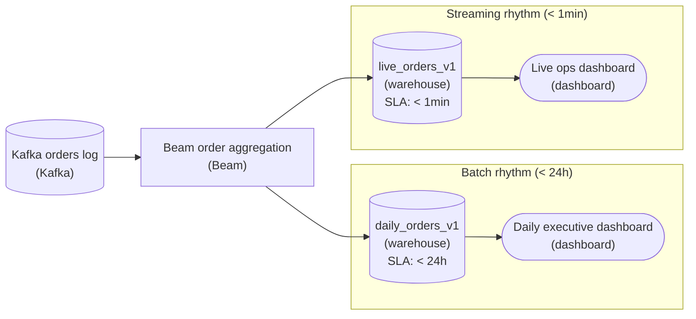

*One Beam transform, deployed twice: the `daily_orders_v1` warehouse view refreshes within 24h and the `live_orders_v1` warehouse view refreshes within a minute. Spark and Flink are out of the production path.*

**`order_totals`, defined once**

```python
# ONE transform definition, shared by both deployments
def order_totals(orders):
    return (
        orders
        | "Window" >> beam.WindowInto(FixedWindows(60))
        | "SumPerRegion" >> beam.CombinePerKey(sum)
    )

# The rhythm is chosen by configuration, not by a second codebase
options = PipelineOptions(streaming=cfg.streaming)   # True -> live, False -> daily
source = read_unbounded(cfg) if cfg.streaming else read_bounded(cfg)
sink = write_warehouse(cfg.table)                    # live_orders_v1 or daily_orders_v1

with beam.Pipeline(options=options) as p:
    order_totals(p | source) | sink
```

*`FixedWindows(60)` and `CombinePerKey(sum)` are identical in both rhythms, so a window total means the same thing in both tables.*

| ✕ Batch rhythm (daily) | ✓ Streaming rhythm (live) |
| --- | --- |
| A bounded `PCollection` over a fixed range of offsets. Each window fires once, on complete data. Each run fully recomputes the day into `daily_orders_v1`. | An unbounded `PCollection` with `streaming=True`. The same windows fire incrementally as the watermark advances and land in `live_orders_v1` within a minute. Allowed lateness lets a late order reopen its window. |

| Pitfall: Appending re-fired windows double-counts |
| --- |
| Both rhythms rewrite the same window keys. The batch job does this on every rerun, and the stream does it whenever a late order reopens a window. With an append sink, each rewrite adds the total a second time. Instead, upsert on the window and the region, the same key `CombinePerKey` grouped on. A re-fired window then replaces its row, so reruns and late data are both safe. |

| Real world: Freshness becomes a config toggle, not a fork |
| --- |
| One team owns `order_totals`. Choosing between a cheap, exact daily table and a fresh, provisional live table becomes a deployment decision. Teams adopt Beam to remove exactly this kind of drift: two codebases computing one metric in two subtly different ways, with nobody able to say which dashboard is right. |

**Follow-up questions**

1. A late order arrives after the nightly run has written `daily_orders_v1`. Which tier is the source of truth?\
   *The batch view is the eventually-correct record; the live view is fast but provisional.*
2. Should both deployments use the same allowed-lateness bound?\
   *The late-data policy belongs to each rhythm's configuration, not to the shared `order_totals`.*
3. One slow Kafka partition holds back the live job's watermark. What stalls?\
   *Links per-partition progress to when streaming windows can fire.*

</details>


<br>

### Exercise 2 of 2

**● TASK**

Kafka events land in an S3 raw zone within 15 minutes and roll up into a Snowflake curated layer, refreshed daily, behind the executive dashboard. Rewire the live operations dashboard, which must reflect activity within minutes, and the ML inference service, whose features may be at most 2 hours old, onto feeds fast enough for them. Then label every node with the freshness tier it can honestly deliver; no node may promise fresher data than what feeds it.

**Starting canvas** (already placed for you):

- Kafka events log (source, Kafka)
- S3 raw events (storage, S3)
- Snowflake curated daily aggregate (storage, Snowflake)
- Snowflake live 5-min mart (storage, Snowflake)
- ML features serving (storage, Feast)
- Daily executive dashboard (consumer, Looker)
- Live ops dashboard (consumer, Looker)
- ML inference (consumer, API)

<details>
<summary><strong>Solution</strong></summary>

#### The freshness contract

Per-node freshness tiering rests on one rule: a dataset can be **no fresher than the input feeding it**, so freshness only holds or decays as you move downstream. The starter broke that rule twice. `Snowflake live 5-min mart` advertised '< 1min' while nothing fast fed it. `ML features serving` hung off the once-a-day curated rollup, even though inference needs features under 2 hours old.

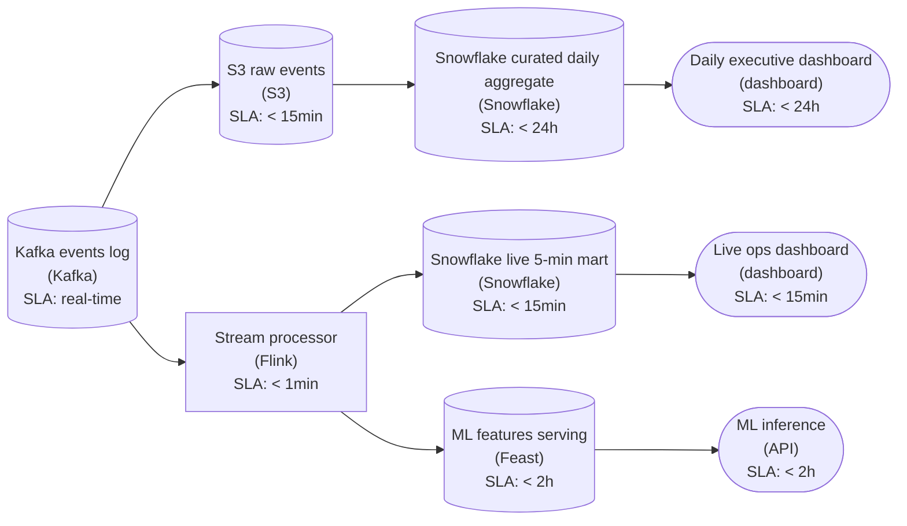

*One `Kafka` source, 2 clocks: a daily batch path through the raw zone, and a `Flink` streaming path for the 2 fast consumers. Every tier holds or relaxes going downstream.*

The fix gives each consumer the clock it needs. The batch path keeps its cadence: `Kafka events log` lands in `S3 raw events` at '< 15min', which rolls up into `Snowflake curated daily aggregate` at '< 24h' for the executive dashboard. A `Flink` stream processor reads the same topic at '< 1min' and feeds both fast consumers. The live mart sits at '< 15min', which is what a five-minute mart honestly delivers. `ML features serving` sits at '< 2h', inside the inference window. Follow any edge and the label never gets fresher downstream.

| Key insight: Same source, 2 clocks |
| --- |
| This is the Lambda shape again: one `Kafka` topic fans out into a batch layer tuned for complete, cheap daily rollups and a streaming layer tuned for latency. You do not speed up the daily rollup to serve the live mart. You give the fast consumers a parallel streaming path and let each layer keep the tier it can afford. |

| Pitfall: A label is a promise its feed must keep |
| --- |
| The starter's '< 1min' on the live mart was aspirational, not achievable, because nothing sub-minute fed it. Label a node with what its slowest input can actually deliver, not with what its consumer wishes for. When a downstream tier is tighter than the feed, the answer is a new feed, not a braver label. |

**Follow-up questions**

1. If the feature window tightened from 2 hours to 5 minutes, what tier could `ML features serving` honestly carry, and does its feed already support it?\
   *Routing a consumer by the freshness it needs, then checking the label against the feed.*
2. The executive dashboard now wants hourly instead of daily numbers. What changes upstream before you can relabel `Snowflake curated daily aggregate`?\
   *The label follows the pipeline's real cadence, not the other way round.*

</details>


<br>

---

## Unified Engines: Where Lines Blur

### One transform, bounded or unbounded input

A unified engine treats a batch as a stream that happens to end. The transform is written once as a graph of operators, filters, projections, grouped aggregations and joins, and the engine decides at launch whether to feed that graph a bounded input, such as a month of files, or an unbounded one, such as a live log. Only the launch parameters change between the 2 runs.

```sql
views = source("page_views")

per_article = (
    views
    .filter(lambda e: not e["is_crawler"])
    .group_by("article_id")
    .count()
)

run(per_article, mode="batch", input="archive/2026-10")
run(per_article, mode="stream", input="log/page_views")
```

A declarative query works the same way: the grouped count below fully describes the result in both modes, and the engine builds the same operator graph from it.

```sql
SELECT
  article_id,
  COUNT(*) AS views
FROM page_views
WHERE is_crawler = FALSE
GROUP BY article_id
```

The engine unifies the language and operators: a developer learns 1 API, and an aggregation means the same thing over finished or ongoing input. It unifies testing, because the stream job can run over a bounded sample file and be checked against a hand-computed answer. It also unifies sources and sinks, since a connector for a bounded file and one for a log present the same interface to the operator graph.


<br>

### Execution still differs

Execution is where the 2 modes part. In batch mode the query above reads every row, emits exactly 1 row per article, and exits. In stream mode it emits a row for a-1042 when the first view arrives, then a replacement row every time that count changes, for as long as the job lives. A consumer that appends each emitted row ends up with thousands of rows for 1 article, so it must replace by key. The query is identical, but batch mode writes a table once and stream mode writes a changelog that never ends.

| aspect | batch run | streaming run |
| --- | --- | --- |
| input | bounded, fully known before the job starts | unbounded, arriving while the job runs |
| operator lifetime | stage by stage, each finishing before the next | every operator alive at once, pipelined |
| state | sort and shuffle files for 1 job, discarded at exit | local stores, checkpointed, kept across restarts |
| state size bound | the input size | the distinct key count, growing until keys expire |
| failure recovery | rerun the failed stage from its materialized input | restore the last checkpoint, reread the log from that offset |
| output | the complete result, written once | a changelog of inserts and replacements, written continuously |
| resources | a burst, released at exit | a reservation held around the clock |
| ends when | the input is consumed | someone stops it |

The state rows bite hardest. A batch grouped count over 30 days of views holds a count per article while it runs, then frees it. The streaming version holds that count for the job's whole life, often months, so an article published in January still occupies state in October whether anyone views it or not. A join between 2 streams must hold one or both sides in state until a match can arrive, where a batch join sees both sides complete in one pass. Stateful transforms are where the same code stops meaning the same cost.

For architecture, the unified engine shrinks Lambda's cost without settling the design question. With 1 codebase, a batch recompute beside a stream job is a second launch of the same program. Recompute versus replay becomes a storage question, whether history is replayed from the log or re-read from an archive, and section 4's migration puts numbers on it.

**A team writes a running count of views per article, with no window, tests it over a 2-hour sample file, and deploys it in stream mode. Which runtime difference is most likely to surprise them in production?**

- **A.** The grouped count emits a different final number per article in stream mode than in batch mode for the same input, because streaming aggregations are approximate.
- **B.** The stream run cannot be recovered after a crash, while the batch run can be rerun from its input files, so every crash loses the counts accumulated so far.
- **C.** The stream job emits exactly 1 row per article once its input is fully read, so the sink can append the rows safely without replacing by key.
- **D.** State grows with the number of distinct articles seen and does not shrink unless keys are expired, while the batch test held state only for the sample's articles and freed it at exit.

<details>
<summary>Solution</summary>

**D.** State grows with the number of distinct articles seen and does not shrink unless keys are expired, while the batch test held state only for the sample's articles and freed it at exit.

The sample bounded the state by its input; in production the bound is the distinct key count over the job's whole life.

**Why the others are wrong**

- **A.** The semantics are unified; given the same complete input, both modes arrive at the same final count.
- **B.** Stream recovery restores the last checkpoint and rereads the log from that offset; the counts survive.
- **C.** A live log is never fully read; each change to an article's count emits a replacement row, so appending leaves many rows per article.

</details>


<br>

---

## Pipeline Architecture

### Exercise 1 of 2

**● TASK**

Migrate the Lambda engagement pipeline on the canvas to Kappa, keeping every Lambda node in place: both paths run until the dashboard cuts over. Back the Kafka event log with tiered storage in S3 so it can replay the longest backfill window. Add one exactly-once Flink pipeline that reads the log and writes a single Iceberg materialized view feeding the dashboard, the one path that will replace both Spark jobs.

**Starting canvas** (already placed for you):

- Kafka content_events (source, Kafka)
- S3 master event log (storage, S3)
- Spark nightly batch view builder (transform, Spark)
- Spark Streaming speed view (transform, Spark)
- Cassandra batch_view (storage, Cassandra)
- Cassandra speed_view (storage, Cassandra)
- Lambda serving merge (consumer, Looker)
- Content engagement dashboard (consumer, Looker)

<details>
<summary><strong>Solution</strong></summary>

#### What Kappa actually removes

Kappa architecture is Lambda with the batch layer deleted. Lambda kept 2 code paths because the log was not a reliable source of truth: the nightly `Spark` batch job rebuilt the accurate daily view from the full event log, and a separate `Spark Streaming` speed view filled the gap with an approximation until batch caught up. The serving layer then merged the 2 on read, and that merge is where your 0.4 percent drift lives. Kappa says: if the log is durable and long enough, one streaming pipeline reading it end-to-end is both the live view AND the reprocessing tool. A backfill or a bug fix is not a second job, it is the same `Flink` pipeline replaying `content_events` from an earlier offset.

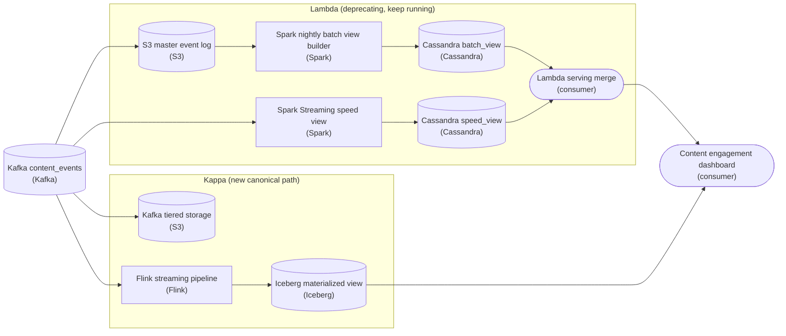

*Both paths share the one `content_events` source and feed the same dashboard. The Kappa path runs alongside Lambda until consumers cut over.*

1. **Make the log long enough to be the source of truth**

   The whole reason Lambda needed a batch layer was that the streaming log could not hold enough history to replay a full rebuild. Backing `Kafka content_events` with tiered storage in `S3` moves cold segments off broker disk at object-store prices, so the log can retain the longest backfill window you will ever need. That single change is what lets one pipeline do both the live and the reprocessing work. Without it, you are still Lambda.

2. **Collapse the 2 Spark jobs into one Flink pipeline**

   A single `Flink` streaming pipeline reads `content_events` and computes the engagement view end-to-end. The thing that makes this replace the accurate batch job, not just the approximate speed view, is exactly-once semantics: `Flink`'s checkpoint-plus-transactional-sink guarantees each event lands in the output exactly one time even across failures and replays. That is why you no longer need a nightly Spark pass to correct the stream: one pipeline is authoritative.

3. **Serve one canonical view instead of merging two**

   `Flink` writes an `Iceberg` materialized view on object storage as the single view, and the dashboard reads it directly. This deletes the read-time merge of `Cassandra batch_view` and `Cassandra speed_view` that produced the drift. `Iceberg`'s snapshot isolation means a replay can rewrite partitions while the dashboard keeps reading a consistent snapshot, so a backfill never shows a half-updated view.

| Pitfall: Lambda stays up until consumers cut over |
| --- |
| The tempting move is to rip out `Spark`, `Cassandra`, and the Lambda serving merge the moment the `Flink` path is drawn. The migration order is explicit that both stay running until consumers cut over: you validate Kappa by comparing its `Iceberg` output against the live Lambda view before the old path is retired. Cut the old path early and a single `Flink` bug is a full outage with nothing to fall back to. |

| Real world: The enabling shift is the storage bill |
| --- |
| Kappa was proposed in 2014 but stayed impractical because retaining months of log on broker-attached disk was ruinously expensive. What changed is not the diagram: Kafka tiered storage and cheap object tiers made long retention affordable, and engines like `Flink` gave you exactly-once so the stream could be authoritative. When you justify this migration, lead with the constraint that shifted, not with 'one codebase is nicer'. The second on-call rotation and the drift are symptoms; the retention economics are the cause. |

**Follow-up questions**

1. A late-arriving `content_events` record shows up three days after its event time. How does the `Flink` plus `Iceberg` path fold it in without a nightly batch correction?\
   *Event-time windows and Iceberg partition rewrites as the replacement for Lambda's batch reconciliation.*
2. You need to backfill after fixing a bug in the engagement logic. What exactly do you replay, and how does the dashboard keep showing correct numbers during the replay?\
   *Reprocessing from an earlier offset plus Iceberg snapshot isolation.*
3. What signal tells you it is finally safe to delete the `Cassandra` views and the Lambda serving merge?\
   *The cut-over criterion: consumers reading the Iceberg view and a validated drift of zero, not a calendar date.*

</details>


<br>

### Exercise 2 of 2

**● TASK**

Replace a market-intelligence platform's Lambda architecture with a Kappa core: one unified streaming engine reads an immutable, long-retention Kafka log into a lakehouse materialized view on object storage, serving a sub-second price-alert feed and a trader dashboard fresh within minutes. A separate batch path, a shared bronze raw zone in object storage feeding a warehouse mart, serves a daily research mart and a monthly regulatory archive. Set each stage's freshness so a streaming tier and a batch tier both show, and wire each surface to its path.

**Starting canvas** (already placed for you):

- Market data Kafka (source, Kafka)
- News feed Kafka (source, Kafka)
- Reference Postgres (source, PostgreSQL)
- Filings file drop (source, object storage)
- Real-time price alert feed (sub-second) (consumer, API)
- Trader dashboard (within minutes) (consumer, Grafana)
- Research mart (daily) (consumer, Jupyter)
- Regulatory archive (monthly, < 24h freshness) (consumer, API)

<details>
<summary><strong>Solution</strong></summary>

#### One log, one codebase

At the center of this redesign is a **Kappa architecture**: one streaming engine reads a single immutable, long-retention `Kafka` log, and every real-time surface is a projection of that log. It is the deliberate opposite of the Lambda setup you replaced, where a batch layer and a speed layer recomputed the same numbers in two codebases that drifted. One log and one processing path removes that reconciliation work, and the per-stage freshness chips show which stages actually need to run continuously.

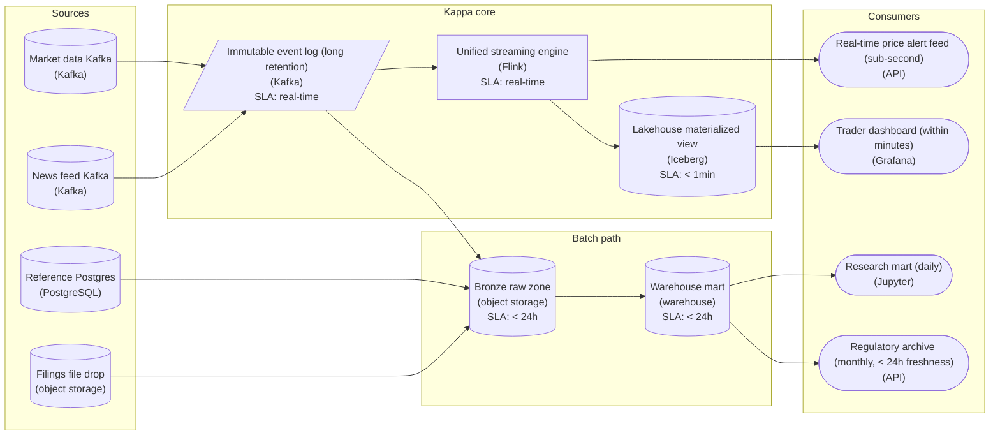

*The Kappa core runs real-time from one immutable `Kafka` log into an `Iceberg` view. The batch path lands the log, `Reference Postgres` and the filings drop in a bronze zone once a day before the `Warehouse mart`.*

| ✕ Kappa core (sub-second, minutes) | ✓ Batch path (daily, monthly) |
| --- | --- |
| One `Flink` job reads the immutable `Kafka` log, pushes price alerts directly, and keeps a lakehouse materialized view warm for the trader dashboard. The log's long retention makes a code fix a replay, not a backfill. | Bounded runs land a daily copy of the log, `Reference Postgres` and the `Filings file drop` in a bronze raw zone, then build the `Warehouse mart`. These runs are cheap, partitioned by day, and rerun end to end when logic changes. A monthly archive has no reason to pay for a stream. |

| Pitfall: Freshness is a budget, not a bragging right |
| --- |
| The tempting mistake is routing everything through the stream because it is the interesting part. Putting the monthly `Regulatory archive` on the streaming engine buys a 24/7 job, watermark tuning, and pager coverage for a consumer that reads once a month. Match the path to the clock, or you just move the on-call pain onto one over-provisioned stream. |

| Key insight: Long retention is the reprocessing story |
| --- |
| Kappa works only because the `Kafka` log is immutable and retained long enough to replay. Find a bug in the streaming logic and you rewind the offset and re-emit through the same code, instead of running the separate batch correction Lambda forced on you. That is how the second codebase disappears; idempotent writes into the view keep a replay safe to run twice. |

**Follow-up questions**

1. A `News feed Kafka` event arrives 10 minutes late. How does the streaming engine fold it into an already-published window?\
   *Watermarks and allowed lateness versus silently dropping it.*
2. The `Filings file drop` redelivers the same file. What keeps the `Warehouse mart` correct?\
   *Idempotent file ingestion and dedup keys on the batch side.*

</details>


<br>

---

## Per-Node Freshness Tier Analysis

### Four tiers, one rule

A freshness tier is the delay a node promises between an event happening and that event showing in its output. Four tiers cover most pipelines: seconds, minutes, hours and daily. Writing the tier beside every node exposes a rule an unannotated diagram hides: a node is only as fresh as its slowest input, however often it runs.

| tier | typical cadence | usually built as |
| --- | --- | --- |
| seconds | under 1 minute | stream job over a log |
| minutes | 1 to 15 minutes | micro-batch |
| hours | hourly to every 6 hours | scheduled job |
| daily | once a day or slower | nightly job or snapshot export |


<br>

### Annotating a real graph

An online store runs the pipeline below. Order events arrive on a log. A product catalog is exported from the operations database every night at 02:00. A micro-batch every 5 minutes joins recent orders to the catalog to attach each order's category and margin, writing enriched_orders. A second micro-batch every 5 minutes sums enriched_orders into revenue_by_category. Two consumers read the results: a finance dashboard that refreshes hourly, and a fraud model that polls enriched_orders every 30 seconds to score each new order against its category's typical basket.

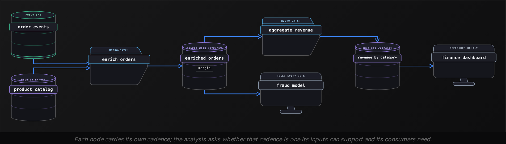

| node | own cadence | slowest input | effective freshness | consumer expects | finding |
| --- | --- | --- | --- | --- | --- |
| order_events | seconds | none | seconds |  | fine |
| product_catalog | daily | operations database, daily export | daily |  | fine |
| enriched_orders | 5 min | product_catalog, daily | order columns 5 min; category and margin up to 24 h | fraud_model, 30 s | unmet: polled 10 times per run, margin a day stale |
| revenue_by_category | 5 min | enriched_orders, 5 min | amounts 5 min; category daily | finance_dashboard, hourly | hidden cost: 12 runs per refresh |

The 2 mismatches point in opposite directions. The fraud model reads a 5-minute table every 30 seconds and believes it scores fresh orders; it scores orders up to 5 minutes old, and when the catalog reprices a product at 10:00 the margin it sees stays wrong until the next 02:00 export. That is an unmet expectation, and no alarm fired because the table did update every 5 minutes. The revenue table is rebuilt every 5 minutes for a dashboard that reads it hourly: hidden cost, as the aggregate job starts, reads, writes and releases workers around the clock for a consumer that looks once an hour.

- **288** — aggregate runs per day
- **264** — runs no dashboard refresh reads


<br>

### The 5-step analysis

- Write each node's own cadence beside it, including sources and snapshot exports
- Propagate downward: a node's effective freshness is the slowest of its inputs, per column where inputs differ
- Write each consumer's expected freshness beside it, taken from how the data is used, never from how often it polls
- Flag as hidden cost runs outpacing all their inputs or the fastest consumer's need, like 288 revenue runs for 24 reads
- Flag every consumer whose expectation is faster than its source's effective freshness as unmet

Fixes move a tier boundary rather than nudge a cadence. If the fraud model needs only the order columns at 30 seconds, it should read order_events through a stream job and skip the enrichment. If it needs margin at 30 seconds, the catalog must publish each price change as an event the enrichment consumes, moving product_catalog to the seconds tier: the expensive fix. For finance, revenue_by_category moves to hourly or becomes a query the dashboard runs on refresh, while the 5-minute enrichment stays if the fraud path still wants it.

> **TIP**
>
> Write per-column freshness on the storage nodes, not only on the transforms. A table whose rows land every 5 minutes and whose margin column is a day old carries 2 tiers, and consumers read columns.

**A pipeline streams clickstream events (seconds) into a sessions table rebuilt by a micro-batch every 10 minutes, which joins a user_segments table refreshed weekly. A marketing tool reads sessions every 15 minutes to pick a banner by segment. Which finding is correct?**

- **A.** The micro-batch should run every 5 minutes so the marketing tool reads fresher sessions on each 15-minute poll and the banner reflects the latest clicks.
- **B.** The marketing tool's 15-minute read is served, but segment is weekly-fresh, so a user who changed segment on Monday gets the old banner all week; the fix is on user_segments.
- **C.** The sessions micro-batch is hidden cost, because clickstream arrives in seconds and the batch only runs every 10 minutes, wasting the source's freshness.
- **D.** The weekly user_segments refresh is hidden cost, because the micro-batch reads it 1,008 times a week for a table that only changes once.

<details>
<summary>Solution</summary>

**B.** The marketing tool's 15-minute read is served, but segment is weekly-fresh, so a user who changed segment on Monday gets the old banner all week; the fix is on user_segments.

Propagating the slowest input gives the segment column a weekly tier; the consumer's expectation is unmet on that column alone.

**Why the others are wrong**

- **A.** Sessions are already fresher than the 15-minute poll; the stale column is segment, and a faster micro-batch leaves it weekly.
- **C.** Running slower than an input is a freshness choice, and 10 minutes sits close to a 15-minute reader's need; the column that fails is segment.
- **D.** Reading a small table is cheap; the cost finding concerns a writer's cadence, and user_segments is written once a week.

</details>


<br>

---

## Pipeline Architecture

### Exercise 1 of 2

**● TASK**

Ad impressions land on an append-only event log at 2 billion events a day. Build a Lambda architecture: an immutable master data set fed from the log, a batch layer that recomputes exact spend totals from full history every night, and a speed layer reading the same log that keeps spend fresh within a minute. A serving layer merges both views for the advertiser dashboard.

<details>
<summary><strong>Solution</strong></summary>

#### 2 views, one answer

Lambda architecture runs 2 computations over the same events and lets the serving layer add them up. The batch layer is slow but exact: every night it rereads the whole master data set and rebuilds spend from scratch. The speed layer is fast but provisional: it only covers the hours since the last batch run finished. At 2 billion impressions a day, that split is the point: advertisers see pacing within a minute, and finance bills from numbers nobody had to patch.

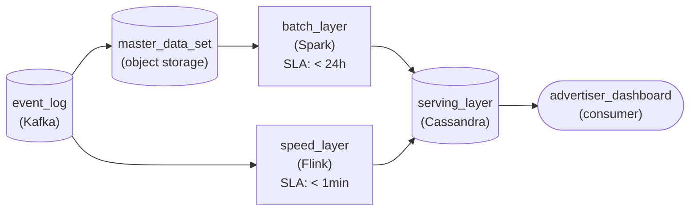

*The log feeds both layers; `serving_layer` merges the nightly batch view with the live speed view.*

1. **Make the log the only source of truth**

   Both layers read from the event log, never from each other. The log lands unchanged in `master_data_set`, which is append-only, so the batch layer can always recompute from complete history. If a billing rule changes, you rerun the batch layer; nothing is patched in place.

2. **Shrink the speed view to the gap**

   The speed view only holds spend since the last completed batch run. When tonight's batch view lands, those hours drop out of the speed view, and the serving layer returns `batch_view + speed_view` for the hours each one owns. Any drift the stream introduced lives at most a day.

| Pitfall: The speed view is never an input |
| --- |
| A tempting shortcut writes the speed layer's output into the master data set, or starts the batch layer from yesterday's totals. Either way the approximate numbers become permanent and the nightly recompute can no longer correct them. The batch layer reads raw events only. |

| Real world: The same logic lives in 2 codebases |
| --- |
| Spend is computed once in the Spark job and again in the Flink job. Every rule change ships to both, and the 2 must agree on what counts as an impression. That duplication is the price Lambda charges for having freshness and correctness at once. |

**Follow-up questions**

1. A publisher's impressions from the last 30 days turn out to be fraud. Which layer removes them, and what does the dashboard show until it does?\
   *Whether corrections flow through a recompute over the immutable master data set rather than edits to stored views.*
2. What happens to the dashboard if tonight's batch run fails?\
   *How the serving layer keeps answering when the speed view has to cover more than one day.*

</details>


<br>

### Exercise 2 of 2

**● TASK**

Driver trip events land on a Kafka log that keeps every event since launch, about 40 million a day. Build a Kappa architecture: one Flink streaming job serves drivers live earnings within seconds, with no batch layer. When the fee formula changes, the same job's code replays the full log into a new earnings view that sits beside the live one until drivers are cut over.

<details>
<summary><strong>Solution</strong></summary>

#### One codebase, 2 running copies, one log

Kappa architecture keeps a single streaming implementation and treats the event log as the truth. Repricing history is not a batch job: it is the same Flink code started from the first offset of the log. Because the Kafka log holds every trip since launch, replaying it reproduces every earnings row under the new formula, with no second codebase to keep in sync.

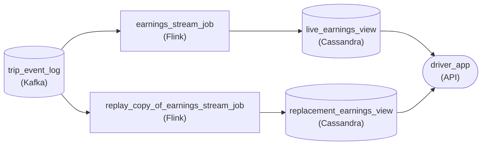

*`trip_event_log` feeds the live `earnings_stream_job` and `replay_copy_of_earnings_stream_job`, a second run of the same code from the first offset; each writes its own view until `driver_app` cuts over.*

1. **Replay from the log, not from the view**

   `replay_copy_of_earnings_stream_job` is the live job's code with the new formula, started at the beginning of `trip_event_log` exactly as the live job once was. Reading from `live_earnings_view` instead would bake the old formula into the new numbers.

2. **Write beside, then cut over**

   The replay lands in `replacement_earnings_view` while drivers keep reading the live one. Once it catches up to the live offsets and the totals check out, the app switches reads and the old view and its job are retired. That is the parallel materialized view.

| Pitfall: A repricing batch job brings Lambda back |
| --- |
| Adding a Spark job that recomputes history means the fee formula now lives in 2 places. The day they disagree, drivers see one number live and another after the nightly overwrite: the exact drift Kappa exists to remove. |

| Performance: Replay speed sets the cutover date |
| --- |
| Live traffic averages about 460 events a second, but one year of log is roughly 14.6 billion events. The replay copy needs far more parallelism than the live job to catch up in hours rather than weeks, and write throughput on the new view is usually the bottleneck. |

**Follow-up questions**

1. What changes if the log only kept 30 days of trip events?\
   *Whether the event log can still be the source of truth, and what full retention or archiving it needs for a replay to reach every past trip.*
2. How would you decide the replacement view is ready for cutover?\
   *Catching up to the live job's position in the log and validating the rebuilt numbers before readers switch.*

</details>


<br>

---

## Lambda to Kappa Worked Example

### The workload

A podcast platform serves listens per episode to creators and its recommendation ranking, from 3,000 listen events per second. Under Lambda, a nightly recompute of episode_listens_batch starts at 02:00 over a file archive of every listen and lands roughly 07:00; a speed layer keeps episode_listens_rt since midnight; consumers read both through a merge query. The codebases drifted twice in a year, and the layer holding the stricter rule set which way totals moved at 07:00. A crawler rule added to batch only made totals drop at the landing, then climb too fast all day. A completed-listen rule raised from 30 to 60 seconds played, in the speed layer only, made totals jump at the landing, then grow too slowly.

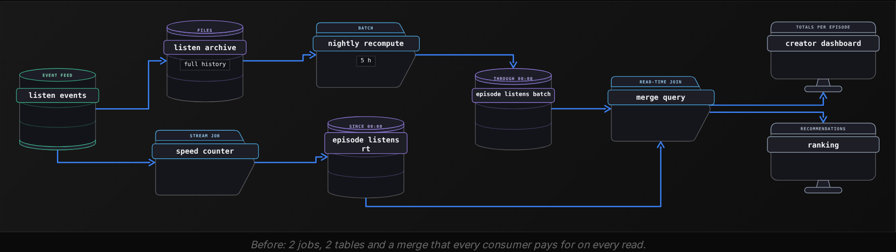

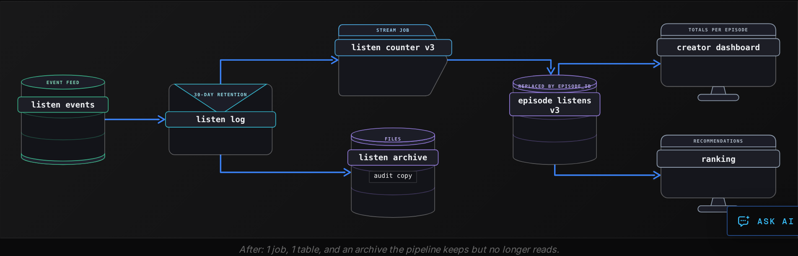


<br>

### One definition of a completed listen

The code diff, by intent

- **Deleted** *nightly_recompute and merge_query*\
  The batch implementation and read-time merge go; both consumers read episode_listens_v3.
- **Promoted** *speed_counter becomes listen_counter*\
  The stream job holds the only definition of a completed listen.
- **Added** *a version in the output name*\
  The job writes episode_listens_vN; each replay is a new N and never overwrites the table being read.
- **Added** *a sink that replaces by episode_id*\
  Each count change emits a replacement row, and the sink overwrites by key.
- **Added** *a diff query*\
  Run before every cutover, it lists episodes whose counts differ between old and new tables.

```sql
SELECT
  COALESCE(o.episode_id, n.episode_id) AS episode_id,
  o.listens AS old_listens,
  n.listens AS new_listens
FROM episode_listens_v2 AS o
FULL OUTER JOIN episode_listens_v3 AS n
  ON n.episode_id = o.episode_id
WHERE o.listens IS NULL
  OR n.listens IS NULL
  OR o.listens <> n.listens
ORDER BY ABS(COALESCE(o.listens, 0) - COALESCE(n.listens, 0)) DESC
LIMIT 100
```


<br>

### The log becomes the master dataset

The archive stops being the master dataset and becomes an audit copy; the log takes that role for 30 days. At 3,000 events per second and about 400 bytes each, 30 days with 3 replicas fills about 9.3TB of broker disk, which the team weighs against the 5-hour nightly job's compute and accepts. A replay runs at 120,000 events per second, and while it runs the output exists twice, so the serving store needs room for 2 copies of episode_listens, about 40GB each. A correction older than 30 days reads the archive through the same transform, across section 1's handoff seam.

- **104GB** — log written per day
- **18.5 h** — 30-day replay including catch-up

**The team wants to correct 60 days of history after a tagging bug, but the log retains 30 days. Which plan keeps the single-codebase property?**

- **A.** Give the stream job's reader an archive mode that reads days 31 to 60 from files, hands off to the log at the archive's last offset, and run the same transform as v4.
- **B.** Write a batch job over the archive for days 31 to 60, let the stream job handle the last 30, and merge the 2 tables at read time for consumers.
- **C.** Raise retention to 60 days now, wait 30 days for the log to fill, then replay from the oldest offset with the fixed v4 job.
- **D.** Replay the 30 days available with v4 and scale the older counts by the correction ratio observed on the replayed window.

<details>
<summary>Solution</summary>

**A.** Give the stream job's reader an archive mode that reads days 31 to 60 from files, hands off to the log at the archive's last offset, and run the same transform as v4.

One transform, 2 input readers: the handoff seam is the only new code, and the rule still lives in 1 place.

**Why the others are wrong**

- **B.** That rebuilds Lambda: a second implementation of the rule and a merge that every reader pays for.
- **C.** Raising retention keeps future events longer; the events from days 31 to 60 were already deleted.
- **D.** The older counts would come from arithmetic on a guess, with no code that reads the actual events.

</details>


<br>

### New checks replace the nightly overwrite

| step | when | what happens | what proves it worked |
| --- | --- | --- | --- |
| 1 | Mon 06:00 | Start listen_counter_v3 at the oldest retained offset, writing episode_listens_v3 | Job is reading; v3 row count rising |
| 2 | Tue 00:30 | v3 reaches the live offset and keeps pace | Gap between log head and v3 under 5 seconds |
| 3 | Tue 00:30 to Thu 02:00 | v3 and the Lambda pair both serve; the diff query runs hourly | Diff lists only episodes with listens in the last 24 hours, differing under 0.1% |
| 4 | Thu 09:00 | Dashboard and ranking switch to episode_listens_v3 | No read of the batch or rt tables for 24 hours |
| 5 | Fri 09:00 | Stop nightly_recompute and speed_counter; drop their tables | Archive still written; retention alert set at 25 days |

Before step 5 the team writes down what gets harder. With no nightly overwrite, nothing erases drift in the stream job's counts, so a once-free correctness check must be built: an hourly query comparing sampled episodes against raw event counts in the log. A bad deploy now reaches every consumer at once, so every change ships as a new vN replay beside the running version. Retention is now a correctness boundary too: an alert fires when the oldest event a planned correction needs reaches 25 days old, 5 days before the log deletes it, leaving time to replay or read the archive.

**Two weeks after cutover, a creator reports an episode's total fell 3% overnight. Under the new design, which cause is possible, and which old-design cause is ruled out?**

- **A.** Possible: the nightly recompute applied a rule the stream job lacks. Ruled out: a replay cutover, since replays only add listens.
- **B.** Possible: retention expired and deleted 30-day-old events, lowering stored counts. Ruled out: nothing from the old design.
- **C.** Possible: a new replay cut over with a stricter completed-listen rule. Ruled out: a nightly batch overwriting the speed layer's count.
- **D.** Possible: the speed layer reset at 02:00 before the batch view landed. Ruled out: a replay, since v3 writes the table being read.

<details>
<summary>Solution</summary>

**C.** Possible: a new replay cut over with a stricter completed-listen rule. Ruled out: a nightly batch overwriting the speed layer's count.

A count moves only when the job emits a replacement, and cutting over to a new vN is the designed way for history to change.

**Why the others are wrong**

- **A.** No nightly recompute exists after step 5, and a replay with a stricter rule lowers counts.
- **B.** Expiring log messages removes input bytes; counts already written to episode_listens_v3 do not change.
- **D.** The speed layer was stopped at step 5, and a replay writes to a new vN table, never the one being read.

</details>


<br>

---

## Pipeline Architecture

### Exercise 1 of 1

**● TASK**

Smart-meter readings arrive on a Kafka topic at 50,000 events per second, and one Spark job computes per-meter usage. A grid-outage dashboard needs that usage within one minute. The billing report reads a daily usage table built from a full day of readings in object storage, and it must not pay for compute running around the clock. Design the pipeline so the same Spark logic runs in the mode each consumer needs.

<details>
<summary><strong>Solution</strong></summary>

A unified engine lets you write the per-meter usage logic once and choose the runtime per output. Spark runs the same DataFrame query as a streaming job or a batch job by changing the trigger, but the two runs still bill and fail differently: streaming mode keeps executors up all day, batch mode pays only for the run window. The decision here is not which engine. It is which mode each consumer has earned.

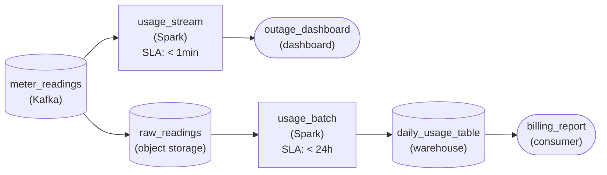

*One Spark usage job, two runtime modes: `usage_stream` feeds the outage dashboard within a minute, `usage_batch` builds `daily_usage_table` once a day from `raw_readings`.*

1. **Give the outage feed the streaming run**

   Operators need usage within a minute, so `usage_stream` runs continuously off the Kafka topic at `< 1min` freshness and writes straight to `outage_dashboard`. That always-on compute is the price of the latency, and only this consumer should pay it.

2. **Give billing the batch run**

   Billing is read once a day, so the same Spark logic runs in batch mode as `usage_batch`, once a day over the full day landed in `raw_readings`, writing `daily_usage_table`. The cluster starts, finishes and shuts down: you pay for the run, not for 24 hours.

| Pitfall: Same code does not mean same mode |
| --- |
| Because the API is identical, it is tempting to point the streaming run at the billing table too. It works, and it bills round-the-clock compute for a number someone reads once each morning. Unified code is a reason to choose the mode per consumer, not a reason to stop choosing. |

| Key insight: A failed day reruns, a failed stream resumes |
| --- |
| When `usage_batch` fails, you rerun that day's partition from object storage and overwrite it. When `usage_stream` fails, it restarts from its checkpoint and Kafka offsets. One body of logic still leaves you two recovery playbooks to operate. |

**Follow-up questions**

1. What changes if the outage view can tolerate 15 minutes instead of one?\
   *Whether a micro-batch trigger can replace the always-on run and what that saves.*
2. A corrected reading arrives 3 days late. How does each run absorb it?\
   *Partition rerun in batch mode versus late data in the streaming run.*

</details>


<br>

---

## Putting It All Together

A food delivery company shows every restaurant its orders and revenue for the day on a partner dashboard, and feeds the same counts into a courier dispatch model that reacts to demand spikes. The numbers come from a nightly batch over the order archive plus a stream job for today, merged at read time, and the 2 disagreed last month when a refund rule changed in one job only. The team is deciding whether to collapse the design into a single replayable stream job, and how fresh each piece of it actually needs to be.

- The refund disagreement is section 0's second-codebase cost in the open: 1 rule, 2 implementations, drift that the nightly overwrite hides until someone looks at 15:00.
- Collapsing to 1 stream job with a versioned output and a log replay is section 1's Kappa move, and the first design decision is retention: how far back the company expects to correct restaurant totals.
- The unified engine from section 2 lets the team keep the stream job as the only code and still test it over a bounded day of files, while budgeting state for every restaurant ever seen.
- Section 3's tier analysis separates the 2 consumers: the dispatch model needs seconds on order counts, while the partner dashboard refreshes hourly and the restaurant attributes it joins change daily, so the micro-batch feeding it is hidden cost.
- Section 4's cutover procedure, replay beside the live table, diff before any consumer switches, then delete the batch layer, is the plan the team writes before touching production.


<br>

---

## Pipeline Architecture

### Exercise 1 of 2

**● TASK**

Inventory changes from a pharmacy chain's store database arrive through CDC, about 30 million a day, and three readers need them on different clocks: store managers see stock-outs within a minute, a regional replenishment dashboard refreshes hourly, and a compliance report rebuilds once a day. Land every change raw in object storage. Design the pipeline with a freshness tier on each processing stage, none faster than the reader it feeds needs.

<details>
<summary><strong>Solution</strong></summary>

#### Tier the stage, not the pipeline

Per-node freshness tiering gives every processing stage its own clock, set by the reader it feeds, instead of stamping one tier across the whole pipeline. Here one CDC change stream serves three readers: a stock-out view that needs sub-minute data, a dashboard that refreshes hourly, and a compliance report rebuilt daily. Only one path through the design should pay for streaming.

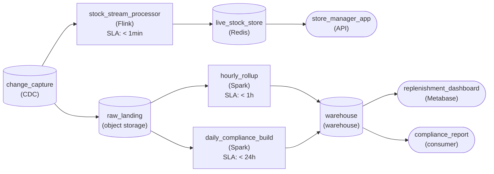

*One CDC stream, three clocks: a sub-minute live path, an hourly rollup and a daily compliance build reading the same raw landing.*

1. **Start from each reader's clock**

   Write down what each reader needs before drawing a stage: under a minute for store managers, an hour for planners, a day for compliance. Each number becomes the `slaFreshness` on the stage that builds that reader's view, and nothing feeding a batch reader needs to run faster than the batch itself.

2. **Fork once and let the landing decouple the clocks**

   The change stream splits a single time: one branch goes to a Flink job at '< 1min' that keeps live stock counts, the other lands every change raw in object storage. The hourly rollup and the daily build each read that landing on their own schedule, so a slow batch run never touches the live path.

| Pitfall: One tier for everything is wrong somewhere |
| --- |
| Running the dashboard and compliance builds as streaming jobs because the stock-out view needs sub-minute data keeps compute busy around the clock to produce numbers nobody reads faster than hourly. Stamping the whole pipeline daily fails the other way: store managers learn about a stock-out the next morning. |

| Key insight: Mixed tiers off one landing are not a contradiction |
| --- |
| The raw landing is written continuously while the warehouse it feeds refreshes hourly and daily. Different readers get different freshness from different layers of the same pipeline, and each layer is only as fast as its own readers demand. |

**Follow-up questions**

1. A loss-prevention team wants raw changes queryable within 15 minutes. Which node's tier changes, and which stay put?\
   *Raising one layer's tier without dragging the curated rollups along.*
2. Planners now ask for the dashboard every 5 minutes. Does the rollup cross into the streaming band, and what does that cost?\
   *Where a tighter reader clock crosses the batch-to-streaming line.*

</details>


<br>

### Exercise 2 of 2

**● TASK**

A competitive online game writes 300 million match events a day to one event log that keeps 90 days of history. Choose between Lambda, Kappa and a unified engine, then design the pipeline: a live leaderboard store must reflect each match within seconds, and season standings land in a warehouse once a day. When the scoring rule changes, all 90 days are recomputed and the standings rewritten, and the three-person team can run only one codebase.

<details>
<summary><strong>Solution</strong></summary>

#### Kappa wins when one small team owns the rescore

This workload lands on Kappa architecture with a unified engine, because the 2 things that once justified Lambda are already covered. Lambda paid for a batch layer to get exact results and cheap recomputation. Flink gives exact results straight from the stream, and a log that keeps 90 days already holds the history to recompute from. What remains of Lambda is only its cost: the scoring rule written twice, 2 clusters, and 2 places for a rescore to disagree, which a three-person team cannot carry.

1. **Count the codebases first**

   A Lambda design puts the scoring rule in a batch layer and again in a speed layer, then merges them at serving. Every scoring change ships twice, and a bug in one copy shows up as the leaderboard and the standings disagreeing. With one codebase allowed, Lambda is out before cost even enters.

2. **Make the log the source of truth**

   Because the log keeps 90 days, a rescore is a replay: start a second run of `scoring_job` from the earliest offset with the new rule, let it catch up, then switch readers over. The partition-overwrite `backfillStrategy` on the warehouse replaces each day's standings, so a rerun rewrites old scores instead of appending beside them.

3. **Tier each store to its reader**

   The job runs continuously, but its sinks do not share one clock. `live_leaderboard_store` is 'real-time' because players watch it; `season_standings_warehouse` is '< 24h' because the esports team reads it each morning. One streaming path, 2 freshness tiers.

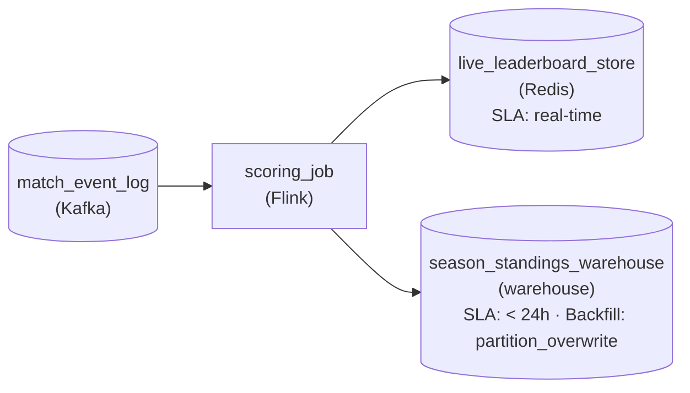

*One Flink job reads the 90-day log and writes both stores, each on its own freshness tier.*

| Performance: Recompute cost is a short burst, not a standing cluster |
| --- |
| 300 million events a day averages about 3,500 per second, near 10,000 at peak, which a modest Flink job handles. A full rescore replays roughly 27 billion events; finishing inside a day means about 320,000 per second, so the replay run is scaled out for those hours and released afterwards. Lambda would keep a batch cluster paid for all season to do the same work. |

| Pitfall: A separate backfill job is Lambda again |
| --- |
| The tempting shortcut is a Spark job that reads the archived log and recomputes standings while Flink handles the live path. It works on day one and drifts by the second scoring change, because the rule now lives in 2 places. Recompute with the same job, replayed from the log. |

**Follow-up questions**

1. Banned players' matches must disappear from both stores within an hour of the ban. What changes?\
   *Tests whether a retroactive correction reuses the single streaming path and its replay instead of adding a second one.*
2. Log retention is cut from 90 days to 7 to save storage. Does Kappa still hold?\
   *Tests seeing that replay depends on the log holding full history, and that the log would need archiving to object storage to keep it.*

</details>


<br>

---

## Key Takeaways

- Lambda keeps a batch layer, a speed layer and a serving merge because early stream engines could corrupt counts on a crash and logs held only hours; the batch recompute from the master dataset was the correction.
- The cost of Lambda is every rule implemented twice, and the 2 implementations drift; the engine constraints that justified that cost have shifted.
- Kappa keeps 1 stream job and a retained log; recompute is a replay of the same job into a new versioned table, and the replay horizon is exactly the retention budget.
- A unified engine shares code, semantics and testing between batch and stream, while state lifetime, recovery, output shape and resource use still differ at runtime.
- A node is only as fresh as its slowest input; annotating every node and consumer with a tier exposes hidden cost and unmet expectations per column.
- A Lambda-to-Kappa migration deletes the batch job and merge, versions the output, runs old and new side by side with a diff, and replaces the nightly overwrite with a correctness check of its own.
