Beginner·Pipeline Architecture · 25 min · 9 challenges

# Batch vs Streaming: Beginner

It is 11:58 pm on New Year's Eve and riders across Manhattan open the Uber app at once. Surge pricing has to reflect that demand within seconds or drivers never head toward Times Square. The same night, every driver's weekly pay summary waits to be produced once, after the week closes. Same trips, same company, 2 rhythms, and this lesson is about telling them apart.


<br>

---

## Two Ways Data Can Move

The last lesson gave every pipeline 4 roles: a source, a transform, storage, and a consumer. Rhythm is a different question: when does the transform run, and how much data does it handle each time? Every pipeline answers in one of 2 ways, and the answer sets the cost, the freshness of the output, and the kind of failure you will be paged for.


<br>

### Batch: collect a pile, then process it

A batch pipeline lets records accumulate and processes them together on a schedule. Signups land in an application database all day, and nothing counts them. At 02:00 the next morning a job wakes up, reads every signup from the previous day, counts them by country, writes the counts to a table, and exits. The job has a start, an end, and a window of data it owns: the 24 hours before it ran. Between runs the transform is a definition waiting for its next trigger, with no process running anywhere.


<br>

### Streaming: process each record as it arrives

A streaming pipeline keeps the transform running at all times and hands it records one at a time, within seconds of each record being created. The same signups flow into a queue. A consumer process reads the queue continuously, adds 1 to the count for that signup's country, and writes the new count to a serving table. The unit of work is a single record, so the output changes 6 times on a day with 6 signups, and the consumer is still running at midnight waiting for the seventh.

The same signups feed a stream that counts each one as it lands and a batch that counts them once a nightApr 24 · 00:00

Kafka

signups

streaming

stream_counter

COUNT BYcountry

serving table

live_counts

Airflow

nightly_batch

CRON02:00

warehouse

daily_counts

records0 records

#

id

country

live_counts0 rows

country

signups

daily_counts0 rows

country

signups

Signups by country, counted two ways

1/16

Watch the clock in the animation. At 07:40 the second signup, from Germany, lands in the queue. Within 2 seconds `live_counts` shows DE at 1, while `daily_counts` holds nothing, because its job will not run for another 18 hours. At 02:00 on April 25 the nightly job fires, reads all 6 signups, and 8 minutes later writes US 3, DE 2, IN 1 in a single overwrite. Both tables now hold identical numbers. They arrived on 2 different rhythms, and for most of the day only one of them was right.


<br>

### What changes, in one table

| Dimension | Batch | Streaming |
| --- | --- | --- |
| Trigger | A time on a schedule | A record arriving |
| Unit of work | A window of records, such as one day | 1 record |
| Compute lifetime | Starts at the trigger, exits when finished | Started once, runs for months |
| Output write | The whole result, replaced each run | 1 row updated per record |
| Freshness | As old as the time since the last run | Seconds |
| Cost | Minutes of compute per run | Every hour of every day |

> What stays the same
>
> - The source: the same signups table feeds both pipelines.
> - The transform logic: count by country, in both cases.
> - The storage and the consumer: a table of counts, read by a dashboard.
> - What differs is when the transform runs, how much it handles per run, and how long it stays alive.


<br>

### Freshness and lifetime

Two words from that table carry the rest of this lesson. Freshness is the delay between a record being created and its effect showing in the output. For `s4`, the signup from India at 15:30, that delay is 2 seconds in `live_counts` and 10 hours and 38 minutes in `daily_counts`. Compute lifetime is how long the transform exists as a running process. The batch job lives for 8 minutes a day. The stream consumer lives for all 1,440 minutes of it, including the roughly 1,434 in which no signup arrives. Freshness is what the consumer feels. Lifetime is what the bill feels.

> **TIP**
>
> Ask one question of any pipeline you meet: what starts the transform? If the answer is a time, it is batch. If the answer is a record showing up, it is streaming. Everything else in this lesson follows from that answer.

**Which of these 4 pipelines is batch?**

- **A.** A fraud check that scores each card swipe within 200 milliseconds of the swipe reaching the bank.
- **B.** A counter that raises a city's active-driver total each time a driver taps the go-online button.
- **C.** A job that reads every order placed yesterday at 03:00 each morning and writes a totals table.
- **D.** A process that reads a queue of clicks continuously and appends each one to a log table.

<details>
<summary>Solution</summary>

**C.** A job that reads every order placed yesterday at 03:00 each morning and writes a totals table.

A clock starts it, it owns a 1 day window, and it exits when done. Batch.

**Why the others are wrong**

- **A.** The swipe is the trigger and the unit of work is 1 record. That is streaming.
- **B.** Each tap triggers 1 update. The transform runs continuously, waiting for taps. Streaming.
- **D.** Reading a queue continuously and writing per record is the streaming rhythm, even with no counting involved.

</details>


<br>

---

## Pipeline Architecture

### Exercise 1 of 1

**● TASK**

Set each source's slaFreshness to its rhythm. The Postgres orders database accumulates rows until a job processes the chunk, so it gets a daily-tier batch label such as < 24h. The Kafka clickstream topic delivers each event as it arrives, so it gets real-time or < 1min. The two sources must end up with distinct labels.

**Starting canvas** (already placed for you):

- Postgres orders (source, Postgres)
- Kafka clickstream (source, Kafka)

<details>
<summary><strong>Solution</strong></summary>

#### Two rhythms, two labels

Every source moves on one of two rhythms, and **batch versus streaming** is the name for that split. A batch source lets rows pile up and hands them over in scheduled chunks. A streaming source emits each record the moment it happens. The `slaFreshness` label records that rhythm. It is the freshness contract the rest of the diagram reads: how stale the data can get before anyone downstream should worry.

The orders rows wait for a job to process the chunk, so that source sits on the daily tier, '< 24h'. Clickstream events flow through as they arrive, so that source sits on the streaming tier, 'real-time' or '< 1min'. The canvas has two cadences, so it needs two labels.

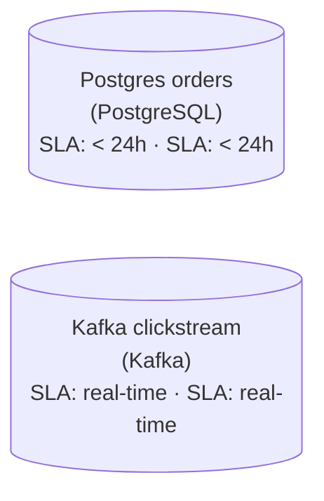

*The rhythm lives in `slaFreshness`, not in the tool name: '< 24h' on the batch orders source, 'real-time' on the streaming clickstream.*

| Pitfall: One shared label hides a rhythm |
| --- |
| Giving both sources '< 24h', or both 'real-time', looks tidy, but then the diagram lies. It either says clicks refresh once a day or says orders are live to the second. A second common slip is writing the cadence into the tech label ('Postgres, batch'). Freshness is read from `slaFreshness`, so set it there. |

| Real world: The label picks the downstream architecture |
| --- |
| When a new source arrives, the first question is its rhythm. A batch input feeds a scheduled job and a warehouse table. A streaming input feeds a consumer group and a low-latency store. Label it wrong and you either pay for a stream processor on data that lands once a day, or you promise a dashboard freshness the batch job can never deliver. |

**Follow-up questions**

1. If the orders job ran hourly instead of daily, what changes on the `Postgres orders` label, and does the source become streaming?\
   *A faster schedule is still batch. The tier tightens to '< 1h', but the data still arrives in chunks.*
2. Which `slaFreshness` fits the clickstream if the app buffers events offline and flushes them in bursts?\
   *The label follows the delivery rhythm, not the transport. A bursty Kafka feed behaves more like micro-batch.*

</details>


<br>

---

## Batch: Picture, Rhythm, Example

A batch pipeline has 3 moving parts beyond the data itself: a scheduler that knows when to fire, a job that does the work, and the storage the job reads from and writes to. The scheduler is the only part awake all the time, and its whole task is to watch a clock. The job is where compute starts, runs, and shuts down, and that lifecycle is what this section traces, minute by minute.

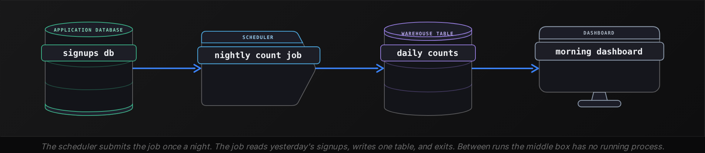


<br>

### One run, minute by minute

| Clock | What happens | Compute state |
| --- | --- | --- |
| 02:00:00 | The scheduler reaches the trigger time and submits the job | Starting: a machine is requested |
| 02:01:00 | The job's process is up and connects to the signups database | Running |
| 02:01:30 | It reads every signup dated April 24 | Running: reading |
| 02:06:00 | It counts the rows per country in memory | Running: computing |
| 02:07:30 | It overwrites `daily_counts` with the new rows | Running: writing |
| 02:08:00 | The job reports success and its process exits | Shut down |
| 02:08 until 02:00 next day | Nothing runs. The scheduler watches the clock | Off |

Three points on that timeline matter more than the rest. Compute starts at 02:00, when the scheduler submits the job and a machine is allocated. Compute runs from 02:01 to 02:08, and this is the only period in which data is touched. Compute shuts down at 02:08, and from then until the next trigger the pipeline costs nothing and does nothing. A batch pipeline is defined as much by the 23 hours and 52 minutes it is off as by the 8 minutes it is on.

- **0.6%** — of each day the job is running
- **99.4%** — of each day the job is off


<br>

### The window is the boundary

```sql
SELECT
  country,
  COUNT(*) AS signups
FROM signups
WHERE signup_date = DATE '2026-04-24'
GROUP BY country
```

The `WHERE` clause draws the window. The run at 02:00 on April 25 owns signups dated April 24 and nothing else. A signup at 23:59 on April 24 is counted 2 hours and 9 minutes after it happened. A signup at 00:01 on April 25 belongs to the next window and waits until 02:08 on April 26, which is 26 hours and 7 minutes. Two records created 2 minutes apart show up in the output 24 hours apart, and that gap is the price of a daily window.

> **TIP**
>
> A batch job that finishes at 02:08 and is read at 09:00 delivers data at least 9 hours old, because its newest record, from 23:59, is 9 hours old by then. Freshness is measured at the read, so a faster job changes nothing until someone reads earlier.


<br>

### Every run replaces its result

The animation wrote `daily_counts` in overwrite mode, and that is the usual batch choice. Each run produces the complete answer for its window and replaces whatever the previous run wrote for it. If the job fails at 02:05 and someone restarts it at 02:20, the second attempt reads the same April 24 rows, computes the same counts, and leaves the table exactly as a successful first attempt would have. A batch run is a unit you can repeat, because its window closed when the day ended.

- Starts: the scheduler fires at the trigger time and a machine is allocated to the job.
- Runs: the job reads its window, computes, and writes, all inside one process.
- Shuts down: the process exits, and compute cost drops to zero until the next trigger.
- Repeats: the next run owns the next window and replaces its own output.

**A user signs up at 02:03 on April 25, while the nightly job is already running. When does that signup first appear in daily_counts?**

- **A.** At 02:08 on April 25, because the running job picks up every row present at the moment it writes.
- **B.** At 02:08 on April 26, because the row is dated April 25 and belongs to the next run's window.
- **C.** Within 2 seconds, because the table is updated as soon as each record arrives in the source.
- **D.** Never, because rows created while a run is in progress fall between windows and are skipped.

<details>
<summary>Solution</summary>

**B.** At 02:08 on April 26, because the row is dated April 25 and belongs to the next run's window.

The April 25 window is processed by the run at 02:00 on April 26, which finishes at 02:08. The signup waits 24 hours and 5 minutes.

**Why the others are wrong**

- **A.** The job's WHERE clause selects rows dated April 24. A row dated April 25 is outside its window no matter when it is read.
- **C.** That describes live_counts and the stream. daily_counts changes only when the nightly job writes it.
- **D.** Windows are defined by the row's date, so every row belongs to exactly one window. Nothing falls between them.

</details>


<br>

---

## Pipeline Architecture

### Exercise 1 of 1

**● TASK**

Between the MySQL transactions source and the Looker dashboard, add a raw-zone storage node where the nightly extract lands as partitioned files, a dbt transform that writes daily_balances, and a warehouse that holds it. Add an orchestrator that runs the job once a day at 2am so leadership reads it by 8am. Tag the warehouse table with a daily slaFreshness (< 24h); nothing here streams or runs continuously.

**Starting canvas** (already placed for you):

- MySQL transactions (source, MySQL)
- Looker executive dashboard (consumer, Looker)

<details>
<summary><strong>Solution</strong></summary>

A nightly batch pipeline is one run, once a day, over bounded data. It lands the extract untouched, curates it into a table, and serves that table to a morning reader under a named freshness promise. You were given both ends of the run. The middle you drew is the same 4 moves every batch job makes: **land raw, curate, serve, all woken by one clock**.

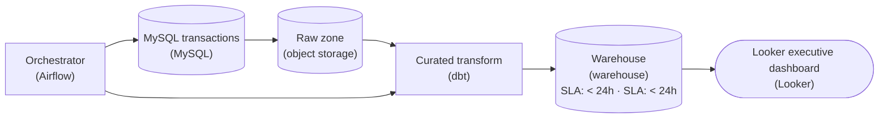

*Data flows in one line from source to dashboard. `Airflow` wakes the extract and the transform at 2am Pacific, and `daily_balances` in the warehouse carries a '< 24h' freshness SLA.*

1. **Land the extract raw**

   The first stop after `MySQL` is object storage, not the warehouse. The extract lands as a date-partitioned file (`dt=2026-09-16/`) with no cleaning applied. This is the raw tier of the medallion pattern. Because you keep an untouched copy, a bad transform costs a re-run instead of a re-extract from the operational database.

2. **Curate into `daily_balances`**

   `dbt` reads the raw files and writes `daily_balances` into the warehouse. The business logic lives here, and it reads from raw, not from the source, so you can replay any landed day whenever you need to. The warehouse holds the table because it is built for the analytical reads `Looker` sends. `MySQL` is built for the bank's transactional writes.

3. **Wake it with one clock and name the promise**

   Nothing runs on its own. `Airflow` starts the DAG at 2am and enforces the order: the extract finishes before the transform starts. The '< 24h' `slaFreshness` tag on the warehouse table states the contract to the 8am room. That makes a failed run something you can detect and alert on before anyone reads stale numbers.

| Pitfall: A stream here burns compute for one read |
| --- |
| The usual mistake is adding a Kafka topic or an always-on consumer. The books close at midnight and get read at 8am, so the data is bounded and the cadence is daily. If any node on your canvas implies a stream or a real-time SLA, it does not belong in a nightly batch. |

**Follow-up questions**

1. The 2am run fails. How does the '< 24h' `slaFreshness` tag turn that into a page before 8am?\
   *The SLA as an enforceable contract, not documentation.*
2. Leadership wants hourly refreshes. Which nodes stay, and what changes?\
   *Where batch cadence ends and micro-batch begins.*

</details>


<br>

---

## Streaming: Picture, Rhythm, Example

A streaming pipeline also has 3 parts beyond the data: a queue that holds records in arrival order, a consumer process that reads them, and a sink that receives the results. The consumer plays the roles of both the scheduler and the job from the batch picture. It is started once and expected to stay up for months. There is no trigger time to look up, because the arrival of a record is the trigger.

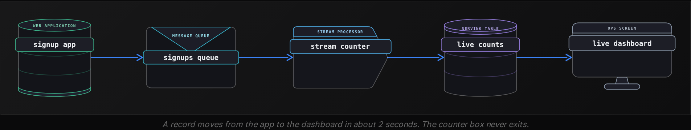


<br>

### One event, source to sink

Follow signup `s2`, a user in Germany who presses the signup button at 07:40:00 on April 24.

| Clock | Where s2 is | What happens |
| --- | --- | --- |
| 07:40:00.000 | Signup app | The app saves the user and publishes `{id: s2, country: DE}` to the queue |
| 07:40:00.040 | Queue | The queue appends the record after `s1` and offers it to consumers |
| 07:40:00.120 | Stream counter | The consumer, blocked waiting for input, receives `s2` |
| 07:40:00.125 | Stream counter | It reads the current DE count from the sink, 0, and computes 1 |
| 07:40:02.000 | `live_counts` | It writes the row DE, 1 and tells the queue that `s2` is done |
| 07:40:02.300 | Live dashboard | The next screen refresh reads DE, 1 |

Two seconds after someone in Germany pressed a button, a screen in the office shows the new count, and nothing was scheduled to make that happen. The consumer was waiting at 07:39, it processed `s2` at 07:40, and it returned to waiting at 07:40:02 for `s3`, which arrives at 11:05. For 3 hours and 25 minutes the process is alive, allocated, billed, and doing nothing except waiting.

```sql
for event in queue.subscribe("signups"):
    country = event["country"]
    current = live_counts.get(country, default=0)
    live_counts.upsert(country, current + 1)
    queue.mark_done(event["id"])
```

That `for` loop is the entire transform. `queue.subscribe` blocks until a record is available, so the loop body runs once per signup and never on a timer. `live_counts.get` fetches the current count for one country. `upsert` inserts that country's row or replaces it, 1 row rather than the whole table. `mark_done` tells the queue the consumer has finished `s2`, so a consumer that crashes and restarts resumes at `s3` instead of rereading the day from `s1`.


<br>

### The queue is the shock absorber

The queue sits between the app and the consumer so that neither waits for the other. The app publishes a record in 40 milliseconds and goes back to serving the user. If the consumer is taken down for an upgrade at 15:00, signup `s4` at 15:30 lands in the queue and sits there. When the consumer returns at 15:45 it reads `s4` and carries on. The queue turned a 45 minute outage into a 15 minute delay for 1 record, and the app never noticed. Without the queue, the app would have had to wait for the counter or drop the record.

| ✓ Batch job down | ✗ Consumer down |
| --- | --- |
| • The next read is hours away, so nobody sees it<br><br>• A rerun reads the same closed window<br><br>• Same output, finished later | • New records wait in the queue<br><br>• Readers see a frozen, stale table<br><br>• Restart resumes at the first unfinished record |

**Signups feed both pipelines from the animation. At 15:00 on April 24 the stream consumer is stopped for an upgrade and restarted at 15:45. The nightly job runs as usual at 02:00 on April 25. At 02:10 on April 25, what does each table show for IN?**

- **A.** live_counts has no IN row and daily_counts shows IN 1, because the stream missed s4 while it was down.
- **B.** Both show IN 1: the queue held s4 until the consumer returned at 15:45, and the batch read it at 02:00.
- **C.** live_counts shows IN 1 and daily_counts has no IN row, because s4 arrived while the consumer was down.
- **D.** Both show IN 2, because the restarted consumer reprocessed s4 and the batch counted the duplicate.

<details>
<summary>Solution</summary>

**B.** Both show IN 1: the queue held s4 until the consumer returned at 15:45, and the batch read it at 02:00.

The stream wrote IN 1 at about 15:45. The batch read all 6 April 24 rows at 02:00 and wrote IN 1 at 02:08. Both are correct.

**Why the others are wrong**

- **A.** The queue kept s4 from 15:30 until the consumer returned at 15:45. The stream was late by 15 minutes and missed nothing.
- **C.** The batch reads the source table, where s4 has been since 15:30. The consumer outage has no effect on the nightly job.
- **D.** The consumer marks each record done after writing, so it resumes at the first unfinished record. s4 is processed once, and the batch reads the source, where s4 exists once.

</details>

*On a day with 6 signups, the consumer works for about 12 seconds and waits for the other 23 hours, 59 minutes and 48 seconds. The rhythm is streaming regardless of volume.*

> **TIP**
>
> When a streaming pipeline misbehaves, look at the queue first. A growing backlog means the consumer is slow or down. An empty queue beside a stale table means no events happened or the producer stopped: check the source for new records first.

**At 11:05 signup s3, from the US, lands in the queue. At 11:05:05 on April 24, what do the 2 tables show for US?**

- **A.** live_counts shows US 2 and daily_counts shows US 1, because the batch wrote the overnight count at 02:08.
- **B.** live_counts shows US 1 and daily_counts shows US 1, because both tables update within seconds of a record.
- **C.** live_counts shows US 1 and daily_counts is empty, because the stream has not caught up with s3 yet.
- **D.** live_counts shows US 2 and daily_counts has no rows, because its first run happens at 02:00 on April 25.

<details>
<summary>Solution</summary>

**D.** live_counts shows US 2 and daily_counts has no rows, because its first run happens at 02:00 on April 25.

s1 at 00:12 and s3 at 11:05 are both US, so the stream shows 2. The batch has not had a window to process yet.

**Why the others are wrong**

- **A.** The first batch run in the animation fires at 02:00 on April 25. At 11:05 on April 24 it has not run, so daily_counts is empty.
- **B.** Only the stream updates within seconds, and s1 and s3 are both US, so the live count is already 2.
- **C.** The consumer takes 2 seconds per record and has been idle since 07:40. At 11:05:05 s3 is already counted.

</details>


<br>

---

## Pipeline Architecture

### Exercise 1 of 1

**● TASK**

Driver phones publish GPS pings to the Kinesis stream on the canvas every 3 seconds, and a live ops dashboard polls each driver's latest location every second. Trace one ping from that source to the map: add a streaming consumer that processes pings as they arrive (plain Spark or dbt is batch and does not count), a serving store holding the latest location per driver, and the dashboard. Mark the store's freshness as real-time.

**Starting canvas** (already placed for you):

- Kinesis driver pings (source, Kinesis)

<details>
<summary><strong>Solution</strong></summary>

#### Reading one ping end to end

Stream processing turns the pipeline into a long-running service: a driver's GPS ping, not a clock, is what moves data forward. Follow one ping through the shape you built. The `Kinesis` source was handed to you. A **Flink consumer** reads the ping the moment it lands, updates its state for that driver, and writes the new position to a serving store keyed by driver. The dashboard's once-a-second poll then finds it there. The store carries a 'real-time' `slaFreshness`, so the diagram itself says nothing here waits for a schedule.

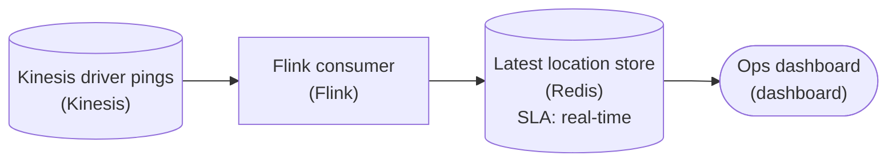

*One ping's path: `Kinesis` -> Flink consumer -> latest location store (real-time) -> dashboard poll, with no schedule anywhere.*

| Pitfall: A batch engine leaves each ping waiting for the next run |
| --- |
| The tempting wrong answer is plain `Spark` or `dbt` in the consumer slot, since they process the same records. But they wake on a schedule, read a chunk, and sleep, so a ping can sit unread for a whole interval and the 'live' map lags minutes behind. That slot needs an engine that reads as events arrive: `Flink`, `Spark Structured Streaming`, `Kafka Streams`, or `Beam`. |

| Key insight: Partition by `driver_id` so a driver's pings stay ordered |
| --- |
| Kinesis shards and the consumer's keyed state both key on `driver_id`. Every ping for one driver then flows through the same partition in order, so a fresh location is never overwritten with a stale one, and the work spreads across shards as the fleet grows. The serving store is keyed the same way: one row per driver, upserted on each ping. |

The store keeps no history. The dashboard asks one thing, 'where is each driver now', so the consumer collapses the stream to the latest position per `driver_id` and writes that single row. A point lookup by key answers in milliseconds. That lets a once-per-second dashboard sit on a firehose of pings without either side waiting on the other.

**Follow-up questions**

1. What breaks if a driver's phone buffers offline and then flushes 5 out-of-order pings at once?\
   *Event time versus arrival order: keep the newest timestamp per `driver_id` rather than the last ping read.*
2. The product team wants a driver's last 10 minutes of trail on the map. What changes in the shape?\
   *A latest-only store versus a windowed store that keeps recent history, still without falling back to batch.*

</details>


<br>

---

## What Real-Time Actually Means

'Real-time' is a request, and requests arrive without numbers attached. When a product manager asks for signups in real time, the engineer's job is to turn those words into a freshness tier: the maximum age the number may have at the moment someone reads it. Four tiers cover almost every request, and each tier points to a different architecture and a different bill.

| Tier | Maximum age when read | Example request | What delivers it |
| --- | --- | --- | --- |
| Sub-second | Under 1 second | Block a card swipe that looks stolen before the terminal says approved | A stream consumer holding the data it needs in memory |
| Seconds | Between 1 and 60 seconds | A wall screen showing orders placed in the last minute | A streaming pipeline writing to a serving table |
| Minutes | Between 1 and 60 minutes | An on-call engineer checking whether signups dropped after a release | A batch job scheduled every 5 to 15 minutes |
| Hours or more | Between 1 hour and 1 day | The Monday morning review of last week's signups by country | A nightly or hourly batch job |

Each tier is about 60 times stricter than the one below it, and the architecture changes with it. Hours and minutes are both served by the batch picture from 2 sections ago, with a shorter window and a more frequent trigger as the tier tightens. Seconds and sub-second need the streaming picture, because a job scheduled every 5 seconds would spend more time starting up than working, and would in effect be an always-on process with extra overhead. The line between batch and streaming sits at roughly 1 minute of allowed age.


<br>

### Three questions that produce a number

- How old can the number be when you read it, and what goes wrong if it is older?
- How often do you read it: once a morning, once an hour, or on a wall screen all day?
- What decision follows from it, and how soon after the data must that decision happen?

The second question usually exposes the tier. A number read once each Monday at 10:00 gains nothing from being 5 seconds old. It gains everything from being correct by 10:00. A number on a wall screen that someone glances at every few minutes benefits from being under a minute old. A number that gates a payment helps only if it arrives before the payment completes. The reading rhythm sets the ceiling on how fresh the data needs to be, and building fresher than that ceiling buys nothing.


<br>

### One request, three translations

Suppose 3 people in the same week each ask for 'real-time signups'. Each conversation ends somewhere different.

| Who asks | What they do with it | Tier | Architecture |
| --- | --- | --- | --- |
| Head of marketing | Reviews signups by country at the Monday 10:00 meeting | Hours | Nightly batch, finished by 03:00 |
| On-call engineer | Wants to see a drop within 5 minutes of a release so a bad release can be rolled back | Minutes | Batch every 5 minutes over the last 5 minutes of signups |
| Growth team | Closes a promotion the moment the 1,000th signup lands, so nobody is promised a gift that is gone | Seconds | Stream consumer keeping a running count |

Three identical requests, 3 different pipelines, and a cost range of more than 100 to 1. The marketing report costs 8 minutes of compute a day. The release monitor costs a short job 288 times a day. The promotion counter costs a process that is up for all 86,400 seconds, and it is the only one of the 3 that needs to be. Writing the tier down before building anything keeps the first 2 requesters from paying for the third one's architecture.

> Write freshness as a number
>
> - Replace 'real time' with 'no older than N seconds when read' and get the requester to agree to N.
> - Tie N to a decision: what is done differently if the number is 10 minutes old instead of 10 seconds?
> - Record N beside the pipeline. Whoever maintains it next year needs to know which tier it serves.

> **TIP**
>
> When someone cannot name a number, ask how they would notice if the data were an hour stale. If the answer is that they would not notice, the tier is hours and the pipeline is a nightly batch.

**The finance team says daily revenue totals must be real-time. In conversation you learn they review the totals at 09:00 each morning and again at 17:00. Which tier and architecture fit?**

- **A.** Hours tier: a batch job on a schedule that completes before 09:00 and runs again before 17:00.
- **B.** Seconds tier: a stream consumer that updates a running revenue total as each order lands.
- **C.** Minutes tier: a batch job every 5 minutes, so the 09:00 number is never more than 5 minutes old.
- **D.** Sub-second tier: an in-memory total that the finance dashboard reads directly on each page load.

<details>
<summary>Solution</summary>

**A.** Hours tier: a batch job on a schedule that completes before 09:00 and runs again before 17:00.

Two reads a day, at fixed times, is the hours tier. Two batch runs timed to finish before each read deliver exactly what is needed.

**Why the others are wrong**

- **B.** A total that is 2 seconds old at 09:00 is no more useful to a 09:00 reader than one that is 2 hours old. The always-on cost buys nothing.
- **C.** This runs 288 times a day to serve 2 reads. The tier is set by the reader's rhythm, which is twice daily.
- **D.** Sub-second is for decisions that must happen before an action completes, such as blocking a payment. A morning review is hours away from that.

</details>


<br>

---

## Pipeline Architecture

### Exercise 1 of 2

**● TASK**

A product manager asks for a real-time inventory dashboard and, when pressed for a number, says store managers need stock counts no more than an hour old. POS systems drop stock exports every 15 minutes, and the dashboard reads a warehouse table. Choose batch or streaming for the stage that moves the exports into the warehouse, picking the simplest one that meets the target, and tag the dashboard with its slaFreshness tier.

**Starting canvas** (already placed for you):

- POS stock exports (source)
- Inventory warehouse (storage, warehouse)
- Inventory dashboard (consumer, dashboard)

<details>
<summary><strong>Solution</strong></summary>

#### An hour-old target is a batch problem

Picking batch or streaming starts by turning 'real-time' into a number. Here the number is an hour: stock counts up to 60 minutes old are good enough for a store manager. That is the '< 1h' tier, and **the simplest architecture for that tier is a scheduled batch job**. The POS exports already land every 15 minutes, so a job that loads them into the warehouse every 15 to 30 minutes keeps the dashboard well inside the hour.

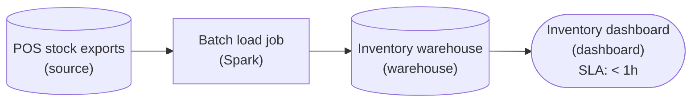

*A scheduled `Spark` batch job sits between the 15-minute exports and the warehouse, and the dashboard's `slaFreshness` is '< 1h'. No queue, no stream processor.*

| Pitfall: The word real-time does not pick the tier |
| --- |
| The tempting move is a streaming job between the exports and the warehouse, because the request said real-time. A stream reading 15-minute files is still only as fresh as the files, and it runs compute around the clock to beat a one-hour target the batch job already meets. Tagging the dashboard 'real-time' or '< 1min' makes the same mistake in the label. |

| ✕ Streaming for this target | ✓ Batch for this target |
| --- | --- |
| A job that never stops, plus a continuous event feed from the stores to make it worth running. It buys sub-minute freshness nobody asked for, at a higher running cost. | A scheduled job on the exports that already exist. It meets '< 1h' with the fewest moving parts, and its compute runs only when new files arrive. |

| Real world: Ask how old the data may be before drawing anything |
| --- |
| Most real-time requests turn out to mean within the hour or by the start of the workday. One question, how old can the data be before it changes a decision, usually moves the design from a stream to a schedule. |

**Follow-up questions**

1. Store managers now need stock counts under a minute old. What has to change besides the processing stage?\
   *A sub-minute tier needs streaming end to end, so the 15-minute file exports must become a continuous event feed.*
2. If the target loosens to 'ready by the start of each workday', which tier and cadence fit?\
   *'< 24h' and one daily batch run: an even simpler schedule.*

</details>


<br>

### Exercise 2 of 2

**● TASK**

A meal-kit subscription company serves two consumers off one Postgres orders database, and both already sit on the canvas. The Looker chart is read at the Monday standup, shows last week's orders by region, and is fine with day-old numbers; the fulfillment fraud check has to flag a suspicious order within seconds, before the box reaches packing. Build each consumer a path off that one database that meets its own freshness need.

**Starting canvas** (already placed for you):

- Postgres orders (source, PostgreSQL)
- Looker weekly orders chart (consumer, Looker)
- Fulfillment fraud-blocking service (consumer, API)

<details>
<summary><strong>Solution</strong></summary>

#### One source, two clocks

Choosing between **batch and streaming** is a question about the reader, not the data: what freshness does each consumer need, and what is it worth paying to get it? Both consumers here read the same `orders` rows, so it is tempting to build one path and fan it out. But the Looker chart is read once, at the Monday standup, and is happy with day-old numbers, while the fraud check has seconds to flag an order before the box reaches packing. Two latency budgets mean two paths off the one database, each sized to its own clock.

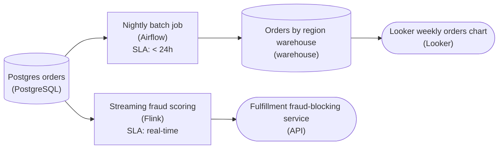

*One Postgres source feeds two paths sized to two freshness budgets: a nightly batch rollup into a warehouse for the chart, an always-on streaming job for the fraud check.*

1. **Give the chart a scheduled batch rollup**

   The Monday chart needs orders grouped by region, and day-old is fine, so a job on a schedule is the whole answer. A nightly run reads yesterday's `orders`, writes a small rollup by region into a warehouse, and Looker reads that. Mark the job '< 24h'. You trade away freshness nobody needs for a plan that is cheap and simple: it touches Postgres once a day, off-hours, instead of on every dashboard load.

2. **Give the fraud check an always-on stream**

   Seconds-to-flag rules out any schedule, even an hourly one, because the box would be packed before the next run. So the fraud path is a streaming job that never stops: it picks up each new order as it arrives, scores it, and calls the fraud service. Mark it 'real-time'. Work happens per order, not per tick of a clock, and you pay for that with a process that runs all day.

| Pitfall: Polling the database faster is not streaming |
| --- |
| Under a tight budget the reflex is to shorten the batch interval: every hour, then every minute, then every 10 seconds. That hammers Postgres with repeated scans, and every order still waits up to one full interval to be seen. A streaming job reverses the direction: each order flows to it as it happens, so a suspicious order is scored because it arrived, not because you asked again. |

| ✕ Batch path (the chart) | ✓ Streaming path (the fraud check) |
| --- | --- |
| Triggered by a schedule. It reads a bounded chunk (yesterday's `orders`), computes an aggregate once, and writes it to the warehouse. Latency is hours, and that is fine: it is cheap to run, simple to reason about, and trivial to rerun if a night fails. | Triggered by each new order. Orders are scored one at a time, in flight, by an always-on job. Latency is seconds. It is more to operate and costs more to keep running, but it is the only shape that meets a per-order deadline. |

**Follow-up questions**

1. The fraud team now wants an hourly count of blocked orders on the same Looker dashboard. Does that number come off the batch path or the stream?\
   *Tests whether you route by the consumer's freshness need rather than by which pipeline the data first arrived on.*
2. A backfill corrects a week of miscategorized regions in Postgres. How does each path pick up the fix?\
   *Batch reruns a window and recomputes; the stream only saw orders as they arrived, so a correction may need a replay or a separate reload.*

</details>


<br>

---

## Picking Batch or Streaming

The choice comes down to 2 inputs: the consumer's freshness tier, which the previous section taught you to extract, and how much the owner is willing to pay and to operate. Batch wins by default. Streaming wins when the tier demands it and the budget accepts it. This section puts numbers on both inputs so the decision stops being a matter of taste.


<br>

### Step 1: the tier narrows the field

| Consumer's tier | Choice | Why |
| --- | --- | --- |
| Hours or more | Batch, nightly or hourly | One short run per window delivers the number before anyone reads it |
| Minutes | Batch on a short schedule | A job every 5 to 15 minutes meets the tier at a fraction of always-on cost |
| Seconds | Streaming | Only a consumer that is already running can react within seconds of each record |
| Sub-second | Streaming, with its data in memory | Even a write to a serving table may take too long at this tier |

Step 1 settles the decision for most consumers, because most consumers read reports, and reports sit in the hours tier. The contested cases cluster around the 1 minute boundary, where either shape can meet the tier and the second input decides.


<br>

### Step 2: the cost you accept

Put a price on both shapes with one rate. Suppose the smallest machine that can run the signups counter costs $0.30 per hour. The nightly batch runs for 8 minutes, which is $0.04 per day. The stream consumer runs for 24 hours, which is $7.20 per day, roughly 180 times as much for the same 6 counted rows. The ratio shrinks as volume grows, because the batch run gets longer while the stream's hours stay fixed at 24, but at low volume streaming pays for 23 hours and 52 minutes of waiting.

- **$2,628** — stream consumer, per year
- **$14.60** — nightly batch, per year

Money is only part of the cost. A stream consumer is a process that can crash at 03:00 on a Sunday, and someone has to notice and restart it, because every minute it is down the live table drifts further from the truth. A batch job that fails at 02:05 can be restarted at 09:00 by whoever arrives first, and the output is still ready hours before the Monday meeting. Cost tolerance means both the bill and the willingness to run something that never stops.

| ✓ Do | ✗ Don't |
| --- | --- |
| • Write the consumer's freshness tier down before choosing a shape<br><br>• Default to batch, and make streaming earn its place with a seconds tier<br><br>• Price both shapes with the same hourly rate so the comparison is fair<br><br>• Feed a batch and a stream from one source when 2 consumers need 2 tiers | • Build streaming because the request contained the words real time<br><br>• Schedule a batch every 30 seconds to avoid admitting the case is streaming<br><br>• Judge cost by the bill alone and forget who restarts a crashed consumer at 03:00<br><br>• Let the loudest requester set the tier for every consumer of a table |


<br>

### Four cases, decided

| Use case | Who reads it, and when | Tier | Choice |
| --- | --- | --- | --- |
| Nightly sales report by region | Regional managers, at 08:00 | Hours | Batch at 02:00 over the previous day |
| Card swipe fraud score | The payment terminal, before it prints a receipt | Sub-second | Streaming, scoring each swipe as it arrives |
| Dashboard of failed logins | An on-call engineer, glancing every 10 minutes | Minutes | Batch every 10 minutes over the last 10 minutes |
| Monthly invoice generation | The billing system, on the 1st of each month | Hours or more | Batch on the 1st over the previous month |

Look at how the second column decides the third. Regional managers reading at 08:00 cannot act on anything fresher than a nightly run gives them. A payment terminal waiting for approval cannot act on anything slower than a stream delivers. The reader's rhythm sets the tier, and the tier sets the shape. The dashboard is the one case where budget matters, because a 10 minute batch and a stream both meet the tier, and the batch costs a fraction of the stream.

**A support team wants to see a customer's total order count when that customer calls. Calls arrive all day. The team says an order placed 2 hours ago is fine to miss. Which choice fits?**

- **A.** Streaming, because calls arrive all day and the agent needs the total within seconds of each call.
- **B.** Batch every 10 minutes, because order totals change often and a daily job would lag by a day.
- **C.** Batch every hour, because the team accepts a 2 hour age and an hourly run keeps the total under that limit.
- **D.** Streaming, because totals are per customer and a batch job cannot write one row per customer.

<details>
<summary>Solution</summary>

**C.** Batch every hour, because the team accepts a 2 hour age and an hourly run keeps the total under that limit.

A run each hour finishing within minutes keeps every total under 2 hours old, inside the stated tier, with compute for a few minutes an hour.

**Why the others are wrong**

- **A.** Calls arriving all day describes how often the number is read, and the agent reads a number that may be 2 hours old. The tier is hours.
- **B.** Hourly runs already meet the 2 hour limit, and this runs 6 times as often for no gain.
- **D.** A batch job writes any number of rows, one per customer included. The row shape has nothing to do with the rhythm.

</details>


<br>

---

## Pipeline Architecture

### Exercise 1 of 2

**● TASK**

Wire the 5 endpoints on the canvas so each consumer runs at the rhythm its freshness need demands. Land the Postgres orders data once in a shared object-storage raw zone, curate it, and serve the CFO revenue and marketing retention charts from a warehouse an orchestrator refreshes at least daily. Send the Kafka kitchen events through a stream processor into a low-latency serving store, never through the warehouse, so the store-ops ticket board stays under a minute fresh. Extract each source only once, and make both tiers (under a minute and daily) visible on the canvas.

**Starting canvas** (already placed for you):

- Postgres orders (source, Postgres)
- Kafka kitchen events (source, Kafka)
- CFO revenue dashboard (consumer, Looker)
- Store-ops kitchen ticket dashboard (consumer, Looker)
- Marketing retention chart (consumer, Looker)

<details>
<summary><strong>Solution</strong></summary>

#### Match the pipeline to the reader's clock

This challenge is a **batch-versus-streaming** split: the same store's raw data feeds three dashboards, but the rhythm each pipeline runs at is dictated by the reader, not the source. The CFO revenue chart and the marketing retention chart are opened once a day, so a warehouse that refreshes daily is exactly right; the store-ops kitchen board watches the line in real time, so nothing slower than a stream will do. You had two sources (`Postgres orders`, `Kafka kitchen events`) and 5 endpoints already placed. The job was to draw the two spines between them and pick the right component at each hop.

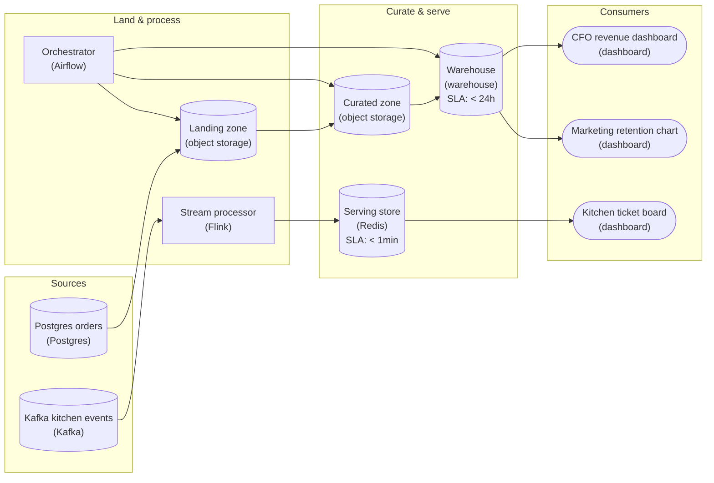

*Two spines from shared sources: a daily batch spine (land once in object storage, curate, load the warehouse) feeding both reporting charts, and a sub-minute stream spine feeding the line board.*

1. **Land orders once, then curate before the warehouse**

   The orders data lands from `Postgres orders` into a shared object-storage `Landing zone` as raw files first, then gets cleaned and typed into a `Curated zone`, and only then loads into the `Warehouse`. Landing raw before you transform is the ELT shape: the lake keeps the untouched copy so you can reprocess a bad day without re-pulling from Postgres, and both the CFO and marketing charts read the same curated tables instead of each re-deriving from raw. One landing, two readers.

2. **Put the batch hops under an orchestrator**

   The three batch hops (`Landing zone`, `Curated zone`, `Warehouse`) run as a scheduled DAG under the `Orchestrator`. That is what makes 'refreshes no slower than once a day' a real guarantee rather than a hope: the orchestrator runs land then curate then load in dependency order, so the warehouse never loads a half-written curated file, and a failed hop stops the ones downstream of it.

3. **Keep the kitchen on its own stream spine**

   `Kafka kitchen events` flow into a `Stream processor` that writes to a low-latency `Serving store`, and the `Kitchen ticket board` reads from there. This spine never touches the lake or the warehouse, because every batch hop would add minutes the line cannot afford. The serving store exists so the dashboard reads a pre-computed current state in milliseconds instead of scanning a growing event log on every refresh.

| Pitfall: Don't stream what a day-old number answers |
| --- |
| The common miss is wiring the `Kitchen ticket board` off the warehouse (too slow, the line sees minutes-old tickets) or, worse, running the reporting charts off the stream to 'keep it simple'. A single stream spine feeding everything means you rebuild historical revenue and retention aggregates in a stateful stream job, pay for it 24/7, and still can't cheaply recompute a corrected prior day. Latency is a requirement to be matched, not maximized. |

| Key insight: Freshness is bounded by the slowest hop |
| --- |
| A consumer is only as fresh as the slowest hop feeding it. The `Kitchen ticket board` stays under a minute only because every hop behind it (`Kafka` to `Stream processor` to `Serving store`) is sub-minute, so a single daily hop anywhere in that chain would blow the budget. The reporting charts inherit the daily cadence of the `Warehouse` load, which is fine. Trace the slowest edge on each path and that is the freshness you actually promised. |

**Follow-up questions**

1. A kitchen event for store 42 arrives 90 seconds late because the tablet was offline. How does the stream spine handle it without corrupting the current ticket count?\
   *Late-arriving data: watermarks and event-time windows in the stream processor versus naive processing-time counting.*
2. Yesterday's orders had a duplicate-charge bug fixed this morning. How do you correct the CFO revenue chart, and why is the raw landing zone what makes that cheap?\
   *Reprocessing from the immutable raw lake copy versus re-pulling from Postgres; why ELT keeps corrections local to the batch spine.*

</details>


<br>

### Exercise 2 of 2

**● TASK**

A finance executive asks for real-time revenue. Pressed for a concrete target, she wants yesterday's revenue on her dashboard when she opens it at 8am, and payments land in a PostgreSQL database whose day closes at midnight. Translate her request into a freshness tier, then build the simplest pipeline from that database to her dashboard that meets it, with the freshness set on the stage that serves her.

<details>
<summary><strong>Solution</strong></summary>

#### Real-time is a word; 8am is a target

Translating real-time into a freshness tier mostly means listening for the deadline. She said real-time, then she said 8am, and only the second phrase is a requirement. Yesterday's revenue becomes final at midnight and nobody looks until morning, so one run anywhere in that eight-hour gap meets her target. That is the daily tier, the cheapest of the five.

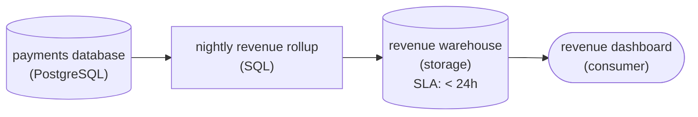

*One nightly rollup over the closed day lands in a warehouse set to '< 24h', and the revenue dashboard reads from it.*

1. **Replace the word with a time**

   'Real-time' carried no units; 'yesterday's numbers by 8am' does. Write the target down as a deadline plus the data it covers: closed days, ready at the start of the workday. Every faster tier now has to justify itself against that sentence, and none can, because nothing is read between midnight and 8am.

2. **Set the daily tier where she reads**

   Use the simplest architecture for the tier: one nightly rollup over the closed day, landing in a warehouse. Put '< 24h' on the warehouse the dashboard reads from, not on an upstream stage. The freshness that counts is the one on the stage feeding her screen.

| Pitfall: A stream here pays for updates nobody sees |
| --- |
| Streaming payments into the dashboard keeps compute running all night to refresh a number she reads once at 8am. That costs a tier or 2 more than the daily run and shows her exactly the same figure. Picking a tier the reader never uses is overengineering, however modern it looks. |

| Real world: Most real-time requests turn out to be a deadline |
| --- |
| A product manager who asks for a real-time signup dashboard often means within the hour, and an hourly run covers that. Ask for the target in units of time before you draw anything. The answer is usually far looser than the word suggested. |

**Follow-up questions**

1. Which tier fits if she starts checking revenue at 2pm to see the morning's sales?\
   *Tests whether a read in the middle of the day moves the target from daily into a faster tier.*
2. What changes if a day's payments can keep settling until 3am?\
   *Tests that a later close moves when the nightly run can start but not which tier is needed.*

</details>


<br>

---

## Putting It All Together

A ride-hailing company such as Uber moves the same trip events down 2 paths. Surge pricing has to reflect each neighborhood's ride requests from the last 30 seconds, a seconds tier that only an always-on consumer counting requests as they arrive can serve. Each driver's weekly pay summary is produced once, after the week closes, which a single batch run over 7 days of completed trips serves comfortably. Both read the same trips. One consumer is a pricing engine reacting in seconds, the other is a driver opening a statement on Tuesday morning.

- The pricing engine needs requests from the last 30 seconds, which is the seconds tier, and section 4 sends every seconds tier to streaming (sections 2, 3 and 4).
- Drivers read their pay once a week, so the tier is hours or more and a single batch run over the week's trips is enough (sections 1 and 4).
- The same trip events feed both, as the signups fed both tables in the animation. The source does not pick the rhythm, the consumer does (section 0).
- If the batch pay job fails at 02:05 on Monday, a rerun at 09:00 still beats Tuesday's statement. If the pricing consumer dies, prices go stale within seconds. That gap is the operating cost section 4 priced.


<br>

---

## Pipeline Architecture

### Exercise 1 of 2

**● TASK**

A cold-chain warehouse publishes a temperature reading from each of its 400 freezers to Kafka once a second. Choose batch or streaming for each of 2 consumers: the on-call alert must fire within seconds of any freezer rising above -18C, and the compliance dashboard an auditor opens once each morning needs only each freezer's daily high and low. Wire Kafka to both consumers through the processing each one needs.

<details>
<summary><strong>Solution</strong></summary>

#### One source, 2 clocks

Choosing batch or streaming is a decision you make per consumer, not per source. One Kafka topic carries 400 readings a second, about 35 million a day, yet its 2 readers live on different clocks: on-call has to know within seconds, while the auditor reads closed days once each morning. So the same source forks into 2 paths, each running at the rhythm its reader needs.

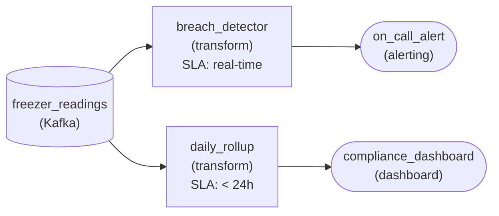

*One Kafka topic forks: a 'real-time' path to the alert and a '< 24h' path to the dashboard.*

1. **Ask what each consumer does with the number**

   On-call acts on a breach the moment it happens, and a freezer that stays warm for an hour has already spoiled its stock: that is a 'real-time' need, so `breach_detector` runs continuously and pushes straight to `on_call_alert`. The auditor signs off on yesterday, and a closed day never changes: that is a daily need.

2. **Match the cost to the value**

   `daily_rollup` wakes once a night at '< 24h', computes each freezer's high and low for the closed day, and stops. Running it as a stream would keep compute up all day to refresh numbers nobody opens until morning.

| Pitfall: One clock for both readers fails one of them |
| --- |
| Streaming everything pays round-the-clock compute for a dashboard read once a day. Batching everything sends the breach alert hours after the stock thawed. The fork is the answer, not a compromise. |

| Performance: The batch side is tiny work |
| --- |
| 35 million readings collapse to 400 rows a day, one high and one low per freezer: a few minutes of nightly compute. The streaming side only compares each reading against -18C, so its cost is the always-on process itself, which the alert justifies. |

**Follow-up questions**

1. Facilities wants a wall screen of current temperatures, never more than a minute old. Which path feeds it?\
   *Reusing the streaming path for a second fresh consumer instead of speeding up the batch.*
2. If Kafka keeps readings for only 12 hours, what does `daily_rollup` need before it can see a full day?\
   *Landing raw readings in storage so a nightly batch has a complete day to read.*

</details>


<br>

### Exercise 2 of 2

**● TASK**

A news site publishes every article page view to a Kafka topic, about 30 million events a day, and needs one number computed 2 ways: views per article. The newsroom's trending board must show counts no more than a minute old, so build a streaming path that keeps a running count per article in a store the board reads. The ad billing report needs yesterday's final count per article by 6am, so land the raw events in a store where they pile up and have a nightly batch job count the whole day in one pass into a warehouse the report reads.

<details>
<summary><strong>Solution</strong></summary>

#### Same count, 2 rhythms

Views per article is one simple count, and this design computes it twice on purpose. Batch processing waits for a bounded chunk, yesterday's events piled up in the landing store, and counts it once. Stream processing keeps a long-running job alive that bumps a running total the moment each event arrives. By morning both paths agree on yesterday's numbers; what differs is **when the answer exists**, the shape of the compute, and what it costs to keep running.

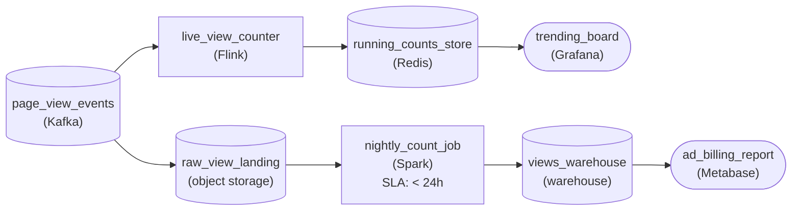

*`page_view_events` fans out to a continuous path for the trending board and a nightly path for billing.*

| ✕ Streaming path | ✓ Batch path |
| --- | --- |
| `live_view_counter` runs all day, holds a running total per article and writes each change to `running_counts_store`. Timing: seconds. Compute shape: a small always-on service sized for the peak rate. Cost: paid for every hour it runs, including 4am when almost nobody is reading. | `nightly_count_job` wakes once, reads the whole day from `raw_view_landing`, counts it in one pass and writes to `views_warehouse`. Timing: hours, done before 6am. Compute shape: one large burst, then nothing. Cost: paid only for the minutes it runs, and a failed run is simply rerun over the same files. |

| Pitfall: One rhythm cannot serve both readers |
| --- |
| The tempting shortcut is a single path. Point billing at `running_counts_store` and invoices come from a total that never settles and has no saved day to rerun. Keep only the nightly job and the trending board is up to a day stale. Each reader gets the rhythm its freshness need demands, both fed by the same topic. |

| Performance: The cost difference is shape, not size |
| --- |
| 30 million events a day averages about 350 a second, so a modest streaming job keeps up even at breaking-news peaks, and the nightly job reads one day of raw files in a short run. Neither path is expensive at this volume: you are choosing between an always-on service and a once-a-day burst. |

**Follow-up questions**

1. Marketing wants views per article for every hour of the last day. Which rhythm, and fed from where?\
   *Placing a freshness need that sits between the 2 existing paths.*
2. The board's total at midnight differs slightly from the billing number. Which one is the record?\
   *Why the settled batch count over a bounded day is the number money is based on.*

</details>


<br>

---

## Key Takeaways

- Batch waits for a window of records to accumulate, processes them in one run, writes the whole result, and exits. Compute lives for minutes a day.
- Streaming keeps a consumer running at all times and processes each record within seconds of its arrival. Compute lives for every minute of the day.
- Freshness is the delay between a record being created and its effect showing in the output. Measure it at the moment someone reads.
- 'Real-time' becomes a number by asking how often the consumer reads and what breaks when the data is older. Four tiers: hours, minutes, seconds, sub-second.
- Hours and minutes are batch with shorter windows. Seconds and below are streaming. Default to batch, and make streaming earn its always-on cost.
