Intermediate·Pipeline Architecture · 30 min · 11 challenges

# Batch vs Streaming: Intermediate

It is 23:10 on a rainy Friday in Chicago and a stadium concert has let out. Uber's rider app shows a surge multiplier that recomputes from driver supply and rider demand as the crowd pours onto the street. A pipeline that summarized demand every hour would still show a calm evening. Latency, throughput, and what each one costs decide whether the multiplier moves before the crowd disperses.


<br>

---

## Latency vs Throughput Tradeoff

Latency is the time between an event happening and its result reaching the consumer. Throughput is how much data the pipeline processes per unit of time, measured in rows per second or gigabytes per hour. A pipeline can have high throughput and terrible latency: a nightly job that chews through 180GB in 50 minutes moves data fast, yet an order placed at 00:05 waits almost 24 hours before a dashboard shows it.

Keep latency and throughput apart by asking what each one answers. Latency answers *how old is the newest row the consumer can see*. Throughput answers *how many rows per second can this pipeline absorb before falling behind*. Neither number tells you the other.

| Pipeline | Input rate | Throughput | Latency (p95) |
| --- | --- | --- | --- |
| Nightly orders load | 4M rows/day | 80,000 rows/s during the run | up to 24 h |
| Hourly inventory sync | 4M rows/day | 6,000 rows/s during the run | up to 65 min |
| Click stream | 4M rows/day | 50 rows/s, all day | 3 s |

All 3 pipelines carry the same 4M rows a day. The nightly load has the highest throughput, because it processes all 4M in under a minute of wall clock, and the worst latency. The click stream has the lowest throughput by a factor of 1,600 and the best latency.

Latency and throughput get confused because shortening a schedule lowers latency, and people read that as the pipeline getting faster. The processing rate did not change. Running the nightly load every hour makes each run handle 1/24 of the rows in roughly 1/24 of the time, so throughput during the run is unchanged while worst-case latency drops from 24 hours to 1.

> **TIP**
>
> Report latency as a percentile, never an average. If 9 rows in 10 land within 2 seconds and 1 in 10 takes 90 seconds, the mean is about 11 seconds and looks healthy, while the p95 shows the 90 second wait.


<br>

### Which one is holding you back

A pipeline is latency-constrained when it keeps up with the input but the consumer still gets results later than it needs them. The fix is a shorter schedule or a different movement pattern, since the machines sit idle most of the day. A pipeline is throughput-constrained when input arrives faster than the pipeline processes it, so the backlog grows. The fix is more parallel workers or less work per row. A shorter schedule leaves rows arriving per hour and rows processed per hour unchanged, so it does not help, and each extra run adds its own startup and commit overhead.

> Diagnosing which metric constrains you
>
> - Backlog (rows waiting, or queue depth) grows run after run: throughput. The pipeline cannot keep pace.
> - Backlog drains to 0 after each run but the consumer still complains: latency. The schedule is the limit.
> - Run time grows in proportion to input size: throughput. More rows, more minutes.
> - Run time stays flat while the consumer's freshness need shrinks: latency. The requirement changed.

*The same pipeline can switch categories: an hourly job that processes 10GB today is latency-constrained; when the input triples it becomes throughput-constrained with no code change.*

You can measure both from the curated table itself if every row carries 2 timestamps: when the event happened and when the pipeline wrote it. The gap between them, taken at the 95th percentile, is latency as the consumer experiences it. Rows written per hour of run time is throughput.

```sql
SELECT
  DATE_TRUNC('hour', loaded_ts) AS load_hour,
  COUNT(*) AS rows_loaded,
  APPROX_PERCENTILE(DATE_DIFF('second', event_ts, loaded_ts), 0.95) AS p95_latency_s
FROM curated.orders
WHERE loaded_ts >= LOCALTIMESTAMP - INTERVAL '1' DAY
GROUP BY 1
ORDER BY 1
```

Read the result as a pair of signals. If `rows_loaded` spikes in a single hour and `p95_latency_s` sits near 86,000 in that same hour, you are looking at a nightly batch and the consumer is seeing day-old rows. If `rows_loaded` is smooth across all 24 hours and `p95_latency_s` is climbing hour over hour, rows are arriving faster than they are written and the backlog is growing.

**A pipeline reads a queue every hour and writes to a curated table. Each run takes 48 minutes, up from 30 minutes 3 months ago, and the queue depth at the start of each run has been rising for weeks. The consumer wants rows within 2 hours. Which metric constrains this pipeline, and what change helps?**

- **A.** Latency; switch to a 15 minute schedule so rows arrive sooner.
- **B.** Throughput; add parallel workers or cut work per row so each run finishes well inside the interval.
- **C.** Latency; the consumer's 2 hour need is already met, so no change is required.
- **D.** Throughput; lengthen the schedule to every 2 hours so each run has more time.

<details>
<summary>Solution</summary>

**B.** Throughput; add parallel workers or cut work per row so each run finishes well inside the interval.

Run time growing with input and a rising backlog are both throughput signals. Processing more rows per minute is the only change that shrinks the backlog.

**Why the others are wrong**

- **A.** The rising backlog marks throughput. A shorter schedule leaves rows processed per hour unchanged and adds per-run overhead, so the backlog keeps growing.
- **C.** It is met today. A growing backlog means each run starts further behind, and latency will pass 2 hours within weeks.
- **D.** Throughput is the right diagnosis, but a longer interval carries the same rows per hour at the same processing rate. Latency doubles and the backlog still grows.

</details>


<br>

---

## Pipeline Architecture

### Exercise 1 of 2

**● TASK**

An orders pipeline moves 1 billion events a day from PostgreSQL into a warehouse mart, and an executive dashboard reads that mart once, at 7am each morning. Decide whether latency or throughput is the constraint here, and pick batch or streaming for the transform to match. Set the mart's freshness SLA to the loosest value the dashboard still accepts.

**Starting canvas** (already placed for you):

- Orders database (1 billion events/day) (source, PostgreSQL)
- Transform job (transform)
- Orders warehouse mart (storage, warehouse)
- Executive dashboard (7am) (consumer, dashboard)

<details>
<summary><strong>Solution</strong></summary>

#### Freshness and volume are 2 different axes

Splitting the vague word "fast" into 2 measurements is what decides this design. **Latency** is how soon a result must be ready after an event lands; throughput is how many events per unit of time the pipeline has to move. They are separate dials, and a pipeline is usually constrained by one of them. Here the dashboard reads once a day at 7am, so the latency ask is loose (anything under a day works), while a billion events a day is genuinely heavy volume. Loose latency and heavy throughput make throughput the constraint, and batch is built for exactly that.

So the transform runs as a scheduled batch job, and the mart carries a `slaFreshness` of '< 24h'. That chip writes the freshness contract on the canvas instead of leaving it implied. It records the loosest latency the reader accepts, which is what licenses the batch rhythm.

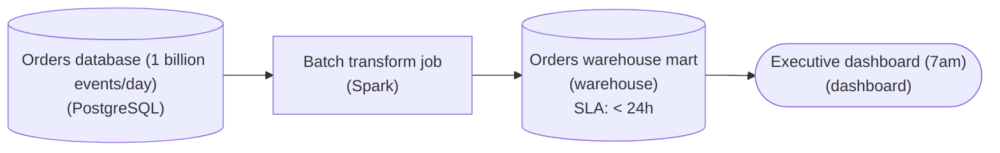

*One scheduled batch run fills the mart before the 7am read; the '< 24h' freshness chip is the contract the rhythm is sized against.*

| Pitfall: "A billion events" is not a reason to stream |
| --- |
| The common miss is to see the volume number, feel the pressure, and reach for a streaming engine. Streaming buys low **latency**, not more throughput, and low latency is exactly what this pipeline does not need. Nobody reads the mart between the nightly run and 7am, so a result that lands at 2am is worth the same as one that lands a moment after each order. |

| ✕ Batch (the pick) | ✓ Streaming (rejected) |
| --- | --- |
| One scheduled run reads the day's orders, builds the mart in large passes, and finishes well before 7am. The volume is absorbed by spreading per-event overhead across the whole batch, and the '< 24h' contract is met with room to spare. | A standing job keeps compute running all day to hold end-to-end latency in seconds. It meets a freshness target nobody asked for, and the dashboard shows the same numbers at 7am either way. |

| Performance: Buy only the latency the reader needs |
| --- |
| Higher throughput on the same hardware comes from batching work, and batching raises latency. When the only reader looks once a day, that extra latency costs nothing: '< 24h' is the loosest SLA that still satisfies it, so the pipeline can batch as aggressively as the volume demands. Find the real latency requirement first, then pick the rhythm. |

**Follow-up questions**

1. If the executive team also wants a noon refresh, does that flip you to streaming?\
   *Checks whether a second scheduled batch run still meets an hours-scale latency ask.*
2. What reader would make latency, not throughput, the constraint on this pipeline?\
   *Looks for a consumer that acts on each order within seconds or a few minutes of it landing.*

</details>


<br>

### Exercise 2 of 2

**● TASK**

A support-ops dashboard reads Kafka events through an hourly Spark batch, but agents need events visible within 15 minutes of arrival. Replace the batch transform with Flink on a 1 to 5 minute micro-batch trigger and tag the warehouse mart slaFreshness < 15min. Do not push to real-time or under 1 minute: sub-second streaming costs 5 to 50 times more for freshness the consumer does not need.

**Starting canvas** (already placed for you):

- Kafka customer-support events (source, Kafka)
- Hourly Spark batch job (transform, Spark)
- Snowflake support_queue mart (storage, Snowflake)
- CS ops dashboard (consumer, Looker)

<details>
<summary><strong>Solution</strong></summary>

#### Freshness is a dial, not a switch

Between an hourly batch that lands data too late and a sub-second stream that costs 5 to 50 times more sits a middle gear: **micro-batch**. A streaming engine like `Flink` fires on a short trigger interval instead of per event, so you size the rhythm to what the consumer reads rather than to the fastest engine you can name. The agents want events inside 15 minutes; a 1 to 5 minute trigger clears that cheaply.

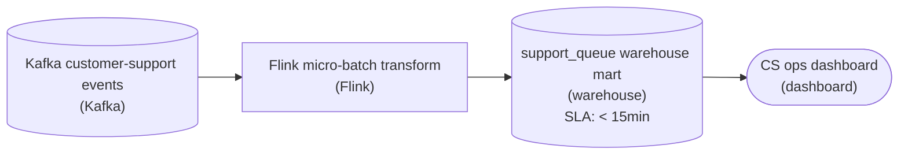

*The hourly Spark batch becomes a `Flink` transform on a 1-5 minute trigger; the warehouse mart is re-tagged to the under-15-minute tier so downstream expectations match the new rhythm.*

| Trick: The trigger interval is the cost knob |
| --- |
| A streaming engine on a 1-5 minute trigger ingests continuously but commits output on a schedule, batching many events into each warehouse write. That one parameter turns a five-to-fifty-times pricier engine into one costing barely more than the batch it replaces, while landing data far fresher. |

| ✕ True streaming (rejected) | ✓ Micro-batch (chosen) |
| --- | --- |
| Sub-second, per-event processing. Freshness of seconds is real, but the dashboard refreshes every few minutes, so it is latency nobody reads, and tiny continuous commits hammer the warehouse. | A `Flink` job on a 1-5 minute trigger lands well under the 15-minute target and amortizes each write over many events. The freshness the dashboard needs, none of the cost it does not. |

| Pitfall: Over-fresh is as wrong as too-slow |
| --- |
| Reading 'fresher' as 'real-time' and reaching for a sub-second engine over-provisions freshness the consumer never reads. Tag the mart at the under-15-minute tier, not a real-time tier the contract cannot cheaply honor. |

**Follow-up questions**

1. If a second team wants the same `support_queue` data within seconds for an auto-escalation bot, do you tighten this trigger or add a separate path?\
   *Tests whether they match freshness tiers per consumer instead of over-serving everyone from one expensive job.*

</details>


<br>

---

## Micro-Batch: The Middle Ground

Micro-batch is batch run on a short, fixed timer against a queue. Every trigger interval, say 60 seconds, the job wakes, reads everything that arrived on the queue since the previous trigger, transforms it, writes one output, records how far it read, and sleeps until the next tick.

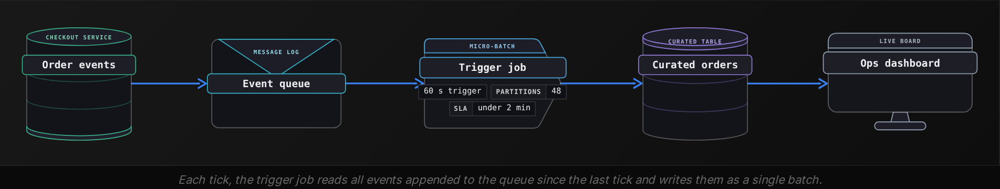

| ✓ Kept from batch | ✗ Taken from streaming |
| --- | --- |
| • Discrete runs, each with a start, an end and one output<br><br>• Fixed per-run overhead shared across many rows<br><br>• A run can be repeated by rereading the same queue range | • A queue as the source rather than a daily file or table snapshot<br><br>• A job that never exits and never waits for a scheduler<br><br>• Freshness measured in seconds or minutes rather than hours |


<br>

### The interval sets the latency

Worst-case latency for a row is the full interval plus the processing time of the batch it lands in. A row that arrives 1 second after a tick waits 59 seconds for the next one, then waits for that batch to finish. Processing time grows with the batch, so the table below assumes 6 seconds of fixed overhead per run plus 200 rows a second, on 4M rows a day. At a 60 second trigger each batch takes around 20 seconds, so latency ranges from 20 to 80 seconds.

| Trigger interval | Processing per run | Worst-case latency | Runs per day | Rows per run |
| --- | --- | --- | --- | --- |
| 1 h | 14 min | 74 min | 24 | 166,667 |
| 5 min | 75 s | 6 min 15 s | 288 | 13,889 |
| 1 min | 20 s | 80 s | 1,440 | 2,778 |
| 10 s | 8 s | 18 s | 8,640 | 463 |

Shrinking the interval hits a floor: near 6 seconds, the fixed overhead alone fills each slot and runs fire back to back. Processing rate is the other limit. This job processes 200 rows a second against an average input of 46. If the busiest minute brings 250 rows a second, each batch takes longer than the time it covers, every tick starts later than the last, and the backlog grows until the peak passes. Size processing for the busiest minute of the day, not the average one.

```sql
import time

TRIGGER_SECONDS = 60
offset = load_committed_offset()

while True:
    tick = time.monotonic()
    events, new_offset = read_queue(after=offset)
    if events:
        rows = transform(events)
        write_batch(rows)
        offset = new_offset
        commit_offset(offset)
    elapsed = time.monotonic() - tick
    time.sleep(max(0, TRIGGER_SECONDS - elapsed))
```

The offset is committed only after the batch is written, so a crash between the 2 writes replays the same events on restart rather than skipping them. The sleep is computed from the elapsed time, so a 20 second batch is followed by a 40 second sleep and the ticks land on the minute. An empty read still advances the clock: a quiet queue produces no output but costs a wake-up.


<br>

### Fixed write overhead, shared across a batch

Every write to the curated layer carries fixed overhead that is the same for 1 row or 1M: opening a connection, creating a file, committing a transaction, updating a listing. Pure streaming pays that overhead once per event or once per tiny buffer. Micro-batch pays it once per interval and spreads it across every row in the batch. At 1 minute and 2,778 rows per run, the fixed cost per row is 2,778 times smaller than paying it per event. That amortization is why micro-batch holds most of streaming's freshness at a fraction of its cost, as long as the consumer tolerates a minute.

> **TIP**
>
> Start the interval at half the consumer's freshness requirement. A dashboard that needs 2 minute old data gets a 60 second trigger; the other 60 seconds absorb processing time and a slow tick.

**A micro-batch job on a 30 second trigger processes a typical batch in 12 seconds, but between 18:00 and 19:00 the input quadruples and each batch takes 45 seconds. The consumer needs rows within 2 minutes. What happens during that hour, and what is the smallest fix?**

- **A.** Latency rises to 75 seconds and holds there; the 2 minute need is met and no change is needed.
- **B.** The backlog grows all hour; lengthen the interval to 60 seconds so each run has more time.
- **C.** The backlog grows all hour and latency climbs past 2 minutes; add parallel workers so the peak batch finishes in under 30 seconds.
- **D.** Nothing changes, because micro-batch reads everything since the last tick regardless of size.

<details>
<summary>Solution</summary>

**C.** The backlog grows all hour and latency climbs past 2 minutes; add parallel workers so the peak batch finishes in under 30 seconds.

Processing of 45 seconds in a 30 second slot is a throughput shortfall of 15 seconds per tick. Only a higher processing rate at peak keeps the interval honest.

**Why the others are wrong**

- **A.** Latency would hold at 75 seconds only if 45 seconds fit inside the 30 second interval. It does not, so each tick starts 15 seconds later than the last and latency keeps climbing.
- **B.** The diagnosis is right, the fix is not. A 60 second batch holds twice the rows and takes about 90 seconds, still over the interval.
- **D.** Reading everything is true, but finishing 45 seconds of work in a 30 second slot means the next tick starts late and the gap compounds.

</details>


<br>

---

## Pipeline Architecture

### Exercise 1 of 2

**● TASK**

A retailer's revenue pipeline runs Flink streaming at $4,000/month to feed a CFO dashboard read once each morning at 7am, so its latency is worth nothing against a 5-50x streaming premium. Downgrade it: replace the Flink transform with a nightly batch engine (Spark, PySpark, or dbt), remove the RocksDB state store, tag the warehouse mart slaFreshness < 24h, and leave no node with a real-time or < 1min slaFreshness.

**Starting canvas** (already placed for you):

- Postgres orders (source, Postgres)
- Flink streaming job ($4K/month) (transform, Flink)
- Local state store (RocksDB) (storage, RocksDB)
- Snowflake daily_revenue (storage, Snowflake)
- CFO daily revenue dashboard (reads 7am) (consumer, Looker)

<details>
<summary><strong>Solution</strong></summary>

#### Pay only for the freshness someone reads

Choosing between batch and streaming is a **cost decision** before it is an architecture one. Start by asking what a fresher number is worth to the person reading it. The CFO opens this dashboard once, at 7am. To her, a figure computed at 4am and one computed a millisecond ago look exactly the same. The latency is worth zero dollars, so the Flink job is a $4,000 monthly bill that buys nothing.

| Pitfall: Real-time is not a free default |
| --- |
| It is tempting to keep the 'real-time' tags because fresher feels safer. Streaming keeps a cluster running around the clock and holds `RocksDB` state between events, even at 3am when nobody reads the output. That typically costs 5 to 50 times the equivalent batch run. A batch job wakes up, makes one pass and exits. |

1. **Swap the engine and drop the state store**

   Replace the `Flink` node with a batch transform such as `Spark`, `dbt` or `PySpark`. Then delete the `RocksDB` node. Local state exists to carry aggregates across a continuous stream. A job that recomputes the whole day in one pass has nothing to carry, so keeping the store would leave dead infrastructure.

2. **Retag `slaFreshness` to the real need**

   Set `slaFreshness` to '< 24h' on the revenue mart and remove every 'real-time' tag. An SLA is a statement about value, and the honest statement here is that a number less than a day old is fine. The CFO's need never changed. You only stopped over-provisioning for it.

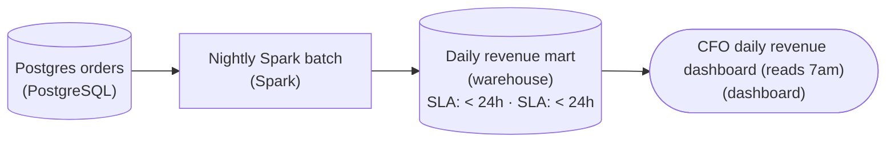

*The downgrade: a nightly Spark run replaces Flink, the RocksDB store is gone, and the warehouse mart carries `slaFreshness` '< 24h' to match the once-a-day read.*

**Follow-up questions**

1. The CFO now wants the number by 6am instead of 7am. What changes?\
   *A fixed daily read still calls for batch. Only the schedule moves earlier.*
2. A fraud team wants alerts on suspicious orders within seconds. Should they read from the revenue mart?\
   *When latency has real dollar value, streaming is justified, but it belongs in a separate pipeline.*

</details>


<br>

### Exercise 2 of 2

**● TASK**

The transform on the canvas keeps rolling 5-minute click counts per page from a Kafka topic, so it is stateful: each window's count depends on every click already seen in that window. Add a checkpointed state store node wired to the streaming transform, backed by RocksDB, HDFS or S3, so a worker restart does not lose the current window's partial counts. Leave the rest of the pipeline as it is.

**Starting canvas** (already placed for you):

- Kafka raw clicks (source, Kafka)
- Spark rolling 5-min counts per page (transform, Spark Structured Streaming)
- Page clicks 5-min mart (storage, warehouse)
- Click analytics dashboard (consumer, dashboard)

<details>
<summary><strong>Solution</strong></summary>

#### The windowed count is state, and state needs a home

A windowed `GROUP BY` is a **stateful** transform. To emit the count for a page's current 5-minute window, the engine must remember every click already counted for that window and add the next one to the running total. That per-(`page`, window) tally cannot be derived from the click in front of the engine. It comes only from the whole stream seen so far. Once a transform's output for one row depends on other rows, you've crossed from stateless to stateful, and the engine needs a durable place to keep that memory across micro-batches and restarts.

| ✕ Stateless | ✓ Stateful |
| --- | --- |
| A `map`, `filter`, or projection handles each event alone: parse the JSON, drop bot traffic, rename a field. A restart loses only the read position, because nothing was accumulating. No state store needed. | A windowed aggregation, streaming join, or dedup keeps a running structure keyed by something (`page`, window). The `count(*)` for a window is a fold over prior events, so that fold has to survive a crash. Your transform is in this class. |

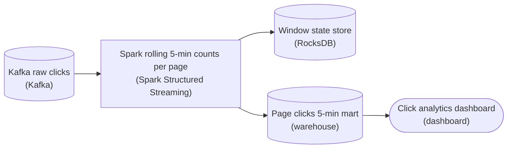

*The only addition is a RocksDB state store wired to the streaming transform. The transform checkpoints window state there each micro-batch and reads it back on recovery. The mart and the dashboard are unchanged.*

| Pitfall: It runs fine until the first restart |
| --- |
| In a dev run the engine holds window state in memory and the counts look right, so the gap stays hidden. The store only proves its worth on failure. Without a checkpointed location, a restart discards every in-flight window: partially counted 5-minute buckets vanish or get recounted from a replayed offset. The dashboard's numbers then go wrong exactly when nobody is watching. |

| Key insight: Watermark bounds the state, the checkpoint persists it |
| --- |
| These are two halves of one job. The watermark tells the engine when a window is old enough that no more clicks will arrive, so its entry can be evicted and the store stops growing. The checkpointed state store is what lets that state survive a crash. You need both, which is why the store hangs off the transform rather than sitting out by the warehouse. |

**Follow-up questions**

1. What forces state to grow without bound, and which knob stops it?\
   *Connects late-arriving events and a missing watermark to unbounded state.*
2. If you added a streaming join of clicks to a `sessions` stream, would that need its own state store?\
   *Checks that the stateful classification extends beyond windowed aggregation to joins.*

</details>


<br>

---

## Why Streaming Costs More

A batch job rents machines for the minutes it runs. A streaming job rents them for every minute of the day, including the hours when almost nothing arrives. That difference drives most of the cost gap.

| Line item | Nightly batch | Streaming | Ratio |
| --- | --- | --- | --- |
| Compute, 4M rows/day | 4 machines x 1 h = 4 machine-hours | 3 machines x 24 h = 72 machine-hours | 18x |
| Peak sizing | Sized for the whole day's rows in 1 h | Sized for the busiest second, idle the rest | n/a |
| Writes to curated layer | 1 commit per day | 1 commit per second = 86,400 | 86,400x |
| Always-on queue | None, reads yesterday's table | Queue cluster running 24 h | new line item |
| People | Failures found next morning | Pager at 03:00 for a stalled job | on-call rota |

The compute line surprises people in the other direction: streaming uses fewer machines at any moment than the batch job at its peak, because the work spreads across the day instead of piling into 1 hour. It still costs 18 times the machine-hours because those 3 machines never stop. Reserved pricing can shave the ratio, but the shape stays: streaming pays for idle time, and batch pays only while it runs.


<br>

### 3 places the premium hides

Idle capacity, commit overhead and on-call

- **Idle compute** *the 24 hour tax*\
  Machines sized for the busiest second run through the quietest hour. A pipeline whose input is 10x higher at noon than at 04:00 wastes most of its capacity most of the night.
- **Per-write overhead** *fixed cost multiplied by frequency*\
  Each commit to the curated layer costs roughly the same whether it carries 1 row or 1M. Committing every second pays that cost 86,400 times a day, and readers then pay again to open thousands of tiny outputs.
- **Operations** *a system that is always running can always be down*\
  A nightly job that fails at 02:00 is rerun at 09:00 by whoever arrives first. A stream that stalls at 02:00 is 7 hours behind by 09:00, so someone carries a pager.

- **8,760 h** — hours a stream runs per year
- **365 h** — hours a 1 h nightly job runs per year


<br>

### Pricing the delay

The premium is justified when a decision made from fresh data is worth more than the premium. Put a price on the delay. A fraud check that declines a stolen card at checkout saves the full order value; the same check run tomorrow morning saves nothing, because the goods shipped. A weekly revenue report that is 1 hour stale costs nothing, because nobody reads it until Monday.

| Consumer | Cost of 1 hour of staleness | Freshness that removes it | Pattern that earns its premium |
| --- | --- | --- | --- |
| Card fraud decision | Order value per fraudulent order | Seconds | Streaming |
| Warehouse stock on product page | Refund per oversold unit | Minutes | Micro-batch |
| Marketing spend dashboard | A mistimed budget shift, once a day at most | Hours | Hourly batch |
| Monthly finance close | Nothing | Days | Nightly batch |

Work the arithmetic for the stock example. The store oversells roughly 2 units per hour of staleness, and each oversell costs $15 in refunds and support time. Hourly batch leaves 1 hour of staleness: 48 oversells a day, $720 a day in cost. A 1 minute micro-batch leaves 1 minute of staleness: under 1 oversell a day, around $12. If moving from hourly batch to micro-batch adds $200 a day in compute, it pays back more than 3 times over. Per-event streaming at $2,000 a day would save the last fraction of an oversell and lose money.

| ✓ Latency is worth the premium when | ✗ Latency is wasted spend when |
| --- | --- |
| • The consumer is a machine, or a person acting within minutes<br><br>• Each minute of staleness has a cost you can write down<br><br>• Input arrives steadily, so machines are rarely idle | • The consumer reads on a schedule: a daily report, a weekly review<br><br>• Staleness costs nothing until a threshold measured in hours<br><br>• Input arrives in daily dumps, so the stream waits on an upstream batch anyway |

**A team proposes replacing a nightly batch that feeds a weekly executive revenue deck with a streaming pipeline. The batch costs $40 a day; the stream estimate is $600 a day. The deck is opened on Monday mornings only. Which judgement is right?**

- **A.** Accept: fresher data is always more accurate, and $600 a day is small for an executive audience.
- **B.** Reject: streaming cannot produce a weekly aggregate, so the deck would break.
- **C.** Accept: streaming removes the nightly failure risk, so the $560 premium is insurance.
- **D.** Reject: the consumer reads weekly, so the freshness gain has no value and the premium is $560 a day of pure cost.

<details>
<summary>Solution</summary>

**D.** Reject: the consumer reads weekly, so the freshness gain has no value and the premium is $560 a day of pure cost.

The cost of staleness for a Monday deck is 0 for any latency under 6 days. Paying 15 times more to cut latency from 1 day to 1 second saves nothing.

**Why the others are wrong**

- **A.** Freshness changes the age of the data, not its accuracy. The deck's Monday numbers are identical under either design.
- **B.** A stream can hold a running weekly total. The architecture works; it buys nothing for this consumer.
- **C.** A stalled stream fails too, and now someone must notice it at night. A nightly job that fails has 6 days of slack before Monday.

</details>


<br>

---

## Pipeline Architecture

### Exercise 1 of 2

**● TASK**

The nightly Spark batch on the canvas now takes 11 hours for 18 million orders a day, missing the executive dashboard's 6am refresh, while marketing needs numbers within 15 minutes. From the one Postgres source, keep the executive path on batch landing its warehouse table in under an hour, and give marketing a micro-batch path into a serving store fresh within 15 minutes. Skip real-time streaming for the whole join: it costs about 20x for freshness no one asked for.

**Starting canvas** (already placed for you):

- Postgres orders (18M/day) (source, Postgres)
- Nightly Spark batch (11 hours, missing 6am SLA) (transform, Spark)
- Snowflake fact_daily_orders (storage, Snowflake)
- Executive dashboard (tier 4, daily) (consumer, Looker)
- Marketing live dashboard (tier 2, < 15min) (consumer, Looker)

<details>
<summary><strong>Solution</strong></summary>

When a batch job outgrows its window, the right move is rarely a switch to streaming. It is matching each consumer to the cheapest cadence that meets its freshness tier. The executive dashboard reads daily, so batch is still the right engine: only the 11-hour full rebuild is broken. Marketing needs '< 15min', which no nightly clock can reach, so it gets its own **micro-batch** path instead of dragging the executive path into streaming.

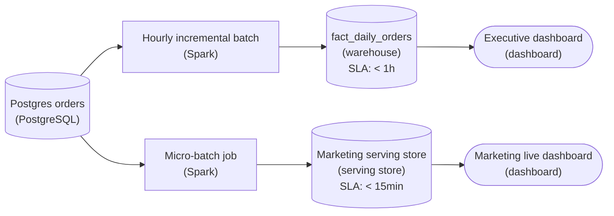

*One `Postgres` source, two cadences: an hourly incremental batch into a warehouse tagged '< 1h', and a micro-batch into a serving store tagged '< 15min'.*

1. **Make the executive path incremental, not faster**

   The 11-hour run rebuilds every order each night. Read only the orders past the last high-water mark, join the product dimension, and `MERGE` into `fact_daily_orders`. Run hourly, each slice is small, so the table lands inside '< 1h' and the 6am slip disappears without leaving batch. The keyed merge is idempotent, so a retried run writes the same rows instead of doubling them.

2. **Give marketing its own micro-batch path**

   A Spark job on a tight trigger picks up new orders every minute or two and writes a small serving store tagged '< 15min'. It carries only the recent slice marketing watches, not the full fact table, so its compute is a fraction of the nightly rebuild. Both paths read the one `Postgres` source but never share a clock.

| Pitfall: Don't buy freshness no one asked for |
| --- |
| The overreach is to rebuild the whole 18M-row join as true real-time streaming and point both dashboards at it. It works, but the executive path gains nothing because it reads daily, while you pay roughly 20x for an always-on cluster and standing join state. |

| ✕ Micro-batch (chosen) | ✓ True streaming (rejected) |
| --- | --- |
| A Spark job on a one- or two-minute trigger clears '< 15min' comfortably, and its cost scales with the recent slice it reads. | Per-event processing buys sub-second latency and holds join state for the full order history. No consumer asked for sub-second, so that always-on cluster is the ~20x line. |

**Follow-up questions**

1. What if a late order arrives with a `created_at` from yesterday after the hourly batch already ran?\
   *Why the idempotent `MERGE` lets you reprocess a past window safely.*
2. How would you catch the marketing path slipping past '< 15min' while the job still reports success?\
   *Freshness monitoring: alert on data lag, not just job status.*

</details>


<br>

### Exercise 2 of 2

**● TASK**

Fan 50 billion log events a day from one Kafka topic out to three consumers, picking the rhythm per branch instead of streaming all three. Land Kafka once into a shared bronze raw zone in object storage and have every branch read from bronze, never from Kafka directly. Feed the 30-second incident pager from a streaming engine tagged real-time or < 1min, the rolling five-minute ops dashboard from a micro-batch engine on a one-minute trigger tagged < 15min, and the daily billing capacity report from nightly batch tagged < 24h.

**Starting canvas** (already placed for you):

- Kafka log events (50B/day) (source, Kafka)
- Incident pager (sub-30-sec) (consumer, PagerDuty)
- Live ops dashboard (rolling 5-min) (consumer, Looker)
- Billing capacity report (daily) (consumer, Tableau)

<details>
<summary><strong>Solution</strong></summary>

#### Match the clock to the branch

**Freshness tiering** means letting each consumer's own deadline choose its processing rhythm, instead of picking one rhythm for the whole fan-out. Three consumers hang off the same 50-billion-event firehose, but their deadlines run from 30 seconds for the pager, to 5 minutes for the dashboard, to a full day for billing. So you run three engines, each just fast enough for the branch it feeds: a streaming engine for the pager, a one-minute micro-batch trigger for the dashboard, and a nightly batch job for billing.

The move that keeps this clean is landing Kafka into a shared bronze raw zone once and reading every branch from bronze. Kafka stays the transport, and object storage becomes the durable, replayable copy the three cadences share. That is the medallion idea in miniature: one raw landing that many downstream shapes read from.

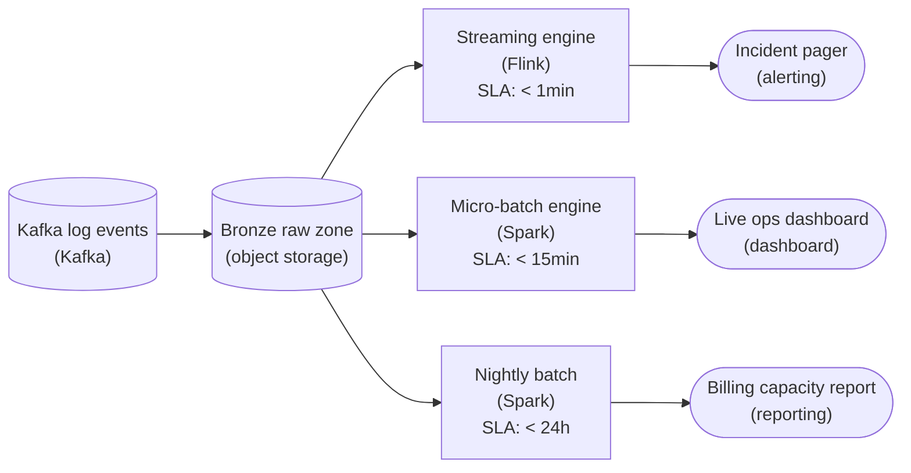

*One land into bronze, three cadences out: streaming under a minute for the pager, a one-minute micro-batch trigger for the dashboard, nightly batch for billing.*

| Pitfall: Streaming all three, or tapping Kafka three times |
| --- |
| There are 2 attempts to watch for. The first is one streaming engine feeding all three branches. It hits every deadline, but you pay for sub-minute freshness on a billing report read once a day, and you run a 24/7 cluster to do what a nightly job does in one pass. The second is pointing all three branches straight at Kafka. That means three consumer groups replaying the same 50B events, no durable replayable copy, and a daily job that depends on retention it does not control. Landing into bronze once removes both problems. |

| Key insight: True streaming vs micro-batch is a deadline decision |
| --- |
| The pager and the dashboard look similar, but the dashboard shows rolling five-minute aggregates. A one-minute micro-batch trigger lands well inside that window and spreads per-run overhead across a batch of events. The pager cannot wait for the next trigger, so it gets true record-at-a-time streaming. Micro-batch is not a weaker stream; it is the right tool when the deadline is minutes, not seconds. |

| ✕ Freshness the branch needs | ✓ Cost of over-delivering it |
| --- | --- |
| Pager: 30 seconds, genuinely needs streaming. Dashboard: rolling 5 minutes, which micro-batch clears. Billing: daily, one nightly pass. | Streaming everything means always-on compute for 2 branches that never asked for it. Freshness nobody consumes is pure spend, so the win is aligning each cadence to its deadline, not maximizing it everywhere. |

**Follow-up questions**

1. If the dashboard's requirement tightened from rolling 5 minutes to 30 seconds, what changes in this design?\
   *Promoting one branch from micro-batch to streaming while it keeps reading the same bronze zone.*
2. Billing needs to recompute a corrected total after late-arriving events are backfilled. Why does reading from bronze make that possible?\
   *The replay payoff of landing once into a durable raw zone.*

</details>


<br>

---

## Stateful vs Stateless Transforms

A stateless transform produces its output for a record from that record alone: each row goes in, its row comes out, and the transform remembers nothing. A stateful transform's output depends on records it has already seen, so it needs memory of the past to produce the present. One question sorts any transform: does its output need earlier records?

| Transform | Needs earlier records? | Class |
| --- | --- | --- |
| Parse event JSON into columns | No | Stateless |
| Filter out internal test users | No | Stateless |
| Look up country from a static IP table | No | Stateless |
| Count orders per city per 5 minute window | Yes, every order in the window | Stateful |
| Drop an event whose id was seen in the last hour | Yes, every id for 1 hour | Stateful |
| Match each refund to its original payment | Yes, every unmatched payment | Stateful |
| Running lifetime spend per customer | Yes, all history | Stateful |

Input events, 10:00 to 10:05

| event_id | city | amount | event_ts |
| --- | --- | --- | --- |
| e1 | Austin | 40 | 10:01:12 |
| e2 | Austin | 25 | 10:03:40 |
| e3 | Denver | 60 | 10:04:05 |

Stateful output: count per city per window

| window_start | city | orders | total |
| --- | --- | --- | --- |
| 10:00 | Austin | 2 | 65 |
| 10:00 | Denver | 1 | 60 |

The right table cannot be produced one row at a time. When e1 arrives, the pipeline knows Austin has 1 order so far; it must hold that partial count somewhere until 10:05, when the window closes and the row is final. In a batch job this is a `GROUP BY`, and the state lives in the memory of a run that ends in minutes. In a stream the job never ends, so state lives in a store that must survive for as long as the window is open, for every open key at once.

```sql
SELECT
  city,
  COUNT(*) AS orders,
  SUM(amount) AS total
FROM raw.order_events
WHERE event_ts >= TIMESTAMP '2026-10-27 10:00:00'
  AND event_ts < TIMESTAMP '2026-10-27 10:05:00'
GROUP BY city
```


<br>

### State costs memory and time

State costs memory in proportion to the number of open keys times the size of each key's partial result, and it costs time to protect that memory. If the stream tracks 5 minute windows for 10,000 cities, the state is small. If it drops duplicate event ids seen in the last 24 hours at 2,000 events a second, the state holds 172.8M ids, several gigabytes, and every incoming event checks against it. The stateless transform next to it holds nothing and scales by adding machines; the stateful one scales by splitting keys across machines, and each key must land on the same machine every time.

> **TIP**
>
> When a stream job's cost jumps, look for a new stateful step. A stateless parse added to a stream adds machines in proportion to rows; a new 24 hour deduplication adds a state store, a checkpoint stream and a recovery story.


<br>

### Recovering state after a crash

A stateless job that dies restarts, reads the last position it recorded on the queue, and continues; it lost nothing because it held nothing. A stateful job that dies loses every partial count in memory. Without protection, the 10:00 to 10:05 Austin window restarts at 0 part way through, and the final row is wrong with no error to show for it. The protection is a checkpoint: every few seconds the job writes its state and its queue position together to durable storage, so a restart loads the snapshot and replays only the events after the saved position.

> Restart after a crash at 10:03:00
>
> - Stateless: resume from queue position 48,210, reprocess nothing, 2 seconds to catch up.
> - Stateful, no checkpoint: all partial counts gone; the 10:00 window undercounts and nobody is told.
> - Stateful, checkpoint every 5 s: load state and position 38,210 saved at 10:02:55, replay 10,000 events, 5 seconds to catch up, counts correct.

Checkpointing is itself a cost: the state is written over and over, and the write must be frequent enough that replay after a crash is short, but not so frequent that writing state crowds out processing events. A job with 8GB of state checkpointing every 10 seconds moves 69TB a day to storage for protection alone.

**Classify this rule and say what it needs: flag any payment card used in 3 different cities within 10 minutes.**

- **A.** Stateless: each payment carries its own city, so the transform compares the city on the row to the previous row.
- **B.** Stateful: the job keeps the cities seen per card for the last 10 minutes and checkpoints that store so a restart does not forget a card's recent cities.
- **C.** Stateful: the job keeps every payment ever seen so any card's full history is available.
- **D.** Stateless: the check can be done by a lookup against a static table of known cities.

<details>
<summary>Solution</summary>

**B.** Stateful: the job keeps the cities seen per card for the last 10 minutes and checkpoints that store so a restart does not forget a card's recent cities.

The output for a payment depends on earlier payments on the same card. The state is bounded to 10 minutes per card, and without a checkpoint a crash would reset every card to 0 cities.

**Why the others are wrong**

- **A.** Remembering the previous row is already memory of an earlier record, and the rule spans many rows over 10 minutes, so no single-row transform can express it.
- **C.** Stateful is correct, but only 10 minutes of cities per card are needed. Keeping all history grows the state forever for no gain.
- **D.** A static table lists which cities exist, but not which cities this card visited in the last 10 minutes.

</details>


<br>

---

## Pipeline Architecture

### Exercise 1 of 2

**● TASK**

A factory's sensor gateway publishes 3,000 temperature readings a second to a Kafka topic, about 260 million a day. Operators watch a live panel, backed by its own store, that must show every reading within 30 seconds of it arriving on the topic. An hourly Spark batch would clear that volume easily; weigh the latency and the throughput this needs, then design the pipeline from the topic to the panel.

<details>
<summary><strong>Solution</strong></summary>

#### 2 dials, and only one of them binds here

Latency and throughput are separate measures. Throughput asks whether the pipeline keeps up: 3,000 readings a second is about 260 million a day, and an hourly Spark job clears that comfortably. Latency asks how long one reading waits before anyone can see it, and on an hourly schedule that wait is up to an hour against a 30-second budget. Once you name both numbers the choice is clear: throughput is not the constraint, latency is, so readings go through a stream processor.

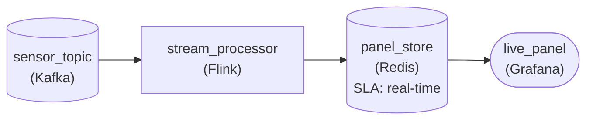

*`sensor_topic` feeds `stream_processor` continuously, which keeps `panel_store` fresh in real time, well inside 30 seconds, for `live_panel`.*

| ✕ Hourly Spark batch | ✓ Flink reading the topic |
| --- | --- |
| Collects an hour of readings and processes about 10.8 million in one run. Throughput is excellent, but a reading that lands just after a run waits nearly an hour to appear. | Handles each reading as it arrives and writes it to `panel_store` within seconds. Per-event overhead is higher, but at 3,000 a second that overhead is affordable. |

| Pitfall: Keeping up is not the same as being on time |
| --- |
| A batch job that finishes in 5 minutes looks fast, but its latency is the schedule plus the run, not the run alone. Measure from the moment a reading lands on the topic to the moment an operator can see it. |

| Performance: Modest volume makes low latency cheap |
| --- |
| At 3,000 readings a second a small stream job holds the rate, so paying per-event overhead for 30-second freshness costs little. The tension bites at much larger volumes, where batching work to amortize that overhead starts to win on throughput. |

**Follow-up questions**

1. The plant adds a weekly report of average temperature per machine. Does it belong on the same streaming path?\
   *Weighing both dials for a second reader whose latency budget is a week.*
2. If the panel's budget relaxed to one hour, what would you change?\
   *Seeing the decision flip once latency stops being the constraint.*

</details>


<br>

### Exercise 2 of 2

**● TASK**

A food-delivery platform publishes 40 million order status events a day to a Kafka topic, and a restaurant-ops panel reads per-restaurant open-order counts from a warehouse. The panel must show a change within 2 minutes, but nothing needs per-event latency, so pay for no more freshness than that. Choose micro-batch or record-at-a-time streaming for the transform, set its freshness to fit, and design the pipeline from the topic to the panel.

<details>
<summary><strong>Solution</strong></summary>

#### Pick the trigger, not the fastest engine

Micro-batch is what most 'streaming' pipelines really run: an engine with a streaming API that wakes on a trigger interval, processes whatever accumulated, writes the result, and waits. Here the panel needs a change within 2 minutes and nobody reacts to single events, so a one-minute trigger meets the bar while each batch spreads its overhead across roughly 28,000 events (about 460 a second times 60).

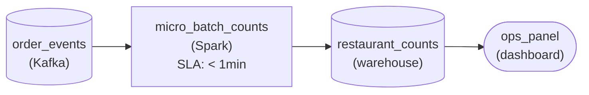

*The Kafka topic feeds a Spark micro-batch on a one-minute trigger, which writes per-restaurant counts to a warehouse the ops panel reads.*

1. **Turn the freshness bar into a trigger**

   In the worst case a status change lands just after a batch starts: it waits up to one trigger interval, then rides the next batch's few seconds of processing. A one-minute trigger plus that work stays under 2 minutes, which is why the transform carries the '< 1min' freshness chip.

2. **Rule out both neighbors**

   A per-event processor at real-time freshness also meets 2 minutes, but it pays to keep every record moving for a panel nobody reads faster than once a minute. A 15-minute trigger or an hourly batch is cheaper still and misses the bar outright.

| Pitfall: Faster than required is not more correct |
| --- |
| The common slip is reaching for record-at-a-time streaming because the problem says 'events' and 'Kafka'. Latency below what any reader consumes is pure cost: the requirement sets the trigger, not the other way round. |

| Real world: The trigger is one number you retune |
| --- |
| In Spark Structured Streaming the interval is the `processingTime` argument on the trigger. If the panel later needs 30 seconds, you shorten it and the application code stays the same; Flink exposes a similar tunable interval. |

**Follow-up questions**

1. If the panel's bar tightened to 10 seconds, would micro-batch still be the right pick?\
   *Where a shorter trigger stops amortizing per-batch overhead and per-event processing starts to earn its cost.*
2. Dinner rush runs five times the average volume. What happens to each one-minute batch?\
   *Whether a fixed trigger absorbs a burst by growing the batch rather than adding latency.*

</details>


<br>

---

## When Batch Outgrows Itself

Batch pipelines outgrow themselves in 2 ways, and the fix depends on which. The data grows until the run no longer finishes inside its schedule, a throughput problem. Or the consumer's freshness need shrinks until the schedule itself is too slow, a latency problem. Both show up as the same complaint, the dashboard is behind, and both tempt a team to rebuild as streaming. Name the problem first, then climb the smallest number of rungs that meets the consumer's tier.

| Consumer freshness tier | Smallest pattern that meets it | Cost relative to nightly batch |
| --- | --- | --- |
| Yesterday's numbers (24 h) | Nightly batch | 1x |
| This hour's numbers (1 h) | Hourly batch over new rows only | 1x to 2x |
| Within a few minutes | Micro-batch, 1 to 5 min trigger | 3x to 10x |
| Within seconds | Streaming, stateless where possible | 15x and up |


<br>

### A worked diagnosis

A nightly job rebuilds a 2 year `curated.orders` table from the full raw history every night at 01:00. 2 years ago it took 90 minutes. It now takes 5 hours 40 minutes and must finish before 07:00, when the finance team opens its dashboard. Meanwhile the operations team has asked for the same table within 1 hour so it can react to regional delivery delays. Run time growing in step with history is the throughput signal; the 1 hour request is the latency signal. The job has both problems, and the same rung fixes both.

Most of the job's work is reprocessing 730 days of orders to add 1 day's worth. Switch it to process only rows that arrived since the previous run, and a nightly run reads 1 day of rows instead of 730. Once runs are small, the schedule can tighten to hourly without touching streaming. Each hourly run handles around 170,000 rows in about 3 minutes, so worst-case latency falls from 30 hours to around 63 minutes, which the operations team accepts as its hourly tier.

```sql
INSERT INTO curated.orders
SELECT
  order_id,
  customer_id,
  city,
  amount,
  event_ts,
  ingested_ts
FROM raw.order_events
WHERE ingested_ts > (
  SELECT
    coalesce(max(ingested_ts), TIMESTAMP '1970-01-01 00:00:00')
  FROM curated.orders
)
```

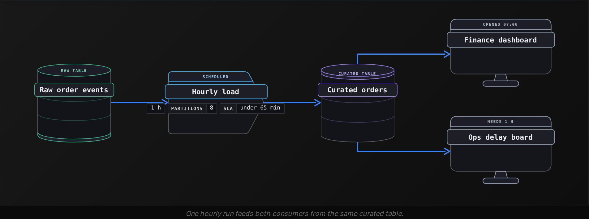


<br>

### Moving one path to micro-batch or streaming

Stop climbing when the tier is met. If the operations team later needs delays within 2 minutes, the next step is a micro-batch job on the order queue with a 60 second trigger, and only the path feeding the delay board moves. Finance keeps its hourly load: a fresher table gains it nothing and would cost 3 to 10 times more. If a fraud consumer later needs sub-second decisions, that single stateless check becomes a streaming job, while the stateful aggregates stay in micro-batch where state and recovery cost less.

| ✓ Do | ✗ Don't |
| --- | --- |
| • Name the constraint first: a growing backlog is throughput, a waiting consumer with idle machines is latency<br><br>• Process only new rows before shortening the schedule<br><br>• Move one consumer's path up a rung, never the whole table | • Shorten a schedule on a throughput-bound job; extra runs add overhead, not speed<br><br>• Rebuild as streaming because the dashboard is behind<br><br>• Put a stateful aggregate into a stream before pricing its state and checkpoints |

**A daily batch loads 20M click rows in 50 minutes for a marketing dashboard viewed at 09:00. Product wants a live board of clicks per page over the last 5 minutes, refreshed within 1 minute. Marketing's need is unchanged. Which design is the smallest that meets both?**

- **A.** Replace the nightly batch with a streaming job that writes every click within 1 second, and point both dashboards at it.
- **B.** Run the existing nightly batch every 5 minutes so the product board is fresh enough.
- **C.** Keep the nightly batch for marketing; add a micro-batch job on the click queue with a 30 second trigger computing the 5 minute per-page counts, and check its processing time stays under 30 seconds.
- **D.** Keep the nightly batch and add a second nightly batch that computes per-page counts, since 2 batches are cheaper than a stream.

<details>
<summary>Solution</summary>

**C.** Keep the nightly batch for marketing; add a micro-batch job on the click queue with a 30 second trigger computing the 5 minute per-page counts, and check its processing time stays under 30 seconds.

Each consumer gets its own rung. Worst-case latency is the 30 second interval plus processing, so the check on processing keeps it under 1 minute. The count's state is bounded to 5 minutes per page.

**Why the others are wrong**

- **A.** Marketing gains nothing from seconds, everyone pays the always-on premium, and the 5 minute count becomes a stateful stream with checkpoint cost.
- **B.** The batch rebuilds all 20M rows in 50 minutes. On a 5 minute schedule it falls behind on the first run.
- **D.** Keeping the first batch is right. A nightly count is up to 24 hours stale against a 1 minute need, so the product tier is missed.

</details>


<br>

---

## Pipeline Architecture

### Exercise 1 of 1

**● TASK**

A metering service writes 200 million API-call events a day to Kafka, and the billing team reads per-customer usage totals once a day, by 6am, to draft invoices. Design the cheapest pipeline that meets that need: the current proposal is an always-on stream processor keeping running totals for 2 million customers, so decide whether its continuous compute and state are worth paying for. Land the raw events durably so any day can be recomputed.

<details>
<summary><strong>Solution</strong></summary>

#### Pay only for freshness someone reads

Streaming bills by the hour whether or not anyone is reading. That is the first of the 3 cost components from the section: continuous compute, state storage and operational overhead. Here the only reader drafts invoices once a day at 6am, so an always-on stream processor would pay for 24 hours of cluster time, a checkpointed store of running totals for 2 million customers, and an on-call rotation for consumer lag, all to serve one read a day. A daily batch run pays for the forty minutes it works and nothing else.

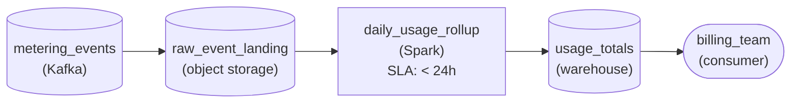

*Kafka lands raw calls in object storage; one Spark run a day rolls them into per-customer totals in the warehouse before billing reads at 6am.*

| Pitfall: Events on a stream do not need a streaming pipeline |
| --- |
| The tempting design reaches for a stream processor because the events already sit in Kafka. Where the data arrives says nothing about how fresh the output must be. Ask who reads it and how often: when the answer is once a day, a `< 1min` freshness tier is budget spent on minutes nobody looks at. |

| Performance: Forty minutes against 24 hours |
| --- |
| Compute: rolling up 200 million events takes about forty minutes, against a cluster provisioned around the clock, roughly 36 to 1 in raw hours. State: the batch run keeps nothing between days because it rereads the raw files, so there is no 2-million-key store to checkpoint. Operations: a failed nightly run is retried before 6am; a stuck stream pages someone at 3am. |

| Key insight: The raw store is what keeps batch cheap to fix |
| --- |
| Landing every raw call in object storage means a wrong day is repaired by rerunning that one day, with no stream replay and no state to rebuild. That durable history is also why nothing needs to run between the daily runs. |

**Follow-up questions**

1. Product wants an alert within a minute when a customer exceeds their quota. What changes, and what does it cost?\
   *Whether you add a narrow streaming branch for the alert alone and keep invoicing on the cheap daily run.*
2. Billing switches to drafting invoices every hour. Is an always-on stream now worth it?\
   *Whether hourly freshness is better met by an hourly batch or micro-batch than by continuous compute.*

</details>


<br>

---

## Putting It All Together

A grocery delivery company runs a nightly batch that rebuilds its orders table from 2 years of history for the finance dashboard. The run has crept to 6 hours. Dispatch now wants courier delays per zone within 1 minute, and the payments team wants a card check that blocks stolen cards before the order is accepted.

- The 6 hour run growing with history is a throughput constraint; the finance consumer is satisfied, so no schedule change is needed. Processing only the previous day's rows cuts the run to minutes at the same cost.
- Dispatch's 1 minute need is a latency constraint on a stateful count per zone. A micro-batch job on the order queue with a 30 second trigger meets it while bounding the state to the open windows.
- The card check is stateless per payment and worth the full order value per second saved, so it alone justifies the always-on premium of a true stream.
- Each of the 3 consumers sits on its own rung, so the company pays streaming cost only for the path where seconds have a price and leaves the other 2 where they are cheapest.


<br>

---

## Pipeline Architecture

### Exercise 1 of 2

**● TASK**

A payments gateway publishes 50,000 card authorizations a second to Kafka. Mask each card number and archive every event in object storage; separately, count authorizations per card over a 10-minute window and publish cards above 5 to an alerts topic within a minute. Keep the stateless masking and the stateful counting as separate stages, and checkpoint the counter's state to durable storage so a restart resumes the counts.

<details>
<summary><strong>Solution</strong></summary>

#### 2 boxes on the same topic, opposite sides of the state line

Masking a card number and counting a card's authorizations look alike on the canvas: 2 transforms reading the same Kafka topic. They sit on opposite sides of the stateless versus stateful line. Masking needs only the event in hand. The per-card count needs every authorization that card made in the last 10 minutes, so the engine has to remember something between events, and **that memory is what has to survive a crash**.

1. **Classify each transform by what it must remember**

   `mask_card_number` rewrites one field on one event and forgets it, so it scales by adding workers and simply resumes from its committed offset after a failure. `count_per_card_10min` keeps a counter per card key, about 8 million live keys at this volume, and its output depends on events it saw minutes ago.

2. **Give the stateful stage, and only it, a checkpoint**

   The counter holds its keyed state in a local store and snapshots it to `state_checkpoints` together with its Kafka offsets. On restart it reloads the snapshot and replays from those offsets, so a card sitting at 5 authorizations still trips the alert on its sixth. The masker needs no snapshot at all.

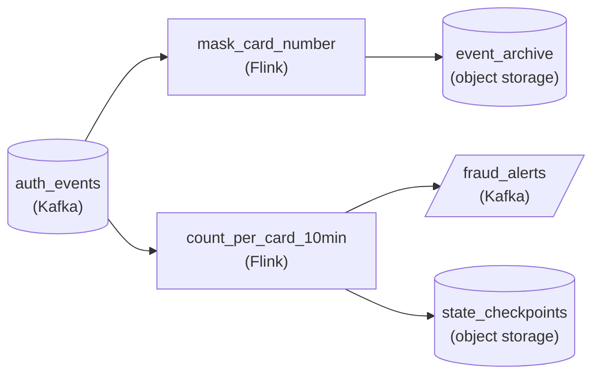

*The stateless `mask_card_number` branch lands in `event_archive`; only the stateful `count_per_card_10min` checkpoints to `state_checkpoints` and feeds `fraud_alerts`.*

| Pitfall: A restarted counter must not start from zero |
| --- |
| Drawing the counter like the masker, a box with no durable state, means every deploy or crash silently resets millions of counts, and a card mid-burst slips under the threshold. Fusing masking into the counting job is the opposite mistake: the cheap stateless work inherits the checkpoint size and slower recovery of the stateful job. |

| Performance: State grows with keys, not with events |
| --- |
| 50,000 events a second is about 4.3 billion a day, and the masker's cost tracks that linearly. The counter's state tracks distinct cards in the window instead: roughly 8 million keys at a few bytes each is a few hundred megabytes, small enough to checkpoint every minute without stalling the alert path. |

**Follow-up questions**

1. Fraud wants each alert tagged with the card's home country from a separate card-profile stream. Which category is that join, and what does it add to the checkpoint?\
   *Recognizing a stream-to-stream join as stateful and placing it on the checkpointed side.*
2. What changes if the window grows from 10 minutes to 24 hours?\
   *How window length drives state size and recovery time while the masking branch stays the same.*

</details>


<br>

### Exercise 2 of 2

**● TASK**

A mobile game publishes 120 million match results a day to a Kafka topic, and a nightly Spark batch costing about $300 a month computes per-region win rates for a live-ops dashboard that now needs them within 15 minutes. A record-at-a-time job holding per-region counts in state is quoted at $6,000 a month, against a budget of $1,500. Design the pipeline from the topic to the dashboard: choose how the win rates are computed and a trigger interval that meets the 15-minute target inside the budget, and land them in a warehouse the dashboard reads.

<details>
<summary><strong>Solution</strong></summary>

#### Price the freshness, then pick the trigger

A micro-batch trigger interval is a price tag as much as a latency setting. Every trigger pays for a cluster to start, read a slice of the topic, update the per-region counts and write them out, so a shorter interval buys freshness by paying that cost more often. The job here is to find the longest trigger that still meets 15 minutes, because that is also the cheapest one that does.

1. **Turn the target into a trigger budget**

   Worst-case staleness is the trigger interval plus one run's processing time: a match that finishes just after a run starts waits a full interval, then the next run's work. At 120 million results a day (about 1,400 a second), ten minutes of data is roughly 830,000 events, which a run clears in about two minutes. A 10-minute trigger gives about 12 minutes worst case; a 15-minute trigger gives about 17 and misses.

2. **Price each option against nightly**

   Nightly uses about an hour of cluster time a day for $300, so roughly $10 an hour. A 10-minute trigger is 144 runs a day at about two minutes each, 4.8 hours a day, near $1,440 and inside budget. A 5-minute trigger means 288 runs at about 1.5 minutes, near $2,160 and over. The record-at-a-time job pays for compute, a state backend and checkpoints that never stop, which is how it reaches $6,000: 20 times nightly for freshness live-ops cannot use.

3. **Keep the state small and carried between runs**

   Win rate per region is a stateful count: each run adds its slice's wins and matches to running totals. With about 30 regions that state is a few kilobytes, carried in the run's checkpoint from one trigger to the next. Small state is what keeps the micro-batch cheap and its recovery simple.

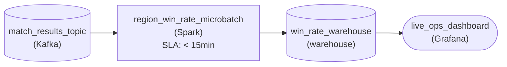

*The topic feeds a Spark micro-batch on a 10-minute trigger, which writes per-region win rates to the warehouse the dashboard reads.*

| Performance: Freshness is bought by the trigger, not the engine |
| --- |
| The same Spark logic that ran nightly now runs 144 times a day on a slice 1/144th the size. Cost scales with how often the cluster starts and how long each run holds it: about 5x nightly here, the cheap end of the 5x to 50x band. Evening peaks near 4x the average lengthen each run, so check the 12-minute worst case against peak load, not the daily mean. |

| Pitfall: A micro-batch job left running pays always-on prices |
| --- |
| Choosing micro-batch and then keeping the job up between triggers bills the cluster 24 hours a day and erases most of the saving. The cost case holds only when each trigger starts, processes its slice and releases the compute. The opposite miss is just as common: assuming a 15-minute target needs per-event processing at all. |

**Follow-up questions**

1. Evening traffic hits 4x the average and a run now takes 6 minutes. Does the 10-minute trigger still meet 15 minutes?\
   *Staleness is trigger plus processing time, and processing time grows with load.*
2. The budget drops to $1,000 a month. What do you change, and what do you tell live-ops?\
   *Whether the learner can name the freshness a smaller budget actually buys instead of shaving the trigger blindly.*

</details>


<br>

---

## Key Takeaways

- Latency is how old the newest visible row is; throughput is how many rows per second the pipeline absorbs. Measure both, and diagnose by watching whether the backlog grows.
- Micro-batch runs batch on a short fixed trigger against a queue. Worst-case latency is the interval plus processing time, and processing must stay under the interval or the backlog grows.
- Streaming costs more because machines run 24 hours, every write pays fixed overhead, and a stalled job needs someone awake. Justify it only when staleness has a price you can write down.
- A stateless transform needs only the current record and restarts for free. A stateful one holds partial results per key, must checkpoint them, and recovers by loading a snapshot and replaying.
- When batch falls behind, name the constraint, process only new rows, tighten the schedule, and move a single consumer's path up one rung at a time.
