Advanced·Pipeline Architecture · 38 min · 11 challenges

# Data Quality: Advanced

PayPal published an open-source template for data contracts, and a Friday release on a checkout team shows what one is for. A checkout engineer renames `amount_cents` to `amount` and switches it to dollars. With a contract check in the build, the merge fails within minutes and gets fixed before lunch. Without one, Monday's revenue dashboard shows zero for every market, and finance spends the morning finding out why.


<br>

---

## Data Contracts and CI Enforcement

A data contract is a versioned file, owned by the team that produces a dataset, stating what every consumer may rely on. It has 3 parts. The schema lists each field with its type and whether it may be null. The guarantees state rules the values obey and delivery promises, such as how soon an event lands after the order completes. The evolution policy says which changes the producer may ship freely, which count as breaking, and how much notice consumers get first. The file sits in the producer's repository beside the code that emits the data, so a change to either is reviewed together.


<br>

### A contract for one event

```sql
contract: checkout.order_completed
version: 1.2.0
owner: checkout-platform
schema:
  - name: order_id
    type: string
    required: true
    unique: true
  - name: customer_id
    type: string
    required: true
  - name: amount_cents
    type: bigint
    required: true
    min: 1
  - name: currency
    type: string
    required: true
    allowed: [USD, EUR, GBP]
  - name: completed_at
    type: timestamp
    required: true
  - name: coupon_code
    type: string
    required: false
guarantees:
  freshness_minutes: 60
  daily_rows_min: 400000
  amount_cents_meaning: total charged after discounts, before tax, in minor currency units
evolution:
  additive: [add optional field]
  breaking: [remove field, rename field, change type, make field required, change allowed values]
  breaking_requires: new major version and 30 days notice
```

The version follows a major.minor.patch rule. An additive change, such as a new optional `refund_reason` field, raises it to 1.3.0 and asks nothing of consumers. A breaking change raises it to 2.0.0 and starts the 30-day notice. This team counts any edit to `allowed` as breaking, added values included, because a consumer that looks up exchange rates by currency fails on a code it has never seen. The `amount_cents_meaning` line matters as much as the types: a producer who starts including tax keeps every type valid and still moves every revenue figure downstream.


<br>

### Enforcing it at 2 points

Continuous integration, or CI, is the set of automated checks that run on every proposed code change before it may merge. The contract check in the producer's CI builds a sample event from the changed code, usually inside a unit test, and diffs its fields against the contract file. If a pull request renames `amount_cents` to `amount`, the diff shows a required field missing and an undeclared field added. The check classifies that as breaking and fails the build unless the same pull request raises the contract to 2.0.0, which puts the rename in front of reviewers and starts the clock for consumers.

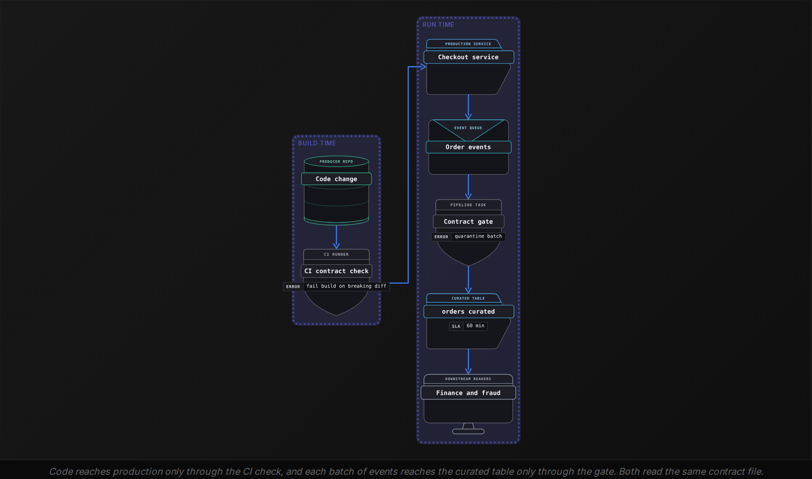

**A checkout engineer adds JPY to the allowed currencies and raises the contract from 1.2.0 to 1.3.0 in the same pull request. What does the CI contract check do under this contract's evolution policy?**

- **A.** Passes the build, because adding a value only widens what consumers receive, which the policy treats as additive.
- **B.** Fails the build, because any change to allowed values is breaking and needs 2.0.0 plus 30 days notice.
- **C.** Passes the build, and the pipeline gate later quarantines every batch containing a JPY order.
- **D.** Fails the build, because every edit to a contract file needs a new major version, whatever it changes.

<details>
<summary>Solution</summary>

**B.** Fails the build, because any change to allowed values is breaking and needs 2.0.0 plus 30 days notice.

The policy names this change as breaking, so a minor bump to 1.3.0 does not satisfy the check.

**Why the others are wrong**

- **A.** This policy lists every change to allowed values as breaking, added values included.
- **C.** CI runs first, and the bump is the wrong kind for a breaking change, so the merge never happens.
- **D.** An additive change such as a new optional field passes with a minor bump.

</details>

CI sees code, so it misses every problem the code did not cause. Suppose a payment partner starts routing orders through checkout with `currency` set to `JPY` by configuration. No code changed, so CI has nothing to check. The gate runs on each batch of real rows against the guarantees, so it catches the unknown currency, a day that lands 180,000 rows, or a replay that repeats `order_id` values. A failing gate quarantines the batch, and consumers keep reading the last good partition: the block authority from the beginner lesson, now driven by the contract.

```sql
SELECT
  COUNT(*) AS row_count,
  COUNT_IF(order_id IS NULL) AS null_order_id,
  COUNT(*) - COUNT(DISTINCT order_id) AS duplicate_order_id,
  COUNT_IF(amount_cents < 1) AS bad_amount,
  COUNT_IF(currency NOT IN ('USD', 'EUR', 'GBP')) AS bad_currency
FROM staging.order_completed
WHERE batch_date = DATE '2026-10-23'
```

**A refunds integration starts writing refunds into the order event stream as negative amount_cents values. Checkout's code has not changed. Which enforcement point stops these rows from reaching orders_curated?**

- **A.** The CI contract check, because negative values violate the min: 1 rule declared in the contract file.
- **B.** Neither point, because amount_cents is still a bigint and the schema in the contract is unchanged.
- **C.** Both points together: CI flags the broken rule, then the gate quarantines the batch it describes.
- **D.** The pipeline gate, because its bad_amount count rises above 0 and it quarantines the batch.

<details>
<summary>Solution</summary>

**D.** The pipeline gate, because its bad_amount count rises above 0 and it quarantines the batch.

The gate checks guarantees on every batch of rows, so a value rule catches a change no code review saw.

**Why the others are wrong**

- **A.** CI runs when code changes, and checkout's code did not change, so CI never compares anything.
- **B.** The schema is unchanged, but the contract also declares a minimum, and the gate checks it on real rows.
- **C.** No code or contract changed, so CI has nothing to flag. The gate acts alone.

</details>


<br>

---

## Pipeline Architecture

### Exercise 1 of 2

**● TASK**

Turn the customer_events data contract into enforcement on the pipeline. Before the curate step, validate every event against the contract's schema, its evolution policy (additive changes pass, breaking ones are rejected) and its quality SLA, so violations never reach fct_customer_events. Have an orchestrator run that validation on every pipeline run, and feed the landed table into a monitoring dashboard that pages on-call when a breach slips through.

**Starting canvas** (already placed for you):

- Producer service (schema lives in tribal knowledge) (source, API)
- Kafka customer_events topic (queue, Kafka)
- transform_curate (transform, SQL)
- Iceberg fct_customer_events (storage, Iceberg)
- Three downstream consumers (consumer, API)

<details>
<summary><strong>Solution</strong></summary>

#### A contract the pipeline enforces on every run

A data contract becomes real only when the pipeline refuses to break it. Its **evolution policy** decides what happens when the producer changes the schema: an added nullable field is additive and passes, while a dropped or retyped column is breaking and is rejected. Put that check in one validation gate in front of `transform_curate`, together with the schema match and the quality SLA. The `customer_events` wiki page then becomes a rule the pipeline applies every time it runs.

```mermaid
flowchart LR
    n0[("Producer service<br/>(API)")]
    n1[/"Kafka `customer_events`<br/>(Kafka)"/]
    n2["Contract validation<br/>(custom)"]
    n3["`transform_curate`<br/>(SQL)"]
    n4[("Iceberg `fct_customer_events`<br/>(Iceberg)")]
    n5(["Three downstream consumers<br/>(API)"])
    n6["Orchestrator<br/>(Airflow)"]
    n7(["Monitoring dashboard<br/>(Grafana)"])
    n8(["On-call alerts<br/>(consumer)"])
    n0 --> n1
    n1 --> n2
    n2 --> n3
    n3 --> n4
    n4 --> n5
    n6 --> n2
    n4 --> n7
    n7 --> n8
```

*Contract validation sits between `customer_events` and `transform_curate`. The orchestrator runs it on every run, and a monitoring dashboard on the landed table pages on-call.*

1. **Validate before `transform_curate`, not after**

   Each event is checked three ways while it is still in flight. Does it match the declared schema? Is any drift an allowed evolution rather than a breaking one? Does the batch clear the quality SLA? Only events that pass all three reach curate, so `fct_customer_events` never holds a violation.

2. **Let the orchestrator own every run**

   Make validation a task in the Airflow DAG, upstream of curate. A failed check fails the run instead of letting bad data through. The guarantee then holds without anyone having to remember to look.

3. **Watch the landed table and page on-call**

   Validation stops what it can see at the door. A monitoring dashboard on `fct_customer_events` catches a breach that slips past it and hands that breach to on-call. Without it, the first sign of the breach is a consumer's wrong number.

| Key insight: Additive passes, breaking is rejected |
| --- |
| Schema evolution does not mean that no change is allowed. A new nullable column keeps every reader working, so the policy lets it through. A removed or retyped column breaks readers, so the policy blocks it. A rename is a removal plus an addition, so it counts as breaking unless both names ship side by side for a deprecation window. |

| Pitfall: Validating after curate is too late |
| --- |
| The tempting shortcut is to load everything into `fct_customer_events` and check the curated table afterward. By then the bad batch has already reached the consumers, so you detect corruption instead of preventing it. Enforce the contract upstream of curate, so a breach is stopped before it lands. |

</details>


<br>

### Exercise 2 of 2

**● TASK**

Instrument the curated Iceberg table for all five pillars of data observability. Attach one quality check monitor each for freshness, distribution, volume and schema, and add a DataHub catalog node that records which upstream column produced each output column, the lineage pillar most programs skip. Keep the curated table on a schema-evolvable format so the contract can change under CI without breaking its three consumers.

**Starting canvas** (already placed for you):

- Kafka events source (source, Kafka)
- transform_curate (transform, SQL)
- Iceberg fct_curated (storage, Iceberg)
- Three downstream consumers (consumer, API)

<details>
<summary><strong>Solution</strong></summary>

The five pillars of data observability (freshness, distribution, volume, schema and lineage) give you a diagnostic order to walk when a consumer reports a wrong number. They are not a checklist. Each pillar rules out one class of cause: the data is late, a column's shape has drifted, row counts spiked or vanished, the contract changed, or a bad value came in from some upstream source. The monitors you placed give every pillar a reading, so you walk that order with instruments instead of guesses.

#### Where each pillar lives

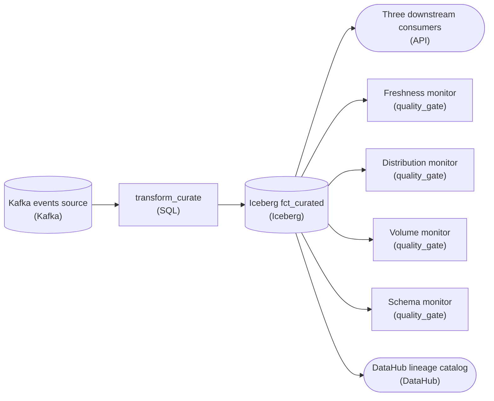

*Four quality checks instrument freshness, distribution, volume and schema on `fct_curated`; the DataHub catalog covers lineage.*

The four monitors attach to `fct_curated`, not to `transform_curate`, and that is deliberate. Freshness, distribution, volume and schema are properties of the data at rest, which is what the three consumers actually read. A monitor on the transform only tells you the job ran. A monitor on the table tells you what the job produced, and that is the number the consumer is complaining about.

| Pitfall: Lineage is the pillar most programs leave half-covered |
| --- |
| Four table monitors are cheap. Column-level lineage is not, which is why most programs cover the first four pillars well and lineage poorly. Yet lineage is the pillar that tells you where a problem started. Without a catalog that maps which upstream column fed each output column, the other four pillars tell you a value is wrong and then leave you grepping SQL for its source. The DataHub node turns a detected anomaly into a root cause instead of a hunt. |

| Key insight: The schema pillar is only as good as the format under it |
| --- |
| A schema monitor that fires on breaking changes is worthless if the table cannot evolve safely. Keeping `fct_curated` on Iceberg lets the contract add, rename or reorder columns under CI without rewriting data files or breaking the three consumers mid-read. On a format that cannot evolve, every contract change means a full rewrite, so teams route around the schema check instead of through it. |

**Follow-up questions**

1. Which pillar catches a producer that silently starts sending `amount` in cents instead of dollars, and why does the schema monitor miss it?\
   *The type is unchanged, so only the distribution pillar sees the shift.*
2. How would you scope the freshness monitor so it only fires when a consumer's actual read window is affected?\
   *Ties a raw staleness threshold to how the data product is actually read.*

</details>


<br>

---

## Five Pillars of Observability

A contract states what should be true about one dataset. Observability measures what is true across every table, including the many that have no contract yet. Data observability sorts those measurements into 5 pillars, each answering one question about a table. The same 5 serve 2 jobs: an order of questions during an incident, and a grid for deciding what a quality program covers.

| Pillar | Question | Measured as | Typical fault |
| --- | --- | --- | --- |
| Freshness | When did new data last land? | minutes since the newest `loaded_at` | a stalled upstream job |
| Volume | Did the expected amount arrive? | rows per partition against recent history | a dropped file, a doubled load |
| Schema | Did the shape change? | column names and types against yesterday | a removed or retyped column |
| Distribution | Are the values plausible? | null rate, distinct count, percentiles | a unit change, a flood of defaults |
| Lineage | What feeds this table, and what reads it? | upstream and downstream datasets as a graph | where a fault began and who it reaches |

Lineage is the dependency graph between datasets: for any table, the tables its rows come from and everything built on it downstream, dashboards and models included. The first 4 pillars say that something is wrong with a table. Lineage says where to look upstream for the cause and whom to warn downstream.


<br>

### The pillars as an incident order

Ask the pillars in order of cost. Freshness and volume come from load metadata in seconds, and together they split every incident in 2: data that did not arrive, and data that arrived wrong. Schema is a comparison of column lists. Distribution needs a scan of values, so it comes last. Lineage runs through all of it: test the symptom table first, then step upstream one table at a time until the failing pillar reads normal; the fault began in the next step downstream.

On Oct 22 the revenue dashboard shows 0 revenue for the EU market. Walking upstream, the pillars report this:

| Table | Freshness | Volume | Schema | Distribution |
| --- | --- | --- | --- | --- |
| `revenue_daily` | on time | normal | unchanged | EU revenue is 0 |
| `orders_curated` | on time | 31% below its 28-day median | unchanged | no EU rows |
| `orders_raw` | on time | 412,000 rows, normal | unchanged | new `currency` value `eur` in 31% of rows |

Freshness is green everywhere, so the data arrived. Volume is normal in `orders_raw` and 31% low one step later, which places the loss in the step that builds `orders_curated`. That step inner joins orders to exchange rates on `currency`, and the distribution of `orders_raw` shows why rows vanish: a checkout release began sending lowercase `eur`, which matches no rate. Walking lineage downstream from `orders_curated` then finds a second victim, `fraud_features`, which no dashboard showed. A contract gate with a fixed currency list would have stopped this batch before `orders_curated`.

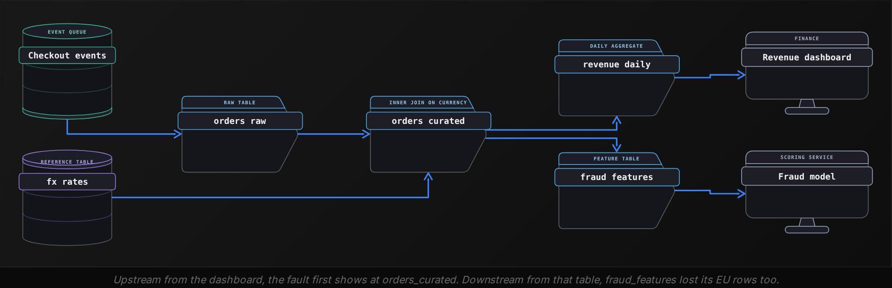


<br>

### The pillars as a coverage map

To design a program, lay tables against pillars and mark each cell with whether an automated check covers it. Rank rows by how many people and systems read the table, then close gaps in the top rows first. Here is this pipeline as it stood before the incident:

| Table | Freshness | Volume | Schema | Distribution | Lineage |
| --- | --- | --- | --- | --- | --- |
| `orders_raw` | yes | yes | yes | gap | yes |
| `orders_curated` | yes | gap | yes | gap | yes |
| `revenue_daily` | yes | gap | gap | gap | yes |
| `fraud_features` | gap | gap | yes | gap | yes |

The incident passed through 2 gaps: no distribution check on `orders_raw` and no volume check on `orders_curated`. Either one would have fired hours before finance noticed. `revenue_daily` has 3 gaps of its own, so a fault that started there would surface only on the dashboard.

**The sessions_daily dashboard shows average session length doubled overnight. sessions_daily is fresh, its row count matches history and its schema is unchanged. What comes next?**

- **A.** Check distribution on session_seconds in sessions_daily, then walk lineage upstream to the first table where the values doubled.
- **B.** Check freshness on every upstream table, because a stale input is the usual reason an average shifts overnight.
- **C.** Check volume on sessions_daily against 28 days, because a doubled average usually means half the rows went missing.
- **D.** Walk lineage downstream to list affected dashboards, then close the incident once their owners are notified.

<details>
<summary>Solution</summary>

**A.** Check distribution on session_seconds in sessions_daily, then walk lineage upstream to the first table where the values doubled.

The first 3 pillars all pass, which rules out a missing or reshaped load and leaves the values. Lineage finds where the change began.

**Why the others are wrong**

- **B.** Stale inputs show as old data or low volume, and the symptom table is already fresh with a normal count.
- **C.** Volume was already normal. Missing rows can shift an average, but the count rules that out here.
- **D.** Warning consumers is part of the response, but it leaves the cause unfound and the values still wrong.

</details>


<br>

---

## Pipeline Architecture

### Exercise 1 of 2

**● TASK**

The status page shows one uptime number, so consumers cannot tell 'late but correct' from 'on time but wrong'. Split it into an operational SLA (fresh by 6am) and a quality SLA (correct row counts and null rates by 6am) by forking two monitors off the curated table, each named for its target and its input: the orchestrator's last success time, or the row count and null rate gates. Route each monitor to its own on-call alert, and feed both to the status page.

**Starting canvas** (already placed for you):

- Kafka events source (source, Kafka)
- Orchestrator (Airflow): runs nightly (transform, Airflow)
- transform_curate (transform, SQL)
- Iceberg fct_orders curated (storage, Iceberg)
- Status page (consumer)

<details>
<summary><strong>Solution</strong></summary>

#### One table, two promises

Splitting an operational SLA from a quality SLA means treating 'fresh by 6am' and 'correct row counts and null rates by 6am' as **two independent promises** about the same table, each with its own measurement and its own owner. The orchestrator measures the first: did the nightly run of `transform_curate` succeed before 6am? The data measures the second: a run that finishes at 5:30 can still publish a table that lost 30 percent of its rows. Either promise can fail while the other holds, so one signal cannot report both.

| Pitfall: A single uptime number is only the operational SLA |
| --- |
| The starter status page reports one number, and it is really just the operational SLA under another name. When it stays green, consumers read 'the data is good', but green only ever meant 'the run finished on time'. A 30 percent row count drop goes straight through, because nothing on that path ever looked at row counts or null rates. |

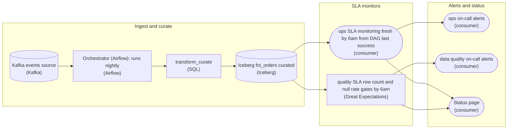

*Two monitors fork off the curated table, one for the operational SLA and one for the quality SLA. Each alerts its own on-call, and both feed the status page.*

1. **Name the operational monitor for its deadline and metric**

   Fork the first monitor off the curated table and name it for what it promises and what it reads: fresh by 6am, measured by the orchestrator's last success time for the nightly `transform_curate` run. It never looks inside the table. When it fires, the meaning is unambiguous: the data is late, and the people who restart runs and chase infrastructure own the fix.

2. **Name the quality monitor for its deadline and gates**

   Fork the second monitor off the same table and name it for the quality target and the gates behind it: a row count check against the expected range and a null rate check on the critical columns. It can be red while the operational monitor is green, which is exactly the 'on time but wrong' case the single number hid. Its owners chase dropped partitions and upstream drift, not late runs.

| Key insight: One shared alert merges the SLAs again |
| --- |
| If both monitors page the same channel, the split collapses at the last step: whoever answers still has to dig to learn whether the data is late or wrong. Giving each monitor its own on-call alert puts the broken promise and its owner in the alert itself. Feeding both states to the status page lets consumers read 'late but correct' and 'on time but wrong' directly. |

**Follow-up questions**

1. If `transform_curate` crashes and never writes the curated table, which monitor fires: the quality one, the operational one, or both?\
   *A missing table is an operational miss: the last success time never advances, and the quality gates have nothing to evaluate. The two monitors are ordered, not symmetric.*
2. How would you add a third promise, 'schema unchanged by 6am', without folding it back into the quality monitor?\
   *Checks that one monitor and one alert per promise generalizes beyond two SLAs.*

</details>


<br>

### Exercise 2 of 2

**● TASK**

The distributional check on fct_orders pages on-call 20 times a week, and only 3 pages are real. Add a batch transform that backtests the check's threshold against the 90 days of order history in the S3 lake and feeds the tuned threshold into the live check, which reads the Snowflake mart and pages PagerDuty. Name the transform with its backtest window, its target of 2 to 10 fires per 90 days, and the known-anomaly list it excludes.

**Starting canvas** (already placed for you):

- Order-history lake (90 days of fct_orders as Iceberg tables on S3) (storage, S3)
- Distributional check (z >= 3 threshold; currently fires 20x/week) (quality_gate, Great Expectations)
- Snowflake fct_orders (live mart) (storage, Snowflake)
- PagerDuty quality alerts (consumer, PagerDuty)

<details>
<summary><strong>Solution</strong></summary>

#### Tuning a check against its own history

A check that pages 20 times a week and is right 3 times isn't broken on its logic, it's mistuned on its threshold. What you built is **backtesting**: take a candidate threshold, replay it over the 90 days already in the lake, count how often it would have paged, and keep only the value whose count lands where a human can triage, here 2 to 10 fires per 90 days. `z >= 3` is a knob, not a law.

```mermaid
flowchart LR
    n0[("Order-history lake (90d `fct_orders`, Iceberg/S3)<br/>(S3)")]
    n1["`backtest_fct_orders_90d_target_2to10_fires_excl_known_anomalies`<br/>(Spark)"]
    n2["Live check (reads tuned threshold)<br/>(Great Expectations)"]
    n3[("Live `fct_orders` mart<br/>(Snowflake)")]
    n4(["PagerDuty on-call<br/>(PagerDuty)"])
    n0 --> n1
    n1 --> n2
    n3 --> n2
    n2 --> n4
```

*The backtest reads S3 history, skips known anomalies and emits a tuned threshold; the live check reads the Snowflake mart and pages only when that threshold fires.*

The transform reads the lake, not the mart. A 90-day backtest wants a stable copy of the past, and Iceberg gives exactly that: a snapshot you replay identically every run, partitioned by date so the job scans only the 90 days it needs. The live check keeps reading Snowflake `fct_orders`; the tuned threshold is the one artifact that crosses from history into the live plane.

| Pitfall: Silencing beats a bad threshold; both lose to a tuned one |
| --- |
| The tempting wrong moves: delete the check, so the 3 real pages a quarter vanish too, or eyeball a higher `z` until this week looks quiet. Eyeballing overfits to the last few days: a threshold that silences this week can fire 15 times next quarter or stay silent through a real incident. Backtesting over a fixed 90-day window turns a hunch into a number you can defend. |

| Key insight: The name is the contract; the anomaly list keeps it stable |
| --- |
| The name carries the window (`90d`), the target rate (`2to10_fires`) and the known-anomaly list (`excl_known_anomalies`), because those 3 are the tuning contract and belong in the DAG. The list matters most: an incident you already investigated is a real fire in history, so counting it drags the threshold up and re-pages something nobody needs to see again. Excluding it also keeps the result stable: the same 90 days yield the same threshold every time. |

**Follow-up questions**

1. Order volume triples next quarter and the tuned threshold drifts back to firing 15 times per 90 days. What keeps the check in range?\
   *Tests whether tuning is one-time or a scheduled re-backtest.*
2. Where do you store the known-anomaly list so a human logging a new incident and the nightly backtest read the same source?\
   *Tests whether the list is a durable shared artifact, not a baked-in constant.*

</details>


<br>

---

## Quality SLAs vs Ops SLAs

The orchestration lessons treated an SLA as a promise that a run finishes on time. That is an operational SLA, a commitment about how the pipeline executes. A quality SLA is a commitment about the data a run publishes, and the 2 fail independently. During the EU currency incident every task succeeded and every table landed before 06:00, so the operational SLA held all day while consumers read wrong numbers. Treat them as 2 promises with separate measurements and separate owners, because fixing one does nothing for the other.

| ✓ Operational SLA | ✗ Quality SLA |
| --- | --- |
| • Promises the partition is published by 06:00 UTC<br><br>• Measured from run records: start, end, status<br><br>• Broken by stuck tasks, slow inputs, cluster outages<br><br>• Improved by retries, concurrency, earlier upstream schedules | • Promises the published partition is correct<br><br>• Measured from check results and the corrections log<br><br>• Broken by wrong values, missing rows, broken joins<br><br>• Improved by contracts, producer-side checks, tuned thresholds |


<br>

### Writing each as a measurable commitment

A commitment names an indicator and sets a target for it over a window. The operational indicator is direct: was the partition of `orders_curated` published by 06:00 UTC the next day? For quality, passing checks is a weak indicator, because a check says nothing about defects it never tests for. A stronger one comes from the corrections log, a record written whenever anyone restates a published partition. The quality indicator becomes: was the published partition never corrected? A partition the gate holds back costs nothing on quality, since no consumer read it.

| Field | Operational SLA | Quality SLA |
| --- | --- | --- |
| Indicator | published by 06:00 UTC the next day | published and never corrected |
| Target | 89 of 90 days | 88 of 90 partitions |
| Window | rolling 90 days | rolling 90 days |
| Source | `ops.runs` | `ops.corrections` |
| Fixed by | platform on-call | producer and table owner |

```sql
WITH corrected AS (
  SELECT DISTINCT
    partition_date
  FROM ops.corrections
  WHERE table_name = 'orders_curated'
)

SELECT
  COUNT(*) AS days,
  COUNT_IF(
    r.published_at <= CAST(r.partition_date AS TIMESTAMP) + INTERVAL '30' HOUR
  ) AS on_time_days,
  COUNT_IF(c.partition_date IS NULL) AS never_corrected
FROM ops.runs AS r
LEFT JOIN corrected AS c
  ON c.partition_date = r.partition_date
WHERE r.table_name = 'orders_curated'
  AND r.status = 'published'
  AND r.partition_date >= CURRENT_DATE - INTERVAL '90' DAY
```

**On Oct 14 the gate blocks the orders_curated partition at 05:50 for duplicate order_id values. The owner fixes it and the partition publishes at 07:10. It is never corrected afterward. How does Oct 14 count?**

- **A.** Late for the operational SLA and corrected for the quality SLA, because the gate found a defect in it.
- **B.** Late for the operational SLA and good for the quality SLA, because consumers never read the bad version.
- **C.** On time for the operational SLA, because the first run finished before 06:00, and good for quality.
- **D.** Excluded from both SLAs, because a day with a blocking failure is an incident and leaves the window.

<details>
<summary>Solution</summary>

**B.** Late for the operational SLA and good for the quality SLA, because consumers never read the bad version.

Publication came after 06:00, and the published partition needed no correction, so the hold cost time and protected quality.

**Why the others are wrong**

- **A.** A correction restates published data. The bad version never published, so nothing was corrected.
- **C.** The indicator is publication by 06:00, and a run that ends blocked publishes nothing.
- **D.** Dropping incident days would hide the exact days both SLAs exist to count.

</details>

- **90 of 90** — days published by 06:00 UTC
- **84 of 90** — partitions never corrected

The pipeline met its operational target with a day to spare and missed its quality target by 4 partitions. A blended health score would have averaged the 2 into a comfortable number and hidden the miss.

> Where the 6 corrections came from
>
> - One missing refund: a refund service outage dropped events, and no volume check covered refunds
> - One EU join loss: lowercase `eur` matched no `fx_rates` row, and no distribution check covered `currency`
> - 2 duplicate orders: an upstream replay repeated rows, and the `order_id` uniqueness check was warn-only
> - 2 wrong conversions: `fx_rates` loaded a stale day, and no freshness check covered it

Every one of the 6 traces to a missing check or a check without blocking authority, and none shrinks with faster runs. Doubling retries lifts the operational number and leaves all 6 in place; a retry that reruns a bad batch sooner only publishes it sooner. The 2 SLAs also pull against each other. A blocking uniqueness check would have prevented 2 corrections, and every block holds a partition past 06:00 while someone fixes it. Write that tradeoff into the SLA on purpose: a held partition counts as late for operations and as protected for quality.

**Over a quarter, payments_daily meets its operational SLA on 89 of 90 days and its quality SLA on 81 of 90. The team proposes doubling retries and adding a second cluster. What will that change?**

- **A.** Both numbers, because retries rerun failed work and a rerun repairs the bad partitions too.
- **B.** Mostly the quality number, because more capacity lets the checks scan more rows each night.
- **C.** At most the operational number, from 89 toward 90, while the quality number stays at 81.
- **D.** Neither number, because both SLAs are already inside their targets for the quarter.

<details>
<summary>Solution</summary>

**C.** At most the operational number, from 89 toward 90, while the quality number stays at 81.

Retries and capacity address execution. The 9 corrected partitions came from data defects that faster runs republish.

**Why the others are wrong**

- **A.** A rerun of a defective input reproduces the defect. Corrections need checks or contracts.
- **B.** Coverage depends on which checks exist, and extra compute leaves the gaps where they are.
- **D.** No targets are stated here, and 81 of 90 would miss a target such as 88 of 90.

</details>


<br>

---

## Pipeline Architecture

### Exercise 1 of 1

**● TASK**

A four-year-old Kafka topic of customer events feeds a leadership dashboard, a churn model, and a billing service, but it has no enforced schema, so producers add and rename fields unannounced. Put a contract on it: enforce the agreed schema where events are produced, and monitor the curated table for freshness, volume, distribution, and schema drift. Wire that monitor to an on-call alert that fires only on genuine violations.

**Starting canvas** (already placed for you):

- Kafka customer_events topic (4 years old; no formal schema) (source, Kafka)
- transform_curate (no contract enforcement today) (transform, SQL)
- Iceberg fct_customer_events (storage, Iceberg)
- Leadership dashboard (consumer, Looker)
- Churn model (consumer, Jupyter)
- Billing aggregator (consumer, API)

<details>
<summary><strong>Solution</strong></summary>

#### Treating the stream as a product

The fix here has a name: a **data contract**. Instead of letting `customer_events` be whatever producers happen to emit, you publish an agreed schema and enforce it where the events are produced. A breaking change is then rejected at the source rather than surfacing as a wrong number weeks later. A schema registry holds the registered schema and its compatibility rule, and refuses any message that violates them.

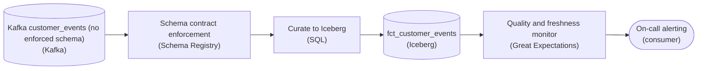

*The contract is enforced at the schema registry stage. The monitor watches the curated `fct_customer_events` table and is the only thing wired to the on-call alert.*

Enforcement belongs where events are born, not where they are read. If each consumer validates on its own, the dashboard, churn model and billing service drift apart into three half-contracts instead of one. Pushing the check to the producer edge means every reader inherits one guarantee, and a producer who renames a field learns about it at deploy time, before anyone on call does.

| Pitfall: An alert on everything is an alert on nothing |
| --- |
| A monitor that fires on every blip trains the team to swipe it away, so the one real drift lands in a muted channel. Send only genuine violations to the on-call alert: a breaking schema change, or a freshness breach. Let soft anomalies sit in a report that pages nobody. |

| Key insight: The monitor asks 4 questions of the table |
| --- |
| It checks 4 things. Freshness: did new rows land on time? Volume: is the count in its expected band? Distribution: did the mix of a key column such as `event_type` suddenly shift? Schema drift: did a column appear, vanish or change type? The schema is enforced at the source, but the curation SQL and the table's own schema evolution can still drift, so checking `fct_customer_events` is defense in depth. |

| Real world: Compatibility mode keeps the contract livable |
| --- |
| A contract that froze the schema forever would just get bypassed. Registries run a compatibility rule, usually `BACKWARD`, so producers can still add optional fields safely and only truly breaking changes get rejected. That lets every consumer team ship against one promise. |

**Follow-up questions**

1. A producer needs to rename `customer_id` to `account_id`. How do you ship that without breaking the churn model mid-flight?\
   *Think additive: write both fields for a while, migrate readers, then retire the old one, rather than a hard rename the registry would reject.*

</details>


<br>

---

## Tuning Thresholds vs History

A threshold decides how often someone gets pulled into an investigation. Set it too tight and people stop reading alerts; set it too loose and finance finds the incident first. The target is an alarm rate that fits the time the team has. Here, 3 engineers can each work about 5 quality alerts a week. Spread across 40 checks, that allows each check about 5 alerts per 90 days, and every threshold below is judged against that budget.


<br>

### Backtest against 90 days of history

A backtest replays a candidate threshold over stored history and counts how often it would have fired. The distributional checks you already run produce one value per metric per day; store them in `quality.metric_history` and the backtest becomes a query. This one scores each day's row count for `orders_curated` against the mean and standard deviation of the 8 previous same weekdays, since a Sunday should be compared with other Sundays. It tries 4 values of `k`, the number of standard deviations that triggers an alert, over the last 90 days.

```sql
WITH scored AS (
  SELECT
    metric_date,
    metric_value,
    AVG(metric_value) OVER (
      PARTITION BY DAY_OF_WEEK(metric_date)
      ORDER BY metric_date
      ROWS BETWEEN 8 PRECEDING AND 1 PRECEDING
    ) AS baseline_mean,
    STDDEV(metric_value) OVER (
      PARTITION BY DAY_OF_WEEK(metric_date)
      ORDER BY metric_date
      ROWS BETWEEN 8 PRECEDING AND 1 PRECEDING
    ) AS baseline_sd
  FROM quality.metric_history
  WHERE table_name = 'orders_curated'
    AND metric_name = 'row_count'
    AND metric_date >= DATE '2026-05-31'
)

SELECT
  t.k,
  COUNT_IF(
    ABS(s.metric_value - s.baseline_mean) > t.k * s.baseline_sd
  ) AS alerts
FROM scored AS s
CROSS JOIN UNNEST(ARRAY[2.0, 2.5, 3.0, 4.0]) AS t(k)
WHERE s.metric_date >= DATE '2026-07-26'
GROUP BY t.k
ORDER BY t.k
```

The corrections log from the SLA work labels the answers. In this window, 4 of its entries changed the row count, so those 4 days are the incidents a row-count threshold should catch.

Before annotations

| k | Alerts | Incidents caught |
| --- | --- | --- |
| 2.0 | 23 | 4 of 4 |
| 2.5 | 11 | 4 of 4 |
| 3.0 | 6 | 3 of 4 |
| 4.0 | 2 | 1 of 4 |

After annotations

| k | Alerts | Incidents caught |
| --- | --- | --- |
| 2.0 | 12 | 4 of 4 |
| 2.5 | 5 | 4 of 4 |
| 3.0 | 3 | 3 of 4 |
| 4.0 | 1 | 1 of 4 |

Before annotations, only `k = 4.0` fits the budget, and it misses 3 of the 4 incidents. Most extra alerts at lower settings fired on events the team already understood, and those events also stretched the baseline for the 8 weeks after them, which made later real drops look smaller.


<br>

### Annotate the anomalies you already know

An annotation is a row recording a deviation the team has already explained. It names the table and the reason, with a start and end date. Planned events get one before they happen, and unplanned ones get one after review. In both the backtest and production, annotated days stay out of the baseline and raise no alert.

| Table | Start | End | Reason |
| --- | --- | --- | --- |
| `orders_curated` | 2026-08-12 | 2026-08-12 | email campaign to all customers, volume 1.6x |
| `orders_curated` | 2026-09-18 | 2026-09-19 | sale over 2 days, volume 2.4x |
| `orders_curated` | 2026-10-05 | 2026-10-05 | app outage, real orders down 40% |

```sql
SELECT
  h.table_name,
  h.metric_name,
  h.metric_date,
  h.metric_value
FROM quality.metric_history AS h
LEFT JOIN quality.annotations AS a
  ON a.table_name = h.table_name
    AND h.metric_date BETWEEN a.start_date AND a.end_date
WHERE h.table_name = 'orders_curated'
  AND h.metric_name = 'row_count'
  AND a.table_name IS NULL
```

After annotation, `k = 2.5` catches all 4 incidents with 5 alerts, inside the budget. Give blocking checks a looser `k` than warning checks. A false warning costs an hour of reading. A false block holds a partition past 06:00 and spends the single spare day in the operational target.

| ✓ Do | ✗ Don't |
| --- | --- |
| • Backtest every new threshold against 90 days before it goes live<br><br>• Compare each day with the same weekday in earlier weeks<br><br>• Give every annotation an end date and a named owner | • Copy one k across all 40 checks<br><br>• Annotate a day only because it raised an alert<br><br>• Let annotated days feed the baseline |

**After an alert nobody could explain, a colleague annotates orders_curated from 2026-10-20 with no end date. What follows?**

- **A.** The baseline improves, because one unexplained day stops stretching it for the next 8 weeks.
- **B.** Production alerting is unaffected, because annotations apply only to backtests run against history.
- **C.** The threshold widens on its own, because the annotation marks a new normal level for row count.
- **D.** Every day from Oct 20 on leaves the baseline and raises no alert, so the check is silenced.

<details>
<summary>Solution</summary>

**D.** Every day from Oct 20 on leaves the baseline and raises no alert, so the check is silenced.

An open-ended annotation is a disabled check, and it labels an unexplained day as explained.

**Why the others are wrong**

- **A.** Only one day looked odd, and this annotation covers every day after it as well.
- **B.** Annotated days leave the baseline and raise no alert in production too; that is their purpose.
- **C.** Annotations remove days from the input; they never change k or declare a new level.

</details>


<br>

---

## Pipeline Architecture

### Exercise 1 of 2

**● TASK**

Design one representative data-contract pipeline that the other 7 legacy pipelines can copy. Enforce the producer's schema at the ingestion boundary so a breaking change never reaches the curated table, and on that curated layer watch all five observability pillars and run quality assertions before anyone downstream trusts it. Route operational-health alarms and data-quality alarms to two separate responders, and have downstream consumers read from the serving mart rather than the raw layer.

**Starting canvas** (already placed for you):

- Producer service (source, API)
- Kafka events topic (queue, Kafka)
- transform_curate (transform, SQL)
- Iceberg fct_curated (curated layer) (storage, Iceberg)
- Snowflake serving mart (storage, Snowflake)
- Three downstream consumers (consumer, Looker)

<details>
<summary><strong>Solution</strong></summary>

#### Writing the contract down

A data contract is a versioned agreement about the shape of what a producer emits, checked by a machine at the moment data crosses into the platform. These 8 pipelines ran on an unwritten one, so a renamed field broke dashboards with no owner. The fix is to enforce the agreement at the ingestion boundary, so a breaking change fails at the door instead of quietly corrupting `fct_curated`.

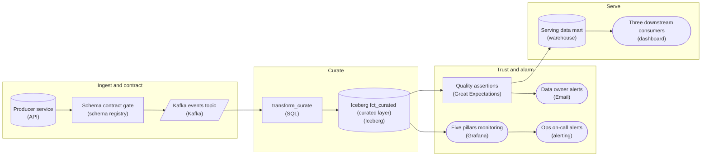

*The contract is enforced before Kafka; two alarms reach two responders; dashboards read the serving mart, never the raw layer.*

| Pitfall: Filtering is not enforcing |
| --- |
| The common first draft validates inside `transform_curate`, often as a `WHERE` that drops malformed rows. The bad data has already entered, the producer never learns it broke the agreement, and every dropped row is a number that stops reconciling. The registry check sits upstream of the topic and rejects. Keep `transform_curate` idempotent on the event id so a Kafka replay re-curates rather than double-counts. |

| ✕ Operational health | ✓ Data quality |
| --- | --- |
| The five pillars monitor watches freshness, volume, distribution, schema and lineage on `fct_curated` and pages ops on-call when the plumbing breaks: a late table, a cratered row count. A platform engineer fixes it. | Great Expectations asserts on curated columns and emails the data owner when data is fresh but wrong: a null spike, a fanned-out join. It also gates the serving mart, so consumers only see rows that passed. |

| Real world: Document first, enforce second |
| --- |
| With unknown consumers you cannot enforce on day one. Observe the current schema, volumes and readers, publish that reality as contract version 1 so it breaks nobody, then flip the registry to enforce. Copy the pattern to the other 7 only once this pipeline is stable. |

**Follow-up questions**

1. The producer adds an optional field. Does the `Schema contract gate` accept it under backward compatibility?\
   *Additive optional fields evolve safely; renames and type changes are breaking.*
2. A metric looks wrong but every `Quality assertions` check passed. Which plane failed?\
   *Separates a green check from a check nobody wrote.*

</details>


<br>

### Exercise 2 of 2

**● TASK**

An orders service publishes events to Kafka, and its team adds, drops or retypes fields most sprints. Build the data contract: each producer schema change passes a compatibility check in CI before it is registered in a schema registry, and incoming events are validated against the registered schema. Failing events go to a dead letter queue, and the lakehouse orders table must take on added columns without a rebuild.

<details>
<summary><strong>Solution</strong></summary>

#### Check the contract twice: at change time and at arrival

Schema evolution stays safe only when the contract is enforced in two places. The CI compatibility check is the change-time half: a pull request that removes or retypes a field consumers read fails the build, so the incompatible schema never reaches the registry. Ingest validation is the arrival half: every event from the topic is checked against the version the registry holds, so even a deploy that skipped CI cannot slip a bad shape into the table.

1. **Put the registry behind CI**

   Only the CI step writes to `schema_registry`. That turns the registry into a record of approved contracts rather than whatever was last deployed. Adding an optional field passes; dropping `order_total` or turning it from a number into a string fails before merge.

2. **Validate on the way in, and keep what fails**

   `schema_validation` reads the registered version and splits the stream: conforming events go to `orders_table`, nonconforming ones go to `dead_letter_queue` with the failure reason attached, so the producer team can fix and replay them.

3. **Let the table absorb additive change**

   Iceberg tracks columns by ID, so a new field becomes a new nullable column on the next write and older rows read it as empty. No rebuild, no rewrite of history.

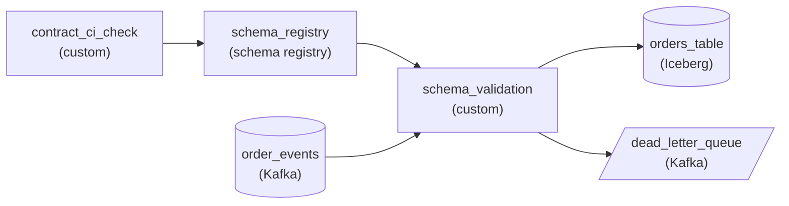

*CI gates what `schema_registry` holds; `schema_validation` gates what `orders_table` holds; failures land in `dead_letter_queue`.*

| Pitfall: Dropping bad events is a silent failure |
| --- |
| Filtering out events that fail validation looks tidy, but it is exactly the silent data loss a contract exists to prevent: the table looks healthy while orders are missing. Route them to a dead letter queue so the loss is visible and recoverable. |

**Follow-up questions**

1. The producer wants to rename `order_total` to `gross_amount`. How does the contract let that ship without breaking finance?\
   *Treating a rename as an add, a dual-write window, then a separate checked removal.*
2. A consumer needs `order_total` changed from integer cents to a decimal amount. What path does that change take?\
   *Handling a breaking type change through a new field and a versioned migration instead of an in-place retype.*

</details>


<br>

---

## Contracts on a Legacy Pipeline

On a new dataset the contract comes first and the data is built to match. A legacy table reverses that order. `orders_legacy` has 23 columns and has loaded nightly for 6 years. It has no written owner, and nobody has listed its readers. A clean contract enforced on day one would block tonight's load. The rollout runs in 4 steps, and each produces something the next one needs.


<br>

### Step 1: Write down what the table is today

Contract v1.0.0 describes the table as it behaves, quirks included, so it passes on its first night and gives every later step a baseline. Profile 90 days to find the facts.

```sql
SELECT
  COUNT(*) AS row_count,
  COUNT_IF(region IS NULL) * 100.0 / COUNT(*) AS region_null_pct,
  MIN(amount) AS min_amount,
  MAX(amount) AS max_amount,
  ARRAY_AGG(DISTINCT status) AS status_values
FROM legacy.orders_legacy
WHERE order_date BETWEEN DATE '2026-06-28'
AND DATE '2026-09-25'
```

| Profile finding | Entry in contract v1.0.0 |
| --- | --- |
| `region` null in 4.1% of rows | `region` optional, null rate at most 5% |
| `status` has 7 values, with both `CANCELLED` and `canceled` | all 7 values allowed, as written |
| `amount` is a `double` in dollars, minimum -310.00 | negatives allowed; meaning: refunds are stored as negative orders |
| `amount` maximum 48,200.00 | `amount` at most 50,000.00 |


<br>

### Step 2: Inventory every consumer

A breaking change cannot be planned without knowing whom it breaks. Query history lists who read the table and which columns they touched. A 90-day search found 13 readers; the 14th, an annual audit export that reads once a year, appeared only when the search covered 13 months. Of the 14, 9 are scheduled jobs and 3 are dashboards; the other 2 are analysts' notebooks. Of those, 5 filter on lowercase `canceled` only, so normalizing `status` in place would drop cancellations from their counts without any error. Record an owner and a contact for each consumer; step 4 needs them.


<br>

### Step 3: Observe before enforcing

Run every v1 rule in warn mode for 28 days and record each violation. A rule gets blocking authority once it has run clean or every violation has an explanation. The window from Sep 26 to Oct 23 produced this:

| Rule | Violations in 28 days | Decision |
| --- | --- | --- |
| `region` null rate at most 5% | 0 | block |
| `amount` at most 50,000.00 | one, a confirmed 62,000.00 bulk order on Oct 3 | raise the bound in v1.1.0, then block |
| at least 300,000 rows a day | one, on Oct 5 | block, with Oct 5 covered by an `orders_legacy` outage annotation |
| `order_id` unique | 3 | stay warn until the upstream retry replaces its partition instead of appending, then block after a clean window |


<br>

### Step 4: Migrate behind a new major version

The cleanups go into contract v2.0.0 on a new table, `orders_v2`, under the same evolution policy as checkout's contract. There `amount_cents` becomes a `bigint` and `status` is normalized to 6 values. `region` is now required and filled from the delivery address. The legacy job writes both tables from the same input, each behind its own gate. Version 1 is frozen and receives fixes only. Each consumer from the inventory gets a dated move to v2, and `orders_legacy` is retired once every inventoried consumer has moved and the 30-day notice has passed.

**Contract v2.0.0 maps both CANCELLED and canceled to CANCELLED. Of the 14 consumers, 5 filter on lowercase canceled. What keeps their cancellation counts right through the migration?**

- **A.** Normalize the values in orders_legacy tonight, since the change is already documented in v2.0.0.
- **B.** Add a rule on the v2 gate that blocks any row with lowercase canceled, so the 5 consumers see a failure.
- **C.** Leave orders_legacy as it is, and have each of the 5 change its filter to CANCELLED during its dated move to orders_v2.
- **D.** Keep both spellings in v2 so no consumer has to change anything, and retire v1 when the notice ends.

<details>
<summary>Solution</summary>

**C.** Leave orders_legacy as it is, and have each of the 5 change its filter to CANCELLED during its dated move to orders_v2.

V1 stays frozen, and the inventory names exactly who must change a filter before switching.

**Why the others are wrong**

- **A.** Changing v1 in place breaks the 5 consumers at once, which is why v1 is frozen.
- **B.** Lowercase values never reach v2, so the rule never fires, and the 5 filters still miss cancellations after the move.
- **D.** That carries the quirk into v2 and undoes the cleanup the migration exists for.

</details>

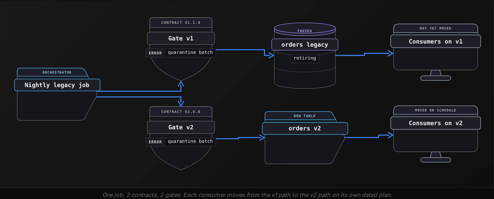

**At week 6 of the move, 8 of the 14 consumers read orders_v2. A producer pull request renames region to market and raises the contract from 2.0.0 to 2.1.0. The volume check on orders_v2 has fired 6 times in those 6 weeks, against a budget of about 5 per 90 days. Which plan follows this lesson?**

- **A.** Let CI fail the rename and ship market as an added optional field in 2.1.0; backtest the volume check with annotations and retune k to the budget.
- **B.** Approve the rename, since 2.1.0 is a new version; then raise the volume check to k = 4.0 so its alerts drop under the budget.
- **C.** Let CI fail the rename; then add retries and concurrency to the volume check's task so its 6 alerts resolve faster.
- **D.** Approve the rename after the 6 remaining consumers move to v2, and return the volume check to warn mode for 28 days.

<details>
<summary>Solution</summary>

**A.** Let CI fail the rename and ship market as an added optional field in 2.1.0; backtest the volume check with annotations and retune k to the budget.

A rename needs 3.0.0 and notice to the 8 v2 readers, while an added field is additive. The alert overrun is a tuning problem, fixed against history.

**Why the others are wrong**

- **B.** A minor bump cannot carry a rename, and jumping to k = 4.0 without a backtest risks missing real incidents.
- **C.** The CI half is right. Retries change how fast the task runs and leave the alert rate where it is.
- **D.** The 8 consumers already on v2 read region today, and another observation window leaves a known noisy threshold untuned.

</details>


<br>

---

## Pipeline Architecture

### Exercise 1 of 2

**● TASK**

About 2 million orders a night load from the order database into a warehouse that feeds a finance dashboard, and last week revenue fell 30% while every job reported success. Redesign the nightly batch so freshness, volume, schema and distribution each get their own check before the dashboard reads the data. A failed check must page the on-call engineer, and lineage must be captured so a bad number traces back to its source table.

<details>
<summary><strong>Solution</strong></summary>

#### Each pillar answers a different question

The five pillars earn their keep as a diagnostic map: freshness asks whether the data arrived on time, volume whether the right amount arrived, schema whether it arrived in the right shape, distribution whether the values look plausible, and lineage where it came from. A 30% revenue drop with every job green is exactly the case the map is for. An instrumented pipeline tells you jobs ran; an observable one tells you which pillar broke, and that narrows the cause before anyone opens a query.

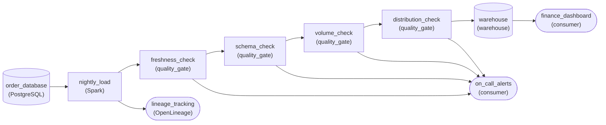

*4 pillar checks gate the warehouse load, any failure pages on-call, and the load reports lineage.*

1. **Give each pillar its own check**

   4 separate gates, not one. When `volume_check` fails while `distribution_check` would have passed, you already know rows went missing rather than values drifting, so you look at the extract instead of the pricing logic. One combined check that only says 'failed' throws that diagnosis away.

2. **Put the checks in the path and lineage beside it**

   The checks sit between `nightly_load` and the `warehouse`, so bad data stops before finance reads it, and every check has a path to `on_call_alerts`. Lineage cannot be checked row by row: the load reports it to `lineage_tracking`, so a wrong dashboard number traces back to its source table.

| Pitfall: A green job is not healthy data |
| --- |
| Job success says the code ran, not that the data is right. A load that reads half a partition, or a column whose unit quietly changed from dollars to cents, finishes cleanly. Only volume and distribution checks catch those, which is how last week's drop slipped through. |

| Key insight: Lineage can be unknown while everything else is green |
| --- |
| Volume can be wrong without distribution being wrong, and schema can shift without freshness slipping. Lineage is independent of all four: every check can pass and you still cannot say which table a dashboard number depends on. |

**Follow-up questions**

1. The order database now feeds 3 more marts. Do the checks move, and who do you warn when one fails?\
   *Whether checks belong with the source or with each reader, and how lineage names the affected readers.*
2. Distribution fires but volume and schema pass. Where do you look first?\
   *Walking the pillars as a diagnosis rather than a checklist.*

</details>


<br>

### Exercise 2 of 2

**● TASK**

About 40 million smart-meter readings load nightly into a warehouse behind a billing dashboard, and a fixed null-rate check pages on-call fifteen times a month, nearly all false. Keep 180 days of raw readings and backtest the proposed threshold against them, counting the pages it would have fired, before the check goes live. The tuned check must block a bad load from the warehouse and page on-call when it fires.

<details>
<summary><strong>Solution</strong></summary>

#### A threshold earns its place in history first

Threshold tuning treats a quality check as an alarm with a budget. A null-rate line picked by feel fired fifteen times a month over 40 million nightly readings, and on-call learned to swipe it away. Replaying the proposed threshold over the 180 days you already keep turns the guess into a count: how many pages it would have sent, and on which nights. Ship it only when that count fits what on-call reads carefully and the nights that would have paged are the nights the bills were wrong.

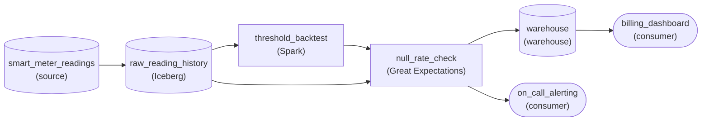

*Raw readings land in a 180-day history; the backtest sets the threshold `null_rate_check` enforces before loads reach `warehouse`.*

1. **Keep the history the replay reads**

   The backtest is only as good as the history beneath it. `raw_reading_history` holds 180 days so the replay sees a full season, including the winter weeks when meters drop offline and the null rate climbs honestly. 30 days would tune the threshold to one quiet month.

2. **Count the pages before they exist**

   `threshold_backtest` runs the proposed assertion over each past night and counts how often it would have failed. Too many and the line moves out; a known bad night it misses and the line moves in. Its output is the threshold `null_rate_check` enforces, which is why the edge runs from the backtest into the check.

3. **Keep the check on the live path**

   `null_rate_check` sits ahead of `warehouse`, so a bad night never lands where the billing dashboard reads, and its failures go to `on_call_alerting`. Tuning lowered the page count; it did not remove the protection.

| Pitfall: Muting a noisy check is not tuning it |
| --- |
| When a check cries wolf, the tempting fix is to silence it or widen the line until it goes quiet. Both remove the noise and the protection together. The backtest keeps the check and moves the line to where history says the real failures sit. |

**Follow-up questions**

1. A firmware rollout shifts the normal null rate for a third of the meters. What reruns, and when?\
   *Whether the backtest is a recurring job rather than a one-time tuning.*
2. Sunday loads are always sparser than weekdays. How would the replay account for that?\
   *Seasonality in thresholds tuned against history.*

</details>


<br>

---

## Putting It All Together

A grocery delivery company builds driver_payouts nightly from delivery events and pays drivers from it every Monday. The table is 4 years old, has 11 consumers and no contract. Last quarter 3 payouts were restated after the tips service started sending dollars where it had sent cents, while the job met its 05:00 deadline every night and the on-call engineer muted a volume alert that fired on every holiday.

- The legacy rollout starts with v1 written from a 90-day profile, which records in the contract's meaning line that tips are in cents.
- A unit change keeps the type, so CI lets it through. A distribution rule on tips in the pipeline gate catches it in the first batch, and the meaning line shows the change was breaking.
- A coverage grid across the 5 pillars shows where the restatements got through: tips had schema checks and no distribution check.
- The 3 restatements count against the quality SLA, separate from the operational SLA the job met every night, and faster scheduling would have prevented none of them.
- Holiday annotations with end dates, plus a backtested k , bring the muted volume alert back inside what the on-call engineer can investigate.
- Version 2 stores tips in a single unit under a new major version, and each of the 11 consumers from the inventory gets a dated move.


<br>

---

## Pipeline Architecture

### Exercise 1 of 2

**● TASK**

A six-year-old nightly shipments export lands in a warehouse table read by two scheduled reports and unknown analyst queries. The producer is switching the export to a v2 shape that retypes weight from text to a number and renames 3 columns. Check each load against the v2 contract before it lands in a v2 table, then map it back into a v1 table in the old shape so existing readers keep working through the deprecation window.

<details>
<summary><strong>Solution</strong></summary>

#### Let the producer evolve, keep the readers' shape fixed

Schema evolution on a legacy feed means the producer's shape can change while the readers' shape cannot. The two reports and the analyst queries nobody can list already encode a contract: the old column names and the text weight. When the export switches to the retyped, renamed shape, the pipeline absorbs the change. It checks the new shape against the v2 contract, lands it as v2, and derives the old shape from it as v1. That is the semver move: a major version shipped beside the old one instead of replacing it.

1. **Enforce the v2 contract at the door**

   The check sits between the export and `shipments_v2`. A load that drifts from v2, such as a missing column or weight arriving as text again, is held back. Readers keep yesterday's data instead of getting a half-loaded table or silently dropped rows.

2. **Land the new shape as v2**

   `shipments_v2` stores the numeric weight and the new column names exactly as the producer ships them, so readers who want the new shape can start querying it today.

3. **Derive v1 from v2**

   `v1_compat_mapping` casts weight back to text in the format readers parse today, such as '12 kg', and restores the 3 old names into `shipments_v1`. Take that shape from query logs and report definitions, not from the wiki.

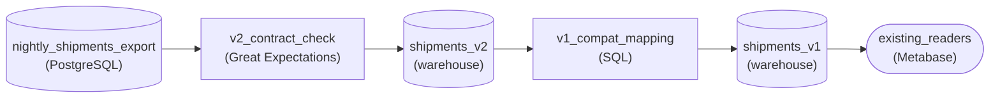

*Each nightly load is checked against v2, lands in `shipments_v2`, and is mapped back into `shipments_v1` for existing readers.*

| Pitfall: Letting new names flow into the old table breaks readers you never met |
| --- |
| Sending the export's new names and numeric weight straight into the table readers already query is the one-shot migration. The reports get fixed because someone owns them. The analyst queries fail, or silently return nulls, and the next contract the team proposes is met with suspicion. |

| Key insight: v1 retires on evidence, not on a date alone |
| --- |
| The old version is a supported release, kept alive by its mapping until its query log goes quiet. The deprecation window is a promise to readers, not a deadline imposed on them. |

**Follow-up questions**

1. The producer wants to add a nullable `carrier_code` column next month. Does that need a v3?\
   *Separates an additive, backward-compatible change (a minor version) from a breaking one.*
2. What changes if one report can never migrate off v1?\
   *Keeping a compatibility version alive past the window, and what it costs to maintain.*

</details>


<br>

### Exercise 2 of 2

**● TASK**

A nightly batch loads about 30 million song plays from the playback database into a warehouse behind a royalty dashboard, and a rights holder just reported its royalty total fell 12 percent while every job ran on time. Design the pipeline so a wrong number like that is caught before the dashboard reads it: check each load's freshness, volume, schema and value distribution, and record lineage so a bad figure traces back to its source. Have the check read its paging threshold from a store of the last 90 days of check results, so it pages the on-call engineer only on real breaks.

<details>
<summary><strong>Solution</strong></summary>

#### From a complaint to a check people trust

This capstone runs 3 of the lesson's ideas as one loop. The five pillars turn a vague complaint into a located fault, the quality SLA explains how a pipeline that met its schedule still shipped a wrong total, and threshold tuning keeps the new check from becoming the next ignored page.

1. **Walk the pillars to locate the break**

   Freshness and schema were green: the job ran on time and nothing errored. Volume is where the 30 million nightly plays came in short, and distribution confirms it, with one app version's share falling to zero. Lineage names the source the missing rows came from. The check worth adding is the one that would have caught it: volume and distribution on every load.

2. **Hold the quality SLA, not just the schedule**

   The ops SLA, loaded by 4am, was met. The quality SLA, correct totals by 7am, is only held by a check between the load and the warehouse. A failing load stays out of `royalty_warehouse`, so the dashboard shows yesterday's total instead of a wrong one.

3. **Set the threshold from history**

   Weekday swings run about 8 percent, so a fixed 5 percent band pages most weeks. Replay candidate bands over the 90 nights in `check_history`, comparing each night to the same weekday, and count pages against known real breaks. Keep the band that flags the 12 percent drop and almost nothing else.

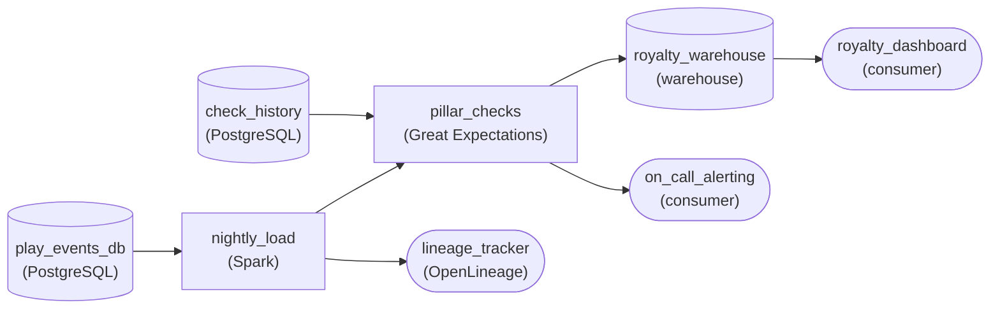

*`nightly_load` emits lineage to `lineage_tracker`, and `pillar_checks` reads its thresholds from `check_history`, blocks bad loads from `royalty_warehouse` and pages `on_call_alerting`.*

| Pitfall: An untuned check becomes the next ignored page |
| --- |
| After an incident the tempting fix is a tight threshold that surely would have caught it. Backtested, it usually fires several times a week, and within a month on-call acknowledges it unread. Tuning against `check_history` is what makes the new check trusted, not just present. |

**Follow-up questions**

1. How would you catch the next drop if it hit only one rights holder, too small to move total volume?\
   *Segmenting the distribution check so a local break is not averaged away.*
2. What changes if rights holders need totals within an hour of each play instead of nightly?\
   *Moving volume and distribution checks onto shorter windows and redefining what history means.*

</details>


<br>

---

## Key Takeaways

- A data contract has 3 parts: the schema and its guarantees, plus an evolution policy. All 3 live in the producer's repository and are versioned with the code.
- CI enforces the contract against code changes, and the pipeline gate enforces it against real rows. Each catches failures the other cannot see.
- The 5 pillars run from freshness and volume to schema and distribution, ending with lineage. They give a fixed order of questions in an incident and a grid of gaps when planning coverage.
- An operational SLA counts on-time publication, and a quality SLA counts published partitions that never needed correction. Faster runs improve only the first.
- Backtest thresholds against 90 days, comparing like weekdays, and annotate known events with end dates until alerts fit the team's capacity.
- On a legacy table, document today's behavior as v1, list every consumer, observe in warn mode, then move readers to a new major version.
