Beginner·Pipeline Architecture · 25 min · 11 challenges

# Data Quality: Beginner

Picture Airbnb's nightly bookings pipeline finishing at 04:00 with every task green. By 09:00 a product manager is celebrating a 40% jump in Paris reservations. The jump came from a retried load that wrote each booking twice. Nothing failed, nothing paged anyone, and the chart was wrong. This lesson is about the check that would have stopped that run at 04:01, before the chart ever drew.


<br>

---

## Pipeline Ran vs Data Is Good

### Two Kinds of Success

An orchestrator calls a run successful when each task exits with code 0 inside its time limit. Call that operational success: the machinery did what it was told. Semantic success is a different claim: the rows now sitting in the table say true things about the business. A pipeline can have the first without the second, and the orchestrator has no way to tell the difference.

Take a nightly orders pipeline. At 02:00 it copies the previous day's orders out of the operational database, reshapes them, and writes the `fct_orders` partition for that date. On 25 April the upstream team added a filter to their export view and left it pointing at a test account. The export returned 3 orders instead of the usual 48,000. Here is the run as the orchestrator recorded it.

| Task | Status | Duration | Rows out |
| --- | --- | --- | --- |
| extract_orders | success | 4s | 3 |
| transform_orders | success | 2s | 3 |
| load_fct_orders | success | 3s | 3 |

*The rows-out column is there because the tasks printed it. An orchestrator stores exit codes and durations on its own, and records rows written only when a task reports them.*

Three green tasks, 9 seconds, and a `fct_orders` partition holding 3 rows where 48,000 belong. At 08:00 the revenue dashboard refreshed and showed $415 of revenue for a day that earned roughly $3.1 million. Nobody was alerted, because from the orchestrator's point of view the night had gone exactly to plan.


<br>

### Naming the Failure Mode

This is a silent failure: a run that completes without error and leaves wrong data behind. The word silent carries the weight. A task that crashes announces itself, turns red, and waits for a human. A silent failure announces nothing. It is found by whoever reads the dashboard first, hours later, and is then traced backwards through 3 layers to a filter someone changed in a different team.

✓What the orchestrator sees

- Exit code 0 on every task
- Durations inside the usual range
- Dependencies satisfied in order
- A run marked success at 02:09

✗What the business sees

- Revenue down 99.9% overnight
- 3 orders on a weekday
- A dashboard that contradicts the finance system
- A morning of analyst time spent on a drop that never happened

The cost of a silent failure grows with every hour it stays silent. The 3-row partition was written at 02:09. The dashboard refreshed at 08:00. An analyst noticed at 09:30 and spent until 11:00 ruling out a real fall in sales before asking the data team. By then 2 downstream tables had rebuilt from the bad partition and needed rebuilding again. A check at 02:10 would have cost 1 red task and 1 message.


<br>

### Why the Tools You Already Have Cannot Catch It

The last 2 lessons gave you retries and idempotent writes, and neither one helps here. A retry reruns the extract, which faithfully returns the same 3 rows, because the source itself is what changed. Idempotent replace does what it promised: the partition holds exactly what the run produced, which is 3 rows, and a rerun replaces 3 rows with 3 rows. Both mechanisms protect the pipeline against its own crashes. Neither one reads the data.

The gap between the 2 kinds of success is where a **quality check** lives: a task whose only job is to look at the rows a previous task wrote, compare them with what rows should look like, and fail loudly when they do not match. Failing is the point. A failed check turns the silent failure into a loud one, and a loud failure is one the orchestrator already knows how to handle: red task, skipped downstream, a human reading an error message.

> Three ways a green run lies
>
> - Too few rows: a source filter, a truncated export, or a load that stopped early
> - Too many rows: a retry that appended, or a join that matched each row twice
> - Old rows: the run read the previous day's data again because the new day's never arrived

> **TIP**
>
> When a dashboard number looks wrong, ask the run 2 questions in order: did every task succeed, and how many rows did each task write? A green run that wrote 3 rows has told you where to look.

**A nightly job loads the previous day's payments into fct_payments. Which of these is a silent failure in the sense this section defines?**

- **A.** The load task crashes at 02:04 because the warehouse rejected a connection, and the run turns red.
- **B.** The transform task runs 40 minutes longer than usual and finishes after the dashboard already refreshed.
- **C.** Every task succeeds, but the extract returned 0 rows because the source table was renamed, so the partition is empty.
- **D.** The load task retries twice after a network timeout and succeeds on the third attempt with the correct rows.

<details>
<summary>Solution</summary>

**C.** Every task succeeds, but the extract returned 0 rows because the source table was renamed, so the partition is empty.

Every task exited 0 and the data is wrong. The orchestrator reports success while the dashboard reports no revenue, and nothing points at the rename.

**Why the others are wrong**

- **A.** This is a loud failure. The orchestrator saw the non-zero exit, marked the task red, and a retry with backoff is the right response.
- **B.** Slowness is visible: the orchestrator records the duration, and the dashboard shows the previous day's data with its own date. Nothing false was written.
- **D.** A retry that eventually succeeds is the retry mechanism working. With an idempotent write the data is correct, and the run is loud about its own history in the task log.

</details>


<br>

---

## Pipeline Architecture

### Exercise 1 of 1

**● TASK**

An orders pipeline reads Kafka events, transforms them, and loads a Snowflake mart finance reads; a partition silently dropped 6 hours of events yet every run exited green. Add a quality check at each layer boundary: one on the Kafka events before the transform consumes them, so a shortfall is caught where it enters, and one on the transform's output before it lands in the mart, so wrong numbers fail the load even when the run succeeds.

**Starting canvas** (already placed for you):

- Kafka order_events source (one partition silently dropped events for 6 hours Tuesday) (source, Kafka)
- transform_orders (ran green; read what was present) (transform, SQL)
- Snowflake daily_orders mart (revenue 12% low on Tuesday; nobody noticed until Friday) (storage, Snowflake)
- Revenue dashboard (consumer, Looker)


<br>

### Solution

#### Green and wrong: an exit code is not a correctness signal

A run that exits green has proved **operational success**: the code executed and the writes committed. It has not proved semantic success, that the data actually describes the world. `transform_orders` read whatever rows were present, did honest arithmetic on them, and returned `0`. Nothing asserted completeness, so a six-hour hole in one Kafka partition sailed straight through to the mart. The 2 checks you placed give the pipeline the signal it was missing: a way to say 'the data is wrong' even when every job succeeded.

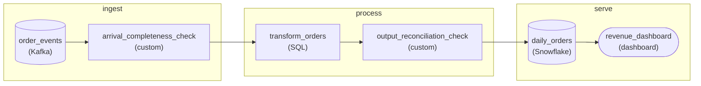

*One check where the events enter and one before the mart. Data moves on only after its check passes, so a short number never reaches finance.*

| Pitfall: A check placed too far downstream |
| --- |
| The tempting fix is a single sanity check on the mart, or an alert when `daily_orders` revenue drops. That is effectively what already happened: finance was the check, and it fired on Friday. A check pays off most at the **point where the defect enters**. The arrival check sees a partition that stopped advancing while its siblings moved. The mart, 3 stages later, sees only a smaller total with nothing to compare it against. |

1. **Check the events arriving from the source, before the transform runs**

   Between `order_events` and `transform_orders`, assert that this batch is complete. Every partition advanced, not just the topic total. The arriving `COUNT(*)` sits near a normal day's volume. The newest event timestamp is fresh. The dropped partition trips the per-partition rule even when the aggregate count looks plausible.

2. **Verify the transform's output before it lands in the mart**

   Between `transform_orders` and `daily_orders`, reconcile the result against what went in. The output order count matches the input order count, summed revenue falls within normal bounds, and no required column is `NULL`. On failure the run does not publish. It stops, and the mart keeps yesterday's good numbers instead of being overwritten with a wrong one that finance would trust.

| ✕ Exit code as truth (what broke) | ✓ Asserted expectations (what you built) |
| --- | --- |
| Trust `return 0`. The transform reads whatever survived the drop, computes a smaller revenue, and writes it. Every stage is green. The error surfaces days later as a business anomaly, after the bad number has already been quoted in reports. | Data passes on only after its expectations hold. A missing partition fails the arrival check, and a shrunken total fails the output check. The failure is loud, immediate, and located at the stage that introduced it, so the fix is a replay, not an investigation. |

| Real world: A correctness check is its own stage, not a comment |
| --- |
| Teams wire these checks as explicit stages: dbt tests and `dbt source freshness`, Great Expectations or Soda suites, Airflow sensors that block the downstream task. The shared idea is that a job must prove its input arrived whole and its output reconciles before it may publish. 'The DAG went green' is an operational fact. 'The data is complete' is a separate assertion you have to write. |

**Follow-up questions**

1. When the arrival check fails on the dropped partition, what should the pipeline do beyond stopping the load: hold the whole day, or set the partial batch aside for reprocessing?\
   *Separates detecting a bad batch from recovering it. Stopping on a gap is only safe when the source can be replayed.*
2. How would you set the expected volume so a genuinely slow sales day passes but a 12 percent shortfall fails?\
   *Compares fixed bounds with a band built from recent days, and weighs the cost of a check that cries wolf.*


<br>

---

## Four Cheap Quality Checks

### What Cheap Means Here

A cheap check is one aggregate query against the table a task wrote, run as the next task in the DAG. It needs no sample data, no second system, and no knowledge of the business beyond a single expected number. On a 48,000-row partition each one finishes in under 2 seconds. Four of them cover most of the silent failures from the last section, and they are the same 4 on nearly every table you will ever own.

Here is a slice of the table they run against. `fct_orders` holds one row per order, partitioned by `order_dt`, with a `loaded_at` stamp written by the load task.

| order_dt | order_id | customer_id | amount | loaded_at |
| --- | --- | --- | --- | --- |
| 2026-04-25 | 5001 | 88102 | 200.00 | 2026-04-26 02:08:41 |
| 2026-04-25 | 5002 | 88340 | 135.00 | 2026-04-26 02:08:41 |
| 2026-04-25 | 5002 | 88340 | 135.00 | 2026-04-26 02:08:41 |
| 2026-04-25 | 5003 | NULL | 80.00 | 2026-04-26 02:08:41 |


<br>

### Check 1: Row Count

Row count asks whether the partition holds about as many rows as it should. The expectation can be a fixed floor (never fewer than 25,000 orders on any day) or a comparison with the previous partition (never fewer than half of the day before). Start with the fixed floor. It catches the 3-row partition from the last section, and it needs no second query.

```sql
SELECT
  COUNT(*) AS row_count
FROM fct_orders
WHERE order_dt = DATE '2026-04-25'
```

A healthy weekday returns something near 48,000. A Sunday returns nearer 31,000. The floor sits below both and far above anything a broken export produces.


<br>

### Check 2: Null Rate

Null rate asks what share of rows are missing a value in a column that should have one. `COUNT(column)` skips nulls and `COUNT(*)` does not, so the difference between them is the null count, and dividing by the total gives the rate.

```sql
SELECT
  COUNT(*) - COUNT(customer_id) AS null_customers,
  CAST(COUNT(*) - COUNT(customer_id) AS DOUBLE) / COUNT(*) AS null_rate
FROM fct_orders
WHERE order_dt = DATE '2026-04-25'
```

On a typical day 240 of 48,000 orders arrive with no `customer_id`, guest checkouts, and that 0.5% is normal. A rate of 40% means the join that attaches customers stopped matching. The threshold goes above the normal rate with room to spare: 2% catches a broken join and ignores a busy guest-checkout day.


<br>

### Check 3: Uniqueness

Uniqueness asks whether the business key appears once per row. It is the check that would have caught the doubled rows from the retry lesson. `COUNT(DISTINCT order_id)` counts each key once, so any gap between it and `COUNT(*)` is the number of surplus rows.

```sql
SELECT
  COUNT(*) - COUNT(DISTINCT order_id) AS duplicate_rows
FROM fct_orders
WHERE order_dt = DATE '2026-04-25'
```

Against the sample slice above this returns 1: order 5002 appears twice. The threshold for uniqueness on a key is 0. One duplicate in a fact table that sums `amount` is one order counted twice in revenue.


<br>

### Check 4: Freshness

Freshness asks whether the newest data is as new as it should be. The run starts at 02:00 for the previous day, so by 03:00 the maximum `loaded_at` should be under 2 hours old and the maximum `order_dt` should be the day before. The first 3 checks run inside that run, so on a night the run never triggers, they never run either. Freshness runs on its own 03:00 schedule, depends on no load task, and reads the whole table. `localtimestamp` is the moment the query runs.

```sql
SELECT
  MAX(order_dt) AS newest_partition,
  DATE_DIFF('hour', MAX(loaded_at), LOCALTIMESTAMP) AS hours_since_load
FROM fct_orders
```

Run at 03:00 on 26 April, a healthy table returns `2026-04-25` and `0`. A return of `2026-04-24` and `24` means last night's run never wrote, whatever the orchestrator says about it.


<br>

### All Four at Once

The 4 checks read the same partition, so they fit in one query. Running them together costs one scan instead of 4, and the result row is a one-line health report for the partition.

```sql
SELECT
  COUNT(*) AS row_count,
  COUNT(*) - COUNT(customer_id) AS null_customers,
  COUNT(*) - COUNT(DISTINCT order_id) AS duplicate_rows,
  DATE_DIFF('hour', MAX(loaded_at), LOCALTIMESTAMP) AS hours_since_load
FROM fct_orders
WHERE order_dt = DATE '2026-04-25'
```

| Check | Question it answers | Healthy value | Catches |
| --- | --- | --- | --- |
| Row count | How many rows landed? | 25,000 or more | Truncated exports, empty partitions |
| Null rate | How many required values are missing? | Under 2% null | Broken joins, dropped columns |
| Uniqueness | Does each key appear once? | 0 duplicates | Appending retries, fan-out joins |
| Freshness | How old is the newest row? | Under 2 hours | Skipped runs, stuck loads |

**The combined query ran at 03:00 on 26 April against the 2026-04-25 partition and returned row_count 47,910, null_customers 19,380, duplicate_rows 0, hours_since_load 1. Which check fails?**

- **A.** Row count fails: 47,910 is below the 48,000 that a typical weekday produces.
- **B.** Null rate fails: 19,380 of 47,910 is about 40% null, far above the 2% threshold.
- **C.** Freshness fails: 1 hour since load means the run finished later than its schedule.
- **D.** Uniqueness fails: 0 duplicate rows means COUNT(DISTINCT order_id) was never computed.

<details>
<summary>Solution</summary>

**B.** Null rate fails: 19,380 of 47,910 is about 40% null, far above the 2% threshold.

Two of every 5 orders have no customer, against a normal 0.5%. Something upstream of customer_id stopped matching, while count, uniqueness and freshness all look fine.

**Why the others are wrong**

- **A.** Typical is the center of normal, and the floor is 25,000. A count 90 rows under typical is an ordinary weekday.
- **C.** The run starts at 02:00 and the check ran at 03:00, so 1 hour is on time. Freshness fails at 24 hours, when a night was skipped.
- **D.** Zero is the healthy value for uniqueness. It means every order_id appeared once, and the query computed both counts to arrive at it.

</details>


<br>

---

## Pipeline Architecture

### Exercise 1 of 2

**● TASK**

A green run loaded a malformed batch into the Snowflake revenue mart, and the dashboard showed wrong numbers for 2 days. Add the four cheap checks between the transform and the mart, one node each: row count against a 7-day baseline, null rate on required columns, primary-key uniqueness, and freshness of the newest record against run time. Wire at least one check into the mart so a failure stops bad data there, and name each node with its threshold or baseline window.

**Starting canvas** (already placed for you):

- Kafka order_events source (source, Kafka)
- transform_orders (no quality gates yet) (transform, SQL)
- Snowflake daily_orders mart (storage, Snowflake)
- Revenue dashboard (consumer, Looker)


<br>

### Solution

#### Green is not correct: check the mart's own data

The four cheap checks are **data-quality assertions** on the transform's output: row count, null rate, uniqueness and freshness, each a few seconds of basic SQL. A green run only says the code did not throw. Last quarter's bad batch reached `daily_orders` because nothing after `transform_orders` asked whether the rows made sense, so each check now sits on the path into the mart.

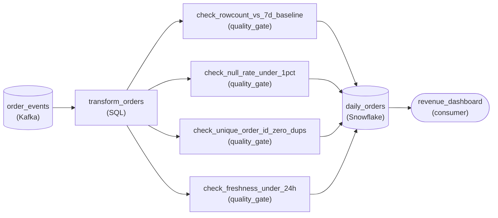

*The four checks sit between `transform_orders` and `daily_orders`, so the mart only loads a batch that passed each one and the dashboard reads only checked rows.*

Each check catches a different silent failure. `check_rowcount_vs_7d_baseline` fails when today's count lands outside a band (say 25 percent) around the trailing seven-day average: a half-loaded batch that is green but short. `check_null_rate_under_1pct` watches required columns, so an upstream change that nulls `amount` cannot quietly zero revenue. `check_unique_order_id_zero_dups` keeps the primary key unique, which also catches a batch published twice. `check_freshness_under_24h` compares `max(event_ts)` to run time, so a stalled feed shows up as stale rather than as a plausibly small day.

| Pitfall: One generic check node hides which failure fired |
| --- |
| The tempting shortcut is a single `validate_orders` node. It looks like quality coverage, but when it fails it only says something is wrong. Four nodes, each named with its threshold or baseline window, tell whoever reads the failure which assertion broke and what the limit was. |

| Real world: A finance partner can read a row-count failure |
| --- |
| These four are the checks a non-technical stakeholder understands. 'Row count was 40 percent below the seven-day average' turns into a corrective action without a phone call; a statistical drift score would not. |

**Follow-up questions**

1. If yesterday was a real holiday, `check_rowcount_vs_7d_baseline` fails on a correct low-volume batch. How would you keep the check useful without widening the band until it catches nothing?\
   *A static seven-day baseline versus a seasonal one.*
2. What breaks in `check_freshness_under_24h` when events arrive hours after their event time, and how would you tell a stale feed from expected late data?\
   *Event time versus processing time.*


<br>

### Exercise 2 of 2

**● TASK**

Quality checks placed only at the end let bad data run through every transform before anything trips, so on-call has to trace each failure back across layers. On this three-layer pipeline, add a quality gate at each layer boundary: source to raw, raw to curated, and curated to serving. Put each gate in front of the layer it guards so nothing lands unchecked, and name it for what it asserts at that boundary.

**Starting canvas** (already placed for you):

- Kafka order_events source (source, Kafka)
- Iceberg raw_orders (raw layer) (storage, Iceberg)
- transform_curate (raw -> curated) (transform, SQL)
- Iceberg curated_orders (curated layer) (storage, Iceberg)
- transform_serve (curated -> serving) (transform, SQL)
- daily_orders mart (serving layer) (storage, warehouse)
- Revenue dashboard (consumer, dashboard)


<br>

### Solution

#### A gate at every boundary

Placing a quality check at each layer boundary is the medallion pattern's safety net: every hop between layers passes through a gate that asserts what must be true at that point. A gate that fails stops bad rows before the next layer reads them, so a failure's blast radius is one layer, not the whole pipeline.

```mermaid
flowchart LR
    n0[("order_events<br/>(Kafka)")]
    n1["check_required_fields<br/>(quality_gate)"]
    n2[("raw_orders<br/>(Iceberg)")]
    n3["transform_curate<br/>(SQL)"]
    n4["check_keys_and_codes<br/>(quality_gate)"]
    n5[("curated_orders<br/>(Iceberg)")]
    n6["transform_serve<br/>(SQL)"]
    n7["check_totals_reconcile<br/>(quality_gate)"]
    n8[("daily_orders<br/>(warehouse)")]
    n9(["Revenue dashboard<br/>(dashboard)"])
    n0 --> n1
    n1 --> n2
    n2 --> n3
    n3 --> n4
    n4 --> n5
    n5 --> n6
    n6 --> n7
    n7 --> n8
    n8 --> n9
```

*Three gates, one in front of each layer, keep each failure scoped to the layer that produced it.*

| Pitfall: A late failure hides its origin |
| --- |
| With one check only at the serving mart, a null `order_id` from the source still flows through `transform_curate` and `transform_serve` before anything trips. You see the symptom in `daily_orders` and have to trace it back across both transforms. A gate right after the source catches it where it entered. |

Name each gate for what it asserts at that boundary. `check_required_fields` sits in front of `raw_orders`: required fields present and `order_id` non-null. `check_keys_and_codes` sits in front of `curated_orders`: `order_id` unique and currency codes valid. `check_totals_reconcile` sits in front of `daily_orders`: daily totals tie out and no revenue is negative.

| Real world: Gates pay for themselves in triage time |
| --- |
| The real win is diagnostic cost. When the raw-to-curated gate trips, on-call knows the defect lives in `transform_curate` or its input, not somewhere across three layers. The check's name in the alert becomes the first line of the runbook. |

**Follow-up questions**

1. Where would a fourth gate go if `curated_orders` fanned out to 2 serving marts?\
   *Tests whether the rule is one gate per hop, not a fixed count of three.*


<br>

---

## Quality Checks at Boundaries

### How Far a Bad Row Travels

A pipeline you can read left to right has layers: a staging table that holds a raw copy of the source, a curated table built from it, and a dashboard that reads the curated table. Each arrow between layers is a boundary. A bad row that crosses a boundary unchecked becomes the next layer's input, and every layer after it inherits the problem and adds its own work on top.

The orders pipeline has 2 boundaries. Here it is with a quality gate placed at each one, drawn as its own task between the write that fills a layer and the read that consumes it.

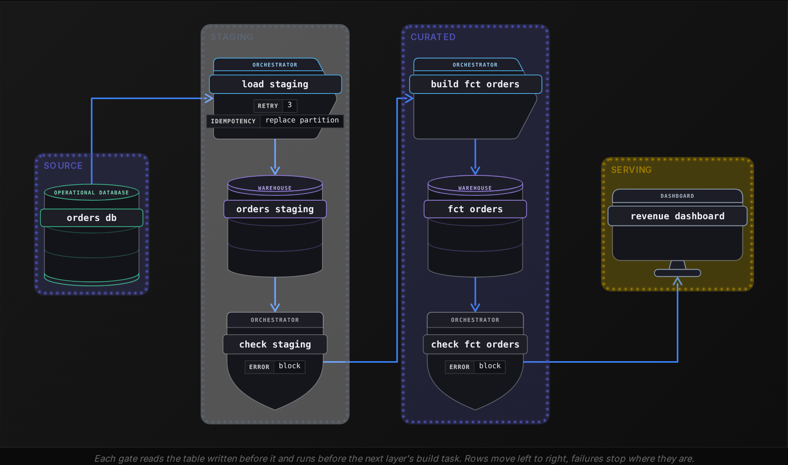


<br>

### What Each Gate Asks

The 2 gates ask different questions because the 2 boundaries break in different ways. The staging gate stands between the source and everything you own. It asks whether the copy is complete, current and unrepeated: row count against a floor, freshness of the newest row, and uniqueness on `order_id`, since the source holds each order once and any duplicate in staging came from the load. If it fails, the fault is in the source or in the load, and nothing downstream has been touched.

The curated gate stands between your transformation and your consumers. `build_fct_orders` joins staging orders to a customers table and sums line items, and joins are where rows multiply or lose their values. So this gate asks whether the build preserved the data: null rate on `customer_id`, uniqueness on `order_id` a second time, and row count compared with staging, since one order in should mean one order out.

| Boundary | Checks | A failure means | First place to look |
| --- | --- | --- | --- |
| Source to staging | Row count floor, freshness, uniqueness | The copy is short, old or doubled | The source export, the load task |
| Staging to curated | Null rate, uniqueness, count vs staging | The build changed the data | The join in build_fct_orders |


<br>

### The Same Bug, Two Placements

Suppose the load task appended instead of replacing, as in the retry lesson, and `orders_staging` now holds 96,000 rows for 25 April, each order twice. Follow the bug under 2 designs.

✓One gate, at the end of the run

- 02:05 staging holds 96,000 rows, nothing checks it
- 02:20 build_fct_orders writes 96,000 rows into fct_orders
- 02:22 the dashboard refreshes and shows revenue doubled
- 02:25 the single gate fails on duplicates, after the dashboard already moved
- Fix means rerunning load, build, refresh, and a summary table built from fct_orders

✗A gate at each boundary

- 02:05 staging holds 96,000 rows
- 02:06 check_staging finds 48,000 duplicate order_id values and fails
- build_fct_orders never starts
- fct_orders and the dashboard still show 24 April with its date
- Fix means rerunning one load task

The bug is identical. The difference is scope: in the first design it reached 3 tables and a dashboard, and in the second it reached 1 table. A gate at a boundary makes the layer behind it the last layer the bug can touch, which is also the layer whose owner knows how to fix it.


<br>

### What a Gate Costs

Each gate is one aggregate query and one task slot, about 2 seconds against a 10-minute run. Over a quarter of 90 nights that is 3 minutes of compute. Skipping it is paid on the one bad night: an analyst's morning from 09:30 to 11:00 and a rebuild of 2 downstream tables.

✓Do

- Put a gate right after each write, before the next read
- Check at staging what the source could break: count, freshness, key
- Check at curated what the build could break: nulls and fan-out
- Compare curated row count with staging to catch join fan-out

✗Don't

- Rely on one gate at the end to cover every layer
- Skip the staging gate because staging is only a copy
- Let a build task read a table no gate has passed
- Treat gate run time as waste: 2 seconds against a 10-minute run

**The orders pipeline gains a third layer: a daily_revenue summary built from fct_orders by grouping on order_dt. Where does a new gate belong, and what should it check first?**

- **A.** No new gate is needed, because fct_orders already passed its gate and a summary cannot introduce errors.
- **B.** A second gate on orders_staging, since every error in the summary must have started in the raw copy.
- **C.** A gate after daily_revenue checking uniqueness on order_id, the same check the curated gate runs.
- **D.** A gate after daily_revenue is written, checking that its summed amount equals the sum in fct_orders for the same date.

<details>
<summary>Solution</summary>

**D.** A gate after daily_revenue is written, checking that its summed amount equals the sum in fct_orders for the same date.

The new boundary is between fct_orders and the summary, and the question that boundary raises is whether the aggregation preserved the total. Comparing the 2 sums answers it directly.

**Why the others are wrong**

- **A.** A GROUP BY is a transformation, and transformations can go wrong: a filter in the summary query or a bad date cast changes the result. Every new layer gets its own gate.
- **B.** Staging already has a gate, and the summary's build step can introduce its own errors after staging was verified. The gate goes where the new boundary is.
- **C.** The summary has no order_id column, it groups by date. The right check for a boundary comes from what that layer's build could break, which here is the total.

</details>


<br>

---

## Pipeline Architecture

### Exercise 1 of 2

**● TASK**

Five quality checks sit between the transform and the daily_orders mart, each named on the canvas. Add block or warn to every check's name: block when publishing the bad data is worse than not running, warn when running is better but still imperfect. A duplicate key, the null rate, a row count under half of baseline and the schema mismatch would corrupt joins or mislead the dashboard; a row count at 80 to 90 percent of baseline is plausible variation.

**Starting canvas** (already placed for you):

- Kafka order_events source (source, Kafka)
- transform_orders (transform, SQL)
- Check 1: PK uniqueness (no authority set) (quality_gate, Great Expectations)
- Check 2: required-col null > 5% (no authority set) (quality_gate, Great Expectations)
- Check 3: row count < 50% baseline (no authority set) (quality_gate, Great Expectations)
- Check 4: row count 80-90% baseline (no authority set) (quality_gate, Great Expectations)
- Check 5: schema mismatch on consumer-parsed column (no authority set) (quality_gate, Great Expectations)
- Snowflake daily_orders mart (storage, Snowflake)
- Revenue dashboard (consumer, Looker)


<br>

### Solution

#### Giving each check an authority

Every quality check carries an **authority**: a blocking check halts the run when it fails, a warning check logs the failure and still lets the data reach `daily_orders`. The rule the section gave you is a cost comparison, not a severity ranking. Block when a bad load is worse than no load at all; warn when a slightly-off dashboard today beats a stale one.

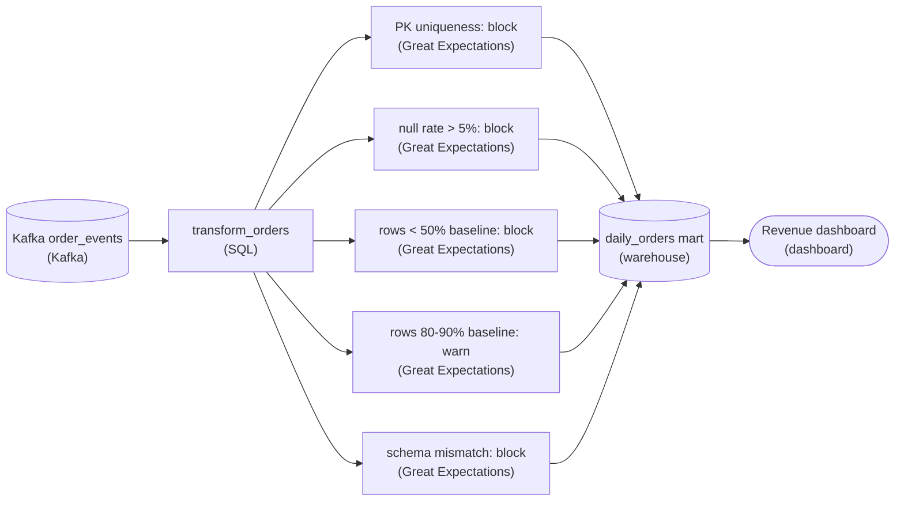

*Every check guards the `daily_orders` mart; 4 halt the run on failure, only the 80-90% row count warns and lets data through.*

| Key insight: The 4 blockers all corrupt or mislead |
| --- |
| A duplicate primary key breaks the joins the mart is built on. A null rate above 5% in a required column silently drops rows from every aggregate. A row count under half of baseline means a load so incomplete the revenue number is simply wrong. A schema mismatch on a column the dashboard parses either errors the tile or renders garbage. In all four, publishing is worse than showing yesterday's data, so they block. |

| Pitfall: A plausible wobble is not a failure |
| --- |
| The tempting mistake is to block the **80-90% of baseline** row count too, on the logic that fewer rows is always suspect. But a slow ingest day, a holiday, or normal seasonality lands right in that band. Halting the mart for a tolerable variation makes the dashboard stale for no real defect, and a gate that cries wolf trains the team to ignore every alert, including the 4 that matter. |

**Follow-up questions**

1. The 80-90% warning fires every day for a week straight. What should change?\
   *Whether a persistent warning is read as a signal to re-baseline or promote the check to blocking, not as noise to mute.*


<br>

### Exercise 2 of 2

**● TASK**

Turn the starter pipeline into a DAG with a first quality gate on mart.daily_orders, which is built once a day at 2am. Add an orchestrator that runs the transform, then a SQL assertion check, named for its rule, that passes only when today's row count is 50 to 200 percent of the same-weekday average over the trailing 8 weeks. A pass lets the revenue dashboard read the table; a fail halts the DAG and pages on-call.

**Starting canvas** (already placed for you):

- Kafka order_events source (source, Kafka)
- transform_daily_orders (runs at 2am; currently no orchestrator, no gate) (transform, SQL)
- mart.daily_orders (storage, warehouse)
- Revenue dashboard (consumer)


<br>

### Solution

A quality gate is a blocking step between a table and everything that reads it. The orchestrator runs your row-count assertion right after `transform_daily_orders` writes `mart.daily_orders`. A pass lets the dashboard read, and a fail halts the DAG and pages on-call. 2 ideas snap together here: orchestration, so the steps run in order at 2am, and a data-quality assertion, so one of those steps is a pass/fail check on the data itself.

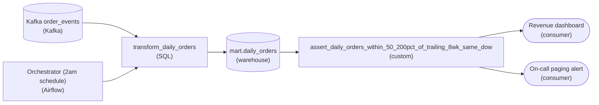

*The gate sits between `mart.daily_orders` and its readers: a pass advances to the dashboard, a fail halts the DAG and branches to on-call paging.*

1. **Wrap the transform in an orchestrator**

   The starter fired `transform_daily_orders` 'at 2am' with no orchestrator. That is a bare cron, and cron cannot express 'run the next step only if this one passed'. Under an orchestrator the run becomes a DAG where every downstream edge depends on the upstream step's exit status, which is exactly what a gate needs.

2. **Put the assertion in the check's name**

   Name the check `assert_daily_orders_within_50_200pct_of_trailing_8wk_same_dow` so it states the band and the baseline window without anyone opening the SQL. Whoever is paged at 3am then knows which guardrail tripped: today's count against the same-weekday average over the trailing 56 days.

**The assertion query**

```sql
WITH daily_counts AS (
  SELECT order_date, COUNT(*) AS row_count
  FROM mart.daily_orders
  WHERE order_date >= CURRENT_DATE - INTERVAL '56 days'
  GROUP BY order_date
),
baseline AS (
  SELECT AVG(row_count) AS expected
  FROM daily_counts
  WHERE order_date < CURRENT_DATE
    AND EXTRACT(DOW FROM order_date) = EXTRACT(DOW FROM CURRENT_DATE)
),
today AS (
  SELECT COALESCE(MAX(row_count), 0) AS actual
  FROM daily_counts
  WHERE order_date = CURRENT_DATE
)
SELECT today.actual, baseline.expected
FROM today
CROSS JOIN baseline
WHERE today.actual < 0.5 * baseline.expected
   OR today.actual > 2.0 * baseline.expected;
```

*Returns a row only when today's count breaches the band; an empty result means pass, and any row fails the task.*

| Pitfall: A check that only logs is not a gate |
| --- |
| The common miss is a check that computes the number, writes it to a metrics table, and reports success anyway. That is monitoring, not a gate: the bad load still sits in `mart.daily_orders` and the dashboard renders it. A gate returns a failure the orchestrator acts on, so the DAG halts before the dashboard edge fires. |

| Real world: Compare Tuesdays to Tuesdays |
| --- |
| A flat 'within 200% of yesterday' threshold pages you every Monday, because Monday's volume never resembles Sunday's. Filtering the baseline to the same weekday over 8 weeks with `EXTRACT(DOW ...)` is what makes it trustworthy, so ordinary weekly seasonality never reads as an anomaly. |

**Follow-up questions**

1. If `mart.daily_orders` is empty because the upstream Kafka feed was down, should the gate fail or never run?\
   *A data-quality breach and an upstream-dependency failure need different fixes and different pages.*
2. How would you let the gate warn instead of halt on a soft breach, say 40 to 50 percent of baseline?\
   *Adding severities and a branch that pages without stopping the DAG.*


<br>

---

## Warn vs Block Authorities

### What Happens After a Check Fails

A check that fails has to do something, and there are 2 choices. It can block: the task turns red, nothing downstream runs, and the curated table keeps whatever it held before. Or it can warn: the task posts a message to a channel the team reads, marks itself passed, and the run continues to publish. The choice is the check's authority, and it is set per check.

The animation below runs the same gate both ways. `orders_staging` holds 4 rows for 25 April, and order 5002 appears twice. `check_orders` runs at 06:00 with 2 checks: `order_id` must be unique, and the row count must be at least 3. `publish_orders` overwrites `fct_orders`, and the revenue dashboard sums `amount`. Switch between Block and Warn and watch the dashboard.

A failed check stops the run, so nothing after it publishes05:59

Snowflake

orders_staging

Airflow

check_orders

ON FAILblock

Airflow

publish_orders

AFTERcheck_orders

Snowflake

fct_orders

Looker

revenue

$480

Apr 254 rows

order_id

amount

5001

200

5002

135

5002

135

×2

5003

80

checks2 checks

unique order_id

row count

no alert

Apr 242 rows

order_id

amount

4991

230

4992

250

One duplicate order_id

1/6

Under Block, the uniqueness check fails at 06:01, `publish_orders` never runs, and the dashboard keeps showing $480 from the 24 April partition, with its date. The number is a day old and correct. Under Warn, a message goes to the channel, `publish_orders` overwrites `fct_orders` with all 4 rows, and the dashboard shows $550. The true figure for 25 April is $415. The duplicate added $135 to revenue, and the only trace of it is a message in a channel at 06:01.


<br>

### The Rule for Choosing

Compare 2 costs. The cost of running with the bad data: who reads the table, what they decide from it, and how long the wrong number stands before anyone sees it. The cost of not running: consumers see the previous day's data for a few hours while someone fixes the load. Block when the first cost is higher. Warn when the second is.

For a duplicated `order_id` in a revenue table, running means finance sees an inflated total, so block. For a `customer_id` null rate of 3% against a 2% threshold, the per-customer breakdown drops about 1,440 of 48,000 orders instead of the usual 240, while the total stays right. Blocking would hide a correct total from everyone to protect a breakdown few people read that day. Warn, and fix it in the morning.

| Check on fct_orders | Cost of running with it | Authority |
| --- | --- | --- |
| Row count under 25,000 floor | Revenue shows a 90% drop that never happened | Block |
| Duplicate order_id | Revenue double counts every repeated order | Block |
| customer_id null rate over 2% | Customer breakdown loses a few rows, total correct | Warn |
| Newest row over 2 hours old | Dashboard shows the previous day with its date | Warn |

Freshness sits at warn for a reason worth stating. If the data is stale, the damage is already visible in the date on the dashboard, and blocking the publish cannot make the rows newer. The useful response is a person looking at why the run was late, which a warning asks for. Blocking would only delay the fix.


<br>

### A Warning Only Works If Someone Reads It

A warn check that posts to a channel nobody watches is a silent failure with extra steps. Before setting any check to warn, name the person or rotation who reads the channel and what they do when a warning appears. If no one can be named, the check is block or it is nothing.

New checks usually start at warn even when they will end at block. A fresh threshold has no history behind it, and a floor set too high blocks a healthy run on the first busy Sunday. Run the check at warn for 2 weeks, read every message it posts, adjust the threshold until the messages are all real problems, then promote it to block.

> **TIP**
>
> Write the authority next to the check in the DAG as a parameter the next engineer can read, such as `on_fail: block`. A check whose authority lives only in someone's memory gets copied with the wrong one.

✓Block when

- Consumers make money decisions from the table
- The rows would be wrong, and a delay would cost less
- A wrong number would stand for hours unnoticed
- The threshold has 2 weeks of clean history

✗Warn when

- Stale data is already visible as stale
- The failure degrades a detail, the totals hold
- The check is new and its threshold unproven
- A named person reads the channel today

**A new check on fct_orders asserts that no amount is negative. On its first run it finds 12 negative rows out of 48,000, all refunds the business records as negative orders. What should its authority have been, and why?**

- **A.** Warn, because the check is new, and the first message would have revealed that refunds are legitimate before anything was blocked.
- **B.** Block, because negative amounts in a revenue table are always wrong and must never reach the dashboard.
- **C.** Warn, because negative amounts never affect the revenue total and so can never matter to a consumer.
- **D.** Block, because 12 of 48,000 is below any reasonable threshold and the check would have passed anyway.

<details>
<summary>Solution</summary>

**A.** Warn, because the check is new, and the first message would have revealed that refunds are legitimate before anything was blocked.

A new check has no history. Running it at warn for its first weeks surfaces this kind of surprise as a message instead of a halted run, and the rule gets rewritten to allow refunds.

**Why the others are wrong**

- **B.** The 12 rows are correct business data. A block here would have hidden a correct day of revenue to protect against a rule the check's author misunderstood.
- **C.** Negative amounts reduce the total, which is why refunds are stored that way. The reason to warn is the check's newness. The rows themselves are correct.
- **D.** The check as written has no threshold: any negative row fails it. Twelve rows would have blocked the run and held back a correct partition.

</details>


<br>

---

## Pipeline Architecture

### Exercise 1 of 2

**● TASK**

A daily orders pipeline at a Series B startup treats a green orchestrator run as proof the data is good, and it runs no quality checks anywhere between the Kafka source and the Snowflake mart that the revenue dashboard reads. Add the first quality suite at that layer boundary as four separate cheap checks (row count, null rate, uniqueness, freshness), tagging each check's name as either block or warn, following the rule that a check blocks when running on bad data is worse than not running at all. Keep the dashboard reading from the existing Snowflake mart.

**Starting canvas** (already placed for you):

- Kafka order_events source (source, Kafka)
- transform_daily_orders (no checks) (transform, SQL)
- Snowflake daily_orders mart (storage, Snowflake)
- Revenue dashboard (consumer, Looker)


<br>

### Solution

#### A quality gate at the layer boundary

A **data quality gate** is a small suite of assertions that runs where data crosses from one layer to the next, so bad data stops at the boundary instead of surfacing on a dashboard. A green orchestrator run only proves the code executed without throwing. It says nothing about whether `order_events` actually delivered today's orders, whether `order_id` is unique, or whether the numbers are current. The gate is what turns 'the job ran' into 'the data is trustworthy', and the first one belongs on the `transform_daily_orders` to `daily_orders` boundary the dashboard reads from.

| Pitfall: A green run is not a passing check |
| --- |
| The most common mistake here is treating the orchestrator's status as a quality signal. If `transform_daily_orders` runs `INSERT ... SELECT` over an empty Kafka window, it succeeds cleanly and loads zero rows. The run is green, the mart is empty, and the revenue dashboard confidently shows $0. Orchestration checks that work happened; a quality gate checks that the work was correct. They are different jobs and you need both. |

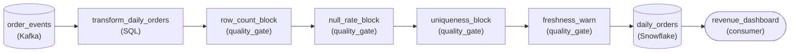

*Four checks sit on the transform-to-mart boundary. A block check fails the run, so the mart keeps yesterday's numbers. The warn check lets the load through and raises a notification.*

The four cheap checks cover the usual ways this table goes wrong. Row count asks whether any orders loaded. Null rate asks whether `order_id` and `amount` are populated. Uniqueness asks whether `order_id` is a real key. Freshness asks whether the newest row is from today. Each one is a single aggregate over `daily_orders`, so the whole suite is a handful of `COUNT(*)` and `MAX(...)` scans. Writing the checks is the easy part. The judgment is deciding what each one does when it fails.

| ✕ Block | ✓ Warn |
| --- | --- |
| Row count, null rate on `order_id` and `amount`, and uniqueness on `order_id` all block. When these fail, the data is confidently wrong. Zero rows reads as a dead business, nulls drop out of `SUM(amount)`, and duplicate keys double-count revenue. Publishing that is worse than publishing nothing, so the check fails the run and the mart keeps yesterday's good numbers. | Freshness warns. Late-arriving Kafka data makes the table a few hours stale, but the rows already there are still correct. Blocking would blank the dashboard over data that is old but right. So the load goes through and the team gets a notification instead. |

| Trick: Block when bad data misleads, warn when it is only late |
| --- |
| Block when acting on the bad data is worse than not acting at all. Warn when the data is degraded but still more useful than an empty result. Correctness failures (wrong totals, missing keys, empty loads) block because they mislead. Timeliness failures warn because a stale but accurate number still informs a decision. Tag each check by that test, not by how alarming it sounds. |

| Real world: Severity is what decides publish or hold |
| --- |
| Tools like dbt tests, Great Expectations and Soda work this way. Every assertion carries a severity, and the orchestrator reads that severity at the boundary to decide whether to publish or hold. Teams that tag everything as block get paged for data that is an hour stale and start disabling checks. Teams that tag everything as warn ship broken revenue numbers. |

**Follow-up questions**

1. The freshness warn fires 3 days straight. When should a repeated warn escalate to a block?\
   *Severity is a policy, not a fixed label: sustained staleness eventually crosses into wrong.*
2. How would you keep a blocked run from leaving a half-loaded `daily_orders`?\
   *Points toward staging-then-swap or transactional loads, so a blocked check leaves the last good table in place.*
3. Where would you add the second gate once this one is trusted?\
   *Extends the boundary idea: a check between Kafka and the transform catches bad input before the mart is built.*


<br>

### Exercise 2 of 2

**● TASK**

A nightly batch job copies yesterday's ride trips, about 400,000 rows a day, from the trips database into a warehouse table that an operations dashboard reads. Add the four cheap quality checks against that loaded table: row count against the seven-day average, null rate on trip ID and fare, freshness of the newest trip, and fares within a sane range. Any failed check must alert the on-call analyst.


<br>

### Solution

#### Check the rows the job wrote

The four cheap quality checks all ask questions about the loaded table, never about the job that loaded it. Row count compares tonight's trips with the seven-day average, so a load that lands half of a normal 400,000 trips stands out. Null rate catches trips missing an ID or a fare. Freshness asks whether the newest trip is from yesterday. A range check flags fares that are negative or absurdly large. Each is one short SQL query that runs in seconds.

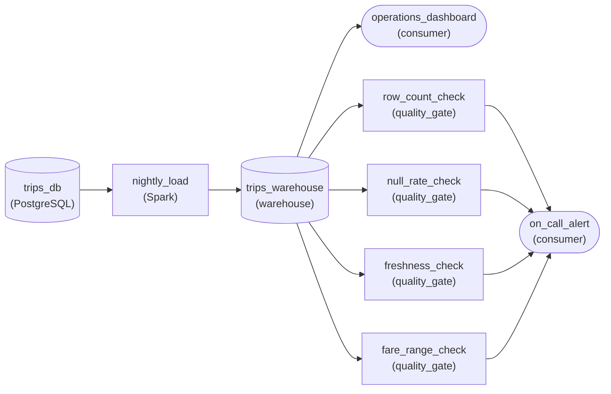

*The nightly load writes the warehouse table; four checks read it and send any failure to the on-call alert.*

| Pitfall: A green job is not a checked table |
| --- |
| The most common miss is treating the load job's success as the check. Spark can finish cleanly after reading an empty extract or a fare column full of nulls. Wire the checks to the warehouse table so they see exactly the rows the dashboard will see. |

| Key insight: Each failure names its own fix |
| --- |
| 'Row count outside its band' sends the analyst to the source extract; 'fares out of range' sends them to the upstream pricing feed. Four plain checks produce four plain messages, which is why the alert turns into a corrective action without a phone call. |

**Follow-up questions**

1. Weekend trip counts drop by a third. Does a seven-day average still give a fair baseline?\
   *Tests how a rolling baseline absorbs a weekly pattern in the row count check.*
2. A new `tip_amount` column starts arriving. Which of the four checks would you extend to cover it?\
   *Tests mapping a new column onto the null rate and range checks.*


<br>

---

## First Quality Gate: Row Count

### The Assertion Pattern

A quality gate is a query plus a rule about its result. The cleanest shape is a query that returns rows only when something is wrong. If the result is empty, the gate passes. If any row comes back, the gate fails and the row is the evidence. The row count check from the second section ran against `fct_orders`. The first gate belongs at the staging boundary, so point it at `orders_staging` and add a `HAVING` clause that keeps the result only when the count is under the floor.

```sql
SELECT
  COUNT(*) AS row_count
FROM orders_staging
WHERE order_dt = DATE '2026-04-25'
HAVING COUNT(*) < 25000
```

On a healthy night this returns nothing. On the night of the 3-row partition it returns one row, `row_count` 3, which is both the verdict and the first line of the incident report.


<br>

### The Task Around the Query

The gate runs as a task, and a task fails by raising. The function below runs the assertion for one date and one floor, and raises with the offending count if any row comes back. The orchestrator sees the raise as a non-zero exit, marks the task red, and skips everything downstream of it.

```sql
def check_row_count(conn, run_date, floor):
    sql = f"""
        SELECT
          COUNT(*) AS row_count
        FROM orders_staging
        WHERE order_dt = DATE '{run_date}'
        HAVING COUNT(*) < {floor}
    """
    violations = conn.execute(sql).fetchall()
    if violations:
        raise ValueError(
            f"orders_staging {run_date}: {violations[0][0]} rows, floor is {floor}"
        )
```

The raise is the whole mechanism. Nothing in this function knows about dashboards or downstream tables. It knows one query, one floor, and how to fail. The DAG supplies the rest.


<br>

### Wiring It Into the DAG

The gate sits between the write it checks and the build it protects. `load_staging` writes the day's rows into `orders_staging`, `check_row_count` reads that partition, and only then does `build_fct_orders` replace the live `fct_orders` partition. The dashboard refresh depends on the build. Four tasks, 3 edges, 1 schedule at 02:00.

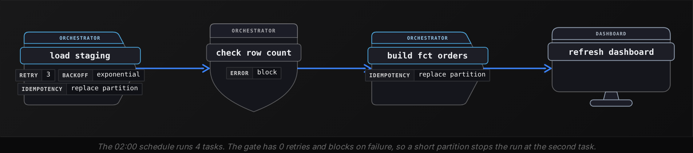

The gate has 0 retries. The load task retries 3 times with backoff because its failures are usually transient. A failed assertion is permanent: the same query against the same 3 rows returns the same verdict, so a retry only delays the red task. The cost of 0 is that a connection timeout inside the gate blocks a healthy run too. When that starts happening, retry the query's execution errors and let the assertion's `ValueError` fail at once.


<br>

### Choosing the Floor

The floor is a number below every healthy day and above every broken one. Pull the daily counts for the last 90 days: the busiest weekday was 52,400, the quietest Sunday was 29,800, and a holiday dipped to 27,100. The broken run produced 3. Any number between 27,100 and 3 works, and 25,000 leaves a margin under the worst real day while still catching a half-loaded 15,000.

*Later you can replace the fixed floor with half of the previous partition's count, which tracks growth on its own. Start fixed: a number you can read in the code is a number you can reason about at 03:00.*


<br>

### The Night It Fires

| Time | Task | Result |
| --- | --- | --- |
| 02:00:00 | load_staging | Writes 3 rows to orders_staging for 25 April, exits 0 |
| 02:00:04 | check_row_count | Assertion returns row_count 3, raises, task red |
| 02:00:04 | build_fct_orders | Skipped, upstream failed |
| 02:00:04 | refresh_dashboard | Skipped, upstream failed |
| 08:00 | dashboard | Shows 24 April's figures, labelled 24 April |
| 09:15 | on-call engineer | Reads the error, finds the test-account filter, asks upstream to fix it |
| 10:30 | rerun load_staging | Writes 48,000 rows, gate passes, build and refresh run |

The dashboard was wrong for 0 minutes. It showed a day-old number with a day-old date for 8 hours, which is a known state everyone can read. The engineer started from a red task with the count in its error message instead of from an analyst's question about a 99.9% revenue drop. And the fix was one rerun of one task, because nothing past the gate had moved.

> What you built
>
> - An assertion query that returns rows only on failure
> - A task that raises when any row comes back
> - A gate placed after the write and before the build
> - Block authority with 0 retries
> - A floor chosen from 90 days of real counts

**The gate above is changed to HAVING COUNT(*) < 50000 by someone who read that a typical weekday has 48,000 orders. What happens on the next healthy Tuesday with 48,200 rows?**

- **A.** The gate passes, since 48,200 is a normal count and the gate recognizes normal days from history.
- **B.** The gate passes because the orchestrator retries it until a later load brings the count over 50,000.
- **C.** The gate warns in the channel and lets the build run, because row count checks are warn by default.
- **D.** The gate returns 1 row and raises, so build and refresh are skipped and the dashboard shows Monday's data all day.

<details>
<summary>Solution</summary>

**D.** The gate returns 1 row and raises, so build and refresh are skipped and the dashboard shows Monday's data all day.

The floor sits above every healthy day, so every healthy day is blocked. The data was fine and the consumers lost a day of freshness, which is why the floor comes from the quietest real day, with margin under it.

**Why the others are wrong**

- **A.** The gate knows only its floor. A floor of 50,000 is above a normal day, so a normal day fails it.
- **B.** The gate has 0 retries, and no later load is scheduled for that date. A retry would run the same query against the same rows and fail the same way.
- **C.** This gate raises, which the orchestrator treats as failure, and raising is block. There is no default authority, the code decides it.

</details>


<br>

---

## Pipeline Architecture

### Exercise 1 of 2

**● TASK**

A nightly batch pipeline lands fitness-tracker sync files in a raw layer, a Spark job cleans them into a cleaned layer, and a dbt model builds the daily activity table a dashboard reads. Its only quality check sits between that table and the dashboard, so a bad file surfaces after every transform has run on it. Keep that check and add one at each earlier layer boundary, so a failure is caught in the layer where it starts.


<br>

### Solution

#### A gate at every boundary, not only the last one

Boundary gating gives every hand-off between layers its own quality check, so a bad batch is caught in the layer that produced it. With one gate in front of the dashboard, a truncated sync file passes through the Spark cleaning job and the dbt model before anything notices, and whoever is on call has to work backwards through both transforms to learn whether the file, the cleaning logic or the model broke. Gates at the raw-to-cleaned and cleaned-to-serving boundaries turn that hunt into a lookup: the gate that fired names the layer.

```mermaid
flowchart LR
    n0[("device_sync_files<br/>(source)")]
    n1[("raw_landing<br/>(object storage)")]
    n2["raw_check<br/>(Great Expectations)"]
    n3["clean_job<br/>(Spark)"]
    n4[("cleaned_store<br/>(Delta Lake)")]
    n5["cleaned_check<br/>(dbt tests)"]
    n6["daily_activity_model<br/>(dbt)"]
    n7[("daily_activity_table<br/>(warehouse)")]
    n8["dashboard_check<br/>(dbt tests)"]
    n9(["activity_dashboard<br/>(dashboard)"])
    n0 --> n1
    n1 --> n2
    n2 --> n3
    n3 --> n4
    n4 --> n5
    n5 --> n6
    n6 --> n7
    n7 --> n8
    n8 --> n9
```

*3 gates, one per boundary: `raw_check` before the Spark job, `cleaned_check` before the dbt model, `dashboard_check` before the dashboard.*

1. **Gate the raw files before cleaning**

   The first check goes between the raw landing store and the Spark job. It asserts what the source promised: a device ID and timestamp on every record, a row count in the expected range. A failure here means the file was bad on arrival, and no transform has touched it yet.

2. **Gate the cleaned layer before the model**

   The second check sits between the cleaned store and the dbt model. It catches what the cleaning job itself broke, like a release that silently drops rows with a null heart rate. Without it, that bug surfaces as a dip on the dashboard and looks exactly like a source problem.

3. **Keep the serving gate**

   The original check in front of the dashboard stays. It now only has to guard what the daily model added, such as totals out of range or a missing day, because everything upstream was already checked at its own boundary.

| Pitfall: A gate on a side branch guards nothing |
| --- |
| A quality check that hangs off the raw store but is not on the path into the Spark job looks like coverage on the canvas, yet the data flows around it. Each gate belongs inline: the store it reads feeds the gate, and the gate feeds the transform that consumes that store. |

**Follow-up questions**

1. A weekly personal-bests email starts reading the cleaned layer directly. Which gate already protects it, and does it need a new one?\
   *Whether a boundary gate protects every reader downstream of it, not just the next transform.*
2. Using the 4 cheap checks from earlier in the lesson, which would you assert at each of the 3 boundaries?\
   *Matching each check to the layer where that kind of failure originates.*


<br>

### Exercise 2 of 2

**● TASK**

A nightly job loads about 200,000 hotel bookings from the bookings database into a published table that the revenue dashboard reads. Give it two quality checks with different authorities: a duplicate booking ID check that blocks, so a failure stops the table from being published, and a row count check that only warns when the load lands at 80 to 90 percent of the recent baseline, emailing the data team while the load still publishes.


<br>

### Solution

#### Where a check sits is its authority

Warn vs block is decided **per check**, and on a canvas it shows up as placement. A blocking check sits on the data path: the published table only receives rows that passed it, so duplicate booking IDs stop the load before revenue joins double-count. A warning check branches off the path to a notification, so a load at 85 percent of baseline still publishes and the data team reads about it in the morning.

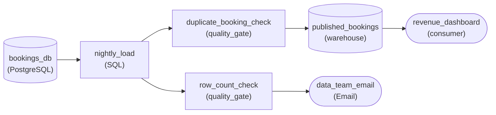

*The duplicate check guards the path into the published table; the row count check branches off to email.*

| Pitfall: One gate for both checks gets one authority wrong |
| --- |
| Chaining the row count check inline after the duplicate check means a quiet Sunday halts the dashboard. Wiring both checks only to email means duplicates publish anyway, and an alarm that never stops anything soon gets ignored. |

| Key insight: Ask whether running is worse than not running |
| --- |
| Duplicates: yesterday's table beats a double-counted one, so block. A load at 85 percent: today's mostly complete table beats yesterday's, so warn. The same question puts a schema mismatch on a column the dashboard parses on the blocking side. |

| Real world: Ship the check with its long-term authority |
| --- |
| A check launched as a temporary warning tends to stay a warning forever, because nothing forces the promotion conversation. Decide block or warn when you write the check. |

**Follow-up questions**

1. Finance adds a rule that booking amount may be at most 5 percent null. Where does that check go?\
   *Applying the decision rule to a required column the dashboard sums.*
2. What should change if the row count falls below half of the recent baseline?\
   *The same metric can need a blocking threshold and a warning threshold.*


<br>

---

## Putting It All Together

Spotify ships Wrapped every December from a year of play events rolled up per listener. Picture the nightly load into the plays staging table appending on a retry one night in October, so every play from that day lands twice. Without a gate, the duplicates flow into the curated listening table and then the yearly rollup, where that day counts twice: a song a listener binged that October day gains an extra day of minutes and can climb into their top 5. With a gate, the run stops the same night.

- The doubled night is a silent failure: every load task exited 0, and the orchestrator marked the run green while the staging table held each play twice.
- A uniqueness check on the play event key at the staging gate returns a duplicate count in the millions and fails, which is the cheap check built for exactly this bug.
- Because the gate sits at the staging boundary, the curated table and the yearly rollup never read the doubled night, so the fix is one rerun of one load task.
- That gate is block authority: a doubled day of listening is wrong data that would stand unseen until December, which costs far more than one day of delay.
- The whole gate is a HAVING assertion, a task that raises, 0 retries, and a threshold of 0 duplicates, wired between the load and the build.


<br>

---

## Pipeline Architecture

### Exercise 1 of 2

**● TASK**

An orchestrator runs a nightly batch job that summarizes the point-of-sale database into a store-level daily sales table, one row per open store (about 1,200 rows), which the regional sales dashboard reads each morning. Add a row-count quality gate that the orchestrator runs after the transform and that halts the run before the table is published when the count falls outside 1,150 to 1,250.


<br>

### Solution

#### A gate the orchestrator runs before anyone reads

A **row-count gate** is the smallest quality gate that pays for itself: one SQL assertion, a `COUNT(*)` on the fresh summary compared against a band. Here the band falls out of the grain. The table holds one row per open store, so about 1,200 rows is the expectation and 1,150 to 1,250 is the tolerance. What makes it a gate rather than a report is where it sits: the orchestrator runs it as its own task after the transform, and publishing happens only downstream of a pass.

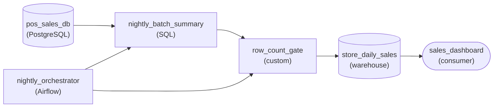

*The gate sits on the data path between `nightly_batch_summary` and `store_daily_sales`; the orchestrator triggers both tasks in order.*

1. **Run the assertion as its own task**

   The check is a separate task the orchestrator starts once the summary task succeeds. Keeping it separate means a failure points straight at the data, not at the SQL that built it, and the same wiring takes the next gate with different SQL.

2. **Make publishing depend on a pass**

   `store_daily_sales` is fed only by `row_count_gate`. When the count lands at 900 or 2,400, the task fails, the orchestrator stops the run, and the dashboard keeps yesterday's good table.

| Pitfall: A check beside the table is only a report |
| --- |
| Hanging the count check off `store_daily_sales` as a side branch looks similar on a canvas, but the dashboard already reads the bad rows before the check finishes. A blocking gate has to sit between the transform and the published table. |

| Real world: The second gate costs a fraction of the first |
| --- |
| Once this gate runs nightly, a null check or a freshness check is the same task with different SQL: the orchestration wiring and the halt behavior already exist. |

**Follow-up questions**

1. The chain opens 80 stores next quarter. How should the band change so a correct run is not halted?\
   *Whether the band follows the grain (open stores) instead of staying a fixed number.*
2. Which other cheap check would you add to this same task next, and would it block or warn?\
   *Reusing the gate pattern and choosing the right authority for the new check.*


<br>

### Exercise 2 of 2

**● TASK**

Last Tuesday the billing dashboard showed zero usage for one region: that region's meter file had landed with every reading null, and nothing stopped it on the way. Each night about 2 million smart-meter readings are pulled from the meter API into a raw landing area, cleaned, and built into a daily usage table in the warehouse that the dashboard reads. Put a quality gate at each layer boundary so a failure stops in the layer where it started. Null or missing readings must block the run; a regional usage total outside its usual range only warns the on-call engineer by email.


<br>

### Solution

#### Catch it in the layer where it started

Boundary gates with the right authority turn a vague 'the dashboard looks wrong' into a precise 'the meter API sent nothing for one region'. The null file was already bad the moment it landed, so the check that catches it belongs right after the raw landing area, where it fails before cleaning and the table build ever run on empty input. A single check at the end would have seen only a zero total, 2 layers away from the cause, after every stage in between had done its work on bad data.

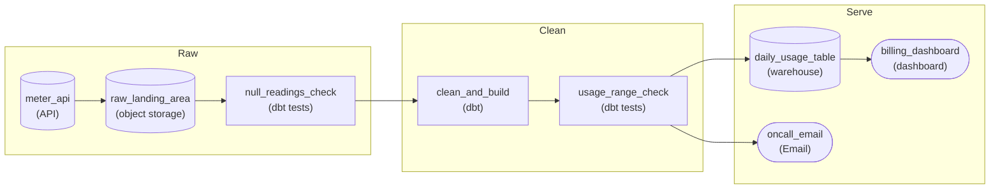

*The raw boundary blocks on null readings; the build boundary warns by email on an odd regional total and still publishes.*

1. **Trace the failure back to its layer**

   Ask where the data first went wrong. Every reading was null the moment it landed, so the raw boundary owns this failure, and `null_readings_check` sits there in the data path. The regional total is different: it only exists after the build, so `usage_range_check` sits at the next boundary, just before `daily_usage_table`.

2. **Decide what each check is allowed to do**

   A null file is a block: publishing it means bills computed from nothing, while stopping costs only a late morning. An unusual regional total is a warn: heat waves and holidays move usage for real, so halting on every swing would stop billing over normal weather. The warn check lets data through to the table and sends a message to `oncall_email`.

| Key insight: Block when running is worse than stopping |
| --- |
| For each check, ask which outcome is worse: running on this data, or not running at all. A missing region makes running worse, so it blocks. An odd but plausible total makes stopping worse, so it warns and lets a person decide. |

| Pitfall: A warning with nowhere to go is silence |
| --- |
| A range check marked as a warning but wired to nothing changes nothing: the data publishes and nobody hears about it. The warn gate earns its place only through the edge to a destination someone actually reads, here the on-call engineer's email. |

**Follow-up questions**

1. Finance also wants to know if the meter API has not delivered by 3am. Where does that freshness check go, and should it block or warn?\
   *Placing one of the 4 cheap checks at the raw boundary and choosing its authority.*
2. What if a region's file lands with half its usual row count instead of zero rows?\
   *Splitting a row-count range into a hard block threshold and a softer warn band.*


<br>

---

## Key Takeaways

- Operational success is every task exiting 0. Semantic success is the rows being true. A silent failure is the first without the second.
- Four cheap checks, each one aggregate query, cover most silent failures: row count, null rate, uniqueness on the key, freshness.
- A gate at every layer boundary keeps a bug scoped to the layer where it started, and points at the owner who can fix it.
- Block when running with bad data costs more than being late. Warn when stale is already visible or the threshold is new.
- A gate is an assertion query that returns rows only on failure, a task that raises, 0 retries, and a floor read from real history.
