Intermediate·Pipeline Architecture · 32 min · 11 challenges

# Data Quality: Intermediate

Suppose that on a Tuesday morning at Uber the nightly trips load finished on time, its row count sat inside the normal band, and no schema check blocked it. A finance dashboard still shows the average fare jumping from $14.20 to $15.89 overnight, and no rider paid more. One city's feed had started sending fares in cents. This lesson builds the checks that would have held that load.


<br>

---

## Schema Validation Basics

Schema validation asks a single question of every row: does this record have the shape the downstream tables were built for? Shape has 4 parts. Required fields must be present as keys. Types must parse, so a `fare_usd` of "14.2O", typed with a letter O, fails. Nullability says which present fields may hold NULL. Ranges and allowed sets bound the values: a fare can't be negative, and `status` must be one of 3 known words.


<br>

### Four rule types on a trips feed

| Field | Required | Type | Nullable | Range or set |
| --- | --- | --- | --- | --- |
| trip_id | yes | VARCHAR | no | unique per load |
| rider_id | yes | BIGINT | no | greater than 0 |
| driver_id | yes | BIGINT | no | greater than 0 |
| city_id | yes | INTEGER | no | greater than 0 |
| fare_usd | yes | DECIMAL(10,2) | no | 0 to 2000 |
| distance_km | yes | DOUBLE | no | 0 to 500 |
| status | yes | VARCHAR | no | completed, cancelled, refunded |
| promo_code | no | VARCHAR | yes | 3 to 12 characters |

Required and nullable are separate rules. `promo_code` is optional: missing or NULL, both mean no promo. `fare_usd` is required and not nullable, and its 2 failures point at different bugs. A missing key means the producer dropped the field from its payload; `"fare_usd": null` means it sent the field with no value, as after a failed price lookup. Reporting them separately tells the producer where to look.


<br>

### Six records, checked

| Record | What arrived | Rule it breaks | Result |
| --- | --- | --- | --- |
| 1 | every field valid, fare 14.20 | none | pass |
| 2 | no `fare_usd` key | required | fail |
| 3 | `distance_km` = "12,4" | type | fail |
| 4 | `rider_id` = null | nullability | fail |
| 5 | `fare_usd` = -6.50 | range | fail |
| 6 | `status` = "COMPLETED" | allowed set | fail |

Record 6 starts arguments, since "COMPLETED" means the same as "completed". Lowercase `status` in the transform and validate what comes out, so a harmless casing change never becomes an alert. Record 3 is a real failure: "12,4" uses a comma as the decimal mark.


<br>

### Rules as config, adopted gradually

Switching on 40 rules in a single deploy fails: the first run flags thousands of old quirks nobody has triaged, and every rule gets muted within a week. A declarative check file lets the suite grow 1 rule at a time. Each entry ties a rule type to a field and sets that rule's authority. A runner reads the file and generates the SQL.

```sql
table: staging.trips
checks:
  - field: trip_id
    rule: required
    authority: block
  - field: fare_usd
    rule: type
    expect: decimal
    authority: block
  - field: fare_usd
    rule: range
    min: 0
    max: 2000
    authority: warn
    added: 2026-10-05
  - field: status
    rule: allowed_set
    values: [completed, cancelled, refunded]
    authority: warn
    added: 2026-10-12
```

Required fields and types go in first, at block. A missing required key loads silently as NULL and skews every aggregate on that column, while a value that fails its type can't load into a typed column. Nullability and range rules start at warn while someone reads each violation, which is either a producer bug or a wrong rule. After 2 quiet weeks a rule is promoted to block, and the `added` date on each entry puts that schedule in review.

**A new rule bounds distance_km from 0 to 500 at warn. It reports around 1,900 rows a day, all cancelled trips with distance_km = -1. What next?**

- **A.** Promote it to block, since 1,900 bad rows a day is a real defect.
- **B.** Keep it at warn and ask the producer whether -1 marks cancelled trips on purpose.
- **C.** Delete it, since a rule that fires every day teaches people to ignore it.
- **D.** Widen the range to start at -1 and promote it to block that day.

<details>
<summary>Solution</summary>

**B.** Keep it at warn and ask the producer whether -1 marks cancelled trips on purpose.

Right. Warn exists to sort real bugs from wrong rules, and the producer knows which this is.

**Why the others are wrong**

- **A.** Nobody knows yet whether -1 is a bug, so blocking could stop loads over a deliberate value.
- **C.** That discards a working check over a pattern the producer could explain in a sentence.
- **D.** That bakes an unexplained value into the rule and skips the 2 quiet weeks a rule needs before it blocks.

</details>


<br>

### What a rule compiles to

Each entry becomes a count of violating rows, and the rule passes at zero. Type rules run on the raw landing table, where every field is still a string, using `try_cast`, which returns NULL for an unparseable value instead of failing the query. Range and allowed-set rules run on staging, in a single pass over the day's partition:

```sql
SELECT
  COUNT(*) AS rows_checked,
  COUNT_IF(
    fare_usd < 0
    OR fare_usd > 2000
  ) AS fare_range_violations,
  COUNT_IF(
    status NOT IN ('completed', 'cancelled', 'refunded')
  ) AS status_set_violations
FROM staging.trips
WHERE ds = DATE '2026-10-20'
```

A NULL `status` makes `NOT IN` return NULL, and `count_if` counts only TRUE, so the set rule skips it on purpose. The nullability rule owns NULLs, and each defect is reported once, under the rule that names its cause.

**A record arrives with status = null and fare_usd = 1450.00 on a 3.1 km trip. Every other field is valid. Which rule reports it?**

- **A.** The allowed-set rule, because NULL is not among the 3 permitted words.
- **B.** The range rule, because 1450 dollars for a 3.1 km trip is far from normal.
- **C.** The nullability rule, because status is not nullable and the set test skips NULLs.
- **D.** Both the nullability and allowed-set rules, so the record is counted twice.

<details>
<summary>Solution</summary>

**C.** The nullability rule, because status is not nullable and the set test skips NULLs.

Right. The NULL fails nullability and the set rule ignores it, so the defect is counted once.

**Why the others are wrong**

- **A.** NOT IN on a NULL returns NULL, which count_if skips, so the set rule stays silent.
- **B.** Under the 2000 maximum, 1450 passes. A fare wrong for its distance needs a cross-field row rule, such as a bound on fare per km.
- **D.** The count_if behaviour prevents that; only the nullability rule reports this record.

</details>


<br>

---

## Pipeline Architecture

### Exercise 1 of 2

**● TASK**

A producer renamed customer_id to user_id, dropped a required column and started sending strings for numbers; the pipeline absorbed all three silently. Add a schema validation check between the Kafka source and the curated table that stops the pipeline on drift. Name it for what it asserts: column existence, types, nullability and ranges. Use a tool the team can adopt incrementally, such as Great Expectations or dbt tests.

**Starting canvas** (already placed for you):

- Kafka events source (producer renamed customer_id, dropped a required col, sent strings) (source, Kafka)
- transform_curate (silently absorbed all three drift events) (transform, SQL)
- Iceberg fct_orders curated table (storage, Iceberg)
- Orders dashboard (consumer, Metabase)

<details>
<summary><strong>Solution</strong></summary>

#### Schema validation is a contract at the boundary

The pattern you just placed is **schema validation**: a gate that, before any row is allowed into the curated table, asserts four things about every event. The declared column exists, its type matches, its nullability is respected, and its values fall in the declared range. It turns the producer's schema from an assumption your transform quietly trusts into a contract your pipeline checks. The whole reason the three drifts here went unnoticed is that `transform_curate` had no such contract, so it happily read whatever shape arrived.

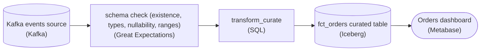

*The check sits inline between the source and `transform_curate`: every event passes through it, and a failed assertion stops the run before drift reaches `fct_orders`.*

| Pitfall: Silent absorption is the failure mode, not a hard crash |
| --- |
| Each of the three drifts is individually survivable, which is exactly why nobody noticed. The rename from `customer_id` to `user_id` made downstream joins match nothing (or match `NULL` to `NULL`), so order counts quietly fell. The dropped required column became `NULL`-filled, so aggregates that filtered on it silently lost rows. And a number arriving as the string '42' either coerced, truncated, or sorted as text, corrupting sums. None of these throw. A pipeline without a boundary contract treats 'wrong shape' as 'new normal'. |

1. **Assert the column exists, and you catch the rename**

   An existence assertion on `customer_id` fails the instant the producer renames it to `user_id`, because the expected name is simply gone. This is the check that would have fired on day one of the incident. Renames are the most common breaking change and the cheapest to catch, since you only need the declared column list, not the data.

2. **Assert the type, and you catch strings-for-numbers**

   A type assertion rejects the row where a numeric field arrives as '42'. Without it, the coercion happens deep inside `transform_curate` where it looks like a math bug, not a contract breach. Checking type at the boundary localizes the blame to the producer, where it belongs.

3. **Assert nullability and range, and you catch the dropped column and the garbage values**

   A not-null assertion on the required column fails when the producer drops it and every row surfaces as `NULL`. A range assertion (say, order amounts must be non-negative and below a sane ceiling) catches values that pass the type check but are still nonsense. Together, existence, type, nullability, and range are the four faces of one schema contract.

| Real world: Adopt it incrementally, at the boundary you don't control |
| --- |
| In production you put this check exactly where a schema you don't own crosses into tables you do, which is the source-to-curated edge. Great Expectations, dbt tests, and Soda all express these same four assertions and can be added one table at a time, so you don't need a big-bang rollout. Failing the run loudly matters as much as the check itself: a stopped pipeline beats a green dashboard built on corrupted rows. |

**Follow-up questions**

1. Should a failed validation halt the whole run, or divert only the bad rows and let the clean ones through?\
   *Tests fail-fast vs. quarantine trade-offs, and whether partial loads are acceptable for this table.*
2. The producer renames `customer_id` to `user_id` on purpose next quarter. How do you evolve the contract without a false alarm?\
   *Separates a breaking change from a coordinated, versioned schema evolution.*
3. Who owns the range thresholds, and how do you keep them from going stale as the business grows?\
   *Tests whether value-range assertions are treated as living contract rather than a one-time guess.*

</details>


<br>

### Exercise 2 of 2

**● TASK**

One run's order_amount_usd mean fell from its usual 84 dollars (stddev near 32) to 71, yet every row passed the null, range, uniqueness and schema checks. Add a distributional check that gates each run before it lands in the orders table, comparing a summary statistic against a rolling historical baseline. Name the check for its statistic, baseline window and firing threshold.

**Starting canvas** (already placed for you):

- Kafka order_events source (source, Kafka)
- transform_orders (transform, SQL)
- Iceberg fct_orders (storage, Iceberg)
- Revenue dashboard (consumer, Grafana)

<details>
<summary><strong>Solution</strong></summary>

#### Catching valid-but-wrong data

A **distributional check** watches the shape of a whole run rather than any single row. On the bad run every row-level guard passes: `order_amount_usd` is never null, never duplicated, the schema is intact, and 71 dollars is a perfectly plausible order. The drift only appears when you summarize the run (mean, stddev, quantiles, category mix), compare those numbers to a rolling historical baseline, and fire when the gap crosses a threshold.

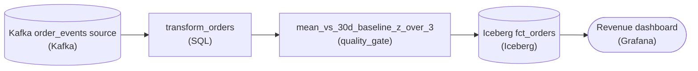

*The check gates each run between `transform_orders` and `Iceberg fct_orders`, so a shifted run never reaches the revenue dashboard.*

| Pitfall: A range check can't see a shifted mean |
| --- |
| The tempting fix is a tighter bound, such as rejecting rows outside 20 to 200 dollars. Every value on the bad run still falls inside any sane range, so the check stays green while the mean drifts. Row-level predicates test each value against a fixed rule and have no memory of what a run usually looks like. |

The check computes this run's mean, then takes the mean and stddev of the trailing 30 days of run means as its baseline. The distance is a z-score: `(run_mean - baseline_mean) / baseline_stddev`. The 32-dollar stddev describes single orders. Daily means spread far less, so a drop from 84 to 71 lands well past `|z| > 3` and trips. The name `mean_vs_30d_baseline_z_over_3` carries the whole contract (the **statistic**, the baseline window and the threshold), so anyone reading the DAG knows what it watches and when it fires.

| Real world: One check per statistic, not one mega-check |
| --- |
| Production pipelines keep these as separate stages: one for the mean, one for a quantile, one for category mix. Split checks mean an alert names its own cause, and you can tune each threshold independently. A coupon bug shifts the mean; a new locale shifts the category mix. |

**Follow-up questions**

1. A promo day legitimately drops the mean. How do you keep the check from crying wolf every campaign?\
   *Separating seasonality from anomaly, for example a same-weekday baseline or excluding known campaign days.*
2. What statistic would catch a bug that hits one small segment and leaves the overall mean near 84?\
   *Pushes toward per-segment means or quantile checks over a single global mean.*

</details>


<br>

---

## Distributional Checks

Schema rules judge each row by itself, and some failures leave every row valid while the batch as a whole is wrong. A city's feed switches to cents. A release starts labelling cash payments as card. Distributional checks compute a few summary numbers over the whole batch and compare them with the same numbers from past batches, which form the baseline.


<br>

### Four summaries and what each notices

| Summary | Moves when | Barely moves when |
| --- | --- | --- |
| Mean | a few rows turn extreme, or every value shifts | values trade places and the total holds |
| Standard deviation | the spread widens, as when cents mix with dollars | every value shifts by the same amount |
| p50 and p95 | the typical value or the top 5% moves | fewer than 1% of rows turn extreme |
| Category mix | a category's share grows or shrinks | the row count changes and every share holds |


<br>

### Picking the baseline

Fares on a Tuesday differ from fares on a Saturday, so comparing each day with yesterday flags every weekly swing. Compare each day with the same weekday across the previous 4 weeks instead. That gives 4 baseline values per summary, and from them a baseline mean and a baseline standard deviation of the summary itself. Keep the 2 standard deviations apart: the spread of fares inside a day is a summary you track, and the spread of a summary across baseline days tells you how much daily wobble is normal.


<br>

### Worked example: the cents bug

| Day | Mean fare (USD) | Median fare (USD) |
| --- | --- | --- |
| Tue 2026-09-22 | 14.10 | 11.70 |
| Tue 2026-09-29 | 14.35 | 11.85 |
| Tue 2026-10-06 | 13.95 | 11.75 |
| Tue 2026-10-13 | 14.40 | 11.90 |
| Baseline mean | 14.20 | 11.80 |
| Today, Tue 2026-10-20 | 15.89 | 11.80 |

The baseline standard deviation of the daily mean is 0.21, and today's mean sits 1.69 above the baseline mean, 8 baseline standard deviations out. That distance is a z-score, and 3 is a common starting threshold. The median held at 11.80. About 0.12% of today's 4,000,000 trips came from a city sending fares in cents, so a fare of 14.20 arrived as 1420. Too few rows changed to shift the median, and their size was enough to drag the mean up. Most cent values still sat under 2000, so the range rule passed them.

- **4,800** — trips that arrived in cents
- **+11.9%** — rise in today's mean fare

One query computes every fare summary for today and the 4 baseline Tuesdays. `approx_percentile` returns a quantile within a small error, far cheaper than an exact sort over millions of rows. In production, each day's results go into a metrics table, so the next check reads 4 stored rows instead of rescanning 4 partitions.

```sql
SELECT
  ds,
  AVG(fare_usd) AS mean_fare,
  STDDEV(fare_usd) AS stddev_fare,
  APPROX_PERCENTILE(fare_usd, 0.5) AS p50_fare,
  APPROX_PERCENTILE(fare_usd, 0.95) AS p95_fare
FROM staging.trips
WHERE ds IN (
  DATE '2026-09-22',
  DATE '2026-09-29',
  DATE '2026-10-06',
  DATE '2026-10-13',
  DATE '2026-10-20'
)
GROUP BY ds
ORDER BY ds
```

**From 2026-10-27, every fare_usd includes an 8% tax, a factor of 1.08. Which summaries shift?**

- **A.** Only the mean, since quantiles and spread ignore a change to every row.
- **B.** Only the payment mix, since a tax changes how riders choose to pay.
- **C.** None, since every row scales by the same factor and the shape holds.
- **D.** Mean, standard deviation, p50 and p95 all rise 8%, and the payment mix holds.

<details>
<summary>Solution</summary>

**D.** Mean, standard deviation, p50 and p95 all rise 8%, and the payment mix holds.

Right. Scaling every value moves every numeric summary; category shares don't depend on fares.

**Why the others are wrong**

- **A.** A uniform 8% raise moves every quantile and the spread by 8% too.
- **B.** The tax changes each fare's value and relabels no payment type.
- **C.** Z-scores compare levels, and a mean of 15.34 sits roughly 5 baseline deviations above 14.20.

</details>


<br>

### Category mix: compare shares

A categorical column has no mean. For each category, take the absolute difference between today's share and its baseline share. Sum those differences and halve the total. The result, total variation distance, is the fraction of rows that would have to switch category to turn one mix into the other.

| payment_type | Baseline share | Today | Absolute difference |
| --- | --- | --- | --- |
| card | 72% | 81% | 9 points |
| cash | 18% | 9% | 9 points |
| wallet | 10% | 10% | 0 points |
| Total variation distance |  |  | 9 points (18 halved) |

Against a 5-point threshold, this day fails. Its trip count was normal, so the row count gate stayed green: cash trips still happened, and a new app release recorded them as card.

> **TIP**
>
> Put a floor under each baseline standard deviation, such as 1% of the baseline mean. Four baseline days can produce a tiny standard deviation by luck, and ordinary wobble then scores above 3.

**A check compares each day's mean distance_km with the day before. It fires every Saturday and Monday, and on no other day. What fixes it?**

- **A.** Compare each day with the same weekday over the previous 4 weeks.
- **B.** Keep the day-before comparison and raise the z-score threshold to 6.
- **C.** Switch from mean to median so the weekly pattern drops out.
- **D.** Pool the last 28 days into one baseline for a steadier deviation.

<details>
<summary>Solution</summary>

**A.** Compare each day with the same weekday over the previous 4 weeks.

Right. Saturdays get judged against Saturdays, so the weekly pattern stops looking like a shift.

**Why the others are wrong**

- **B.** A looser threshold hides the weekly swing and every smaller real shift.
- **C.** The weekly pattern moves the whole distribution, so the median swings too.
- **D.** Pooling weekdays with weekends inflates the deviation, so weekday shifts get lost in it.

</details>


<br>

---

## Pipeline Architecture

### Exercise 1 of 2

**● TASK**

Add a referential-integrity check node that reads both Snowflake fct_orders and dim_customer and isolates the orders whose customer_id has no match in the dimension, since Snowflake does not enforce that foreign key. Wire an error_path edge from the check to a separate quarantine store outside the warehouse, such as an S3 bucket, so the flagged rows land there and never reach the Looker sales dashboard.

**Starting canvas** (already placed for you):

- Kafka order_events source ()
- PostgreSQL customers source ()
- transform_fct_orders ()
- transform_dim_customer ()
- Snowflake fct_orders (some rows reference customer_ids missing from dim_customer) ()
- Snowflake dim_customer ()
- Sales dashboard (joins fct to dim; sees inconsistent answers) ()

<details>
<summary><strong>Solution</strong></summary>

#### A foreign key the warehouse won't enforce

Snowflake accepts a foreign key declaration but never enforces it, so **referential integrity** becomes a check you run yourself. The quality gate you placed between `fct_orders` and `dim_customer` asks one question of every fact row: does its `customer_id` exist in the dimension right now? Matched rows continue to the dashboard. Orphans leave on an error path to a quarantine store outside the warehouse. Every row takes exactly one of those 2 routes.

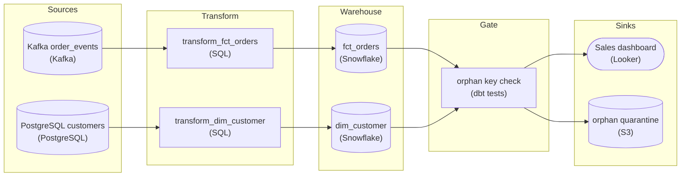

*The gate reads `fct_orders` and `dim_customer`, passes matched orders to Looker, and sends orphans on an error path to S3.*

| Pitfall: An inner join hides orphans instead of catching them |
| --- |
| Letting the dashboard `INNER JOIN` `fct_orders` to `dim_customer` looks like a fix, but it only makes the problem invisible. The join silently drops every orphaned order, sales understate by exactly those rows, and nothing records that it happened. The check exists to make orphans **visible and countable**. |

**What the gate evaluates**

```sql
/* valid rows: keep flowing to the dashboard */
SELECT f.*
FROM fct_orders f
JOIN dim_customer d
  ON f.customer_id = d.customer_id;

/* orphaned rows: the error path to quarantine */
SELECT f.*, CURRENT_TIMESTAMP AS quarantined_at
FROM fct_orders f
LEFT JOIN dim_customer d
  ON f.customer_id = d.customer_id
WHERE d.customer_id IS NULL;
```

*`LEFT JOIN` plus `WHERE d.customer_id IS NULL` is an anti-join: it returns exactly the fact rows that have no dimension match.*

| Real world: Quarantine is a holding pen, not a graveyard |
| --- |
| Many orphans are early, not wrong. CDC can land an order before its `dim_customer` row, and a rebuild can leave a temporary gap. Re-run the check on quarantined rows each cycle, and the rows whose dimension has since arrived go back onto the good path. Keeping the pen in S3 rather than in a Snowflake table means no consumer can read a half-baked row by accident. |

**Follow-up questions**

1. How would you drain `orphan quarantine` once the missing `dim_customer` rows land?\
   *Treats late-arriving data as replayable.*
2. If an order is quarantined and then replayed, how do you make sure it ends up in exactly one place?\
   *Idempotency on the error path.*
3. What orphan rate should raise an alert instead of just parking rows?\
   *A rising count points to a broken dimension load.*

</details>


<br>

### Exercise 2 of 2

**● TASK**

The row-count check in this pipeline uses one hard-coded threshold: it passes on test fixtures, which load the same small batch every day, and fires on production's live traffic with its quiet weekends and holidays. Replace it with a single row-count check, still gating loads into the orders warehouse, whose name states that the assertion is shared by dev and prod while its threshold comes from config keyed on the environment.

**Starting canvas** (already placed for you):

- Kafka order events (source, Kafka)
- transform orders (transform, SQL)
- row-count check (single hard-coded threshold; passes in test, fires in prod) (quality_gate, Great Expectations)
- daily orders warehouse (storage, warehouse)
- revenue dashboard (consumer, Metabase)

<details>
<summary><strong>Solution</strong></summary>

#### One assertion, an environment-keyed threshold

Environment-aware thresholds split a data-quality check into 2 parts that change at different rates. The assertion is written once and is identical in `dev` and `prod`. The bound it compares against is loaded from config keyed on the environment. The starter's check fused the two, baking one row-count floor into the check itself, so test and production effectively ran different rules. That is why it stayed green on fixtures and went red every morning in production.

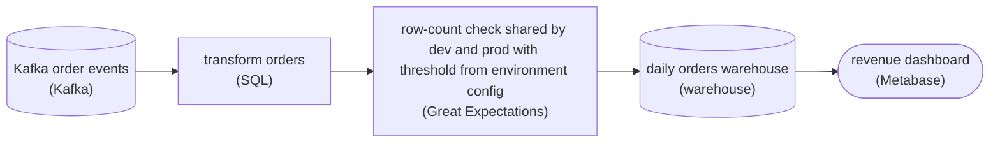

*Same position in the flow, same assertion. Only the threshold the check reads changes per environment.*

| Pitfall: A floor tuned in test fires on quiet days in prod |
| --- |
| Test fixtures load the same rows every run, so a hard-coded floor like `row_count >= 1000` is always satisfied there. Production carries live traffic with calendar effects (a quiet Sunday, a holiday) that legitimately dip below a floor tuned to a busy weekday. The check fired on **volume variance**, not on data quality. Nothing was broken; the number was simply wrong for the environment it ran in. |

**The shared assertion with an environment-keyed threshold**

```python
# config, not code, is what differs per environment
THRESHOLDS = {
    "dev":  {"min_rows": 10},      # fixtures load a fixed small batch
    "prod": {"min_rows": 40_000},  # calibrated to observed weekday-low traffic
}

# the assertion is identical everywhere; only the bound is sourced
min_rows = THRESHOLDS[env]["min_rows"]
expect_row_count_to_be_between(min_value=min_rows)
```

*The rule is written once; `env` selects the bound.*

| Key insight: A threshold copied from live output never fires |
| --- |
| Do not quiet a noisy check by tuning its threshold to whatever the producer is currently emitting, for example by comparing against yesterday's count. That version passes in production every day, which feels like success, but it means the check can never detect drift. Choose the bound from a stable expectation for the environment, not from the live output you are supposed to be validating. |

**Follow-up questions**

1. If weekends legitimately fall below the weekday floor, what does a single `min_rows` miss?\
   *Leads toward day-of-week thresholds that are still sourced from config, not hard-coded exceptions in the assertion.*
2. You add a `staging` environment that mirrors prod traffic. What has to change in the pipeline?\
   *Checks that the fix scales: adding an environment should mean only a new `THRESHOLDS` key, never a new branch in the check.*
3. How would you catch an over-supply, where `row_count` is far above expected, and not just a shortfall?\
   *Extends the shared assertion to a two-sided `min`/`max` bound, with both values keyed on the environment.*

</details>


<br>

---

## Referential Integrity in DW

In a warehouse, fact rows point at dimension rows through keys. On a trip row, `rider_id` should match a row in its dimension table, and so should `driver_id` and `city_id`. A fact key with no matching dimension row is an orphan. Orphans pass every schema rule, since `driver_id` 90412 is a valid positive BIGINT, and they surface only when someone joins.

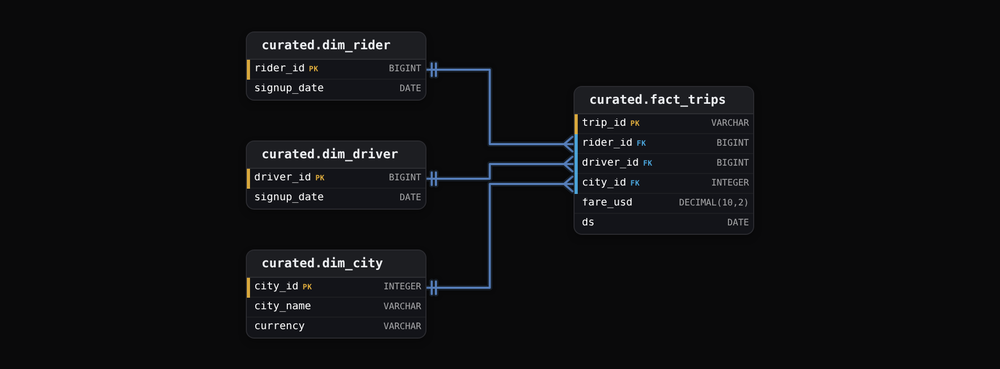


<br>

### Why orphans vanish quietly

Most dashboards join facts to dimensions with an inner join, which keeps only rows that match on both sides. Orphan trips drop out of every revenue chart with no error, the fare total comes in low, and nothing in the query says why.


<br>

### Finding orphans: LEFT JOIN plus a NULL filter

A LEFT JOIN keeps every fact row and fills the dimension's columns with NULL where no match exists, so filtering on the dimension key being NULL leaves exactly the orphans. The extra condition `t.driver_id IS NOT NULL` keeps NULL fact keys out: a trip with no driver already broke the nullability rule, and counting it here would report one defect under 2 names.

```sql
SELECT
  t.trip_id,
  t.driver_id
FROM staging.trips AS t
LEFT JOIN curated.dim_driver AS d
  ON t.driver_id = d.driver_id
WHERE t.ds = DATE '2026-10-20'
  AND t.driver_id IS NOT NULL
  AND d.driver_id IS NULL
```

staging.trips, 2026-10-20

| trip_id | driver_id |
| --- | --- |
| t-101 | 3301 |
| t-102 | 3302 |
| t-103 | 90412 |
| t-104 | NULL |
| t-105 | 3301 |
| t-106 | 90577 |

curated.dim_driver

| driver_id | signup_date |
| --- | --- |
| 3301 | 2025-03-14 |
| 3302 | 2026-01-09 |
| 3315 | 2026-06-30 |

The query returns t-103 and t-106, and t-104 is left to the nullability rule. An inner join on these 6 trips returns 3 and drops t-103, t-104 and t-106 with no error. Report orphans as a rate over rows with a non-NULL key, so a single threshold fits a quiet Sunday and a holiday peak.

**A teammate moves the NULL test into the join, ON t.driver_id = d.driver_id AND d.driver_id IS NULL, and drops it from WHERE. What does the query return?**

- **A.** The same 2 orphans, since the test means the same in either clause.
- **B.** Every trip that day with a non-NULL driver_id, all with NULL driver columns.
- **C.** No rows, since a fact key can never equal a NULL dimension key.
- **D.** Only the trips that match a driver, as an inner join returns.

<details>
<summary>Solution</summary>

**B.** Every trip that day with a non-NULL driver_id, all with NULL driver columns.

Right. The ON condition is never true, so the LEFT JOIN keeps every fact row unmatched.

**Why the others are wrong**

- **A.** In a LEFT JOIN, ON decides what matches and WHERE decides what survives.
- **C.** That holds for an inner join; a LEFT JOIN keeps fact rows with no match.
- **D.** Matching needs the ON condition true, and with d.driver_id IS NULL added it never is.

</details>


<br>

### Four ways to handle an orphan

| Strategy | The orphan row | Dashboards see | Fits when |
| --- | --- | --- | --- |
| Block | the whole load stops until the dimension is fixed | yesterday's data, unchanged | an orphan means a bug, and the dimension is small and fully known |
| Quarantine | moves to a quarantine table while the rest loads | totals missing the orphans | orphans are rare and someone triages the table |
| Placeholder | key set to -1, pointing at an Unknown row; the original id stays in a column like `driver_id_raw` so a repair job can re-point it | complete totals, part under Unknown | totals must be complete and the attribute can wait |
| Defer | held back and re-joined on each later load, up to a limit | the row once its dimension row lands | the dimension row arrives later from a slower source |

One strategy per key on curated.fact_trips

- **city_id: block** *small, fully known dimension*\
  The city dimension holds a few hundred rows and changes when the company launches a city. An unknown city id is a producer bug, and its fares can't be taxed or converted correctly.
- **driver_id: defer for 2 loads, then quarantine** *dimension lands after the facts*\
  Trips load at 02:00 for the previous day, and the driver dimension refreshes from the onboarding system at 06:00. A driver who signed up and drove on the same day is an orphan at 02:00 and matches the next night. Still orphaned after 2 loads means a real defect.
- **rider_id: placeholder** *totals matter more than the label*\
  A rider who deletes an account leaves dim_rider, yet trips taken before the deletion can still arrive and still count toward revenue. Mapping those trips to -1 keeps totals whole and labels the rider Unknown.

> **TIP**
>
> A deferred row is written by a later run than the one that read it. Write it with the same replace-by-key pattern as every other row, keyed on `trip_id`, so rerunning either night can't insert the trip twice.

**A new column, promo_id, points at dim_promo, which syncs every 6 hours, so orphan promo ids appear most mornings and match by afternoon. Finance needs complete fare totals by 07:00. Which strategy fits?**

- **A.** Block the load each morning until the promo dimension catches up.
- **B.** Quarantine the orphan rows and have someone triage them daily.
- **C.** Defer the orphan rows with no time limit, re-joining them each load.
- **D.** Load orphans with the -1 placeholder, then re-point them from the raw id.

<details>
<summary>Solution</summary>

**D.** Load orphans with the -1 placeholder, then re-point them from the raw id.

Right. Totals are complete at 07:00, and a repair job fixes attribution by afternoon.

**Why the others are wrong**

- **A.** That holds every fare past 07:00 for an attribute finance can do without.
- **B.** Quarantined rows leave the totals, so the 07:00 numbers run low.
- **C.** Deferred rows miss 07:00, and with no limit a real defect waits forever.

</details>


<br>

---

## Pipeline Architecture

### Exercise 1 of 2

**● TASK**

Extend the starter into a quality suite for fct_customer_events, a Snowflake table of two million events a day. Add one quality gate per pillar, each reading the table and naming its threshold: freshness (MAX(event_timestamp) within 2 hours), volume (versus a day-of-week baseline), distribution (event_type mix within 5 points) and schema (columns, types, nullability). Record column lineage in a catalog, and page on-call from every gate.

**Starting canvas** (already placed for you):

- Kafka customer_events source (~2M/day, four event_types) (source, Kafka)
- transform_fct_customer_events (transform, SQL)
- Snowflake fct_customer_events curated table (storage, Snowflake)
- Dashboard consumer (consumer, Metabase)
- Churn model consumer (consumer, Jupyter)
- Billing report consumer (consumer, API)

<details>
<summary><strong>Solution</strong></summary>

A data quality suite splits one trusted table into named, independent pillars (freshness, volume, distribution, schema), each with its own assertion and threshold. That decomposition is what you wired around `fct_customer_events`. A single 'is the table OK?' check only tells you something is wrong; four separate gates tell you **which** thing is wrong, and each pages on its own.

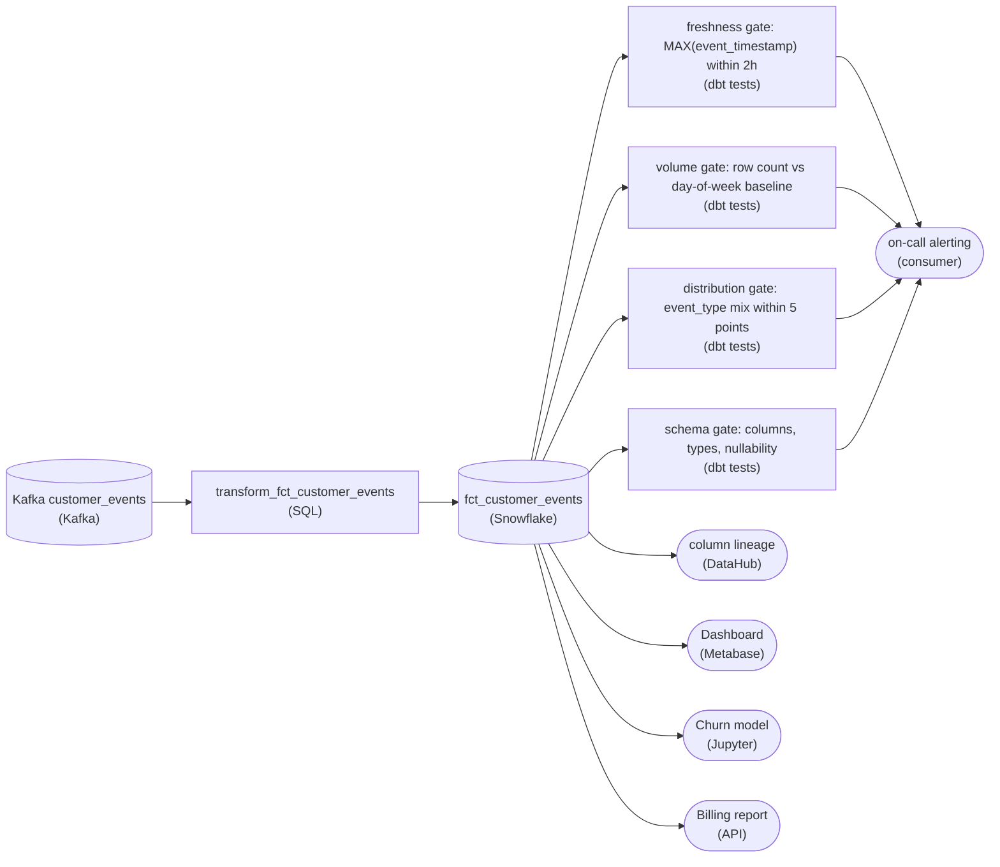

*The curated `fct_customer_events` table fans into four independent quality checks; each pages on-call through the alerting consumer when it fails, and `DataHub` records column-level lineage.*

| Key insight: One failure mode per gate |
| --- |
| Freshness catches a stalled load, volume a partial load, distribution a shift in the event mix, schema an upstream rename. Bundle them into one assertion and you lose the diagnosis: a red light with no label. Four `quality_gate` nodes mean the page that wakes on-call already names the pillar that broke. |

Every gate reads from `fct_customer_events`, the landed curated table, not the Kafka stream or the transform. You validate what actually got written after `transform_fct_customer_events` runs. Assert on the stream instead and the check stays green while the load silently drops half its rows.

| Pitfall: Yesterday is the wrong baseline |
| --- |
| The volume gate compares today's count to a day-of-week baseline, not to yesterday. SaaS traffic sags on weekends, so a Saturday checked against Friday pages every week for a healthy load, and on-call learns to ignore it. Anchor to the same weekday's recent history and the gate stays quiet until something is genuinely off. |

**Follow-up questions**

1. The freshness gate uses `MAX(event_timestamp)` within 2 hours. What breaks if one of the four event types can legitimately arrive hours late?\
   *Late data: a table-wide freshness bound hides a per-`event_type` staleness problem.*
2. How would the schema gate accept an additive new column without paging, while still blocking a type change or a dropped column?\
   *Schema evolution: separating backward-compatible changes from breaking ones.*

</details>


<br>

### Exercise 2 of 2

**● TASK**

Build a data quality program over the existing medallion flow with gates at three layers: validate the producer's schema where raw lands, check value distributions on the curated Iceberg tables, and confirm every fct_orders key resolves to a dim_customer row before the serving mart is built. Route block-class failures to an on-call paging destination and warn-class failures to a non-paging notification channel. The Looker dashboard keeps reading from the Snowflake daily_orders mart.

**Starting canvas** (already placed for you):

- Kafka order_events source (source, Kafka)
- PostgreSQL customers source (source, PostgreSQL)
- transform_curate (transform, SQL)
- transform_dim_customer (transform, SQL)
- Iceberg fct_orders curated (storage, Iceberg)
- Iceberg dim_customer (storage, Iceberg)
- transform_serve (transform, SQL)
- Snowflake daily_orders mart (storage, Snowflake)
- Revenue dashboard (consumer, Looker)

<details>
<summary><strong>Solution</strong></summary>

#### Quality gates as first-class nodes

The thing you just built is a **data quality program**: a set of checks wired into the DAG as gates at each medallion boundary, not a spreadsheet someone reviews after the numbers already look wrong. The medallion shape hands you three natural places to check, and each one wants a different kind of check. Where raw lands you validate the producer's contract; on the curated Iceberg tables you watch the value distribution; and before the serving mart you confirm referential integrity across the 2 curated tables. That is why 'ad-hoc or absent' was the real defect here: the checks existed nowhere the pipeline could act on them.

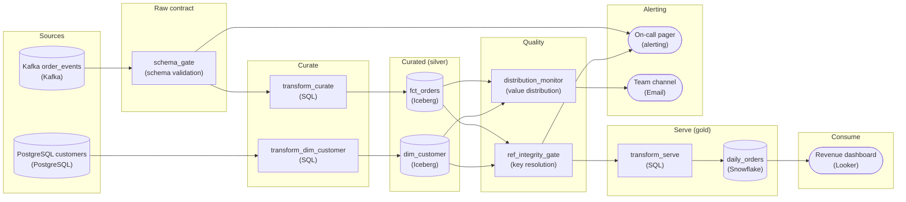

*Three gates on the medallion flow: a blocking schema check at raw landing, a warning distribution monitor on the curated Iceberg tables, and a blocking key-resolution gate that `transform_serve` depends on. Block-class failures page on-call; warn-class failures go to an email channel.*

1. **Validate the producer's schema where raw lands**

   Put `schema_gate` on the edge out of the `order_events` Kafka source, before `transform_curate` ever reads it. This is where the drifting producer shows up first: a renamed field, a widened type, a dropped column. Because the same producer slips every quarter, catching it at the contract boundary means the bad shape never reaches curated. This is 'block' class, so its failure edge goes to the on-call pager: everything downstream of a broken contract is suspect.

2. **Watch the value distribution on the curated tables**

   Point `distribution_monitor` at `fct_orders` and `dim_customer` after they are written. Schema can be perfectly valid while the values quietly rot: revenue amounts trending toward zero, a spike in nulls, row counts halving overnight. That is the 'quiet drift' the title names. A shifted distribution is a signal to investigate, not proof the data is wrong, so it is 'warn' class and posts to the non-paging channel.

3. **Gate the serving mart on referential integrity**

   Before `transform_serve` builds `daily_orders`, run `ref_integrity_gate`: every `customer_id` in `fct_orders` must resolve to a row in `dim_customer`. Orphan keys are exactly how revenue silently understates, since an order whose customer never joined drops out of the customer-keyed rollup. The load-bearing move is that this check is a **dependency edge into** `transform_serve`, not a monitor sitting beside it. The mart does not build until the check passes. Block class, page on-call.

| ✕ Block class to the pager | ✓ Warn class to the channel |
| --- | --- |
| Schema drift and orphan keys halt the DAG and page on-call. These are correctness failures: the mart would be wrong, so publishing it is worse than not publishing at all. `schema_gate` and `ref_integrity_gate` route here. | A shifted distribution posts to the non-paging channel and lets the run continue. It might be a real regression or a legitimate business swing, so a human decides. Paging on every wobble is how you train on-call to ignore the pager. `distribution_monitor` routes here. |

| Pitfall: A monitor beside the mart is not a gate |
| --- |
| The common miss is wiring the key check to read `fct_orders` and fire an alert while `transform_serve` runs anyway on its own schedule. By the time anyone reads the alert, `daily_orders` is already published with understated revenue and Looker is showing it. A gate has to sit ON the dependency path: `transform_serve` takes `ref_integrity_gate` as an upstream, so a failure blocks the build instead of merely describing it after the fact. |

**Follow-up questions**

1. Where does the expected range for the `fct_orders` revenue distribution come from?\
   *tests fixed thresholds vs a rolling statistical baseline*
2. The schema gate blocks the whole feed on one bad field. How would you quarantine only the offending records and let the rest flow?\
   *dead-letter / quarantine pattern instead of all-or-nothing*
3. If `dim_customer` is late, `ref_integrity_gate` blocks and `daily_orders` never refreshes. Should the mart serve yesterday's partition instead?\
   *freshness vs correctness tradeoff at the serving layer*

</details>


<br>

---

## Test vs Prod: Same Checks

A check that runs only in production meets real data for the first time at 02:00, on the night it matters. Running the same suite in a test environment catches a broken rule, or a transform change that breaks a good one, before it ships. Test data differs from prod data in size and completeness, so a suite tuned for one environment can fail, or pass, for the wrong reasons in the other.


<br>

### Which rules travel unchanged

| ✓ Same rule, same threshold | ✗ Same rule, tuned threshold |
| --- | --- |
| • Required fields and types<br><br>• Nullability<br><br>• Ranges and allowed sets<br><br>• Orphan detection, once test data is sampled by key | • Row count bounds<br><br>• Baselines for z-score checks<br><br>• Tight category-mix bands |

The left column judges each row by itself, whatever its neighbours look like. The right column judges the batch, and a batch summary depends on how big the batch is and how it was built.


<br>

### Row counts: a number that can't travel

Prod loads 4,000,000 trips a day; the test environment loads a 1% sample of about 40,000. A gate written as `min_rows: 3500000` fails every test run. Faced with a check that always fails in test, teams turn it off there, and within a month the test copy of the suite has drifted from prod. Keep 1 rule and move only the numbers into a per-environment block:

```sql
table: staging.trips
checks:
  - name: daily_row_count
    rule: row_count
    authority: block
    thresholds:
      prod:
        min_rows: 3500000
        max_rows: 4800000
      test:
        min_rows: 35000
        max_rows: 48000
  - name: payment_mix
    rule: category_distance
    field: payment_type
    authority: warn
    thresholds:
      prod:
        max_points: 5
      test:
        max_points: 5
```

Authority stays identical across environments. If a rule blocks in prod and only warns in test, a change that trips it ships on a green test run and stops the prod load the next night.

**A teammate adds authority_override: {test: warn} to daily_row_count so test runs stop failing. What does that break?**

- **A.** Nothing, since test counts come from a sample and never reach a consumer.
- **B.** Prod starts warning too, since authority is shared across the 2 environments.
- **C.** A change that breaks the count ships on a green test run, then blocks prod.
- **D.** The test row count stops being computed and leaves the metrics table.

<details>
<summary>Solution</summary>

**C.** A change that breaks the count ships on a green test run, then blocks prod.

Right. An always-failing test gate needs a tuned test threshold, with authority left alone.

**Why the others are wrong**

- **A.** The test run is a rehearsal, and its job is to fail where prod would.
- **B.** The override names only test, so prod keeps blocking.
- **D.** Warn still computes and records the count; it only stops failing the run.

</details>


<br>

### Small samples wobble more

Many teams also keep a fixture, a hand-built file of 2,000 rows that loads in seconds. Summaries over fewer rows wobble more by chance. For a category share p measured on n rows, the typical chance wobble is `sqrt(p * (1 - p) / n)`. For the 10% `wallet` share:

| Environment | Rows | Typical wobble of a 10% share |
| --- | --- | --- |
| prod | 4,000,000 | 0.015 points |
| test sample | 40,000 | 0.15 points |
| fixture | 2,000 | 0.67 points |

The 5-point mix threshold is more than 7 times the fixture's wobble, so it holds everywhere, which is why the file above uses 5 in both blocks. A 0.5-point band that suits prod would fire on the fixture by chance on many runs. For z-score checks, build the test baseline from earlier test runs on the same sample. A baseline taken from prod's steadier numbers would score the sample's ordinary wobble as a shift.


<br>

### Sample by key so joins still resolve

Sampling 1% of trips and, separately, 1% of drivers leaves roughly 99% of sampled trips pointing at drivers the test dimension lacks. The orphan check fires on nearly every row, someone raises the test threshold until it stops, and the check is dead in test. Sample by key instead: pick 1% of drivers, copy every trip they drove, then copy the rider and city rows those trips reference. Every test key now resolves, so an orphan in test means what it means in prod.


<br>

### Fixtures prove the checks fire

A check that has never failed might be broken. The fixture plants 1 known bad row per rule: a negative fare, a `status` of "pending", a `driver_id` with no dimension row. The test run expects each rule to report exactly its planted row, so a rule that reports zero has a config bug, found before it reaches prod.

**Which band around the baseline wallet share will likely fire on the 2,000-row fixture when nothing is wrong?**

- **A.** A band of 0.5 points, smaller than a single typical wobble.
- **B.** A band of 2 points, about 3 typical wobbles wide.
- **C.** A band of 5 points, the mix threshold the file uses.
- **D.** A band of 10 points, double the file's mix threshold.

<details>
<summary>Solution</summary>

**A.** A band of 0.5 points, smaller than a single typical wobble.

Right. Chance alone moves the share roughly 0.67 points, so this fires on many clean runs.

**Why the others are wrong**

- **B.** At 3 wobbles wide, chance firing is rare, though a run can still reach it.
- **C.** Five points is over 7 wobbles, so chance almost never reaches it.
- **D.** Fifteen wobbles wide, it stays quiet on clean runs and on many real shifts.

</details>


<br>

---

## Pipeline Architecture

### Exercise 1 of 1

**● TASK**

A logistics partner drops about 40,000 shipment rows per hour as files into a landing area, and a delivery dashboard reads from the warehouse. Add a schema check between the landing area and the warehouse that asserts the partner's declared shape: every required column present, weight numeric and between 0 and 30,000 kg, ship time never null. Send rows that fail to a dead-letter store instead of the warehouse.

<details>
<summary><strong>Solution</strong></summary>

#### The schema check is the partner's contract, enforced

Schema validation turns the partner's promise into something the pipeline enforces on every row. Each landed file is checked against the declared shape: required columns exist, weight is numeric and inside 0 to 30,000 kg, and ship time is never null. At about 40,000 rows an hour, even a one percent break rate is 400 bad rows an hour that would otherwise reach the delivery dashboard.

1. **Put the check where nothing can skip it**

   The schema check sits on the only path from the landing area into the warehouse. If it hangs off to the side, or runs after the load, the dashboard has already read the bad rows by the time anyone looks. A row that fails is a row the pipeline should not have produced, so it never gets the chance.

2. **Decide per row, not per file**

   One malformed weight should not hold back 39,999 good shipments. The check splits each file: conforming rows continue to the warehouse, failing rows go to the dead-letter store along with the assertion they broke.

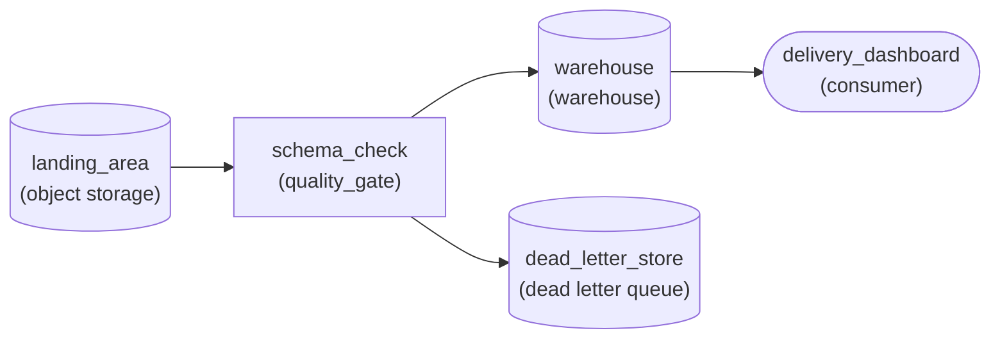

*Files land, pass through the schema check, and split: conforming rows to the warehouse, failing rows to the dead-letter store.*

| Pitfall: Silently dropping bad rows hides the break |
| --- |
| Filtering failures out and moving on keeps the dashboard clean for a week. Then the partner changes a field, a third of the rows vanish, and there is no trace of why. The dead-letter store is the evidence you bring to the producer: these rows, this assertion, this file. |

| Key insight: Writing the check exposes every ambiguity |
| --- |
| Pinning a range on weight forces the question of kilograms or pounds. Asserting ship time is never null forces UTC versus local time, and whether a blank means missing. Settle those with the partner at integration time, before the dashboard depends on the answer. |

**Follow-up questions**

1. The partner adds an optional column next month. Should the check reject those files?\
   *Separates columns the contract requires from additions it allows.*
2. Half of one hour's file fails the check. What should happen besides the dead-letter write?\
   *Acting on failures: when a row-level split should escalate to an alert or a stopped load.*

</details>


<br>

---

## Quality Suite for Events

An app's events table records every screen view and tap, and every search too. Say `app_events` holds 1.2 billion rows a day, landing in hourly partitions. Its columns are `event_id`, `user_id`, `event_name`, `event_ts`, `platform` and `app_version`, plus `properties`, which is a JSON string. Its suite covers 5 pillars, each a question about the data, and puts each check at the boundary where it runs cheaply and its action protects the most.

The 5 pillars

- **Freshness**\
  Did the newest data arrive on time?
- **Volume**\
  Did the expected number of rows arrive, each once?
- **Schema**\
  Does each row carry its required fields, with the right types and values in range?
- **Distribution**\
  Do the batch's summaries match their baseline?
- **Relationships**\
  Do the keys resolve to dimension rows?


<br>

### Where each check runs

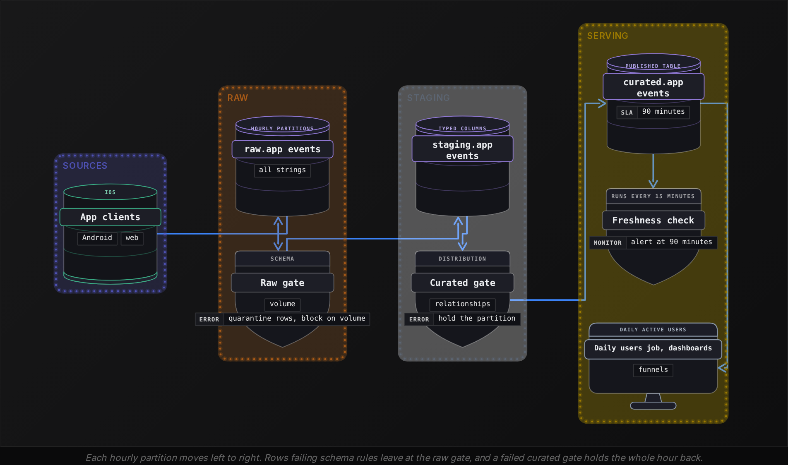

Schema rules run between raw and staging because they need the raw strings: once a value is cast into a typed column, the text that failed to parse is gone. Distribution and relationship checks run between staging and curated, where values are already typed and the checks can read dimension tables and stored baselines. Freshness runs against the published table, since consumers care about the age of what they can query.


<br>

### The suite, check by check

| Pillar | Check | Threshold | On failure | Boundary |
| --- | --- | --- | --- | --- |
| Freshness | age of newest `event_ts` in curated | 90 minutes | hold the daily active users job | serving |
| Volume | rows per hour vs same hour, same weekday, 4 weeks | z-score of 4 | block the partition | raw to staging |
| Volume | duplicate `event_id` within the hour | 0.1% of rows | warn | raw to staging |
| Schema | required fields present, `event_ts` parses | any failing row | quarantine that row | raw to staging |
| Schema | `platform` in ios, android, web | 0.01% of rows | warn | raw to staging |
| Distribution | `event_name` mix vs baseline | 3 points | warn | staging to curated |
| Distribution | NULL `user_id` share per platform | baseline plus 2 points | block the partition | staging to curated |
| Relationships | `app_version` found in dim_app_version | 0.5% orphan rate | orphans get -1; warn above rate | staging to curated |

The NULL `user_id` check blocks even though logged-out users produce NULL ids legitimately, because its threshold is each platform's own baseline share, say 6% on web and 2% on iOS. A release that drops the id for signed-in web users shows up as web jumping to 15%, and every daily active user count built from that hour would read low. The `event_name` mix only warns: product launches change which events fire, and blocking on each launch would hold the table for changes nobody needs to fix.

**The 14:00 partition has 49.6 million rows and an iOS NULL user_id share of 3.5% against a 2% baseline. Every other check passes. What happens to it?**

- **A.** The curated gate holds it, since the iOS share nearly doubled.
- **B.** It publishes, since 3.5% sits within 2 points of the 2% baseline.
- **C.** The raw gate quarantines the NULL-id rows and publishes the rest.
- **D.** It publishes, since NULL ids come from logged-out users and go unchecked.

<details>
<summary>Solution</summary>

**B.** It publishes, since 3.5% sits within 2 points of the 2% baseline.

Right. The limit is baseline plus 2 points, so iOS blocks only above 4%.

**Why the others are wrong**

- **A.** The rule measures points above baseline, and 1.5 points is inside the margin.
- **C.** Quarantine is for rows failing schema rules, and a NULL user_id is allowed per row.
- **D.** NULL ids are checked as a share per platform, which catches a dropped-id release.

</details>


<br>

### Keeping 1.2 billion rows cheap to check

- Scope every check to the new hourly partition, about 50 million rows.
- Store each hour's summaries in a metrics table, so a baseline reads 4 stored rows per check.
- Use approx_percentile for quantiles: its small error sits well inside a z-score threshold.
- Count duplicates exactly: approx_distinct carries a 2.3% standard error, far above a 0.1% threshold.
- Extract only the JSON keys a rule names with json_extract_scalar, leaving the rest of properties unparsed.

The raw gate's checks for one hour fit in a single pass over its partition. Every column is still a string at this layer, so the timestamp test wraps the parse in `try`, which returns NULL instead of failing:

```sql
SELECT
  COUNT(*) AS row_count,
  COUNT(*) - COUNT(DISTINCT event_id) AS duplicate_ids,
  COUNT_IF(TRY(FROM_ISO8601_TIMESTAMP(event_ts)) IS NULL) AS unparsed_event_ts,
  COUNT_IF(platform NOT IN ('ios', 'android', 'web')) AS unknown_platform_rows
FROM raw.app_events
WHERE ds = '2026-10-20'
  AND hr = '14'
```

**A new rule requires every purchase event's properties to hold a price that parses as a number. Where should it run, and what should a failure do?**

- **A.** Between raw and staging, quarantining each failing row, since it judges a row's raw string.
- **B.** Between staging and curated, as a mean-price check that blocks above a z-score of 3.
- **C.** On the published table every 15 minutes, warning when the newest purchase is old.
- **D.** Between raw and staging, blocking the whole hourly partition whenever a row fails.

<details>
<summary>Solution</summary>

**A.** Between raw and staging, quarantining each failing row, since it judges a row's raw string.

Right. It is a per-row schema rule, so failing rows leave and the rest of the hour publishes.

**Why the others are wrong**

- **B.** A mean can look normal while thousands of rows lack a price, and blocking holds good rows.
- **C.** That is a freshness check; it says nothing about prices.
- **D.** The boundary fits, but one bad row would hold back about 50 million good ones.

</details>


<br>

---

## Pipeline Architecture

### Exercise 1 of 2

**● TASK**

A ride-hailing platform loads about 3 million completed trips each night into a published trips table that a pricing dashboard reads. Add a distributional check on `fare_per_km` that compares the run's mean and 95th percentile against a trailing 28-day baseline of past runs. When either statistic moves more than 3 standard deviations from that baseline, hold the run out of the published table and alert the on-call engineer.

<details>
<summary><strong>Solution</strong></summary>

#### Judge the run against its own history

A distributional check catches the failure no row-level test sees: every trip row is valid, yet the population has moved. Here the check computes the mean and 95th percentile of `fare_per_km` for tonight's 3 million trips, compares each to a trailing 28-day baseline, and fires when either sits more than 3 standard deviations away. Firing does 2 things at once: the run stays out of the published table, and a person hears about it.

1. **Store the baseline, not a constant**

   The check needs last month's statistics to compare against, so it reads them from a baseline store of past runs. A hard-coded fare floor goes stale the first time prices change; a trailing window moves with the business.

2. **Put the check on the only road in**

   The published table is fed solely by the check's pass branch. If the nightly load also wrote straight to that table, the check would only observe a bad run the dashboard was already reading.

3. **Route the failure to a person**

   A shift can be a real surge weekend or an upstream filter regression, and only a human can tell which. The fail branch goes to an on-call alert, and the held run waits for that decision instead of being silently dropped.

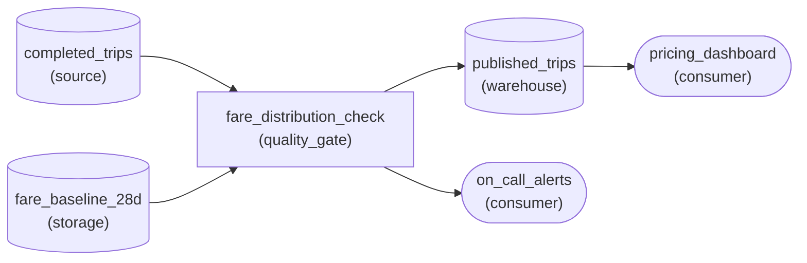

*Tonight's trips reach `published_trips` only through `fare_distribution_check`, which reads the 28-day baseline and alerts on-call when it fires.*

| Pitfall: A mean-only check misses a shifted tail |
| --- |
| If a producer bug drops long trips, the average of `fare_per_km` can barely move while the 95th percentile collapses. Tracking a tail statistic beside the mean is what catches shifts that change the shape rather than the center. |

| Real world: The same shape fits any numeric column |
| --- |
| Swap `fare_per_km` for a sensor's temperature reading or an ad's cost per click and the design is unchanged: summary statistics per run, a trailing baseline, a threshold in standard deviations, and a fail path that holds the run and alerts. |

**Follow-up questions**

1. What happens to the baseline after a real, permanent price change?\
   *Whether the window absorbs a new normal once someone confirms the shift was genuine.*
2. How would the check change if one city's fares run far higher than the rest?\
   *Segmenting the baseline by a dimension instead of comparing against one global distribution.*

</details>


<br>

### Exercise 2 of 2

**● TASK**

Each night about 5 million viewing sessions load into a warehouse fact table, and every session's title_id must exist in the warehouse's title dimension. Design the pipeline with a referential integrity check that compares the sessions against that dimension before the content dashboard reads them. Route orphan sessions to a dead-letter queue rather than dropping them.

<details>
<summary><strong>Solution</strong></summary>

#### The pipeline now owns the foreign key

A referential integrity check is the pipeline doing the job a foreign key constraint did in the operational database: before a session is published, look up its `title_id` in the title dimension and decide what happens when nothing is there. The warehouse will not refuse the row for you, so without this stage an unknown title slips into the fact table and becomes a different wrong number in every query that touches it.

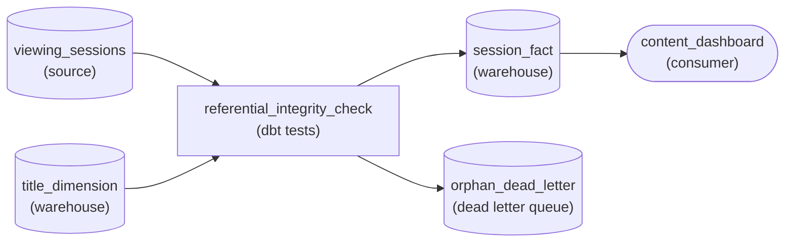

*Sessions and `title_dimension` both feed the check; matched rows reach `session_fact` and the dashboard, orphans land in `orphan_dead_letter`.*

1. **Give the check both sides of the key**

   A check that only sees the sessions can confirm `title_id` is not null, which is a schema check. To catch an orphan it needs the set of keys that exist, so the title dimension is an input edge into the check, not just a table sitting somewhere downstream.

2. **Split the output instead of filtering it**

   The check has 2 exits. Sessions whose `title_id` matches go on to `session_fact`; sessions whose key is missing go to `orphan_dead_letter` with the night's load date. Every input row ends up in exactly one place, so the 2 counts always add back up to the load.

| Pitfall: An inner join is a silent filter |
| --- |
| The tempting shortcut is to join sessions to the dimension with an `INNER JOIN` while loading the fact. It looks like a check, but every orphan simply disappears and watch totals quietly understate. A `LEFT JOIN` keeps the rows but fills the title columns with `NULL`, so a filter like `genre = 'drama'` drops them in one report and counts them as unknown in another. |

| Real world: Most orphans are a late dimension, not bad data |
| --- |
| In practice most orphan keys are titles the catalog has not delivered yet. That is why the dead letter queue keeps the rows instead of deleting them: once the title arrives in the dimension, the parked sessions pass the same check and join the fact table. |

**Follow-up questions**

1. How would you raise an alert when orphans exceed 1% of a night's load?\
   *Turning the dead letter volume into a monitored signal instead of a pile nobody looks at.*
2. What changes if each session also carries a `listener_id` that must exist in a listener dimension?\
   *Whether the check generalises to several foreign keys on one fact table.*

</details>


<br>

---

## Putting It All Together

Picture a plays table at Spotify, where each row is one stream and stream counts feed royalty reports. On a Thursday, a new Android build starts reporting ms_played in seconds. Every row passes schema rules, since 182 is a valid positive integer, and hourly volume looks normal. The Android median of ms_played falls from about 180,000 to 180, far past a z-score of 3, so the curated gate holds each affected hour. The build's app_version is missing from the version dimension, so those rows carry the -1 placeholder until the dimension catches up. The team fixes the conversion in the transform, proves it in test against a fixture with a planted seconds-valued row, where the same suite runs with sample-sized thresholds, and republishes the held hours by replacing their partitions.

- Schema rules passed every row because the bug changed units, a batch-level fact that only a distribution check sees.
- Comparing Android with its own same-weekday baseline kept iOS and web variation out of the signal.
- The placeholder kept play totals whole while the version dimension lagged, because attribution could wait and royalty counts could not.
- Holding the hour at the curated gate meant no royalty report ever read seconds as milliseconds.
- Replacing partitions on republish kept the fix idempotent, so a second rerun could not double any stream counts.
- The fixture's planted row proved the fixed transform and the check both behave before the change reached prod.


<br>

---

## Pipeline Architecture

### Exercise 1 of 2

**● TASK**

A video service lands about 4 million playback events a day, hourly, into a raw table, and publishes them to a warehouse table read by a recommendations model and a royalties report. Build a quality suite before the published table that checks the schema, freshness within two hours, hourly volume and the event-type mix, and blocks a failing load. Page on-call when a check fails, and record lineage so the page names the affected readers.

<details>
<summary><strong>Solution</strong></summary>

#### 5 pillars, all standing in front of the published table

A quality suite turns the 5 pillars into gates that every hourly load must clear before anyone reads it. 4 of them are checks. Schema confirms the columns are the ones readers expect. Freshness confirms `MAX(event_timestamp)` is within two hours of `CURRENT_TIMESTAMP`. Volume confirms the hour holds roughly the 170,000 rows that 4 million a day implies. Distribution confirms the `event_type` shares look like last week. The fifth pillar, lineage, is not a check at all: it is the record of who reads the table, so a page can say who is hurt.

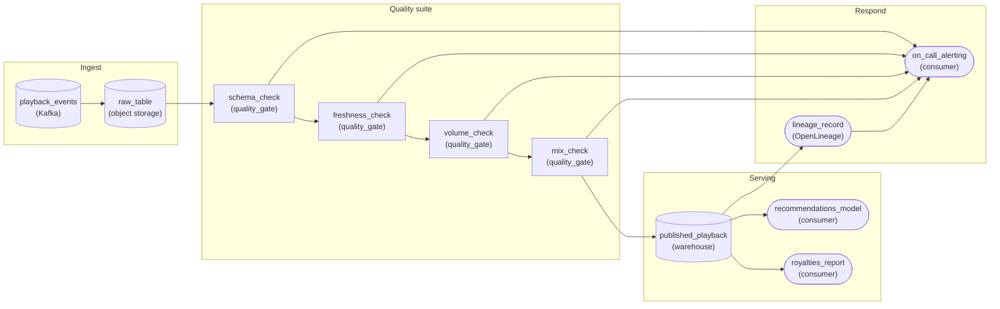

*Each hourly load clears `schema_check`, `freshness_check`, `volume_check` and `mix_check` before reaching `published_playback`; any failure pages `on_call_alerting`, which reads the readers from `lineage_record`.*

1. **Run the schema check first**

   If a column was renamed or retyped, every later check reads garbage: a missing `event_type` makes the mix check meaningless. Schema runs first, and a failure there stops the chain before the statistical checks waste a run.

2. **Chain the checks in front of `published_playback`**

   Each check feeds the next, and only the last one feeds the published table. A failed hour goes nowhere downstream: it stays in `raw_table`, and readers keep the last good hour, which is what a report that pays out money needs.

3. **Wire failures and lineage into one page**

   Every check has a line to `on_call_alerting`, and the lineage record of who reads `published_playback` feeds the same page. The message becomes 'mix check failed, affects recommendations and royalties' instead of a bare check name nobody can triage at 3 a.m.

| Pitfall: A check after the publish only reports the damage |
| --- |
| The common wrong shape hangs the checks off the published table, reading it after the load lands. By the time the volume check fires, the royalties report has already read the half-empty hour. Checks protect readers only when they sit on the path into the table. |

| Performance: An hour of events is cheap to check |
| --- |
| 4 million events a day is about 46 per second and roughly 170,000 rows per hourly load. Each check is one aggregate over that hour: a row count, a `MAX(event_timestamp)`, a `GROUP BY event_type`. That is big enough for the shares to be statistically stable and small enough that 4 checks add seconds, not minutes. |

**Follow-up questions**

1. A new event type launches next month. How does the mix check avoid paging on day one?\
   *Updating a distribution baseline on purpose instead of loosening the check.*
2. Volume drops by 40 percent every night between 2 and 5 a.m. What should the volume check compare an hour against?\
   *Choosing a time-of-day baseline over one flat threshold.*

</details>


<br>

### Exercise 2 of 2

**● TASK**

A utility loads about 8 million smart-meter readings each night from an operational PostgreSQL database into a warehouse table that a demand-forecasting dashboard reads. Validate each load's schema, then run a distributional check that compares its kwh_used mean against a stored historical baseline. A load that fails either check goes to quarantine instead of the warehouse, and the on-call engineer is alerted. The same checks also run in a test environment that loads a 1% sample, so drift thresholds must come from per-environment threshold config, not hard-coded values.

<details>
<summary><strong>Solution</strong></summary>

#### One check, a baseline, and 2 thresholds

Drift detection asks a different question than schema validation: not whether each row is well formed, but whether tonight's population still looks like the nights before it. A reading of 1.9 kWh is perfectly valid. Eight million of them, when the stored baseline says the mean sits near 1.2, points to a firmware change or an upstream filter that dropped the low users. The schema check runs first so the distributional check only ever compares clean numbers.

1. **Put the schema check first**

   If `kwh_used` arrives as text or half null, the mean is meaningless and the drift check fires for the wrong reason. Gate structure first, then measure the distribution of what passed.

2. **Compare against a stored baseline**

   The drift check reads the historical mean and spread from `baseline_stats` and measures how far tonight's `kwh_used` mean sits from it. Keeping the baseline in its own store lets you recompute it from accepted nights without touching the check.

3. **Read thresholds per environment**

   The test load is a 1% sample of about 80,000 readings, so its mean wanders far more night to night than the 8 million in prod. The check logic is identical in both places; only the allowed deviation, read from `threshold_config` for the current environment, differs.

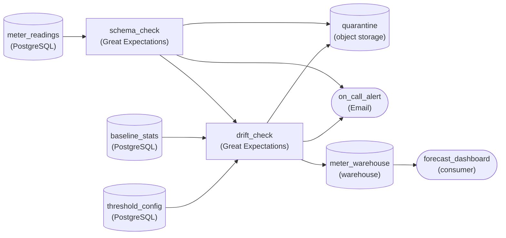

*`schema_check` then `drift_check`, which reads `baseline_stats` and `threshold_config`; failures go to `quarantine` and page `on_call_alert`, passes land in `meter_warehouse`.*

| Pitfall: A hard-coded threshold breaks in one environment |
| --- |
| Tune the band on prod and the noisy 1% test sample trips it every night; tune it on test and real prod drift sails through. Teams then silence the noisy check and the suite stops protecting anything. Keep one check and give it a threshold per environment. |

| Key insight: Quarantine keeps the evidence |
| --- |
| Routing a failed load to `quarantine` instead of dropping it lets the on-call engineer see exactly which night shifted and replay it once the producer is fixed. Meanwhile the dashboard keeps showing the last good night rather than a bad forecast. |

**Follow-up questions**

1. Usage rises every winter. How do you stop the drift check from flagging every cold snap?\
   *Refreshing `baseline_stats` from a trailing window of accepted nights instead of widening the threshold.*
2. The team wants the same drift check on `peak_kw` too. What changes in the design?\
   *Whether baseline and threshold config generalise per column rather than adding a new check stack.*

</details>


<br>

---

## Key Takeaways

- Schema rules judge each row for required keys and types that parse, then for nullability and ranges or allowed sets, reporting each defect under its own cause.
- Grow a suite from a check file: required fields and types block first, and newer rules warn for 2 weeks before promotion.
- Distribution checks compare batch summaries with the same weekday in past weeks; the mean catches rare extreme rows while the median holds still.
- Find orphans with a LEFT JOIN and a NULL dimension key, then decide per key whether to block or quarantine; a placeholder or a deferral are the other options.
- Run the same suite in every environment: row rules carry over unchanged, batch thresholds scale with batch size, and authority stays fixed.
- Place each check where it has what it needs. Schema rules need the raw strings and distribution checks need typed data with baselines, while freshness runs on the published table.
