Advanced·Pipeline Architecture · 38 min · 12 challenges

# Failure Handling: Advanced

Uber's engineers have written about sending failed payment events for the Driver Injury Protection program through delayed retry queues and, as a last stop, a dead letter queue. When a premium-calculation service slows to a crawl on a Friday evening, decisions made long before that evening determine whether those queues protect drivers' coverage or bury millions of good payments.


<br>

---

## Failure Classification by Design

Splitting failures into transient and permanent answers a single question: retry or not. A production pipeline has to answer 4 questions for every failure. Should it retry? Should it stop calling the dependency? Where does the failed record go? Does someone get woken up? The answers to all 4 depend on 2 properties of the failure: how long it will last, and how much of the traffic it hits.

Every example in this lesson uses the same pipeline. It reads 2,000 order events per second from a durable log, calls a tax service that can serve 3,000 requests per second, and writes each priced order to curated.orders, keyed on order_id.


<br>

### Duration and scope

Scope is the newer idea. A record-scoped failure hits a single record because of something inside it: a malformed amount, a missing customer ID. A systemic failure hits every record because of something outside them all: an overloaded service, an expired credential, a bug in freshly deployed code. The same error can land on either side. A timeout on 1 call in 10,000 is record-scoped noise, while timeouts on every call are systemic.

| Class | Duration | Scope | Example | Response |
| --- | --- | --- | --- | --- |
| Transient record | Seconds | Single record | A lone 503 or connection reset | Retry in place with backoff and jitter |
| Transient systemic | Minutes to hours | All records | Tax service overloaded, 429 on every call | Open the breaker, leave records in the source log |
| Permanent record | Forever | Single record | `tip_amount` holds the string 'abc' | Write it to the DLQ and keep going |
| Permanent systemic | Until a human acts | All records | Expired credential returning 401; a bug in the transform | Halt the pipeline and page the owner |

The bottom row is where pipelines most often go wrong. Record by record, a permanent systemic failure looks like a permanent record failure: the call returns 401 and the order cannot be priced. A pipeline that checks only the error type sends every order to the DLQ, and an hour later the DLQ holds 7.2 million good orders. All of them need the same fix, a new credential, and none of them needed a decision of its own.


<br>

### The classifier is code, and it reads the failure rate

Classification belongs in a single function that every retry, breaker and DLQ decision calls, so the rules live in one place and can be tested. It takes 2 inputs: the error, and the share of recent records that failed with the same kind of error. For timeouts and overload responses, that share tracks the tax service. For parse errors, it tracks the payloads. That share is what promotes a record-scoped verdict to a systemic one.

```sql
from dataclasses import dataclass

TRANSIENT_STATUS = {429, 502, 503, 504}
AUTH_STATUS = {401, 403}
SYSTEMIC_RATE = 0.5


@dataclass
class Verdict:
    failure_class: str
    action: str


def classify(error, same_kind_failure_rate):
    status = getattr(error, "status", None)
    systemic = same_kind_failure_rate >= SYSTEMIC_RATE

    if isinstance(error, DuplicateKeyError):
        return Verdict("already_applied", "ack")
    if status in AUTH_STATUS:
        return Verdict("permanent_systemic", "halt_and_page")
    if status in TRANSIENT_STATUS or isinstance(error, (TimeoutError, ConnectionError)):
        if systemic:
            return Verdict("transient_systemic", "open_breaker")
        return Verdict("transient_record", "retry_with_backoff")
    if isinstance(error, (ValueError, KeyError)):
        if systemic:
            return Verdict("permanent_systemic", "halt_and_page")
        return Verdict("permanent_record", "send_to_dlq")
    return Verdict("unknown", "retry_then_dlq")
```

A duplicate-key error on an insert-if-absent write keyed on order_id and event_seq together means an earlier attempt already landed this exact event, so the record counts as a success and is acknowledged. A ValueError on half of all records points to a deployed bug or a producer format change, so the per-record verdict is overridden and the pipeline halts. An error the function has never seen gets a short retry and then the DLQ, and the count of unknown verdicts is tracked: when it climbs past a handful per hour, the classifier needs a new rule.


<br>

### One table drives retry, breaker, queue and runbook

With classes defined, every mechanism downstream reads from the same table. That includes the runbook, the page an on-call engineer opens when an alert fires. It gets an entry per class instead of an entry per error message, which keeps it short enough to use at 3 a.m.

| Class | Retry | Breaker | Record goes to | Pages | Runbook first step |
| --- | --- | --- | --- | --- | --- |
| Transient record | Up to 4 attempts, exponential backoff, jitter | Counts toward failure rate | DLQ after attempt 4 | No | None |
| Transient systemic | Paused while breaker is open | Opens at 50% failures over 30 s | Stays in the source log | After 10 min open | Check the dependency's health and recent deploys |
| Permanent record | None | Not counted | DLQ with error signature | No | Group the DLQ by signature |
| Permanent systemic | None | All calls stopped | Stays in the source log | Immediately | Check the last deploy and credential expiry |
| Already applied | None | Not counted | Acknowledged | No | None |

> **TIP**
>
> Write the class table before any retry code. An argument about retry counts or DLQ routing then turns into a question of which row a failure belongs to, and that question has a testable answer.

**A credential rotation at the tax service goes wrong, and from 14:00 every call from the order pipeline returns 401. Today the pipeline sends any record that fails 4 attempts to the DLQ. What should it do instead?**

- **A.** Retry each record 4 times with backoff, then write it to the DLQ for later replay
- **B.** Leave each record in the source log, stop calling the tax service, and page the owner
- **C.** Open the breaker and probe every 30 seconds, sending records to the DLQ while it waits
- **D.** Write each record to the DLQ at once without retrying, because a 401 is permanent

<details>
<summary>Solution</summary>

**B.** Leave each record in the source log, stop calling the tax service, and page the owner

A 401 on every call is permanent and systemic. Orders wait safely in the log until a human supplies a working credential.

**Why the others are wrong**

- **A.** This is the current behavior. Every order fails the same way, so the DLQ fills with good orders waiting on one fix.
- **C.** Stopping calls is right, but DLQ routing creates a mass replay, and probes can never repair a credential.
- **D.** Skipping retries fits a 401, but the failure is systemic, so the DLQ still fills with millions of good orders.

</details>


<br>

---

## Pipeline Architecture

### Exercise 1 of 2

**● TASK**

Add three failure classifiers (quality gates) to this order pipeline, one each for the read, processing and write surfaces, and name each with that surface's failure modes and the response each mode gets. Transient modes get a bounded retry with exponential backoff, poison records and exhausted retries route from the classifiers to a dead letter queue, and failures no retry can fix page on-call.

**Starting canvas** (already placed for you):

- Kafka order_events source (read-side) (source, Kafka)
- enrich_orders worker (processing-side) (transform, Pandas)
- Iceberg orders_enriched (write-side) (storage, Iceberg)
- Orders dashboard (consumer, Looker)


<br>

### Solution

#### The failure surface decides the retry

**Failure classification** means you name what can break at each surface before you pick a single retry setting. Every node touches the world three times: it reads, it processes, it writes. Each of those breaks in its own ways, and each way needs its own response. One try/except around `enrich_orders` collapses all three into one answer, so a permanent break gets retried until the budget runs out and a transient blip gets escalated like a disaster. Three classifier markers keep the surfaces apart and pair every mode with the response that actually fits it.

| Trick: One question sorts every mode |
| --- |
| For each failure mode ask: can waiting and trying again fix it? Source down, table down, 'partition locked', a dependency timeout: yes, so a bounded retry with exponential backoff, and the record goes to the dead letter queue once the budget is spent. 'schema changed', a poison pill, 'constraint violated' on a malformed row: never, so the record goes straight to the dead letter queue and the stream keeps moving. Auth expired, a revoked write permission or a code bug: no retry fixes it and no single record is at fault, so page a human. |

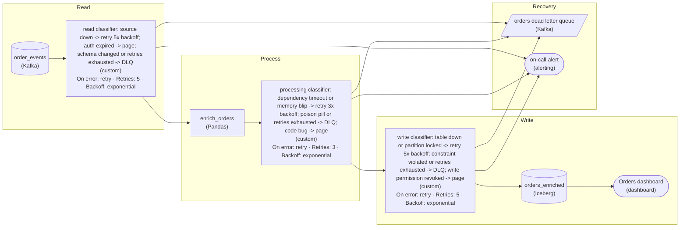

*One classifier per surface, each naming its modes and responses: transient modes retry with exponential backoff, poison and exhausted records go to the dead letter queue, unfixable modes page on-call.*

| ✕ Retry can fix it | ✓ Retry never fixes it |
| --- | --- |
| Read: source briefly down. Processing: a memory blip or a dependency timeout. Write: table down, 'partition locked'. Response: a bounded retry with exponential backoff. The bound matters: when it is exhausted the record leaves the main path for the dead letter queue instead of spinning forever. | Read: 'schema changed' so the record no longer parses. Processing: a poison pill that throws on every attempt. Write: 'constraint violated' by a malformed row. Response: straight to the dead letter queue. Auth expired, a revoked write permission and code bugs are not the record's fault, so they page on-call. |

| Pitfall: A blanket retry treats poison like a blip |
| --- |
| The first draft is usually one `for attempt in range(3)` around the whole worker. A single 'schema changed' record burns all three attempts, throws, and in an ordered stream stalls every record behind it. An expired credential gets retried three times and still fails, when only a human refreshing the token helps. The response has to be chosen per mode, which is why each marker names the mode and the response together. |

On a real team, this classification is what the runbook is built from. When the page fires at 3am, the marker that sent it already says which surface broke and why, so the responder knows whether to refresh a credential, wait out an Iceberg lock, or leave a quarantined record for the morning. Separating read from write also means a write outage retries only the write, not a re-read of Kafka.

**Follow-up questions**

1. What retry budget and backoff would you give the write surface so a 'partition locked' retry outlasts a routine table maintenance window?\
   *Sizing a retry budget from the failure mode's expected duration.*
2. A dependency returns HTTP 429 on some calls and HTTP 400 on others. Which classifier handles each, and does either belong in the retry path?\
   *Classifying 2 modes from the same dependency differently.*
3. How would you add a fourth failure mode, 'data arrived late', to the read classifier, and what response fits it?\
   *Extending the classification to a mode that is neither transient nor poison.*


<br>

### Exercise 2 of 2

**● TASK**

Records that `enrich_worker` fails to process are currently lost. Divert them to a dead letter queue, then read that queue as a quality signal: a stream job computing the per-second arrival rate by exception type, a metrics store keeping the rolling baseline, and a paging destination that fires when a type's rate deviates from that baseline by a high z-score.

**Starting canvas** (already placed for you):

- Kafka events source (source, Kafka)
- enrich_worker (transform, Flink)
- enriched_orders (storage, warehouse)


<br>

### Solution

#### The DLQ is a stream, not a mailbox

A dead-letter queue starts life as a safety net: every record `enrich_worker` gives up on is diverted there instead of being dropped or blocking the partition, with an envelope that carries the diagnosis (`failed_at`, `exception_type`, `attempt_count`, `correlation_id`). Read **as a quality signal**, that same queue becomes the earliest warning the pipeline has. A queue drained by hand once a week throws the signal away; the design you drew reads it continuously and turns its arrival pattern into a rate per failure reason, a stored history, and an alarm when today breaks from the recent past.

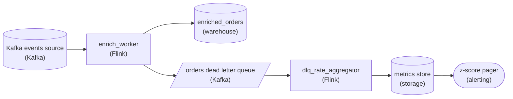

*Failures leave the main path on an error edge into the dead letter queue; the aggregator, metrics store and pager hang off it. The enrichment path to `enriched_orders` is untouched.*

1. **Divert failures, then count them by reason per second**

   Route every record `enrich_worker` cannot process onto an error path into the dead letter queue, then attach `dlq_rate_aggregator` as a stream consumer of that queue. It keys each record by `exception_type` and counts arrivals in a one-second tumbling window, emitting (timestamp, `exception_type`, rate). The per-second grain is what lets a spike show up in seconds instead of being smeared across a day.

2. **Land the rates in a time-series store**

   The rates land in the metrics store. Its rolling history IS the baseline: to know that 40 `ValidationError` per second is abnormal, you need to remember this stream normally sits near 2. No history, no baseline, no anomaly detection.

3. **Alert on deviation from the rolling baseline**

   The pager reads recent history per `exception_type`, computes a rolling mean and standard deviation, and fires when `(rate - mean) / stddev` crosses a threshold (say 3). Because the alarm is per type, it names the failure mode: a `ValidationError` spike points at a producer schema change, an `AuthError` spike at an expired credential, a slow climb in `TimeoutError` at a degrading downstream.

| Trick: The breakdown by `exception_type` is the whole game |
| --- |
| A single total DLQ rate only says failures went up. Keying by `exception_type` turns a smoke alarm into a diagnosis: each failure mode gets its own baseline and its own z-score, so the page names the cause. |

| ✕ Static threshold | ✓ Rolling z-score |
| --- | --- |
| "Alert if rate > 100/s" is one number for every stream. It floods you on a high-volume type where 100/s is normal and stays silent on a low-volume type where 5/s is a fire. | `(rate - mean) / stddev` normalizes each `exception_type` against its own recent behavior, so one rule covers every failure mode and adapts as traffic shifts. |

| Pitfall: A baseline held in memory forgets on restart |
| --- |
| Skipping the metrics store and alerting straight off the queue keeps the baseline in memory, where it dies on every restart or rebalance, exactly when history matters most. Persisting rates first also lets you look back after an incident to see when the drift began. |

**Follow-up questions**

1. Traffic has a daily cycle, so 2am and 2pm have very different baselines. How do you keep the z-score from firing every morning?\
   *Pushes toward seasonal baselines (hour-of-day, day-of-week) instead of a flat rolling window.*
2. What should the page carry besides the rate, so the on-call engineer can act immediately?\
   *Attaching sample `correlation_id` values and the `exception_type` makes the page itself diagnostic.*
3. A brief downstream blip spikes `TimeoutError` then recovers. How do you avoid paging for something that self-heals?\
   *Sustained-deviation logic: require the z-score to hold for N consecutive windows.*


<br>

---

## The DLQ as a Quality Signal

Consumers notice bad data when a dashboard number looks wrong, often hours after the cause. The DLQ sees the cause within seconds, because every record a producer change breaks lands there the moment it is processed. With the right metrics, the DLQ becomes the earliest warning the pipeline has about the systems that feed it.


<br>

### What a DLQ row has to carry

A metric can slice only by a field the DLQ row stores. A DLQ holding the payload and a raw error message answers how many records failed. It can't say which producer release broke which field, and that is the question that finds a regression.

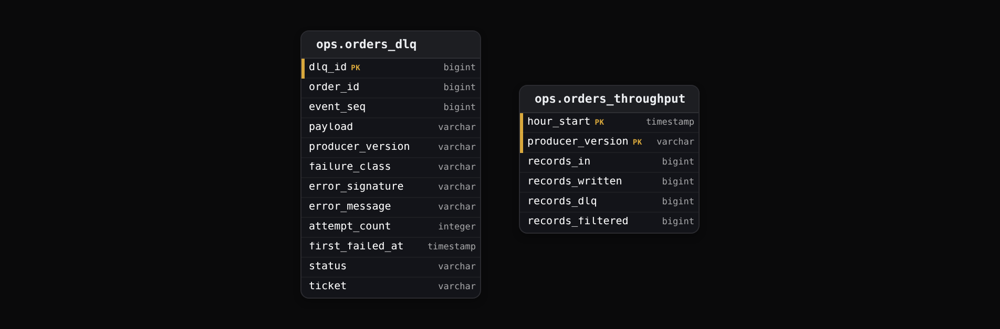

The error_signature column is the raw message with its values stripped out. cannot cast 'abc' to decimal at tip_amount and cannot cast '12,50' to decimal at tip_amount both become cannot cast <v> to decimal at tip_amount. Grouping by raw message produces a group per bad value; grouping by signature produces a group per bug.


<br>

### Rate by slice, against a baseline

The order pipeline's normal DLQ rate is 0.01%, about 720 rows an hour. At 10:00 the order service starts a canary of release v4.12, a trial rollout on 5% of its hosts. The release sends tip_amount as a string whenever a tip was edited after checkout, which happens on 15% of orders. The next hour looks like this:

| producer_version | records_in | dlq_rows | dlq_rate |
| --- | --- | --- | --- |
| v4.11 | 6,840,000 | 684 | 0.01% |
| v4.12 | 360,000 | 54,000 | 15.00% |
| All versions | 7,200,000 | 54,684 | 0.76% |

Consider which alerts that hour trips. An alert on 100,000 DLQ rows per hour stays silent. A pipeline-wide rate alert at 1% stays silent too, since 0.76% sits under it. Sliced by producer version, v4.12 fails at 15%, a figure no healthy release produces. That alert fires during the canary and the rollout stops at 5% of hosts. At full rollout, the same bug would send 1.08 million orders an hour to the DLQ.

- **1,500x** — v4.12 DLQ rate over the baseline

```sql
WITH dlq AS (
  SELECT
    producer_version,
    COUNT(*) AS dlq_rows
  FROM ops.orders_dlq
  WHERE first_failed_at >= DATE_TRUNC('hour', CURRENT_TIMESTAMP) - INTERVAL '1' HOUR
    AND first_failed_at < DATE_TRUNC('hour', CURRENT_TIMESTAMP)
  GROUP BY producer_version
),
traffic AS (
  SELECT
    producer_version,
    SUM(records_in) AS records_in
  FROM ops.orders_throughput
  WHERE hour_start = DATE_TRUNC('hour', CURRENT_TIMESTAMP) - INTERVAL '1' HOUR
  GROUP BY producer_version
)

SELECT
  t.producer_version,
  t.records_in,
  COALESCE(d.dlq_rows, 0) AS dlq_rows,
  ROUND(
    COALESCE(d.dlq_rows, 0) * 100.0 / NULLIF(t.records_in, 0),
    2
  ) AS dlq_pct
FROM traffic AS t
LEFT JOIN dlq AS d
  ON d.producer_version = t.producer_version
ORDER BY dlq_pct DESC
```


<br>

### The 4 DLQ metrics worth alerting on

- **Rate by slice:** dlq_rows / records_in per producer version and failure class. Catches a regression while a canary still touches a small share of traffic.
- **New signature:** an error_signature absent for the past 14 days. A new bug shows up as a new group even at low volume.
- **Oldest untriaged row:** the age of the oldest row with status = 'new'. A DLQ nobody reads loses data slowly, and this age says how slowly.
- **Conservation:** records_in = records_written + records_dlq + records_filtered. A gap means records vanished without reaching the DLQ.

The conservation check exists because a quiet DLQ proves nothing. If a code change wraps the parse step in a try block that logs the error and moves on, failures stop reaching the DLQ and its rate falls to zero, which looks like an improvement. Conservation exposes it: 7,200,000 records in against 7,180,000 written, 0 in the DLQ and 0 filtered leaves 20,000 orders unaccounted for.

**Right after a pipeline deploy, the order pipeline's DLQ rate drops from 0.01% to 0.00%, while records_in holds steady at 7.2 million per hour. What should an engineer check first?**

- **A.** Nothing: the deploy fixed the last parse bugs, so the DLQ thresholds can be tightened
- **B.** The producer release history, because producers must have cleaned up their payloads
- **C.** Conservation: whether records written plus DLQ plus filtered still adds up to records_in
- **D.** The DLQ table's storage quota, since a full table would stop accepting new rows

<details>
<summary>Solution</summary>

**C.** Conservation: whether records written plus DLQ plus filtered still adds up to records_in

If failures are being swallowed, the sum falls short of records_in, and the shortfall counts the lost orders.

**Why the others are wrong**

- **A.** An exact zero right after a deploy more often means hidden failures; tightening thresholds hides them further.
- **B.** The drop lines up with the pipeline's own deploy, so the pipeline is the first suspect.
- **D.** A full DLQ makes writes fail loudly in the pipeline, which raises errors instead of a clean zero rate.

</details>


<br>

---

## Pipeline Architecture

### Exercise 1 of 2

**● TASK**

Turn the orders DLQ into a recovery surface: add a replay transform off it whose name covers its three jobs, inspection (payload, exception, attempts), annotation (edit a payload with an audit trail) and bounded replay (throttled, with a dry-run). Replays write idempotently into the enriched orders warehouse. Send any replay that fails a second time to a separate side-channel destination, never back into the DLQ.

**Starting canvas** (already placed for you):

- orders_dlq (source, Kafka)
- orders_enriched (storage, warehouse)


<br>

### Solution

#### A dead-letter queue is only as good as its drain

The transform you hung off `orders_dlq` is a **replay tool**, the piece that turns a dead-letter queue from a graveyard into a buffer you can recover from. It earns the name by doing three jobs, inspection, annotation and bounded replay, by writing idempotently, and by having somewhere safe to send a message that fails again.

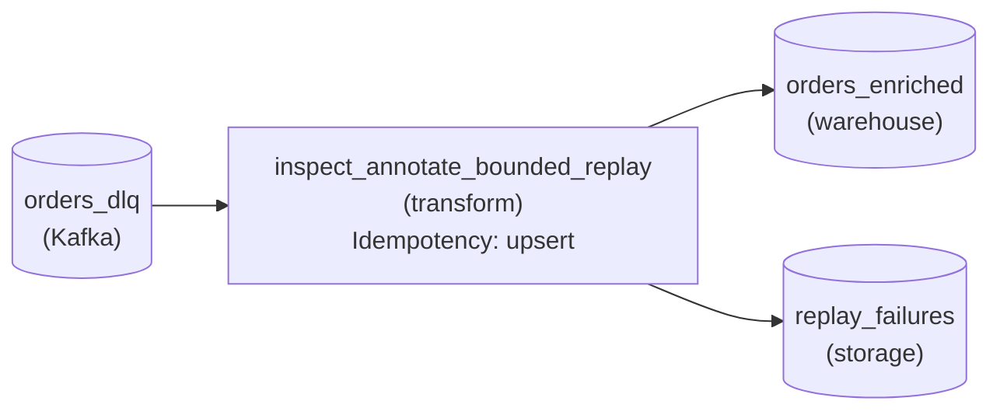

*`inspect_annotate_bounded_replay` reads `orders_dlq`, upserts into `orders_enriched`, and sends anything that fails again to `replay_failures`, never back to `orders_dlq`.*

1. **Inspection: decode the envelope first**

   The DLQ record is an envelope, not a bare payload: it carries the original message, the exception that killed it, and the attempt count. Reading all three tells an operator WHY it dead-lettered before they act, so replay is not blind.

2. **Annotation: edit with an audit trail**

   Messages that died on bad data need the payload fixed before replay. Annotation allows that, but records who changed what and from what original, so you never silently mutate production data you cannot later explain.

3. **Bounded replay: throttle and dry-run**

   An hour of backlog is a flood. Replaying it wide-open turns it into a thundering herd against a downstream already struggling. Bounded replay caps the batch rate, offers a dry-run, and drains in controlled waves.

| Trick: Idempotency is the other half of replay |
| --- |
| Replay is safe only because the replay write is idempotent: `inspect_annotate_bounded_replay` upserts into `orders_enriched` on the order key. Re-delivering a message that DID succeed but dead-lettered on a timeout is harmless, because the upsert collapses the duplicate. Drop the idempotent write and every replay risks double-counting an order. |

| Pitfall: A second failure must not re-enter the source |
| --- |
| The shortcut is to let a re-failed replay flow back into `orders_dlq`. That is an infinite loop: the same poison message drains, fails, and re-enters forever, so the queue never empties and you cannot tell 'drained' from 'stuck'. `replay_failures` breaks the loop into a small, human-sized set to investigate. |

**Follow-up questions**

1. What signal separates a code bug from bad data in `replay_failures`?\
   *The second-attempt exception versus the first is the tell; treat the side channel as triage, not a graveyard.*
2. How would you make bounded replay resumable if the replay transform crashes mid-drain?\
   *Pushes on batch processing plus offset and attempt tracking so a restart resumes instead of replaying everything.*


<br>

### Exercise 2 of 2

**● TASK**

A producer streams events through an unbounded queue to a worker pool, and the service the workers call has slowed from 100ms to 2 seconds. Make the queue bounded with a blocking put, so a full queue backpressures the producer instead of growing memory until it crashes. Add a load shedder between the producer and the queue that diverts events whose put waited too long into a dead letter queue instead of losing them.

**Starting canvas** (already placed for you):

- producer (source)
- unbounded queue (queue)
- worker pool (transform)
- slow downstream service (consumer, API)


<br>

### Solution

#### Backpressure: the queue that pushes back

Backpressure is the rule that a slow consumer gets to slow its producer down. A queue with a `maxsize` and a blocking `put()` applies it. Once the worker pool cannot drain fast enough, the queue fills and the next `put()` **waits** for a free slot. "Memory grows without limit" becomes "the producer waits", and that wait travels backward stage by stage instead of one process exhausting its memory and toppling the rest.

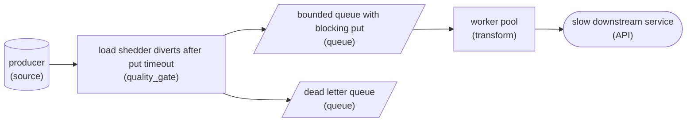

*The shedder calls a blocking `put()` with a timeout. A full queue stalls it, and an event that waits past the timeout goes to the dead letter queue instead of piling up upstream.*

Blocking alone only moves the pressure: the producer now stalls, and whatever feeds it starts to fill its own queue. Load shedding puts a bound on that stall. The shedder sits on the source side and attempts the blocking `put()` with a timeout. When the timeout expires, it hands the event to a dead letter queue instead of discarding it. The cascade stops at the edge of the pipeline, and the shed events wait somewhere you already know how to replay from once the service is back to 100ms.

| Pitfall: An unbounded queue hides the failure, it doesn't prevent it |
| --- |
| It's tempting to call an unbounded queue "resilient" because `put()` never fails. It's the opposite: an instant `put()` is the pipeline lying about its capacity. Every un-drained item sits in memory, so a downstream that goes from 100ms to 2s doesn't slow the producer. It grows the queue until the process runs out of memory, the producer dies, and the cascade runs backward. A `maxsize` turns that invisible leak into an honest, observable wait. |

| ✕ Blocking (backpressure) | ✓ Load shedding |
| --- | --- |
| A full queue makes `put()` wait until a slot opens. Nothing is lost, and the producer is throttled to the consumer's real rate. This is the right default for every queue between 2 stages. | When the wait itself is unacceptable, the source stops waiting (`put()` with a timeout) and takes the event off the hot path. Latency stays flat. Sending the event to a dead letter queue rather than dropping it keeps it recoverable once the downstream catches up. |

**Follow-up questions**

1. During a long slowdown the dead letter queue grows too. When is it acceptable to drop shed events outright instead?\
   *Telemetry or live-state feeds can afford to lose stale events; order or billing events cannot, so their shed path needs durable room.*
2. The downstream recovers to 100ms. How does a blocking `put()` design return to full throughput on its own?\
   *Backpressure relieves itself: once workers drain faster than the producer fills, `put()` stops waiting with no operator action.*


<br>

---

## Reprocessing From the DLQ

A DLQ that only collects records loses them more slowly. Recovery needs a path back: find the broken records, write down what is known about them, fix the cause, and send them through the pipeline again without starving live traffic or corrupting the curated table.


<br>

### A lifecycle for every DLQ row

| status | Set by | Meaning |
| --- | --- | --- |
| new | The pipeline | Failed, and nobody has looked yet |
| triaged | On-call engineer | The signature has an owner and a ticket |
| fix_deployed | Owner | The fix is live; rows are safe to replay |
| replayed | Replay worker | Written to curated.orders |
| refailed | Replay worker | Failed again; attempt_count raised |
| discarded | Owner, with a reason | Never to be replayed, such as test traffic |

Annotation works a signature at a time. A single update marks all 54,000 tip_amount rows from the v4.12 canary as triaged with a ticket number. The status column lets replay select only rows whose cause is fixed, and it ends loops: a row that reaches refailed a third time stays put until a human looks.


<br>

### Replay through a separate, throttled path

The quickest-looking replay copies DLQ rows back onto the pipeline's input log. Those old records then queue behind live ones and draw on the same tax capacity live orders need. A dedicated replay worker runs the same transform code under its own rate limit, so replay cannot take capacity from live orders as long as that limit fits the dependency's current headroom.

Set that limit from the dependency's headroom. Live traffic uses 2,000 of the tax service's 3,000 requests per second. Holding 400 back for bursts leaves replay 600 per second. At that rate the 54,000 canary rows replay in 90 seconds, and a backlog of 2.1 million rows takes roughly 58 minutes.

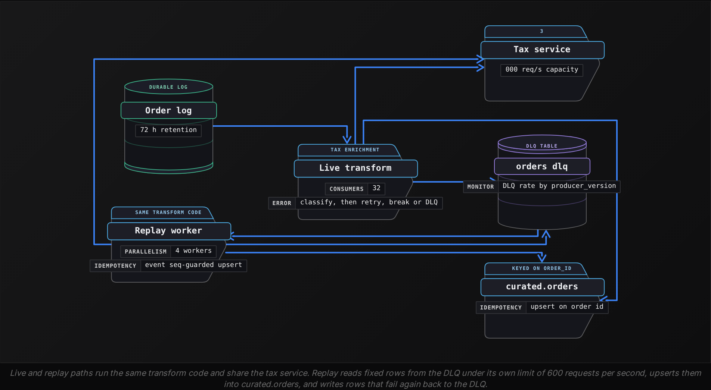


<br>

### Idempotent writes and the stale replay

Replay has to be safe to run twice, because the replay worker can crash halfway like any process. An upsert keyed on order_id covers that: a second run rewrites the same row. Replay also meets a hazard live traffic rarely does, a DLQ row older than what the table already holds. Order 88123 failed at event_seq 4, when its tip was edited. Its seq 5, a cancellation, succeeded an hour later. A plain upsert of seq 4 would un-cancel the order.

The guard is a condition on the write: apply a replayed row only when its event_seq is greater than the stored one. Running the same condition as a read-only dry run shows what replay will do before it touches the table.

```sql
SELECT
  d.order_id,
  d.event_seq AS replay_seq,
  o.event_seq AS current_seq,
  CASE
    WHEN o.order_id IS NULL THEN 'insert'
    WHEN d.event_seq > o.event_seq THEN 'update'
    ELSE 'skip_stale'
  END AS replay_action
FROM ops.orders_dlq AS d
LEFT JOIN curated.orders AS o
  ON o.order_id = d.order_id
WHERE d.status = 'fix_deployed'
  AND d.error_signature = 'cannot cast <v> to decimal at tip_amount'
ORDER BY d.order_id
```

| order_id | replay_seq | current_seq | replay_action |
| --- | --- | --- | --- |
| 88121 | 1 | NULL | insert |
| 88122 | 4 | 2 | update |
| 88123 | 4 | 5 | skip_stale |

A dry run with 2% of rows in skip_stale is normal: those orders moved on while their failed event waited. A dry run with 60% in skip_stale means the selection is wrong, often rows a crashed replay wrote without updating their status. The guard turns that second pass into skips instead of overwrites.

**A replay of 2.1 million DLQ rows is planned for peak hours. The tax service serves 3,000 requests per second, live traffic uses 2,500, and 400 stay in reserve for bursts. About how long will replay take?**

- **A.** About 5.8 hours, at a limit of 100 requests per second
- **B.** About 58 minutes, at a limit of 600 requests per second
- **C.** About 70 minutes, at a limit of 500 requests per second
- **D.** About 14 minutes, at a limit of 2,500 requests per second

<details>
<summary>Solution</summary>

**A.** About 5.8 hours, at a limit of 100 requests per second

Subtracting live traffic and the reserve from 3,000 leaves 100 per second, so 2.1 million rows take 21,000 seconds.

**Why the others are wrong**

- **B.** That limit fits off-peak, when live traffic uses 2,000. At peak it pushes the tax service past capacity.
- **C.** This counts the headroom but spends the burst reserve, so any spike in live orders hits a saturated service.
- **D.** This hands replay the live path's share, which starves live orders or overloads the tax service.

</details>


<br>

---

## Pipeline Architecture

### Exercise 1 of 2

**● TASK**

A Geo-IP config change pushed enrichment p99 from 80ms to 4 seconds, and with nowhere durable to put clicks it could not enrich, the worker lost 3 hours of events to Kafka's 24-hour retention. Redesign the failure handling: route clicks that fail enrichment to a durable dead-letter queue and retry them from there once Geo-IP recovers, put a data-quality check on that queue, and page on-call when it grows, well inside the retention window.

**Starting canvas** (already placed for you):

- Web app clickstream source (source, API)
- Kafka raw_clicks topic (24-hour retention) (queue, Kafka)
- Enrich and write worker (no retry, no dead-letter path) (transform, Flink)
- Geo-IP enrichment service (config change pushed p99 from 80ms to 4s) (source, API)
- enriched_clicks store (idempotent inserts) (storage, Redshift)
- Product analytics dashboards (consumer, Looker)


<br>

### Solution

#### The failure a dead-letter queue prevents

A dead-letter queue is a durable side channel. When the `Enrich and write worker` can't finish a click, it writes that click somewhere it will survive instead of holding it in memory or dropping it. That single move is what the old pipeline lacked. When Geo-IP's p99 jumped from 80ms to 4s, the worker stalled and `raw_clicks` kept filling. Once the 24-hour retention window rolled past the backlog, 3 hours of events were gone with no copy anywhere.

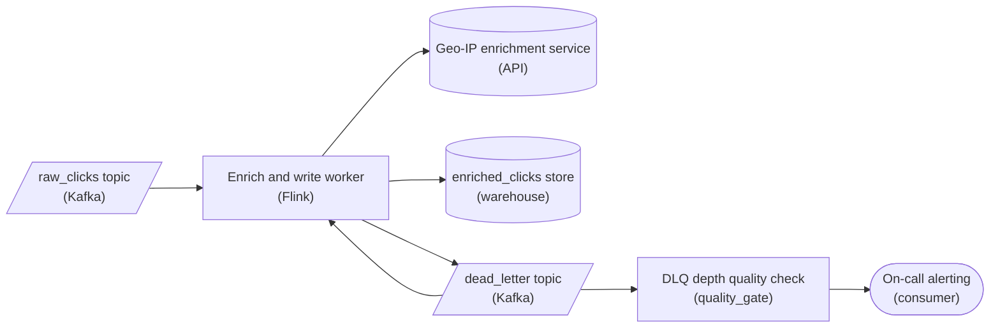

*Failed enrichments land in the `dead_letter` topic and drain back for retry. A depth check on that topic pages on-call.*

| Pitfall: Retry in the hot path is not durability |
| --- |
| The tempting fix is to wrap the Geo-IP call in a retry loop. But retrying in-line against a service that is now 4s slow makes the worker slower still, and the un-enriched clicks are **still** only in `raw_clicks`, still racing the retention clock. Retry belongs on the `dead_letter` topic, drained back through the worker once Geo-IP recovers, not in the ingest path. |

| Key insight: The DLQ decouples failure from retention |
| --- |
| Once failed clicks land in a durable `dead_letter` topic, the enrichment outage stops being a data-loss clock. The clicks wait as long as you need, the worker keeps draining `raw_clicks` at full speed, and you reprocess when Geo-IP recovers. |

Durability alone isn't enough: a `dead_letter` topic that grows silently is just a slower way to lose data. The data-quality check watches its depth and fill rate, and the alert has to fire with enough lead time that on-call acts **before** the 24-hour retention on the source topic can expire anything. That lead-time budget is the whole reason you page early rather than on a threshold you happen to notice.

**Follow-up questions**

1. When Geo-IP recovers and you drain `dead_letter` back through the worker, what stops a click being written to `enriched_clicks` twice?\
   *Tests whether idempotent inserts make reprocessing safe to repeat.*


<br>

### Exercise 2 of 2

**● TASK**

Redesign a clickstream pipeline so the next latency spike, schema drift, credential rotation, downstream outage, and producer-side burst do not cause an outage. Compose every advanced-tier pattern: failure-surface classification on each node; retry budget plus circuit breaker around every external call; DLQ with envelope; DLQ-as-quality-signal monitoring (rate by exception type with z-score alerts); DLQ replay tooling with a second-failure side channel; bounded queues with backpressure; load-shedding on the source side. Route the dashboard through the resilient path.

**Starting canvas** (already placed for you):

- Web clickstream source (source, Custom)
- Kafka raw_clicks (currently unbounded) (storage, Kafka)
- Worker pool (no classification, no retry budget, no breaker, no DLQ) (transform, Python)
- Geo-IP service (storage, API)
- Clickhouse enriched_clicks (idempotent) (storage, Clickhouse)
- Product analytics dashboard (consumer, Looker)


<br>

### Solution

#### Resilience is routing: every failure gets a lane

You turned a fragile clickstream into one where a latency spike, schema drift, a rotated credential, a downstream outage, and a producer burst each become a routing decision instead of an outage. The spine that ties the 5 patterns together is failure-surface classification: on every node a failure is first labeled transient, poison, or downstream-down, and that one label picks its lane. Retry budget, circuit breaker, DLQ, bounded queues, and load-shedding are just the lanes.

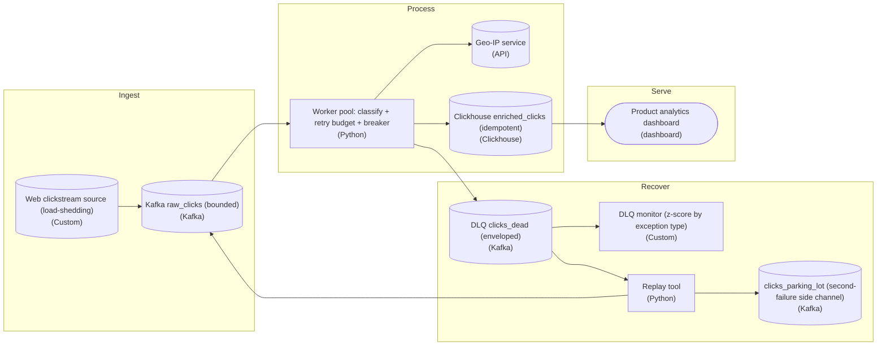

*The dashboard reads only from idempotent `enriched_clicks`; every failure branches sideways into the recover layer, never forward to the dashboard.*

| Pitfall: The worker you started with treats every error the same |
| --- |
| With no classification, a slow `geoip_lookup`, a malformed event, and a Geo-IP outage all hit the same bare `except` and either crash the consumer or drop good data. Retrying a poison event forever wedges the partition; not retrying a transient timeout drops good rows. Both are the same bug: reacting before you classify. |

**The worker as a set of lanes**

```python
def handle(event):
    try:
        validate_schema(event)                 # poison if this raises
    except SchemaError as exc:
        publish_dlq(event, exc, klass="poison")
        return

    for attempt in range(RETRY_BUDGET):        # transient gets a bounded budget
        try:
            geo = breaker.call(geoip_lookup, event.ip)   # breaker fails fast when open
            clickhouse.upsert(enrich(event, geo))         # idempotent sink
            return
        except BreakerOpen as exc:
            publish_dlq(event, exc, klass="downstream_down")
            return
        except TransientError as exc:
            sleep(backoff(attempt))
            last = exc
    publish_dlq(event, last, klass="retry_exhausted")

def publish_dlq(event, exc, klass):
    envelope = {
        "payload": event.raw,
        "failure_class": klass,
        "exception_type": type(exc).__name__,
        "failed_at": now_iso(),
        "attempts": RETRY_BUDGET,
    }
    producer.send("clicks_dead", envelope)
```

*Classify first; the reaction (drop-to-DLQ, retry, fail-fast) falls out of the class. The envelope is what makes replay possible later.*

| Real world: The DLQ is a quality signal, not a graveyard |
| --- |
| Because every envelope carries `exception_type`, the monitor computes a rate per type and z-score alerts when one spikes: a jump in `SchemaError` means a producer shipped a new field; a jump in `downstream_down` means Geo-IP is down. When fixed, the replay tool re-injects events into `raw_clicks`; anything that fails again goes to `clicks_parking_lot` so a replay storm cannot loop back in. |

**Follow-up questions**

1. If the breaker is open and events pile into `clicks_dead` as `downstream_down`, how do you replay them WITHOUT re-tripping the breaker the moment Geo-IP recovers?\
   *Tests whether replay respects rate limits and breaker state rather than firing a thundering herd.*
2. What makes the `enriched_clicks` sink safe to replay into twice, and what breaks if it were not idempotent?\
   *Tests why at-least-once delivery from replay requires an idempotent sink.*


<br>

---

## Cascading Failure and Backpressure

A cascade starts with a single slow dependency and ends with failures in systems that were never broken. Underneath it is a queue that fills: whenever records arrive faster than a stage can finish them, the difference piles up somewhere, and every somewhere has a size limit.


<br>

### Arrival rate minus service rate

Suppose a slow database query drops the tax service's capacity from 3,000 requests per second to 1,200. Orders still arrive at 2,000 per second. The order pipeline's in-memory buffer has no size limit, and its process has memory for around 500,000 records, so the buffer grows by 800 records every second until that memory runs out.

| Minutes since slowdown | Buffered records | Process memory |
| --- | --- | --- |
| 0 | 0 | Empty |
| 2 | 96,000 | 19% full |
| 5 | 240,000 | 48% full |
| 10 | 480,000 | 96% full |
| 10.4 | 500,000 | Full: the process runs out of memory |

The crash makes the next minute worse. The restarted process re-reads everything since its last committed offset, so it starts with a backlog and calls the slow service harder than before it died.


<br>

### Latency drains pools and retries multiply load

**Little's law** says the number of requests in flight equals arrival rate times latency. At 2,000 requests per second and 50 ms each, the pipeline holds 100 calls open. When latency climbs to 2 seconds, it needs 4,000. A connection pool of 200 runs dry, and records time out while waiting for a connection they never got.

Retries stack on top. If the HTTP client makes 4 attempts and the task wrapping it also makes 4, a single order can produce 16 calls. At 2,000 orders per second, a struggling tax service can face 32,000 requests per second, more than 10 times its healthy capacity. That load keeps it down even after its own fix ships.


<br>

### 3 ways to bound the damage

| Tactic | What it does | What it costs | Use when |
| --- | --- | --- | --- |
| Backpressure | A full buffer stops the consumer pulling; records wait in the durable log | Lag grows; nothing is lost while lag stays within retention | The source is durable and the slowdown ends within retention |
| Load shedding | Low-priority records are deferred or dropped so critical ones keep flowing | Deferred work runs later; dropped work is gone | Some consumers can wait and others cannot |
| Degraded fallback | A cached or estimated answer replaces the slow call, flagged as estimated | Results stay approximate until reprocessed | An approximate answer now beats an exact one later |

Backpressure holds only if every stage between the slow service and the durable source honors it. A stage with an unbounded buffer absorbs the pressure, hides it from the stages before it, and becomes the stage that runs out of memory. The order log keeps 72 hours of events, so through a full tax outage, backpressure loses nothing for the first 72 hours. From hour 72 onward, each further hour of outage expires the oldest hour of unread orders.

Shedding needs a priority on every record, set at design time. Payment events feed the ledger and cannot wait; cart-edit events feed only a marketing attribution table and can wait a day. Under slowdown, the pipeline writes cart edits to a deferred table and spends the tax service's 1,200 requests per second on payment events first.

Classification picks the tactic. Timeouts on every call are transient systemic, so the breaker opens and backpressure keeps records in the log. Routing those timeouts to the DLQ would turn a slowdown into millions of good orders awaiting replay.

✓Do

- Cap every in-memory buffer and stop pulling when it is full
- Retry at a single layer, inside a retry budget
- Tag each record with a priority before the pipeline needs to shed
- Alert when source lag passes half of the log's retention

✗Don't

- Let any stage buffer without a size limit
- Stack client, task and orchestrator retries on the same call
- Send records to the DLQ because a dependency was slow
- Shed records without logging what was dropped

**The tax service goes fully down. The breaker opens, every buffer is capped, and backpressure holds orders in the log, which keeps 72 hours of events. The outage lasts 80 hours. What happens to the orders?**

- **A.** None are lost, because backpressure keeps every unread order in the durable log
- **B.** All 80 hours of orders are lost, because the open breaker discarded each one
- **C.** The capped buffers overflow and the pipeline crashes, losing what was in memory
- **D.** The first 8 hours of orders expire from the log before the pipeline can read them

<details>
<summary>Solution</summary>

**D.** The first 8 hours of orders expire from the log before the pipeline can read them

From hour 72, each further outage hour expires the oldest hour of unread orders, so the first 8 hours are gone by hour 80.

**Why the others are wrong**

- **A.** Backpressure keeps orders in the log only as long as the log keeps them, which is 72 hours.
- **B.** An open breaker stops calls and leaves records alone; they wait in the log until retention runs out.
- **C.** A full capped buffer stops the consumer pulling, so it never overflows; unread orders stay in the log.

</details>


<br>

---

## Pipeline Architecture

### Exercise 1 of 2

**● TASK**

A stream job reads shipment events from a queue, enriches each via a carrier API and writes to a warehouse. Classify its failures and give each class its own path: carrier timeouts are transient and retry with exponential backoff, up to 5 attempts; malformed events are poison and go straight to a dead letter queue; an expired carrier credential pages the on-call engineer. An event still timing out after its last attempt also goes to the dead letter queue.


<br>

### Solution

#### Classify by cause, not by node

Failure classification sorts every way a node can fail by what will actually fix it, and that decides the node's exits. The carrier API fails in 2 ways that look alike in a log and need opposite answers. A timeout clears on its own, so it earns a retry with exponential backoff and a hard cap of 5 attempts. An expired credential fails the same way on every call, so retrying only delays the one fix that works: a person rotating it. Malformed events are a third class, poison. They will never succeed, so they leave the stream at once.

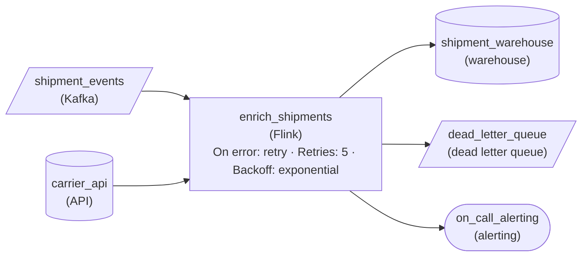

*Each failure class gets its own exit from `enrich_shipments`: bounded retries on the node, poison and exhausted events to `dead_letter_queue`, credential expiry to `on_call_alerting`.*

| Pitfall: A blanket retry turns poison into load |
| --- |
| The tempting design puts one retry policy on the whole job and stops there. A malformed event then burns 5 backed-off attempts before landing anywhere, holding up the events behind it. An expired credential spins every event through the full cap and never reaches a person. Classify first, then attach the retry only to the class that can recover. |

| Key insight: Exhausting retries is a classification too |
| --- |
| A timeout that survives 5 attempts has stopped behaving like a transient failure. Giving it the same dead letter destination as poison means the retry cap is a decision about where the event goes next, not the point where it silently disappears. |

**Follow-up questions**

1. The warehouse write sometimes fails on a locked partition and sometimes on a duplicate key. How do you classify each?\
   *Applies the same classification to the write surface of a node instead of the read.*
2. The carrier starts returning rate-limit responses during peak hours. Which class is that, and does it change the backoff?\
   *Checks that a new failure mode is placed by its cause rather than by the service it came from.*


<br>

### Exercise 2 of 2

**● TASK**

A stream job parses 40,000 smart-meter readings per second from a queue into a warehouse, and readings it fails to parse are currently skipped. Route those failures to a dead letter queue, then read the DLQ as a quality signal: compute its per-second arrival rate broken down by exception type, chart that rate on a dashboard, and page the on-call engineer when any one type's rate climbs.


<br>

### Solution

#### A DLQ is a sensor, not a bin

Reading a dead letter queue as a quality signal means treating every entry as a data point about the system, not a chore to clear. A firmware wave that starts emitting a new timestamp format lands in the DLQ minutes after it ships, long before anyone notices gaps in the warehouse. The DLQ only tells you that if something computes its rate and breaks it down by exception type.

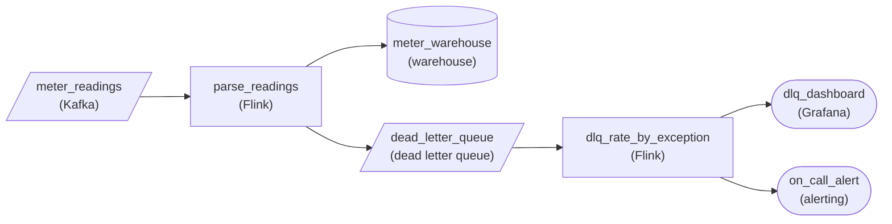

*Failures leave `parse_readings` for `dead_letter_queue`, and `dlq_rate_by_exception` turns the DLQ into per-type rates for a dashboard and a page.*

1. **Divert, then measure the rate**

   Sending `parse_readings` failures to `dead_letter_queue` keeps the bad readings, but size alone says little: 4 failures a second is normal noise at 40,000 readings a second. `dlq_rate_by_exception` counts arrivals per second keyed by exception type, so the background rate and a fresh regression stop being the same number.

2. **Put the signal in front of people**

   The per-type rates go to `dlq_dashboard` for anyone looking and to `on_call_alert` for when nobody is. Paging on one type's rate rising is what turns a day-fourteen discovery into a day-one fix.

| Pitfall: Total DLQ size hides a new failure type |
| --- |
| A fleet already failing 4 readings a second for a known reason absorbs a new failure at 2 a second without the total looking alarming. Broken down by exception type, the new type jumps from zero to 2 per second: an obvious spike. Alert on the total and the regression hides inside the baseline. |

| Real world: Each exception type points at an owner |
| --- |
| In practice a schema mismatch points at the producer team, a timeout at a downstream service, a malformed payload at a firmware release. A per-type chart tells you who to call before you open a single record. |

**Follow-up questions**

1. What changes if the rate is also broken down by firmware version?\
   *Adding a second dimension so a spike traces back to the rollout that caused it.*
2. How would you alert on an exception type that has never appeared before?\
   *Telling a brand-new failure type apart from growth in a known one.*


<br>

---

## Postmortem: Six-Hour Outage

This postmortem follows the order pipeline on a day before any of this lesson's patterns existed. Each decision behind it was ordinary when made; the outage comes from how they lined up. Read each event and name the pattern that would have stopped it before checking the table that follows.


<br>

### The timeline

| Time | Event |
| --- | --- |
| 09:00 | A tax service deploy adds a slow query; 30% of calls now take 1.5 s |
| 09:04 | Calls past the 1 s timeout are retried by the client and the task, 4 attempts each: up to 16 calls per order |
| 09:12 | Load reaches about 32,000 requests per second; every call times out |
| 09:12 | Calls that exhaust retries are labeled permanent; every order goes to the DLQ |
| 09:58 | The unbounded prefetch buffer runs out of memory; 4 restarts by 11:40 rewrite 1.9 million rows to the DLQ a second time |
| 11:30 | Finance's hourly report shows almost no orders since 09:12: the first human signal |
| 12:05 | On-call traces the timeouts to the tax service |
| 13:00 | The tax team rolls back, but the retry storm keeps the service saturated |
| 14:45 | Someone pauses the pipeline by hand and the tax service recovers |
| 15:00 | The pipeline resumes and the outage is declared over, with 31 million rows in the DLQ |
| 15:30 | An engineer copies every DLQ row onto the input log at full speed; the tax service saturates again |
| 15:50 | The copy stops; a script replays at 600 per second for a little over 14 hours |

- **2 h 30 min** — until a finance report, not an alert


<br>

### Each event as a missing pattern

| Time | Missing pattern | Prevention | Section |
| --- | --- | --- | --- |
| 09:04 | Retries at 2 layers | Retries at a single layer, inside a budget | Cascading Failure |
| 09:12 | Mass timeouts handled per record | Failure rate fed to the classifier opens the breaker | Classification |
| 09:12 | DLQ went from 0.01% to 100% unseen | Alert on DLQ rate by failure class | DLQ as Signal |
| 09:58 | Unbounded buffer | Capped buffer pushing back to the log | Cascading Failure |
| 11:30 | Consumers found it first | Paging on DLQ rate and table freshness | DLQ as Signal |
| 13:00 | Nothing gave the service room to recover | Breaker with half-open probes | Cascading Failure |
| 15:30 | Replay shared the live path | Separate replay worker with its own limit | Reprocessing |
| 15:50 | Duplicate DLQ rows, 1.9 million | Upsert on order_id guarded by event_seq | Reprocessing |

The 09:12 misclassification matters most. A classifier reading the failure rate would have seen timeouts on more than half of calls within seconds, opened the breaker and left every order in the log. The DLQ flood, the duplicate rows and both replay mistakes disappear, and the 13:00 rollback ends the outage, because nothing is sending extra load to the service. What remains is a backlog in the log that drains once the tax service recovers.


<br>

### The checklist

- Every failure gets a class from duration and scope, and the classifier reads the recent failure rate
- Retries live at a single layer, with exponential backoff, jitter and a retry budget
- Each dependency call sits behind a circuit breaker with half-open probes
- Every buffer is capped, and a full buffer stops the consumer from pulling
- Records carry a priority, so the pipeline can defer or shed them under slowdown
- DLQ rows store producer version, failure class and error signature
- Alerts cover DLQ rate by slice, new signatures, the oldest untriaged row and conservation
- Replay runs on its own throttled path and writes with an event_seq-guarded upsert
- The runbook has an entry per failure class

> **TIP**
>
> Run the checklist against a design before it ships: name a failure from each class and trace where each record ends up. A record that can end up nowhere, or in 2 places, marks the gap.

**A clickstream pipeline enriches events with a geo-lookup service. During a geo-lookup slowdown, its DLQ grows by 2,000 rows per second, and the team plans to replay them afterward. Which change fixes the cause?**

- **A.** Raise the DLQ storage limit so it can hold a full day of failed events
- **B.** Add a third retry layer so slow calls get more chances before reaching the DLQ
- **C.** Feed the failure rate to the classifier so mass timeouts open the breaker and stay in the log
- **D.** Replay the DLQ continuously at full speed so it never holds more than a few minutes

<details>
<summary>Solution</summary>

**C.** Feed the failure rate to the classifier so mass timeouts open the breaker and stay in the log

Mass timeouts are transient systemic, so records belong in the source log behind an open breaker.

**Why the others are wrong**

- **A.** This makes the flood survivable and leaves it in place; every slowdown still ends in a mass replay.
- **B.** More layers multiply calls on a struggling service and deepen the slowdown.
- **D.** Full-speed replay adds load to the slow service, repeating the 15:30 mistake from the postmortem.

</details>

The checklist also has to hold up when the recovery tooling itself fails. At 09:58 in the postmortem, 4 restarts wrote 1.9 million orders to the DLQ twice, and a replay worker can crash halfway through its selection in the same way. A design passes the replay items only if running the same selection a second time leaves every row of curated.orders unchanged.

**A team replays 6 million DLQ rows with a worker throttled to the tax service's headroom. Halfway through, the worker crashes and restarts with the same selection. What keeps curated.orders correct?**

- **A.** The upsert on order_id guarded by event_seq, which turns already-written rows into skips
- **B.** The throttle, which keeps replay slow enough that duplicate writes cannot occur
- **C.** The DLQ rate alert, which fires if the restarted worker writes a row a second time
- **D.** The circuit breaker, which opens when the same order_id is written a second time

<details>
<summary>Solution</summary>

**A.** The upsert on order_id guarded by event_seq, which turns already-written rows into skips

Rows from the first pass now match the stored seq, so the guard skips them and nothing is written twice.

**Why the others are wrong**

- **B.** The throttle controls load on the tax service; a slowly written duplicate is still a duplicate.
- **C.** That alert watches failures entering the DLQ and never sees rows written to the curated table.
- **D.** A breaker reacts to failing dependency calls, and rewriting an existing row raises no failure.

</details>


<br>

---

## Pipeline Architecture

### Exercise 1 of 2

**● TASK**

A stream job reads payment webhook events from a queue, converts currencies and loads them into a warehouse; events it fails on already land in a dead letter queue, about 3,000 a day. Make that DLQ drainable: add an inspection view operators can filter by exception type, and a replay stage that applies their fixes and sends a chosen batch back into the input queue. Show replay progress on a dashboard.


<br>

### Solution

#### A DLQ is only as good as its drain

Reprocessing from the DLQ is where a dead letter queue earns its keep: until someone can read, fix and resend those 3,000 events a day, they are lost payments with a storage bill. So the replay tooling sits on the canvas as real stages, an inspection view reading the DLQ and a replay stage writing back into the input queue, designed alongside the pipeline rather than improvised during an incident.

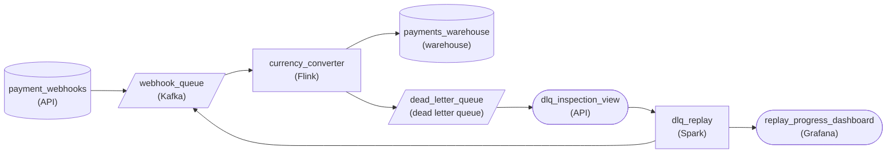

*Failures from `currency_converter` land in the DLQ; `dlq_inspection_view` reads it, fixes flow into `dlq_replay`, which resends to `webhook_queue` and reports to `replay_progress_dashboard`.*

1. **Give operators a read path**

   The inspection view reads the dead letter queue directly and shows each failed event's payload, exception type, attempts and correlation ID, filterable by exception type. Operators decide what to replay here instead of writing queries against raw envelopes.

2. **Carry the fix into replay**

   The edge from the inspection view into the replay stage is the modify step: an operator patches a missing currency rate or annotates a malformed payload, then selects one event, a hundred, or every event of one exception type. That selection is the blast radius.

3. **Replay into the input queue**

   The replay stage writes into the same queue the live job reads, so replayed events get the same conversion, the same warehouse load, and the same route back to the DLQ if they fail again. Its progress feeds a dashboard, so a replay whose failure count climbs is stopped early.

| Pitfall: Replaying straight into the warehouse skips the job that failed |
| --- |
| Writing fixed events directly into the warehouse bypasses the currency conversion and leaves a still-broken event nowhere to go. Send replays through the input queue so the stream job stays the only writer and its DLQ route still catches repeat failures. |

**Follow-up questions**

1. How would finance tell replayed warehouse rows apart from live ones?\
   *Carrying an operator annotation from inspection through replay into the load.*
2. How would you replay every missing-rate failure from last Tuesday without touching newer ones?\
   *Bounding a replay by exception type and time range.*


<br>

### Exercise 2 of 2

**● TASK**

A sensor gateway pushes 20,000 readings per second straight into a stream job that writes them to a time-series store. When the store slows to 5,000 writes per second, the job's memory fills and the crash spreads back to the gateway. Redesign the path with backpressure so a 30-minute store slowdown buffers durably instead of crashing anything upstream, with no reading lost. In normal running, readings land within a minute.


<br>

### Solution

#### Where the pressure lands

Backpressure only works if some component can absorb the wait. In this pipeline the original source cannot: sensors send on a fixed schedule, so a full buffer in the stream job's memory has nowhere to push back except into the gateway, and the gateway crashes. The fix is to **end the backpressure chain at a durable log**. The gateway appends and moves on, the stream job reads at whatever rate the store accepts, and the difference piles up on disk instead of in anyone's heap.

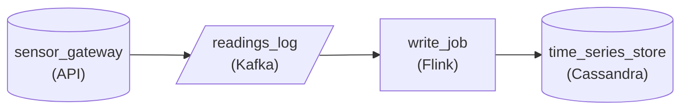

*The gateway appends to `readings_log`; `write_job` pulls at the store's pace, so a slowdown grows the log, not anyone's memory.*

1. **Put a durable log between gateway and job**

   The gateway's only job becomes appending to `readings_log`. An append is cheap and does not depend on how fast anything downstream reads, so the gateway's health no longer depends on the store's.

2. **Let the job pull at the store's pace**

   `write_job` consumes from the log and caps its in-flight writes. When the store slows, the job simply reads less often and its position falls behind the head of the log. That lag is backpressure made visible, and it is the only place the slowdown shows up.

| Performance: A 30-minute backlog fits on disk, not in memory |
| --- |
| Readings arrive at 20,000 per second and leave at 5,000, so the backlog grows by 15,000 per second: 27 million readings over 30 minutes, about 5.4 GB at 200 bytes each. A log keeps that across restarts, and once the store recovers to 30,000 writes per second the job drains the backlog in about 45 minutes while new readings keep arriving. |

| Pitfall: A bigger in-memory queue only delays the crash |
| --- |
| Raising the stream job's buffer size buys minutes, not safety. Holding 5.4 GB in a heap is the same crash later, and every buffered reading is lost when it happens. A bounded memory buffer with nothing durable behind it just hands the wait to a gateway that cannot wait. |

**Follow-up questions**

1. An anomaly detector now needs the same readings but runs slower than `write_job`. Where should it read from?\
   *Independent consumers on one log: each falls behind on its own position without slowing the other.*
2. The log keeps one hour of data and the store stays slow for 3 hours. What happens?\
   *Retention is the edge of the durable buffer; past it, backpressure has nowhere left to land.*


<br>

---

## Putting It All Together

Uber has published how payments for its Driver Injury Protection program move through retry queues with growing delays before landing in a dead letter queue. Take that design to the night a premium-calculation service slows down after a deploy, and walk each failure through it.

- Classification: timeouts on most calls mark the slowdown as transient systemic, so the breaker opens and payments wait in the source log instead of draining through the retry queues.
- Signal: a DLQ rate split by producer version shows whether the slowdown or a bad producer release causes the failures, minutes before drivers or finance notice.
- Backpressure: capped buffers hold payments in the log, and the log's retention sets how long the slowdown can last before anything is lost.
- Replay: once the service recovers, a throttled worker drains the DLQ within the service's headroom, and an upsert on payment ID makes a crashed replay safe to rerun.
- Postmortem: if the night still goes wrong, each event maps to a missing checklist item, which turns the incident into specific design changes.


<br>

---

## Pipeline Architecture

### Exercise 1 of 2

**● TASK**

A stream job reads 8,000 ride events per second from a queue, calls a fare-pricing service per event, and writes the priced events to a warehouse. Its postmortem found that a two-hour pricing slowdown silently dropped every event whose first call failed. Apply the action items: retry pricing calls with exponential backoff up to a fixed limit, route events that exhaust retries to a dead letter queue, and page on-call when that queue grows.


<br>

### Solution

#### A retry policy decides whether a failure stays transient

Retry handling is the action item this postmortem keeps returning to. With no retry policy, a two-hour pricing slowdown turned recoverable timeouts into two hours of lost rides. The fix is not to retry harder: at 8,000 events per second against a service sized for about 10,000 calls, immediate retries pile load onto the one dependency already struggling.

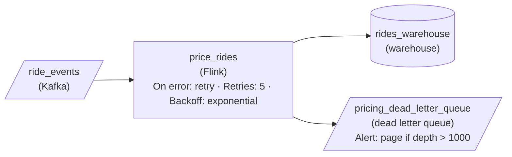

*Priced events flow to the warehouse; events that exhaust 5 exponential retries in `price_rides` go to a dead letter queue that pages on-call as it grows.*

1. **Back off exponentially, then stop**

   Set the pricing stage to retry with an exponential `retryBackoff` and a fixed `retryCount`. Growing waits give a slow service room to recover instead of stacking a second wave of calls on it, and the cap guarantees every event eventually leaves the retry loop. A two-hour outage is longer than any sane retry window, which is why the next step exists.

2. **Give exhausted events a durable exit**

   An event that runs out of attempts is not garbage: the ride happened and finance needs its fare. Route it from the pricing stage to a dead letter queue so the original payload survives and can be replayed once pricing is healthy. Retry and DLQ are one design: the cap is safe only because the exit exists.

| Pitfall: A retry with no limit is a second outage |
| --- |
| The tempting post-incident fix is to retry forever. Unbounded retries pin a worker on one event, the source queue backs up behind it, and every attempt adds load while pricing is down. A malformed ride ID that can never price blocks the stream outright. |

| Key insight: The page is what makes the DLQ worth having |
| --- |
| In the incident nobody noticed until finance did. A `monitorAlert` on the dead letter queue, paging when its depth climbs, turns a silent pile of failures into a signal within minutes while the events are still safe to replay. |

**Follow-up questions**

1. Pricing starts returning an error for malformed ride IDs that will never succeed. Should those be retried at all?\
   *Separating permanent failures from transient ones before the retry loop.*
2. The outage lasts 6 hours instead of two. How do you drain the dead letter queue without recreating the overload?\
   *Rate-limited replay against a recovering dependency.*


<br>

### Exercise 2 of 2

**● TASK**

A stream job reads 15,000 inventory events per second, published by three fulfillment services to a queue, and writes them to a warehouse. Last week its dead letter queue jumped from 40 to 6,000 records an hour, nearly all 'missing field' errors from one service, while timeouts stayed flat. Redesign it so a validation check sends contract violations to the dead letter queue, the stream job retries timeouts with exponential backoff before parking them in the dead letter queue, a monitor on the dead letter queue pages when one error type's hourly rate spikes, and a replay tool sends fixed records back through validation.


<br>

### Solution

#### Read the dead letter queue by error type, then act on what it says

A dead letter queue becomes a quality signal the moment you read its growth per error type instead of its total depth. Here the total jumped 150x, but the split tells the whole story: 'missing field' errors from one service climbed while timeouts held at their usual trickle. That pattern is upstream contract drift, a permanent failure, and it calls for a different action than a transient one: stop retrying it, page the team that owns the producer, and replay once their fix ships.

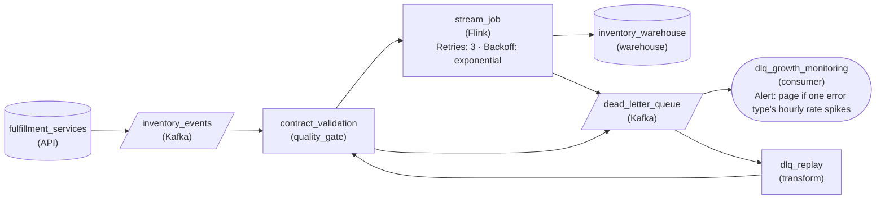

*Contract violations skip retries, timeouts retry and then park, and both the monitor and the replay tool read the dead letter queue.*

1. **Classify before you retry**

   A record missing a required field fails identically on every attempt, so `contract_validation` parks it on the first pass. Only the warehouse write timeout is transient, so only `stream_job` carries a `retryCount` of 3 with exponential backoff, and an exhausted retry lands in the same queue.

2. **Alert on the rate of one error type**

   Total depth hides the cause: 40 timeouts and 6,000 contract errors an hour look like one big number. `dlq_growth_monitoring` pages when a single error type's hourly rate spikes, which aims the page at the service whose release broke the contract.

3. **Replay through validation, not around it**

   After the producer ships its fix, `dlq_replay` pulls the parked records, lets someone patch or annotate them, and sends them back into `contract_validation`. A record that is still broken parks again instead of corrupting stock counts in the warehouse.

| Pitfall: More retries cannot fix a missing field |
| --- |
| The tempting reaction to a growing queue is raising the retry limit. For contract violations that multiplies load by the retry count, delays healthy events queued behind them, and still ends with the same records in the dead letter queue. |

| Real world: Error type plus producer names the owner |
| --- |
| Tag every parked record with its exception type and producing service. A spike confined to one pair right after a deploy is that team's contract break; a spike across every producer at once usually points at your own stream job or the warehouse. |

**Follow-up questions**

1. What changes if the drifted service keeps publishing broken events for two days before it ships a fix?\
   *Whether the dead letter queue retention and the replay tool are sized for a long backlog, and whether replay preserves update order per item.*
2. How would the design change if the missing field were optional and the stream job could fill a safe default?\
   *Reclassifying a failure from permanent to recoverable at validation, which shrinks what the dead letter queue has to hold.*


<br>

---

## Key Takeaways

- Classify every failure by duration and scope, and let the classifier read the recent failure rate so mass failures count as systemic.
- A permanent systemic failure belongs in a halted pipeline with a page, and its records stay in the source log.
- Slice the DLQ rate by producer version and failure class so a canary regression fires an alert before full rollout.
- Pair DLQ metrics with a conservation check, because a silent DLQ can hide swallowed failures.
- Replay on a separate path throttled to the dependency's headroom, writing with an upsert guarded by event sequence.
- Cascades are queues filling: cap buffers, push back to the durable log, shed by priority, and retry at a single layer.
