Beginner·Pipeline Architecture · 25 min · 10 challenges

# Failure Handling: Beginner

A Stripe settlement pipeline pulls payout files from dozens of card networks overnight. One network's API goes down for 3 minutes during a deploy. All 400 workers see the error at the same moment. What each worker does in the next 10 seconds decides whether the API comes back or gets knocked over again by Stripe's own retries, and whether anyone notices before the finance team opens the report.


<br>

---

## Transient vs Permanent Failures

A task fails when a call it makes returns an error or never returns at all. The error says what happened; it does not say what to do next. That decision comes down to one question: if the task ran the same step again in 10 seconds, would it succeed? Each of the 3 possible answers calls for a different response.


<br>

### One question, 3 answers

A transient failure is one where the answer is yes. The cause sits outside your code and passes on its own: a network connection dropped halfway through a request, a database refused a new connection because its pool was full, an API returned 503 because the server behind it was restarting. The request itself was fine, so sending it again after a pause gets it through.

A permanent failure is one where the answer is no. The cause is in the request itself or in the code, and waiting changes nothing: the file you asked for does not exist, the API key expired last week, a record carries the string `N/A` where the schema expects an integer, a function raised `KeyError` on a column the source renamed. The second attempt fails for the same reason as the first, and so does the fiftieth.

An ambiguous failure is one where the error does not tell you. A request timed out after 30 seconds: did the server never receive it, or did it process the request and lose the response on the way back? A 500 Internal Server Error says the server hit a bug, which might be a one-off under load or might be triggered by your exact payload every time. The status code alone cannot settle it.

| What the task sees | Typical cause | Category | First response |
| --- | --- | --- | --- |
| Connection reset by peer | A network hop dropped the socket | Transient | Retry after a pause |
| 503 Service Unavailable | The service is restarting or overloaded | Transient | Retry after a pause |
| 429 Too Many Requests | You exceeded the service's rate limit | Transient | Retry after the pause the service asks for |
| 401 Unauthorized | The credential is wrong or expired | Permanent | Stop, alert, rotate the credential |
| 404 Not Found | The resource or endpoint does not exist | Permanent | Stop and alert |
| ValueError parsing a row | The data does not match the expected shape | Permanent | Set the row aside, continue |
| Timeout after 30 s | Slow network, slow server, or a lost response | Ambiguous | Retry only if the step is idempotent |
| 500 Internal Server Error | The server raised an unhandled error | Ambiguous | Retry a few times, then stop |


<br>

### The response follows the category

Transient failures get a retry: wait, then run the same step again, a limited number of times. Permanent failures get the opposite. Retrying them wastes the time budget, delays the alert that someone needs to see, and in the worst case does damage, such as locking an account after too many bad logins. The task should stop at once and surface the error with its full traceback.

Ambiguous failures are where the idempotency lesson pays off. A timed-out call to write a batch of 5,000 rows may have landed every row before the response was lost. If the write replaces the partition rather than appending, running it again is safe, and you can treat the timeout as transient. If the write appends, a retry risks 10,000 rows where 5,000 belong, and the timeout has to be treated as permanent until someone checks what landed. The category of an ambiguous error depends on the step, not on the error.

> Response by category
>
> - Transient: retry a limited number of times, with a pause between attempts
> - Permanent: stop immediately, keep the error, alert a person
> - Ambiguous and the step is idempotent: treat it as transient
> - Ambiguous and the step is not idempotent: treat it as permanent until verified

> **TIP**
>
> Classify by the exception class and the status code, never by searching the message text. Messages change between library versions; a `requests.Timeout` class or a 503 status is stable and can be matched in code.

**A nightly task that loads a partner's daily order file raised a different error on each of 4 nights. Which of these should the task stop on at once, rather than retry?**

- **A.** A 503 from the partner's API while it was mid-deploy, which cleared within a minute
- **B.** A KeyError: 'customer_id' raised after the partner renamed that column to cust_id
- **C.** A connection reset 40 seconds into downloading a 900 MB file from the partner
- **D.** A 30 second timeout on the first call, after which the partner's status page showed a brief outage

<details>
<summary>Solution</summary>

**B.** A KeyError: 'customer_id' raised after the partner renamed that column to cust_id

The column is gone from every future response too, so the second attempt fails the same way as the first. This is permanent: stop, keep the traceback, and alert someone to fix the mapping.

**Why the others are wrong**

- **A.** A 503 means the service could not serve the request right now. The cause is on their side and passes on its own, so this is transient and a paused retry is the right response.
- **C.** A reset socket is a network fault. The download is a read, so repeating it is safe, and this is a textbook transient failure that calls for a paused retry.
- **D.** A timeout is ambiguous on its own, and the status page resolves the ambiguity toward a passing outage. Since the call is a read, retrying it is safe.

</details>


<br>

---

## Pipeline Architecture

### Exercise 1 of 2

**● TASK**

The nightly ingest_orders load hit four errors: HTTP 503 during a downstream CPU spike, HTTP 429 from a rate limiter, HTTP 401 from an expired service-account token, and a JSON parse error on one malformed row. Downstream of the ingest transform, add one quality-gate node per error, named with the error, then its bucket (transient or permanent), then the response that bucket calls for.

**Starting canvas** (already placed for you):

- Order events source (source, Kafka)
- ingest_orders transform (transform, Pandas)
- Orders warehouse (storage, warehouse)
- Orders dashboard (consumer, dashboard)


<br>

### Solution

#### Name the bucket before you pick the response

Sorting failures into **transient vs permanent** comes down to one question you ask of every error: would the exact same request succeed if the pipeline simply ran it again later? If yes, the cause is a temporary condition and the failure is transient, so the response is to try again. If no, nothing about waiting will change the outcome, so the failure is permanent and the response is to stop trying and fix or set aside the thing that is broken.

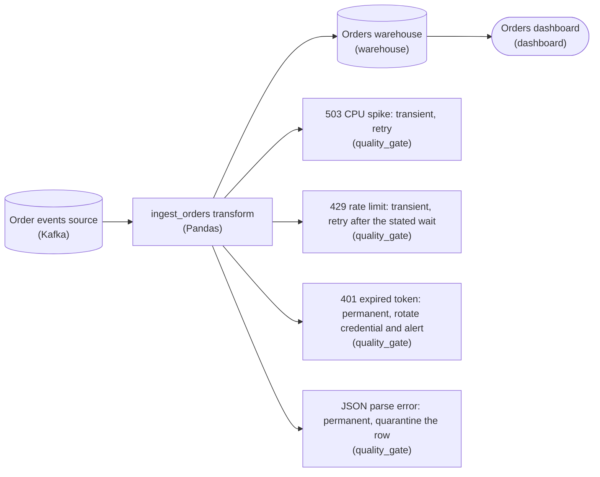

*One classifier gate per error off `ingest_orders transform`, each naming the bucket and the response that follows from it.*

Run last week's four errors through that question. The '503' came from a downstream that was briefly overloaded; once the spike passes the same call works, so it is transient. The '429' is transient too: the rate limiter is saying not yet, and it even tells you how long to wait. The '401' is a bad credential, and the section lists that as permanent: the expired token fails identically on every attempt until someone rotates it. The malformed JSON row is permanent as well: parsing the same bytes gives the same error forever, so that one row is set aside while the rest of the load continues. Any response that stops retrying fits a permanent error: alerting a human, rotating the credential, quarantining or dead-lettering the row.

| Pitfall: One response for every error gives up nothing and fixes nothing |
| --- |
| Wrapping the whole transform in one blanket try-again rule treats every error as transient. It burns compute replaying a row that can never parse and a token that will never authenticate, and it delays the healthy rows behind them. The bucket decides the response, not a single counter. |

| ✕ Transient: 503, 429 | ✓ Permanent: 401, JSON parse |
| --- | --- |
| A temporary condition caused it, so the identical request will work later. Try again; for the '429', wait the time the server named first. | The input or the credential itself is wrong, so retrying changes nothing. Stop, rotate the credential or set the bad row aside, and let a human know. |

| Key insight: An ambiguous error starts transient and gets escalated |
| --- |
| A plain '500' does not say whether the downstream is briefly overloaded or truly broken. The pragmatic call from the section is to treat it as transient with a small budget, and escalate it to permanent once that budget is spent. |

**Follow-up questions**

1. A request fails with HTTP '500' and no other detail. Which bucket does it start in, and what moves it to the other one?\
   *The ambiguous row of the section's table: transient with a small budget, then permanent.*
2. A downstream returns '400 Bad Request' on one order payload. Transient or permanent?\
   *Applying the same would-it-work-next-time question to a new status code.*


<br>

### Exercise 2 of 2

**● TASK**

An order-enrichment pipeline calls a pricing API that returns 503 while its backend restarts, and the current enrich transform retries every exception forever with no wait. Replace it with a bounded retry: give the transform a retry count of 5, and name it for its fixed wait between attempts and the transient errors it catches. A permanent error such as a bad request must fail on the first attempt. It writes to the enriched orders table, which merges on the event id.

**Starting canvas** (already placed for you):

- Order events source (source, Kafka)
- Pricing API (returns 503 during downstream restarts) (source, API)
- enrich_prices: while-True loop, bare except, no sleep, no max_attempts (transform)
- Iceberg enriched_orders (idempotent: MERGE on event_id) (storage, Iceberg)


<br>

### Solution

#### The retry that knows when to quit

What the transform needed is a **bounded retry**: call again a fixed number of times, wait between tries, then give up and let the error surface. 3 numbers make one correct: `max_attempts`, the `wait` between attempts, and the exact transient exception types you catch. One rule ties them together: only transient failures retry, and a permanent error propagates on the first hit. On the canvas the retry count of 5 lives in the transform's settings and its name carries the other two, so anyone reading the DAG knows the contract without opening the code.

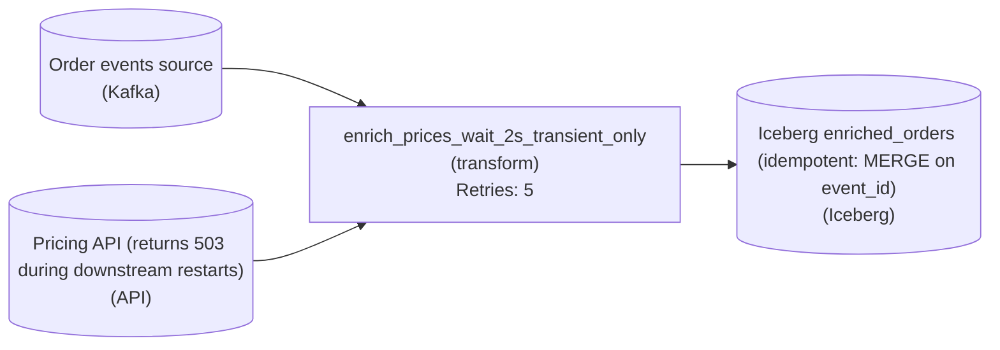

*A pricing `503` is absorbed by up to 5 attempts 2 seconds apart; a permanent `4xx` fails the record on the first try.*

**What you replaced**

```python
def enrich_prices(order):
    while True:
        try:
            return call_pricing_api(order)
        except Exception:
            pass  # every error, retried forever, no sleep
```

*The `while True` with a bare `except` retries a bad request as eagerly as a timeout, and never stops.*

**The bounded retry**

```python
import time
import requests

PRICING_URL = "https://pricing.internal/price"
TRANSIENT_STATUS = {502, 503, 504}


class TransientPricingError(Exception):
    pass


def enrich_prices_wait_2s_transient_only(order, max_attempts=5, wait=2):
    for attempt in range(1, max_attempts + 1):
        try:
            resp = requests.get(PRICING_URL, params={"id": order["event_id"]}, timeout=10)
            if resp.status_code in TRANSIENT_STATUS:
                raise TransientPricingError(resp.status_code)
            resp.raise_for_status()   # permanent 4xx -> propagates
            return {**order, "price": resp.json()["price"]}
        except (requests.Timeout, requests.ConnectionError, TransientPricingError):
            if attempt == max_attempts:
                raise
            time.sleep(wait)
```

*3 numbers (`max_attempts=5`, `wait=2`, the transient tuple) and one rule: `raise_for_status()` lets a `4xx` escape the loop.*

| Pitfall: A bare except cannot tell a blip from a bug |
| --- |
| The trap in the original is `except Exception`. A `503` from a restarting dependency and a `400` from a malformed order both land in the same branch, so the malformed order is retried forever and the whole pipeline wedges on one poison record. Narrowing the catch to `(Timeout, ConnectionError, TransientPricingError)` is what makes `raise_for_status()` meaningful: a permanent error is never swallowed, it propagates on the first attempt. |

| Key insight: Idempotent writes are the permission slip to retry |
| --- |
| Retrying is only safe because the sink does a `MERGE on event_id`. If attempt 3 succeeds after attempts 1 and 2 timed out mid-write, you still get exactly one row per `event_id`. Without that idempotent write, a bounded retry would double-insert an order every time a response was lost after the write committed. |

**Follow-up questions**

1. The fifth attempt still gets a `503`. What should the run do with that order, and why is re-raising better than returning `None`?\
   *Tests what happens when the retry budget is exhausted.*
2. What has to change first if the sink were an append that did not `MERGE on event_id`?\
   *Tests whether retry safety depends on the idempotent write, not the loop.*


<br>

---

## The Retry: Easy to Misuse

A retry is a loop that runs a failed step again. Writing one takes 5 lines, which is why most retry bugs come from loops written in a hurry. Every retry loop makes 4 decisions, whether the author noticed making them: which errors trigger another attempt, how many attempts are allowed, how long to wait between them, and what happens when the attempts run out.


<br>

### The loop that looks fine

```sql
while True:
    try:
        page = fetch_page(url)
        break
    except Exception:
        pass
```

This loop answers all 4 questions badly. `except Exception` retries every error, including the `KeyError` from a renamed column and the 401 from an expired key, both of which will fail identically forever. There's no pause, so a failing service receives a new request every few milliseconds from this one worker. There is no limit, so the task runs until someone kills it, and the orchestrator shows it as running rather than failed, which means no alert fires. And `pass` discards the exception, so when someone finally looks, there is no record of what went wrong.


<br>

### The bounded version

```sql
import time

import requests

RETRYABLE_STATUS = {500, 502, 503, 504}
MAX_ATTEMPTS = 5
WAIT_SECONDS = 2


def is_transient(err):
    if isinstance(err, (requests.ConnectionError, requests.Timeout)):
        return True
    if isinstance(err, requests.HTTPError):
        return err.response.status_code in RETRYABLE_STATUS
    return False


def fetch_with_retry(url):
    for attempt in range(1, MAX_ATTEMPTS + 1):
        try:
            response = requests.get(url, timeout=10)
            response.raise_for_status()
            return response.json()
        except requests.RequestException as err:
            if not is_transient(err) or attempt == MAX_ATTEMPTS:
                raise
            print(f"attempt {attempt} failed: {err}")
            time.sleep(WAIT_SECONDS)
```

`is_transient` encodes the first section's classification: connection errors, timeouts and the listed 5xx statuses are retried, nothing else. Status 429 is left out on purpose, because it needs the pause the service names in its `Retry-After` header, covered in the last section. `MAX_ATTEMPTS` is the budget: 5 attempts means 1 original call plus 4 retries. A permanent error or a spent budget hits the bare `raise`, which re-throws the original exception, so the task fails with the real traceback. Only a transient error with attempts left reaches `time.sleep`. The step is a read, so retrying a 500 or a timeout is safe. Around an appending write both are ambiguous, and the loop would drop 500 from `RETRYABLE_STATUS` and `requests.Timeout` from `is_transient`.

> **TIP**
>
> Count attempts, not retries, when you set the budget. `MAX_ATTEMPTS = 5` means the step runs at most 5 times. A budget described as '5 retries' means 6 runs, and the off-by-1 argument it starts costs more than the extra attempt.

| Attempt | Starts at | Result | What the loop does |
| --- | --- | --- | --- |
| 1 | 0 s | Timeout after 10 s | Sleep 2 s |
| 2 | 12 s | Timeout after 10 s | Sleep 2 s |
| 3 | 24 s | Timeout after 10 s | Sleep 2 s |
| 4 | 36 s | Timeout after 10 s | Sleep 2 s |
| 5 | 48 s | Timeout after 10 s | Raise; the task fails at 58 s |

The table shows the worst case: every attempt times out. The loop spends 50 seconds inside calls and 8 seconds sleeping, and raises at 58 seconds. If the orchestrator kills the task at 30 seconds, attempt 3 is cut off, the real error is never raised, and the task is marked as a timeout. Each orchestrator retry starts a fresh loop at attempt 1, so with 3 orchestrator retries, 4 runs make 12 calls instead of 5, and none ends with the real traceback. The task timeout has to exceed the loop's worst case, which you compute rather than guess.

✓Do

- Name the exact exception classes and status codes that count as transient
- Set a fixed attempt budget and re-raise the real error when it is spent
- Sleep between attempts, even in the smallest loop
- Log each failed attempt with its number and the error

✗Don't

- Catch Exception and retry whatever lands in it
- Retry inside while True with no exit
- Swallow the last error with pass or a silent None
- Set the task timeout shorter than the loop's worst case

**This loop wraps a CSV parse. What happens when the file has a malformed row that parse_csv rejects with ValueError?**

```python
def load_rows(path):
    for attempt in range(3):
        try:
            return parse_csv(path)
        except Exception:
            time.sleep(5)
```

- **A.** It parses 3 times, sleeps 15 seconds in total, then returns None and the caller continues as if it loaded nothing
- **B.** It raises ValueError on the first attempt, because a parse error is outside the loop's retryable list
- **C.** It parses 3 times, sleeps 15 seconds in total, then raises the last ValueError up to the caller
- **D.** It loops until the file is fixed, because range(3) restarts each time the exception is caught

<details>
<summary>Solution</summary>

**A.** It parses 3 times, sleeps 15 seconds in total, then returns None and the caller continues as if it loaded nothing

except Exception retries the permanent ValueError, and when the loop ends there is no raise, so the function falls off the end and returns None. Downstream code gets no rows and no error.

**Why the others are wrong**

- **B.** There is no retryable list. except Exception catches the ValueError along with everything else, so the first failure leads to a sleep, not a raise.
- **C.** The attempt count and the sleep are right, but nothing re-raises. After the third failure the loop ends and Python returns None.
- **D.** range(3) yields 3 values once. The loop is bounded; the problem is what happens after the third attempt, not an infinite loop.

</details>


<br>

---

## Pipeline Architecture

### Exercise 1 of 1

**● TASK**

500 workers call a pricing API every minute, and when a latency spike times them all out at once, their fixed one-second retry sends 500 retries back in one synchronized wave that turns the blip into an outage. Replace the fixed-delay retry stage with one named for its exponential backoff and jitter policy. Credential errors and malformed records will never succeed, so route those permanent failures to a quarantine node instead of retrying them.

**Starting canvas** (already placed for you):

- Order events (500 workers consume in parallel) (source, Kafka)
- call_pricing_api: retry on a fixed 1-second sleep (synchronizes all 500 workers) (transform, Python)
- Pricing API (external, overloaded by the synchronized retry wave) (consumer, API)
- Enriched order events (storage, PostgreSQL)


<br>

### Solution

#### The retry became the load

A thundering herd is many clients getting knocked back at the same instant and then all retrying at the same instant. Your 500 workers timed out together during the blip, each slept a flat one second, and one second later 500 retries hit the pricing API as a single spike. The fix has 2 independent parts: make each worker wait a **different, growing** amount of time before retrying, and stop retrying failures that can never succeed.

| Pitfall: A fixed sleep shifts the wave, it doesn't spread it |
| --- |
| It is tempting to read a `sleep(1)` between attempts as 'backing off'. It isn't. A constant delay moves all 500 workers forward by the same second, so they stay in phase: the spike just lands a second later at the same height. Any policy that hands every worker the same delay leaves the herd intact. |

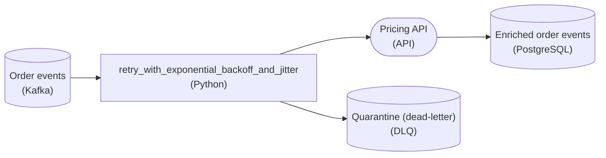

*The fixed retry transform becomes `retry_with_exponential_backoff_and_jitter`, and permanent failures branch to a dead-letter path instead of looping.*

| Key insight: Jitter is the part that desynchronizes |
| --- |
| Exponential backoff grows the delay (1s, 2s, 4s), capped with `min(2 ** attempt, 30)` so a struggling API gets exponentially fewer requests while a recovered one is picked back up promptly. But backoff alone keeps the herd together: 500 workers on the same schedule double in lockstep and still arrive together. A random offset (`delay * random()`) makes one worker wait 3.2s and another 6.9s, smearing the spike into a smooth curve. **Backoff protects the API over time; jitter protects it at any single instant.** |

| ✕ Retry it (transient) | ✓ Quarantine it (permanent) |
| --- | --- |
| A timeout, a `503`, a dropped connection could plausibly succeed on a later attempt, so it belongs in the backoff-and-jitter loop. | A `401` from a bad credential or a malformed record fails identically every time. Retrying it just burns attempts and adds load forever. Route it once to the dead-letter path for a human or a repair job, and let the stream keep moving. |

**Follow-up questions**

1. How would you stop a message from retrying forever, even when the failure looks transient?\
   *Tests whether the learner caps attempts with a max-retries budget and drains exhausted messages to the same dead-letter path.*
2. What does full jitter (`delay * random()`) trade off against equal jitter (`delay/2 + random()*delay/2`)?\
   *Tests that full jitter spreads arrivals most aggressively while equal jitter keeps a guaranteed minimum wait.*


<br>

---

## Naive Retries and Thundering Herd

The bounded loop is correct for 1 worker, and pipelines rarely have 1. Picture 100 workers running it, with the wait set to 1 second and a budget of 8 attempts, pulling settlement pages from a payments API that serves 40 calls per second. At the 30 second mark the API restarts and answers nothing for 200 milliseconds. Every call in flight fails, every worker sleeps the same 1 second, and all 100 retries arrive at the same instant. The API is healthy again, but 100 calls land in a window built for 40. The 60 that get a 503 sleep 1 second and arrive together again.

Every worker waits 1 s after a failure, then calls again28 s

100 workers

workers

RETRYafter 1 s

MAX TRIES8

downstream API

payments_api

CAPACITY40/s

workers0 calls made

0 through0 retrying0 gave up

calls per secondcapacity 40/s

A 200 ms blip and 100 workers

1/20

Run the first variant and watch the arrivals. The original fault lasted 200 milliseconds. The service is then held at full capacity by retries for several seconds, and some workers are on their third or fourth attempt before the backlog clears. Every one of those extra calls was created by the clients' own retry policy. This is the thundering herd: a group of clients that fail together, wait the same amount, and return together.


<br>

### How a herd keeps a service down

The animation shows a blip. The expensive case is a real outage. Suppose the API falls over because its database is slow, and would recover in 2 minutes if left alone. During those 2 minutes every worker retries every second, so the API's first moments of recovery are met by 100 synchronised calls, which push it over again. It never gets a quiet moment to come back up. Meanwhile each worker burns through its 8 attempts in under 10 seconds, raises, and the orchestrator marks the task failed. Someone reruns the DAG, and the rerun launches another 100 workers into a service that is still down.


<br>

### Backoff spaces the waves, jitter spreads each one

Backoff spreads the waves apart in time. Instead of 1 second every time, the wait doubles after each failure: 1, 2, 4, 8 seconds. The service gets more room between waves, and a worker that has failed 7 times is calling once a minute. Jitter spreads the workers within a wave. Instead of sleeping exactly 4 seconds, each worker sleeps a random amount between 0 and 4 seconds. The 100 retries that used to land in the same millisecond now land across a 4 second window, at an average of 25 per second, under the service's capacity of 40.

Switch the animation to the second and third variants and compare how long the service stays pinned. With backoff alone the waves are further apart but each wave still hits as one spike. With jitter the spike dissolves into a trickle and the backlog drains within a few seconds of the fault, with far fewer calls made in total.


**A team adds exponential backoff (1 s, 2 s, 4 s, 8 s) to 500 workers but no jitter. The API they call handles 200 calls per second and goes down for 300 milliseconds. What happens on the first retry wave?**

- **A.** The 500 retries spread across the first second, so about 500 per second arrive and 300 of them fail
- **B.** About 200 retries arrive in the first second and the rest wait, because the API queues what it cannot serve
- **C.** All 500 retries succeed, because the outage was only 300 milliseconds and the API is healthy at 1 second
- **D.** All 500 retries arrive at the same instant 1 second after the failure, 300 get rejected, and those 300 return together 2 seconds later

<details>
<summary>Solution</summary>

**D.** All 500 retries arrive at the same instant 1 second after the failure, 300 get rejected, and those 300 return together 2 seconds later

Backoff changes the gap between waves but not the shape of a wave. Every worker computed the same 1 s wait, so the first wave is 500 simultaneous calls against capacity for 200. The rejected 300 all compute 2 s and come back as one group.

**Why the others are wrong**

- **A.** Without jitter nothing spreads them. They all arrive at the same instant, 1 second after the failure, rather than across the second.
- **B.** The API has no such queue in this scenario; calls above capacity are rejected. And the workers do not coordinate, so nothing holds 300 of them back.
- **C.** The API is healthy but its capacity is 200 per second. Health and capacity are different limits, and 500 simultaneous calls exceed the second one.

</details>


<br>

---

## Pipeline Architecture

### Exercise 1 of 1

**● TASK**

Exponential backoff in one sentence: each successive retry waits roughly twice as long as the previous one (base * 2^attempt), capped at a maximum, with jitter applied. Without a cap the seventh retry waits 64 seconds, the tenth waits 512, the fifteenth waits 4 hours. The cap is non-optional. Compute the wait by replacing the retry transform with one whose name states the formula's three knobs: base, cap, and a jitter strategy.

**Starting canvas** (already placed for you):

- Order events source (source, Kafka)
- call_tax_api: retry with no cap (seventh wait = 64s, fifteenth wait = 4 hours) (transform, Python)
- Tax API downstream (storage, API)
- Iceberg enriched_orders (idempotent: MERGE on event_id) (storage, Iceberg)


<br>

### Solution

#### Bounded exponential backoff

The retry transform you rewrote is **bounded exponential backoff with jitter**, and its new name says all three knobs out loud: a `base` delay, a `cap` that clamps the growth, and a jitter strategy. The wait for an attempt is `min(cap, base * 2 ** attempt)`, then jitter perturbs it so a fleet of workers doesn't wake in lockstep. The doubling makes it back off; the `cap` keeps the doubling from running away.

| Pitfall: The uncapped version is a time bomb |
| --- |
| The starter node computed `base * 2 ** attempt` with no `cap`. That looks fine early, but `2 ** attempt` grows without bound: the seventh wait is 64s, the tenth 512s, the fifteenth over 4 hours. A transient Tax API blip that clears in a minute leaves your consumer parked for an afternoon while Kafka lag climbs. The `cap` bounds worst-case latency. |

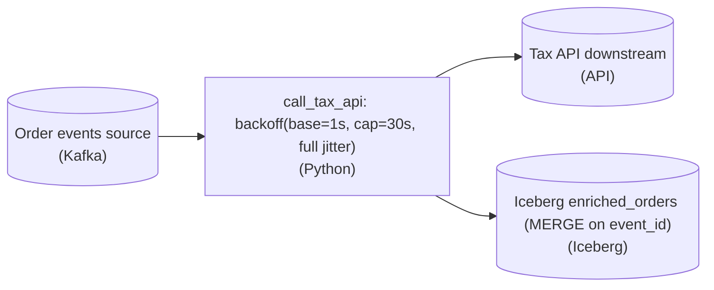

*The retry transform names its three knobs; the sink stays idempotent so replays are safe.*

**The wait, made concrete**

```python
import random

def backoff_delay(attempt, base=1.0, cap=30.0):
    capped = min(cap, base * 2 ** attempt)
    return random.uniform(0, capped)  # full jitter
```

*`min()` applies the cap; full jitter picks a point in `[0, capped]`.*

| Trick: Jitter is what prevents the thundering herd |
| --- |
| Deterministic `min(cap, base * 2 ** attempt)` makes every worker that failed at the same instant retry together, hammering the API in waves. **Full jitter** sleeps a random amount in `[0, capped]`, smearing retries across the window and breaking the correlation that turns a recoverable outage into a self-inflicted DDoS. |

Retries and idempotency are two halves of one design: once you retry, the same order event may be processed twice (the first call may have succeeded before the timeout). That is why the sink is a `MERGE on event_id`, not a blind `INSERT`. Backoff makes retries survivable upstream; idempotent writes make them survivable downstream.

**Follow-up questions**

1. After how many attempts should `call_tax_api` stop retrying and route the event to a dead-letter topic?\
   *Backoff bounds each wait, but you still need a max-attempts ceiling so a broken event doesn't loop forever.*
2. If the Tax API returns a 429 with a `Retry-After` header, how should that override the computed `cap`?\
   *Server-directed backoff should win over the client's own schedule.*


<br>

---

## Computing Exponential Backoff

Exponential backoff is a formula, and you should be able to run it in your head before you trust a library to run it for you. After the n-th consecutive failure, the wait before the next attempt is `wait = min(cap, base * 2 ** (n - 1))`. `base` is the wait after the first failure. The exponent doubles it with each further failure. `cap` is the ceiling the wait can never exceed. With the animation's settings, base is 1 second and cap is 60 seconds.

*Libraries differ on whether the first failure is numbered 0 or 1. Check which before comparing numbers; the shape of the curve is the same either way.*

| Failure number | base \* 2^(n-1) | After the 60 s cap | Cumulative sleep |
| --- | --- | --- | --- |
| 1 | 1 s | 1 s | 1 s |
| 2 | 2 s | 2 s | 3 s |
| 3 | 4 s | 4 s | 7 s |
| 4 | 8 s | 8 s | 15 s |
| 5 | 16 s | 16 s | 31 s |
| 6 | 32 s | 32 s | 63 s |
| 7 | 64 s | 60 s | 123 s |
| 8 | 128 s | 60 s | No sleep: attempt 8 was the last of the budget |

Doubling beats adding a second each time because a linear ramp of 1, 2, 3, 4 seconds grows too slowly to matter: after 10 failures a worker is still calling every 10 seconds, and 100 such workers still send 10 calls per second into a service that may need a minute of quiet. Doubling reaches a full minute between calls by the seventh failure.


<br>

### The cap keeps the wait finite

Without the cap the doubling never stops. By the eleventh failure the computed wait passes a quarter of an hour, and by the twentieth it is measured in days. A worker sleeping that long is indistinguishable from a hung task, and no outage is helped by a client that checks back next week. The cap turns the curve into a ramp with a flat top: doubling while the service most needs room, then a steady polling interval of 60 seconds once the wait is long enough. With the cap in place, the 7 waits in the table add up to about 2 minutes before the eighth and final attempt.

- **17 min** — uncapped wait after failure 11
- **6 days** — uncapped wait after failure 20


<br>

### Jitter: a random point inside the window

Full jitter replaces the computed wait with a random draw between 0 and that wait: `sleep = random.uniform(0, min(cap, base * 2 ** (n - 1)))`. The capped value becomes the top of a window rather than the wait itself. After the third failure a worker no longer sleeps 4 seconds; it sleeps somewhere between 0 and 4 seconds, and the 100 workers in a wave each draw their own number. Here are 3 workers that failed at the same moment, across their first 4 failures.

| Failure | Window (0 to) | Worker A draws | Worker B draws | Worker C draws |
| --- | --- | --- | --- | --- |
| 1 | 1 s | 0.8 s | 0.2 s | 0.5 s |
| 2 | 2 s | 1.7 s | 0.4 s | 1.1 s |
| 3 | 4 s | 0.3 s | 3.6 s | 2.2 s |
| 4 | 8 s | 6.9 s | 1.5 s | 4.8 s |

The average sleep is half the window, so jitter also shortens the typical wait. The cap still matters, because the window stops at 60 seconds and no draw exceeds it. Each worker draws fresh on every attempt, which breaks the synchronisation. Workers A and B failed in the same millisecond, but their later attempts are independent, so they collide only by chance rather than every time.

```sql
import random


def backoff_seconds(failures, base=1.0, cap=60.0):
    raw = base * 2 ** (failures - 1)
    window = min(cap, raw)
    return random.uniform(0, window)
```

This function is the whole policy. Call it with the number of consecutive failures so far, sleep for what it returns, and stop calling it once the attempt budget is spent. The retry loop from the previous section needs 1 change: replace the constant `WAIT_SECONDS` with `backoff_seconds(attempt)`.

**A retry policy uses base 0.5 s, cap 30 s and full jitter. A worker has failed for the 6th consecutive time. Which statement about its next sleep is right?**

- **A.** It sleeps exactly 16 s, because 0.5 multiplied by 2 to the 5th is 16 and that is under the cap
- **B.** It sleeps a random amount between 0 and 16 s, because 0.5 multiplied by 2 to the 5th is 16 and that is under the cap
- **C.** It sleeps a random amount between 0 and 30 s, because 0.5 multiplied by 2 to the 6th is 32 and the cap applies
- **D.** It sleeps a random amount between 0 and 32 s, because 0.5 multiplied by 2 to the 6th is 32 and nothing caps it

<details>
<summary>Solution</summary>

**B.** It sleeps a random amount between 0 and 16 s, because 0.5 multiplied by 2 to the 5th is 16 and that is under the cap

The 6th failure means an exponent of 5: 0.5 * 32 = 16 s. That is below the 30 s cap, so the window is 0 to 16 s and the worker draws a value inside it.

**Why the others are wrong**

- **A.** The arithmetic is right: 0.5 * 32 = 16 s, under the 30 s cap. But with full jitter 16 s is the top of the window, not the sleep itself.
- **C.** The exponent is failures minus 1, so it is 5, not 6. The raw value is 16 s, which the cap does not touch.
- **D.** Both the exponent and the cap are wrong here. The exponent is 5, giving 16 s, and even a 32 s value would be capped to 30 s.

</details>


<br>

---

## Pipeline Architecture

### Exercise 1 of 2

**● TASK**

Give transient errors capped exponential-backoff retries, but stop retrying three failures that never heal. Send an event missing a required field to quarantine storage a human can inspect, and an HTTP 401 to a paging tool instead of risking a lockout. Send a poison pill, a message that crashes the worker on every pull, and any event that exhausts its retries to a separate dead-letter queue so the queue keeps flowing. Wire each one from the worker on an error path.

**Starting canvas** (already placed for you):

- Kafka events source (source, Kafka)
- process_events transform (currently retries every error class indefinitely) (transform, Python)
- Iceberg processed_events (downstream sink) (storage, Iceberg)
- Events dashboard (consumer, dashboard)


<br>

### Solution

#### When retrying can't change the outcome

Error routing by retry-ability is the idea behind what you drew. A retry only helps when something can change between attempts: a timeout, a briefly unavailable sink, a throttled call. Those failures are transient, so the worker retries them a capped number of times with exponential backoff, and an event that exhausts its retries falls through to the dead-letter queue instead of looping forever. A **deterministic** failure returns the identical result on every re-run, so retrying it burns cycles and can do real harm. All three failures here are deterministic, so each one skips the retry loop and leaves the worker on its own error path to a terminal home.

The destination follows who resolves the failure. A validation failure sees the same missing field on every attempt, so it goes to durable quarantine storage (an object store or a table) where a human inspects the bad record. A `401` keeps presenting the same wrong credential and can lock the account out, so it pages an on-call engineer who can rotate the secret. A poison pill crashes the worker on every pull and blocks every message behind it, so it goes to a dead-letter queue, which isolates the bad message and keeps the main queue flowing.

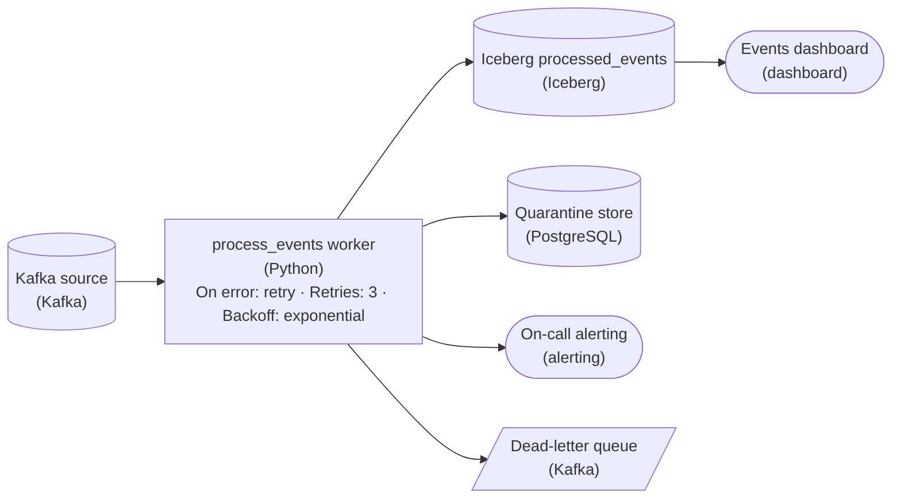

*Three capped retries with exponential backoff on the worker for transient errors, then three error paths, each failure class routed to a home that matches how it gets resolved.*

| Pitfall: One retry loop for every error class |
| --- |
| The starter worker retries everything indefinitely. A poison pill re-crashes the worker and stalls the whole partition, and a `401` retried in a tight loop trips the account lockout you were trying to avoid. Even a transient error needs a cap: without one, an outage that outlasts the backoff turns into an endless loop. Retrying a deterministic failure never reaches a different result. It only spreads the damage from one bad record to the whole stream. |

| Real world: The DLQ is where debugging starts |
| --- |
| The dead-letter queue and the quarantine store are worklists, not graveyards. On-call replays the DLQ after a fix ships, and quarantined records become test cases for the schema check that let them through. An alert on DLQ depth is often the first sign that an upstream producer changed its payload. |

**Follow-up questions**

1. A throttled call returns 429 and a bad credential returns 401: how does the worker tell them apart before it decides whether to retry?\
   *Tests whether the learner classifies an error by its status before the retry decision, not after.*
2. What metadata would you attach to a quarantined validation record so a human can reproduce and fix it?\
   *Checks that quarantine storage carries the offset, the raw payload and the error, not just the rejected event.*


<br>

### Exercise 2 of 2

**● TASK**

A logistics ETL enriches Kafka shipment events against a route API that returns 503s while restarting, then writes them to a Snowflake mart the operations dashboard reads. Its enrich step treats every exception alike, retries on a fixed one-second clock across 200 workers, and loops forever on unparseable rows. Rebuild it so the enrich step's name states its retry policy (bounded attempts, capped exponential backoff, jitter, transient errors only), validation failures land in a quarantine store, auth failures page an on-call alert, poison pills go to a dead-letter queue, and the mart keeps feeding the dashboard.

**Starting canvas** (already placed for you):

- Kafka shipment_events (200 workers fan-in) (source, Kafka)
- Route lookup API (third-party; 503 during restarts) (source, API)
- enrich_routes: while-True bare except, fixed 1s sleep, no classification, no quarantine (transform, Flink)
- Snowflake shipments_enriched (idempotent: MERGE on shipment_id) (storage, Snowflake)
- Logistics dashboard (consumer, Looker)


<br>

### Solution

#### The catch block that couldn't tell failures apart

What you rebuilt is **error classification**: before reacting to a failed enrichment, you name what KIND of failure it was. The old `enrich_routes` had one bare `except` that treated a route API `503`, a malformed shipment, an expired credential, and an unparseable poison row as the same event, then answered every one by sleeping a fixed second and looping. Three of those 4 never heal on retry, so the loop meant to ride out a brief restart spun forever.

| Pitfall: A fixed retry clock is a self-synchronizing herd |
| --- |
| All 200 workers retried on the same one-second clock, so failed rows hit the API in synchronized waves. The moment it recovered it took 200 simultaneous requests, fell over, and returned everyone another `503` on the same clock. Capped exponential backoff spreads the attempts; `jitter` randomizes each worker's wait so the herd never re-synchronizes. |

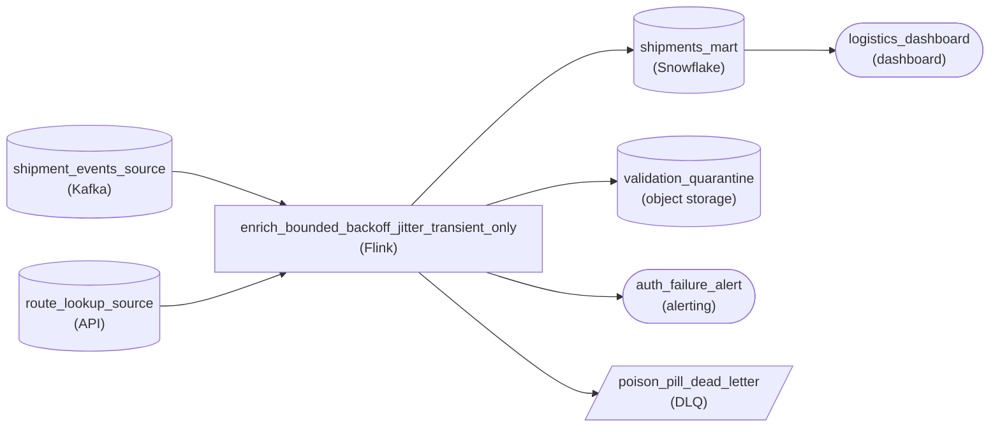

*One enrich stage, 4 exits: only transient errors loop back; each other class forks to a lane that matches its cause.*

Only transient errors, `503`s and timeouts, flow back into the loop, and `enrich_bounded_backoff_jitter_transient_only` fences even those: bounded attempts, exponentially growing waits, a cap so the wait never runs away, and jitter. Everything else forks by cause. A schema failure goes to `validation_quarantine`, a durable object store where it waits for inspection instead of blocking the stream. An auth failure routes to `auth_failure_alert`, because an expired credential needs a human, not a backoff. A row that exhausts its attempts is a poison pill and lands in `poison_pill_dead_letter`, so one bad message can never wedge the pipeline.

| Key insight: The stage name is the retry contract |
| --- |
| Spelling the policy into `enrich_bounded_backoff_jitter_transient_only` makes the guarantee auditable at a glance. Retrying is safe only because `shipments_mart` does a `MERGE` on `shipment_id`, so a re-delivered row updates in place instead of double-writing. |

**Follow-up questions**

1. If the route API starts returning `429` with a `Retry-After` header, where does that fit your classification?\
   *Checks whether rate-limiting is treated as transient but honors the server's clock instead of blind backoff.*


<br>

---

## When NOT to Retry

A retry is the wrong tool for records that can't be processed, credentials that are rejected, and bugs in the pipeline's own code, which together account for nearly all the cases where retrying hurts. A retry on any of them produces the same error again, only later, with the alert delayed by the full length of the backoff schedule. Each category has its own destination.

| Category | Example | Why a retry cannot help | Route to |
| --- | --- | --- | --- |
| Bad record | A row with `shipped_at = 'yesterday'` in a timestamp column | The row is the same on every attempt | Quarantine storage, then continue |
| Rejected credential | 401 after the partner rotated the API key | The key stays wrong until a person replaces it | Stop, alert, rotate the credential |
| Code bug | `TypeError` because a function received a list instead of a dict | The code is the same on every attempt | Fail the task, alert the owner |
| Missing resource | 404 for an endpoint removed in the partner's v3 API | The endpoint will not come back | Fail the task, alert the owner |
| Rate limit | 429 with a `Retry-After: 120` header | It will help, after the pause the service names | Retry after exactly that pause |


<br>

### Bad records go to quarantine

A nightly file holds 2 million orders, and 12 of them have a text string in the `amount` column. Failing the whole task over 12 rows blocks 1,999,988 good rows from reaching the warehouse, and retrying the task re-reads the same 12 bad rows. Instead, catch the parse error per row, write the bad row to a quarantine table alongside the error message, the source file name and the time, and keep going. Good rows load as usual. The quarantine table is a storage location with a schema, so it can be queried, and the task raises an alert when the quarantine count crosses a threshold, say 100 rows.

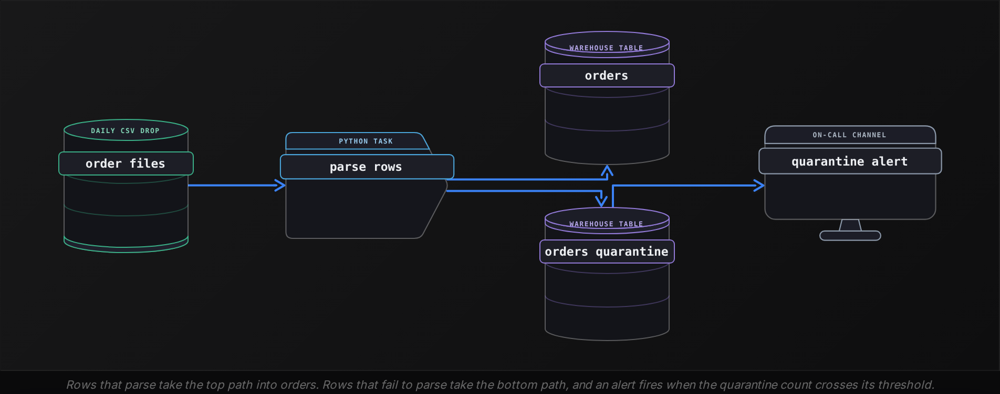

```sql
from datetime import datetime


def load_file(path):
    good, bad = [], []
    for raw in read_csv(path):
        try:
            good.append(parse_order(raw))
        except ValueError as err:
            bad.append(
                {"raw": raw, "error": str(err), "file": path, "seen_at": datetime.utcnow()}
            )
    write_orders(good)
    write_quarantine(bad)
    if len(bad) > 100:
        alert(f"{len(bad)} rows quarantined from {path}")
```

The `except` here catches `ValueError` and nothing wider. A `KeyError` from a renamed column is a bug in the mapping rather than a bad row, and it should stop the task so the mapping gets fixed, instead of quarantining 2 million rows one at a time. The `error` field in each quarantine row is what lets someone fix the source or the parser tomorrow.


<br>

### Rejected credentials go to a person

A 401 or 403 means the service understood the request and refused it. The key has expired, been revoked, or lost a permission. Retrying has 2 costs beyond wasted time. Many services count failed authentications and lock the account after a handful, so a loop of 5 attempts with backoff can turn a 2 minute fix into a support ticket. And the backoff schedule delays the alert: with the cap at 60 seconds, a person hears about the problem minutes after the first 401 instead of immediately. The task should fail on the first 401 and raise an alert that names the credential, so the owner can rotate it. Rotation means issuing a new secret at the service, storing it where the task reads secrets, and rerunning the task.


<br>

### Bugs fail fast

A `TypeError`, `KeyError`, `AttributeError` or `ZeroDivisionError` from the pipeline's own code is the same on the hundredth attempt as on the first. The right response is the one Python gives by default: let it propagate, let the task fail, let the orchestrator alert the owner with the traceback. The bounded loop from earlier does this already, because `is_transient` returns `False` for anything outside its list. A loop that catches `Exception` turns a 1 line bug into a task that sleeps for 2 minutes before reporting the same traceback it had at second 0.

**A task that pulls invoices from a partner API starts receiving 403 Forbidden on every call at 02:00. Its retry loop uses backoff with a 60 s cap and 8 attempts. What should the task do differently?**

- **A.** Keep the loop but raise the cap to 300 s so the partner's permission change has time to propagate
- **B.** Retry twice with a short pause in case the 403 was a one-off, then fail the task and alert
- **C.** Fail on the first 403, alert with the credential's name, and have the owner rotate it before rerunning
- **D.** Quarantine the response body and continue to the next invoice page so the rest of the pull completes

<details>
<summary>Solution</summary>

**C.** Fail on the first 403, alert with the credential's name, and have the owner rotate it before rerunning

The credential was refused and will keep being refused. Failing at once gets the alert out immediately, avoids an account lockout, and routes the fix to the person who can issue a new credential.

**Why the others are wrong**

- **A.** Permissions do not propagate on a timer the task can wait out. A 403 is a decision by the service, and a longer cap only delays the alert further.
- **B.** A 403 is a permanent category. The 2 extra attempts are 2 more failed authentications against an account that may lock, and they gain nothing.
- **D.** Quarantine is for records that can't be parsed. A 403 means no page will be served, so continuing produces a 403 on every remaining page.

</details>


<br>

---

## Pipeline Architecture

### Exercise 1 of 2

**● TASK**

A job pulls JSON order documents from a partner API and loads them into a warehouse. Warehouse writes sometimes time out during restarts, and some documents are malformed and will never parse. Retry the timed-out writes up to 3 times, never retry a malformed document, and set aside malformed documents and writes still failing after the last attempt in a quarantine store.


<br>

### Solution

#### Name the bucket, then pick the response

Every failure in this pipeline lands in one of 2 buckets, and the bucket decides what the pipeline does next. A warehouse write that times out during a restart is **transient**: the same request succeeds a minute later, so trying again is correct. A malformed JSON document is permanent: the partner sends the same bytes on every attempt, so a retry only burns compute. Your canvas puts that split where everyone can see it.

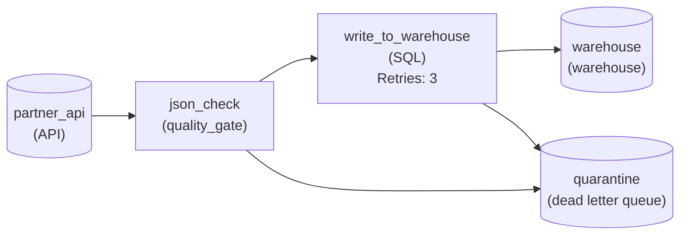

*Malformed documents leave at `json_check` with no retry. Writes get 3 attempts, then escalate to `quarantine`.*

Read the 2 edges into `quarantine` as the two halves of the classification. The edge out of `json_check` is the permanent bucket. That stage has no retry setting, so a bad document goes straight to quarantine and the rest of the run keeps loading. The edge out of `write_to_warehouse` is the transient bucket's escape hatch. The stage has a budget of 3 attempts, and a write that still fails after the third is escalated to permanent and parked in the same store. Without that budget, a timeout that turned out to be a real outage would retry forever.

| Pitfall: One retry setting for everything retries the unfixable |
| --- |
| If you put a retry count on the whole pipeline, or on the parse step, a malformed document is attempted 3 times and fails 3 times. It gets worse if a parse failure stops the run, because every good order behind it waits too. Retries belong only on the stage whose failure can heal. |

| Key insight: Ambiguous errors get a small budget, then escalate |
| --- |
| Most real errors don't announce their bucket. A bare 500 could mean a brief overload or a broken endpoint. Treat it as transient for a handful of attempts, and once those are spent, handle it exactly like a permanent failure. The quarantine edge out of the retrying stage is that escalation. |

**Follow-up questions**

1. The partner API starts returning 500s with no message. Which bucket does that go in, and what changes on the canvas?\
   *Applies the ambiguous-as-transient hedge to a stage that had no retry budget.*
2. The warehouse credential expires overnight. Should the 3 retries on `write_to_warehouse` still apply?\
   *Spots a permanent failure arriving at a stage built for transient ones.*


<br>

### Exercise 2 of 2

**● TASK**

An hourly job fetches currency exchange rates from a rates API and loads them into a warehouse. The API returns 503s during its deploys, which last up to two minutes. Set the fetch step's retry backoff to exponential (a setting of its own, not just a retry count), with waits doubling from one second and capped at one minute, and enough retry attempts that the waits outlast a deploy. When the retries run out, page the on-call engineer instead of retrying further.


<br>

### Solution

#### Doubling waits, with a ceiling

Exponential backoff picks each retry's wait by doubling the last one and stopping at a ceiling. Here that means 1, 2, 4, 8, 16 and 32 seconds, then 60 for every attempt after, because the cap holds. The doubling gives the rates API more room to finish its deploy with every failure, and the cap keeps a late attempt from sleeping through the next run.

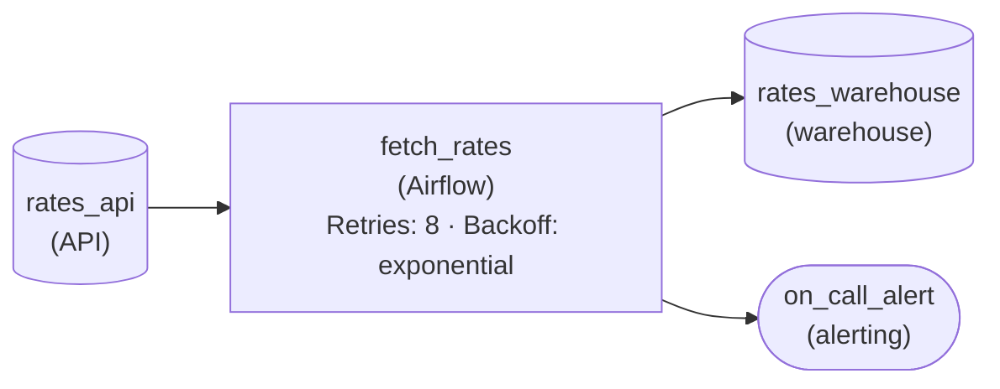

*`rates_api` feeds `fetch_rates`, which retries with exponential backoff for 8 attempts, loads `rates_warehouse`, and pages `on_call_alert` when the retries run out.*

1. **Size the attempts against the deploy**

   Add up the capped waits until they clear two minutes: 1 + 2 + 4 + 8 + 16 + 32 + 60 = 123 seconds after 7 attempts, which beats a two minute deploy with almost no margin. An eighth attempt adds another 60 for 183 seconds, the same 3 minute budget the section worked through, so a `retryCount` of 8 rides out a slow deploy with room to spare.

| Pitfall: Doubling without a cap runs away |
| --- |
| Leave the ceiling off and the tenth wait is 512 seconds, the twelfth over half an hour. The hourly job would still be asleep when the next run starts, and rates that arrive hours late are worse than a run that failed loudly. |

| Real world: Past the budget, stop retrying and page |
| --- |
| After 3 minutes of escalating waits the API is no longer mid-deploy; something is actually broken. That is why `fetch_rates` connects to `on_call_alert`: retries absorb the outage that heals itself, and a person handles the one that does not. |

**Follow-up questions**

1. Deploys start taking 5 minutes. What changes in the policy?\
   *Re-sizing `retryCount` against a longer budget while the cap stays at 60 seconds.*
2. 40 hourly jobs share this API and all hit the same deploy at the same second. What would you add to the waits?\
   *Whether doubling alone keeps the retries from arriving together, and how jitter spreads them.*


<br>

---

## Putting It All Together

A marketplace's nightly settlement DAG has 250 workers, each pulling one seller's payout file from a bank API that serves 100 calls per second. At 01:40 the bank deploys and returns 503 for 20 seconds. At 01:45 a new seller's file arrives with 30 rows whose payout_date reads TBD. At 02:10 the bank rotates the API key without warning and every call returns 401.

- The 503s are transient, and each worker's bounded loop retries them with exponential backoff and full jitter. The first window is only 0 to 1 s, so that wave still lands near 250 calls per second against capacity for 100. Each later window doubles, and by the 0 to 4 s window the remaining retries average about 62 per second, under capacity. The first 6 failures average around 31 s of sleep, which outlasts the 20 second outage well inside the 8 attempt budget.
- The 30 TBD rows are permanent failures at the row level: the parser quarantines them with the error and file name, loads the seller's other rows, and the alert stays quiet because 30 is under the threshold.
- The 401s are permanent at the task level: is_transient returns False , the task fails on the first one instead of sleeping through 8 attempts, and the alert names the credential so the owner rotates it and reruns.
- The rerun is safe because the payout load replaces each seller's partition rather than appending, which is also what made the earlier timeouts safe to classify as transient.


<br>

---

## Pipeline Architecture

### Exercise 1 of 2

**● TASK**

An hourly Spark job reads payment rows from a PostgreSQL replica, checks each row's currency code against the reference list, and writes the rows to a data lake. Retry lake write timeouts a bounded number of times with exponential backoff. Do not retry the permanent failures: rows with an unknown currency code go to a quarantine store a person can inspect, and a 403 from the lake stops the job and alerts the on-call engineer.


<br>

### Solution

#### Retry what can heal, route what cannot

Knowing when not to retry comes down to one question per failure: does anything change between attempts? A lake write that times out can succeed a minute later, so it earns a bounded retry with exponential backoff. A row whose currency code is not on the reference list fails the same check forever, and a 403 means the job's credentials lack write access until someone fixes them. Retrying either one burns compute and buries a clear error under a pile of identical ones.

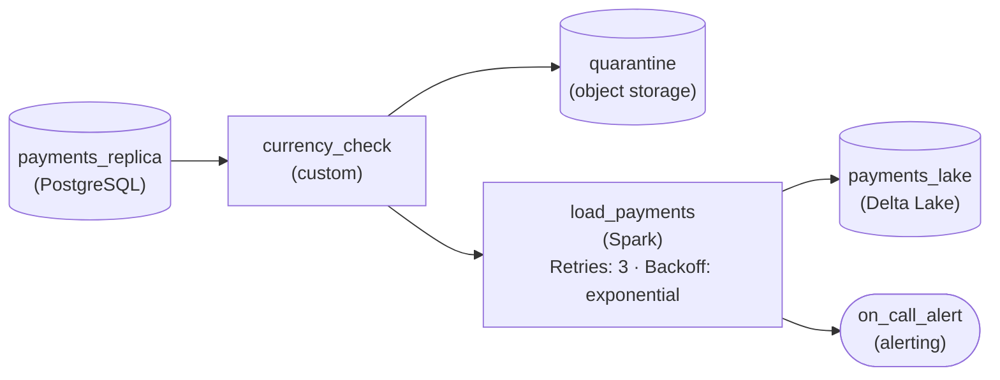

*Only `load_payments` retries; `currency_check` routes bad rows to `quarantine` and a 403 goes to `on_call_alert`.*

1. **Bound the retries on the lake write**

   Put the retry policy on `load_payments`, the stage that talks to the lake: three attempts, each waiting roughly twice as long as the last. The cap matters as much as the backoff, because a timeout that survives three spaced attempts is no longer a blip.

2. **Route unknown currencies to quarantine**

   `currency_check` sends failing rows down an error path to `quarantine`, where a person can see the bad code and ask the producer to fix it. Good rows keep flowing, and nothing loops back to run the check again.

3. **Send the 403 to a person**

   A permission failure on the write goes straight to `on_call_alert`. Only someone who can change the lake's permissions can resolve it, so the fastest fix is telling that person on the first failure, not after three wasted retries.

| Pitfall: A retry on the check repeats the same rejection |
| --- |
| Putting `retryCount` on `currency_check`, or one blanket retry policy across the whole job, looks safe but replays the identical row against the identical list. The log fills with copies of one error, the hourly run stalls, and the quarantine store that would have shown the problem stays empty. |

**Follow-up questions**

1. The lake starts returning 429 Too Many Requests at peak hours. Which path should that take?\
   *Tells a transient rate limit apart from the permanent 403.*
2. What should happen when all three write retries on `load_payments` fail?\
   *The hand-off once a transient failure stops looking transient.*


<br>

### Exercise 2 of 2

**● TASK**

Two hundred parallel workers in a nightly batch geocode customer addresses through a shared geocoding service and load the results into a warehouse. When the service is overloaded it slows down and returns 503s. Retry each 503 with exponential backoff, capped at 60 seconds per wait and spread with random jitter so the workers never retry in lockstep. Give each request a total retry budget of 5 minutes and page the on-call engineer when it runs out. A 400 for a malformed address is never retried: send it to a dead letter store for review.


<br>

### Solution

#### A retry policy that knows when to stop

When 200 workers share one struggling service, a good retry policy does two things at once: it gives the service room to recover, and it stops before the retrying becomes its own outage. **Exponential backoff** buys the room, the cap keeps any single wait reasonable, jitter breaks up the wave that 200 synchronized workers would send, and the total budget turns 'keep trying' into a decision that ends with a person being paged.

1. **Sort the failures before retrying**

   A 503 from an overloaded service is transient: the same request succeeds once the load drops. A 400 for a malformed address is permanent: the eighth attempt fails exactly like the first. Only the 503 enters the retry loop. The 400 goes straight to the dead letter store, where a person can fix the address.

2. **Shape each wait: double, cap, randomize**

   Double the wait on each attempt (2, 4, 8, 16, 32 seconds) and stop growing at 60. Then randomize each wait, for example a random value between zero and the computed delay. Without jitter, 200 workers that failed in the same second retry in the same second, and the service sees a wave larger than the load that tipped it over.

3. **Spend the budget, then escalate**

   8 attempts at those capped waits add up to about 4 minutes, inside the 5-minute budget and longer than the service's usual recovery. Once the budget is spent, the service is not hiccuping, it is down, and more retries only hide that. The exhaustion path leads to an alert so the on-call engineer hears about it tonight, not from an empty dashboard tomorrow.

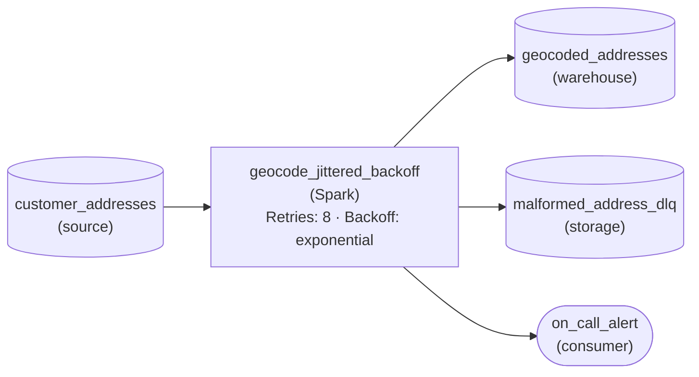

*`geocode_jittered_backoff` retries 503s with jittered waits of 2, 4, 8, 16, 32, then 60 seconds (8 attempts, about 4 minutes, inside the 5-minute budget). Exhaustion pages `on_call_alert`; 400s go straight to `malformed_address_dlq`.*

| Pitfall: A fixed one-second retry rebuilds the overload |
| --- |
| Retrying every second with no limit is the version most first designs ship. Across 200 workers that is 200 requests a second aimed at a service that is already failing, and with no limit the batch never finishes and never pages anyone. Exponential waits shrink the load, jitter spreads it out, and the budget guarantees the loop ends. |

**Follow-up questions**

1. The service starts returning 429 with a header saying when to retry. How does the policy change?\
   *Using a server-provided wait instead of a computed one, while still respecting the total budget.*
2. Every worker exhausts its budget in the same minute and the on-call engineer gets hundreds of pages. What would you change?\
   *Escalating once per outage rather than once per failed request.*


<br>

---

## Key Takeaways

- Every failure is transient, permanent or ambiguous, and the category decides the response before the error ever happens.
- A retry loop names its transient errors, sleeps between attempts, stops at a fixed budget, and re-raises the real error when the budget is spent.
- Many workers retrying on the same fixed schedule form a thundering herd that can keep a recovering service down.
- Exponential backoff spreads waves apart; jitter spreads workers within a wave; the cap keeps the longest wait sane. All 3 are required.
- Bad records go to quarantine, rejected credentials go to a person for rotation, and bugs fail fast with a traceback.
