Intermediate·Pipeline Architecture · 32 min · 12 challenges

# Failure Handling: Intermediate

Friday, 18:00, at Uber. A fare-adjustment event arrives with its amount written as `12,50`, a German-locale decimal. The payments consumer can't parse it. Because it retries the event forever, every trip receipt behind it stalls. At 18:10 the currency service stops answering and 200 workers retry in lockstep. Whether dinner rides get paid tonight depends on where each failure is sent.


<br>

---

## Dead Letter Queue Basics

### A bad message blocks a whole partition

A consumer reads a queue partition in order and commits its offset only after processing a message. Suppose offset 918223 carries the amount `12,50`, which can never parse. The consumer cannot commit past it, so every later message on that partition waits. This is head-of-line blocking: a single permanent failure halts traffic with nothing wrong with it, and a retry loop with no exit keeps the consumer on that message indefinitely.

A dead letter queue (DLQ) is a second destination for messages the consumer has classified as unprocessable, each stored with the reason it failed. After writing the message to the DLQ, the consumer commits past it and moves on. The bad record is kept for a person to inspect, and the good records behind it load within seconds instead of waiting days for a fix.

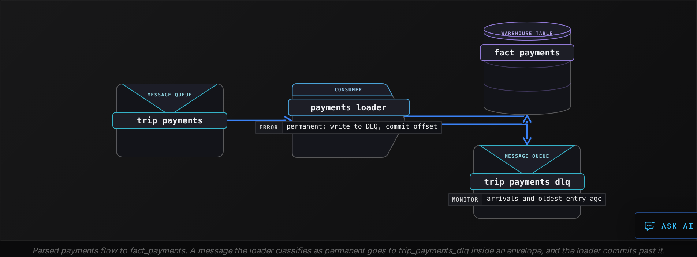


<br>

### What goes in, and what stays out

| ✓ Send to the DLQ | ✗ Keep out of the DLQ |
| --- | --- |
| • A payload that fails to parse, such as an amount of 12,50<br><br>• A value that breaks a rule no retry can change, like a negative fare<br><br>• A schema version this consumer has never seen<br><br>• A message that crashed the consumer on 5 deliveries in a row | • A timeout from the warehouse<br><br>• A 503 from the currency service<br><br>• A dropped connection<br><br>• A rate-limit response that says when to come back |

The left column holds failures that belong to the message: replayed unchanged, it fails again. The right column holds failures of the world around it. Routing those to the DLQ during a 20-minute warehouse outage would bury thousands of valid payments among the broken ones, each needing a manual replay. They get retried instead, and a message whose retries run out stays uncommitted in the main queue to be tried again.

The last item on the left needs care. A **poison message** crashes the process, for example by exhausting memory, so no error handler ever runs: the consumer restarts, reads the same offset and crashes again. The fix is to count deliveries somewhere a crash can't erase, with one counter per partition and offset. The consumer increments it before handling a message and, at 5 deliveries, sends the message to the DLQ unprocessed.

**Which failure should the loader send to trip_payments_dlq?**

- **A.** The warehouse answers every write with a 503 for 40 seconds
- **B.** A payment whose fare is -14.00, which the rules forbid
- **C.** The warehouse times out on 3 writes in a row
- **D.** The consumer loses its connection during a network change

<details>
<summary>Solution</summary>

**B.** A payment whose fare is -14.00, which the rules forbid

Permanent: replayed unchanged, it fails again.

**Why the others are wrong**

- **A.** Transient: the same message loads once the warehouse recovers.
- **C.** Transient: the timeouts belong to the warehouse.
- **D.** Transient: reconnecting fixes it with no change to the message.

</details>


<br>

### The envelope

An entry holding only error text is useless a week later. Each DLQ entry wraps the original message in an envelope. Next to the payload it records the source offset and the error, plus the version of the code that rejected it.

```sql
{
  "original_payload": "{\"payment_id\": \"p-7003\", \"amount\": \"12,50\", \"currency\": \"EUR\"}",
  "source": {
    "topic": "trip_payments",
    "partition": 4,
    "offset": 918223
  },
  "error": {
    "class": "permanent",
    "type": "AmountParseError",
    "message": "amount '12,50' is not a decimal"
  },
  "attempts": 1,
  "first_failed_at": "2026-10-23T18:00:04Z",
  "last_failed_at": "2026-10-23T18:00:04Z",
  "consumer_version": "payments-loader 2.14.0",
  "schema_version": 7
}
```

| Field | Why replay needs it |
| --- | --- |
| original_payload | Replay sends these exact bytes back through the loader; a re-serialized copy can hide the bug |
| source topic, partition, offset | Locates the message in the source and shows whether it was ever committed |
| error class and type | Groups 4,000 entries into 3 causes instead of 4,000 stack traces |
| consumer_version | Tells you whether a fix has shipped since, so a replay is worth trying |


<br>

### Retention longer than the source

The envelope carries a copy of the payload because the source won't keep one. If `trip_payments` retains messages for 7 days, the original of offset 918223 is deleted on day 8, and from then on the DLQ holds the only copy of that payment. DLQ retention therefore has to cover the slowest realistic path from failure to replay.

| Step | Slow but realistic |
| --- | --- |
| Entry lands Friday 18:00, alert read Monday morning | 3 days |
| Root cause found, fix reviewed and deployed | 4 days |
| Replay run and row counts checked | 1 day |
| Total from failure to replay | 8 days |

A 7-day DLQ would delete this payment a day before the replay. Set DLQ retention well past the worst case, such as 30 days.

| ✓ Do | ✗ Don't |
| --- | --- |
| • Alert on DLQ arrivals and on the age of the oldest entry<br><br>• Name an owner: the team that owns the consumer<br><br>• Replay through the same loader code, so validation runs again | • Leave the DLQ unwatched: a queue nobody reads is a delete with a delay<br><br>• Edit payloads in place; publish a corrected copy and keep the original |

**DLQ entries hold only an error string and a timestamp. The decimal-comma fix ships 12 days after the first entry; trip_payments keeps messages 7 days. What happens to the first day's failed payments?**

- **A.** They replay from the DLQ through the fixed loader
- **B.** They are re-read from the topic using the failure timestamps
- **C.** They are lost: no payload in the DLQ, and the topic copy expired
- **D.** They load on their own once the fixed loader restarts

<details>
<summary>Solution</summary>

**C.** They are lost: no payload in the DLQ, and the topic copy expired

Without original_payload the DLQ cannot rebuild them, and after 7 days the topic can't either.

**Why the others are wrong**

- **A.** The entries hold no payload, so the fixed loader has no input.
- **B.** The topic deleted them on day 8.
- **D.** The loader committed past those offsets, so it never reads them again.

</details>


<br>

---

## Pipeline Architecture

### Exercise 1 of 2

**● TASK**

The order-processing worker gives up after 5 retry attempts and silently drops the message. Add a dead letter queue downstream of the worker so exhausted messages land in a durable destination instead of being lost or crashing the worker. Name, on the queue, the envelope each failed message carries so it can be replayed and debugged: the original payload, failure timestamp, exception type, attempt count and correlation ID.

**Starting canvas** (already placed for you):

- Kafka order_events source (source, Kafka)
- process_orders worker (retry budget: 5 attempts; failures currently silently dropped) (transform, Python)
- Iceberg orders_enriched (idempotent sink) (storage, Iceberg)
- Orders dashboard (consumer, Metabase)

<details>
<summary><strong>Solution</strong></summary>

A **dead letter queue** is the durable side channel a message goes to once its retry budget is spent. Instead of looping forever on a message that will never succeed, the `process_orders` worker gives up after its 5 attempts and hands the message somewhere it can be inspected and replayed rather than throwing it away. That destination is the DLQ, and the whole trick is that it is a real, persistent queue, not a log line.

| Pitfall: Silent drop trades a stuck message for lost data |
| --- |
| The 3 tempting exits all lose information. Dropping after the 5th attempt makes one order vanish with no trace. Crashing the worker turns one poison message into a full outage, since it stops every healthy message behind it. Writing the failure to stdout leaves it in a log nobody can replay from. The DLQ is the option that keeps the message and keeps the worker moving. |

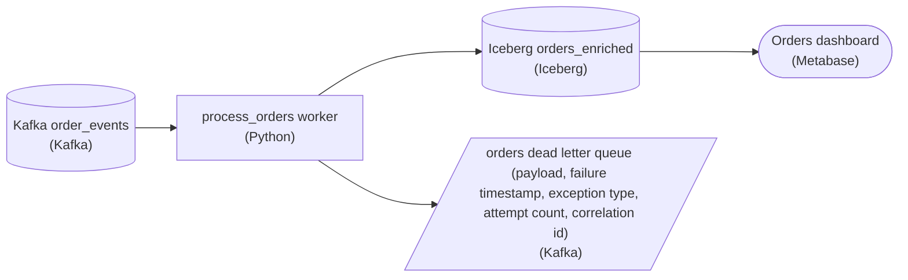

*The dead letter queue hangs off the worker as a second output: success flows to `orders_enriched`, and a message whose 5 attempts are spent flows to the Kafka dead letter queue with its envelope.*

The DLQ is only useful if its envelope is rich enough to recover from without the original stream. Write 5 fields per message: the original payload (so you can replay it verbatim), the failure timestamp, the exception type, the attempt count, and the correlation ID. Together they answer what failed, when, why, how hard the worker tried, and which order it was. That is enough to reprocess the message or to debug the class of failure without going back to the source topic.

| Real world: The DLQ is a queue you drain, not a graveyard |
| --- |
| In production a dead letter queue has an owner and an alarm on its depth. A rising queue usually means a systematic bug (a schema change upstream), not one bad row. The envelope's exception type lets you group those messages and fix the whole batch at once, then replay them back through `process_orders`. |

**Follow-up questions**

1. Should a transient timeout and a permanent schema error both land in the same dead letter queue?\
   *Tests whether the learner separates retriable from non-retriable failures: a timeout deserves the 5 retries, a malformed payload should go to the DLQ on attempt 1.*
2. Why does an idempotent sink like `orders_enriched` make DLQ replay safe?\
   *Checks that replaying a recovered message cannot double-write, so draining the DLQ carries no duplication risk.*

</details>


<br>

### Exercise 2 of 2

**● TASK**

A pipeline's tax API call retries with max_attempts=5 and a 60-second cap, so the naive worst case is 1+2+4+8+60=75 seconds. Each call can itself time out after 30 seconds, so real retry time runs to minutes. Replace the retry transform with one whose name states the full retry budget that bounds the worst case: max_attempts, base_delay, max_delay, max_total_elapsed and jitter.

**Starting canvas** (already placed for you):

- Kafka order_events source (source, Kafka)
- call_tax_api: max_attempts=5, cap=60s, no max_total_elapsed (real worst case is unbounded) (transform, Python)
- Tax API downstream (per-call 30s timeout) (storage, API)
- Iceberg orders_enriched (idempotent sink) (storage, Iceberg)

<details>
<summary><strong>Solution</strong></summary>

A retry budget is the set of five numbers that turns "keep trying until it works" into a bounded, predictable operation, and naming them on the transform is how you set it. `max_attempts` caps how many times you call, `base_delay` sets the first backoff, `max_delay` caps any single wait, `jitter` spreads the waits so retries don't synchronize, and `max_total_elapsed` caps wall-clock time across the whole sequence. The starter node carried 4 of them; the missing one, `max_total_elapsed`, is exactly why the real worst case was unbounded.

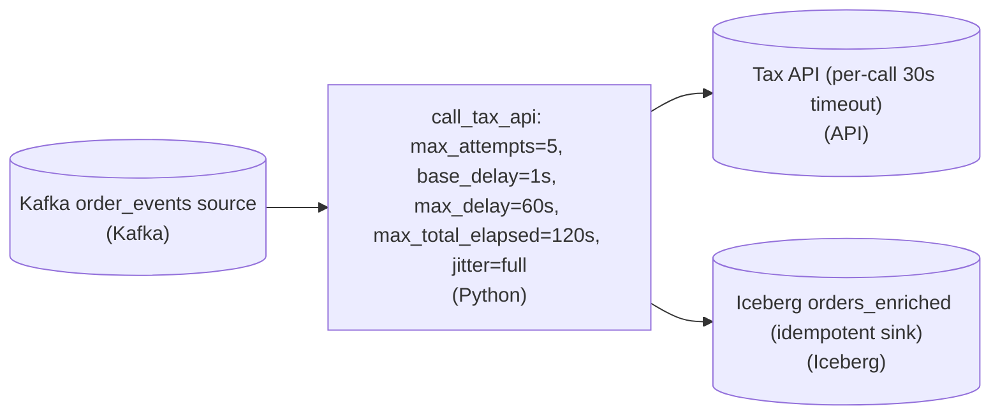

*All five numbers now live in the transform's name; `max_total_elapsed` is the one that makes the worst case a value you can state.*

| Pitfall: The 75-second worst case never existed |
| --- |
| The math `1+2+4+8+60=75` only sums the waits between attempts, assuming each call returns instantly. In production every attempt can burn the full 30-second per-call timeout before it fails, so five calls add up to 150 seconds of work on top of the waiting. With no ceiling on the total, the true worst case drifts into minutes. |

| Key insight: Only `max_total_elapsed` bounds the clock |
| --- |
| `max_attempts` bounds the count of calls, not their duration; `max_delay` bounds one wait, not the run. The single number that caps wall-clock time is `max_total_elapsed`: the loop checks it before every sleep and every call and gives up the moment the budget is spent. That is what lets you promise a worst case instead of estimating one. |

| Real world: Retries lean on the idempotent sink |
| --- |
| A retry often means the tax API already processed the order and only the response was lost. The `orders_enriched` sink is labeled idempotent for exactly this reason: writing the same enriched order twice must land once. A budget without an idempotent sink turns transient failures into duplicate rows. |

**Follow-up questions**

1. Should `max_total_elapsed` start at the first attempt, or when the event was pulled off `order_events`?\
   *Whether the budget covers queue wait or only the API call sequence.*
2. If the tax API returns a `Retry-After` header, how should it interact with `base_delay` and `max_delay`?\
   *Server-directed backoff versus the client's own budget.*

</details>


<br>

---

## Retry Budgets: Max, Delay, Jitter

### 4 limits around a retry loop

The beginner lesson gave retries a delay formula: wait longer after each failure. A retry budget is the set of limits around that formula, and each limit stops a different quantity from growing without bound. The payments loader's warehouse write uses the budget below, plus a timeout of 2 s on every attempt so a hung call cannot stretch a single attempt into minutes.

| Limit | What it bounds | Loader setting |
| --- | --- | --- |
| Max attempts | Calls one message makes to the warehouse | 6 |
| Base delay and cap | The length of any single wait | 0.5 s, doubling, capped at 8 s |
| Elapsed deadline | Total time a message can hold a worker | 20 s |
| Jitter | How many workers retry at the same instant | Full: a random wait from 0 to the computed delay |


<br>

### Walking the worst case

In the worst case every attempt hangs until its 2 s timeout. With jitter switched off so the arithmetic stays visible, the schedule runs like this.

| Attempt | Starts | Fails | Wait before next |
| --- | --- | --- | --- |
| 1 | 0.0 s | 2.0 s | 0.5 s |
| 2 | 2.5 s | 4.5 s | 1 s |
| 3 | 5.5 s | 7.5 s | 2 s |
| 4 | 9.5 s | 11.5 s | 4 s |
| 5 | 15.5 s | 17.5 s | 8 s |
| 6 | Would start at 25.5 s | Would end at 27.5 s | Refused: past the 20 s deadline |

The loader refuses to start an attempt that couldn't finish inside the deadline. Attempt 6 would run from 25.5 s to 27.5 s, so the loader stops at 17.5 s and hands the failure to the next layer. Max attempts allowed 6; the deadline allowed 5. Having both is deliberate: max attempts limits the load on the warehouse, and the deadline limits how stale the pipeline gets.

```sql
import random
import time


def call_with_budget(operation, max_attempts=6, base=0.5, cap=8.0,
                     deadline=20.0, attempt_timeout=2.0):
    start = time.monotonic()
    for attempt in range(1, max_attempts + 1):
        try:
            return operation(timeout=attempt_timeout)
        except TransientError:
            if attempt == max_attempts:
                raise
            delay = random.uniform(0, min(cap, base * 2 ** (attempt - 1)))
            elapsed = time.monotonic() - start
            if elapsed + delay + attempt_timeout > deadline:
                raise
            time.sleep(delay)
```

Only `TransientError` is caught. A permanent error, such as the `12,50` parse failure, passes straight through on the first attempt, which is how it reached the DLQ with `attempts: 1`.

**A loader's budget is 10 max attempts, a 1 s base delay that doubles, a 4 s cap, a 5 s timeout per attempt, and no elapsed deadline. If every attempt hangs until its timeout, how long can a single message hold a worker?**

- **A.** A total of 31 s, the sum of the 9 waits
- **B.** A total of 50 s, 10 attempts of 5 s each
- **C.** A total of 81 s: 50 s of attempts plus 31 s of waits
- **D.** No limit at all, because nothing sets a deadline

<details>
<summary>Solution</summary>

**C.** A total of 81 s: 50 s of attempts plus 31 s of waits

10 timeouts of 5 s, plus 31 s of waits: 7 waits of 4 s after an initial 1 s and 2 s.

**Why the others are wrong**

- **A.** Each of the 10 attempts also runs 5 s before timing out.
- **B.** This leaves out the 31 s of waits.
- **D.** Max attempts already bounds it; a deadline only tightens the bound.

</details>


<br>

### Jitter sized to what an attempt costs

Full jitter replaces each computed delay with a random wait between 0 and that delay, so 200 workers that failed in the same second spread their retries across a window. The window has to be wide enough that the retries arrive no faster than the downstream can serve them, and that depends on how long each attempt holds a connection.

The minimum window is workers \* seconds_per_attempt / concurrent_slots. Take a downstream that serves 20 requests at once. A currency lookup that holds a connection for 50 ms needs 200 \* 0.05 / 20 = 0.5 s of spread. A bulk load that holds a warehouse slot for 30 s needs 200 \* 30 / 20 = 300 s. The 0.5 s base delay that spreads the lookups well would start all 200 bulk loads within the same half-second, 10 times what the warehouse accepts.

When the warehouse fails for every message at once, each message spends its whole budget and the warehouse gets several times its normal traffic while it's weakest. A per-worker retry ratio closes the gap: each worker drops any retry that would push its retries above 10% of its calls in the last minute, which bounds fleet load because every worker applies it. A dropped retry leaves the message uncommitted for the next pass.

- **6x** — warehouse calls per message, all failing
- **1.1x** — calls per message under the retry ratio

**After a network blip, 120 backfill workers fail at the same moment. Each retry runs a 10 s query against a database that allows 40 concurrent queries. What is the smallest jitter window that keeps around 40 queries running at once?**

- **A.** A window of 30 s, so each slot runs 3 retries in turn
- **B.** A window of 3 s, the worker count divided by the slots
- **C.** A window of 0.25 s, the query time divided by the slots
- **D.** A window of 400 s, the slot count times the query time

<details>
<summary>Solution</summary>

**A.** A window of 30 s, so each slot runs 3 retries in turn

The window is 120 * 10 / 40 = 30 s, so retries finish about as fast as new ones start.

**Why the others are wrong**

- **B.** This drops the 10 s each query holds a slot.
- **C.** This ignores how many workers retry.
- **D.** This multiplies where it should divide, delaying recovery.

</details>


<br>

---

## Pipeline Architecture

### Exercise 1 of 2

**● TASK**

The tax API that the order worker calls has been down for 15 minutes, and every call waits out a 30-second timeout before failing. Put a circuit breaker between the worker and the API, named for its closed, open and half-open states and the failure threshold and cool-down that move it between them. Give the worker capped retries with exponential backoff, and send orders that exhaust them to a dead letter queue for replay.

**Starting canvas** (already placed for you):

- order_events (source, Kafka)
- process_orders (transform)
- tax_api (consumer, API)
- orders_enriched (storage, Iceberg)

<details>
<summary><strong>Solution</strong></summary>

#### A breaker in front, a retry budget behind it

A circuit breaker guards against a sustained outage of a whole service, while a retry budget guards against the momentary failure of one request. This design stacks the two. `process_orders` retries a capped number of times with exponential backoff. Every attempt passes through the breaker. An order that spends its whole budget lands in `orders_dead_letter_queue` instead of stalling the partition.

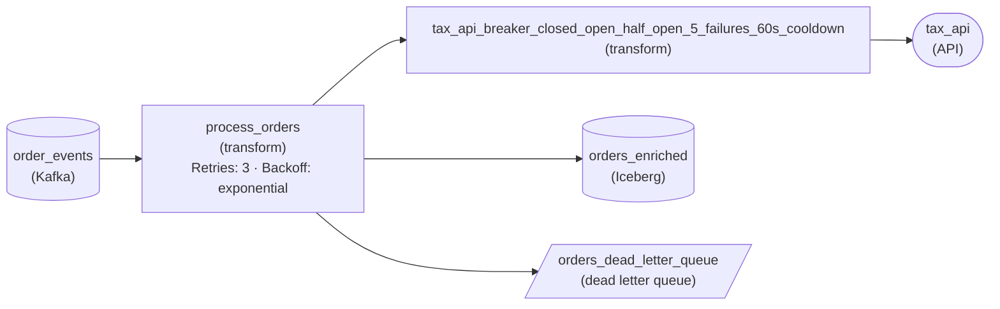

*`process_orders` reaches `tax_api` only through the breaker; orders that exhaust their retries go to `orders_dead_letter_queue`.*

The breaker is a three-state machine. In the closed state, calls pass through and failures are counted. After 5 consecutive failures it trips open, and every call returns immediately for the 60-second cool-down without touching the API. When the cool-down ends it goes half-open and lets one trial request through. A success closes it, and a failure opens it again for a fresh cool-down. Putting the states and both numbers in the stage name makes the behavior readable from the canvas.

| Pitfall: Retrying a dead service multiplies the wait |
| --- |
| The usual first attempt is a retry loop alone: catch the timeout, back off, call again. During a 15-minute outage, that turns one 30-second stall into three per order, with every worker doing it at once, so the API stays buried under timeouts. Backoff spaces the attempts out, but only the breaker stops sending them. |

| Key insight: An open breaker makes the retry budget cheap |
| --- |
| While the breaker is open, each retry fails in milliseconds, so an order spends its 3 attempts in seconds and moves on to `orders_dead_letter_queue`. The worker keeps draining `order_events`. Once a half-open trial succeeds, the parked orders are replayed into `orders_enriched`. |

**Follow-up questions**

1. When the breaker closes again, how would you replay `orders_dead_letter_queue` without reopening it with a burst of traffic?\
   *Combines the breaker's half-open caution with the replay rate of the dead letter queue.*
2. Should a 400 response from the tax API count toward the breaker's failure threshold?\
   *Separates a bad record, which belongs in the dead letter queue, from an unhealthy service, which should trip the breaker.*

</details>


<br>

### Exercise 2 of 2

**● TASK**

The Spark job aggregate_pageviews feeding a product analytics dashboard fails the whole batch on one malformed row. Choose all-or-nothing, skip-and-quarantine, or partial commit with checkpoint for this analytics workload, and rename the transform to name that strategy and its failure-rate threshold as a percentage: the dashboard tolerates up to 1% bad rows per batch. Connect the transform to a dead letter queue where set-aside rows land for inspection.

**Starting canvas** (already placed for you):

- Page-view events Kafka (millions of events per batch) (source, Kafka)
- aggregate_pageviews batch transform (currently fails the entire batch on any malformed row) (transform, Spark)
- Iceberg daily_pageviews (idempotent: partition overwrite by event_date) (storage, Iceberg)
- Product analytics dashboard (consumer, Looker)

<details>
<summary><strong>Solution</strong></summary>

#### Skip-and-quarantine, and the dead letter queue

An analytics rollup is the textbook home for **skip-and-quarantine**: keep processing the good rows, route each bad row to a side channel, and abort only if the failure rate crosses a threshold. That side channel is a dead letter queue, a place records go when the main transform cannot handle them. You applied it by renaming `aggregate_pageviews` to state the strategy and its bounding parameter, then wiring it to a quarantine destination the transform writes rejects to.

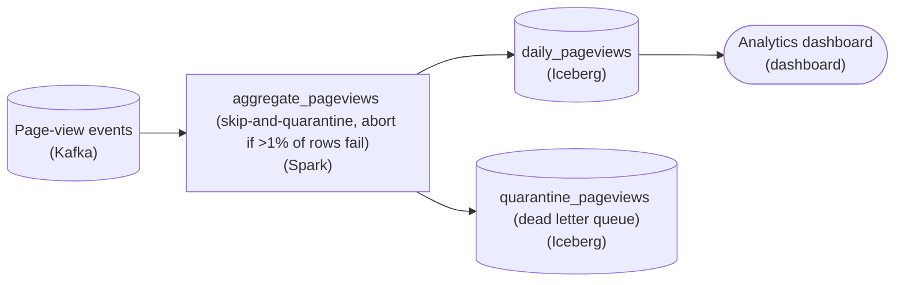

*The transform now has 2 outputs: good rows to `daily_pageviews`, rejects to the quarantine table. The threshold decides when to keep going and when to stop.*

| Pitfall: Both extremes lose something you need |
| --- |
| Failing the whole batch on one bad row throws away work on 9,999 good rows and stalls the dashboard for a single malformed event. Silently dropping the bad row inside the transform is worse: the row vanishes with no record, so an upstream schema change that starts corrupting thousands of rows looks exactly like a healthy run. Skip-and-quarantine avoids both because the set-aside rows land somewhere you can count and inspect. |

| Key insight: The threshold is what makes it skip, not silently drop |
| --- |
| A quarantine destination without a bounding parameter is just a silent drop with extra steps. The percentage threshold (here `>1%`) is the whole point: one bad row in 10,000 is noise and the batch should proceed, but 3,000 bad rows means something systemic broke and the batch must stop before it publishes garbage to `daily_pageviews`. Name the parameter in the transform so the strategy is legible on the canvas, not buried in config. |

| Real world: The workload picks the strategy, not the tool |
| --- |
| Analytics workloads tolerate a little loss for a lot of freshness, which is why this pattern is the default there. A daily ledger is the opposite case: it must balance, so it runs all-or-nothing, and that is only safe because the sink is idempotent, the way `daily_pageviews` overwrites its partition by `event_date`. Partial commit with checkpoint is the heavier tool for a batch so large that re-running from the top is expensive. |

**Follow-up questions**

1. What should a downstream job do with the rows in `quarantine_pageviews`?\
   *Tests whether the learner sees the dead letter queue as rows to reprocess or alert on, not a graveyard.*
2. How would you set the threshold if the batch size varied from 10,000 to 10 million rows?\
   *Pushes toward a percentage rather than an absolute count, and toward watching the rate trend over time.*

</details>


<br>

---

## Circuit Breakers Stop the Hammer

### When retries become the outage

A retry budget bets that the next attempt might work. During a long outage that bet loses every time. At 18:10 the currency service that `enrich_fx` calls to convert EUR fares to USD stops answering for 10 minutes. The enricher uses the same budget as the loader, so each worker spends 5 attempts and 17.5 s on a message, leaves its offset uncommitted, and starts over on the same message. No payment gets through, and the service absorbs a steady flood of calls while it tries to restart.

A circuit breaker sits between a caller and a single dependency, watches the outcomes of recent calls, and stops calling once failures cross a threshold. While it's open, every call fails at once with `CircuitOpen`. That failure takes microseconds and sends nothing over the network, so the struggling service gets quiet in which to recover.

- **57 per s** — calls on the down service, no breaker
- **0** — calls while the breaker is open


<br>

### Closed, open, half-open

| State | What a call does | Next state | When |
| --- | --- | --- | --- |
| Closed | Goes through; its outcome joins a window of the last 20 calls | Open | At least 10 of the last 20 calls failed |
| Open | Fails at once with `CircuitOpen`, no network call | Half-open | The 30 s cooldown has passed |
| Half-open | Lets 3 trial calls through; the rest fail at once | Closed | All 3 trials succeed |
| Half-open | Same trial rule | Open | Any trial fails; the 30 s cooldown restarts |

Each cooldown ends with 3 trial calls, a load any restarting service can take. When the service returns at 18:20, all 3 calls in the next probe succeed and the breaker closes. Traffic resumes within 30 s of the recovery.

#### Why each number is there

- **A window of 20 calls** *Trips on evidence*\
  Without a minimum, 1 failure in the first 2 calls reads as 50%.
- **A 50% failure rate** *Trips on outages*\
  A few slow calls leave it closed; a dead service trips it in seconds.
- **A 30 s cooldown** *Gives recovery room*\
  Long enough for a restart to finish, short enough to notice recovery within a minute.
- **Trials of 3 calls** *Probes gently*\
  A single success could be luck; 3 in a row is evidence, and far short of a stampede.

**A breaker opens at 14:00:00 with a 30 s cooldown and 3 trial calls. At 14:00:31 the first trial succeeds and the second times out. What happens next?**

- **A.** It closes, because a trial succeeded
- **B.** It stays half-open until the third trial returns
- **C.** It stays open until an operator resets it
- **D.** It opens again, with new trials about 30 s later

<details>
<summary>Solution</summary>

**D.** It opens again, with new trials about 30 s later

Any failed trial sends it back to open with a fresh 30 s cooldown.

**Why the others are wrong**

- **A.** Closing needs all 3 trials to succeed.
- **B.** A single failed trial reopens it; it doesn't wait for the third.
- **C.** The cooldown timer starts new trials on its own.

</details>


<br>

### What the pipeline does with CircuitOpen

The code that catches `CircuitOpen` decides what happens next. The error says nothing about the message, so it is classified as transient and the message never goes to the DLQ. The enricher stops polling and leaves its committed offset where it is. After the cooldown, `allow_request` lets it take up to 3 messages from that offset as the half-open trials. Once all 3 succeed, the breaker closes; consumption picks up from that offset, so no payment is lost or skipped. A single failed trial pauses the enricher again.

```sql
def enrich(message, breaker, fx_client):
    if not breaker.allow_request():
        raise CircuitOpen("fx_rates")
    try:
        rate = fx_client.get_rate(message["currency"], timeout=2.0)
    except TransientError:
        breaker.record_failure()
        raise
    breaker.record_success()
    return {**message, "amount_usd": message["amount"] * rate}
```

This function runs inside `call_with_budget`, so every retry attempt counts toward the failure rate. `CircuitOpen` is deliberately a separate error from `TransientError`: the retry loop does not catch it, so an open breaker ends the loop on the spot instead of sleeping through 5 attempts that are certain to fail.

| ✓ Retry budget | ✗ Circuit breaker |
| --- | --- |
| • Scope: a single call and its attempts<br><br>• Expects the next attempt to work<br><br>• Adds load: up to 6 calls per message<br><br>• Fits blips that last seconds | • Scope: every call to a dependency<br><br>• Expects failure until a trial succeeds<br><br>• Removes load: 0 calls while open<br><br>• Fits outages that last minutes |

**A teammate changes the handler so that CircuitOpen sends the message to trip_payments_dlq, since a fast failure is still a failure. What does the next 10-minute currency outage do?**

- **A.** Nothing changes: the breaker keeps calls off the service and the DLQ stays empty
- **B.** It fills the DLQ with valid payments for 10 minutes, each needing a replay
- **C.** It keeps the breaker closed, since dead-lettered calls skip the failure count
- **D.** It pauses the consumer at its offset as before, and only the DLQ alert changes

<details>
<summary>Solution</summary>

**B.** It fills the DLQ with valid payments for 10 minutes, each needing a replay

CircuitOpen says nothing about the payment, so every payment read while the breaker is open lands in the DLQ.

**Why the others are wrong**

- **A.** The breaker still keeps calls off, but each CircuitOpen now dead-letters a valid payment.
- **C.** The breaker opens on the attempts it saw; dead-lettering happens only after it is open.
- **D.** Pausing requires treating CircuitOpen as transient; this change commits past every message instead.

</details>


<br>

---

## Pipeline Architecture

### Exercise 1 of 2

**● TASK**

Extend the starter so the worker survives 3 failures on the tax API call: a one-off 503, a 15-minute 503 outage, and a permanent validation failure. Add a validation gate that classifies errors, a circuit breaker, and a bounded retry with backoff as 3 separate nodes, with the breaker upstream of the retry. Route permanent failures from the gate and retry-exhausted messages from the retry stage to one durable dead letter queue.

**Starting canvas** (already placed for you):

- Kafka order_events source (source, Kafka)
- Worker pool (transform, Flink)
- Tax API (consumer, API)
- Snowflake enriched_orders (storage, Snowflake)
- Orders dashboard (consumer, Looker)

<details>
<summary><strong>Solution</strong></summary>

#### Layered failure handling in one worker

Composing retry, breaker and DLQ is **defense in depth** for a streaming worker: one worker faces 3 different failures, and no single mechanism handles all three. A transient blip (a `503` once, then success) wants a retry. A sustained outage (a `503` for 15 minutes) wants a circuit breaker so you stop hammering a downed service. A permanent failure (a validation error that fails every time) wants to be routed aside so it never blocks the stream. Classification tells these apart, and the order you place breaker and retry in front of the tax API call is the whole exercise.

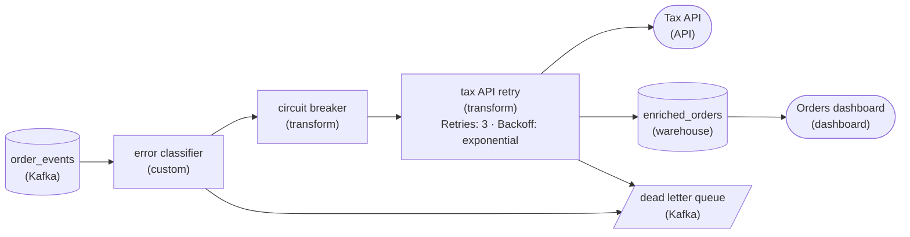

*Classify first. The breaker sits in front of the bounded retry on the tax API call, and 2 error paths reach the dead letter queue: permanent failures and budget-exhausted messages. Only enriched events land in the warehouse.*

1. **Classify before you react**

   The classifier's first job is to decide which of the 3 classes it is holding, and that decision fans out immediately. A permanent failure (a schema violation, a field the tax API rejects on every call) has no retry path that ends well, so it goes straight to the dead letter queue and never touches the breaker. Only a retriable error is worth handing to the resilience layer. Skip this step and you burn the whole retry budget on a message that can never succeed, then dead-letter it anyway.

2. **Put the retry budget inside the breaker**

   The nesting is `breaker(retry(tax_api_call))`. The retry budget absorbs the one-off `503`: a few bounded attempts with backoff, and the blip is gone. The breaker sits outside and watches whole retry sequences across many messages. When failures persist through the fifteen-minute outage, it opens and short-circuits, so new messages fail fast instead of each spending a fresh budget against a service that is down. A budget that exhausts while the breaker is still closed sends its message to the dead letter queue.

| Pitfall: Retry outside the breaker drains every budget |
| --- |
| Flipping the nesting to `retry(breaker(call))` means the retry loop keeps calling a breaker that is already open, treating each fast `CircuitOpen` rejection as one more attempt. The outage the breaker was meant to absorb now drains every message's budget one rejection at a time. Merging breaker and retry into one node hides the same question: draw them apart so the order is visible. |

| Real world: Recovery creates duplicates the sink must absorb |
| --- |
| Every layer here creates duplicates: Kafka is at-least-once, the retry re-issues calls, and an open breaker leaves offsets uncommitted so messages are redelivered when it closes. In production the warehouse write would upsert on `event_id` so a reprocessed order lands on the same row. Without that key, recovery turns transient errors into duplicate rows on the dashboard. |

**Follow-up questions**

1. When the breaker is open, should the worker keep consuming `order_events` or pause?\
   *Failing fast with uncommitted offsets means redelivery, and an idempotent write at the sink is what lets you choose either.*
2. What signal would tell you a message in the dead letter queue is replayable rather than truly permanent?\
   *Separates budget-exhausted messages (replayable once the API recovers) from validation failures (never replayable) inside the same DLQ.*

</details>


<br>

### Exercise 2 of 2

**● TASK**

Settlement events flow from Kafka through a worker that calls a tax-jurisdiction API, then into the Snowflake settlement_mart the finance dashboard reads. Redesign the failure handling: add an error classifier stage, wrap the tax-API call in a circuit breaker stage with a bounded retry budget, and send permanent and budget-exhausted events to a dead letter queue. Skip malformed rows into a quarantine store that alerts above 1% of traffic, and route credential failures to a paging tool. Keep Snowflake feeding the dashboard.

**Starting canvas** (already placed for you):

- Kafka settlement_events source (source, Kafka)
- settlement_worker (retries on bare except) (transform, Flink)
- Tax-jurisdiction API (occasional 503; sustained outages monthly) (source, API)
- Snowflake settlement_mart (MERGE on settlement_id) (storage, Snowflake)
- Finance dashboard (consumer, Looker)

<details>
<summary><strong>Solution</strong></summary>

#### One question decides every arrow: what kind of failure is this?

What holds this whole board together is **error classification**. A resilient stream worker does not ask "did this event fail?" It asks "which class of failure did I just see?" and lets the answer pick the destination. Every pattern you composed (retry budget, circuit breaker, DLQ, skip-and-quarantine, paging) is a named response to one class. The starter `settlement_worker` collapses all of them into a single `except:` that retries, which is why it can hammer a dead credential forever and stall on a malformed row. Give each class its own lane and the pipeline stops guessing.

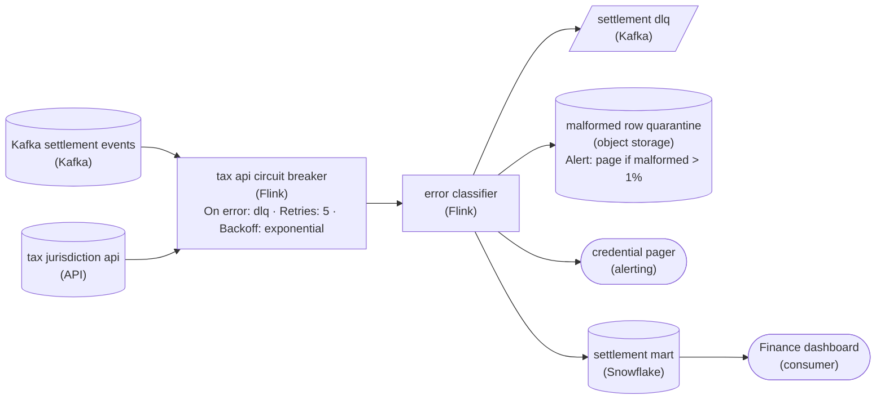

*Each failure class gets its own lane: transient retries behind a breaker, permanent and budget-exhausted to the DLQ, malformed to quarantine, credential to paging.*

1. **Put the retry budget inside a circuit breaker**

   A `503` from the tax-jurisdiction API is transient: the row is fine, the dependency blinked. Retry it, but inside a **budget** (bounded attempts with exponential backoff), never an open-ended loop. When occasional `503`s become a sustained monthly outage, per-event retries just multiply load on something already down, so the circuit breaker wraps the budget: after N consecutive failures it trips open and fast-fails for a cooldown. Events that hit an open breaker or burn through the budget are not lost; they land in the settlement dlq.

2. **Split permanent failures by whether a human must act**

   A malformed row will never parse no matter how often you retry, so it takes the skip-and-quarantine lane: write it to the malformed row quarantine and keep the stream moving, alerting if the rate crosses 1% (that smells like an upstream schema change, not one bad record). A credential failure (`401`/`403`) is also permanent, but quarantining it hides an outage only on-call can fix, so it routes to the paging tool. Same 'permanent' label, 2 destinations, because the classifier asks who resolves it.

| Pitfall: A bare `except:` retry hides 3 different failures |
| --- |
| The starter worker retries on `except:`. That treats a malformed row, a dead credential and a blipping API as one thing: the malformed row loops instead of reaching quarantine, the `401` hammers the auth endpoint and never pages anyone, and only the `503` is helped. A bare retry feels defensive but turns 3 handleable failures into one silent stall. |

| Key insight: An idempotent sink makes every lane safe to replay |
| --- |
| You can retry, trip a breaker and drain a DLQ without corrupting finance's numbers because the sink is idempotent: the mart does a `MERGE` on `settlement_id`, so writing the same settlement twice is a no-op. Without it, a retry after a partial write double-counts revenue, and a DLQ replay double-counts again. |

| Real world: The DLQ is where the money is recovered |
| --- |
| On a revenue pipeline the DLQ is a work queue, not a graveyard. Budget-exhausted settlements wait in the settlement dlq through the outage, then a drain job replays them once the tax API recovers. The quarantine store doubles as a schema-drift early warning. |

**Follow-up questions**

1. The quarantine rate crosses 1% mid-day. Do you halt the worker or keep quarantining and alert?\
   *Whether the 1% threshold is a tripwire or a hard stop.*
2. A DLQ replay runs while the live stream processes the same `settlement_id`. What keeps the mart correct?\
   *Idempotent `MERGE`, not ordering, is the guarantee.*
3. Where does the circuit breaker keep its open/closed state so every worker instance agrees?\
   *Extends the breaker from one process to a worker fleet.*

</details>


<br>

---

## Partial Failure in a Batch

### A file of 10,000 rows with 37 bad ones

At 02:00 on Sunday the payouts job loads a file of driver payouts into the `2026-10-24` partition of `fact_driver_payouts`. The file has 10,000 rows, and 37 of them have an `amount_raw` that won't cast to a decimal. A batch has to decide what the partition holds as a whole, and there are 3 answers.

| Strategy | Partition this morning | The failures | Rerun after the fix |
| --- | --- | --- | --- |
| All-or-nothing | Empty; the swap never ran | Run blocked, owner paged | All 10,000 rows |
| Skip-and-quarantine | 9,963 rows | 37 rows in `quarantine_driver_payouts` | The 37 rows |
| Partial commit, 10 chunks of 1,000 | 8,000 rows from 8 chunks | Chunks 3 and 8 marked failed in a run ledger | 2,000 rows in 2 chunks |

#### All-or-nothing: a partial answer is a wrong answer

`fact_driver_payouts` feeds the bank transfer file. A partition with 9,963 rows looks healthy: it has a total, and 37 payouts are missing with nothing on any dashboard to say so. When a consumer acts on a partial output as if it were complete, the batch must land whole or not at all. The job loads into `staging_driver_payouts` first and swaps the partition in only after a check passes.

```sql
SELECT
  COUNT(*) AS total_rows,
  COUNT_IF(TRY_CAST(amount_raw AS DECIMAL(12, 2)) IS NULL) AS bad_rows
FROM staging_driver_payouts
WHERE batch_date = DATE '2026-10-24'
```

The task running this query fails when `bad_rows` is above 0, so the swap task downstream of it never runs and every earlier partition stays as it was. Here the rerun is cheap, a 4-minute load, so discarding 9,963 good rows costs almost nothing.

#### Skip-and-quarantine: a gap you can name

Suppose instead the file fed only a driver-earnings dashboard that the operations team reviews weekly. A gap of 0.37% is acceptable there, as long as it is recorded and later filled. The job writes failing rows to a quarantine table with a reason, then loads the rest. A threshold still guards against a broken file: when more than 1% of rows fail, the file itself is suspect and the run stops.

```sql
INSERT INTO quarantine_driver_payouts
SELECT
  payout_id,
  driver_id,
  amount_raw,
  'amount_raw is not a decimal' AS reason,
  batch_date
FROM staging_driver_payouts
WHERE batch_date = DATE '2026-10-24'
  AND TRY_CAST(amount_raw AS DECIMAL(12, 2)) IS NULL
```

The load into `fact_driver_payouts` uses the opposite filter, `IS NOT NULL`. Both statements are preceded by a delete of the `2026-10-24` rows they wrote earlier, so a rerun replaces its output instead of appending to it. When the 37 rows are corrected, they are merged into the partition on `payout_id`, the business key, so a second fix attempt cannot double them.

#### Partial commit: a run too costly to repeat

Now change a single fact: before loading, every row is scored by a fraud service, and each chunk of 1,000 rows takes 25 minutes, so the run takes over 4 hours. The job commits each chunk in its own transaction and records it in a ledger. A chunk fails as a unit, whether a row inside it is bad or a write times out, and the job carries on with the next chunk.

| chunk_id | rows | status | finished_at |
| --- | --- | --- | --- |
| 1 | 1 to 1,000 | committed | 02:25 |
| 2 | 1,001 to 2,000 | committed | 02:50 |
| 3 | 2,001 to 3,000 | failed | 03:15 |
| 4 to 7 | 3,001 to 7,000 | committed | 04:55 |
| 8 | 7,001 to 8,000 | failed | 05:20 |
| 9 to 10 | 8,001 to 10,000 | committed | 06:10 |

Partial commit needs 2 things the other strategies do not: the ledger, and writes that replace by `chunk_id`, so a chunk that half-wrote before failing can run again without doubling rows. The resumed run reads the ledger and processes only chunks 3 and 8, taking 50 minutes instead of 250. The price is consistency: until both chunks land, the partition holds 8,000 of 10,000 rows, and consumers must either accept that or wait for the ledger to show all 10 chunks committed.

**A chunked job writes each chunk with a plain INSERT, then marks it committed in the ledger. Chunk 6's insert succeeds, then the job crashes before the ledger update. What does the resumed run do?**

- **A.** Runs chunk 6 again and appends its 1,000 rows a second time
- **B.** Skips chunk 6, because its insert already succeeded
- **C.** Rolls chunk 6 back, then runs it once more
- **D.** Stops at chunk 6 with a duplicate-key error

<details>
<summary>Solution</summary>

**A.** Runs chunk 6 again and appends its 1,000 rows a second time

The ledger still shows chunk 6 as pending, and a plain insert appends. Replacing by chunk_id fixes it.

**Why the others are wrong**

- **B.** The resumed run trusts the ledger, which never recorded that success.
- **C.** The insert committed in its own transaction, so nothing is left to roll back.
- **D.** Only a declared unique key raises that, and this table has none.

</details>


<br>

### The decision as a grid

| Consumers of the output | Rerun is cheap | Rerun is expensive |
| --- | --- | --- |
| Act on totals: payments, ledgers, tax filings | All-or-nothing | Partial commit into staging; publish once every chunk commits |
| Tolerate a recorded gap: dashboards, exploration | Skip-and-quarantine | Partial commit with a quarantine for bad rows |

**A nightly job builds daily_revenue_by_city, which finance uses to file city sales-tax remittances. The run takes 6 minutes. Last night 12 of 400,000 rows had a null city. Which strategy fits?**

- **A.** Skip-and-quarantine, since 12 rows is far below any threshold
- **B.** Partial commit, keeping clean chunks and rerunning failed ones
- **C.** Load every row and file the 12 under a city named unknown
- **D.** All-or-nothing, blocking the publish until the 12 rows are fixed

<details>
<summary>Solution</summary>

**D.** All-or-nothing, blocking the publish until the 12 rows are fixed

A filing built from a partial table is wrong without looking wrong, and a 6-minute rerun is cheap.

**Why the others are wrong**

- **A.** Finance acts on the totals, so any missing row makes a filing wrong, whatever the threshold.
- **B.** Partial commit pays off when reruns are expensive; this one takes 6 minutes.
- **C.** The totals add up, but tax for 12 rows goes to no real city.

</details>


<br>

---

## Pipeline Architecture

### Exercise 1 of 2

**● TASK**

A shipment-tracking pipeline reads about 2 million carrier scan events a day from a Kafka topic, parses each one, and writes it to a PostgreSQL tracking table. About 1 in 10,000 events has a payload the parser still rejects after its retries, and today the worker either drops it or stalls every event behind it. Add a dead letter queue so those events are kept for an operator to inspect while the rest keep flowing.

<details>
<summary><strong>Solution</strong></summary>

#### A third exit for events that cannot be parsed

Once retries are spent, a dead letter queue gives a poison message somewhere to go besides the trash or the front of the line. The event leaves the main flow for a durable side channel, and the parser moves straight on to the next scan. At 2 million events a day and a 1 in 10,000 failure rate, that is about 200 events an operator reads each morning instead of 200 delivery updates that vanish, or a topic that stops moving.

1. **Retry first, then divert**

   `parse_scans` keeps its retry count. The dead letter queue only receives what retrying could not fix, so a short network blip never puts a healthy scan in front of an operator.

2. **Give failures their own queue**

   Draw a second edge out of the parser into `failed_scans_dlq`. It is durable like the main topic, so nothing written there is lost, and the parser picks up the next event as soon as the write succeeds.

3. **Put a reader on the other end**

   A dead letter queue nobody reads is just a slower way to drop data. `operator_review` consumes it, and that is where a human sees the payload next to its error.

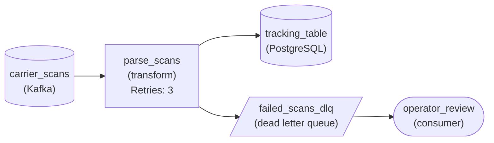

*Good scans land in `tracking_table`; scans that still fail after retries go to `failed_scans_dlq` for `operator_review`.*

| Pitfall: Logging a failure is not keeping it |
| --- |
| Writing the bad payload to an application log and moving on looks like a dead letter queue, but logs rotate and nothing reads them back as events. The message has to land in durable storage with the same shape it had on the main topic, so it can be inspected and later sent through the parser again. |

**Follow-up questions**

1. The parser is fixed. How do the 200 dead letters from yesterday get into `tracking_table`?\
   *Treating the dead letter queue as input for a recovery process, not a graveyard.*
2. A carrier ships a bad release and failures jump to 5 percent of events. What should notice?\
   *A fast-filling dead letter queue is a signal that needs watching, not just a place to park events.*

</details>


<br>

### Exercise 2 of 2

**● TASK**

An hourly job uses 40 parallel workers to fetch shipping rates for 3,000 lanes from a carrier API that answers bursts with HTTP 429, then loads them into a rates warehouse. On the stage that calls the API, set a retry budget: a capped retry count and an exponential retry backoff with jitter, so the 40 workers stop retrying in lockstep. Requests that exhaust the budget go to a dead letter queue so the run still finishes inside its hour.

<details>
<summary><strong>Solution</strong></summary>

#### A retry budget you can bound before it runs

A retry budget is 5 numbers you commit to up front: maximum attempts, base wait, which errors retry, a cap on total elapsed time, and the jitter strategy. Writing them down lets you answer the worst-case question for this specific job: 40 workers, 3,000 lanes, one hour, and one rate-limited carrier API.

1. **Cap the attempts and grow the wait**

   Set `retryCount` to 5 on the fetch stage and `retryBackoff` to 'exponential', which gives waits of roughly 2, 4, 8 and 16 seconds. A 429 is the API asking for room, and a doubling wait gives it room quickly.

2. **Add jitter so 40 workers spread out**

   All 40 workers start at the top of the hour, so they hit the limit together. Without jitter they also retry together, at exactly 2, 4 and 8 seconds, and each wave trips the limit again. Full jitter picks a random wait between zero and the backoff ceiling. That turns 40 synchronized retries into a trickle.

3. **Give exhausted requests a home**

   When the fifth attempt fails, the request goes to the dead letter queue from the previous section, carrying its lane and last error. The run moves on and loads every lane that succeeded. Ops re-drives the parked lanes afterwards.

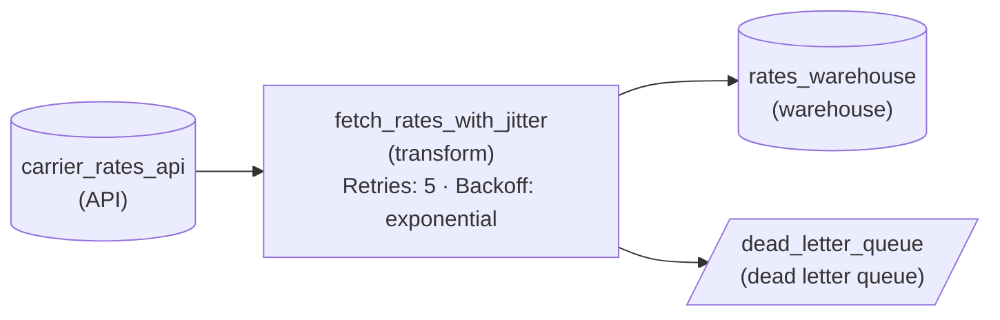

*`fetch_rates_with_jitter` retries up to 5 times with jittered exponential backoff, loads successes into `rates_warehouse`, and parks exhausted lanes in `dead_letter_queue`.*

| Performance: Attempts alone do not bound the hour |
| --- |
| Each worker owns 75 lanes. If a hung call times out at 30 seconds, one lane's worst case is 5 x 30 seconds of calls plus 30 seconds of waits, or 180 seconds. During a full outage that adds up to 75 x 180 = 13,500 seconds per worker, far past the hour. A `max_total_elapsed` clamp of about 45 seconds per lane caps the worst case at 75 x 45, or about 56 minutes, whatever the attempt count says. |

| Pitfall: A 400 will fail all 5 times |
| --- |
| Which errors retry is one of the 5 numbers. A 429 or a 503 clears up on its own; a 400 for a lane the carrier does not recognize never will. Retrying it burns the budget and adds load to an API that is already limiting you, so send it straight to the dead letter queue. |

**Follow-up questions**

1. The carrier starts sending a `Retry-After` header on 429s. How does that change the wait?\
   *Whether the server's hint should replace the computed backoff, and whether it still sits inside the attempt cap and `max_total_elapsed`.*
2. The lane count grows to 12,000 with the same 40 workers. Which number in the budget breaks first?\
   *Recomputing the worst case per worker against the hourly window.*

</details>


<br>

---

## Pipeline Handling All Three

### The third kind: ambiguous

The chunk 6 crash from the ledger question is a third kind of failure, an ambiguous one: the caller cannot tell whether the operation took effect. A warehouse write that times out after 2 s may have committed a millisecond before the connection dropped. Retrying it is safe only when the write is idempotent; otherwise the retry turns uncertainty into a duplicate payment.

| Failure | Example here | Recovery path |
| --- | --- | --- |
| Transient, short | Warehouse returns 503 for 2 s | Retry inside the budget |
| Transient, sustained | Currency service down 18:10 to 18:20 | Breaker opens; consumer holds its offset and resumes |
| Permanent, single message | Amount `12,50` | DLQ with envelope; consumer commits past it |
| Permanent, rows in a batch | 37 payout rows fail the cast | Gate blocks the swap; owner fixes and reruns |
| Ambiguous | Write times out after it committed | Retry, made safe by MERGE on `payment_id` |

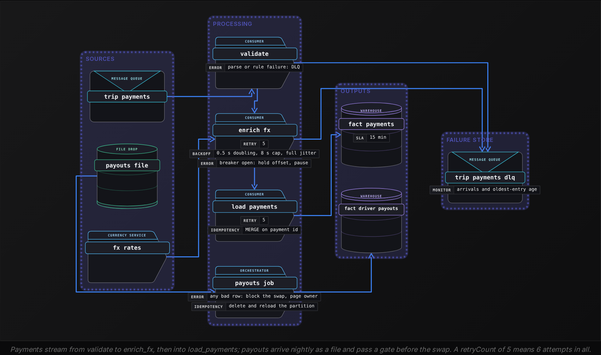


<br>

### Rules that make the layers compose

- Classify first: every error maps to transient, permanent or ambiguous before any handler runs.
- The breaker is checked on every attempt inside the retry loop, so each attempt counts toward its failure rate.
- An open breaker stops the retry loop and pauses consumption; it never writes to the DLQ.
- Every write that can be retried is idempotent, because a timeout can hide a success.
- An error nobody has classified gets the retry budget, then goes to the DLQ marked unknown.

```sql
PERMANENT = (AmountParseError, RuleViolation, UnknownSchemaVersion)
TRANSIENT = (ServiceUnavailable, ConnectionReset, RateLimited)
AMBIGUOUS = (WriteTimeout,)


def recovery_path(error):
    if isinstance(error, CircuitOpen):
        return "pause"
    if isinstance(error, PERMANENT):
        return "dead_letter"
    if isinstance(error, AMBIGUOUS):
        return "retry_idempotent"
    if isinstance(error, TRANSIENT):
        return "retry"
    return "retry_then_dead_letter_unknown"
```

**The currency service starts returning 400 unsupported currency XAF for 0.2% of payments, and the classifier has no rule for it. What happens, and what's the fix?**

- **A.** The breaker opens and pauses the pipeline; raise its failure threshold
- **B.** They exhaust the retry budget and reach the DLQ as unknown; add a permanent rule
- **C.** The payments vanish without a trace; add a log line to catch them
- **D.** The payments block their partition for good; add an elapsed deadline

<details>
<summary>Solution</summary>

**B.** They exhaust the retry budget and reach the DLQ as unknown; add a permanent rule

The fallback retries, then dead-letters them as unknown. A permanent rule dead-letters them on attempt 1, sparing the service 5 retries each.

**Why the others are wrong**

- **A.** At 0.2% far fewer than 10 of every 20 calls fail, so the breaker stays closed.
- **C.** The classifier's last line gives unknown errors a path, so none vanish.
- **D.** The budget already has a 20 s deadline, after which the unknown path dead-letters them.

</details>


<br>

### Friday's 10 minutes, layer by layer

| Time | What happens | Layer that acts | Outcome |
| --- | --- | --- | --- |
| 18:00:04 | Offset 918223 carries amount `12,50` | validate | DLQ entry written, offset committed |
| 18:06:41 | Warehouse returns 503 for 2 s | load_payments retry | Succeeds on a later attempt |
| 18:10:02 | Currency service stops answering | enrich_fx breaker | Opens once 10 of its last 20 calls fail |
| 18:10:32 | First half-open trial times out | enrich_fx breaker | Reopens for another 30 s |
| 18:20:32 | All 3 trials succeed | enrich_fx breaker | Closes; consumer resumes from its held offset |
| 18:20:35 | Write for payment p-7120 times out after committing | load_payments retry | MERGE finds the row; no duplicate |

Every row of the Outcome column ends in a named state. Messages that are set aside have an owner; the rest are committed or retried, or wait while the consumer is paused. None ends with a payment dropped or doubled.

**To speed up loading, a teammate replaces the MERGE on payment_id in load_payments with a plain INSERT. Which row of the Friday timeline now corrupts fact_payments?**

- **A.** The 18:00:04 row, because the DLQ path writes the payment twice
- **B.** The 18:06:41 row, because the 503 retry writes the payment twice
- **C.** The 18:20:35 row, because the retried write adds a second copy
- **D.** The 18:20:32 row, because resumed messages are written twice

<details>
<summary>Solution</summary>

**C.** The 18:20:35 row, because the retried write adds a second copy

The first write committed before the timeout, so a plain insert on retry duplicates the payment. Only the ambiguous failure needed the MERGE.

**Why the others are wrong**

- **A.** Validation rejects it before the load step.
- **B.** A 503 means the warehouse rejected the first write, so the retry writes it once.
- **D.** The held offsets were never loaded, so each resumed message loads once.

</details>


<br>

---

## Pipeline Architecture

### Exercise 1 of 2

**● TASK**

A worker reads 400 delivery orders a minute from a Kafka topic, geocodes each through a partner address API and writes them to a warehouse. Keep exponential-backoff retries on that call for one-off failures, but in a sustained outage every call waits out a 30-second timeout, so put a circuit breaker in front of it that fails fast. Orders the open breaker refuses, and orders out of retries, wait in a queue for replay, and the on-call is paged when the breaker opens.

<details>
<summary><strong>Solution</strong></summary>

#### Stop calling a partner that is already down

A circuit breaker is a few lines of state in front of a downstream call that decide whether to make the call at all. Retries with backoff rescue one request that hiccups; in a full outage they make things worse, because all 400 orders a minute still wait out a 30-second timeout and pile load onto a partner that is already drowning. The breaker counts consecutive failures and, past a threshold, **opens**: every call fails in milliseconds, the partner gets room to recover, and after a cool-down a half-open probe lets one call through to decide whether to close again.

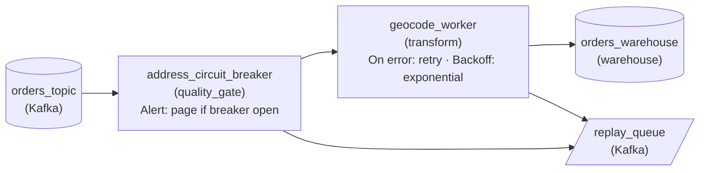

*`address_circuit_breaker` passes orders to `geocode_worker` while closed and diverts them to `replay_queue` while open; orders out of retries take the same error path.*

1. **Put the breaker in front of the call**

   The breaker has to see an order before `geocode_worker` spends 30 seconds on it, so it sits upstream of the call. The retry budget from the last section stays on the worker: it still handles the single 503, and its failures are what the breaker counts.

2. **Give refused orders somewhere to wait**

   Failing fast only helps if the order survives it. Both error paths land in `replay_queue`, the same idea as the dead letter queue from section 0, so once the breaker closes those orders get geocoded late instead of never. The `monitorAlert` on the breaker pages the on-call the moment it opens.

| Pitfall: A bigger retry budget lengthens the outage |
| --- |
| The tempting fix for a long outage is raising the retry count. That multiplies the timed-out calls hitting the partner and keeps it overloaded, which is how a twenty-minute outage becomes a six-hour one. |

| Key insight: Failing in milliseconds is the feature |
| --- |
| An open breaker returns an error almost instantly, so workers are not tied up for 30 seconds per order, and an open breaker is a single clear signal on a dashboard: the partner is unhealthy and recovery is in progress. |

**Follow-up questions**

1. The worker adds a second partner for traffic estimates. Does one breaker cover both calls?\
   *Whether a breaker belongs to one downstream, so one outage cannot block an unrelated call.*
2. When the breaker closes, 40 minutes of orders sit in `replay_queue`. How do you replay them without knocking the partner over again?\
   *Applying the retry budget and pacing to the recovery backlog.*

</details>


<br>

### Exercise 2 of 2

**● TASK**

A nightly batch loads about 3 million smart-meter readings from CSV files into a warehouse that feeds an energy usage dashboard. Roughly 0.1% of rows fail validation (a missing meter ID or a negative kWh value), and today one bad row aborts the whole run. Design the batch so every valid row still loads and each failing row is quarantined in a separate store where it can be inspected and replayed, never silently dropped.

<details>
<summary><strong>Solution</strong></summary>

#### Skip and quarantine keeps the good rows moving

Skip-and-quarantine is the middle point on the partial-failure spectrum: a row that fails validation leaves the batch on its own path, and the run carries on with everything else. At 3 million readings a night and a 0.1% failure rate, that is about 3,000 rows set aside and 2,997,000 loaded, instead of zero loaded because one meter reported a negative kWh.

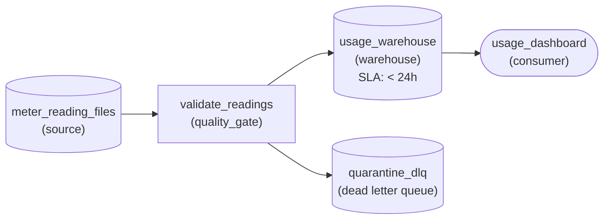

*Rows that pass `validate_readings` load into `usage_warehouse` for the morning dashboard; rows that fail branch into `quarantine_dlq` for inspection and replay.*

| Pitfall: Both extremes lose something |
| --- |
| Aborting the run on the first bad row throws away every good row and leaves the dashboard empty until someone reruns it. Filtering bad rows out with a `WHERE` clause and moving on fails more quietly: nobody sees that 3,000 readings vanished, so a faulty meter or a changed file layout stays hidden. The quarantine store is what makes skipping safe, because every skipped row is still there to count, inspect and replay. |

| Trick: Quarantine the reason with the row |
| --- |
| Store each failing row together with why it failed ('missing meter id', 'negative kwh') and the run date. Replay then means fixing that cause and sending exactly those rows back through validation, not rerunning the whole night. |

| Key insight: The workload decides the strategy |
| --- |
| Usage trends survive a few thousand missing readings, so skipping is right here. A daily financial ledger is the opposite case: a ledger built from a subset of rows does not balance, so that batch should be all-or-nothing, and it is only safe to rerun because the load is idempotent. |

**Follow-up questions**

1. What should happen on a night when 40% of rows land in quarantine?\
   *Whether the quarantine rate is itself a signal worth watching rather than just a bin.*
2. If these readings also fed a monthly billing run, would that batch use the same strategy?\
   *Telling apart workloads where a partial result is fine from ones where it is worse than none.*

</details>


<br>

---

## Putting It All Together

Uber's driver payments pipeline on a Friday evening: a fare event with a decimal comma, a 10-minute outage of the currency service, a warehouse write that times out after it committed, and a nightly payouts file with 37 unparseable amounts. By morning each failure sits in a named place, and no driver is paid twice or left unpaid.

- The envelope written at 18:00:04 is what makes the day-8 replay possible after the topic's 7 days run out.
- The retry budget absorbs the warehouse 503s, and its deadline keeps a hung call from holding a worker past 20 s.
- The breaker is consulted on every retry attempt, so at 18:10 it cuts calls to the currency service and holds offsets instead of filling the DLQ.
- MERGE on payment_id turns the 18:20:35 timeout into a harmless retry, the same replace-instead-of-append rule the payouts job follows.
- The payouts gate blocks the swap because the bank file acts on totals; a dashboard-only output would have quarantined the 37 rows.


<br>

---

## Pipeline Architecture

### Exercise 1 of 2

**● TASK**

A streaming pipeline reads about 5,000 listing events a minute from Kafka, sends each to a content-moderation API, and writes moderated listings to a warehouse. Compose all three failure paths on that call: 429 and 503 blips retried with backoff, 400s for malformed listings sent straight to a dead letter queue, and timeouts given a small retry budget, then dead-lettered. An outage lasting hours must halt the calls rather than drain every event's retries.

<details>
<summary><strong>Solution</strong></summary>

#### Three failures, three destinations

Composing the failure patterns means one stage makes three decisions at once. Every response from the moderation API falls into a class, and each class has exactly one destination: success goes to the warehouse, a permanent 400 goes to the dead letter queue on its first attempt, and a transient or ambiguous error goes back through the retry budget, which hands it to the dead letter queue only when the budget runs out.

1. **Classify before you retry**

   A 400 says the listing is malformed, so retrying it only spends API calls on an event that will fail every time: route it out immediately. A 429 or 503 is the API asking you to come back shortly, so it earns exponential backoff with jitter.

2. **Give timeouts a small budget**

   A timeout is ambiguous: the API may just be slow, or this listing may hang it. Three tries with backoff resolve the slow case; a listing still timing out after that is treated as permanent and dead-lettered, so one poison listing cannot stall its partition.

3. **Let the breaker guard the budget**

   In a three-hour outage, every listing would exhaust its retries and pile into the dead letter queue even though nothing is wrong with it. The breaker opens after repeated failures and pauses consumption; Kafka holds the backlog, and processing resumes from the last committed offset once a probe call succeeds.

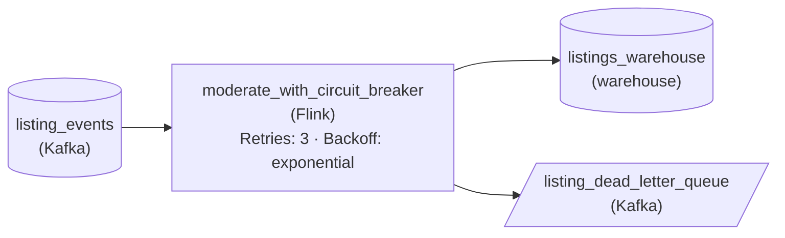

*`moderate_with_circuit_breaker` retries blips and timeouts with backoff, sends 400s and exhausted retries to `listing_dead_letter_queue`, and writes successes to `listings_warehouse`.*

| Pitfall: One retry loop for every error wastes the budget twice |
| --- |
| Wrapping the call in a single retry policy retries 400s that can never succeed. Without a breaker, it also turns a long outage into thousands of dead-lettered listings that only needed to wait. Each error class needs its own path, and the breaker decides when the retry path is worth trying at all. |

**Follow-up questions**

1. Replays from the dead letter queue could write a listing to the warehouse twice. What makes the warehouse write safe to repeat?\
   *Connects dead-letter replay to idempotent writes.*
2. The API starts returning 429 at 150 requests a second instead of 200. Which part of the design absorbs that, and which part should not react to it?\
   *Separates rate-limit backoff from breaker-worthy outages.*

</details>


<br>

### Exercise 2 of 2

**● TASK**

A streaming pipeline reads about 2,000 signup events a minute from Kafka, sends each to a fraud-scoring API, and writes the scored signups to a warehouse. Retry transient API errors under a budget of at most 4 attempts and 2 minutes total per event. The API sometimes goes down for 20 minutes at a time: put a circuit breaker in front of it so the pipeline stops calling it during the outage instead of spending every event's retry budget. Events rejected as invalid, or still failing when their budget runs out, must go to a dead letter queue, never dropped.

<details>
<summary><strong>Solution</strong></summary>

#### Let the breaker spend the outage, not the retries

A retry budget and a circuit breaker answer different failures, and this pipeline needs both, plus a dead letter queue for what neither fixes. The budget covers one call that hiccups: a timeout or a 503 that clears on the next attempt. The breaker covers a service that is down for everyone. Without it, a 20-minute outage at 2,000 events a minute means 40,000 events each spending 4 attempts and up to 2 minutes: roughly 160,000 calls into a dead service, then 40,000 perfectly good signups dumped in the DLQ.

1. **Bound each event's retries**

   Set the budget on the scoring call itself: at most 4 attempts, and a 2-minute ceiling on the total time one event may spend retrying. The attempt cap alone is not enough, because growing waits can stack past what the events queued behind it can tolerate. Retry only what can clear on its own, timeouts and 503s. A 400 means the payload is bad, and another try will not change that.

2. **Trip the breaker before the budget burns**

   The breaker watches the scoring call's failures. Closed, calls flow normally. When failures stay high it opens: no calls go out and the worker stops pulling from the topic, so events wait in Kafka with their budgets untouched. After a cool-down it goes half-open and lets a few probe calls through; success closes it, failure opens it again. That is why `fraud_api_circuit_breaker` sits in front of `fraud_scoring_worker`: it decides whether an event is sent to the API at all.

3. **Dead-letter only what the budget cannot fix**

   2 kinds of event reach `fraud_score_dlq`: one the API rejects as invalid, sent straight there with no retries, and one still failing after 4 attempts or 2 minutes while the breaker was closed. Both keep the stream moving and both are kept for inspection. Neither is an outage casualty, because while the breaker was open nothing was attempted.

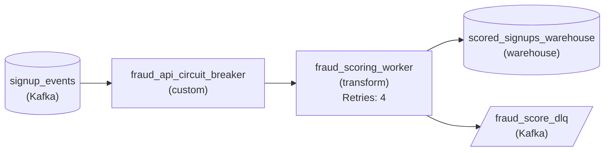

*Signups pass `fraud_api_circuit_breaker` into the retrying `fraud_scoring_worker`. Scored events land in the warehouse, unrecoverable ones in `fraud_score_dlq`.*

| Pitfall: Retries alone turn an outage into a DLQ flood |
| --- |
| The common draft puts a retry policy and a DLQ on the scoring call and stops there. It looks complete, but in a sustained outage every event exhausts its budget against a dead API and lands in the DLQ. The queue meant for genuinely bad events fills with 40,000 good ones that someone must replay by hand. The breaker is what keeps the DLQ meaningful. |

**Follow-up questions**

1. The API recovers and the half-open probes succeed. How do the 40,000 backlogged events get scored without knocking it over again?\
   *Draining a backlog with jitter and a bounded rate so recovery does not trigger a second outage.*
2. The fraud team fixes the payload format and wants dead-lettered signups replayed. What does the replay path need so no signup is written to the warehouse twice?\
   *Replaying from a DLQ combined with idempotent writes to the warehouse.*

</details>


<br>

---

## Key Takeaways

- A DLQ holds messages that will fail again unchanged, each wrapped in an envelope: the payload with its source offset, plus the error and the code version that raised it.
- DLQ retention must comfortably exceed the slowest path from failure to replay, because after the source's retention expires the DLQ holds the only copy.
- A retry budget caps the number of attempts and the length of each wait, and it keeps retries from synchronizing. Its deadline caps total elapsed time, which protects freshness.
- Size the jitter window as workers times seconds per attempt, divided by the slots the downstream can serve.
- A circuit breaker turns a sustained outage into fast failures; CircuitOpen pauses consumption and never reaches the DLQ.
- Pick all-or-nothing, skip-and-quarantine or partial commit by whether consumers act on totals and what a rerun costs.
- Ambiguous failures are safe to retry only through idempotent writes.
