Advanced·Pipeline Architecture · 38 min · 11 challenges

# Idempotent Reruns: Advanced

Uber has written publicly about processing Uber Eats ad clicks exactly once, because each click becomes money a restaurant pays. Suppose the click aggregator crashes at 7:58 p.m. during the Friday dinner rush, holding 40 seconds of clicks it has counted but not yet acknowledged. On restart, those clicks arrive again. Whether 3,000 restaurants pay twice for them depends on choices this lesson teaches.


<br>

---

## Idempotency in Streaming Is Harder

In batch, a rerun has a name. The job that builds `orders_daily` for 2026-10-23 reads a closed set of input files, and the fix you learned is to overwrite that partition. The input will never grow, the output has a single place to land, and running the job 5 times leaves the same partition behind.

A stream job has no such unit. Its input is an unbounded log, read by position: partition 4, offset 1000, then 1001, and on with no end. The job keeps 2 records that must agree: the output it has written, and the position it has marked as done. Those 2 writes go to different systems at different moments, and a crash can land between them.


<br>

### Where the crash lands

| Time | Job action | Rows in sink | Saved position |
| --- | --- | --- | --- |
| 12:00:00 | Reads offsets 1000 to 1499 | 0 | 999 |
| 12:00:03 | Writes 500 enriched rows | 500 | 999 |
| 12:00:04 | Crashes before saving the position | 500 | 999 |
| 12:00:20 | Restarts and resumes after 999 | 500 | 999 |
| 12:00:23 | Writes offsets 1000 to 1499 again | 1,000 | 1499 |

The replayed slice, offsets 1000 to 1499, is whatever arrived between the last saved position and the crash. No partition, hour or file in the output corresponds to it, so the batch move of replacing the unit of work has no unit to replace. The 500 duplicated rows sit beside the originals, indistinguishable from them.

Streams have 2 more properties that make this harder. Outputs are often still open: a running count for the current minute is updated many times before the minute closes, so a replay lands on a number that is mid-change. And operator state, such as those running counts, lives in memory and restores from a periodic snapshot. If that snapshot and the saved position were taken at different moments, the restored state either already includes some replayed records or misses some skipped ones.


<br>

### Patterns that survive replay unaided

Whether a replay corrupts output depends on what an operator does with a record it has already handled. The test: apply the same event e twice, and compare the result with applying it once.

| Operation | Result of applying e twice | Safe on replay? |
| --- | --- | --- |
| Map or filter, upserted by `event_id` | Same row rewritten with same values | Yes |
| Latest value per key, such as a driver's last location | Same final value once replay passes the newest event | Yes |
| Max or min per key | max(x, e, e) equals max(x, e) | Yes |
| Add to a set of distinct users | The set already holds e | Yes |
| Count or sum per key | Total grows by a second contribution | No |
| Append to an insert-only table | Identical row written twice | No |
| Call an outside system: push notification, card charge | A second notification, a second charge | No |
| Key or value created at processing time, `uuid4()` or `now()` | Second row under a new key | No |

The safe rows share a property: the effect depends only on the event's content and lands at an address the event determines. An upsert on `event_id` sends the replayed record to the row it wrote before. A max returns the slot's existing value. The unsafe rows either accumulate, as counts, sums and appends do, or create something new on every run, such as a fresh UUID or a second HTTP request.

> **TIP**
>
> Latest value per key is safe because a log preserves order within a partition, so the replay finishes on the same newest event. If 2 partitions can update the same key, replay order can differ from the original and the final value can flip.

> Keys minted at processing time
>
> An operator that sets `id = uuid4()` or `processed_at = now()` turns a safe upsert into an unsafe append, because the replayed record arrives with a new key. Derive keys from the event: an ID the producer assigned, or a hash of fields fixed when the event was created.

**A job reads trip events from a log and crashes. On restart it replays the last 2,000 events it had already processed. Which operator leaves its output exactly as a crash-free run would?**

- **A.** Add 1 to trips_today[driver_id] for every event, then write the new total.
- **B.** Insert each event into a table with row_id = uuid4() as its primary key.
- **C.** Upsert longest_trip_km[driver_id] as the max of the stored value and the event's distance.
- **D.** Send the rider a push notification with the fare when each trip event arrives.

<details>
<summary>Solution</summary>

**C.** Upsert longest_trip_km[driver_id] as the max of the stored value and the event's distance.

Max is idempotent: the replayed distance is already reflected in the stored maximum, so the value stays put.

**Why the others are wrong**

- **A.** Each replayed event adds 1 again, so every driver with a replayed trip ends up with too many trips. Counters accumulate.
- **B.** The replayed copy gets a fresh UUID, so the primary key never collides and 2,000 duplicate rows land.
- **D.** The phone has no snapshot to roll back. Every replayed event sends a second notification.

</details>


<br>

---

## Pipeline Architecture

### Exercise 1 of 1

**● TASK**

Two aggregators read the same at-least-once event log. The daily revenue sum feeds a regulatory report, where a replayed duplicate misstates revenue: route it through a checkpointed exactly-once engine that commits into a warehouse revenue table, and validate that table with a quality gate before the report reads it. The real-time page-view counter tolerates duplicates, so give it its own cheaper path to the dashboard. Show each aggregator's freshness tier.

**Starting canvas** (already placed for you):

- Event log: payment and page-view events (30-day retention, replay-capable, at-least-once delivery) (source, Kafka)
- Regulatory revenue report (finance files this with the SEC; needs exactly-once-correct daily revenue) (consumer, API)
- Real-time engagement dashboard (page-view counts; tolerates at-least-once noise) (consumer, Grafana)

<details>
<summary><strong>Solution</strong></summary>

#### One log, two guarantees

Streaming idempotency is harder than the batch kind because there is no partition to swap out. A batch rerun overwrites a whole slice of the destination and lands on the same answer, but a stream never closes a slice you can replace. The `Kafka` log here delivers at-least-once, so after a crash or a rebalance it replays events the consumer already applied. Whether that replay hurts depends on the pattern. A **running sum is not naturally idempotent**: every replayed payment adds to revenue again, so the financial close has to be engineered against it. A live page-view count can absorb the same noise, so it stays cheap.

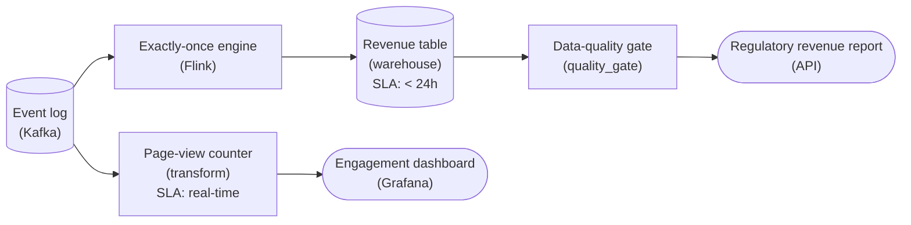

*One retained log fans out to two aggregators; only the daily revenue path carries the engineered exactly-once chain.*

Exactly-once is not something the log hands you; it is built across 3 links. The engine keeps its running total in checkpointed state, and it commits that state together with the consumed offsets into the revenue table in one transaction. When the log replays a range after a restart, the same offsets re-commit atomically instead of being summed twice, and that is what makes a rerun leave revenue unchanged.

| ✕ Revenue sum, engineered | ✓ Page-view count, tolerant |
| --- | --- |
| Every duplicate inflates a filed number, so the path runs on a checkpointed engine with a transactional commit into the warehouse revenue table, and a quality gate validates that table before the report reads it. Correctness first, cost second. | A replayed view nudges a live chart by a rounding error, so the path skips checkpointing, the transactional sink and the gate, and runs as a separate, cheaper reader off the same `Kafka` log. Freshness first. |

| Pitfall: Not every stream needs the expensive guarantee |
| --- |
| The tempting design is one aggregator for both, either deduping downstream or holding the dashboard to the same exactly-once machinery. That drags the cheap path up to the cost of the financial close and couples two readers with opposite needs, so a stall on one blocks the other. Decide per pattern which one needs engineering, and give each its own reader. |

| Real world: Replay is only safe on the engineered path |
| --- |
| Because the log is retained, a bug in the revenue math is fixed by correcting the engine and replaying the affected days into the `Revenue table` from the same offsets. That replay is only safe because this path was engineered to be idempotent; replaying into the page-view counter would simply count twice. |

**Follow-up questions**

1. The revenue bug is found after the report was filed. How do you correct the numbers using only the retained log?\
   *Replay into an idempotent sink as the recovery mechanism, rather than a batch partition rerun.*
2. What does the data-quality gate actually check before the regulatory report reads the revenue table?\
   *Concrete validations: row counts, no missing days, totals within expected bounds.*
3. If the engagement team later wanted page views that are exact for billing advertisers, which path changes and why?\
   *Whether a tolerant pattern becomes one that needs explicit engineering once a duplicate costs money.*

</details>


<br>

---

## Exactly-Once vs Effectively-Once

When a stream engine advertises exactly-once, it is describing committed effects. Execution still repeats: after the crash in the last section, offsets 1000 to 1499 ran twice no matter what the engine promised. The guarantee is that only the effects of a single execution survive, inside a boundary the engine controls.


<br>

### What exactly-once covers

An engine that offers exactly-once takes periodic snapshots that capture 3 things together: the input positions, the operator state and the output not yet released. On a crash it rolls all 3 back to the last completed snapshot and runs forward again. Because everything inside the boundary rewinds at once, the second run's effects replace the first run's instead of adding to them.

Anything outside that boundary keeps whatever it received. Read this operator with a crash in mind:

```sql
def on_order(event, state):
    state['orders'] += 1
    send_receipt_email(event['user_id'])
    return state
```

After a crash, `state['orders']` restores from the snapshot and the count comes out right. The email server has no snapshot: it already accepted the first run's message, and now it accepts the second's. The engine kept its promise, and the customer still received 2 receipts.


<br>

### Effectively-once

Effectively-once reaches the same visible outcome by a different route. Records are delivered at least once, and every effect is made idempotent so the extra deliveries change nothing. The email operator becomes effectively-once if the email service accepts an idempotency key, such as the `order_id`, and drops any second send carrying a key it has seen.

| ✓ Exactly-once (transactional) | ✗ Effectively-once (idempotent) |
| --- | --- |
| • Positions, state and output snapshot together<br><br>• The sink must take part in the engine's commit<br><br>• Output appears only when a snapshot completes<br><br>• Covers effects inside the engine's boundary<br><br>• Breaks at any hop that cannot join the commit | • Delivery is at least once; duplicates are expected<br><br>• The sink deduplicates on a key the event carries<br><br>• Output appears as soon as it is written<br><br>• Covers any system that honors the key<br><br>• Breaks if the key is minted at processing time |


<br>

### Auditing an exactly-once claim

A claim of 'exactly-once, end to end' describes a deployment, and every hop in that deployment either keeps the guarantee or breaks it. Walk the path from the first producer to the last reader and ask the same 6 questions at each hop.

Audit questions for every hop

- Can the source be re-read from a recorded position?
- Do positions, state and output commit in the same snapshot?
- Does the sink join that commit, or deduplicate by key?
- Do readers of the sink see committed data only?
- Does any operator call a system outside the engine?
- Does the producer deduplicate its own send retries?

Run the audit on a common deployment. A checkout service publishes orders to a log. A stream engine sums revenue per store and writes the totals transactionally to an output log. A notification service reads that output and emails each store manager.

| Hop | Question that fails | What goes wrong |
| --- | --- | --- |
| Checkout service to log | Producer retries without dedup | A send that timed out but landed is sent again; the order appears twice |
| Engine to output log | None | Totals commit once per snapshot |
| Output log to notification service | Reader sees uncommitted data | It reads totals from an attempt that later aborted, then reads the retry's totals |
| Notification service to email | Outside call without a key | Each redelivery sends the manager another email |

Exactly-once holds on 1 hop of 4. The engine's documentation is accurate about that hop and silent about the other 3. The fixes are per hop: enable producer deduplication, where the log gives each producer an ID and drops repeated sequence numbers; configure the notification service to read committed data only; and send `store_id` plus the report period as the email's idempotency key.


<br>

### Choosing for the system

Choose exactly-once when every hop can join a single commit and the use case tolerates output that appears once per snapshot. Choose effectively-once when the path crosses systems that cannot join, such as an email provider or a service's own database, or when freshness needs are tighter than the snapshot rhythm. Most production pipelines combine them: exactly-once for the engine's internal state, effectively-once at every exit.

**A payments team reads their stream engine's documentation: 'exactly-once from source to sink.' Their job reads card authorizations from a log, sums them per merchant into transactional output, and calls a fraud API that opens a case for each authorization over $5,000. Which part of this deployment falls outside the guarantee?**

- **A.** The fraud API call, because the outside system has no snapshot to roll back after a crash.
- **B.** The per-merchant sums, because operator state is discarded on each crash and restarted from zero.
- **C.** The log source, because a log cannot be re-read from a recorded position after delivery.
- **D.** Nothing, because the guarantee extends to every call an operator makes during processing.

<details>
<summary>Solution</summary>

**A.** The fraud API call, because the outside system has no snapshot to roll back after a crash.

On recovery the engine replays authorizations since the last snapshot, and every replayed authorization over $5,000 opens a second case. Pass the authorization ID as an idempotency key.

**Why the others are wrong**

- **B.** Operator state restores from the last completed snapshot together with the positions, so the sums are inside the guarantee.
- **C.** Re-reading from a recorded position is what logs are built for, and every replay depends on it.
- **D.** The engine can roll back only what it snapshots. A call to an outside system sits outside that set.

</details>


<br>

---

## Pipeline Architecture

### Exercise 1 of 2

**● TASK**

Audit the claim. The vendor diagram says the Flink job delivers exactly-once via 2PC, but the revenue dashboard's numbers double after every checkpoint recovery. Apply the section's across-which-boundary audit: name the boundary where the engine's guarantee ends and pick a repair so the new sink actually carries the property its name claims.

**Starting canvas** (already placed for you):

- Kafka events topic (source, Kafka)
- Flink streaming job (vendor diagram label: exactly-once via 2PC) (transform, Flink)
- Plain Postgres revenue_events: INSERT INTO append (no PK constraint, no UPSERT, no transaction integration with Flink) (storage, PostgreSQL)
- Revenue dashboard (numbers double after every Flink checkpoint recovery) (consumer, Metabase)

<details>
<summary><strong>Solution</strong></summary>

#### Where the guarantee stops being true

The property under audit has a name: **end-to-end exactly-once**, a claim about the whole path from `Kafka` to the dashboard, not something any single box owns. Flink's 2PC checkpointing earns exactly-once for its own state and any sink that enrolls in the checkpoint barrier. The across-which-boundary audit asks how far that enrollment reaches: only to the last hop that participates. Here that hop is a plain `INSERT INTO revenue_events` with no `PK`, no `ON CONFLICT`, and no transaction shared with Flink, so the guarantee ends one box short of the dashboard.

| Pitfall: A checkpoint rewind replays, and a bare append never forgets |
| --- |
| On a task failure Flink restores the last checkpoint and reprocesses every event consumed since. That is fine for state that rolls back with it, but the earlier `INSERT` already committed those rows, and the replay appends them again. Nothing collapses the duplicates, so the totals double on exactly the recovery the diagram promised was safe. The '2PC' label describes Flink's internal protocol, not the sink write. |

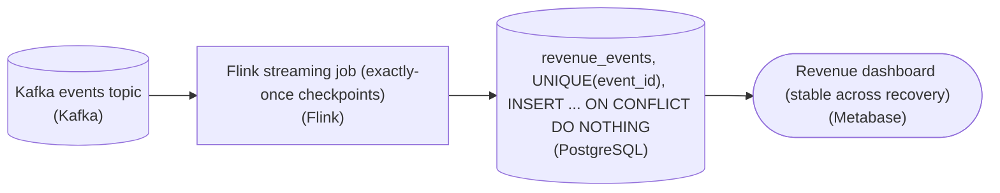

*The repair lives entirely at the sink: `revenue_events` gains `UNIQUE(event_id)`, so a replay lands the same keys and dedupes.*

| ✕ Enroll the sink in the transaction | ✓ Make the write idempotent |
| --- | --- |
| Swap the plain insert for Flink's `TwoPhaseCommitSinkFunction`. Writes stage in a DB transaction that pre-commits on the checkpoint barrier and commits only once the checkpoint is confirmed; a rewind aborts the unconfirmed transaction, so replayed rows never survive. This is what '2PC' should have meant past Flink's own boundary. | Give `revenue_events` a `UNIQUE(event_id)` constraint on a deterministic key and write `INSERT ... ON CONFLICT (event_id) DO NOTHING`. A replay re-sends the same keys and the clause drops them, no distributed transaction needed, only an id that comes from the event itself, never `now()` or a serial. |

**Follow-up questions**

1. What do you use for `event_id` when the upstream events carry no natural unique key?\
   *Probes deterministic key construction, e.g. a hash of stable payload fields or a Kafka `(partition, offset)` pair, and why a generated `now()` or serial breaks the dedup.*
2. When would you reach for the transactional 2PC sink over the idempotent upsert?\
   *Checks the tradeoff: 2PC handles non-idempotent side effects and multi-row atomic writes, at the cost of commit latency tied to the checkpoint interval.*

</details>


<br>

### Exercise 2 of 2

**● TASK**

The order service commits to Postgres orders and publishes to Kafka order_events in one handler, with no shared transaction. Downstream, order_analytics is a plain Postgres append with no key on event_id, so each Kafka redelivery double-counts on the dashboard. Fix each boundary with its idempotency building block: feed Kafka by change data capture from Postgres instead of from the handler, make the analytics write idempotent, and use no custom two-phase commit.

**Starting canvas** (already placed for you):

- Order service application (handler currently writes to Postgres orders AND publishes to Kafka order_events with no atomicity) (source, Custom)
- Postgres orders (the application's primary state) (storage, Postgres)
- Order analytics transform (subscribes to Kafka order_events) (transform, Python)
- Kafka order_events topic (storage, Kafka)
- Plain Postgres order_analytics: INSERT INTO append (no PK on event_id, no UPSERT, double-counts on Kafka redelivery) (storage, Postgres)
- Order analytics dashboard (consumer, Looker)

<details>
<summary><strong>Solution</strong></summary>

#### Two boundaries, two named building blocks

Both fixes have names the section gave you. The first boundary is a **dual write**: the handler commits to `orders` and publishes to `order_events` in the same block, with no shared transaction. If the publish fails after the commit (or the commit fails after the publish), the two stores disagree. The building block is the transactional outbox plus change data capture: write the event as a row in an `outbox` table inside the SAME transaction as the order, then let CDC tail the Postgres log and publish each outbox row to Kafka. One atomic commit, no lost or phantom events.

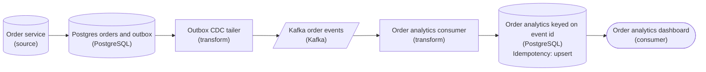

*The handler writes only the order and its `outbox` row in one transaction; CDC owns the publish, and the analytics store upserts on `event_id`.*

The second boundary duplicates for a different reason. Kafka is at-least-once, so `order_analytics` will see some `event_id` values twice after a redelivery or a consumer restart. A plain `INSERT INTO` append counts each arrival, and the dashboard inflates. The fix is an **idempotent consumer**: put a primary key on `event_id` and write with `INSERT ... ON CONFLICT (event_id) DO UPDATE`, an upsert. A redelivered event lands on the same key and changes nothing.

| Pitfall: CDC replaces the second write, it never adds a third |
| --- |
| Do not keep the in-handler publish AND add an `outbox`: that is still a dual write. The handler writes only the `outbox` row and CDC does the publishing. Rolling your own two-phase commit across Postgres and Kafka is the tempting wrong turn the prompt rules out. |

| Key insight: The event carries its own dedupe key |
| --- |
| Idempotency needs a stable identity per event. An `event_id` minted at the source and preserved through Kafka is what makes `ON CONFLICT` safe. If analytics invented a fresh surrogate id per row, every redelivery would look brand new again. |

**Follow-up questions**

1. What if two `outbox` rows for the same order arrive at `order_analytics` out of order?\
   *Tests whether an idempotency key alone handles ordering, or whether you also need a version or sequence column.*
2. Does the outbox plus CDC give you exactly-once end to end?\
   *Checks whether you see it as at-least-once delivery that the consumer's `event_id` upsert makes effectively-once.*

</details>


<br>

---

## Building Blocks of Idempotency

Every guarantee in the last section rests on 3 mechanisms. Each protects a particular kind of hop, and a real architecture chains them.


<br>

### Two-phase commit

Two-phase commit lets a coordinator make several participants commit together or not at all. In phase 1, prepare, each participant does its work, makes it durable but invisible, and votes yes or no. In phase 2, the coordinator records its decision, then tells every participant to commit, or to abort if any vote was no.

A stream engine runs this protocol at every snapshot. The engine coordinates; the sink participates. Between snapshots the sink writes into an open transaction that no reader can see.

| Step | Engine (coordinator) | Sink (participant) |
| --- | --- | --- |
| 1 | Snapshot starts at offset 1499 | Flushes transaction txn-42 and votes yes |
| 2 | Stores offset 1499, state and txn-42 in the snapshot | Holds txn-42 prepared and invisible |
| 3 | Snapshot completes; sends commit for txn-42 | Commits txn-42; rows become visible |
| 4 | Crashes before the sink's acknowledgment arrives | txn-42 is committed, but the engine cannot tell |
| 5 | Restarts from the snapshot; resends commit for txn-42 | Sees txn-42 already committed and ignores the repeat |

Step 5 shows that commit must itself be idempotent, because a restarted coordinator cannot know whether its first commit landed. The protocol also has 2 costs. Rows become visible only at commit, so a 60-second interval delays each record by up to 60 seconds, about 30 on average. The sink also holds prepared transactions open until commit, so its timeout must exceed the longest snapshot plus the longest restart. A sink that times out first aborts a transaction the engine has already recorded as done, and those rows vanish.


<br>

### Transactional outbox

A service that saves an order to its database and also publishes an `OrderPlaced` event writes to 2 systems. If the publish fails after the database commits, the order exists and no downstream system hears about it. If the publish succeeds and the database transaction rolls back, consumers act on an order that was never saved. Retrying either write cannot repair the other.

The outbox reduces 2 writes to 1. The service inserts the event into an `outbox` table in its own database, inside the transaction that saves the order:

```sql
def place_order(conn, order):
    with conn:
        conn.execute(
            'INSERT INTO orders (order_id, user_id, total_cents) VALUES (?, ?, ?)',
            (order.order_id, order.user_id, order.total_cents),
        )
        conn.execute(
            'INSERT INTO outbox (event_id, order_id, payload) VALUES (?, ?, ?)',
            (f'placed-{order.order_id}', order.order_id, order.to_json()),
        )
```

Both rows commit or neither does. A separate relay process polls the outbox and publishes what it finds:

```sql
SELECT
  event_id,
  order_id,
  payload
FROM outbox
WHERE published_at IS NULL
ORDER BY created_at
LIMIT 100
```

After the log acknowledges a batch, the relay sets `published_at` on those rows. A crash between the acknowledgment and that update republishes the batch on restart, so the outbox delivers at least once. Accept that trade: a duplicate can be removed downstream, and a lost event cannot be recovered at all. Removing duplicates is the third block's job.


<br>

### Idempotent consumers

An idempotent consumer stores each event's ID in the same transaction as the event's effect, and skips events whose ID is already stored. With the effect and the ID in a single commit, there is no gap for a crash to fall into. A ledger can make the ID part of the row it writes:

```sql
INSERT INTO ledger_entries
SELECT
    s.event_id,
    s.order_id,
    s.total_cents
FROM staged_events AS s
WHERE NOT EXISTS (
    SELECT
        1
    FROM ledger_entries AS l
    WHERE l.event_id = s.event_id
)
```

The `NOT EXISTS` check misses 2 cases: 2 consumer instances loading overlapping batches at once, and both copies of a republished event sitting in the same staged batch, since neither is in `ledger_entries` yet. Reduce the batch to its first row per `event_id`, and add a unique constraint on `event_id`, which catches both where enforced. Keep IDs in a pruned dedup table longer than your deepest possible rewind, or that rewind reinserts events whose IDs are gone.


<br>

### Chaining the blocks across boundaries

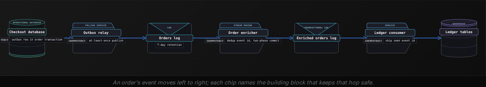

| Boundary | Failure to survive | Building block |
| --- | --- | --- |
| Service database to orders log | Publish fails after the order commits | Transactional outbox |
| Relay to orders log | Relay republishes a batch after a crash | Dedup on `event_id` in the enricher |
| Orders log through enricher to enriched log | Crash in the middle of a snapshot | Two-phase commit |
| Enriched orders log to ledger | Redelivery of committed records | Idempotent consumer |

Look at the second row. Two-phase commit guarantees that each record in the log affects the output once, and a republished outbox event is 2 records in the log. Exactly-once processing of a duplicate produces it twice, once per copy. The enricher therefore deduplicates on `event_id` in its state before emitting, which makes it an idempotent consumer and a two-phase-commit participant at the same time.

**A team sums revenue per store in their stream engine and writes the totals to the warehouse with two-phase commit. Their orders arrive through a transactional outbox. After each outbox relay restart, the totals run about 0.3% high. Which change fixes the totals?**

- **A.** Shorten the snapshot interval so fewer records sit inside each open transaction.
- **B.** Raise the warehouse transaction timeout above the longest snapshot plus restart.
- **C.** Commit the outbox row in a second transaction right after the order commits.
- **D.** Deduplicate on the outbox event_id in the engine's state before summing.

<details>
<summary>Solution</summary>

**D.** Deduplicate on the outbox event_id in the engine's state before summing.

A republished event is a second record in the log, and exactly-once processing counts each record. Dropping repeated IDs before the sum removes the 0.3%.

**Why the others are wrong**

- **A.** Fewer records per transaction changes how much a crash rewinds, but the extra records come from the relay, before the engine ever reads them.
- **B.** That timeout prevents prepared rows from being lost. The symptom here is extra revenue, which comes from duplicate input.
- **C.** That recreates the dual write the outbox exists to remove, and it does nothing about the relay republishing.

</details>


<br>

---

## Pipeline Architecture

### Exercise 1 of 2

**● TASK**

Prepare this pipeline to replay the 14 days a consumer-logic bug corrupted through the corrected Flink job. Rename the existing nodes in place so the replay works: the Kafka source needs retention covering all 14 days (its default is 7), the Flink job needs a named start position at the window start (an offset, a timestamp, or a consumer group reset to it), and the Snowflake sink needs an idempotent write so replayed rows are not counted twice.

**Starting canvas** (already placed for you):

- Kafka events topic (default 7-day retention, too short to cover the 14-day cycle) (source, Kafka)
- Flink streaming job (consumer logic was wrong for the last 14 days; it was restarted but only resumed from the newest events, so the corrupted period was never reprocessed) (transform, Flink)
- Plain Snowflake event_stats: append-only INSERT, so any reprocessing double-counts (storage, Snowflake)
- Event analytics consumer (consumer, Looker)

<details>
<summary><strong>Solution</strong></summary>

#### Why the replay was blocked in 3 places

Fixing a bad output window the Kappa way means replaying the same event log through the corrected job, not standing up a side batch job. That only works when 3 properties hold along the path at once: the log still holds the start of the window, the job can rewind to an addressable position, and the sink absorbs re-emitted rows without double-counting. This canvas broke all three, which is why every node needed a rename.

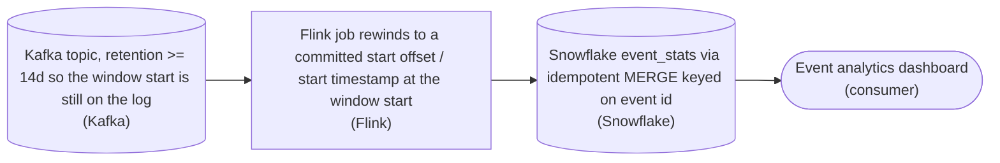

*Each rename restores one property the replay depends on; drop any one and the replay still fails.*

| ✕ What the job did | ✓ What the replay needs |
| --- | --- |
| Restarting `from-latest` seeks to the newest events, so the 14 corrupted days are never re-read. The offset the corrected code needs to start at is not addressable. | A named start position (a committed or start offset, a start timestamp, or a fresh consumer group reset to the window start), so the job rewinds to exactly the first corrupted event. |

| Pitfall: Append plus replay counts every row twice |
| --- |
| The original sink only ran `INSERT`, so replaying 14 days adds a second copy of every event on top of the wrong numbers. Idempotency is what makes a replay safe to run (and re-run): a `MERGE` keyed on event id updates the existing row instead of appending, so the re-emitted rows land exactly once. |

| Real world: The log is your only backfill source |
| --- |
| Kappa reprocessing has no separate history to fall back on, so retention is a hard dependency: if the topic keeps 7 days you can never replay a 14-day window, no matter how the job is configured. Set retention to cover your longest plausible correction window before you need it. |

**Follow-up questions**

1. Rows outside the 14-day window are correct already. How do you keep the rewind from re-touching them?\
   *Bounding the replay: stop offset / end timestamp, or a `MERGE` that no-ops when the value is unchanged.*
2. What breaks if 2 events share the same key you `MERGE` on?\
   *Tests whether the idempotency key is truly unique per event, not just per user or per minute.*

</details>


<br>

### Exercise 2 of 2

**● TASK**

2 streaming aggregators were built with their destinations crossed. The financial-close job, whose daily revenue feeds an SEC filing and must produce identical numbers across every replay, lands in a Redis counter; the page-view counter behind a five-second engagement dashboard, which tolerates the odd duplicate, runs two-phase commit into a lakehouse table. Rehome each so its destination gives exactly the guarantee its use case is willing to pay for.

**Starting canvas** (already placed for you):

- Kafka payments topic (financial close source) (source, Kafka)
- Kafka pageviews topic (page view source) (source, Kafka)
- Aggregator A: financial close, currently lands in Redis (WRONG) (transform, Flink)
- Aggregator B: page view, currently 2PC into lakehouse (OVER-ENGINEERED) (transform, Flink)
- Redis daily_revenue counter (non-ACID, wrong for financial close) (storage, Redis)
- Iceberg page_views_2pc table (over-engineered for a dashboard) (storage, Iceberg)
- Financial regulatory report consumer (SEC) (consumer, API)
- Engagement dashboard consumer (consumer, Looker)

<details>
<summary><strong>Solution</strong></summary>

#### Match the guarantee to the bill

Picking a **delivery guarantee** is a spending decision: you buy exactly the correctness the reader of the data needs and no more. Exactly-once is expensive. It needs a transactional sink that commits the aggregate and its input offsets atomically, so a replay lands the same number, and that takes a two-phase commit, coordinated checkpoints and a store that supports atomic commits. At-least-once is cheap and fast: write the counter, retry on failure, and tolerate the occasional double-count. Neither is 'better'; the skill is spending the coordination only where the reader demands it. Here the wires were crossed. The job that needs exactly-once wrote to a store that cannot give it, and the job that is happy with at-least-once paid for a two-phase commit it will never notice.

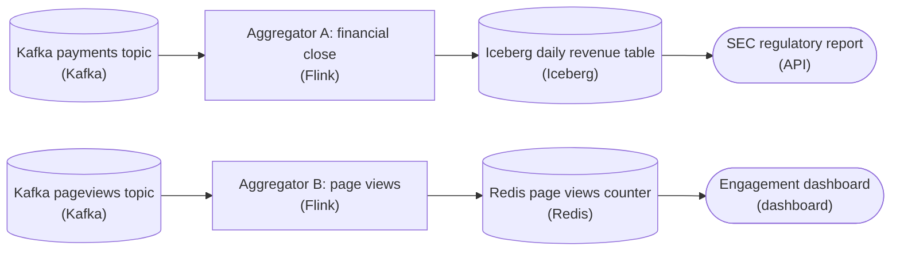

*The corrected wiring: the financial close commits exactly-once into the ACID Iceberg table through a two-phase-commit sink, and page views land at-least-once in the cheap Redis counter. Each job now pays exactly the coordination its reader requires.*

| ✕ Financial close | ✓ Page views |
| --- | --- |
| Feeds an SEC filing, so every replay must produce identical numbers. That is a demand for exactly-once, which needs a store that commits the aggregate and the consumed Kafka offsets in one atomic step. `Iceberg` gives you that: the 2PC sink writes a new snapshot only when the checkpoint commits, so a crash-and-replay re-reads the same offsets and rewrites the same snapshot. `Redis` `INCR` cannot: it is a non-transactional counter, and a retried batch double-counts revenue with no way to undo it. | Feeds a five-second dashboard that can absorb a stray duplicate. That is at-least-once territory, and a `Redis` counter is the right tool: one `INCRBY` per batch, sub-millisecond reads, no coordinator. Running two-phase commit into a lakehouse table here is over-engineering. You pay checkpoint latency and commit overhead to protect a number nobody audits, and you still refresh a real-time panel from a batch-committed table. |

| Pitfall: Non-atomic counter for money |
| --- |
| The tempting shortcut for a revenue aggregate is a fast counter: `INCRBY daily_revenue :amount`. It works until the job restarts mid-batch. On replay the aggregator re-emits the batch, the `INCRBY` fires again, and the SEC number is now wrong by whatever the batch held, with no snapshot to roll back to. A counter has no notion of 'I already applied this offset', and that is exactly the property a financial close needs. |

| Key insight: Exactly-once is really idempotent replay |
| --- |
| The lakehouse sink is not magic; it is idempotency plus atomic commit. The aggregate and the input offsets move together, so replaying a committed checkpoint is a no-op and replaying an uncommitted one reproduces the same snapshot. When you cannot get a transactional commit, you recover the same guarantee by making writes idempotent on a key: an upsert keyed by (day, `source_offset`) instead of a blind increment, so a re-applied batch overwrites rather than adds. |

| Real world: In production, cost hides in the guarantee |
| --- |
| Teams reach for exactly-once everywhere because it feels safe, then wonder why their streaming bill and their p99 latency are high. Most pipelines are a mix: the finance and billing paths genuinely need transactional sinks, while metrics, engagement and telemetry are fine on at-least-once. Sorting each stream by what its consumer will tolerate is one of the largest cost levers in a streaming platform. |

**Follow-up questions**

1. The page-view dashboard starts driving usage-based billing. What has to change about the Redis path?\
   *Once a number is billed on, it inherits the financial-close guarantee and needs an idempotent or transactional sink.*
2. You cannot use a 2PC sink for the financial close, only a plain object store. How do you still get identical numbers across replays?\
   *Points toward idempotent upserts keyed by input offset rather than blind increments.*

</details>


<br>

---

## Replay Infrastructure

Every mechanism so far handles replays nobody asked for: a crash rewinds a few seconds of input. Built on purpose, the same machinery lets you rewind deliberately, to recompute output after a bug fix, to fill a new table from history, or to rebuild state lost with a cluster. Kappa's replay depends on it, and this section prices it.

What a deliberate replay needs

- **Retained source** *The log keeps what it delivered*\
  Retention reaches back to the furthest point you will rewind to.
- **Addressable positions** *Every output knows where its input ended*\
  Offsets per partition, plus a lookup from timestamp to offset.
- **Idempotent downstreams** *Re-sent output changes nothing*\
  Replayed results overwrite or deduplicate instead of adding.


<br>

### Retained source: paying for history

A log bills retention by the byte, multiplied by its replica count. Take an orders log ingesting 50 MB per second and storing 3 replicas of every segment:

| Retention | Logical size | Stored with 3 replicas |
| --- | --- | --- |
| 1 day | 4.32 TB | 12.96 TB |
| 7 days | 30.24 TB | 90.72 TB |
| 30 days | 129.6 TB | 388.8 TB |

Most teams tier it. A few days stay hot in the log for fast rewinds, and older segments are copied to object storage as files, where a single copy backed by the store's own durability replaces 3 replicas. A replay reads the archived files first and switches to the live log at the boundary, which works only if the archive preserves each record's partition and offset.


<br>

### Addressable positions: knowing where to rewind

'Replay from Tuesday's 14:05 deploy' requires a translation from a timestamp to an offset in every partition, which logs that index offsets by timestamp can answer. The harder half sits on the output side: to rewind to where a bug began, each output must record which input positions it reflects. A commit table with a row per committed snapshot and partition does that.

```sql
SELECT
  partition_id,
  MAX(end_offset) AS last_good_offset
FROM revenue_commits
WHERE committed_at < TIMESTAMP '2026-10-20 14:05:00'
GROUP BY partition_id
```

Per partition, the query returns the last offset committed before the deploy. Restart the fixed job from those positions and every record the faulty version handled passes through the fixed code.

A stateful job also needs its state rebuilt. A 7-day rolling revenue total restarted at the deploy offsets would begin from zero, so the job must start 7 days before the deploy, or load a state snapshot taken before it. Retention therefore equals the state horizon plus time to notice a bug plus time to approve the rewind. A 7-day window, with bugs found within 3 days and approved within 1, needs 11 days of log, or 4 days plus a pre-deploy state snapshot.


<br>

### Idempotent downstreams: where replayed output lands

A replay re-emits output that consumers have already received. In-place replay sends corrected results through the same keyed upserts, so each key ends at its fixed value; it is safe only when every consumer of that output is idempotent. Shadow replay writes to a new version, `revenue_v2`, while the live job keeps serving `revenue_v1`. Once v2 has caught up and its numbers check out, readers move to it in a single atomic switch, the snapshot isolation you saw in lakehouse tables. Shadow replay pays for a second job and a second copy of the output while it runs.


<br>

### Catch-up time

A replay chases a log that keeps growing. If the job reads 5 times faster than data arrives, each wall-clock hour consumes 5 hours of backlog while 1 new hour lands, so the lag shrinks by 4 hours every hour.

- **42 hours** — catch-up time for a 7-day rewind at 5x

> **TIP**
>
> Size replay capacity as a multiple of live throughput. The same 7-day rewind takes 7 days at 2x and 35 days at 1.2x, because only the margin above live speed eats into the backlog.

**An aggregator keeps a 14-day rolling count of orders per store. Bugs are found, on average, 4 days after they ship, and approving a rewind takes another day. What is the shortest log retention that lets the team rebuild correct state from the log alone?**

- **A.** A 14-day retention, because the window size alone sets how much input a rebuild reads.
- **B.** A 19-day retention, covering the 14-day window plus 5 days of detection and approval.
- **C.** A 5-day retention, because only records the buggy version processed need to pass through again.
- **D.** A 7-day retention, because retention past a week always costs more than state snapshots.

<details>
<summary>Solution</summary>

**B.** A 19-day retention, covering the 14-day window plus 5 days of detection and approval.

State at the moment the bug shipped depends on the 14 days before it, and the rewind starts 5 days after it. Adding 5 to 14 gives 19.

**Why the others are wrong**

- **A.** The rebuild must restore state as of the moment the bug shipped, 5 days before the rewind starts. A 14-day log reaches back only to 9 days before the bug.
- **C.** Those records need correct state to fold into, and that state depends on the 14 days before the bug shipped.
- **D.** Snapshots can replace retention, but the question asks for a rebuild from the log alone, and 7 days reaches nowhere near the start of the window.

</details>


<br>

---

## Pipeline Architecture

### Exercise 1 of 2

**● TASK**

Make every boundary of the financial-close pipeline effectively-once: replace the handler's dual write to Postgres and Kafka with CDC tailing a Postgres outbox into Kafka. Swap the plain Snowflake sink behind the Flink aggregator for a lakehouse table that upserts on event id and keeps time-travel snapshots for reproducible quarter-close reports. Add an orchestrator that owns the daily schedule, automatic retries, and on-demand replay from historical Kafka offsets. Validate daily revenue totals (completeness, non-null amounts) before the CFO consumer reads them, from the lakehouse only.

**Starting canvas** (already placed for you):

- Order service application (DUAL-WRITE ANTIPATTERN: writes Postgres + Kafka in same handler) (source, API)
- Kafka merchant_balance_events (at-least-once; rebalance produced last week's duplicates) (source, Kafka)
- Postgres orders + outbox table (atomic; outbox row in same transaction as business row) (storage, PostgreSQL)
- Flink streaming aggregator (engine-level 2PC; does not extend to plain Snowflake sink) (transform, Flink)
- Plain Snowflake fct_merchant_balance_hourly (last week's reissue source; no ACID; no time travel) (storage, Snowflake)
- CFO quarter-close reconciliation consumer (against bank settlement file) (consumer, Tableau)

<details>
<summary><strong>Solution</strong></summary>

#### Effectively-once is a chain, not a switch

No single setting turns on **effectively-once** delivery. Every hop where a record moves between systems can duplicate or drop it, so each hop has to be either atomic or idempotent. Last week's incident came from one hop that was neither: a `Kafka` rebalance re-delivered events, and the plain `Snowflake` table counted the money twice.

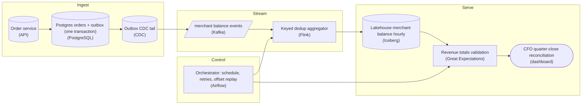

*Each hop is atomic (the outbox) or idempotent (the `event_id` dedup and the `MERGE` sink). The CFO reads only validated lakehouse totals.*

1. **Collapse the dual-write into an outbox**

   A Postgres commit and a `Kafka` produce cannot succeed or fail together, so a crash between them leaves the 2 disagreeing. The handler now writes the `orders` row and an outbox row in one transaction, and a CDC tail of the log publishes the outbox row. The `Kafka` event follows from a committed row instead of being a second write that can half-happen.

2. **Accept repeats, then make them harmless**

   A rebalance re-delivers uncommitted offsets, so `Flink` keys its state on a stable `event_id` and drops events it has already seen. Its two-phase commit stops at its own boundary, so the sink must be idempotent too: an Iceberg `MERGE` on the aggregation key overwrites a re-run hour instead of appending a second copy. Time travel lets the CFO reopen the exact snapshot behind any past report.

3. **Give the pipeline an owner and a gate**

   `Airflow` owns the daily schedule, retries failed tasks, and launches replays from historical offsets. Because the sink is idempotent, a replay reissues a corrected report rather than double-counting. A Great Expectations check on completeness and non-null amounts sits between the lakehouse and the CFO, so the close runs on enforced checks.

| Pitfall: Engine exactly-once ends at the engine |
| --- |
| Trusting `Flink`'s exactly-once to cover the whole path is the mistake behind the incident. The guarantee covers the engine's operators, not a plain insert into an external table. Effectively-once is at-least-once delivery plus an idempotent write at every hop that leaves the engine. |

**Follow-up questions**

1. What should happen if the same `event_id` arrives with a different amount?\
   *Last-write-wins on the key versus rejecting conflicting payloads.*
2. How far back must `Kafka` retention reach to replay an old quarter?\
   *Ties the replay promise to retention or tiered storage.*

</details>


<br>

### Exercise 2 of 2

**● TASK**

Parcel scan events arrive in Kafka at 40,000 per second, and a Flink job counts scans per depot per minute for an operations API that needs them within a minute. The counts land in a key-value store outside Flink's transaction boundary, and after a restart Kafka redelivers every event since the last checkpoint. Design the pipeline so the stored counts are effectively-once: a replay must leave every count unchanged.

<details>
<summary><strong>Solution</strong></summary>

#### Exactly-once stops where the transaction stops

Flink's exactly-once guarantee is honest, but its boundary is narrow: it covers the Kafka offsets, the checkpointed state, and any sink that joins the checkpoint's transaction. A key-value store that commits each write the moment it lands sits outside that boundary, so when the job restarts from its last checkpoint, Kafka redelivers events whose effects the store has already seen. What the store receives is at-least-once. **Effectively-once** is what you build on top of it: make the write idempotent, so a second delivery changes nothing.

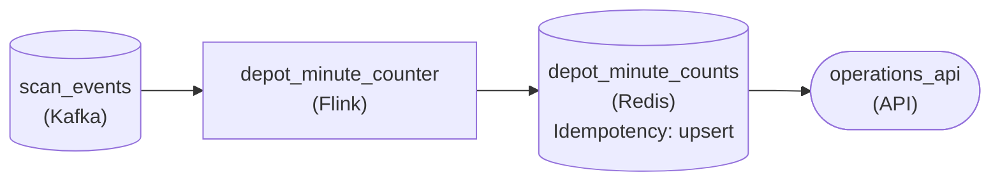

*Exactly-once inside `depot_minute_counter`; an upsert into `depot_minute_counts` makes the outside hop effectively-once.*

1. **Find where the closed system ends**

   Trace each hop and ask who commits it. Kafka into Flink is inside: the consumed offset is part of the checkpoint. Flink into the store is not: the store has nothing to roll back. That second hop is where duplicates can appear, so it is where the deduplication work has to live.

2. **Write the value, not the delta**

   Key each entry by depot and minute and write that minute's full count as an upsert. After a restart Flink's restored state rebuilds the same count from the replayed events, so rewriting it lands the identical entry. Setting `idempotencyStrategy` to upsert on the store is how the canvas records that decision.

| Pitfall: An increment turns a replay into a double count |
| --- |
| If the sink write is `count = count + n`, every event redelivered since the last checkpoint is added again, and the depot's minute jumps. The Flink job did nothing wrong; the store simply accepted the same effect twice. Overwriting with the full count is what makes the replay harmless. |

| Real world: Kafka to Kafka is the closed case |
| --- |
| Swap the store for a Kafka output topic and the picture changes: Kafka Streams, or Flink with a transactional Kafka sink, commits the output records and the input offsets together, and readers that see only committed records get each result once. Add any hop outside that system, a database, an HTTP call, an email, and you are back to at-least-once plus an idempotent receiver. |

**Follow-up questions**

1. What changes if the API also needs a running daily total per depot?\
   *Whether the daily figure stays replay-safe when built from per-minute entries rather than an incremented counter.*
2. The store is replaced by a Kafka topic that a second Flink job reads. Where does exactly-once now hold, and where does it stop?\
   *Placing the closed-system boundary when both ends are Kafka.*

</details>


<br>

---

## Two Streaming Aggregators

The same stream of food-delivery events feeds 2 aggregators. One bills restaurants for ad clicks. The other feeds an operations dashboard of orders per city per minute. Their guarantees point in opposite directions, and building both the same way either overspends on the dashboard or overbills restaurants.


<br>

### Aggregator A: ad-click billing

Each click must be billed once, and an invoice cannot change after it is issued. Latency of a few minutes costs nothing, because invoices run daily. Duplicates arrive from 3 places: the app resends a click upload over a flaky connection, the collector republishes after a crash, and the aggregator replays after its own crash.

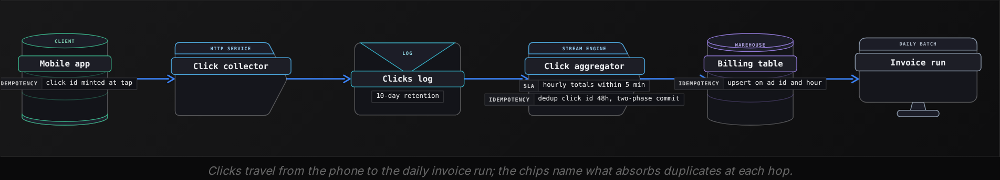

| Choice | Why it fits billing |
| --- | --- |
| `click_id` minted on the phone at tap time | A resent upload carries the same ID; a server-minted ID would turn each resend into a new click |
| Dedup state on `click_id`, kept 48 hours | The app gives up resending after 24 hours, so 48 covers every resend with margin |
| Hourly totals per `ad_id`, upserted | A replayed total overwrites its row with the same number |
| Transactional sink, 60-second snapshots | All of an hour's totals become visible in the same commit |
| Log retention of 10 days | 2 days to rebuild dedup state, 7 to catch a billing bug, 1 to approve the rewind |

The hourly upsert already makes the sink idempotent, so two-phase commit contributes something narrower: atomic visibility. Without it, the daily invoice run could read an hour in which 6,000 ads carry new totals and 4,000 still show old ones. Up to a minute of delay buys never invoicing from a half-updated hour.

The dedup state is the expensive part. At 200 million clicks a day and 16-byte IDs, 48 hours of IDs occupy this much memory before any index overhead:

- **6.4 GB** — raw dedup state per 48 hours

**An engineer proposes cutting Aggregator A's dedup state from 48 hours to 1, arguing that two-phase commit already prevents double billing. What is wrong with that?**

- **A.** Two-phase commit only works when dedup state lasts as long as the 10-day log retention.
- **B.** Nothing: with two-phase commit in place, 1 hour of dedup state is a safe saving.
- **C.** Two-phase commit undoes the engine's own replays, but an app resend hours later is a new record.
- **D.** Two-phase commit creates duplicate rows on every restart, so dedup must stay at 48 hours.

<details>
<summary>Solution</summary>

**C.** Two-phase commit undoes the engine's own replays, but an app resend hours later is a new record.

A resend is a separate record in the log, and exactly-once processing bills each one. Only dedup outliving the 24-hour resend window catches it.

**Why the others are wrong**

- **A.** Two-phase commit has no dependency on dedup state. The 48 hours follow from the 24-hour resend window.
- **B.** A click resent 3 hours later passes a 1-hour check, and two-phase commit bills it cleanly.
- **D.** Commit is idempotent and the snapshot rewinds output, so restarts create no duplicates. Resends do.

</details>


<br>

### Aggregator B: orders-per-city dashboard

An operations lead watches orders per city per minute to spot outages, and the chart refreshes every 10 seconds. No payment or invoice is computed from it, so freshness matters most: 60-second snapshots would leave the chart up to a minute behind, with several refreshes showing nothing new.

| Choice | Why it fits the dashboard |
| --- | --- |
| At-least-once delivery, position saved every 5 seconds | A crash replays at most 5 seconds of events |
| Increments into counters keyed by city and minute | Fast and stateless; replayed seconds are counted twice |
| No transactional sink, no dedup state | Removes the latency floor and the dedup memory |
| Log retention of 1 day | Nobody rewinds a dashboard; history lives in the warehouse |

Measure the error before accepting it. A city running 1,200 orders a minute sees 20 per second, so a crash that replays 5 seconds adds 100 orders to a single minute's bar: a blip of roughly 8% after each crash, with the minutes on either side untouched. For a chart read for its shape, that beats up to a minute of staleness on every refresh. If the same counter ever feeds anyone's pay, the error stops being cosmetic.


<br>

### When exactly-once is over-engineering

- The sink is a keyed upsert of absolute values, so effectively-once already holds
- The readers are people watching trends, and a duplicate is smaller than normal noise
- The freshness target is shorter than the snapshot interval a transactional sink imposes
- Another hop, such as an outside API, breaks the guarantee anyway
- Nobody will ever rewind the output, so the cost buys protection for rare crashes only

**Product wants to pay couriers $1 for every order delivered during the dinner rush, reusing Aggregator B's counters keyed by courier instead of city. Which change makes the payouts correct?**

- **A.** Save the position every second instead of every 5, so a crash replays fewer events.
- **B.** Raise log retention from 1 day to 10 days so a bad payout run can be rewound.
- **C.** Move the counters to a faster store so a replay finishes before the minute closes.
- **D.** Write each bonus as a row keyed by order_id, upserted, and sum the rows for pay.

<details>
<summary>Solution</summary>

**D.** Write each bonus as a row keyed by order_id, upserted, and sum the rows for pay.

A replayed delivery rewrites its own row, so each order pays once, effectively-once at the dashboard's latency.

**Why the others are wrong**

- **A.** A shorter interval shrinks each error but keeps it. Any replayed delivery still pays $1 twice.
- **B.** Rewinding into increment counters re-adds every replayed delivery, so more retention only means bigger errors.
- **C.** Speed changes only when the duplicate lands; a replayed delivery still adds 2.

</details>


<br>

---

## Pipeline Architecture

### Exercise 1 of 2

**● TASK**

Order status events arrive in Kafka at 15,000 per second; a Flink job enriches them into a second Kafka topic, and a notifier sends each update through a push API that has no prepare step and cannot recall a push. A Flink restart must never publish an enriched event twice, and a notifier retry must never notify a customer twice. Use two-phase commit where both sides can take part, and an idempotent consumer with a durable store of sent event ids where one cannot.

<details>
<summary><strong>Solution</strong></summary>

#### Match the pattern to what each boundary can promise

Two-phase commit and the idempotent consumer stop different duplicates, and the boundary decides which one you can use. Between Flink and Kafka both sides can prepare and commit, so Flink's sink stages each enriched event in a Kafka transaction and commits it only when the checkpoint completes: a restart aborts the staged batch instead of publishing it again. The push API cannot prepare and cannot recall a message, so no coordinator can make it abort. There the duplicate is stopped on the consumer side, by checking the event id against a durable record of what was already sent.

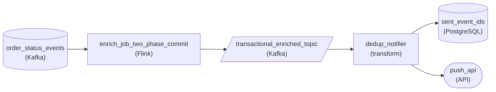

*`enrich_job_two_phase_commit` commits into `transactional_enriched_topic` through Flink's two-phase commit; `dedup_notifier` checks `sent_event_ids` before every call to `push_api`.*

1. **Let the Flink sink commit with the checkpoint**

   Flink is the coordinator and the Kafka topic is a participant. The pre-commit happens at the checkpoint barrier and the commit once every operator has acknowledged it. Readers of the topic see only committed records, so the replay after a restart never surfaces a second copy.

2. **Key the notifier on the event id**

   The id the order service stamped on the event is the one thing that is identical on the first delivery and on the retry. The notifier looks it up, skips an id it has seen, and otherwise sends and records it. The record has to outlive a notifier restart, which is why it sits in a database table and not in memory.

| Pitfall: A transactional topic does not protect the push |
| --- |
| Flink's exactly-once ends at the topic. Once the notifier reads a committed record, a crash before it commits its own offset redelivers that record, and without the id check the customer gets the push again. Two-phase commit fixed the producer side; the consumer side is still at-least-once until you add the check. |

| Real world: Every outbound call needs the same check |
| --- |
| Payment providers, email services and partner webhooks are almost never two-phase commit participants. Wherever a pipeline calls out to one, expect an idempotent consumer in front of it, keyed on an id the upstream event already carries. |

**Follow-up questions**

1. The notifier crashes after the push API returns but before the event id is recorded. What happens on retry, and what changes if you record the id first?\
   *The residual window an idempotent consumer leaves at a sink that cannot roll back, and the trade toward at-most-once.*
2. The push API adds an idempotency key header. Which part of this design could you remove?\
   *Moving deduplication into the sink itself.*

</details>


<br>

### Exercise 2 of 2

**● TASK**

Ad clicks reach Kafka at 20,000 a second, up to an hour out of order, and Kafka keeps 7 days. A live stream job keeps per-campaign state in hourly windows of click time, open for clicks up to an hour late, so advertisers see spend within seconds. Finance replays any hours of the last 180 days through a second windowed stream job whose watermark follows click time, resuming where a failed run stopped. A replayed click counts once.

<details>
<summary><strong>Solution</strong></summary>

#### Replay is a second stream job over old events

Stream processing is what makes this replay hard. The live job keeps state keyed by campaign in hourly windows of event time, meaning when the click happened rather than when it arrived, and a watermark decides when an hour is complete. It updates its campaign's hour as each click arrives and re-emits that hour's total, late clicks included. It closes the hour once clicks are more than an hour late. A replayed click from months ago sits far behind that watermark, so the live job would either drop it or hold every window open for half a year. A batch recompute is ruled out too: corrected hours must come from the same windowed stream logic that produced the live totals. Replay therefore needs a second stream job with the same keyed window state and its own watermark. That job reads a replay topic in click-time order, so its watermark advances hour by hour. Both jobs write into a sink that can take the same hour twice without changing the answer.

| ✕ Windows by arrival time | ✓ Windows by event time |
| --- | --- |
| Each click lands in whatever hour the job happens to see it. A click 40 minutes late inflates the next hour, and a replayed months-old click inflates today's hour. There is no watermark, because nothing ever waits. | Each click lands in the hour it happened, and the watermark sets how long an hour's state stays open. A late click updates its own hour. A replayed click updates its own old hour inside the replay job. |

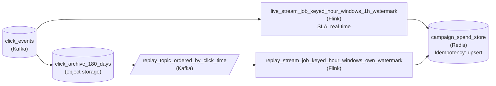

*Live path: Kafka streams the unbounded click log into `live_stream_job_keyed_hour_windows_1h_watermark`, a real-time job holding keyed state per campaign. It assigns each click to the hour it happened, keeps that hour's window open behind a one-hour watermark, and re-emits the hour's total to `campaign_spend_store` within seconds. Replay path: `click_archive_180_days` re-publishes the chosen hours into `replay_topic_ordered_by_click_time`, keyed by campaign and sorted by click time. `replay_stream_job_keyed_hour_windows_own_watermark` reads it from a committed offset with its own window state and watermark, and upserts into the same store.*

1. **Key the window state by campaign and event hour**

   Clicks arrive up to an hour out of order, so each click updates the state for its campaign and the hour it happened in, not the hour it arrived. Keying by campaign keeps all of a campaign's clicks on one task, so its window state is updated in one place. The one-hour watermark keeps each hour open until its stragglers are in, and every straggler re-emits that hour's new total. Both stream jobs hold exactly this keyed event-time window state. What separates them is where each watermark sits.

2. **Copy the log into a store that outlives it**

   Kafka stays the live source, but its 7-day retention is the hard limit on how far a replay can reach. A continuous copy of every event into object storage, `click_archive_180_days`, keeps 180 days of clicks. That moves the limit without touching the shared cluster.

3. **Give replay an addressable stream and its own watermark**

   Fixes are scoped by when a click happened, so the archive is partitioned by click hour, and a replay of one bad week reads exactly those hours. Those hours are re-published into `replay_topic_ordered_by_click_time`, keyed by campaign and in click-time order. Every event in that topic has an offset, and the replay job commits the last one it finished, so a failed replay resumes from that stored position instead of starting over. The replay job's watermark starts at the first replayed hour and advances with the ordered clicks, so each old hour fills, closes in turn and emits its total. Shuffled replay clicks would force the job to keep weeks of windows open. Ordered clicks keep only an hour or 2 open at a time, while the live watermark stays at now.

4. **Let the sink absorb re-emitted hours**

   The same hour reaches `campaign_spend_store` more than once. A late click re-emits an hour the live job already wrote, and a replay re-emits hours that were already counted. If the store adds each emitted total to a running sum, both inflate spend. With an upsert keyed on campaign and click hour, the recomputed window total replaces the old one. A late click, one replay or 5 replays all land on the same number.

| Pitfall: Replaying through the live watermark drops every old click |
| --- |
| Wiring the archive straight back into `live_stream_job_keyed_hour_windows_1h_watermark` looks like the shortest replay path. But that job's watermark sits at now, so every replayed click arrives as late data and is discarded. The replay finishes without changing a single total. |

| Performance: Retention cost is throughput times days |
| --- |
| At 20,000 clicks per second and about 500 bytes each, the stream produces close to 860 GB a day, so 180 days is roughly 155 TB raw. Compressed columnar files in object storage shrink that several times over, and they cost far less per terabyte than keeping the data on Kafka brokers. The replay topic only ever holds the hours being replayed, so the shared cluster's 7 days is plenty for it. |

**Follow-up questions**

1. What changes if replays must reach 2 years back?\
   *Whether the retained store and its cost scale with the new window while both windowed stream jobs stay the same.*
2. How would you replay one campaign without recomputing every other campaign?\
   *Whether the archive can also be addressed by key, for example partitioned by campaign as well as click hour, so only that campaign's window state is rebuilt.*

</details>


<br>

---

## Putting It All Together

Back at Uber Eats, imagine the ads team owning both paths from the same click stream: the billing path that turns clicks into restaurant invoices, and a live chart of clicks per city that the team watches during dinner rush. The aggregator that crashed at 7:58 p.m. sits on the billing path, and the chart's counters sit on the other.

- The click ID minted on the phone is an event-derived key, not one minted at processing time; without it, no later stage could tell a resend from a new click.
- The billing aggregator dedups resends in state and commits hourly totals with two-phase commit, combining an idempotent consumer with a transactional sink, because exactly-once processing alone would bill each resent click.
- An audit of the billing path checks every hop, including the invoice run reading only committed totals, before anyone calls it exactly-once.
- Log retention of 10 days follows the replay formula: 2 days of dedup state horizon, 7 days to catch a billing bug, 1 day to approve the rewind.
- The live chart takes at-least-once increments with a measured blip after crashes, because waiting up to a minute for each snapshot commit would cost freshness on every refresh to prevent an error nobody is billed from.


<br>

---

## Pipeline Architecture

### Exercise 1 of 2

**● TASK**

Smart-meter readings arrive in Kafka at 50,000 per second. A billing aggregator sums daily kWh per meter for invoices, and its totals must be identical across every replay and recovery. A dashboard counter tallies readings per substation per minute for a grid-load dashboard that must refresh within a minute and tolerates a few double counts. Exactly-once sink commits surface only at each 2-minute checkpoint, so the dashboard counter must not wait on them.

<details>
<summary><strong>Solution</strong></summary>

#### Pay for exactly-once only where a duplicate costs money

Idempotency has a price, and these two aggregators sit at opposite ends of it. A duplicated reading on the billing path is an overcharge on a customer's invoice, so that path is built for exactly-once from the topic to the table. A duplicated reading on the grid-load path is a blip operators never notice, so that path runs at-least-once and skips the commit protocol. Same topic, same engine, two guarantees chosen by what a duplicate costs the reader.

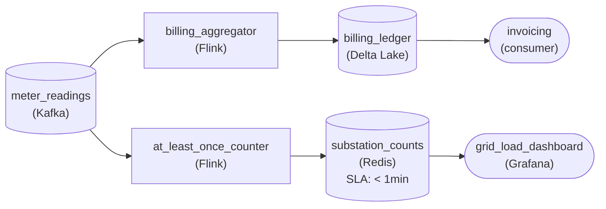

*Two paths off one readings topic: billing totals commit into Delta Lake only at checkpoint, while the at-least-once counter writes substation counts to Redis as it goes.*

1. **Bind the billing commit to the checkpoint**

   The billing aggregator uses Flink's two-phase commit: per-meter daily sums are pre-committed to the Delta Lake table and become visible only when the checkpoint covering those Kafka offsets completes. A crash rolls output and offsets back together, so a replay re-derives the same totals rather than adding to them.

2. **Let the dashboard counter write as it goes**

   The counter writes each minute's substation count to Redis immediately, with no transactional sink. After a restart it resumes from the last checkpoint and may count some readings twice; the dashboard absorbs that, and it shows load within seconds instead of waiting up to 2 minutes for a commit.

| Pitfall: Exactly-once on both paths costs the dashboard its freshness |
| --- |
| Routing the counter through the same transactional sink looks safer but holds every count until the 2-minute checkpoint, which breaks the one-minute refresh. The opposite mistake is worse: a billing path with a plain append double-bills every meter whose readings were replayed. |

| Performance: The commit cost lands only where it buys correctness |
| --- |
| At 50,000 readings a second, the billing job collapses traffic into one row per meter per day, so its checkpoint commits stay small. The counter carries the same input but never pays for a commit, so its latency is set by the one-minute window, not the checkpoint interval. |

**Follow-up questions**

1. Finance also wants hourly kWh per meter. Does that path inherit the billing guarantee?\
   *Whether the cost of a duplicate to the reader, not the data source, decides the guarantee.*
2. What if the billing table had to live in a store with no transactions?\
   *Falling back to a keyed upsert on meter and day to reach effectively-once.*

</details>


<br>

### Exercise 2 of 2

**● TASK**

A hotel-booking service writes each reservation to PostgreSQL and publishes a booking event to Kafka as 2 separate calls; a stream job reads the topic and credits loyalty points into a PostgreSQL ledger. 2 duplicate symptoms appear: events for bookings that never committed, and points credited twice after the job restarts from a checkpoint. Neither database can join a distributed transaction. Fix the producer side and the consumer side with the right pattern each, so a 30-day replay of the topic after a points-rule fix overwrites credits instead of adding to them.

<details>
<summary><strong>Solution</strong></summary>

#### Name the side of the duplicate before naming the pattern

Every duplicate has a side, and its fix lives on that side. This pipeline leaks on both. The 2 separate calls in the booking service can publish an event for a reservation that never committed: a **producer-side** duplicate. The stream job restarting from a checkpoint re-delivers events the ledger already credited: a consumer-side duplicate. Neither database can join a distributed transaction, so 2PC is ruled out, and that leaves exactly one pattern per side.

1. **Move the publish inside the reservation transaction**

   Write the reservation row and an outbox row in the same PostgreSQL transaction, and let CDC on the outbox table publish to Kafka. A rolled-back booking leaves no outbox row, so no event. A committed booking always has its row, so no event goes missing. The relay can still re-send after a crash, which is fine, because the consumer side is about to absorb that.

2. **Key the ledger write on the booking**

   The ledger holds one row per `booking_id` and writes it with an upsert (`INSERT ... ON CONFLICT (booking_id) DO UPDATE`). A redelivered event lands on the row it already wrote, so the credit is set, not added. The same key also absorbs the outbox relay's own re-sends: one idempotent consumer covers every at-least-once hop above it.

3. **Let replay ride on the same key**

   Rewinding the job 30 days re-reads every booking under the fixed rule, and each upsert overwrites the old credit with the corrected one. An additive ledger (`points = points + n`) would make that replay double every balance. The keyed overwrite turns it into a correction.

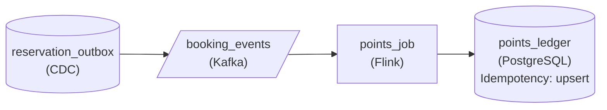

*Outbox rows captured by CDC feed `booking_events`; the Flink job upserts one credit per `booking_id` into `points_ledger`.*

| Pitfall: An idempotent ledger cannot catch a phantom event |
| --- |
| The tempting fix is to upsert at the ledger and stop there. That ends the double credits, but an event for a rolled-back reservation still carries a real `booking_id`, so the ledger credits points for a stay that does not exist. Deduplication removes repeats of true events. It cannot tell a phantom from a real one. Only the outbox stops phantoms, at the source. |

| Key insight: 2PC needs every endpoint to vote |
| --- |
| Two-phase commit would make the write and the publish atomic, but only if PostgreSQL and Kafka both take part in one coordinator's prepare and commit. When an endpoint cannot vote, the outbox gets the same atomicity from a single local transaction, and the idempotent consumer replaces a sink-side 2PC with a key. |

**Follow-up questions**

1. A cancellation event must now revoke a booking's points. How do you keep revocation correct under replay?\
   *Whether the revocation overwrites state keyed by `booking_id` instead of appending a negative credit that double-applies.*
2. The app now wants a running total per member. Where does that total come from so a replay cannot inflate it?\
   *Deriving the aggregate from the keyed ledger rows instead of incrementing a counter on every event.*

</details>


<br>

---

## Key Takeaways

- A stream has no closed unit of work, so a crash replays an arbitrary slice of offsets that no output partition matches.
- Operations whose effect is fixed by the event's content and address, such as keyed upserts, max, set adds and latest value, survive replay; counters, appends, outside calls and processing-time keys do not.
- Exactly-once covers what the engine snapshots; effectively-once extends the same outcome to any system that honors an idempotency key.
- Audit a guarantee hop by hop: replayable source, atomic snapshot, participating or deduplicating sink, committed-only readers, no outside calls, deduplicated producers.
- Two-phase commit, the transactional outbox and idempotent consumers each guard a different boundary, and exactly-once processing still counts a duplicate input once per copy.
- Replay retention equals state horizon plus detection and approval time, and catch-up speed depends on the margin above live throughput.
- Spend on exactly-once where a duplicate costs money; accept at-least-once with a measured error where freshness matters more.
